# Power View 数据可视化

正如我们在第 7 章中看到的，你可以使用 Excel 数据透视表和图表创建强大的数据可视化并进行深入的数据分析。如果你是一名 Excel 高级用户，并且在工作职责中包含详细的数据分析，那么这些工具将是你的首选。另一方面，如果你需要一个工具来让用户从你的 `Power Pivot` 模型中快速创建直观的可视化，那么 `Power View` 是一个绝佳的选择。你可以使用 `Power View` 创建包含上下文关联的可视化内容的引人注目的仪表板，这些可视化内容可以轻松进行筛选、排序和钻取。`Power View` 报表可以作为 Excel 工作表或 SharePoint 库中的内容进行托管。一个额外的好处是，它们可以导出到 PowerPoint，以便在演示中使用，同时保留其交互性。图 8-1 展示了一个包含关联图表和图形的 `Power View` 报表示例。当点击图表上的一个条形时，图形会按该国家和年份进行筛选。

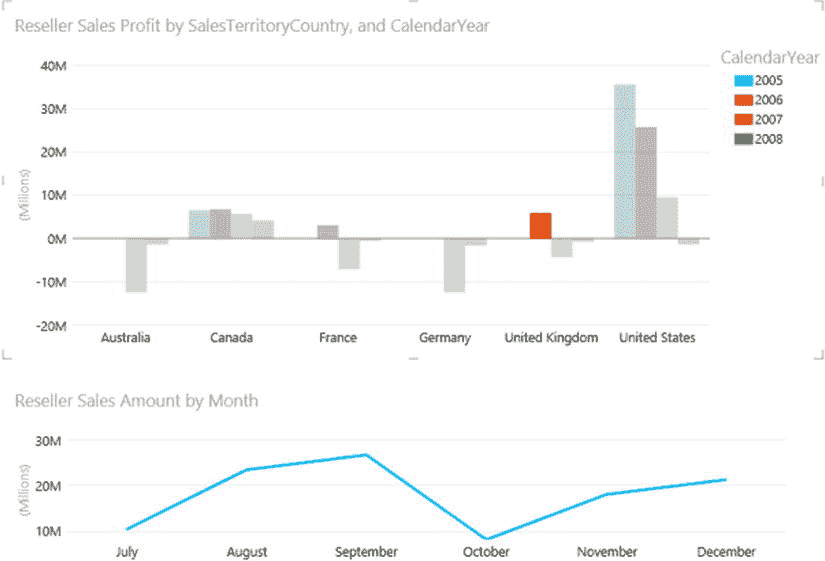

图 8-1. `Power View` 中的交互式图表和图形

使用 `Power View`，你可以创建常见的可视化内容，例如表格、矩阵、图表和图形。此外，你还可以创建包含时间轴的散点图，以揭示数据随时间的变化（参见图 8-2）。

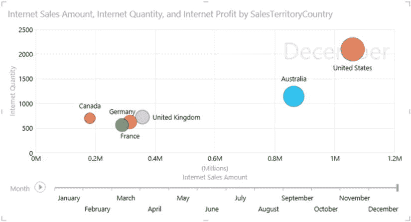

图 8-2. 为散点图添加播放轴

由于 `Power View` 使用 `Bing Maps` 图块，你可以将数据呈现在交互式地图上，并在探索数据时进行缩放和平移，直至街道地址级别。图 8-3 展示了按县划分的降雨量地图。

图 8-3. 按县划分的降雨量地图

`Power View` 中另外两种可用的数据可视化类型是卡片（`Cards`）和磁贴（`tiles`）。卡片以索引卡样式显示每一行的数据。例如，你可以查看员工的联系信息，如图 8-4 所示。

图 8-4. 卡片样式的员工信息

磁贴可视化允许你使用包含文本和图像的选项卡条对数据进行交互式筛选。例如，图 8-5 展示了如何使用磁贴，通过选项卡条中的区域地图图像来按区域筛选销售额。

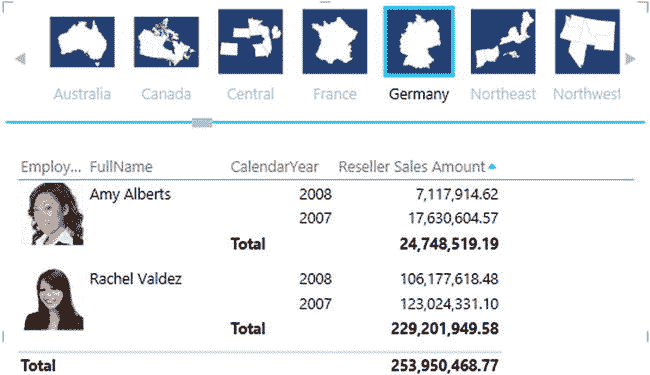

图 8-5. 在 `Power View` 中使用磁贴图像

现在你已经熟悉了 `Power View` 中可用的几种可视化类型，接下来让我们看看创建一些基本报表的过程。

## 创建基本报表

`Power View` 报表基于 Excel 中的 `Power Pivot` 模型。要创建报表，请打开包含模型的 Excel 工作簿，在“插入”选项卡上，单击“Power View”按钮（参见图 8-6）。

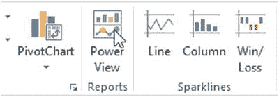

图 8-6. 插入 `Power View` 报表

这将在工作簿中插入一个新选项卡，并显示 `Power View` 设计界面。设计界面包含数据可视化区域、筛选区域和 `Power View` 字段窗口。`Power View` 字段窗口包含暴露给客户端工具的 `Power Pivot` 模型的表和字段（参见图 8-7）。

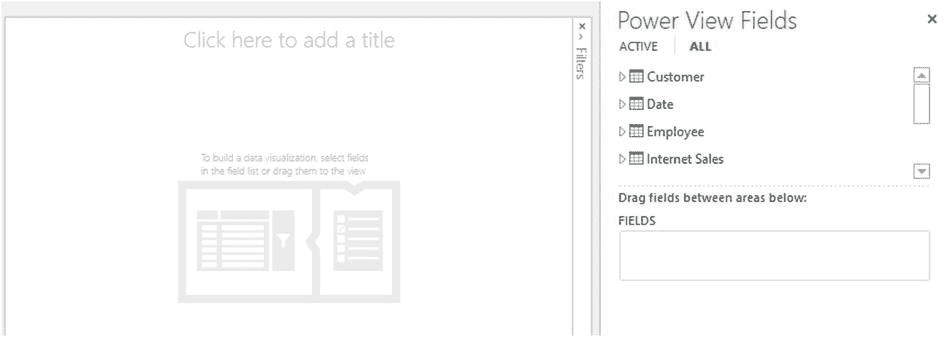

图 8-7. `Power View` 设计界面

在 `Power View` 中创建可视化的关键之一是从表格视图开始，一旦选定了字段，就可以将表格视图切换为其他数据可视化类型。如果你展开 `Power View` 字段列表中的表节点，将看到可用的字段。如果你想创建一个按销售区域显示销售额的条形图，首先将所需字段拖动到字段拖放区域。这将在设计界面上创建一个表格视图。选中该表格视图后，你可以在“设计”选项卡上选择不同的可视化类型（参见图 8-8）。

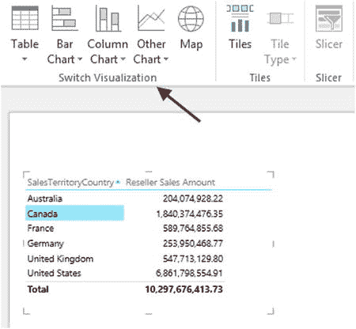

图 8-8. 更改可视化类型

切换可视化类型后，字段列表下的拖放区域将根据可视化类型而变化。图 8-9 显示了条形图的拖放区域。你可能需要重新排列字段，并且可以向拖放区域添加其他字段以获得所需的可视化效果。

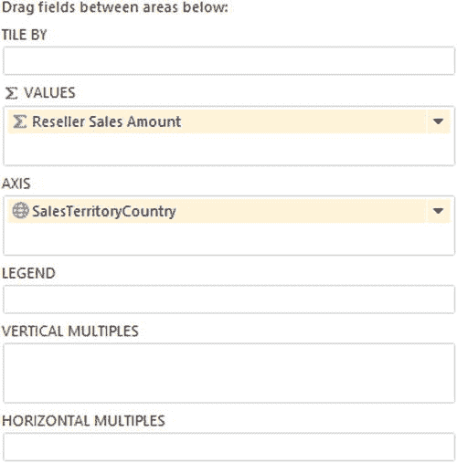

图 8-9. 条形图拖放区域

你可以轻松地将一种可视化类型切换为另一种。例如，如果你选中条形图并在“设计”选项卡中选择其他图表下拉列表，可以将其切换为饼图（参见图 8-10）。

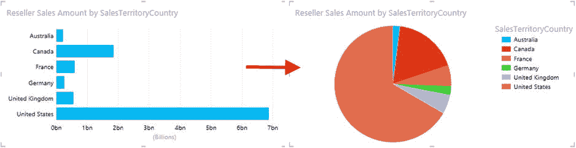

图 8-10. 切换可视化类型

现在你已经了解了如何创建基本可视化（将在第 9 章和第 10 章中学习创建更复杂的可视化），接下来让我们看看如何利用 `Power Pivot` 模型来改善 `Power View` 中的设计者和用户体验。

## 改善 `Power View` 体验

让 `Power Pivot` 模型的用户在 `Power View` 中构建和探索各种可视化内容时获得愉快的体验非常重要。例如，你应该只暴露对用户有意义的字段。隐藏用于关联模型中表的关键值总是一个好主意。要从 `Power View` 中可用字段列表中隐藏列，请右键单击该列并选择“从客户端工具中隐藏”（这将在模型设计器中将该列变为灰色）。图 8-11 展示了隐藏一个没有业务意义的`CustomerID`字段。

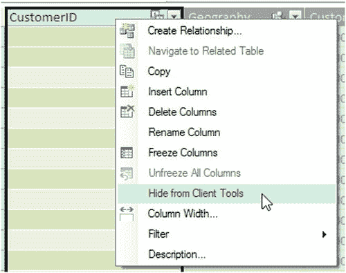

图 8-11. 从客户端工具中隐藏字段

如果你查看图 8-11 中弹出菜单的底部，你将看到可以为字段输入描述。当你在 `Power View` 中悬停在该字段上时，将显示此描述。此选项也适用于模型中创建的度量，并且对于需要了解度量如何定义的业务用户非常有用。图 8-12 显示了在 `Power View` 中显示的描述。

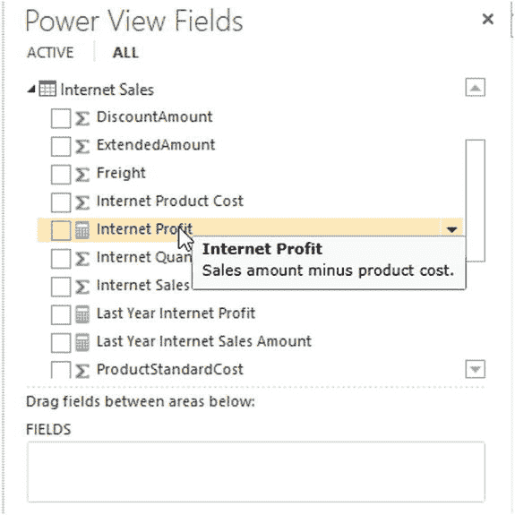

图 8-12. 添加字段描述可改善用户体验

查看 Figure 8-12 中的字段列表时，请注意字段前面的图标。计算器图标表示该度量值是在`Power Pivot`模型中创建的。求和符号（`Σ`）表示该字段是数值型的，拖放到字段放置区域时会进行聚合。默认的聚合方式是求和，但这可能并非所需的聚合方式。在某些情况下，您可能不希望聚合某个数值；例如，在日期表中，年份字段不应被聚合。您可以在`Power Pivot`模型的`Advanced`选项卡上，通过设置“`Summarize By`”下拉列表来控制此行为（参见 Figure 8-13）。

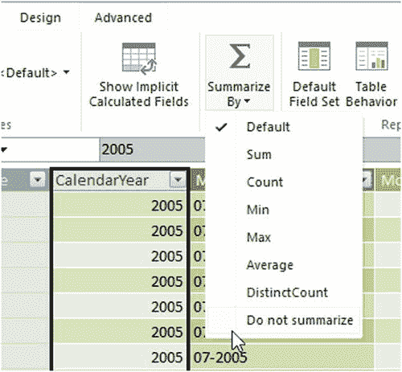

Figure 8-13. 设置字段的默认汇总方式

除了设置字段级属性外，您还可以在`Power Pivot`模型中设置一些表级属性，以便更轻松地在`Power View`中创建报表。如果您查看`Power Pivot`模型设计器中某个表的`Advanced`选项卡，您会看到一个“`Default Field Set`”按钮（参见 Figure 8-13）。选择此按钮将允许您指定该表的默认字段集（参见 Figure 8-14）。设置后，`Power View`用户只需单击`Power View`字段列表中的表节点，即可快速创建表格（参见 Figure 8-15）。

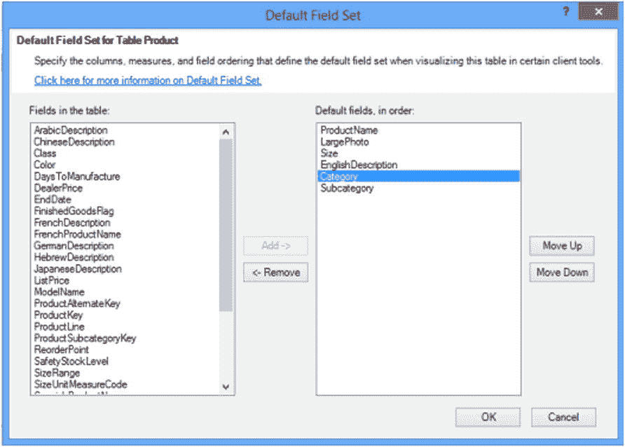

Figure 8-14. 为表设置默认字段

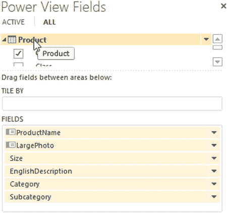

Figure 8-15. 在`Power View`中使用默认字段

在`Power View`中创建可视化时，它会根据所选字段和可视化类型自动对项目进行分组。您可以通过在`Power Pivot`模型中设置“`Table Behavior`”属性来控制分组的评估方式。您可以在模型设计器的`Advanced`选项卡上访问“`Table Behavior`”属性（参见 Figure 8-13）。单击“`Table Behavior`”按钮将显示“`Table Behavior`”设置窗口（参见 Figure 8-16）。

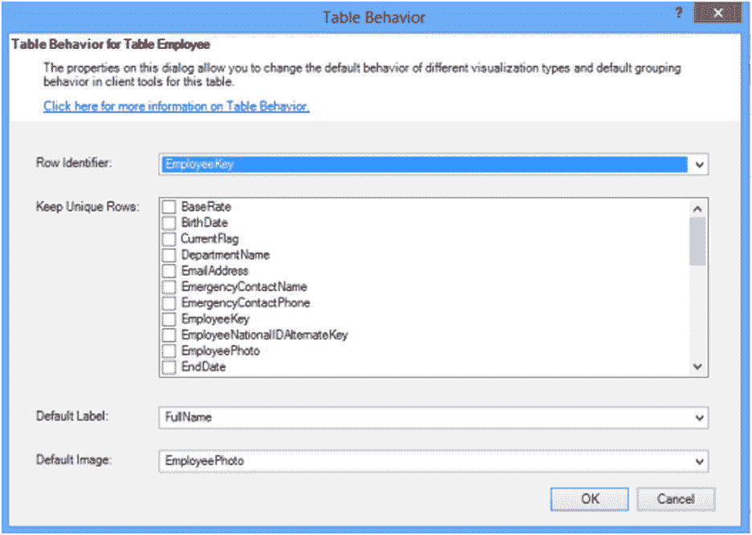

Figure 8-16. 设置表行为

您可以为一个表设置的“`Table Behavior`”属性包括行标识符、指示唯一性的列、默认标签和默认图像。行标识符用于指明唯一标识每一行的字段（通常称为主键）。此字段必须唯一且不能为空。设置行标识符后，您可以选择哪些列包含应保持唯一的值。例如，您可能有两个同名的员工，您不希望将一个员工的记录与另一个员工的记录分组在一起。默认标签和默认图像用于`Power View`的卡片和磁贴类型可视化，设置后可提供更美观的格式样式。Figure 8-17 展示了同一张卡片的两种不同格式。上方的卡片显示了设置默认标签和图像后的格式，下方的卡片显示了未设置时的格式。

Figure 8-17. 设置默认标签和图像的效果

`Power Pivot`模型设计器的`Advanced`选项卡上最后一个可用的设置是字段的“`Data Category`”设置（参见 Figure 8-18）。这对于位置类型（如城市、邮政编码和国家/地区）非常有用。当`Power View`知道某列是位置类型时，它可以使用该字段通过`Bing`地图图层实现可视化。其他有用的数据类别包括图像和`Web` URL。设置这些类别后，`Power View`将知道它们是超链接并相应地设置格式。

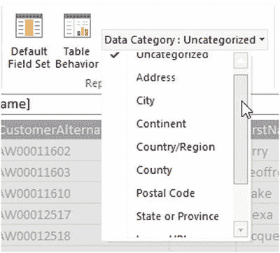

Figure 8-18. 为字段设置数据类别

至此，您应该已经很好地理解了`Power Pivot`模型中的设置如何影响`Power View`中的用户体验。在下面的动手实验中，您将获得处理这些属性的实践经验。

### 动手实验——为 Power View 优化 Power Pivot 模型

在下面的实验中，您将：

*   为 `Power View` 优化一个 `Power Pivot` 模型。
*   在 `Power View` 中创建一个表格和一个卡片可视化。
*   探索表视图筛选。

1.  在 `LabStarters` 文件夹中，打开 `LabChapter8.xlsx` 文件。此文件包含来自测试 `AdventureWorks` 数据库的销售数据。
2.  在 `Excel` 中选择 `Insert` 选项卡，然后单击 `Power View` 按钮。这将在工作簿中插入一个 `Power View` 报表工作表。在 `Power View` 字段窗口中，展开 `Customer` 节点并观察字段列表（参见 Figure 8-19）。

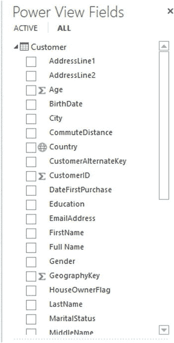

Figure 8-19. 向 `Power View` 公开的客户字段

3.  请注意，`CustomerID`、`CustomerAlternateKey` 和 `GeographyKey` 已暴露给用户。转到 `Power Pivot` 模型并隐藏这些键。
4.  如果查看 Figure 8-19 中的 `Age` 字段，您会看到该字段前面有一个求和符号（Σ）。这意味着如果您将此字段拖到放置区域，它将对年龄进行求和。要在 `Power Pivot` 模型中更改此设置，请选择 `Age` 列，然后在 `Advanced` 选项卡上的 “`Summarize By`” 下拉列表中，选择 “`Do Not Summarize`”。对 `NumberCarsOwned`、`NumberChildrenAtHome` 和 `TotalChildren` 列重复此操作。
5.  如果查看 Figure 8-19 中的 `Country` 字段，您会看到该字段前面有一个地球图标。这表明此字段是位置类型字段。要验证这一点，请在 `Power Pivot` 模型中选择 `Country` 字段，然后选择 `Advanced` 选项卡。请注意，`Data Category` 已设置为 “`Country/Region (Suggested)`”。模型使用列名来猜测此设置。
6.  将 `StateProvince` 和 `City` 列设置为适当的数据类别。返回 `Power View` 字段列表，注意这些字段现在有了地球图标。
7.  在 `Power View` 字段列表中展开 `Date` 表。请注意，存在许多您不希望使用的默认汇总，以及许多您不希望显示的字段。更新模型，使最终的字段列表看起来像 Figure 8-20。同时，设置 `MonthName` 列按 `MonthNumberOfYear` 排序，并向模型添加一个日历层级结构和一个财务层级结构。

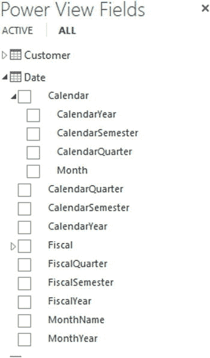

Figure 8-20. 更新后的日期字段

8.  在 `Power View` 字段列表中展开 `Employee` 表。`Power Pivot` 模型包含每位员工的照片，但 `Power View` 无法识别。要解决此问题，请转到 `Power Pivot` 模型，选择 `Employee` 表，然后在 `Advanced` 选项卡上，单击 “`Table Behavior`” 按钮。在 `Table Behavior` 设置窗口中，将 `Row Identifier` 设置为 `EmployeeKey`。将 “`Keep Unique Rows`” 设置为 `FullName`。将 `Default Label` 设置为 `FullName`，并将 `Default Image` 设置为 `EmployeePhoto`（参见 Figure 8-21）。

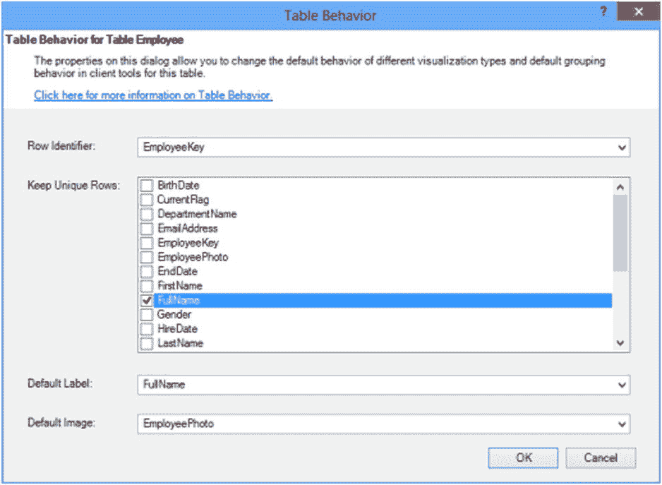

图 8-21. 设置表格行为属性

9.  返回“Power View 字段列表”，展开 `Employee` 表。请注意，现在可以看到 `EmployeePhoto` 字段。同时注意 `EmployeePhoto` 和 `FullName` 字段前新增了一个图标，表明它们是默认字段。
10. 将 `FullName`、`EmployeePhoto`、`Title` 和 `Phone` 拖放到字段列表下方的 `Fields` 放置区域。注意观察视图区域正在生成的表格。
11. 构建好基础表格后，可以将其转换为其他类型的可视化效果。在 `Design` 选项卡中，选择 `Table` 下拉菜单，将可视化效果更改为 `Card` 类型。最终应得到类似于图 8-22 的可视化效果。

图 8-22. 创建员工卡片

12. 在工作簿中插入一个新的 Power View 工作表。展开 `Product` 表格节点，注意其中字段数量众多。为方便用户，您可以设置默认字段集，以便他们通过点击表格节点来选择这些字段。
13. 在 Power Pivot 模型中，选择 `Product` 表，在 `Advanced` 选项卡上，点击 `Default Field Set` 按钮。在 `Default Field Set` 窗口中，选择 `ProductName`、`ProductLine`、`Category`、`Subcategory`、`StandardCost`、`DealerPrice` 和 `ListPrice`，如图 8-23 所示。

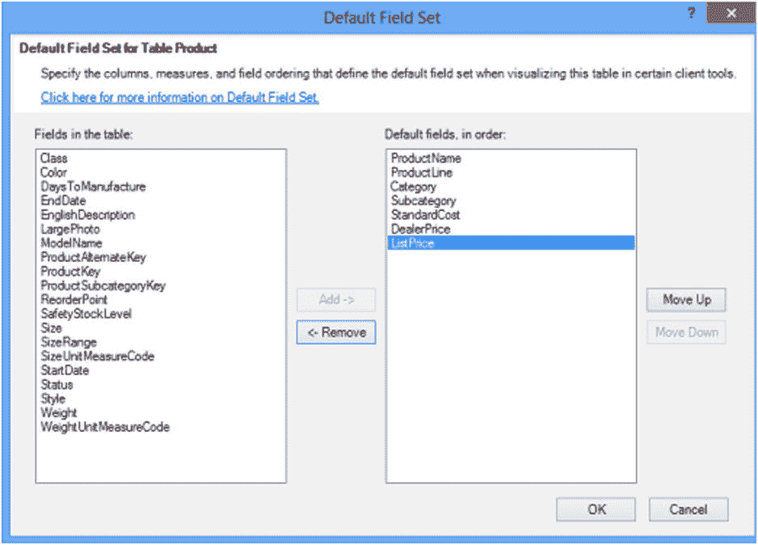

图 8-23. 选择默认字段

14. 返回 Power View 工作表，在“Power View 字段列表”中点击 `Product` 表。您应该会看到生成了一个由您在步骤 13 中选择的默认字段组成的新表格。
15. 选中表格后，点击 `Power View` 选项卡，注意您可以更改主题、字体和文本大小。请尝试更改这些设置。为 Power View 工作表添加一个标题“产品列表”。
16. 请注意，通过点击表格中的列标题，您可以按任意列进行升序或降序排序。表格右上角有一个筛选器图标。点击此图标以显示表格筛选器（参见图 8-24）。

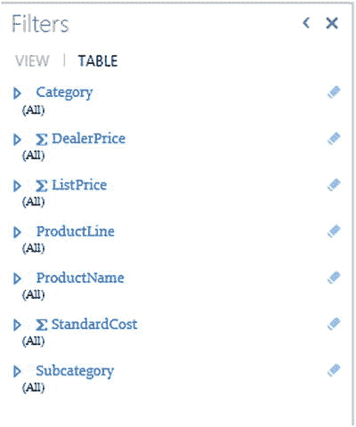

图 8-24. 查看表格筛选器

17. 点击 `Category` 字段以显示选择框。筛选表格，使其仅显示配件。点击 `DealerPrice` 字段；请注意，由于这是一个数字字段，您将看到一个滑块控件。在该字段右侧，您应该看到一个用于切换到高级筛选模式的图标。使用高级筛选模式，将产品列表限制为仅显示经销商价格大于或等于 25 美元的配件。
18. 尝试更改和清除筛选器。完成后，保存更改并退出 Excel。

#### 总结

一个为 Power View 使用而优化良好的 Power Pivot 模型，将是卓越用户体验与极差用户体验之间的分水岭。本章向您展示了如何优化 Power Pivot 模型，以便在 Power View 中更好地创建报表。您了解了如何设置表格行为属性和列属性，以及这些设置如何影响 Power View 体验。您还熟悉了在 Power View 中创建卡片和表格，以及如何对表格进行筛选和排序。下一章将深入探讨 Power View 报表设计器的功能，展示如何创建基本的可视化类型以及这些可视化内置的交互功能，并演示和讨论跨视图筛选、向下钻取功能和切片器。

## 第 9 章

