## 第 13 章

# 使用 Excel 挖掘数据

商业智能中最未被充分利用的领域之一是数据挖掘，或者通常所说的预测分析。这是因为传统的数据挖掘使用一组复杂的算法，而这些工具通常要求你成为这些算法的专家才能实施它们。虽然它并非 Microsoft 官方自助式 BI 工具集的组成部分，但 Microsoft 为 Excel 提供的一组表分析工具，使你可以使用数据挖掘算法，同时隐藏了与实施这些算法相关的大部分复杂性。使用这些 Excel 表分析工具，你可以执行预测、聚类和关联分析等高级数据分析。本章将向你展示如何使用这些工具来实现一些常见的数据挖掘模型，并深入了解你的数据。不过，我需要指出的是，要实施这些表分析工具，你需要能够连接到 `SQL Server Analysis Server (SSAS)` 实例，该实例提供运行算法的引擎。

完成本章后，你将能够：

*   识别 Excel 中可用的表分析工具。
*   分析关键影响因素。
*   识别数据组。
*   预测未来趋势。
*   使用购物篮分析。

### Excel 中的表分析工具

数据挖掘是利用历史数据发现模式并为未来趋势制定预测的过程。数据挖掘的一些常见示例包括市场购物篮分析、营销效果分析和预测。

*   *市场购物篮分析*查看历史数据，并确定在购买过程中哪些产品经常相互关联。利用这些信息，你可以就哪些产品应该一起营销提出建议。
*   *营销效果分析*分析历史营销活动，可用于为未来的活动定位目标客户。
*   *预测*使你能够根据数据中的历史趋势预测未来。例如，你可以根据过去五年的销售趋势进行销售预测。这可以帮助你规划未来季度的库存水平。

要安装 Excel 的表分析工具，请访问下载页面 (`www.microsoft.com/en-us/download/details.aspx?id=35578`)。请确保你为 Office 安装选择了正确的版本（x86 或 x64）。下载软件包后，双击 `SQL_AS_DMAddin.msi` 文件启动安装程序。在“功能选择”窗口中，保留默认选择“用于 Excel 的表分析工具”和“服务器配置实用工具”（参见图 13-1）。

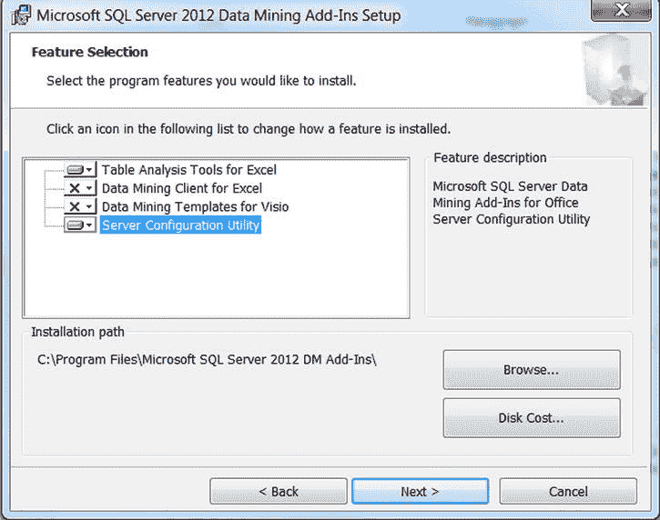
图 13-1 安装表分析工具

安装 Excel 的数据挖掘工具后，当你选择 Excel 表格时，你将会看到一个新的选项卡。“表工具 分析”选项卡包含一组工具，帮助你挖掘表格中包含的数据（参见图 13-2）。

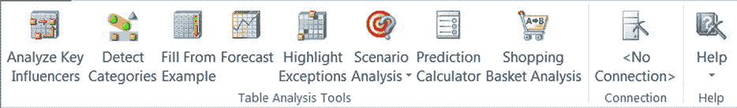
图 13-2 “表工具 分析”选项卡上的表分析工具

你首先应该注意到的是，这里没有列出连接。为了使这些工具能够工作，你需要连接到 `SSAS` 实例。要创建连接，请单击“连接”按钮。在“Analysis Services 连接”窗口中，单击“新建”按钮。在“连接到 Analysis Services”窗口中（参见图 13-3），输入用于连接到 `SSAS` 实例的值。这些值将由你的 `SSAS` 实例确定。

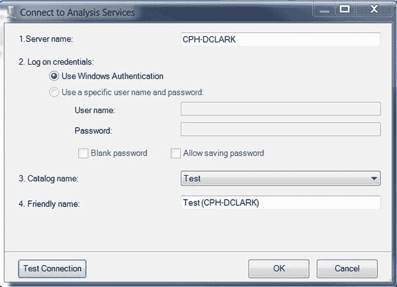
图 13-3 连接到 SSAS 实例

添加连接后，你应该会在表分析工具的连接区域中看到它列出（参见图 13-4）。

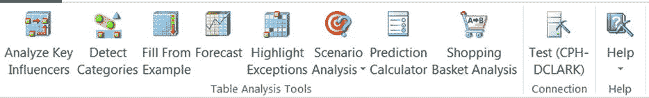
图 13-4 具有活动 SSAS 连接的表分析工具

这些工具中的每一个都使用一种众所周知的数据挖掘算法，并分析数据的分布和数据类型。使用这些工具可以让你免于实施算法的复杂性。表 13-1 总结了每个可用工具、何时使用它们以及所使用的算法类型。

表 13-1 可用表分析工具摘要

| 工具 | 用途 | 算法 |
| --- | --- | --- |
| `分析关键影响因素` | 识别对目标数据列影响最大的因素。 | 朴素贝叶斯 |
| `检测类别` | 查找数据的分组。 | 聚类 |
| `根据示例填充` | 根据数据中的模式推荐新值。 | 逻辑回归 |
| `预测` | 分析随时间变化的数据并预测未来值。 | 时间序列 |
| `突出显示异常` | 分析数据表中的模式并查找不符合模式的值。 | 聚类 |
| `目标查找方案` | 识别为达到目标需要更改的底层因素。 | 逻辑回归 |
| `假设方案` | 预测某项更改是否足以实现所需结果。 | 逻辑回归 |
| `预测计算器` | 分析导致目标结果的因素并预测新输入的预测结果。 | 逻辑回归 |
| `购物篮分析` | 识别可用于交叉销售或追加销售的模式。 | 关联 |

现在你已经了解了可用工具的范围，是时候更详细地了解其中的一些工具了。

### 分析关键影响因素

使用“分析关键影响因素”工具，你可以确定哪些因素对结果影响最大。例如，你有一个包含客户属性的数据表，以及一个指示他们是否购买了自行车的列（参见图 13-5）。

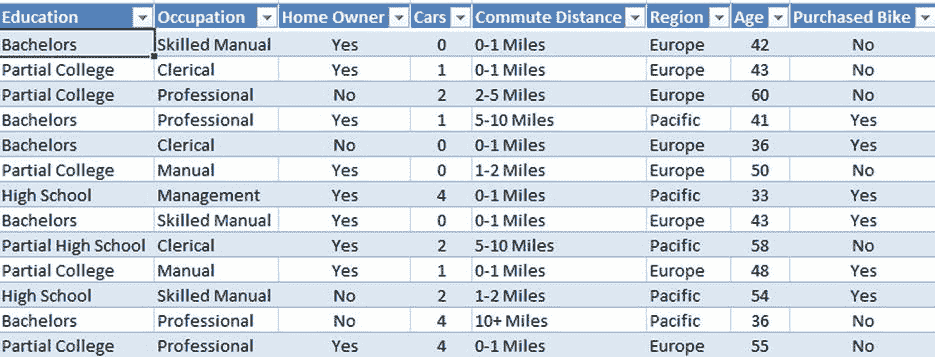
图 13-5 客户属性

要确定影响客户是否购买自行车的关键因素，请选择该表，然后在“表分析工具”选项卡中，选择 `分析关键影响因素`。你将看到一个列选择对话框。首先选择包含你要分析的结果的列（参见图 13-6）。

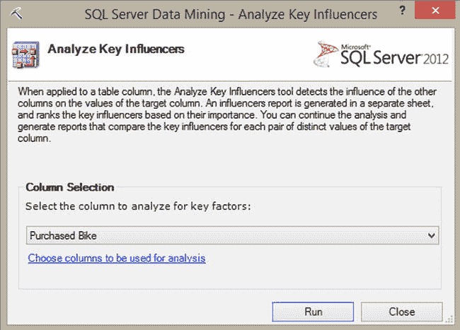
图 13-6 选择结果字段

接下来，单击链接以选择要用于分析的列（参见图 13-7）。

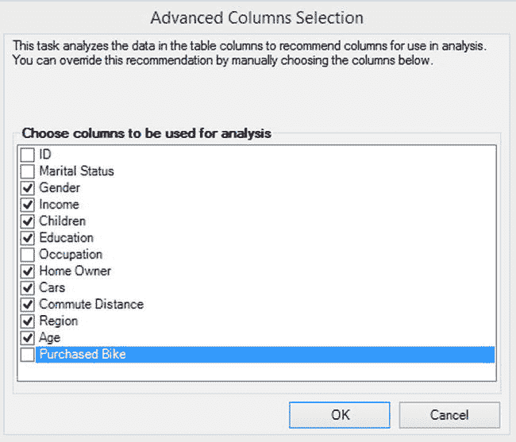
图 13-7 选择影响字段

选择要分析的字段后，选择“确定”关闭“高级列选择”窗口。在“`分析关键影响因素`”窗口中，选择“运行”以开始分析（参见图 13-6）。

## 分析关键影响因素工具的数据分析过程

当`分析关键影响因素`工具分析数据时，它首先会存储数据分布的关键信息。接着，该工具会利用 Microsoft 朴素贝叶斯算法和 SSAS 创建模型。然后生成预测，将每列数据与指定结果关联起来。最后，它使用每个预测的置信度得分来识别对产生目标结果影响最大的因素。

分析完成后，`分析关键影响因素`工具会在新工作表中创建一份报告，按置信度得分降序列出关键影响因素（参见图 13-8）。
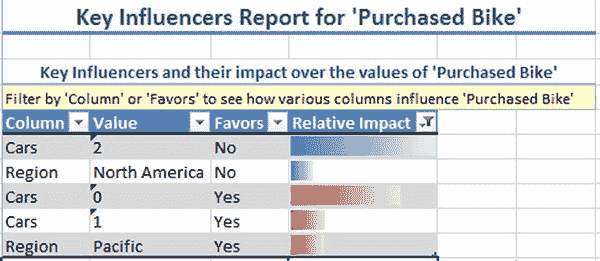
图 13-8 关键影响因素分析结果

从报告中可以清晰地看出，汽车数量对自行车购买行为有明显影响。

除了确定影响自行车购买者的因素外，您可能还想了解自己吸引的是哪种类型的客户。哪些是主要群体？他们是年轻人吗？他们拥有房产吗？在下一节中，您将学习使用`检测类别`工具和聚类分析来解答这些问题。

### 识别数据组

检测数据所属的不同类别是对数据执行的重要分析。这在许多不同场景中都非常有用；例如，您需要了解客户属于哪些群体，以便针对不同群体进行精准营销。仔细研究类别的另一个原因是，可以找出不属于任何群体的异常值。这样，如果需要，您就可以从数据集中过滤掉这些异常值，以免它们影响结果的准确性。发现异常值也是检测潜在欺诈的常见模式。

为了识别购买自行车的客户的不同细分市场，首先选择一个包含客户人口统计信息以及一个表明其是否购买自行车列的表格。在表格工具的分析选项卡中，选择`检测类别`工具。这将启动一个窗口，您可以在其中选择要使用的字段以及要创建的类别数量（参见图 13-9）。不要选择具有唯一值的列，例如 ID 字段，因为它们不适合进行分组分析。
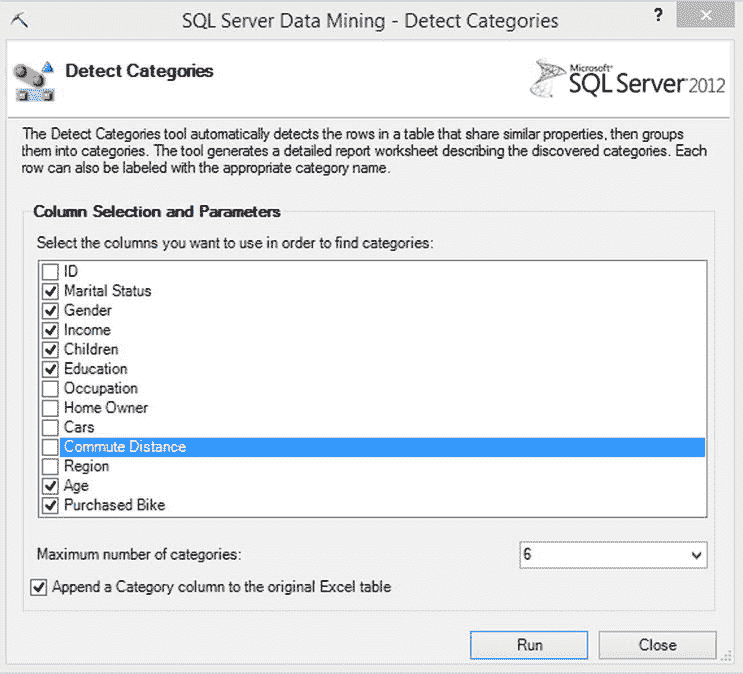
图 13-9 选择分组属性字段

运行`检测类别`工具后，将使用聚类分析算法对数据进行分析。您可以让该工具向数据表追加一个`类别`字段。工具运行完毕后，您将看到一个新的工作表显示结果。该工作表上有一个图表，显示所选字段中每个类别的人口分布情况（参见图 13-10）。由于您关注的是购买自行车客户的类别，因此应将图表的列设置为此字段。
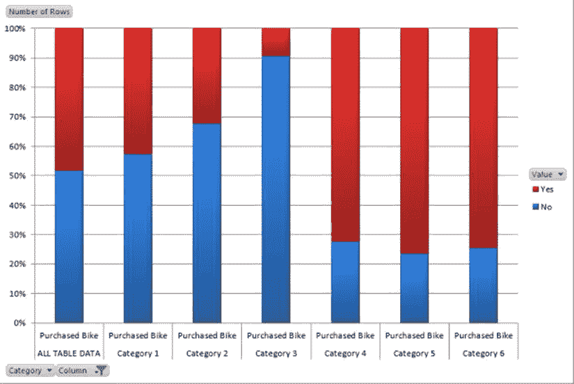
图 13-10 查看人口分布图

如您所见，与类别 4、5 和 6 相关联的客户群最有可能购买自行车。

在同一工作表中，还有一个表格，可用于调查构成不同组的行所具有的属性。图 13-11 展示了构成类别 6 的特征。您可以看到，该组中的大多数人没有子女，拥有学士学位，并且年龄在 37-46 岁之间。
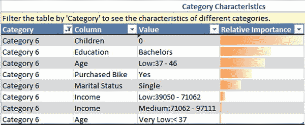
图 13-11 查看组特征

除了`检测类别`工具之外，`突出显示异常`工具也会对数据执行聚类算法。在这种情况下，它寻找的是与其余数据不符的数据。当您需要在执行其他数据分析之前清理数据集时，这些信息会派上用场。请记住，每当您对一组数据执行数据分析时，都需要确保任何异常值不会影响结果的准确性。

运行`突出显示异常`工具时，会弹出一个窗口，您可以在其中选择要分析的列（参见图 13-12）。
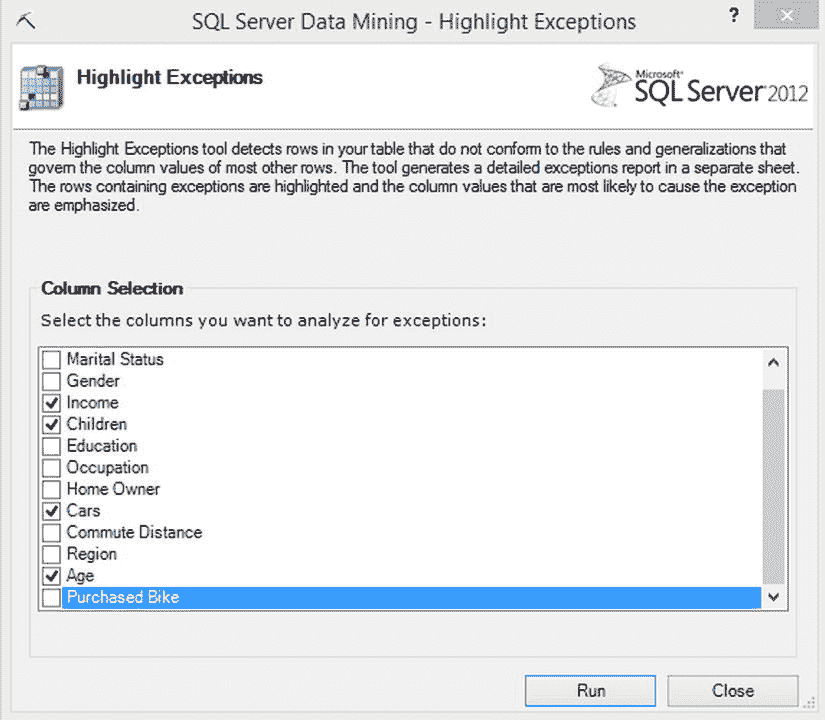
图 13-12 选择要分析的列

运行该工具后，您会看到一个结果表，显示找到的异常值数量。您还可以调整阈值以捕获更多或更少的异常（参见图 13-13）。
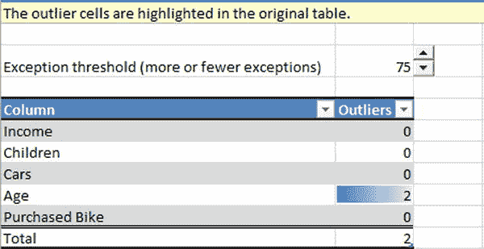
图 13-13 异常值分析结果

查看原始数据表，异常值现在已被高亮显示，因此您可以轻松识别它们（参见图 13-14）。
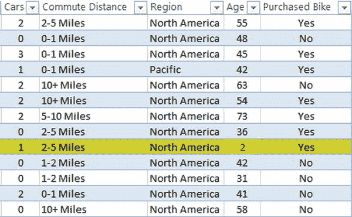
图 13-14 高亮显示找到的异常行

在努力实现高效运营和降低管理成本时，数据挖掘中一个日益重要的领域是预测。接下来您将了解这一部分。

### 预测未来趋势

`预测`工具允许您通过查看过去的趋势来预测未来的趋势。它使用时间序列算法来预测未来值。运行该工具会打开一个窗口，您可以在其中选择要预测的列、时间序列列以及要预测的时间段数（参见图 13-15）。
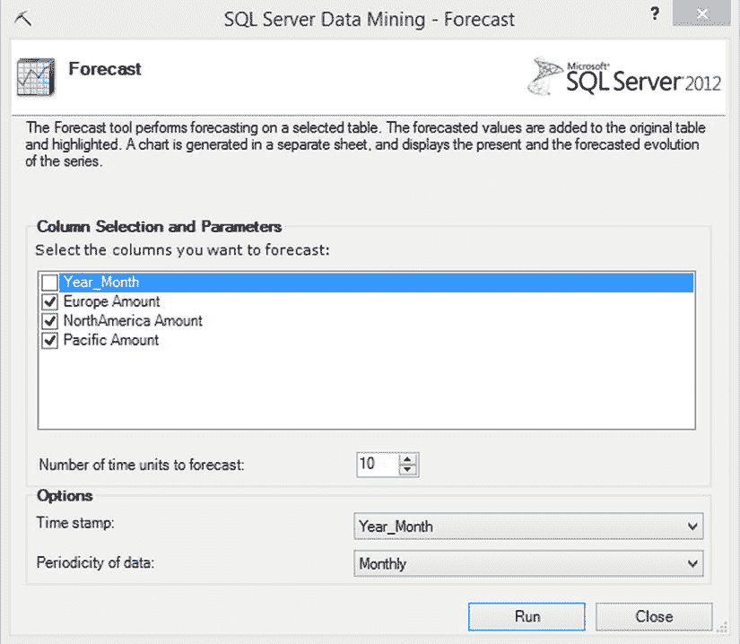
图 13-15 选择预测参数

工具运行完毕后，预测值会被放置在历史数据的末尾，并高亮显示以供查看（参见图 13-16）。
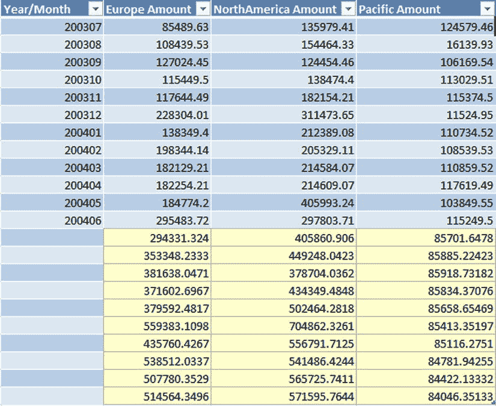
图 13-16 查看预测分析结果

此外，还会插入一个新工作表，其中显示历史趋势和未来预测的线性图表。历史值用实线绘制，未来预测用虚线绘制（参见图 13-17）。
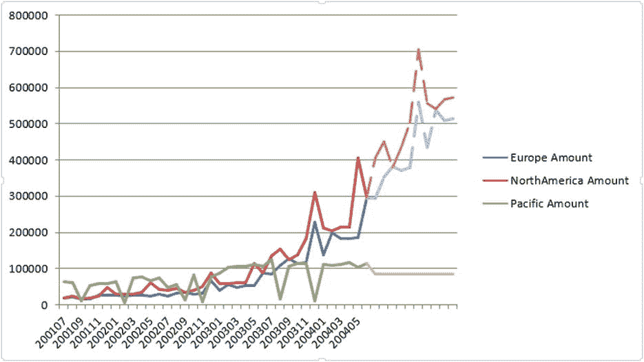
图 13-17 未来趋势的图形化表示

除了预测，另一种流行的数据挖掘类型是购物篮分析。您接下来将了解这一部分。

### 使用购物篮分析

`购物篮分析`工具使用关联算法来查找数据之间的关联。传统上，它被用于分析客户的购买模式，并在推荐追加销售其他商品时非常有用。当您使用`购物篮分析`工具分析数据时，请确保数据具有一个能将其组织成组的键——例如订单号（参见图 13-18）。
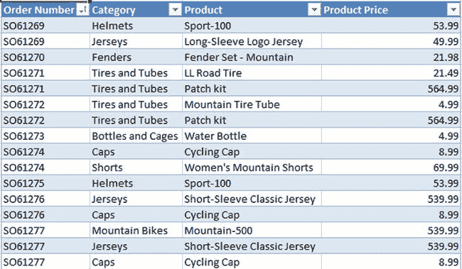
图 13-18 使用订单号对交易进行分组

当您选择`购物篮分析`工具时，会出现一个列选择窗口，您可以在其中选择`交易 ID`、`商品`和`商品价格`列（参见图 13-19）。
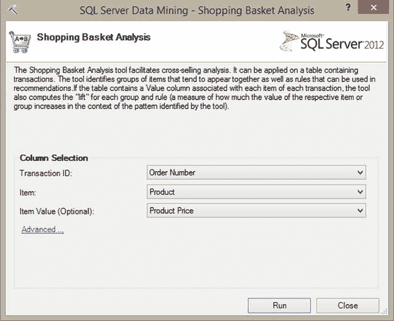
Figure 13-19. 选择要分析的列

选择`Advanced`链接会打开一个窗口，您可以在其中调整算法的敏感度（参见 Figure 13-20）。提高`Minimum Support`和`Minimum Rule Probability`参数会减少结果中的项目数量，但会提高结果的显著性。
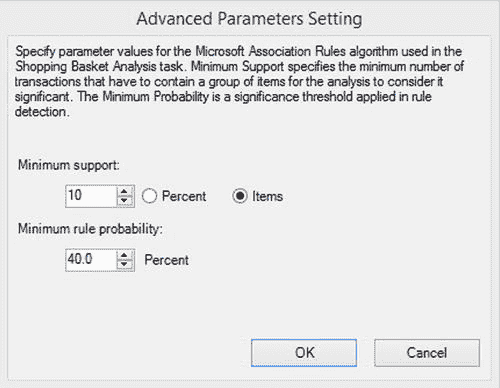
Figure 13-20. 指定最小参数值

运行分析后，会插入两个新的工作表。第一个工作表 `Shopping Basket Bundled Item` 会显示被捆绑在一起找到的项目，以及捆绑规模、销售数量、平均销售额和捆绑总价值（参见 Figure 13-21）。
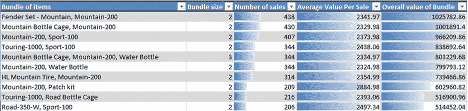
Figure 13-21. 显示已售捆绑产品的分析结果

第二个工作表 `Shopping Basket Recommendations` 列出了同时售出概率较高的产品推荐。例如，如果客户购买了一个公路自行车水壶架，您应该推荐他们也购买一个水壶（参见 Figure 13-22）。这个工作表还包含统计信息，比如关联销售占比和推荐的平均价值。
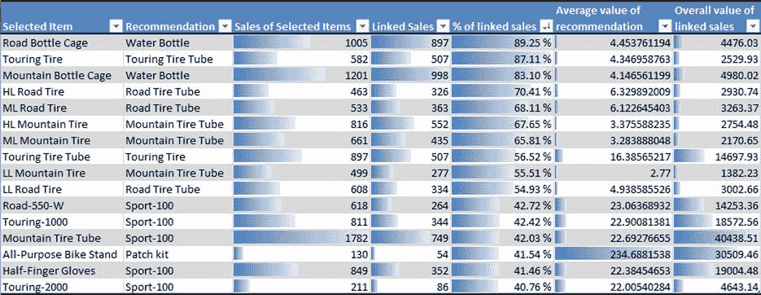
Figure 13-22. 交叉销售产品的推荐

现在您已经了解了各种表分析工具的工作原理，是时候亲自动手实践其中一些工具了。

### 动手实验——在 Excel 中使用表分析工具

在以下实验中，您将会：
- 确定拥有住房的关键影响因素。
- 检测不同的客户群体。
- 对已购产品进行购物篮分析。
- 预测污染物排放。

1.  在 `LabStarters` 文件夹中，打开 `LabChapter13.xlsx` 文件。此文件包含示例客户数据。您将使用表分析工具对此数据进行数据挖掘。
2.  在 `Influencers` 工作表中，点击数据表的任意位置以显示 `Table Tools Analyze` 选项卡。在此选项卡上，选择 `Analyze Key Influencers` 按钮。在 `Column Selection` 窗口中，选择 `Home Owner` 列以分析关键因素。
3.  选择以下用于分析的列：`Marital Status`、`Gender`、`Income`、`Children`、`Education`、`Occupation`、`Cars`、`Commute Distance` 和 `Age`。运行分析，当出现 `Discrimination Reporting` 窗口（参见 Figure 13-23）时，您可以关闭它，因为只有两个值需要比较，并且它们已被添加到报告中。
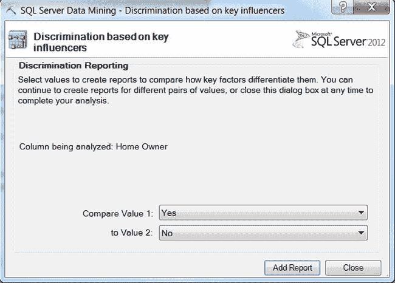
Figure 13-23. 选择要比较的值

4.  在 `Key Influencers` 报告中，请注意，在所分析的列中，婚姻状况是关键影响因素。然而，孩子数量和通勤距离也是影响因素。同样有趣的是，教育程度和年龄并不是关键影响因素。这可能是一个您希望进一步调查的领域，尤其是因为这可能是由于样本量不够大所致。
5.  要检测不同的客户群体，请选择 `Categories` 工作表。点击表格的任意位置，然后在 `Table Tools Analyze` 选项卡上选择 `Detect Categories` 工具。
6.  在 `Detect Categories` 工具中，勾选 `Marital Status`、`Gender`、`Income`、`Children`、`Education`、`Occupation` 和 `Age` 复选框，然后单击 `Run` 按钮。
7.  在 `Categories` 工作表上，注意有六个类别。使用 `Category Characteristics` 表来确定对每个群体最重要的特征（参见 Figure 13-24）。您可以重命名这些类别；例如，类别 1 主要由低收入群体构成，您可以重命名它以反映这一点。
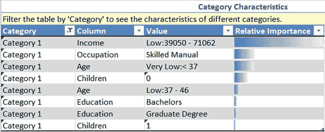
Figure 13-24. 确定一个类别群体的显著特征

8.  表格下方是一个类别概况图表，您可以使用它来分析各个类别不同属性值的分布情况。花些时间通过更改图表上显示的类别和列来分析数据。
9.  要对已购产品进行购物篮分析，请选择 `Shopping Basket` 工作表。此表包含在杂货店购买的物品。点击数据表的任意位置，然后在 `Table Tools Analyze` 选项卡上选择 `Shopping Basket Analysis` 工具。
10. 在 `Shopping Basket Analysis` 窗口中，为 `Transaction ID` 选择 `Order ID` 列。对于 `Item`，选择 `Item` 列，并将 `Item Value` 设置为 `No Value Column`。
11. 选择 `Advanced` 链接，在 `Advanced Parameters Setting` 窗口中，将 `Minimum Support` 改为 20 个项目，将 `Minimum Rule Probability` 改为 50%。
12. 运行分析，在 `Shopping Basket Recommendations` 表中，注意当客户购买麦片时，有 60% 的概率他们也会购买牛奶（参见 Figure 13-25）。
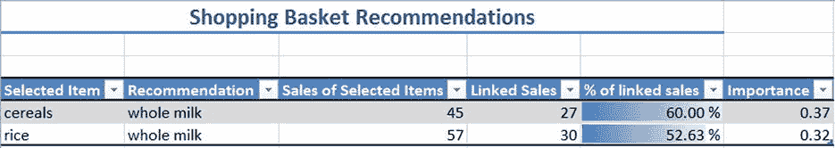
Figure 13-25. 查看交叉销售推荐

13. 要进行预测，请选择 `Forecast` 选项卡，其中包含 2000 年至 2010 年多个州的污染物排放数据。点击数据表的任意位置，然后在 `Table Tools Analyze` 选项卡上选择 `Forecast` 工具。
14. 在 `Forecast` 窗口中，选择要预测的 `State` 列。将 `Time Stamp` 设置为 `Year`，并将 `Periodicity Of Data` 设置为 `Yearly`（参见 Figure 13-26）。
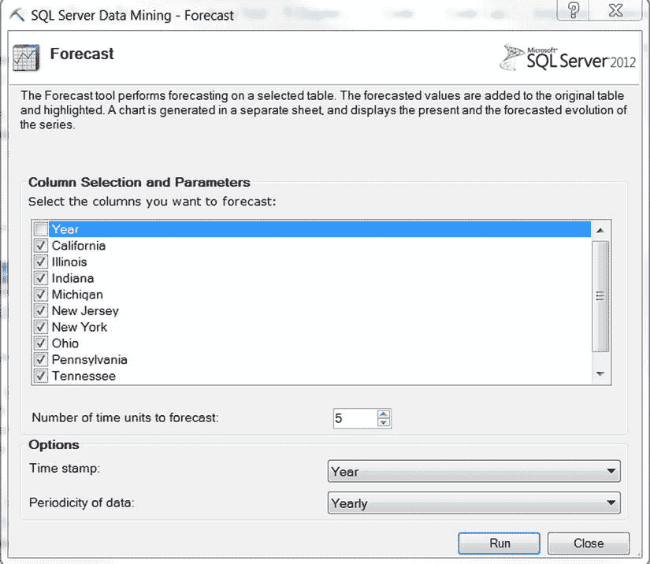
Figure 13-26. 选择预测属性

15. 运行预测。您现在将看到一个预测图，该图将预测显示为实际值上的虚线延伸（参见 Figure 13-27）。
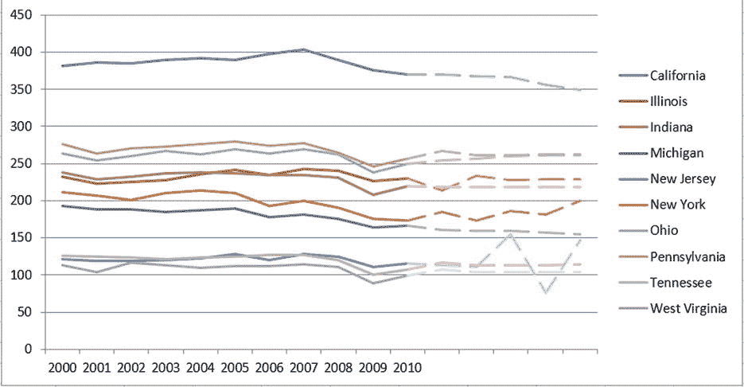
Figure 13-27. 最终的预测图

16. 当您完成对表分析工具的尝试后，保存并关闭 Excel 工作簿。

#### 总结
