# 第 11 章

## 使用 `Power Query` 进行数据发现

虽然 `Power Pivot` 提供了多种可用于查询数据的连接类型，但有时你需要在将数据加载到模型之前对其进行操作。这个过程通常被称为 `ETL`（提取、转换和加载）过程中的转换部分。这正是 `Power Query` 大放异彩之处，也是你的 `BI` 工具集中非常有用的部分。`Power Query` 提供了一个易于使用的界面，用于发现和转换数据。它包含清理和塑形数据的工具，例如删除重复项、替换值和分组数据。此外，它还支持大量结构化和非结构化数据源，例如关系数据库、网页和 `Hadoop` 等。一旦数据被提取和转换，你就可以轻松地将其加载到 `Power Pivot` 模型中。

完成本章后，你将能够：

*   从各种来源发现和导入数据。
*   清理数据。
*   合并、塑形和筛选数据。
*   对数据进行分组和聚合。
*   插入计算列。

### 发现和导入数据

传统上，如果你需要合并和转换来自各种不同数据源的数据，你将依赖 IT 部门使用诸如 `SQL Server Integration Services (SSIS)` 之类的工具为你暂存数据。这可能是一个漫长而费力的过程，包括数据发现、清理以及将数据符合关系结构。尽管这种正式的工作对于加载和符合企业运营数据存储的数据是必需的，但很多时候你只是想快速、直观且敏捷地将来自各种来源的数据添加到你的 `Power Pivot` 模型中。为了支持这一点，你可以使用 `Power Query`（Excel 的一个免费加载项）作为你的自助式 `BI` `ETL` 工具。下载并安装最新版本的 `Power Query` 后，你将在 Excel 中看到一个名为 `Power Query` 的新选项卡（参见 Figure 11-1）。

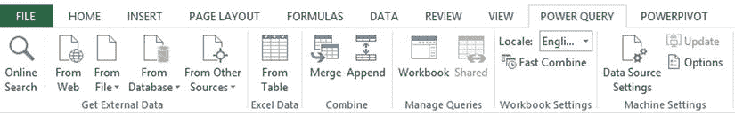

Figure 11-1. 新的 `Power Query` 选项卡

如果你查看选项卡的 `获取外部数据` 区域，你可以看到可用的各种数据源。你可以从网页、文件、数据库以及各种其他来源获取数据（参见 Figure 11-2）。

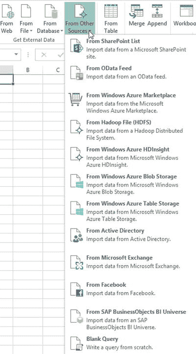

Figure 11-2. `Power Query` 中可用的部分数据源

连接类型将决定您需要通过哪些信息来获取数据源的访问权限。例如，Web 源需要提供 `URL`，而 CSV 文件则需要提供文件路径。连接到数据源后，将启动查询编辑器窗口，并显示数据样本。例如，图 11-3 展示了 CSV 文件中包含的航班延误数据。

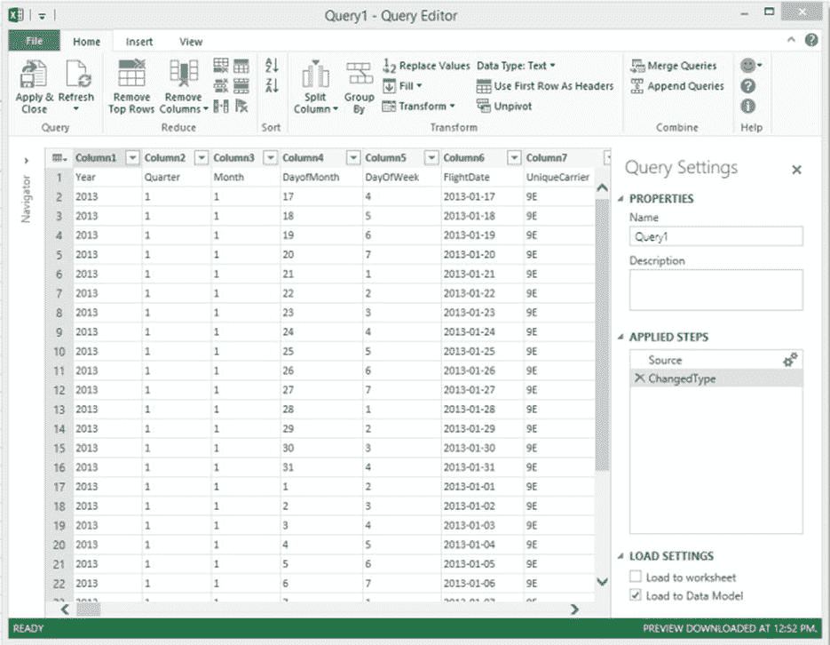

图 11-3. 查询编辑器窗口

如果您选择包含多个表的数据源，Excel 中将显示导航器窗格。图 11-4 展示了连接到 Access 源时显示的导航器窗格。选择表后，查询编辑器将显示样本数据。

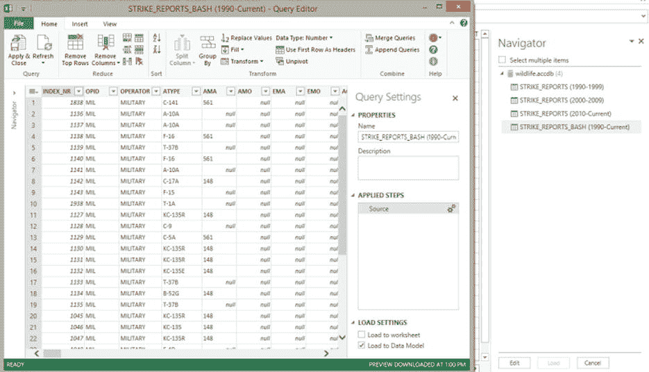

图 11-4. 使用导航器窗格选择表

查看查询编辑器窗口的“查询设置”窗格，您可以发现能够为查询命名并添加描述。如果您希望重用和共享创建的查询（这些功能仅在 Office 365 中可用），这一点非常重要。该窗格还显示了您创建查询所采用的步骤以及数据加载的位置。您可以选择将数据加载到工作表或 `Power Pivot` 数据模型中。

连接到数据源后，下一步是在将数据导入数据模型之前对数据进行转换、清理和筛选。

### 转换、清理和筛选数据

连接到数据源后，您就可以开始转换和清理数据了。这是一个重要步骤，将在很大程度上决定数据对分析工作的支持程度。您会执行的一些常见转换包括删除重复项、替换值、删除错误值和更改数据类型。例如，在图 11-5 中，源 CSV 文件中的 `FlightDate` 列是文本数据类型，但您希望它在模型中成为日期列。

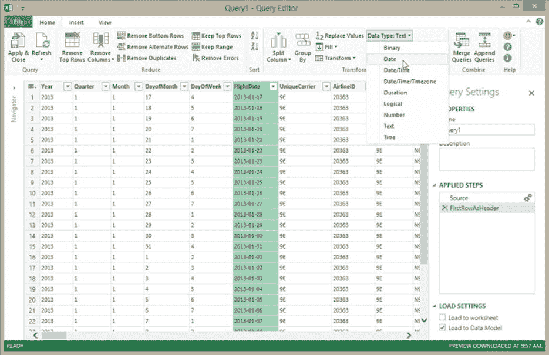

图 11-5. 更改列的数据类型

通常，您需要替换来自源系统的值，以便它们在模型中能够同步。例如，CSV 文件中列出的承运人代码 `VX`，在您现有数据中的值是 `VG`。您可以通过选择列，然后在菜单中选择“替换值”转换，在数据导入时轻松替换这些值。这将启动一个窗口，您可以在其中输入要查找的值以及要替换为的值（参见图 11-6）。

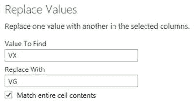

图 11-6. 替换列中的值

从源加载数据时，另一个常见要求是筛选掉不必要的列和行。要删除列，只需选择列，然后点击“开始”选项卡上的“删除列”按钮。如果您只需要几列，也可以选择想要保留的列，然后选择“删除其他列”选项。您可以通过点击列名旁边的下拉菜单并输入筛选条件来筛选行（参见图 11-7）。

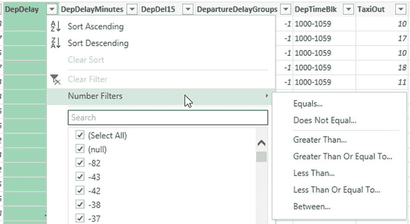

图 11-7. 筛选行

在应用数据转换和筛选时，查询编辑器会列出您已应用的步骤。这使您能够组织并跟踪对数据所做的更改。您可以通过右键单击列表中的步骤来重命名、重新排列和删除步骤（参见图 11-8）。

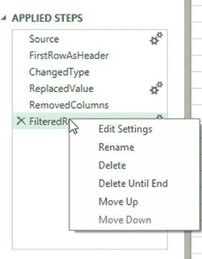

图 11-8. 管理查询步骤

在清理和转换数据之后，您可能需要将来自多个源的数据合并到数据模型的一个表中，或者展开列中包含的数据。

### 合并和调整数据

有时，您可能需要先将来自多个表和/或源的数据合并，然后再将数据加载到模型中。例如，如果一个表中包含链接到另一个查找表的代码，而该查找表包含字段的完整值。处理这种情况的一种方法是将两个表都导入模型，并在 `Power Pivot` 模型中创建表之间的链接。另一种选择是在导入数据之前将表合并在一起。例如，在您之前看到的航班数据中，有一个 `UniqueCarrier` 列包含承运人代码。您可以将这些代码与另一个包含承运人代码和承运人名称的 CSV 文件合并。首先在查询编辑器中为每组数据创建并保存一个查询。对于查找表，您可以取消选中“加载到工作表”和“加载到数据模型”复选框，因为合并后才会加载数据，所以不需要这些。接下来，打开主查询，并在“开始”选项卡上选择“合并”按钮。这将启动“合并”窗口（参见图 11-9），您可以在其中选择查找查询以及连接数据的列。

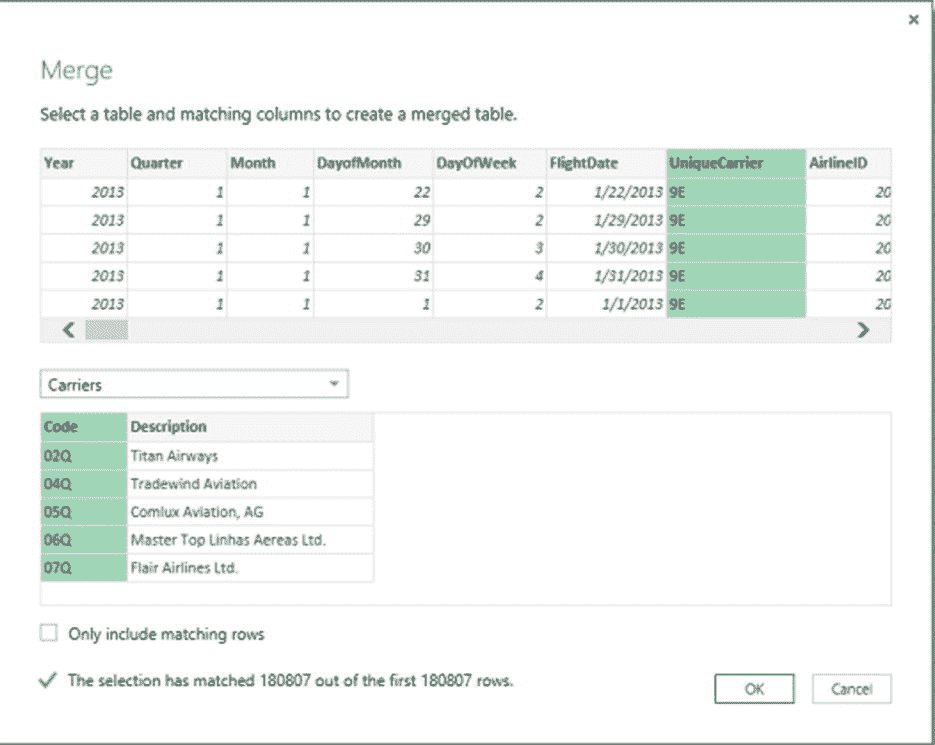

图 11-9. 合并来自两个查询的数据

合并查询后，您可以选择要合并的列（参见图 11-10）。列合并后，您可能希望重命名主查询中的列。

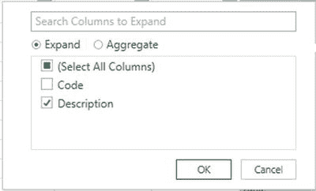

图 11-10. 选择要合并的列

除了合并来自查找表的数据外，您可能还需要追加来自两个不同源的数据。例如，假设您每年都有分开存储在不同源文件或表中的航班数据，并且希望将多年的数据合并到同一个表中。在这种情况下，您需要创建两个相似的查询，每个查询使用不同的源。首先在查询编辑器中打开其中一个查询，然后选择“开始”选项卡上的“追加查询”按钮。接着，您可以选择另一个查询作为要追加的表（参见图 11-11）。

图 11-11. 追加两个查询

有时，源数据可能以列的形式提供给您，需要拆分为多列。例如，您可能需要拆分城市和州，或者名字和姓氏。为此，请在查询编辑器中选择该列，并在“开始”选项卡上选择“拆分列”。您可以按分隔符或按字符数拆分列（参见图 11-12）。

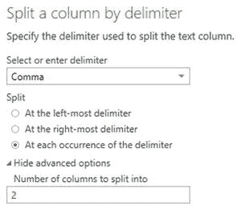

图 11-12. 使用分隔符拆分列

您可能遇到的另一种情况是，数据源包含的数据不是表格形式，而是矩阵形式，如图 11-13 所示。

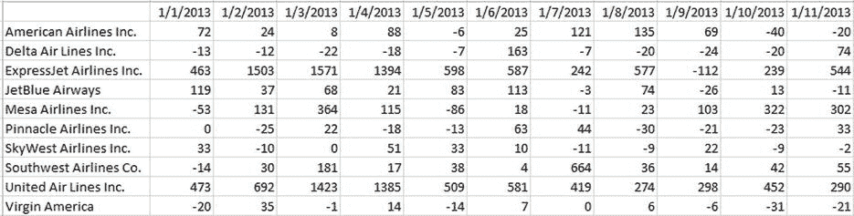

图 11-13. 使用矩阵作为数据源

为了将此数据导入数据模型，您需要对数据进行逆透视，以使其呈现为表格形式。在查询编辑器中，选择需要逆透视的列（参见图 11-14）。

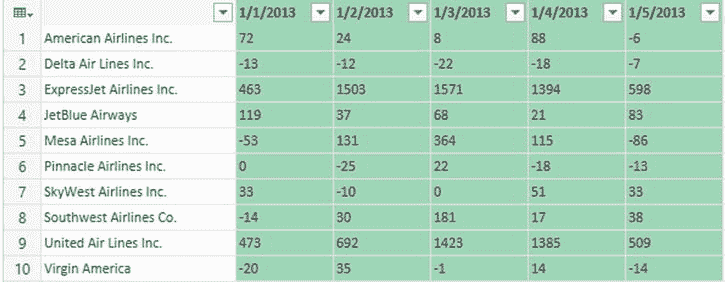

图 11-14. 选择要逆透视的列

在 `Home` 选项卡中，选择 `Unpivot` 转换。数据取消透视后，您将从原始列标题中获得一个 `Attribute` 列和一个 `Value` 列（参见图 11-15）。在导入数据之前，您应该重命名这些列。

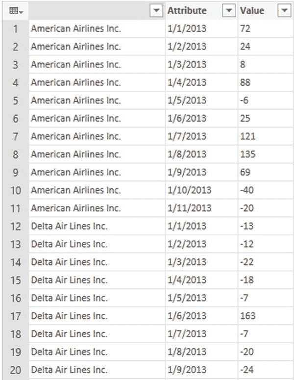

图 11-15. 取消透视转换生成的行

在将数据导入模型时，您通常不需要明细级别的数据；相反，您需要更高层级的聚合值——例如，产品级别的销售额或月度销售额。使用 `Power Query`，您可以轻松地在导入前对数据进行分组和聚合。

## 对数据进行分组和聚合

对数据进行分组和聚合是导入原始数据时可能遇到的常见场景。例如，根据分析需要，您可能需要按月或销售区域汇总数据。若要在查询编辑器中对数据进行聚合和分组，请选择要分组的列，然后选择 `Home` 选项卡中的 `Group By` 转换。系统将弹出一个 `Group By` 窗口（参见图 11-16）。

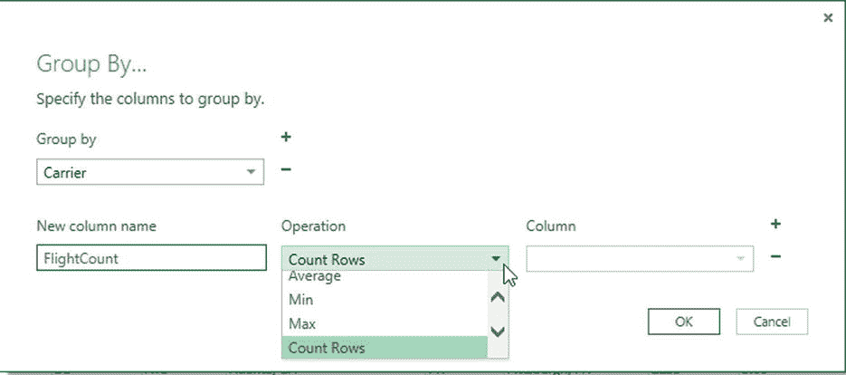

图 11-16. 在 Power Query 中对数据进行分组

您可以使用标准聚合函数按多列分组并聚合多列。图 11-17 展示了按 `Origin` 和 `Carrier` 分组并聚合平均及最大起飞延误的部分结果。

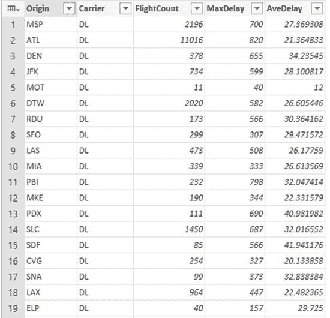

图 11-17. 对航班数据进行分组和聚合

使用 `Power Query` 导入数据时可能遇到的最后一项需求是插入计算列。这稍微高级一些，因为您需要编写代码，您将在下一节中看到这一点。

## 插入计算列

到目前为止，您已经能够使用 `Power Query` 提供的可视化界面构建并执行查询。然而，在后台，`Power Query` 编辑器正在创建一个用于执行查询的文件。该文件用一种名为 `M` 的新语言编写。正如您所见，即使不了解 `M` 或无需学习其工作原理，您也能从 `Power Query` 中获得大量功能。尽管如此，您至少应该知道它的存在，并且知道运行查询时执行的就是 `M` 代码。如果导航到查询编辑器的 `View` 选项卡，您会看到一个打开 `Advanced Editor` 的选项，它将显示用于构建查询的 `M` 代码（参见图 11-18）。

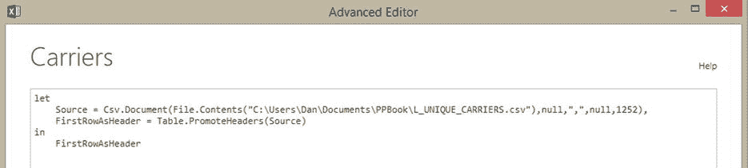

图 11-18. 使用 M 构建查询

您可以使用 `Advanced Editor` 直接用 `M` 编写查询，从而使用可视化界面工具中未公开的某些高级数据处理功能。

如果要在查询中插入计算列，您需要使用 `M` 函数。在查询编辑器的 `Insert` 选项卡中，您可以复制列、插入索引列、合并列以及插入自定义列。当您选择 `Insert A Custom Column` 选项时，系统会弹出一个 `Insert Custom Column` 编辑器，您可以在其中插入用于创建列的 `M` 函数（参见图 11-19）。

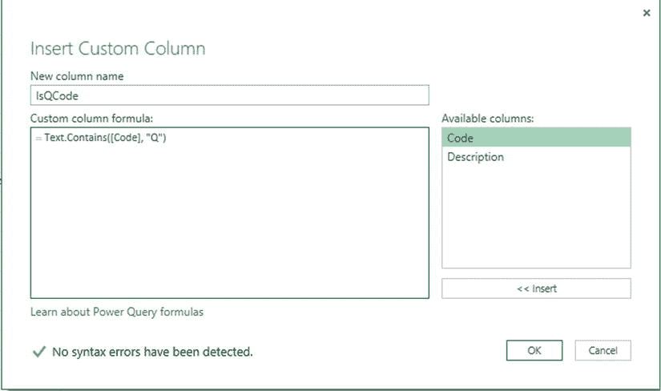

图 11-19. 使用 M 公式创建列

图 11-20 显示了添加自定义列后的查询结果。

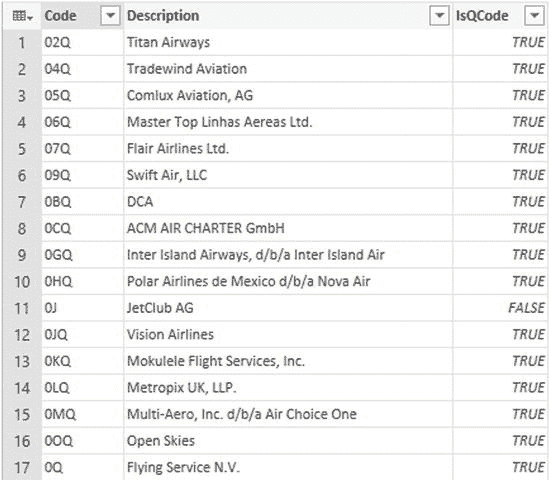

图 11-20. 显示查询结果

因此，如果您需要在将数据插入 `Power Pivot` 模型之前使用 `Power Query` 创建列，请使用 `M` 公式。如果在将数据导入 `Power Pivot` 模型后创建列，则使用 `DAX` 公式。

现在您已经了解了 `Power Query` 的工作原理，是时候动手实践，用它来导入数据了。要完成本实验，假设您已安装了最新的 `Power Query` 加载项。

# 动手实验——使用 Power Query 导入和调整数据

在以下实验中，您将：

*   创建查询以导入数据。
*   筛选和转换数据。
*   追加和调整数据。
*   分组和聚合数据。

1.  在`LabStarters`文件夹中，打开`LabChapter11.xlsx`文件。此文件包含一个基本的 Power Pivot 模型，您将使用 Power Query 向其添加数据。
2.  在 Excel 中选择`Power Query`选项卡。在`Get External Data`下，选择`From File`，然后选择`From CSV`选项。导航到`LabStarters`文件夹中的`FlightPerformance_2012_10.csv`文件。您应该会看到查询编辑器窗口，其中包含航空公司延误数据，如图 11-21 所示。

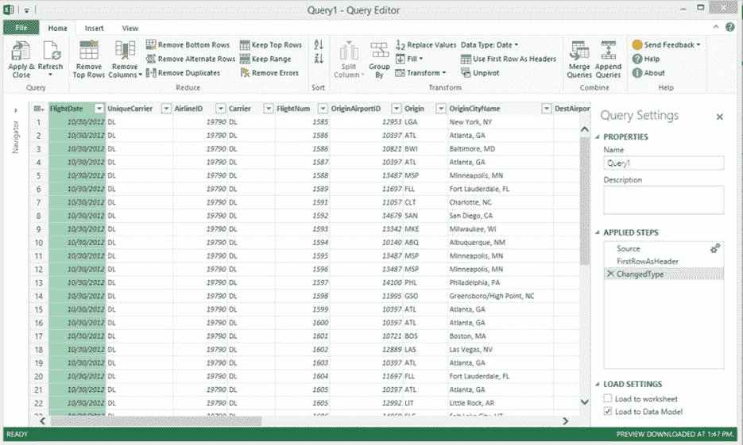

图 11-21. 显示延误数据的查询编辑器窗口

3.  在`Query Settings`窗格中，将查询重命名为`FlightDelays`，并取消选中`Load To Data Model`。
4.  在`Applied Steps`列表中，如果查询编辑器未自动添加将第一行设置为标题的转换，请立即添加。
5.  检查每列的数据类型，查看查询编辑器是否已将`FlightDate`更新为`Date`数据类型，并将数字类型列更新为`Number`数据类型。如果未更新，请立即更改。
6.  删除`UniqueCarrier`、`FlightNum`、`AirTime`、`Flights`和`Distance`列。
7.  筛选数据，使其仅提取航班起飞延误时间大于 15 分钟的行。
8.  选择`Apply & Close`以保存查询。
9.  对`FlightPerformance_2012_11.csv`文件重复步骤 2-8，但这次将查询命名为`FlightDelays2`。
10. 现在您应该有两个工作簿查询，如图 11-22 所示。

图 11-22. 当前工作簿查询

11. 双击`FlightDelays`查询，在查询编辑器中重新打开它。
12. 选择`Home`选项卡`Combine`部分中的`Append Queries`选项。将`FlightDelays2`查询追加到`FlightDelays`查询。
13. 选择`OriginCityName`列，使用逗号将其拆分为两个列，分别命名为`OriginCity`和`OriginState`。对`DestCityName`列执行相同操作。
14. 将`City`列中的`West Palm Beach/Palm Beach`替换为`Palm Beach`。
15. 选中`Load To Data Model`加载设置，然后单击`Apply & Close`按钮。
16. 打开 Power Pivot 模型，验证表是否已加载。
17. 在 Excel 中选择`Power Query`选项卡。在`Get External Data`下，选择`From File`，然后选择`From CSV`选项。导航到`LabStarters`文件夹中的`FlightPerformance_2012_12.csv`文件。
18. 在`Query Settings`窗格中，将查询重命名为`DelaySummary`，并取消选中`Load To Data Model`。
19. 保留`Carrier`、`Origin`和`DepDelay`列，删除其余列。
20. 筛选出延误时间小于 15 分钟的数据。
21. 按`Origin`和`Carrier`分组，计算平均延误和最大延误（参见图 11-23）。

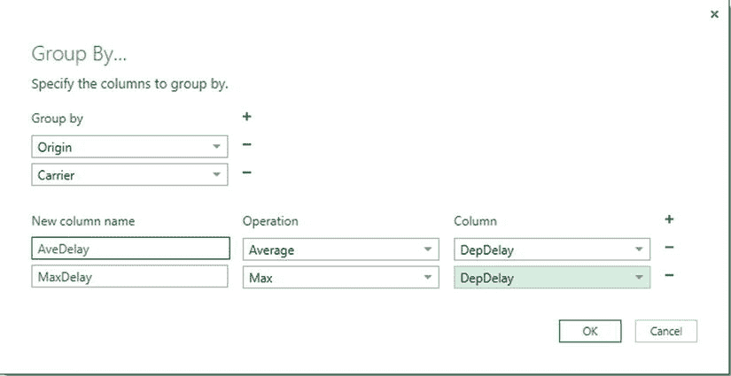

图 11-23. 按出发地和承运人分组

22. 点击`应用并关闭`按钮以保存查询。
23. 添加一个名为`Carriers`的查询，用于从`Carriers.csv`文件中获取代码和描述内容。
24. 打开`DelaySummary`查询，然后在`开始`选项卡中选择`合并查询`选项。使用`Carriers`查询，将`DelaySummary`查询中匹配`Carrier`列的`Description`列与`Carriers`查询中的`Code`列进行合并（参见图 11-24）。

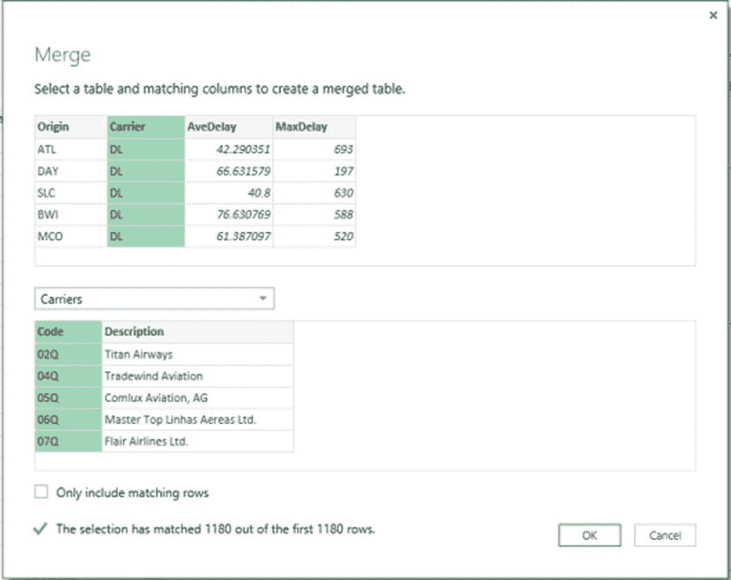

图 11-24. 合并两个查询中的数据

25. 将`Carrier`列重命名为`CarrierCode`，将`Description`列重命名为`Carrier`。
26. 完成后，在`加载设置`下，勾选`加载到数据模型`复选框，然后点击`开始`选项卡上的`应用并关闭`按钮。
27. 完成后，打开 Power Pivot 模型，验证表已添加至模型中。

## 总结

Power Query 是一个非常实用的工具，可用于从多种不同类型的数据源获取数据。在本章中，您学习了如何使用 Power Query 通过直观的界面来整理、清理和转换数据，而无需编写代码。Power Query 会为您生成代码，但不会将其隐藏。如果您需要修改或增强代码，可以使用`高级编辑器`视图。尽管本章仅浅显地介绍了 M 查询语言，但随着您使用 Power Query 经验的积累，您可能会希望更深入地研究 M 编码语言。

在下一章中，即第 12 章，您将了解另一个可添加到自助式 BI 工具库中的实用 Excel 插件。Power Map 极大地扩展了您可用的地图可视化功能。它可以通过在 Bing 地图上以柱形图、热力图和气泡图的形式绘制多达一百万个数据点，来生成 3D 可视化效果。如果数据带有时间戳，它还能生成交互式视图，展示数据在空间和时间上的变化。