# 第三部分


使用`Power Query`和`Power Map`探索和呈现数据

# 第 11 章


## 使用 `Power Query` 进行数据发现

虽然 `Power Pivot` 提供了多种可用于查询数据的连接类型，但有时你需要在将数据加载到模型之前对其进行操作。这个过程通常被称为 `ETL`（提取、转换和加载）过程中的转换部分。这正是 `Power Query` 大放异彩之处，也是你的 `BI` 工具集中非常有用的部分。`Power Query` 提供了一个易于使用的界面，用于发现和转换数据。它包含清理和塑形数据的工具，例如删除重复项、替换值和分组数据。此外，它还支持大量结构化和非结构化数据源，例如关系数据库、网页和 `Hadoop` 等。一旦数据被提取和转换，你就可以轻松地将其加载到 `Power Pivot` 模型中。

完成本章后，你将能够：

*   从各种来源发现和导入数据。
*   清理数据。
*   合并、塑形和筛选数据。
*   对数据进行分组和聚合。
*   插入计算列。

### 发现和导入数据

传统上，如果你需要合并和转换来自各种不同数据源的数据，你将依赖 IT 部门使用诸如 `SQL Server Integration Services (SSIS)` 之类的工具为你暂存数据。这可能是一个漫长而费力的过程，包括数据发现、清理以及将数据符合关系结构。尽管这种正式的工作对于加载和符合企业运营数据存储的数据是必需的，但很多时候你只是想快速、直观且敏捷地将来自各种来源的数据添加到你的 `Power Pivot` 模型中。为了支持这一点，你可以使用 `Power Query`（Excel 的一个免费加载项）作为你的自助式 `BI` `ETL` 工具。下载并安装最新版本的 `Power Query` 后，你将在 Excel 中看到一个名为 `Power Query` 的新选项卡（参见 Figure 11-1）。

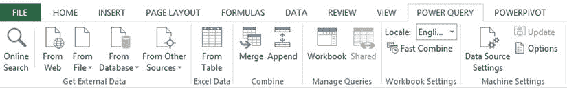

Figure 11-1. 新的 `Power Query` 选项卡

如果你查看选项卡的 `获取外部数据` 区域，你可以看到可用的各种数据源。你可以从网页、文件、数据库以及各种其他来源获取数据（参见 Figure 11-2）。

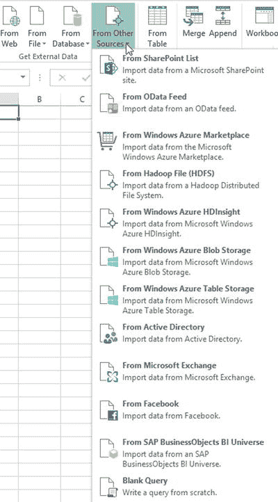

Figure 11-2. `Power Query` 中可用的部分数据源

连接类型将决定您需要通过哪些信息来获取数据源的访问权限。例如，Web 源需要提供 `URL`，而 CSV 文件则需要提供文件路径。连接到数据源后，将启动查询编辑器窗口，并显示数据样本。例如，图 11-3 展示了 CSV 文件中包含的航班延误数据。

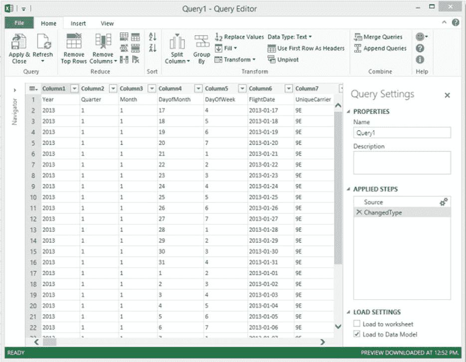

图 11-3. 查询编辑器窗口

如果您选择包含多个表的数据源，Excel 中将显示导航器窗格。图 11-4 展示了连接到 Access 源时显示的导航器窗格。选择表后，查询编辑器将显示样本数据。

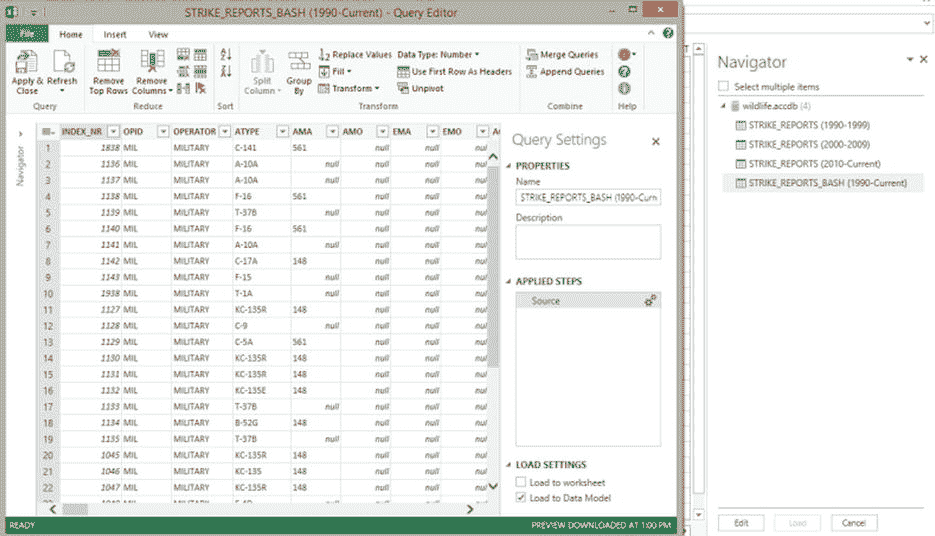

图 11-4. 使用导航器窗格选择表

查看查询编辑器窗口的“查询设置”窗格，您可以发现能够为查询命名并添加描述。如果您希望重用和共享创建的查询（这些功能仅在 Office 365 中可用），这一点非常重要。该窗格还显示了您创建查询所采用的步骤以及数据加载的位置。您可以选择将数据加载到工作表或 `Power Pivot` 数据模型中。

连接到数据源后，下一步是在将数据导入数据模型之前对数据进行转换、清理和筛选。

### 转换、清理和筛选数据

连接到数据源后，您就可以开始转换和清理数据了。这是一个重要步骤，将在很大程度上决定数据对分析工作的支持程度。您会执行的一些常见转换包括删除重复项、替换值、删除错误值和更改数据类型。例如，在图 11-5 中，源 CSV 文件中的 `FlightDate` 列是文本数据类型，但您希望它在模型中成为日期列。

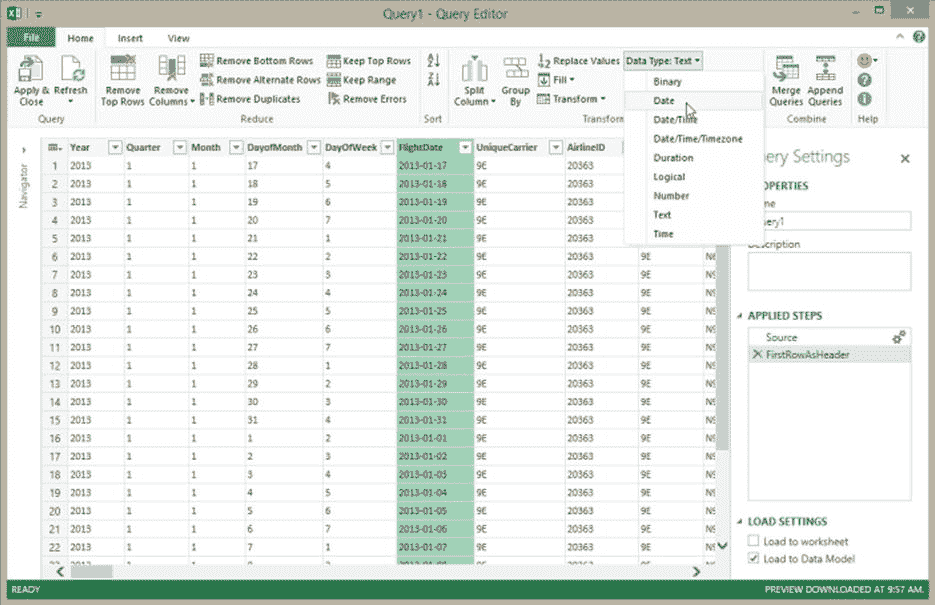

图 11-5. 更改列的数据类型

通常，您需要替换来自源系统的值，以便它们在模型中能够同步。例如，CSV 文件中列出的承运人代码 `VX`，在您现有数据中的值是 `VG`。您可以通过选择列，然后在菜单中选择“替换值”转换，在数据导入时轻松替换这些值。这将启动一个窗口，您可以在其中输入要查找的值以及要替换为的值（参见图 11-6）。

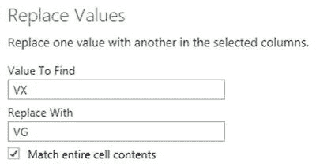

图 11-6. 替换列中的值

从源加载数据时，另一个常见要求是筛选掉不必要的列和行。要删除列，只需选择列，然后点击“开始”选项卡上的“删除列”按钮。如果您只需要几列，也可以选择想要保留的列，然后选择“删除其他列”选项。您可以通过点击列名旁边的下拉菜单并输入筛选条件来筛选行（参见图 11-7）。

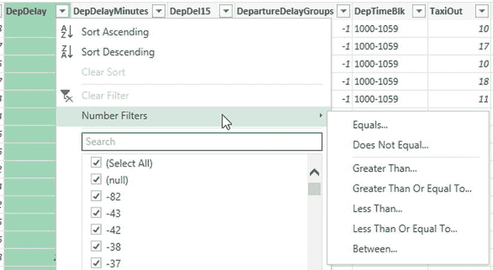

图 11-7. 筛选行

在应用数据转换和筛选时，查询编辑器会列出您已应用的步骤。这使您能够组织并跟踪对数据所做的更改。您可以通过右键单击列表中的步骤来重命名、重新排列和删除步骤（参见图 11-8）。

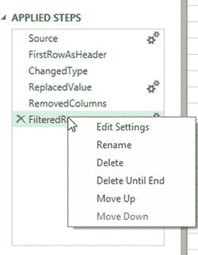

图 11-8. 管理查询步骤

在清理和转换数据之后，您可能需要将来自多个源的数据合并到数据模型的一个表中，或者展开列中包含的数据。

### 合并和调整数据

有时，您可能需要先将来自多个表和/或源的数据合并，然后再将数据加载到模型中。例如，如果一个表中包含链接到另一个查找表的代码，而该查找表包含字段的完整值。处理这种情况的一种方法是将两个表都导入模型，并在 `Power Pivot` 模型中创建表之间的链接。另一种选择是在导入数据之前将表合并在一起。例如，在您之前看到的航班数据中，有一个 `UniqueCarrier` 列包含承运人代码。您可以将这些代码与另一个包含承运人代码和承运人名称的 CSV 文件合并。首先在查询编辑器中为每组数据创建并保存一个查询。对于查找表，您可以取消选中“加载到工作表”和“加载到数据模型”复选框，因为合并后才会加载数据，所以不需要这些。接下来，打开主查询，并在“开始”选项卡上选择“合并”按钮。这将启动“合并”窗口（参见图 11-9），您可以在其中选择查找查询以及连接数据的列。

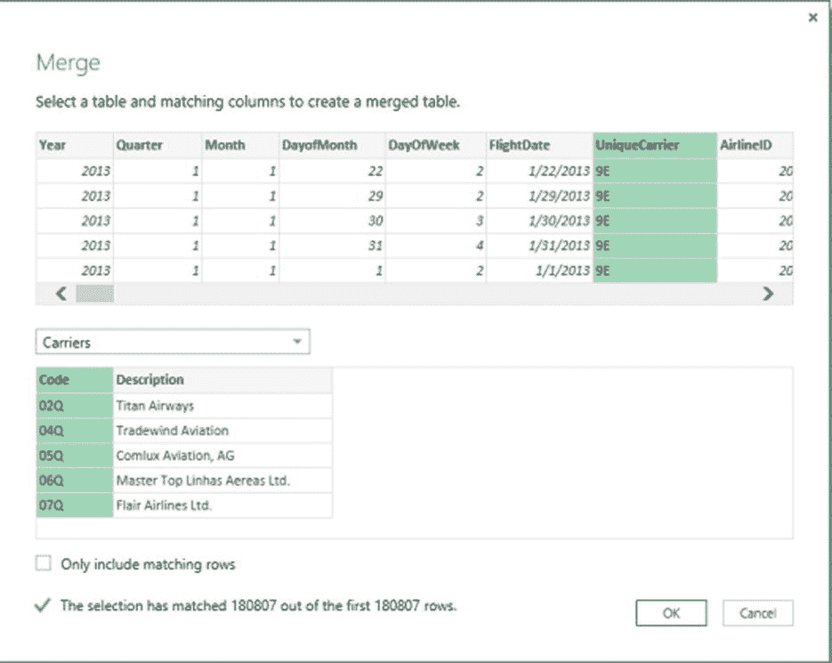

图 11-9. 合并来自两个查询的数据

合并查询后，您可以选择要合并的列（参见图 11-10）。列合并后，您可能希望重命名主查询中的列。

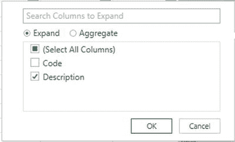

图 11-10. 选择要合并的列

除了合并来自查找表的数据外，您可能还需要追加来自两个不同源的数据。例如，假设您每年都有分开存储在不同源文件或表中的航班数据，并且希望将多年的数据合并到同一个表中。在这种情况下，您需要创建两个相似的查询，每个查询使用不同的源。首先在查询编辑器中打开其中一个查询，然后选择“开始”选项卡上的“追加查询”按钮。接着，您可以选择另一个查询作为要追加的表（参见图 11-11）。

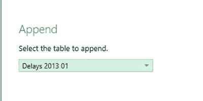

图 11-11. 追加两个查询

有时，源数据可能以列的形式提供给您，需要拆分为多列。例如，您可能需要拆分城市和州，或者名字和姓氏。为此，请在查询编辑器中选择该列，并在“开始”选项卡上选择“拆分列”。您可以按分隔符或按字符数拆分列（参见图 11-12）。

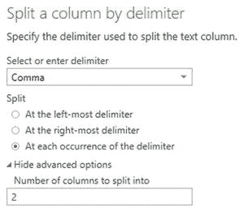

图 11-12. 使用分隔符拆分列

您可能遇到的另一种情况是，数据源包含的数据不是表格形式，而是矩阵形式，如图 11-13 所示。

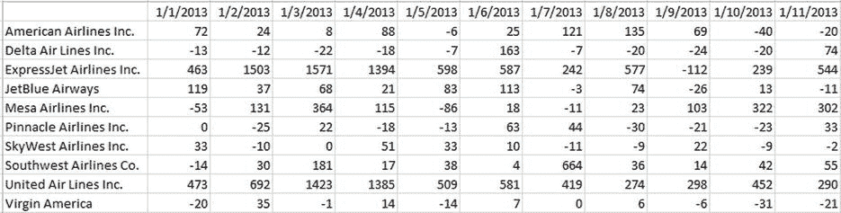

图 11-13. 使用矩阵作为数据源

为了将此数据导入数据模型，您需要对数据进行逆透视，以使其呈现为表格形式。在查询编辑器中，选择需要逆透视的列（参见图 11-14）。

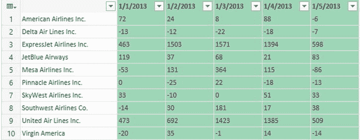

图 11-14. 选择要逆透视的列

在 `Home` 选项卡中，选择 `Unpivot` 转换。数据取消透视后，您将从原始列标题中获得一个 `Attribute` 列和一个 `Value` 列（参见图 11-15）。在导入数据之前，您应该重命名这些列。

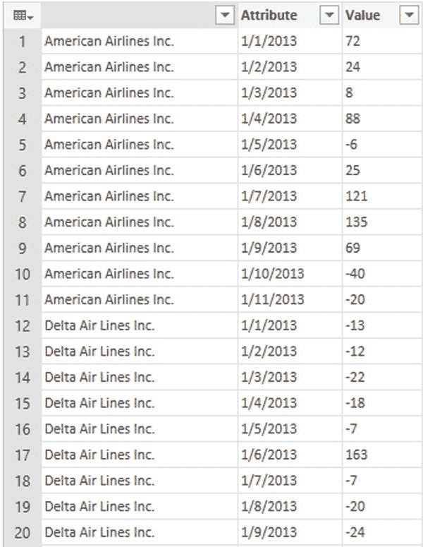

图 11-15. 取消透视转换生成的行

在将数据导入模型时，您通常不需要明细级别的数据；相反，您需要更高层级的聚合值——例如，产品级别的销售额或月度销售额。使用 `Power Query`，您可以轻松地在导入前对数据进行分组和聚合。

## 对数据进行分组和聚合

对数据进行分组和聚合是导入原始数据时可能遇到的常见场景。例如，根据分析需要，您可能需要按月或销售区域汇总数据。若要在查询编辑器中对数据进行聚合和分组，请选择要分组的列，然后选择 `Home` 选项卡中的 `Group By` 转换。系统将弹出一个 `Group By` 窗口（参见图 11-16）。

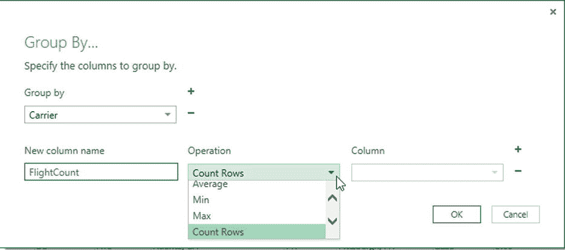

图 11-16. 在 Power Query 中对数据进行分组

您可以使用标准聚合函数按多列分组并聚合多列。图 11-17 展示了按 `Origin` 和 `Carrier` 分组并聚合平均及最大起飞延误的部分结果。

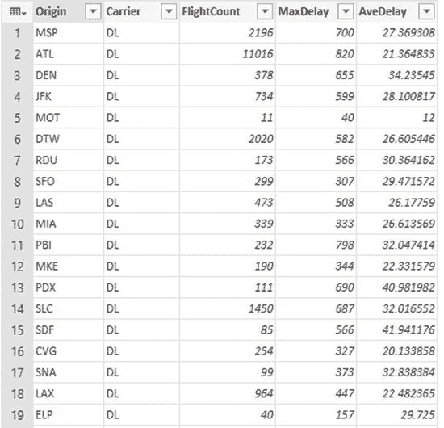

图 11-17. 对航班数据进行分组和聚合

使用 `Power Query` 导入数据时可能遇到的最后一项需求是插入计算列。这稍微高级一些，因为您需要编写代码，您将在下一节中看到这一点。

## 插入计算列

到目前为止，您已经能够使用 `Power Query` 提供的可视化界面构建并执行查询。然而，在后台，`Power Query` 编辑器正在创建一个用于执行查询的文件。该文件用一种名为 `M` 的新语言编写。正如您所见，即使不了解 `M` 或无需学习其工作原理，您也能从 `Power Query` 中获得大量功能。尽管如此，您至少应该知道它的存在，并且知道运行查询时执行的就是 `M` 代码。如果导航到查询编辑器的 `View` 选项卡，您会看到一个打开 `Advanced Editor` 的选项，它将显示用于构建查询的 `M` 代码（参见图 11-18）。

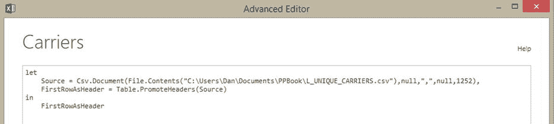

图 11-18. 使用 M 构建查询

您可以使用 `Advanced Editor` 直接用 `M` 编写查询，从而使用可视化界面工具中未公开的某些高级数据处理功能。

如果要在查询中插入计算列，您需要使用 `M` 函数。在查询编辑器的 `Insert` 选项卡中，您可以复制列、插入索引列、合并列以及插入自定义列。当您选择 `Insert A Custom Column` 选项时，系统会弹出一个 `Insert Custom Column` 编辑器，您可以在其中插入用于创建列的 `M` 函数（参见图 11-19）。

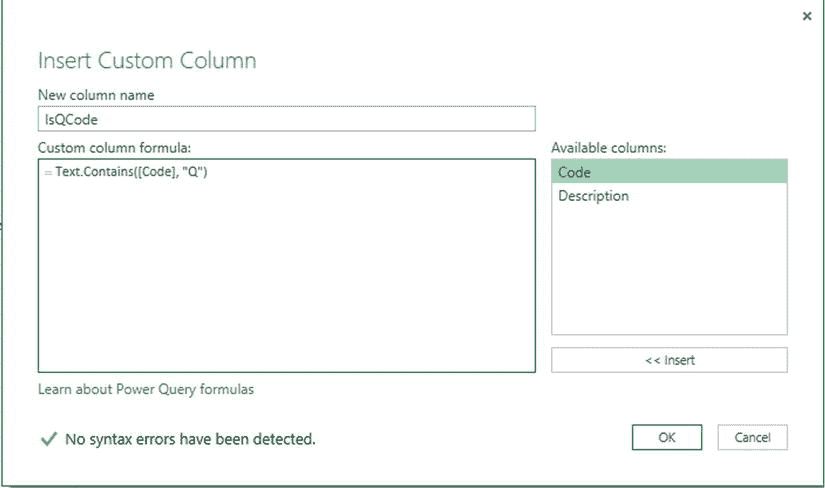

图 11-19. 使用 M 公式创建列

图 11-20 显示了添加自定义列后的查询结果。

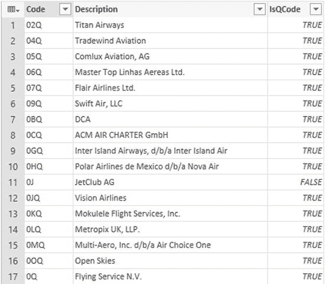

图 11-20. 显示查询结果

因此，如果您需要在将数据插入 `Power Pivot` 模型之前使用 `Power Query` 创建列，请使用 `M` 公式。如果在将数据导入 `Power Pivot` 模型后创建列，则使用 `DAX` 公式。

现在您已经了解了 `Power Query` 的工作原理，是时候动手实践，用它来导入数据了。要完成本实验，假设您已安装了最新的 `Power Query` 加载项。

# 动手实验——使用 Power Query 导入和调整数据

在以下实验中，您将：

*   创建查询以导入数据。
*   筛选和转换数据。
*   追加和调整数据。
*   分组和聚合数据。

1.  在`LabStarters`文件夹中，打开`LabChapter11.xlsx`文件。此文件包含一个基本的 Power Pivot 模型，您将使用 Power Query 向其添加数据。
2.  在 Excel 中选择`Power Query`选项卡。在`Get External Data`下，选择`From File`，然后选择`From CSV`选项。导航到`LabStarters`文件夹中的`FlightPerformance_2012_10.csv`文件。您应该会看到查询编辑器窗口，其中包含航空公司延误数据，如图 11-21 所示。

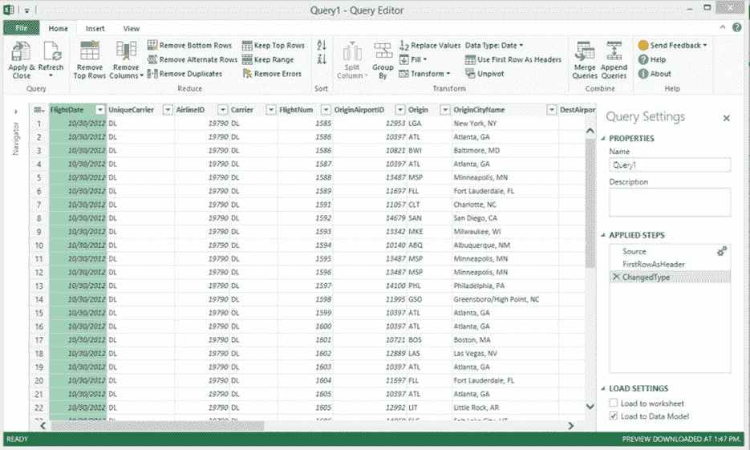

图 11-21. 显示延误数据的查询编辑器窗口

3.  在`Query Settings`窗格中，将查询重命名为`FlightDelays`，并取消选中`Load To Data Model`。
4.  在`Applied Steps`列表中，如果查询编辑器未自动添加将第一行设置为标题的转换，请立即添加。
5.  检查每列的数据类型，查看查询编辑器是否已将`FlightDate`更新为`Date`数据类型，并将数字类型列更新为`Number`数据类型。如果未更新，请立即更改。
6.  删除`UniqueCarrier`、`FlightNum`、`AirTime`、`Flights`和`Distance`列。
7.  筛选数据，使其仅提取航班起飞延误时间大于 15 分钟的行。
8.  选择`Apply & Close`以保存查询。
9.  对`FlightPerformance_2012_11.csv`文件重复步骤 2-8，但这次将查询命名为`FlightDelays2`。
10. 现在您应该有两个工作簿查询，如图 11-22 所示。

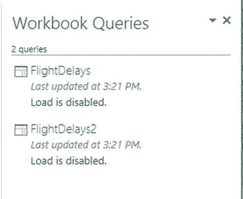

图 11-22. 当前工作簿查询

11. 双击`FlightDelays`查询，在查询编辑器中重新打开它。
12. 选择`Home`选项卡`Combine`部分中的`Append Queries`选项。将`FlightDelays2`查询追加到`FlightDelays`查询。
13. 选择`OriginCityName`列，使用逗号将其拆分为两个列，分别命名为`OriginCity`和`OriginState`。对`DestCityName`列执行相同操作。
14. 将`City`列中的`West Palm Beach/Palm Beach`替换为`Palm Beach`。
15. 选中`Load To Data Model`加载设置，然后单击`Apply & Close`按钮。
16. 打开 Power Pivot 模型，验证表是否已加载。
17. 在 Excel 中选择`Power Query`选项卡。在`Get External Data`下，选择`From File`，然后选择`From CSV`选项。导航到`LabStarters`文件夹中的`FlightPerformance_2012_12.csv`文件。
18. 在`Query Settings`窗格中，将查询重命名为`DelaySummary`，并取消选中`Load To Data Model`。
19. 保留`Carrier`、`Origin`和`DepDelay`列，删除其余列。
20. 筛选出延误时间小于 15 分钟的数据。
21. 按`Origin`和`Carrier`分组，计算平均延误和最大延误（参见图 11-23）。

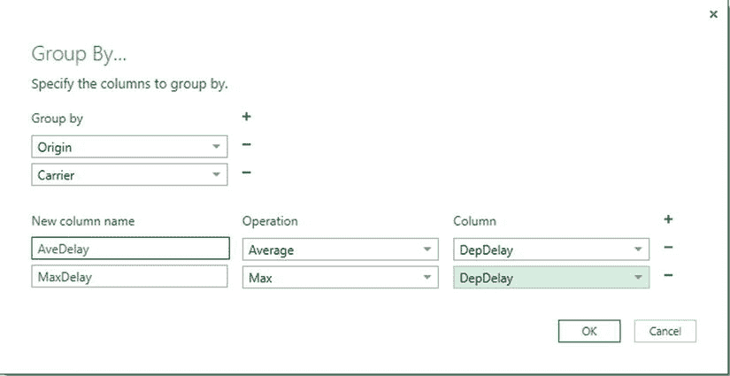

图 11-23. 按出发地和承运人分组

22. 点击`应用并关闭`按钮以保存查询。
23. 添加一个名为`Carriers`的查询，用于从`Carriers.csv`文件中获取代码和描述内容。
24. 打开`DelaySummary`查询，然后在`开始`选项卡中选择`合并查询`选项。使用`Carriers`查询，将`DelaySummary`查询中匹配`Carrier`列的`Description`列与`Carriers`查询中的`Code`列进行合并（参见图 11-24）。

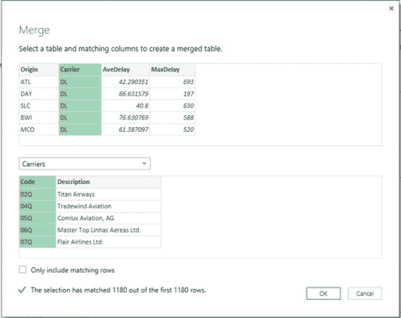

图 11-24. 合并两个查询中的数据

25. 将`Carrier`列重命名为`CarrierCode`，将`Description`列重命名为`Carrier`。
26. 完成后，在`加载设置`下，勾选`加载到数据模型`复选框，然后点击`开始`选项卡上的`应用并关闭`按钮。
27. 完成后，打开 Power Pivot 模型，验证表已添加至模型中。

## 总结

Power Query 是一个非常实用的工具，可用于从多种不同类型的数据源获取数据。在本章中，您学习了如何使用 Power Query 通过直观的界面来整理、清理和转换数据，而无需编写代码。Power Query 会为您生成代码，但不会将其隐藏。如果您需要修改或增强代码，可以使用`高级编辑器`视图。尽管本章仅浅显地介绍了 M 查询语言，但随着您使用 Power Query 经验的积累，您可能会希望更深入地研究 M 编码语言。

在下一章中，即第 12 章，您将了解另一个可添加到自助式 BI 工具库中的实用 Excel 插件。Power Map 极大地扩展了您可用的地图可视化功能。它可以通过在 Bing 地图上以柱形图、热力图和气泡图的形式绘制多达一百万个数据点，来生成 3D 可视化效果。如果数据带有时间戳，它还能生成交互式视图，展示数据在空间和时间上的变化。

# 第 12 章


## 使用 Power Map 进行地理空间分析

Power Map 是一款 Excel 插件，为您提供了一组强大的工具，帮助您可视化并深入了解包含地理编码组件的大型数据集。它可以通过在 Bing 地图上以柱形图、热力图和气泡图的形式绘制多达一百万个数据点，来生成 3D 可视化效果。如果数据带有时间戳，它还能生成交互式视图，展示数据在空间和时间上的变化。在本章中，您将学习如何使用 Power Map 创建引人入胜且独特的数据可视化呈现。

完成本章后，您将能够：

-   准备用于地图映射的数据。
-   创建基于地图的图表。
-   创建热力图和区域图。
-   为地图添加多个图层。
-   分析随时间的变化。
-   创建导览。

 **注意** 如需获取彩色图表副本，请访问 `http://www.apress.com/9781430264453` 的源代码/下载部分。

### 准备用于映射的数据

与任何成功的数据分析工作一样，正确地准备数据以支持该项工作是至关重要的。Power Map 可以使用以下两种数据源之一来制作地图：Excel 表格或 Power Pivot 数据模型中的表格。表格的主要要求是它必须包含唯一的行。它还必须包含位置数据，位置数据可以采用 `纬度` / `经度` 对的形式，但这不是强制要求。您可以使用地址字段（例如 `街道`、`城市`、`国家/地区`、`邮政编码` 和 `省/自治区/直辖市`），这些字段可由 Bing 进行地理定位。您可能需要结合使用多个列才能获得精确的映射。例如，许多同名城市位于不同的州和/或国家。

除了地理定位列，表格行还需包含您希望在地图上绘制的度量。度量必须是数值数据类型之一，例如用于计数的整数和用于销售额的货币/小数。如果您想比较数据随时间的变化，最后一项要求是每行必须包含一个日期或时间字段。图 12-1 显示了一个 Power Pivot 数据模型中的表格，该表格包含有关飞机鸟击事件的信息。由于该表格包含机场位置信息以及鸟击事件信息，因此您可以将其用作 Power Map 的数据源。请记住，尽管这些数据可以精确定位到经纬度级别，但您也可以使用任何位置字段来映射数据。例如，如果没有 `经度` 和 `纬度` 字段，您仍然可以使用 `城市` 或 `州` 字段来映射数据。

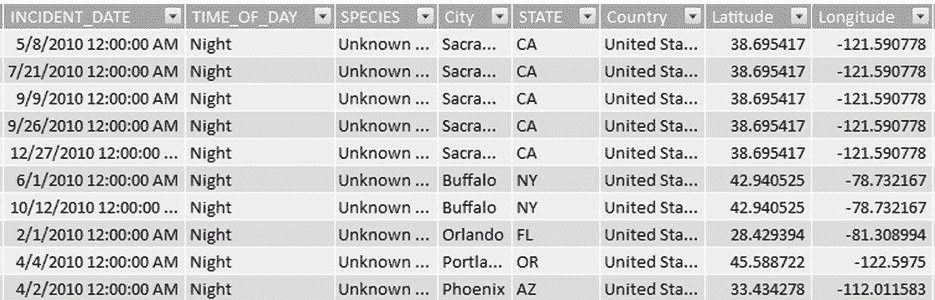

图 12-1. 包含可在 Power Map 中使用的位置信息的鸟击数据

如果您需要从外部源获取地图数据并对其进行整理以便在 Power Map 中使用，请记住上一章的内容：Power Query 是实现此目的的绝佳工具。一旦数据准备妥当，您就可以开始创建地图了。

### 创建基于地图的图表

要启动 Power Map，请转到 Excel 中的 `插入` 选项卡，点击 `地图` 下拉菜单，然后选择 `启动 Power Map`。如果这是您在该 Excel 工作簿中创建的第一个地图，它将启动 Power Map 界面，您可以在其中设计和查看地图（参见图 12-2）。

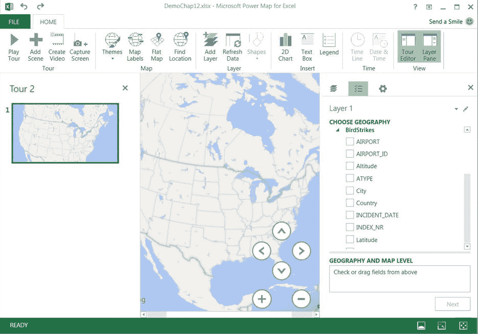

图 12-2. Power Map 界面

Power Map 界面中有三个窗格。左侧的是 `导览编辑器`。您可以在此处将地图的不同视图添加为场景，然后使用这些场景创建数据的视频导览。中间窗格是绘制数据的地图。您可以平移和缩放地图进行交互，从不同角度查看数据。右侧窗格是 `图层窗格`，您可在此处创建将绘制在地图上的数据图层。每个图层代表一组要在地图上添加或移除的数据。您可以通过切换 `开始` 选项卡中 `视图` 部分的按钮来显示或隐藏 `导览编辑器` 和 `图层窗格`（参见图 12-3）。

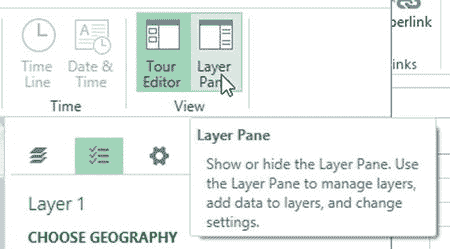

图 12-3. 显示/隐藏窗格

要开始创建地图，您需要使用 `图层窗格` 创建一个图层。一个图层代表一个特定的数据集。您可以创建多个图层并将它们叠加在一起。例如，您可以创建一个显示河流水位高度的图层，再创建另一个显示降雨量的图层，然后将 `降雨量` 图层放置在 `河流水位高度` 图层之上。

为图层选择好数据后，您就可以将其整合到地图中了。在 `图层窗格` 的 `选择地理区域` 区域中，选择您要在地图上绘制的地理区域字段。这些字段可以是 `城市`、`州` 或 `纬度` / `经度` 等。选择地理区域字段后，您将看到位置被绘制在地图上（参见图 12-4）。

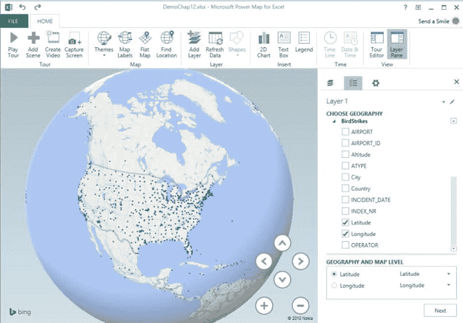

图 12-4. 选择地理区域字段

下一步是在图层中选择要创建的图表类型。您可以选择堆积柱形图、簇状柱形图或气泡图。此外，您还可以创建热力图或区域图。首次创建地图时，默认选择的是堆积柱形图。选定图表类型后，您需要将字段添加到各个部分。例如，堆积柱形图需要为 `Category`（类别）区域提供一个字段。您还可以为 `Height`（高度）和 `Time`（时间）区域添加字段。如果没有为 `Height` 添加字段，则每个类别值的行计数将被使用。图 12-5 展示了被选为 `Category` 的飞行阶段以及生成的堆积柱形图，该图显示了不同机场每个阶段的鸟击数量。

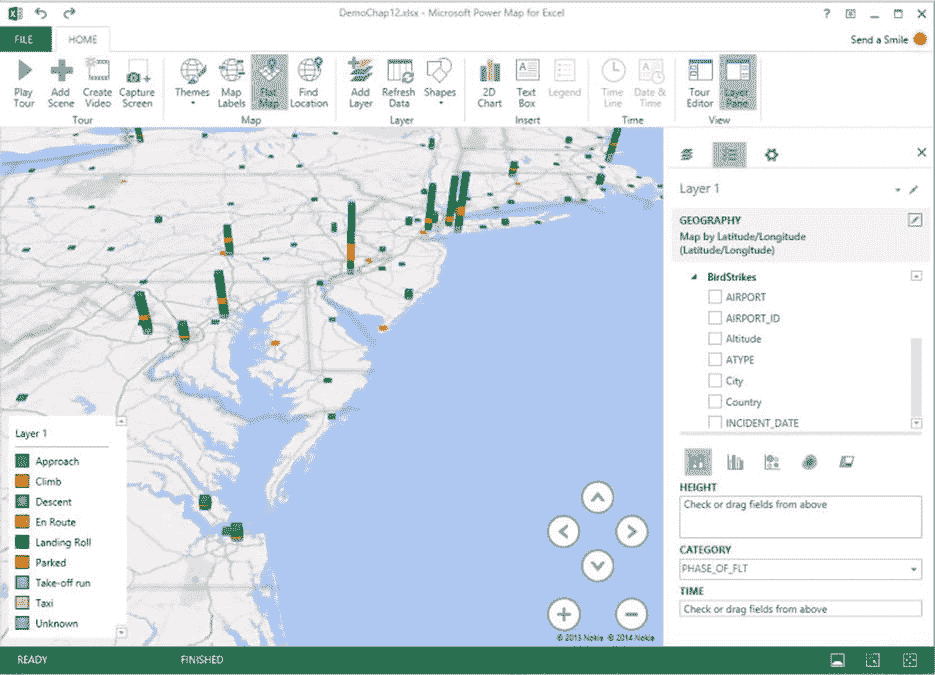

图 12-5. 创建堆积柱形图

您可以根据哪种图表能更好地展示数据，轻松地将堆积柱形图更改为簇状柱形图。

气泡图与柱形图类似，不同之处在于它使用气泡和饼状楔形来展示数据。例如，图 12-6 中的气泡图按一天中的时间段显示了鸟击次数。

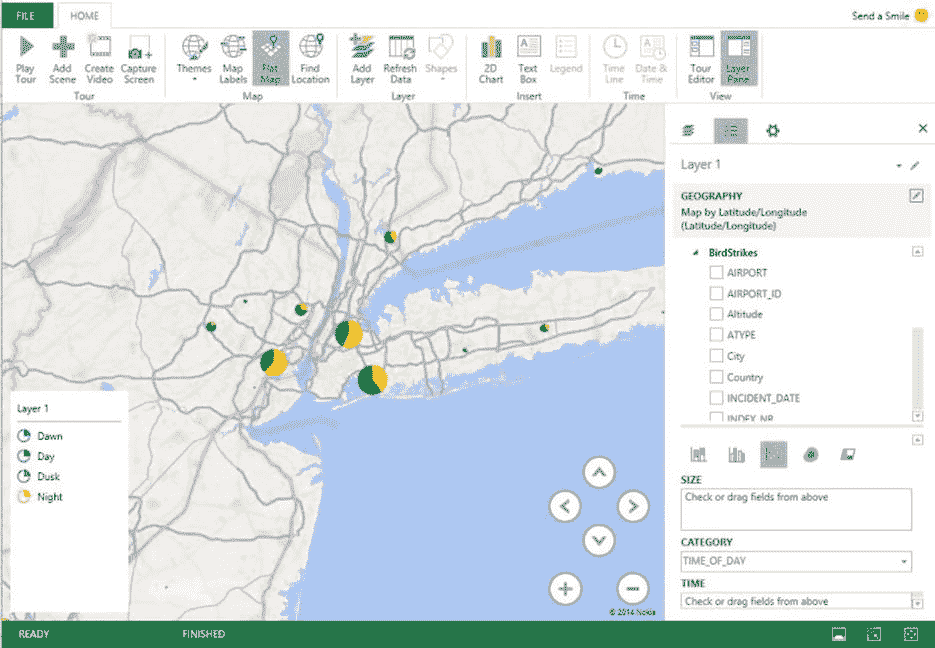

图 12-6. 创建气泡图

如您所见，创建堆积柱形图、簇状柱形图和气泡图的过程非常相似。另外两种彼此相似的图表类型是热力图和区域图。接下来将介绍这两种图。

### 创建热力图和区域图

Power Map 中一种有趣的地图类型是热力图。热力图将数据转换为颜色渐变。较高的值由较深的色调表示，而较低的值则由较浅的色调表示。尽管并非所有数据都适合用热力图表示，但对于某些类型的数据而言，这种图表类型非常有效。每当您想要分析某个值的相对强度时，热力图是一个不错的选择。例如，温度和降雨量等天气数据通常使用热力图来描绘（参见图 12-7）。

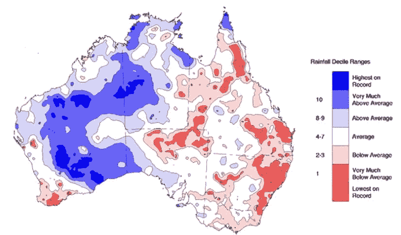

图 12-7. 降雨缺口热力图（来源：国家农业监测系统 [NAMS]）

在 Power Map 中创建热力图与创建堆积柱形图差别不大。首先，选择一个包含地理定位数据和您想要比较的值的表格。选择地理字段后，您可以将可视化效果更改为热力图，并选择要绘制的值字段。如果您没有选择值字段，它将绘制行计数。图 12-8 展示了一幅描绘某城市街区毒品相关犯罪活动的热力图。颜色越深表示犯罪率越高的区域。

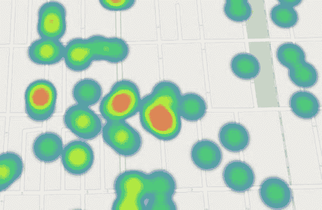

图 12-8. 描绘犯罪率的热力图

另一种与热力图相似的地图类型是区域图。区域图显示定义好的地理区域，例如国家、州、县和邮政编码。然后，它对区域进行颜色编码以比较值字段。常见的区域图类型之一是选举结果图。图 12-9 展示了一个按县划分的选举结果示例。红色代表共和党占多数，蓝色代表民主党占多数。色调越深，优势越大。


图 12-9. 区域图上的选举结果

要创建区域图，请在源表中选择区域字段作为地理字段，然后将可视化效果切换为区域。然后选择包含您想要在地图上显示的值的字段（参见图 12-10）。

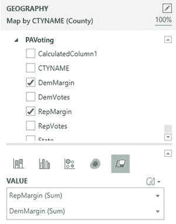

图 12-10. 为区域图选择值

每个区域将显示其值更大的值字段的颜色。通过选择 `Settings`（设置）选项卡下的图层选项，您可以更改地图上显示的值字段的颜色、不透明度和色阶（参见图 12-11）。

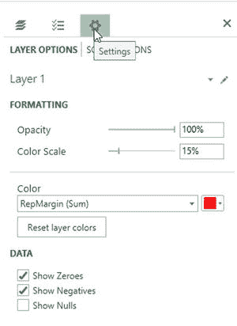

图 12-11. 调整区域图的颜色设置

在这种情况下，您可以调整颜色，使民主党优势显示为蓝色，共和党优势显示为红色（参见图 12-12）。


图 12-12. 区域图上描绘的投票优势

现在您已经了解了如何创建各种类型的地图，您可能希望为地图添加多个图层。接下来将介绍如何操作。

### 向 Power Map 添加多个图层

Power Map 的众多出色功能之一，就是您可以利用它创建多个图层，每个图层都可以有各自的可视化效果。然后，您可以通过添加和移除不同图层来创建丰富的演示文稿。

要在地图中添加另一个图层，请单击 Power Map 设计器中 `Home`（开始）选项卡上的 `Add Layer`（添加图层）按钮。之后，其过程与您之前添加第一个图层时相同。图 12-13 显示了之前的投票结果图层，以及一个附加图层，该图层展示了按种族（白种人和其他）划分的县气泡图。

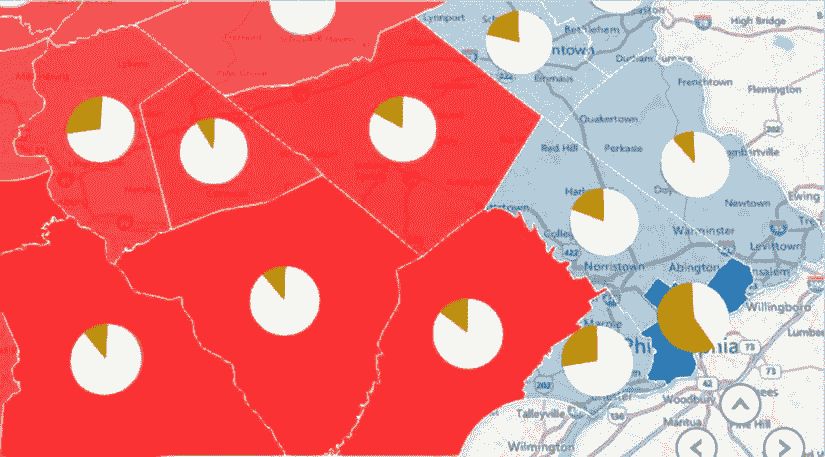

图 12-13. 在 Power Map 中叠加多个图层

要控制地图上哪些图层显示或隐藏，请在 `Layer Pane`（图层窗格）中选择 `Layer Manager`（图层管理器）选项卡。在 `Layer`（图层）列表中，您可以通过单击眼睛图标来隐藏或显示该图层（参见图 12-14）。

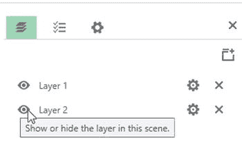

图 12-14. 隐藏和显示图层

如您所见，向地图添加多个图层非常容易。

所有地图可视化效果共有的另一个 Power Map 功能是能够显示随时间的变化。接下来将介绍如何将此功能添加到地图。

### 分析随时间的变化

Power Map 的另一个出色功能是，您可以使用它来查看数据随时间的变化情况。例如，假设您对追踪飓风的位置和风速感兴趣。由于数据包含日期时间字段，您只需将其拖放到 `Layer Pane`（图层窗格）中 `Field List`（字段列表）选项卡上的 `Time`（时间）下拉菜单中即可（参见图 12-15）。

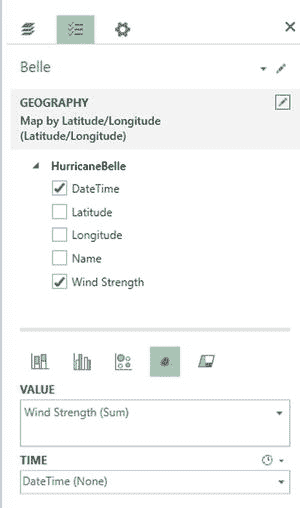

图 12-15. 添加时间字段

一旦添加了时间字段，时间轴播放器就会自动添加到地图图层中。图 12-16 展示了一幅热力图，描绘了飓风沿海岸北上时的风速。使用播放轴，您可以查看其在移动过程中的位置变化。

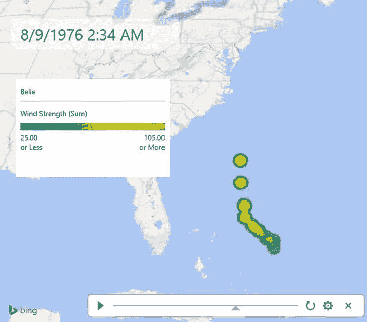

图 12-16. 使用播放轴追踪飓风路径和风速

Power Map 最后一个独特的功能是能够录制一个可以在场景间平移和缩放的操作演示。然后，您可以回放该演示，并将其导出为 MP4 视频。接下来将介绍如何创建操作演示。

### 创建操作演示

借助 Power Map，你可以通过导览（tour）用数据讲述故事。`导览` 是 Power Map 层级结构中的顶层对象。导览由一个或多个场景组成；`场景` 就像数据的一个快照，能以独特的方式展示数据。例如，图 12-17 和 图 12-18 展示了从不同视角查看的同一地图。你可以使用这两个视角创建场景，并将它们添加到导览中，从而从整个美国的视图缩放至仅显示东北部各州。

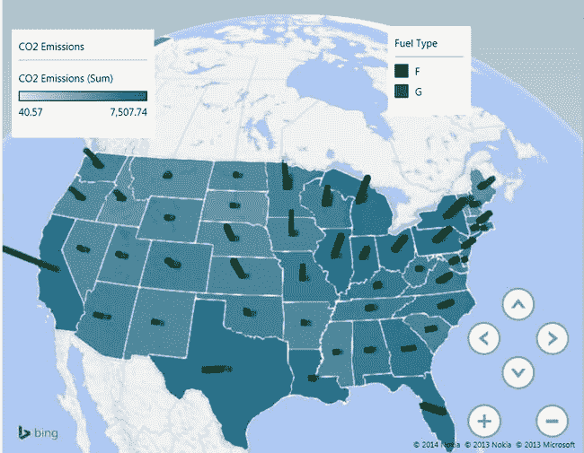

图 12-17。展示整个美国的场景

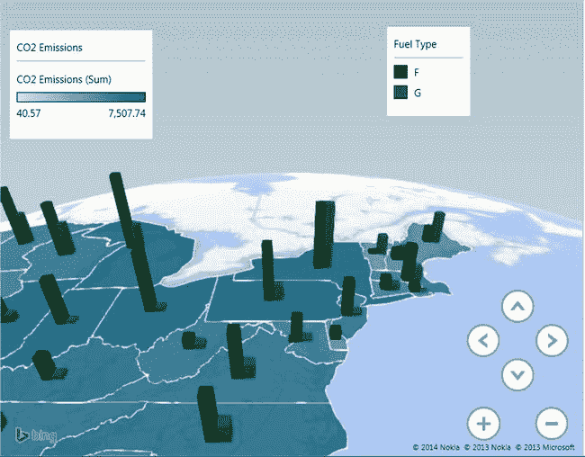

图 12-18。仅展示东北部各州的场景

要捕获一个场景，请将地图调整至该场景所需的视角，然后点击工具栏上的 `Add Scene` 按钮。当你将场景添加到导览中时，它们会出现在 `导览编辑器`（Tour Editor）中（参见 图 12-19）。

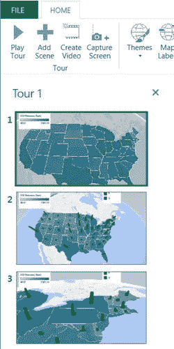

图 12-19。已添加场景的导览编辑器

将场景添加到导览后，你可以通过在 `导览编辑器` 中拖放场景来重新排列场景顺序。你也可以更改某个场景，而不影响导览中的其他场景。你可以添加或移除地图图层、更改主题，以及更改场景的视觉视角。每个场景还拥有场景选项，允许你更改场景时长和过渡效果（参见 图 12-20）。

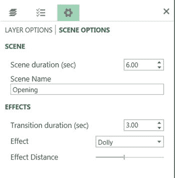

图 12-20。设置场景选项

创建好场景并设置其过渡效果后，你可以点击 `主页`（Home）选项卡上的 `播放导览`（Play Tour）按钮来播放导览（参见 图 12-19）。导览创建完毕后，你可以将其导出为 MP4 视频与他人分享，甚至可以为导览添加音轨（参见 图 12-21）。

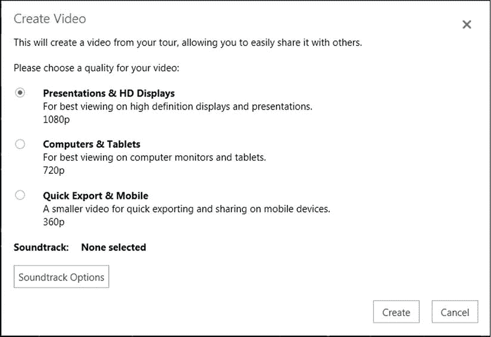

图 12-21。将导览导出为 MP4 视频文件

现在你已经了解了 Power Map 的各种功能，是时候动手实践，用它来绘制一些数据了。要完成本实验，你需要安装最新的 Power Map 加载项。

### 动手实验——在 Power Map 中创建地图可视化

在以下实验中，你将：

*   创建柱状地图。
*   创建区域地图。
*   创建多层地图。
*   创建带有时间轴的热力图。

1.  在`LabStarters`文件夹中，打开`LabChapter12.xlsx`文件。该文件包含发电厂和排放数据，你将使用这些数据在 Power Map 中创建可视化。
2.  在 Excel 的`插入`（Insert）选项卡中，选择`地图`（Map）下拉菜单，然后启动 Power Map。你应该会看到 Power Map 设计器以及`图层面板`（Layer Panel）中的表格（参见 图 12-22）。
    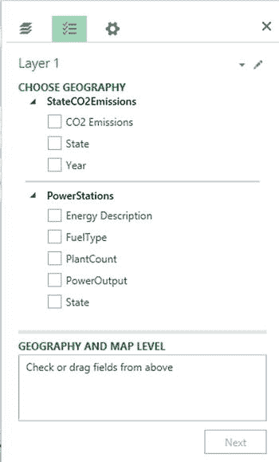
    图 12-22。图层面板中列出的表格
3.  将图层重命名为`燃料类型`，并选择`PowerStations`表中的`State`字段作为地理信息。点击`下一个`（Next）按钮。
4.  将`PlantCount`字段添加到`高度`（Height）下拉框，将`FuelType`字段添加到`类别`（Category）下拉框。将地图切换为簇状柱形图，并放大至美国东北部。你应该会在每个州看到两个柱形：一个代表化石燃料发电厂，另一个代表绿色能源来源。
5.  在`图层窗格`（Layer Pane）的`设置`（Settings）选项卡中，将化石燃料柱形的颜色更改为黑色，将绿色能源柱形的颜色更改为绿色。你还可以调整柱形的高度和粗细。最终地图应类似于图 12-23。
    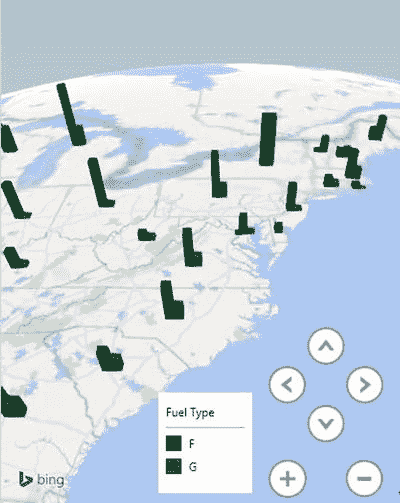
    图 12-23。显示各州发电厂数量的簇状柱形图
6.  在`图层窗格`的`图层管理器`（Layer Manager）选项卡中，添加另一个名为`CO2 排放量`的图层。使用`StateCO2Emissions`表中的`State`字段作为地理信息字段。
7.  将地图类型更改为`区域`（Region），并选择`CO2 Emissions`作为值字段。
8.  在`图层窗格`的`设置`选项卡中，将区域的颜色更改为蓝色。将色阶调整为从零开始，以便你能看到各州数值之间的微小差异。
9.  现在你应该在同一张地图上拥有两个图层，如图 12-24 所示。你可以使用`图层窗格`中的`图层管理器`选项卡来显示或隐藏地图上的各个图层。
    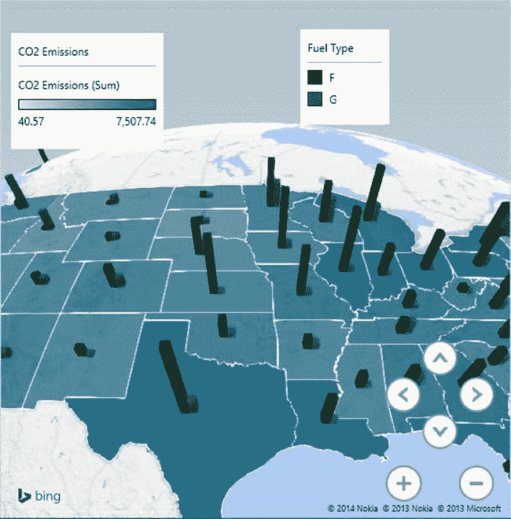
    图 12-24。多层地图
10. 保存并关闭 Excel 工作簿。
11. 在`LabStarters`文件夹中，打开`LabChapter12_2.xlsx`文件。该文件包含飓风数据，你将使用这些数据在 Power Map 中创建热力图和时间线。
12. 启动 Power Map 并创建一个名为`桑迪`的图层。使用`HurricaneSandy`数据，将`Latitude`和`Longitude`字段添加到`地理信息`（Geography）下拉框中。
13. 将地图更改为热力图，并选择`Wind Strength`作为值字段，`DateTime`作为时间字段。
14. 你应该会看到如图 12-25 所示的热力图。请注意风速在登陆时达到最大值。使用播放轴，点击`播放`（Play）按钮，观看飓风随时间的路径轨迹。
    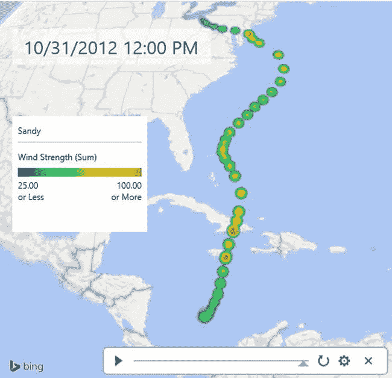
    图 12-25。描绘风速的热力图
15. 完成后，保存并关闭 Excel。

### 总结

正如你在本章中所见，Power Map 是一个强大的 Excel 加载项，提供了一套工具，帮助你可视化并深入了解具有地理成分的数据。你可以通过在地图（Bing map）上方以柱形形式绘制数据，来生成出色的 3D 可视化效果。此外，如果数据包含日期或时间成分，你可以使用 Power Map 可视化随时间变化的数据。你还学习了如何创建热力图和区域地图，对于某些类型的数据集，这些是可视化并发现数据洞察的绝佳方法。Power Map 的另一个强大功能是能够在同一张地图上叠加多个数据图层，这使你能够比较通过位置关联起来的数据。

请记住，当前 Power Map 仍在开发中，新功能会定期添加。请确保你使用的是最新版本，以便充分利用这些功能。

在下一章中，你将了解商业智能分析中最有趣的方面之一：预测分析。预测分析使你能够从历史数据中提取信息，并利用这些信息预测未来的行为和趋势。Excel 提供了一套数据挖掘工具，让预测分析易于实现。使用这些工具，你可以执行高级数据分析，例如预测、聚类和关联分析。第 13 章将向你介绍这些工具，并展示如何实现一些常见的数据挖掘模型，从而深入了解你的数据。

## 第 13 章


# 使用 Excel 挖掘数据

商业智能中最未被充分利用的领域之一是数据挖掘，或者通常所说的预测分析。这是因为传统的数据挖掘使用一组复杂的算法，而这些工具通常要求你成为这些算法的专家才能实施它们。虽然它并非 Microsoft 官方自助式 BI 工具集的组成部分，但 Microsoft 为 Excel 提供的一组表分析工具，使你可以使用数据挖掘算法，同时隐藏了与实施这些算法相关的大部分复杂性。使用这些 Excel 表分析工具，你可以执行预测、聚类和关联分析等高级数据分析。本章将向你展示如何使用这些工具来实现一些常见的数据挖掘模型，并深入了解你的数据。不过，我需要指出的是，要实施这些表分析工具，你需要能够连接到 `SQL Server Analysis Server (SSAS)` 实例，该实例提供运行算法的引擎。

完成本章后，你将能够：

*   识别 Excel 中可用的表分析工具。
*   分析关键影响因素。
*   识别数据组。
*   预测未来趋势。
*   使用购物篮分析。

### Excel 中的表分析工具

数据挖掘是利用历史数据发现模式并为未来趋势制定预测的过程。数据挖掘的一些常见示例包括市场购物篮分析、营销效果分析和预测。

*   *市场购物篮分析*查看历史数据，并确定在购买过程中哪些产品经常相互关联。利用这些信息，你可以就哪些产品应该一起营销提出建议。
*   *营销效果分析*分析历史营销活动，可用于为未来的活动定位目标客户。
*   *预测*使你能够根据数据中的历史趋势预测未来。例如，你可以根据过去五年的销售趋势进行销售预测。这可以帮助你规划未来季度的库存水平。

要安装 Excel 的表分析工具，请访问下载页面 (`www.microsoft.com/en-us/download/details.aspx?id=35578`)。请确保你为 Office 安装选择了正确的版本（x86 或 x64）。下载软件包后，双击 `SQL_AS_DMAddin.msi` 文件启动安装程序。在“功能选择”窗口中，保留默认选择“用于 Excel 的表分析工具”和“服务器配置实用工具”（参见图 13-1）。

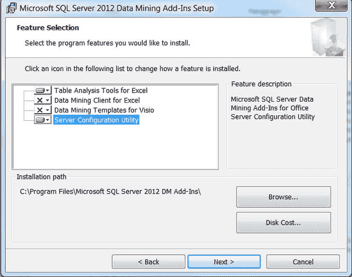
图 13-1 安装表分析工具

安装 Excel 的数据挖掘工具后，当你选择 Excel 表格时，你将会看到一个新的选项卡。“表工具 分析”选项卡包含一组工具，帮助你挖掘表格中包含的数据（参见图 13-2）。

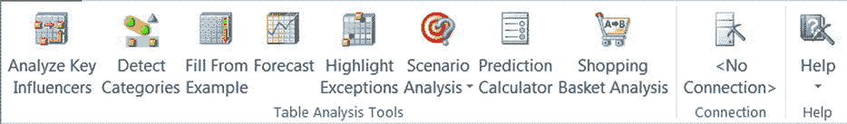
图 13-2 “表工具 分析”选项卡上的表分析工具

你首先应该注意到的是，这里没有列出连接。为了使这些工具能够工作，你需要连接到 `SSAS` 实例。要创建连接，请单击“连接”按钮。在“Analysis Services 连接”窗口中，单击“新建”按钮。在“连接到 Analysis Services”窗口中（参见图 13-3），输入用于连接到 `SSAS` 实例的值。这些值将由你的 `SSAS` 实例确定。

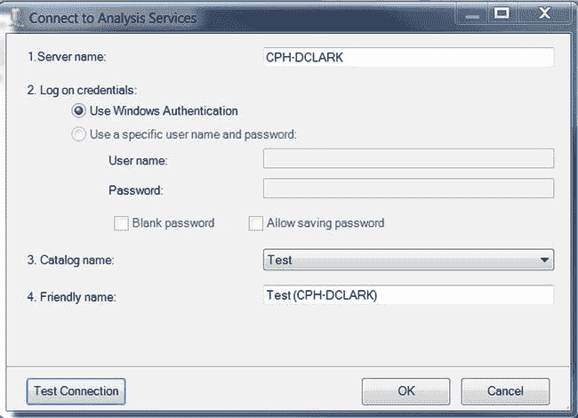
图 13-3 连接到 SSAS 实例

添加连接后，你应该会在表分析工具的连接区域中看到它列出（参见图 13-4）。


图 13-4 具有活动 SSAS 连接的表分析工具

这些工具中的每一个都使用一种众所周知的数据挖掘算法，并分析数据的分布和数据类型。使用这些工具可以让你免于实施算法的复杂性。表 13-1 总结了每个可用工具、何时使用它们以及所使用的算法类型。

表 13-1 可用表分析工具摘要

| 工具 | 用途 | 算法 |
| --- | --- | --- |
| `分析关键影响因素` | 识别对目标数据列影响最大的因素。 | 朴素贝叶斯 |
| `检测类别` | 查找数据的分组。 | 聚类 |
| `根据示例填充` | 根据数据中的模式推荐新值。 | 逻辑回归 |
| `预测` | 分析随时间变化的数据并预测未来值。 | 时间序列 |
| `突出显示异常` | 分析数据表中的模式并查找不符合模式的值。 | 聚类 |
| `目标查找方案` | 识别为达到目标需要更改的底层因素。 | 逻辑回归 |
| `假设方案` | 预测某项更改是否足以实现所需结果。 | 逻辑回归 |
| `预测计算器` | 分析导致目标结果的因素并预测新输入的预测结果。 | 逻辑回归 |
| `购物篮分析` | 识别可用于交叉销售或追加销售的模式。 | 关联 |

现在你已经了解了可用工具的范围，是时候更详细地了解其中的一些工具了。

### 分析关键影响因素

使用“分析关键影响因素”工具，你可以确定哪些因素对结果影响最大。例如，你有一个包含客户属性的数据表，以及一个指示他们是否购买了自行车的列（参见图 13-5）。


图 13-5 客户属性

要确定影响客户是否购买自行车的关键因素，请选择该表，然后在“表分析工具”选项卡中，选择 `分析关键影响因素`。你将看到一个列选择对话框。首先选择包含你要分析的结果的列（参见图 13-6）。


图 13-6 选择结果字段

接下来，单击链接以选择要用于分析的列（参见图 13-7）。


图 13-7 选择影响字段

选择要分析的字段后，选择“确定”关闭“高级列选择”窗口。在“`分析关键影响因素`”窗口中，选择“运行”以开始分析（参见图 13-6）。

## 分析关键影响因素工具的数据分析过程

当`分析关键影响因素`工具分析数据时，它首先会存储数据分布的关键信息。接着，该工具会利用 Microsoft 朴素贝叶斯算法和 SSAS 创建模型。然后生成预测，将每列数据与指定结果关联起来。最后，它使用每个预测的置信度得分来识别对产生目标结果影响最大的因素。

分析完成后，`分析关键影响因素`工具会在新工作表中创建一份报告，按置信度得分降序列出关键影响因素（参见图 13-8）。

图 13-8 关键影响因素分析结果

从报告中可以清晰地看出，汽车数量对自行车购买行为有明显影响。

除了确定影响自行车购买者的因素外，您可能还想了解自己吸引的是哪种类型的客户。哪些是主要群体？他们是年轻人吗？他们拥有房产吗？在下一节中，您将学习使用`检测类别`工具和聚类分析来解答这些问题。

### 识别数据组

检测数据所属的不同类别是对数据执行的重要分析。这在许多不同场景中都非常有用；例如，您需要了解客户属于哪些群体，以便针对不同群体进行精准营销。仔细研究类别的另一个原因是，可以找出不属于任何群体的异常值。这样，如果需要，您就可以从数据集中过滤掉这些异常值，以免它们影响结果的准确性。发现异常值也是检测潜在欺诈的常见模式。

为了识别购买自行车的客户的不同细分市场，首先选择一个包含客户人口统计信息以及一个表明其是否购买自行车列的表格。在表格工具的分析选项卡中，选择`检测类别`工具。这将启动一个窗口，您可以在其中选择要使用的字段以及要创建的类别数量（参见图 13-9）。不要选择具有唯一值的列，例如 ID 字段，因为它们不适合进行分组分析。

图 13-9 选择分组属性字段

运行`检测类别`工具后，将使用聚类分析算法对数据进行分析。您可以让该工具向数据表追加一个`类别`字段。工具运行完毕后，您将看到一个新的工作表显示结果。该工作表上有一个图表，显示所选字段中每个类别的人口分布情况（参见图 13-10）。由于您关注的是购买自行车客户的类别，因此应将图表的列设置为此字段。

图 13-10 查看人口分布图

如您所见，与类别 4、5 和 6 相关联的客户群最有可能购买自行车。

在同一工作表中，还有一个表格，可用于调查构成不同组的行所具有的属性。图 13-11 展示了构成类别 6 的特征。您可以看到，该组中的大多数人没有子女，拥有学士学位，并且年龄在 37-46 岁之间。

图 13-11 查看组特征

除了`检测类别`工具之外，`突出显示异常`工具也会对数据执行聚类算法。在这种情况下，它寻找的是与其余数据不符的数据。当您需要在执行其他数据分析之前清理数据集时，这些信息会派上用场。请记住，每当您对一组数据执行数据分析时，都需要确保任何异常值不会影响结果的准确性。

运行`突出显示异常`工具时，会弹出一个窗口，您可以在其中选择要分析的列（参见图 13-12）。

图 13-12 选择要分析的列

运行该工具后，您会看到一个结果表，显示找到的异常值数量。您还可以调整阈值以捕获更多或更少的异常（参见图 13-13）。

图 13-13 异常值分析结果

查看原始数据表，异常值现在已被高亮显示，因此您可以轻松识别它们（参见图 13-14）。

图 13-14 高亮显示找到的异常行

在努力实现高效运营和降低管理成本时，数据挖掘中一个日益重要的领域是预测。接下来您将了解这一部分。

### 预测未来趋势

`预测`工具允许您通过查看过去的趋势来预测未来的趋势。它使用时间序列算法来预测未来值。运行该工具会打开一个窗口，您可以在其中选择要预测的列、时间序列列以及要预测的时间段数（参见图 13-15）。

图 13-15 选择预测参数

工具运行完毕后，预测值会被放置在历史数据的末尾，并高亮显示以供查看（参见图 13-16）。

图 13-16 查看预测分析结果

此外，还会插入一个新工作表，其中显示历史趋势和未来预测的线性图表。历史值用实线绘制，未来预测用虚线绘制（参见图 13-17）。

图 13-17 未来趋势的图形化表示

除了预测，另一种流行的数据挖掘类型是购物篮分析。您接下来将了解这一部分。

### 使用购物篮分析

`购物篮分析`工具使用关联算法来查找数据之间的关联。传统上，它被用于分析客户的购买模式，并在推荐追加销售其他商品时非常有用。当您使用`购物篮分析`工具分析数据时，请确保数据具有一个能将其组织成组的键——例如订单号（参见图 13-18）。

图 13-18 使用订单号对交易进行分组

当您选择`购物篮分析`工具时，会出现一个列选择窗口，您可以在其中选择`交易 ID`、`商品`和`商品价格`列（参见图 13-19）。

Figure 13-19. 选择要分析的列

选择`Advanced`链接会打开一个窗口，您可以在其中调整算法的敏感度（参见 Figure 13-20）。提高`Minimum Support`和`Minimum Rule Probability`参数会减少结果中的项目数量，但会提高结果的显著性。

Figure 13-20. 指定最小参数值

运行分析后，会插入两个新的工作表。第一个工作表 `Shopping Basket Bundled Item` 会显示被捆绑在一起找到的项目，以及捆绑规模、销售数量、平均销售额和捆绑总价值（参见 Figure 13-21）。

Figure 13-21. 显示已售捆绑产品的分析结果

第二个工作表 `Shopping Basket Recommendations` 列出了同时售出概率较高的产品推荐。例如，如果客户购买了一个公路自行车水壶架，您应该推荐他们也购买一个水壶（参见 Figure 13-22）。这个工作表还包含统计信息，比如关联销售占比和推荐的平均价值。

Figure 13-22. 交叉销售产品的推荐

现在您已经了解了各种表分析工具的工作原理，是时候亲自动手实践其中一些工具了。

### 动手实验——在 Excel 中使用表分析工具

在以下实验中，您将会：
- 确定拥有住房的关键影响因素。
- 检测不同的客户群体。
- 对已购产品进行购物篮分析。
- 预测污染物排放。

1.  在 `LabStarters` 文件夹中，打开 `LabChapter13.xlsx` 文件。此文件包含示例客户数据。您将使用表分析工具对此数据进行数据挖掘。
2.  在 `Influencers` 工作表中，点击数据表的任意位置以显示 `Table Tools Analyze` 选项卡。在此选项卡上，选择 `Analyze Key Influencers` 按钮。在 `Column Selection` 窗口中，选择 `Home Owner` 列以分析关键因素。
3.  选择以下用于分析的列：`Marital Status`、`Gender`、`Income`、`Children`、`Education`、`Occupation`、`Cars`、`Commute Distance` 和 `Age`。运行分析，当出现 `Discrimination Reporting` 窗口（参见 Figure 13-23）时，您可以关闭它，因为只有两个值需要比较，并且它们已被添加到报告中。

Figure 13-23. 选择要比较的值

4.  在 `Key Influencers` 报告中，请注意，在所分析的列中，婚姻状况是关键影响因素。然而，孩子数量和通勤距离也是影响因素。同样有趣的是，教育程度和年龄并不是关键影响因素。这可能是一个您希望进一步调查的领域，尤其是因为这可能是由于样本量不够大所致。
5.  要检测不同的客户群体，请选择 `Categories` 工作表。点击表格的任意位置，然后在 `Table Tools Analyze` 选项卡上选择 `Detect Categories` 工具。
6.  在 `Detect Categories` 工具中，勾选 `Marital Status`、`Gender`、`Income`、`Children`、`Education`、`Occupation` 和 `Age` 复选框，然后单击 `Run` 按钮。
7.  在 `Categories` 工作表上，注意有六个类别。使用 `Category Characteristics` 表来确定对每个群体最重要的特征（参见 Figure 13-24）。您可以重命名这些类别；例如，类别 1 主要由低收入群体构成，您可以重命名它以反映这一点。

Figure 13-24. 确定一个类别群体的显著特征

8.  表格下方是一个类别概况图表，您可以使用它来分析各个类别不同属性值的分布情况。花些时间通过更改图表上显示的类别和列来分析数据。
9.  要对已购产品进行购物篮分析，请选择 `Shopping Basket` 工作表。此表包含在杂货店购买的物品。点击数据表的任意位置，然后在 `Table Tools Analyze` 选项卡上选择 `Shopping Basket Analysis` 工具。
10. 在 `Shopping Basket Analysis` 窗口中，为 `Transaction ID` 选择 `Order ID` 列。对于 `Item`，选择 `Item` 列，并将 `Item Value` 设置为 `No Value Column`。
11. 选择 `Advanced` 链接，在 `Advanced Parameters Setting` 窗口中，将 `Minimum Support` 改为 20 个项目，将 `Minimum Rule Probability` 改为 50%。
12. 运行分析，在 `Shopping Basket Recommendations` 表中，注意当客户购买麦片时，有 60% 的概率他们也会购买牛奶（参见 Figure 13-25）。

Figure 13-25. 查看交叉销售推荐

13. 要进行预测，请选择 `Forecast` 选项卡，其中包含 2000 年至 2010 年多个州的污染物排放数据。点击数据表的任意位置，然后在 `Table Tools Analyze` 选项卡上选择 `Forecast` 工具。
14. 在 `Forecast` 窗口中，选择要预测的 `State` 列。将 `Time Stamp` 设置为 `Year`，并将 `Periodicity Of Data` 设置为 `Yearly`（参见 Figure 13-26）。

Figure 13-26. 选择预测属性

15. 运行预测。您现在将看到一个预测图，该图将预测显示为实际值上的虚线延伸（参见 Figure 13-27）。

Figure 13-27. 最终的预测图

16. 当您完成对表分析工具的尝试后，保存并关闭 Excel 工作簿。

#### 总结

## 第 14 章


# 构建完整解决方案

虽然数据挖掘是商业智能中最未被充分利用的领域之一，但借助 Excel 的表格分析工具，情况未必如此。尽管数据挖掘使用了一系列复杂的算法，且传统工具通常要求您是此类算法的专家才能实施，但使用表格分析工具时，Excel 为您隐藏了大部分复杂性。本章向您展示了如何使用这些工具执行高级数据分析，例如预测、聚类和关联。您现在能够利用这些工具更深入地洞察数据。请记住，不要局限于具体示例，要学会在各种情况下应用这些模式。

在撰写本书时，微软正将其数据挖掘工作重心转移到 Microsoft Azure ML（机器学习）上，并且未对 Excel 的数据挖掘工具进行任何升级。这令人遗憾，因为 Azure ML 是一个纯云平台系统，对于普通业务分析师来说略显高级。好的一面是，一些第三方供应商（例如 XLMiner 和 Predixion）正积极推出他们自己的 Excel 数据挖掘插件工具。这些工具在观感上与本章介绍的表格分析工具非常相似，我认为您会发现使用这些工具过渡起来很容易。

在第 14 章中，您将学习两个实际案例研究，以巩固前几章的概念。通过完成这些案例研究，您将能够评估自己掌握了哪些领域，以及哪些领域需要进一步学习。此外，您还将了解一些与数据分析相关的常见模式，以及如何使用本书涵盖的工具来实现这些模式。

在前几章中，您已经获得了使用微软自助式 BI 工具集中每个组件的经验。您使用了 Power Pivot、Power View、Power Query、Power Map 以及 Excel 表格分析工具。本章为您提供了几个用例，以巩固前几章的概念。通过完成这些用例，您将评估自己掌握了哪些领域，以及哪些领域需要花更多时间学习。由于这有点像您的期末考试，我特意没有像之前的练习那样提供分步说明。相反，我给出了应该足以让您上手的一般性指导。如果您遇到困难，请参考前面的章节，提醒自己如何完成任务。

本章包含以下用例：
*   经销商销售分析
*   销售配额分析
*   传感器分析

## 用例 1：经销商销售分析

在此场景中，您为一家自行车设备公司工作，被要求分析销售数据。您需要构建一个仪表板，用于比较各月之间的同店销售增长。一个额外的限制条件是，进行此比较时，您只想比较已开业至少一年的经销商。

### 加载数据

创建一个名为 `StoreSalesAnalysis.xlsx` 的新 Excel 工作簿。在 `Chapter14Labs` 文件夹中，找到 `UseCase1` 文件夹，其中包含一个 `StoreSales.accdb` Access 数据库。该数据库存储了您需要分析的销售数据。以此作为数据源，导入表 14-1 中列出的数据表和列。

表 14-1. 需导入的商店销售表与列

| 源表 | 友好名称 | 列 |
| --- | --- | --- |
| `dbo_DimDate` | 日期 | `DateKey`, `FullDateAlternateKey`, `EnglishMonthName`, `MonthNumberOfYear`, `CalendarQuarter`, `CalendarYear` |
| `dbo_DimGeography` | 位置 | `GeographyKey`, `City`, `StateProvinceCode`, `StateProvinceName`, `CountryRegionCode`, `EnglishCountryRegionName`, `PostalCode` |
| `dbo_DimProduct` | 产品 | `ProductKey`, `ProductSubcategoryKey`, `EnglishProductName`, `StandardCost`, `ListPrice`, `DealerPrice`, `LargePhoto` |
| `dbo_DimProductCategory` | 类别 | `ProductCategoryKey`, `EnglishProductCategoryName` |
| `dbo_DimProductSubcategory` | 子类别 | `ProductSubcategoryKey`, `EnglishProductSubcategoryName`, `ProductCategoryKey` |
| `dbo_DimReseller` | 经销商 | `ResellerKey`, `GeographyKey`, `BusinessType`, `ResellerName`, `YearOpened` |
| `dbo_FactResellerSales` | 经销商销售额 | `ProductKey`, `ResellerKey`, `OrderDateKey`, `SalesOrderNumber`, `SalesOrderLineNumber`, `OrderQuantity`, `UnitPrice`, `ExtendedAmount`, `TotalProductCost`, `SalesAmount` |

### 创建模型

导入表后，使用相应的键创建表关系。您的模型现在应该类似于图 14-1。


图 14-1. 商店销售模型

根据表 14-2 中列出的信息，重命名表列，并从客户端工具中显示或隐藏列。

表 14-2. 表与列属性


在 `Date` 表中，创建一个年份 - 季度 - 月份的日历层次结构。将此表标记为日期表，并使用 `Full Date` 列作为键。按 `Month Number` 列对 `Month` 列进行排序。设置 `Full Date` 列的格式，使其仅显示日期而不显示时间。

### 创建计算列

使用 DAX `RELATED` 函数，在 `Product` 表中为产品子类别和产品类别创建计算列。

```
[Category]
=IF(ISBLANK([ProductSubcategoryKey]),"Misc",
    RELATED(Category[EnglishProductCategoryName]))

[Subcategory]
=IF(ISBLANK([ProductSubcategoryKey]),"Misc",
    RELATED(Subcategory[EnglishProductSubcategoryName]))
```

从任何客户端工具中隐藏 `Category` 和 `Subcategory` 表。如果 `ProductSubcategoryKey` 为空，则使用 `"Misc"` 填充 `Category` 和 `Subcategory` 列。最后，创建一个名为 `Prd Cat` 的层次结构，其中包含 `Product Category` 和 `Product Subcategory` 列。

### 创建度量值

在 `ResellerSales` 表中添加以下度量值：

```
Month Sales:=TOTALMTD(SUM([Sales Amount]),'Date'[Full Date])

Prev Month Sales:=CALCULATE(Sum([Sales Amount]),PREVIOUSMONTH('Date'[Full Date]))

Monthly Sales Growth:=[Month Sales] - [Prev Month Sales]

Monthly Sales Growth %:=DIVIDE([Monthly Sales Growth],[Prev Month Sales],0)
```

通过创建如图 14-2 所示的数据透视表来测试您的度量值。


图 14-2. 在数据透视表中查看度量值

现在，您需要创建一个度量值，以确定在计算销售额的月份，某个店铺是否已开业至少一年。在 `Reseller` 表中，添加以下度量值：

```
Years Open:=Year(FIRSTDATE('Date'[Full Date])) - Min([Year Opened])

Was Open Prev Year:=If([Years Open]>0,1,0)
```

创建一个数据透视表来测试您的度量值，如图 14-3 所示。请记住，只有在按年份筛选时，这些度量值才有意义。


图 14-3. 测试度量值

现在，您可以组合这些度量值，以便只包括在销售时已开业至少一年的经销商。创建以下度量值：

```
Month Sales Filtered:=Calculate([Month Sales],FILTER(Reseller,[Was Open Prev Year]=1))

Prev Month Sales Filtered:=CALCULATE([Prev Month Sales],
    Filter(Reseller,[Was Open Prev Year]=1))

Monthly Sales Growth Filtered:=[Month Sales Filtered]-[Prev Month Sales Filtered]

Monthly Sales Growth Filtered %:=DIVIDE([Monthly Sales Growth Filtered],
    [Prev Month Sales Filtered],0)
```

通过创建如图 14-4 所示的 Power Pivot 表来测试你的新度量值。你应该能看到经过筛选和未经筛选的度量值之间的差异。


图 14-4. 测试筛选后的度量值

### 创建仪表板

在 Power View 中创建仪表板之前，你需要更新一些表设置以优化模型，使其适用于 Power View。表 14-3 列出了你需要进行的表设置。

表 14-3. 为 Power View 优化设置


此外，将表 14-4 中列出的列标记为相应的数据类别。

表 14-4. 设置数据类别

| 表 | 列 | 数据类别 |
| --- | --- | --- |
| `Location`（位置） | `City`（城市） | City（城市） |
| | `State Province`（州/省） | State or Province（州或省） |
| | `Country`（国家） | Country（国家） |
| | `Postal Code`（邮政编码） | Postal Code（邮政编码） |
| `Product`（产品） | `Product Photo`（产品照片） | Image（图像） |

在 `Date` 表中，设置字段使其不进行汇总。

若要创建仪表板，请插入一个 Power View 报表。将该报表命名为 `Reseller Sales`，并添加一个柱形图，该柱形图使用经过筛选的月度销售额按月份和经销商类型显示销售额。向报表添加一个切片器，以控制图表显示的日历年。由于 2011 年之前没有销售额，请筛选视图，使其仅显示 2011 年至 2014 年。你的报表应类似于图 14-5。


图 14-5. 经销商销售额报表

现在，你需要进行另一项经销商分析，以查找月份、季度和年份的最佳月销售额。为此，你需要在模型中添加一个新度量值。该度量值使用 `VALUES` 和 `MAXX` 函数来查找经销商月销售额的最大值。

```
Max Reseller Sales:=MAXX(VALUES(Reseller[ResellerKey]),[Month Sales])
```

在模型中添加了新的度量值后，在 Power View 报表中添加另一个柱形图，显示每个月的经销商最大销售额。请注意，这些图表是交互式的；如果你单击一个图表中的某个柱形，它将相应地筛选另一个图表（参见图 14-6）。


图 14-6. 添加最大经销商销售额图表

为了更进一步，假设你想要获取该期间内月销售额最高的经销商的名称。为此，你需要组合一系列表达式来检索月销售额最高的经销商的名称。首先，你需要确定哪个经销商的月销售额等于月销售额最大值。如果满足条件，则将其标记为值 `1`；否则，标记为 `BLANK`。

```
IF([Month Sales]=CALCULATE([Max Reseller Sales],
    Values(Reseller[Reseller Name])),1,BLANK())
```

下一步是使用 `FIRSTNONBLANK` 函数来查找值为 `1` 的经销商。

```
FIRSTNONBLANK(Reseller[Reseller Name],
    IF([Month Sales]=CALCULATE([Max Reseller Sales],
    Values(Reseller[Reseller Name])),1,BLANK()))
```

最后，你需要确保在检查的期间内确实存在月销售额。将这些公式组合到 `Top Monthly Reseller` 度量值中，如下所示：

```
Top Monthly Reseller:=If(ISBLANK([Month Sales]),
    BLANK(),FIRSTNONBLANK(Reseller[Reseller Name],IF([Month Sales]=
    CALCULATE([Max Reseller Sales],Values(Reseller[Reseller Name])),1,BLANK())))
```

这次，在 Excel 工作表中构建仪表板。添加一个图表，展示您所关注的年度各月销售额增长百分比，再添加一个数据透视表，显示每个月的最大经销商销售额和经销商名称。此外，还要添加一个用于年份的切片器、一个用于经销商类型的切片器，以及一个用于国家/地区的切片器。您的仪表板应类似于图 14-7。


图 14-7. Excel 工作表中的最终仪表板

完成仪表板并进行实验后，保存并关闭 Excel。

## 用例 2：销售配额分析

在本场景中，您将使用与用例 1 相同的自行车公司销售团队的销售数据。这次，您需要使用 Power View 创建一个仪表板，让销售经理能够跟踪销售团队的业绩。您需要将实际销售额与销售团队的销售配额进行比较。虽然进行比较所需的度量值并不复杂，但销售数据和配额数据的粒度处于不同级别，这带来了挑战。

### 加载数据

创建一个名为 `SalesRepAnalysis.xlsx` 的新 Excel 工作簿。在 `Chapter14Labs` 文件夹中有一个名为 `UseCase2` 的子文件夹；该文件夹包含一个名为 `SalesRepAnalysis.accdb` 的 Access 数据库。以此作为数据源，导入表 14-5 中列出的数据表和列。

表 14-5. 要导入的表和列


## 创建模型

导入表后，根据表 14-6 中列出的信息，重命名表列，并在客户端工具中显示或隐藏相应列。

表 14-6。表和列属性设置


为了在表之间创建适当的关系，您需要创建一个包含日历年份和季度的销售期间表。要获取此表，请使用现有的与 `SalesRepAnalysis.accdb` Access 数据库的连接。这次，使用以下查询获取数据（确保友好查询名称为 Sales Period）：

```sql
Select distinct CalendarYear & CalendarQuarter as PeriodKey,
CalendarYear as [Period Year], CalendarQuarter  as [Period Quarter] from dbo_DimDate
```

在配额表中，使用 DAX 函数 `CONCATENATE` 创建一个 PeriodKey 列。

```
[PeriodKey]
=CONCATENATE([CalendarYear],[CalendarQuarter])
```

销售额表处理起来稍复杂一些。首先，在销售额表和日期表之间创建关系。接着，使用 `RELATED` 函数在销售额表中创建年度期间和季度期间。然后使用 `CONCATENATE` 函数在销售额表中创建 `PeriodKey` 列。

```
[Period Year]
=Related('Date'[Calendar Year])
[Period Quarter]
=RELATED('Date'[Calendar Quarter])
```

在客户端工具中隐藏表中的 `PeriodKey`。同时隐藏配额表和销售额表中的 `Period Year` 和 `Period Quarter` 列。

现在，您可以在模型中完成表关系的创建。图 14-8 展示了最终模型应呈现的样子。


图 14-8。定义了关系的销售代表分析模型

接下来，在销售区域表中使用组、国家/地区和区域字段创建一个区域层次结构。在销售期间表中创建另一个名为期间（`Period`）的层次结构，使用 `Period Year` 和 `Period Quarter` 字段。在销售代表表中，通过用逗号连接 `Last Name` 和 `First Name` 列，添加一个名为 `Sales Rep Name` 的计算列。

## 创建度量值

在销售额表中添加以下度量值：

```
Total Sales:=SUM([Sales Amount])
```

在配额表中添加以下度量值：

```
Total Quota:=Sum([Sales Quota])

Variance:=[Total Sales]-[Total Quota]
```

```
Variance := [Variance]/[Total Sales]
```

为销售代表创建一个关键绩效指标（KPI），其中销售额超过配额 5% 为良好，低于配额 5% 则为差。该 KPI 基于 `Total Sales` 度量值，并与总 `Quota` 度量值进行比较。

通过创建数据透视表来测试度量值，如图 14-9 所示。


图 14-9. 在数据透视表中测试销售 KPI

### 创建仪表板

在 Power View 中创建仪表板之前，请更新部分表格设置，以优化模型与 Power View 的兼容性。表 14-7 列出了你需要调整的表格和设置。

表 14-7. 针对 Power View 的优化设置


此外，请将表 14-8 中列出的列标记为相应的数据类别。

表 14-8. 设置数据类别

| 表 | 列 | 数据类别 |
| --- | --- | --- |
| Sales Rep | Hire Date | 日期 |
| Employee Photo | 图像 |
| Sales Territory | Region | 国家/地区 |
| Country | 国家/地区 |
| Territory Image | 图像 |

在 `Period` 和 `Date` 表中，设置字段使其不进行汇总。

插入一个 Power View 报表，并将其命名为 **Sales Rep Performance**。使用磁贴功能，在标题区域显示不同的销售原因，并在详细信息区域以卡片形式显示销售代表信息（参见图 14-10）。


图 14-10. 使用磁贴和卡片显示销售代表信息

在磁贴详细信息区域内添加一个矩阵，显示按时间段和销售代表划分的销售总 KPI。关闭矩阵的汇总总计。在磁贴区域之外，添加一个时间段年份切片器，以及一个展示各销售区域总销售额的表格。你还可以添加视图筛选器，以筛选掉无销售额的年份和 NA 区域。最终的仪表板应类似于图 14-11。


图 14-11. 最终的销售代表绩效仪表板

完成仪表板并测试后，保存并关闭 Excel。

## 用例 3：传感器分析

在此场景中，你供职于一家电力公司，该公司使用传感器监控设备。传感器监测各种电力读数，包括电力中断和电压尖峰。当传感器检测到问题时，会触发一个记录报警信号。你需要创建一个地图，使分析人员能够查看并比较不同时间段的电力中断和电压尖峰情况。

### 加载数据

所需数据位于多个文本文件中。在将数据加载到 Power Pivot 模型之前，你需要对数据进行清理和处理。因此，你将使用 Power Query 来加载数据。

在 `Chapter14Labs` 文件夹中找到名为 `UseCase3` 的文件夹。该文件夹包含四个文件，其中包含传感器数据以及完成分析所需的相关数据。创建一个名为 `PowerAnalysis.xlsx` 的新 Excel 工作簿。使用 Power Query，连接到 `UseCase3` 文件夹中的 `Alarms.csv` 文件。你应该包含以下列：`PREMISE_NUMBER`、`METER_NUMBER`、`OP_CENTER`、`Type` 和 `DateKey`。将查询重命名为 **Alarms**，取消选中“加载设置”，然后保存查询。添加第二个查询 **AlarmTypes**，从 `AlarmType.txt` 文件中获取报警类型数据。现在，你可以删除 `SHORT_CODE` 列并保存查询。

重新打开 `Alarms` 查询，并使用相应的键将其与 `AlarmTypes` 查询合并（参见图 14-12）。


图 14-12. 将 `AlarmType` 查询与 `Alarms` 查询合并

可以移除 `Alarm Type` 键，并将 `ALARM_DESCRIPTION` 重命名为 `Alarm Type`。

重复前面的步骤，用 `Date.csv` 文件中的日期替换 `DateKey` 列。使用 `Locations.txt` 文件，根据 `OP_CENTER` 为 `Alarms` 查询添加经度和纬度值。你可以重命名列，使其使用相同的命名约定。你的报警查询应类似于图 14-13。


图 14-13：添加了纬度和经度数据的报警查询。

接下来，筛选数据，将报警类型限制为 `power failure` 和 `high AC volts`。完成此操作后，你可能会注意到 `Meter` 列中存在一些错误值；请继续并删除这些错误。现在，你可以按日期、运营中心、报警类型、经度和纬度对报警计数进行聚合分组（参见图 14-14）。


图 14-14：聚合和分组报警数据。

聚合数据后，在“加载设置”下勾选“将数据添加到数据模型”，然后应用并关闭查询。

准备好用于地图绘制的数据后，启动 Power Map 设计器，创建一个显示随时间变化的平均计数的柱形图，如图 14-15 所示。


图 14-15：显示随时间变化的报警计数的 Power Map。

在 Power Map 中创建并探索报警数据后，保存并关闭 Excel。

### 总结

本章提供了一些用例，帮助你评估对本书其他主题的掌握程度。本书的目标是向你介绍微软自助式 BI 工具栈中的各种工具。尽管本书使用的是桌面版 Excel 及其 BI 插件，你也可以使用这些工具的 Office 365 版本。我希望你已经获得了足够的信心和经验，能够开始使用这些工具分析并深入了解自己的数据。

既然你已经牢固掌握了如何使用这些工具，你应该能够自如地处理更复杂的主题。有许多优秀资源涵盖了可用于分析数据的不同技术和模式。微软的 Power BI 网站（`www.microsoft.com/en-us/powerbi/default.aspx`）、Bill Jelen 的网站（`www.mrexcel.com`）以及 Rob Collie 的 Power Pivot Pro 网站（`www.powerpivotpro.com`）都是极好的资源。要了解更多高级主题，请查看 Chris Webb 的 BI 博客（`http://cwebbbi.wordpress.com`）以及 Marco Russo 和 Alberto Ferrari 的 SQLBI 网站（`www.sqlbi.com/`）。

# 索引

[](#a) **A**

- `AllProductSales` 度量值
- 分析关键影响因素工具
- 客户属性
- 影响因子字段
- 关键影响因素分析
- 结果字段

[](#b) **B**

- 条形图，Power View
- 创建
- 按国家划分的销售额比较
- 堆叠图
- 布尔表达式
- 气泡图，Power View

[](#c) **C**

- 卡片可视化，Power View
- 图表，数据透视表
- 创建
- 数据源
- 选择
- 工作簿数据模型
- 柱状图，Power View
- 簇状柱形图，创建
- 布局
- 按国家/地区的销售额，比较
- 排序
- 堆积柱形图，创建
- `Cube` 函数
- `Power Pivot` 数据模型
- 重新排列数据
- 用于检索值

[](#d) **D**

- 仪表板，经销商销售额
- 数据类别设置
- `FIRSTNONBLANK` 函数
- 最大经销商销售额
- `Power View`
- 报表
- 销售增长
- 仪表板，Power View
- 添加相关可视化效果
- 气泡值
- 基于云的 Office 365 解决方案
- 创建
- 添加矩阵
- 交互式筛选器
- 经销商销售分析
- 销售业绩
- 堆积柱形图
- 磁贴分组
- 筛选组和视图
- 按日期
- 图表
- 选择列表
- 基于文本的字段
- 使用切片器和磁贴
- 交互式筛选
- `Power BI` 网站
- 按类别的经销商销售额
- 磁贴可视化效果
- 数据分析表达式 (`DAX`)
- `AllProductSales` 度量值
- 更改查询上下文
- 布尔/表表达式
- 产品销售比率
- 计算
- 不同行中的单元格
- 常见聚合
- 聚合函数
- 自动求和
- 计算列
- 事实表
- 财务表，度量值网格
- 度量值公式，编辑
- 度量值网格，显示/隐藏
- 组织度量值
- 结果度量值位于列下方
- 数据类型
- 日期和时间函数
- `Excel` 值
- 筛选器函数
- 布尔表达式
- 更改截止日期
- 员工人数，部门
- `KPI`（参见 关键绩效指标 (`KPI`)）
- `MAX` 函数
- `Power Pivot` 模型
- 结果度量值、数据透视表
- 销售额度量值
- 销售代表计数
- 单次订单客户
- `USERELATIONSHIP` 筛选器
- 公式
- 信息函数和逻辑函数
- 掌握数据上下文
- 筛选上下文
- 查询上下文
- 行上下文
- 数学、三角函数和统计函数
- 度量值与属性
- 筛选数据
- 财务事实表
- 数据透视表，数据分析
- 数值数据类型与文本数据类型
- 运算符
- `Power Pivot` 公式
- `RELATED` 函数
- 表和列
- 文本函数
- 工作
- 数据分析、数据透视表和图表
- `Excel` 中的 BI 界面
- `AdventureWorksDW` 数据库
- 柱形图，格式设置/选择
- 条件格式
- 创建仪表板
- 数据条，数据透视表
- 创建销售饼图
- 选择连接
- 切片器，插入
- 多维数据集函数
- 数据切片
- 多个图表和表格
- 数据透视图
- 数据透视表基础
- 可视化

[](#data-discovery-power-query) **数据发现，`Power Query`**

- 发现和导入数据
- 数据源
- 导航器窗格，表选择
- 新的 `Power Query` 选项卡
- 查询编辑器窗口
- `SSIS`
- 分组和聚合数据
- 导入和整理数据
- 按来源和承运商
- 来自两个查询
- 查询编辑器窗口
- 工作簿查询
- 插入计算列
- 使用 `M` 语言构建查询
- 使用 `M` 公式创建列
- `DAX` 公式
- 查询结果
- 数据合并与重塑
- 追加查询
- 列选择
- 来自两个查询
- 在 `Power Pivot` 模型中
- 矩阵作为数据源
- 合并窗口
- 使用分隔符拆分列
- 数据转换、清洗与筛选
- 逆透视转换
- 列数据类型
- 筛选行
- 管理查询步骤
- 替换列值

- 数据挖掘
- 分析关键影响因素工具
- 数据组识别
- 属性字段
- 类别
- 列选择
- 高亮显示发现的离群行
- 离群值分析
- 总体图
- 检查组特征
- 预测工具
- 购物篮分析工具
- `SSAS`
- 表分析工具

- 数据模型
- 连接与选择
- 自定义计算
- 客户数据
- 数据库表
- 反规范化
- 添加 `Excel` 表
- 层次结构
- 家庭人数
- 链接表
- 规范化和非规范化表
- `Power Pivot`
- 主键
- `ProductKey` 与更新列名
- 快速分析表选项卡
- 关系
- 运行查询
- 销售区域层次结构
- 星型架构
- 代理键与自然键
- 表关系
- 用于跟踪变化的时间戳
- 传统 `Excel` 数据透视表
- 用户友好型模型

- 数据模型管理器
- 计算列
- 关系图视图
- `Excel` 界面
- 探索关系
- 网格区域度量值
- 动手实验——探索 `Power Pivot`
- 层次结构

首页菜单选项卡

- 启动
- 数据透视表
- 切片器字段选择
- 用于筛选的切片器
- 数据可视化，Power View
- 气泡图，创建
- 卡片样式，信息
- 图表与图形，创建
- 地图
- 磁贴可视化

[](#date-and-time-functions-dax) **日期和时间函数，`DAX`**

- 基于日期的分析
- 聚合库存量
- 销售额增长，计算
- 年初至今和月至今销售额，计算
- 日期上下文，移位
- `DATEADD` 函数
- 月度级别聚合
- 同期销售额，计算
- 同比月度增长，计算
- 日期表，创建
- 创建销售关系
- 自定义计算
- `DAX` 查询引擎
- 从值中生成
- 识别
- 设置日期键
- `SQL` 查询

[](#e) **E**

- 错误消息
- `Excel`，`Power Pivot`
- 账户选项卡
- 加载项
- 版本和发行版
- `Excel` 版本
- 外部数据源

[](#f-g) **F, G**

- 预测工具
- 分析
- 图形表示
- 参数

[](#h) **H**

- 热力图与区域地图
- 颜色设置
- 犯罪率
- 选举结果
- 地理区域
- 降雨量不足热力图
- 堆积柱形图
- 投票差距

[](#i-j) **I, J**

- 信息函数，`DAX`
- 库存度量，测试

[](#k) **K**

- 关键绩效指标 (`KPI`)
- 创建度量值
- 自动求和下拉菜单
- 平均销售额 `KPI`
- 非活动关系
- 数据透视表
- `Power Pivot` 模型
- 切片器
- 门店数量度量，测试
- 测试查询上下文
- 测试度量值
- 最高销售日度量值，测试
- 设计窗口
- 用于当前销售额
- 在绩效仪表板中
- `Excel` 中的数据透视表
- 关键绩效指标。参见关键绩效指标（`KPI`）

[](#l) **L**

- 折线图，Power View
- 比较数据
- 趋势分析
- 逻辑函数，`DAX`

[](#m) **M**

- 基于地图的可视化
- 添加类别
- 客户，映射
- 地球图标
- 查看数据
- 可用的数学和三角函数，`DAX`
- 矩阵。参见 表格和矩阵，Power View
- `M` 公式
- 月度销售增长度量值，测试
- 多维表达式（`MDX`）查询
- 多图表和多表格
- 多数据透视图
- 数据透视图选择
- 简单仪表板创建，`Excel`

[](#n) **N**

- 非规范化表

[](#o) **O**

- 运算符，`DAX`

[](#p) **P**

- 饼图，Power View
- 比较数据
- 创建
- 数据透视表基础
- 数据切片
- 字段选择
- 组成部分
- `Power Map`
- 3D 可视化
- 鸟击信息
- 气泡图
- 地理字段
- 热力图和区域图
- 界面
- 纬度/经度对
- 图层窗格
- 位置字段
- 随时间变化
- 窗格
- 堆积柱形图
- 数据流层级图层
- 导览。参见导览，Power Map
- 可视化效果
- `Power Pivot`。另请参阅 关键绩效指标（`KPI`）
- 访问数据库
- 远大目标
- 优势
- 连接到数据库
- 数据上下文
- 数据馈送
- 数据模型管理器界面
- 数据源
- 数据管理员委员会评审
- `data view window`
- `Excel`
- `existing connection`
- `filtering rows`
- `filtering table rows and columns`
- `for reseller sales`
- `hands-on lab—loading data`
- `importing the data`
- `inactive relationship`
- `interface`
- `many-to-many relationship`
- `model designer window`
- `OLAP cube`
- `one-off data analysis projects`
- `one-to-many relationship`
- `OrderDetailQuery.txt`
- `own query creation`
- `Power Query and Map`
- `previewing and filtering`
- `ProductID`
- `ProductList.txt file`
- `query designer`
- `query in Query Editor mode`
- `query in Table Preview mode`
- `RDMS`
- `retrieve the data`
- `running query and viewing results`
- `select tables and views window`
- `setting up a connection`
- `SharePoint`
- `table import wizard`
- `table properties`
- `table relationships`
- `tables and views selection`
- `tables to customer address`
- `text files`
- `traditional BI project`
- `viewing and validating the query`
- `window design`
- `xVelocity in-memory analytics engine`
- `Power Pivot Model`，`Power View`
- `customer fields`
- `default fields`
- `employee cards, creation`
- `table behavior properties`
- `table filters`
- `updated date fields`
- `Power View`
- 数据可视化。参见 `Data visualizations`，`Power View`
- 交互式仪表板。参见 `Dashboards`，`Power View`
- `Power Pivot Model`，优化。参见 `Power Pivot Model`，`Power View`
- 报表，创建
- 条形图放置区域
- 设计界面
- 插入报表
- 饼图
- 可视化类型，选择
- 标准可视化效果
- 条形图
- 折线图
- 映射

- 饼图
- 散点图
- 堆积条形图
- 堆积柱形图
- 表格和矩阵。参见 表格和矩阵，Power View
- 用户体验
- 添加字段描述
- 数据类别字段
- 默认标签和图像
- 字段，默认汇总方式
- 隐藏 `CustomerID` 字段
- 表行为
- 表，默认字段

[](#q) **Q**

- 查询编辑器窗口

[](#r) **R**

- 关系数据库管理系统
- 经销商销售分析
- 仪表板
- 日期列
- `DAX` `RELATED` 函数
- 筛选度量值
- 数据透视表
- `ProductSubcategory`
- 属性
- `StoreSales.accdb` 访问
- `StoreSalesAnalysis.xlsx`
- 测试度量值

[](#s) **S**

- 销售配额分析
- 仪表板
- 数据类别设置
- `DAX CONCATENATE` 函数
- `KPI`
- `Power View` 优化
- 属性设置
- `RELATED` 函数
- 关系
- `SalesRepAnalysis.xlsx`
- 销售代表信息
- 销售团队
- 销售区域表
- 散点图，Power View
- 添加播放轴
- 比较数据
- 播放轴
- 大小和颜色
- 半累加度量值（创建）
- `CLOSINGBALANCEMONTH`、`CLOSINGBALANCEQUARTER` 和 `CLOSINGBALANCYEAR`
- `Consoto` 数据模型
- `DAX`，优势
- `FIRSTNONBLANK` 和 `LASTNONBLANK` 函数
- 库存和账户余额
- 各产品的库存单位
- 传感器分析
- `Alarms.csv` 文件
- `AlarmType` 查询
- `Date.csv` 文件
- 纬度和经度
- 随时间变化
- `PowerAnalysis.xlsx`
- 功率和电压
- `Power Query`

### 购物篮分析工具
- 购物篮分析工具
- 分析
- 捆绑销售的商品
- 类别
- 特征
- 列选择
- 交叉销售商品
- 交叉销售建议
- 客户群体
- 预测图
- 预测属性
- 分组交易
- 关键因素
- 关键影响因素报表
- 参数值
- 表分析工具

### 单日期函数
- 单日期函数
- `DAX`
- 计算每月前 15 天的销售额
- `STARTOFMONTH` 和 `ENDOFMONTH`

### 数据切片
- 数据切片
- 创建级联筛选器
- 更改设置
- 选择，`Power Pivot` 数据模型
- 切片器连接

## SQL Server Analysis Server (`SSAS`) / SQL Server Integration Services (`SSIS`)
- SQL Server Analysis Server (`SSAS`)
- SQL Server Integration Services (`SSIS`)
- `SSAS`。参见 SQL Server Analysis Server (`SSAS`)
- `SSIS`。参见 SQL Server Integration Services (`SSIS`)
- 可用的统计函数，`DAX`

## T, U
[](#t-u)
- 表分析工具
- 算法
- 安装
- `SSAS`
- 选项卡

## Power View 中的表和矩阵
- Power View 中的表和矩阵
- 客户联系信息
- 矩阵的向下钻取
- 沿层次结构向下钻取
- 表的筛选
- 筛选切片器
- 包含总计和小计的矩阵
- 按类型和月份的经销商销售额
- 按利润比较经销商类型
- 创建切片器
- 将表转换为矩阵
- 文本函数，`DAX`

## Power View 中的磁贴可视化
- Power View 中的磁贴可视化
- 创建
- 分组
- 多个可视化效果
- 创建表

### 时间智能的整合
- 时间智能的整合
- 基于日期的分析
- 创建日期表
- 动手实验实现
- 创建半累加度量值
- 单日期函数
- 切换日期上下文
- 基于时间段的评估

### 基于时间段的评估
- 基于时间段的评估
- 计算年初至今的平均值
- `CALCULATE` 函数和 `DATES` 函数
- 期间至今值
- 产品的年初至今销售额
- 计算年初至今的值

## Power Map 中的导览
- Power Map 中的导览
- 簇状柱形图
- 热力图，风力强度
- 图层窗格
- `MP4` 视频文件
- 多层地图
- 东北部各州
- 设置场景
- 可视化效果

## V, W
[](#v-w)
- 透视表中的可视化效果
- 条件格式和数据条
- 编辑数据条规则
- 使用条件格式创建热力图
- 创建迷你图

## X
[](#x)
- `xVelocity` 内存分析引擎

## Y, Z
[](#y-z)
- 验证年初至今销售额度量值