# 第 12 章

## 使用 Power Map 进行地理空间分析

Power Map 是一款 Excel 插件，为您提供了一组强大的工具，帮助您可视化并深入了解包含地理编码组件的大型数据集。它可以通过在 Bing 地图上以柱形图、热力图和气泡图的形式绘制多达一百万个数据点，来生成 3D 可视化效果。如果数据带有时间戳，它还能生成交互式视图，展示数据在空间和时间上的变化。在本章中，您将学习如何使用 Power Map 创建引人入胜且独特的数据可视化呈现。

完成本章后，您将能够：

-   准备用于地图映射的数据。
-   创建基于地图的图表。
-   创建热力图和区域图。
-   为地图添加多个图层。
-   分析随时间的变化。
-   创建导览。

 **注意** 如需获取彩色图表副本，请访问 `http://www.apress.com/9781430264453` 的源代码/下载部分。

### 准备用于映射的数据

与任何成功的数据分析工作一样，正确地准备数据以支持该项工作是至关重要的。Power Map 可以使用以下两种数据源之一来制作地图：Excel 表格或 Power Pivot 数据模型中的表格。表格的主要要求是它必须包含唯一的行。它还必须包含位置数据，位置数据可以采用 `纬度` / `经度` 对的形式，但这不是强制要求。您可以使用地址字段（例如 `街道`、`城市`、`国家/地区`、`邮政编码` 和 `省/自治区/直辖市`），这些字段可由 Bing 进行地理定位。您可能需要结合使用多个列才能获得精确的映射。例如，许多同名城市位于不同的州和/或国家。

除了地理定位列，表格行还需包含您希望在地图上绘制的度量。度量必须是数值数据类型之一，例如用于计数的整数和用于销售额的货币/小数。如果您想比较数据随时间的变化，最后一项要求是每行必须包含一个日期或时间字段。图 12-1 显示了一个 Power Pivot 数据模型中的表格，该表格包含有关飞机鸟击事件的信息。由于该表格包含机场位置信息以及鸟击事件信息，因此您可以将其用作 Power Map 的数据源。请记住，尽管这些数据可以精确定位到经纬度级别，但您也可以使用任何位置字段来映射数据。例如，如果没有 `经度` 和 `纬度` 字段，您仍然可以使用 `城市` 或 `州` 字段来映射数据。

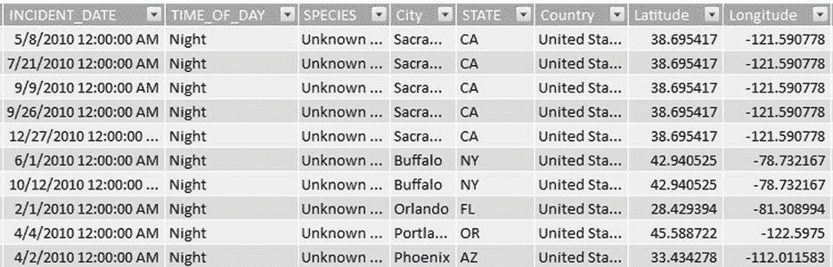

图 12-1. 包含可在 Power Map 中使用的位置信息的鸟击数据

如果您需要从外部源获取地图数据并对其进行整理以便在 Power Map 中使用，请记住上一章的内容：Power Query 是实现此目的的绝佳工具。一旦数据准备妥当，您就可以开始创建地图了。

### 创建基于地图的图表

要启动 Power Map，请转到 Excel 中的 `插入` 选项卡，点击 `地图` 下拉菜单，然后选择 `启动 Power Map`。如果这是您在该 Excel 工作簿中创建的第一个地图，它将启动 Power Map 界面，您可以在其中设计和查看地图（参见图 12-2）。

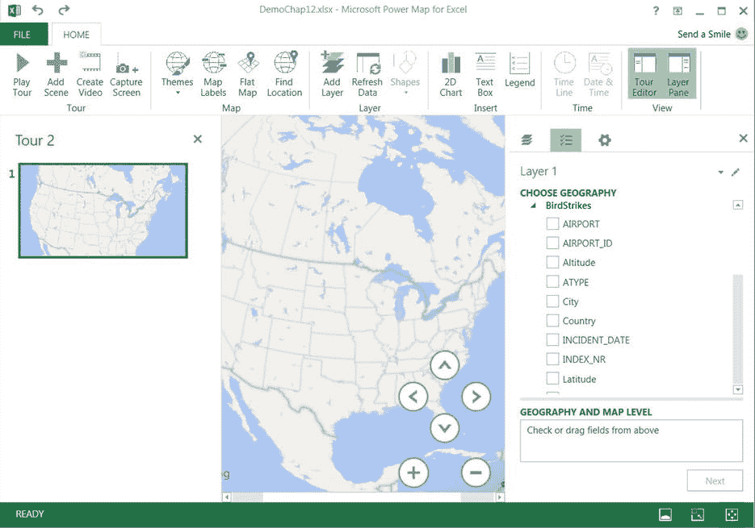

图 12-2. Power Map 界面

Power Map 界面中有三个窗格。左侧的是 `导览编辑器`。您可以在此处将地图的不同视图添加为场景，然后使用这些场景创建数据的视频导览。中间窗格是绘制数据的地图。您可以平移和缩放地图进行交互，从不同角度查看数据。右侧窗格是 `图层窗格`，您可在此处创建将绘制在地图上的数据图层。每个图层代表一组要在地图上添加或移除的数据。您可以通过切换 `开始` 选项卡中 `视图` 部分的按钮来显示或隐藏 `导览编辑器` 和 `图层窗格`（参见图 12-3）。

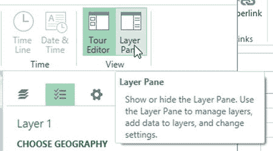

图 12-3. 显示/隐藏窗格

要开始创建地图，您需要使用 `图层窗格` 创建一个图层。一个图层代表一个特定的数据集。您可以创建多个图层并将它们叠加在一起。例如，您可以创建一个显示河流水位高度的图层，再创建另一个显示降雨量的图层，然后将 `降雨量` 图层放置在 `河流水位高度` 图层之上。

为图层选择好数据后，您就可以将其整合到地图中了。在 `图层窗格` 的 `选择地理区域` 区域中，选择您要在地图上绘制的地理区域字段。这些字段可以是 `城市`、`州` 或 `纬度` / `经度` 等。选择地理区域字段后，您将看到位置被绘制在地图上（参见图 12-4）。

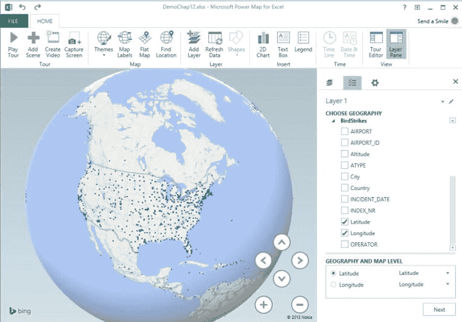

图 12-4. 选择地理区域字段

下一步是在图层中选择要创建的图表类型。您可以选择堆积柱形图、簇状柱形图或气泡图。此外，您还可以创建热力图或区域图。首次创建地图时，默认选择的是堆积柱形图。选定图表类型后，您需要将字段添加到各个部分。例如，堆积柱形图需要为 `Category`（类别）区域提供一个字段。您还可以为 `Height`（高度）和 `Time`（时间）区域添加字段。如果没有为 `Height` 添加字段，则每个类别值的行计数将被使用。图 12-5 展示了被选为 `Category` 的飞行阶段以及生成的堆积柱形图，该图显示了不同机场每个阶段的鸟击数量。

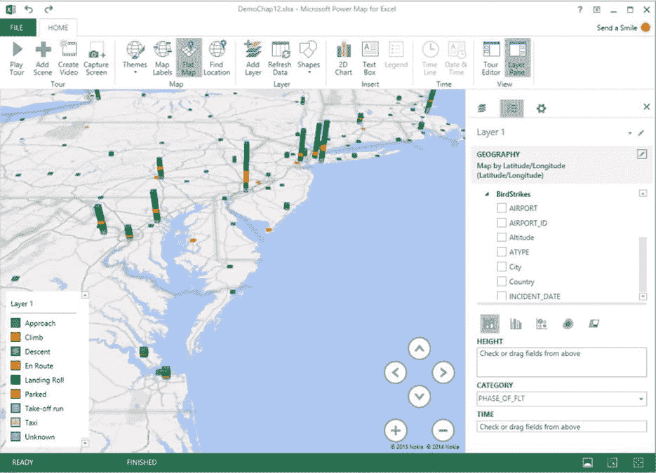

图 12-5. 创建堆积柱形图

您可以根据哪种图表能更好地展示数据，轻松地将堆积柱形图更改为簇状柱形图。

气泡图与柱形图类似，不同之处在于它使用气泡和饼状楔形来展示数据。例如，图 12-6 中的气泡图按一天中的时间段显示了鸟击次数。

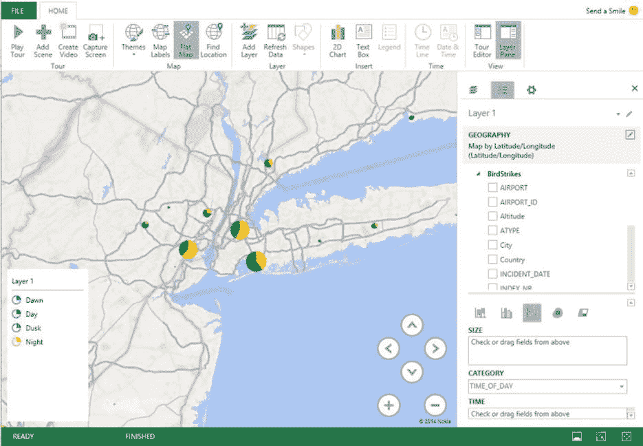

图 12-6. 创建气泡图

如您所见，创建堆积柱形图、簇状柱形图和气泡图的过程非常相似。另外两种彼此相似的图表类型是热力图和区域图。接下来将介绍这两种图。

### 创建热力图和区域图

Power Map 中一种有趣的地图类型是热力图。热力图将数据转换为颜色渐变。较高的值由较深的色调表示，而较低的值则由较浅的色调表示。尽管并非所有数据都适合用热力图表示，但对于某些类型的数据而言，这种图表类型非常有效。每当您想要分析某个值的相对强度时，热力图是一个不错的选择。例如，温度和降雨量等天气数据通常使用热力图来描绘（参见图 12-7）。

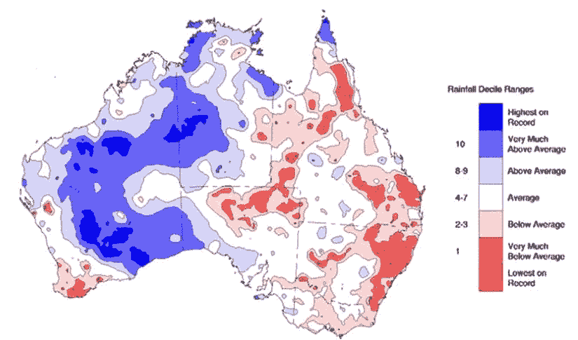

图 12-7. 降雨缺口热力图（来源：国家农业监测系统 [NAMS]）

在 Power Map 中创建热力图与创建堆积柱形图差别不大。首先，选择一个包含地理定位数据和您想要比较的值的表格。选择地理字段后，您可以将可视化效果更改为热力图，并选择要绘制的值字段。如果您没有选择值字段，它将绘制行计数。图 12-8 展示了一幅描绘某城市街区毒品相关犯罪活动的热力图。颜色越深表示犯罪率越高的区域。

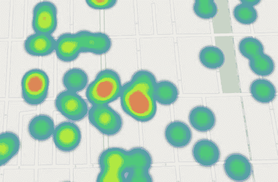

图 12-8. 描绘犯罪率的热力图

另一种与热力图相似的地图类型是区域图。区域图显示定义好的地理区域，例如国家、州、县和邮政编码。然后，它对区域进行颜色编码以比较值字段。常见的区域图类型之一是选举结果图。图 12-9 展示了一个按县划分的选举结果示例。红色代表共和党占多数，蓝色代表民主党占多数。色调越深，优势越大。

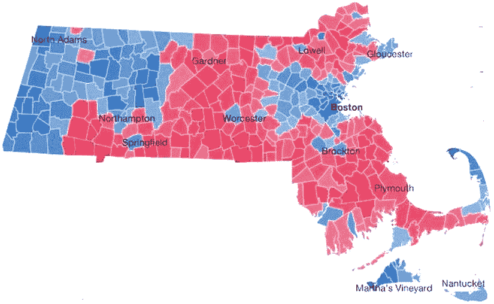

图 12-9. 区域图上的选举结果

要创建区域图，请在源表中选择区域字段作为地理字段，然后将可视化效果切换为区域。然后选择包含您想要在地图上显示的值的字段（参见图 12-10）。

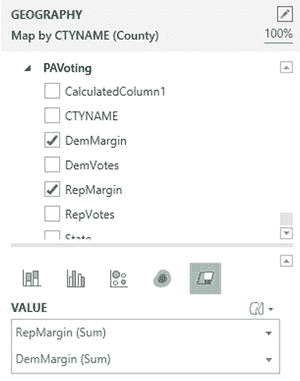

图 12-10. 为区域图选择值

每个区域将显示其值更大的值字段的颜色。通过选择 `Settings`（设置）选项卡下的图层选项，您可以更改地图上显示的值字段的颜色、不透明度和色阶（参见图 12-11）。

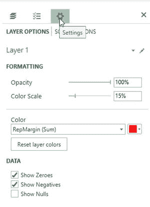

图 12-11. 调整区域图的颜色设置

在这种情况下，您可以调整颜色，使民主党优势显示为蓝色，共和党优势显示为红色（参见图 12-12）。

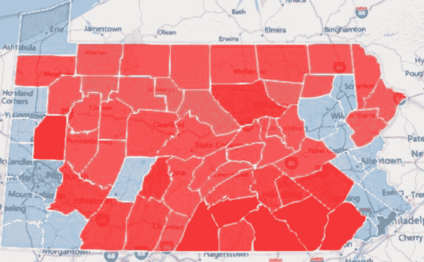

图 12-12. 区域图上描绘的投票优势

现在您已经了解了如何创建各种类型的地图，您可能希望为地图添加多个图层。接下来将介绍如何操作。

### 向 Power Map 添加多个图层

Power Map 的众多出色功能之一，就是您可以利用它创建多个图层，每个图层都可以有各自的可视化效果。然后，您可以通过添加和移除不同图层来创建丰富的演示文稿。

要在地图中添加另一个图层，请单击 Power Map 设计器中 `Home`（开始）选项卡上的 `Add Layer`（添加图层）按钮。之后，其过程与您之前添加第一个图层时相同。图 12-13 显示了之前的投票结果图层，以及一个附加图层，该图层展示了按种族（白种人和其他）划分的县气泡图。

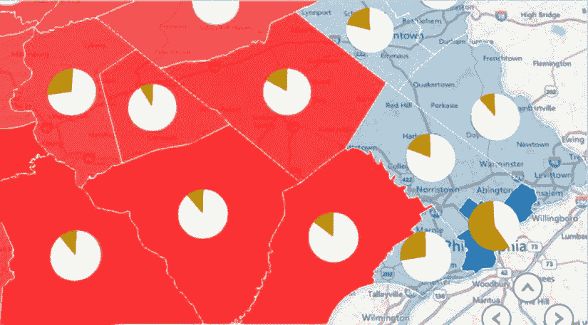

图 12-13. 在 Power Map 中叠加多个图层

要控制地图上哪些图层显示或隐藏，请在 `Layer Pane`（图层窗格）中选择 `Layer Manager`（图层管理器）选项卡。在 `Layer`（图层）列表中，您可以通过单击眼睛图标来隐藏或显示该图层（参见图 12-14）。

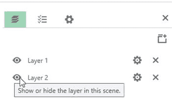

图 12-14. 隐藏和显示图层

如您所见，向地图添加多个图层非常容易。

所有地图可视化效果共有的另一个 Power Map 功能是能够显示随时间的变化。接下来将介绍如何将此功能添加到地图。

### 分析随时间的变化

Power Map 的另一个出色功能是，您可以使用它来查看数据随时间的变化情况。例如，假设您对追踪飓风的位置和风速感兴趣。由于数据包含日期时间字段，您只需将其拖放到 `Layer Pane`（图层窗格）中 `Field List`（字段列表）选项卡上的 `Time`（时间）下拉菜单中即可（参见图 12-15）。

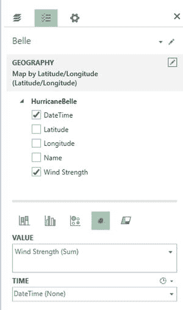

图 12-15. 添加时间字段

一旦添加了时间字段，时间轴播放器就会自动添加到地图图层中。图 12-16 展示了一幅热力图，描绘了飓风沿海岸北上时的风速。使用播放轴，您可以查看其在移动过程中的位置变化。

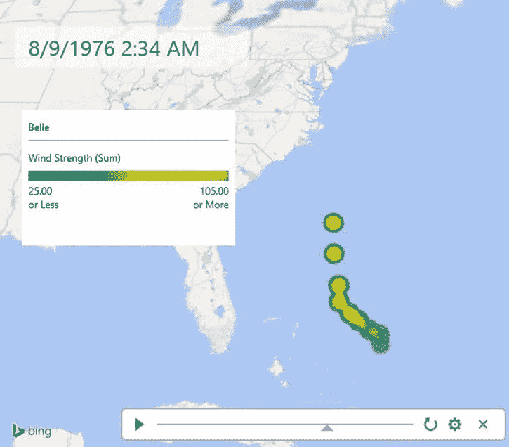

图 12-16. 使用播放轴追踪飓风路径和风速

Power Map 最后一个独特的功能是能够录制一个可以在场景间平移和缩放的操作演示。然后，您可以回放该演示，并将其导出为 MP4 视频。接下来将介绍如何创建操作演示。

### 创建操作演示

借助 Power Map，你可以通过导览（tour）用数据讲述故事。`导览` 是 Power Map 层级结构中的顶层对象。导览由一个或多个场景组成；`场景` 就像数据的一个快照，能以独特的方式展示数据。例如，图 12-17 和 图 12-18 展示了从不同视角查看的同一地图。你可以使用这两个视角创建场景，并将它们添加到导览中，从而从整个美国的视图缩放至仅显示东北部各州。

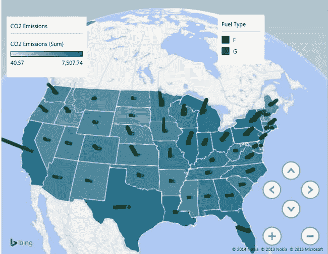

图 12-17。展示整个美国的场景

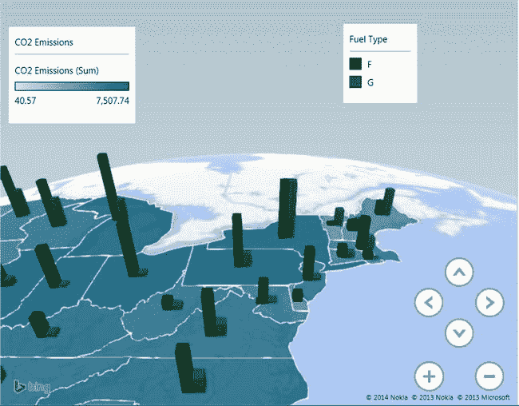

图 12-18。仅展示东北部各州的场景

要捕获一个场景，请将地图调整至该场景所需的视角，然后点击工具栏上的 `Add Scene` 按钮。当你将场景添加到导览中时，它们会出现在 `导览编辑器`（Tour Editor）中（参见 图 12-19）。

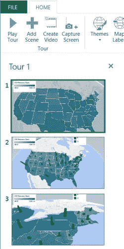

图 12-19。已添加场景的导览编辑器

将场景添加到导览后，你可以通过在 `导览编辑器` 中拖放场景来重新排列场景顺序。你也可以更改某个场景，而不影响导览中的其他场景。你可以添加或移除地图图层、更改主题，以及更改场景的视觉视角。每个场景还拥有场景选项，允许你更改场景时长和过渡效果（参见 图 12-20）。

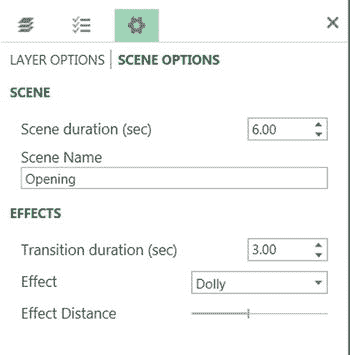

图 12-20。设置场景选项

创建好场景并设置其过渡效果后，你可以点击 `主页`（Home）选项卡上的 `播放导览`（Play Tour）按钮来播放导览（参见 图 12-19）。导览创建完毕后，你可以将其导出为 MP4 视频与他人分享，甚至可以为导览添加音轨（参见 图 12-21）。

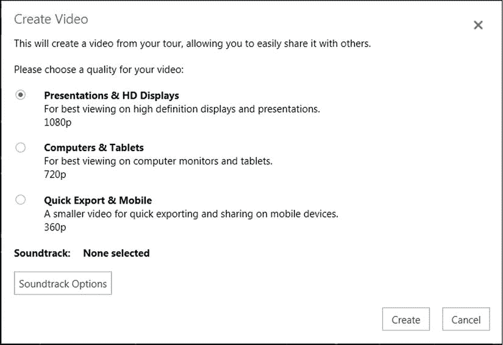

图 12-21。将导览导出为 MP4 视频文件

现在你已经了解了 Power Map 的各种功能，是时候动手实践，用它来绘制一些数据了。要完成本实验，你需要安装最新的 Power Map 加载项。

### 动手实验——在 Power Map 中创建地图可视化

在以下实验中，你将：

*   创建柱状地图。
*   创建区域地图。
*   创建多层地图。
*   创建带有时间轴的热力图。

1.  在`LabStarters`文件夹中，打开`LabChapter12.xlsx`文件。该文件包含发电厂和排放数据，你将使用这些数据在 Power Map 中创建可视化。
2.  在 Excel 的`插入`（Insert）选项卡中，选择`地图`（Map）下拉菜单，然后启动 Power Map。你应该会看到 Power Map 设计器以及`图层面板`（Layer Panel）中的表格（参见 图 12-22）。
    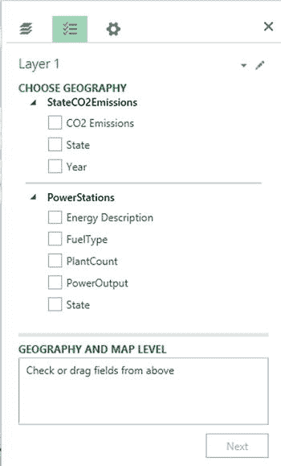
    图 12-22。图层面板中列出的表格
3.  将图层重命名为`燃料类型`，并选择`PowerStations`表中的`State`字段作为地理信息。点击`下一个`（Next）按钮。
4.  将`PlantCount`字段添加到`高度`（Height）下拉框，将`FuelType`字段添加到`类别`（Category）下拉框。将地图切换为簇状柱形图，并放大至美国东北部。你应该会在每个州看到两个柱形：一个代表化石燃料发电厂，另一个代表绿色能源来源。
5.  在`图层窗格`（Layer Pane）的`设置`（Settings）选项卡中，将化石燃料柱形的颜色更改为黑色，将绿色能源柱形的颜色更改为绿色。你还可以调整柱形的高度和粗细。最终地图应类似于图 12-23。
    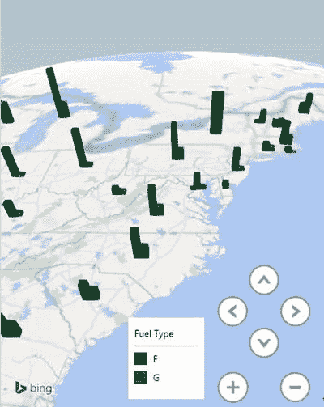
    图 12-23。显示各州发电厂数量的簇状柱形图
6.  在`图层窗格`的`图层管理器`（Layer Manager）选项卡中，添加另一个名为`CO2 排放量`的图层。使用`StateCO2Emissions`表中的`State`字段作为地理信息字段。
7.  将地图类型更改为`区域`（Region），并选择`CO2 Emissions`作为值字段。
8.  在`图层窗格`的`设置`选项卡中，将区域的颜色更改为蓝色。将色阶调整为从零开始，以便你能看到各州数值之间的微小差异。
9.  现在你应该在同一张地图上拥有两个图层，如图 12-24 所示。你可以使用`图层窗格`中的`图层管理器`选项卡来显示或隐藏地图上的各个图层。
    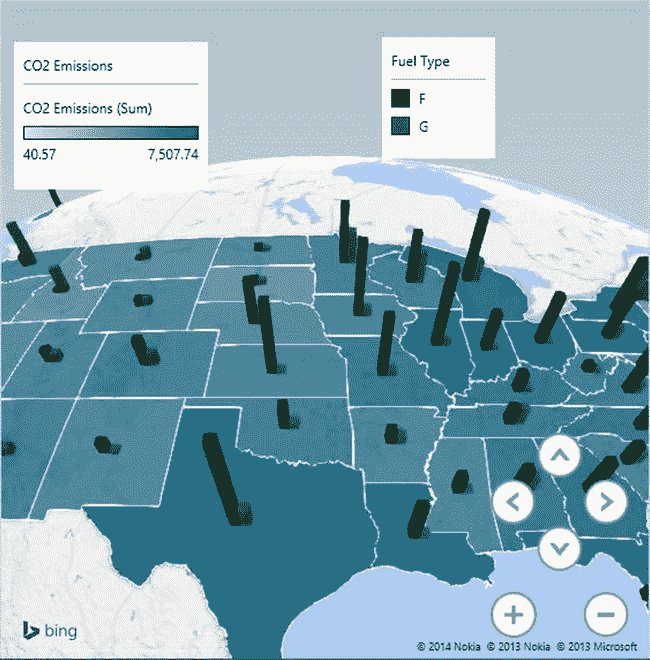
    图 12-24。多层地图
10. 保存并关闭 Excel 工作簿。
11. 在`LabStarters`文件夹中，打开`LabChapter12_2.xlsx`文件。该文件包含飓风数据，你将使用这些数据在 Power Map 中创建热力图和时间线。
12. 启动 Power Map 并创建一个名为`桑迪`的图层。使用`HurricaneSandy`数据，将`Latitude`和`Longitude`字段添加到`地理信息`（Geography）下拉框中。
13. 将地图更改为热力图，并选择`Wind Strength`作为值字段，`DateTime`作为时间字段。
14. 你应该会看到如图 12-25 所示的热力图。请注意风速在登陆时达到最大值。使用播放轴，点击`播放`（Play）按钮，观看飓风随时间的路径轨迹。
    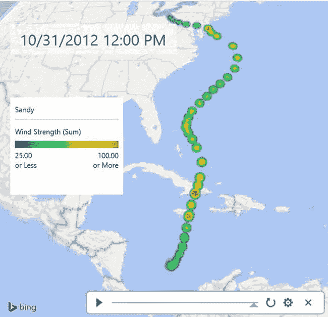
    图 12-25。描绘风速的热力图
15. 完成后，保存并关闭 Excel。

### 总结

正如你在本章中所见，Power Map 是一个强大的 Excel 加载项，提供了一套工具，帮助你可视化并深入了解具有地理成分的数据。你可以通过在地图（Bing map）上方以柱形形式绘制数据，来生成出色的 3D 可视化效果。此外，如果数据包含日期或时间成分，你可以使用 Power Map 可视化随时间变化的数据。你还学习了如何创建热力图和区域地图，对于某些类型的数据集，这些是可视化并发现数据洞察的绝佳方法。Power Map 的另一个强大功能是能够在同一张地图上叠加多个数据图层，这使你能够比较通过位置关联起来的数据。

请记住，当前 Power Map 仍在开发中，新功能会定期添加。请确保你使用的是最新版本，以便充分利用这些功能。

在下一章中，你将了解商业智能分析中最有趣的方面之一：预测分析。预测分析使你能够从历史数据中提取信息，并利用这些信息预测未来的行为和趋势。Excel 提供了一套数据挖掘工具，让预测分析易于实现。使用这些工具，你可以执行高级数据分析，例如预测、聚类和关联分析。第 13 章将向你介绍这些工具，并展示如何实现一些常见的数据挖掘模型，从而深入了解你的数据。

## 第 13 章

