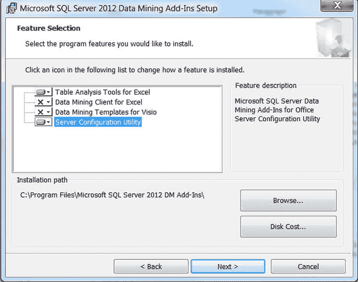
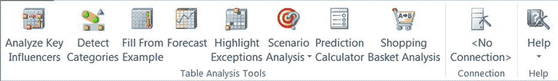
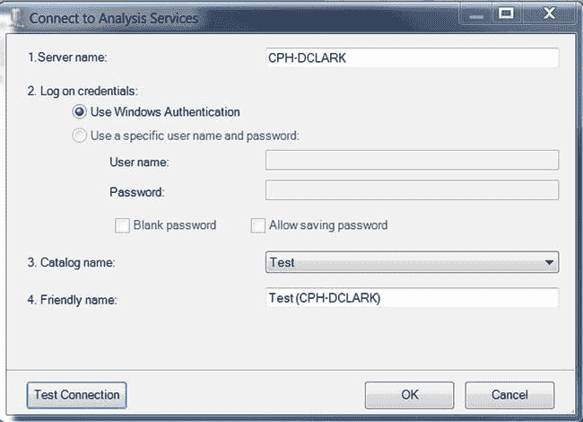
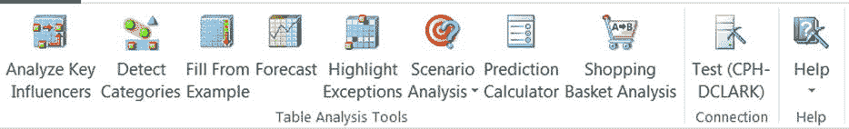
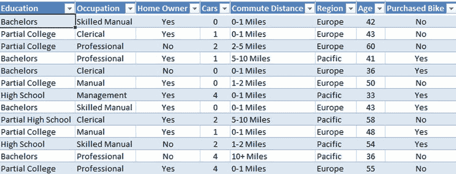
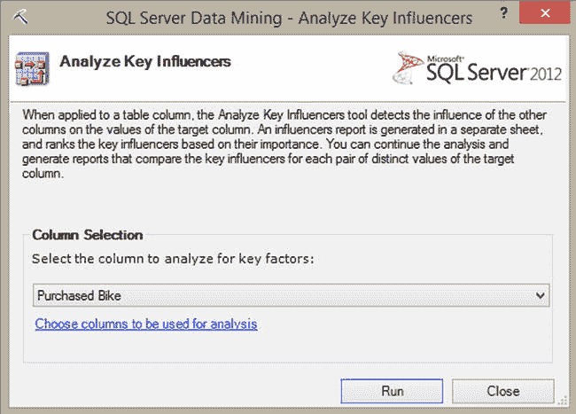
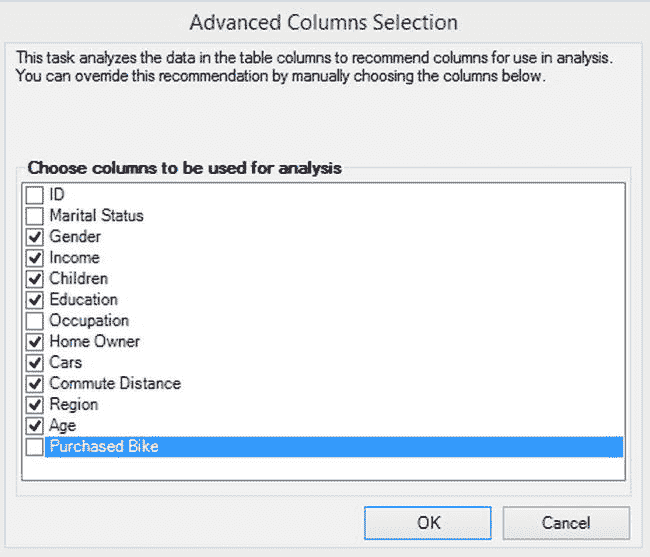

# 使用 Excel 挖掘数据

商业智能中最未被充分利用的领域之一是数据挖掘，或者通常所说的*预测分析*。这是因为传统的数据挖掘使用一组复杂的算法，而这些工具通常要求你成为这些算法的专家才能实施它们。虽然它并非 Microsoft 官方自助式 BI 工具集的组成部分，但 Microsoft 为 Excel 提供的一组表分析工具，使你可以使用数据挖掘算法，同时隐藏了与实施这些算法相关的大部分复杂性。使用这些 Excel 表分析工具，你可以执行预测、聚类和关联分析等高级数据分析。本章将向你展示如何使用这些工具来实现一些常见的数据挖掘模型，并深入了解你的数据。不过，我需要指出的是，要实施这些表分析工具，你需要能够连接到 SQL Server Analysis Server (SSAS) 实例，该实例提供运行算法的引擎。

完成本章后，你将能够：

*   识别 Excel 中可用的表分析工具。
*   分析关键影响因素。
*   识别数据组。
*   预测未来趋势。
*   使用购物篮分析。

### Excel 中的表分析工具

*数据挖掘*是利用历史数据发现模式并为未来趋势制定预测的过程。数据挖掘的一些常见示例包括市场购物篮分析、营销效果分析和预测。*市场购物篮分析*查看历史数据，并确定在购买过程中哪些产品经常相互关联。利用这些信息，你可以就哪些产品应该一起营销提出建议。*营销效果分析*分析历史营销活动，可用于为未来的活动定位目标客户。*预测*使你能够根据数据中的历史趋势预测未来。例如，你可以根据过去五年的销售趋势进行销售预测。这可以帮助你规划未来季度的库存水平。

要安装 Excel 的表分析工具，请访问下载页面 (`www.microsoft.com/en-us/download/details.aspx?id=35578`)。请确保你为 Office 安装选择了正确的版本（x86 或 x64）。下载软件包后，双击 `SQL_AS_DMAddin.msi` 文件启动安装程序。在“功能选择”窗口中，保留默认选择“用于 Excel 的表分析工具”和“服务器配置实用工具”（参见图 13-1）。

图 13-1

安装表分析工具

安装 Excel 的数据挖掘工具后，当你选择 Excel 表格时，你将会看到一个新的选项卡。“表工具 分析”选项卡包含一组工具，帮助你挖掘表格中包含的数据（参见图 13-2）。

图 13-2

“表工具 分析”选项卡上的表分析工具

你首先应该注意到的是，这里没有列出连接。为了使这些工具能够工作，你需要连接到 SSAS 实例。要创建连接，请单击“连接”按钮。在“Analysis Services 连接”窗口中，单击“新建”按钮。在“连接到 Analysis Services”窗口中（参见图 13-3），输入用于连接到 SSAS 实例的值。这些值将由你的 SSAS 实例确定。

图 13-3

连接到 SSAS 实例

添加连接后，你应该会在表分析工具的连接区域中看到它列出（参见图 13-4）。

图 13-4

具有活动 SSAS 连接的表分析工具

这些工具中的每一个都使用一种众所周知的数据挖掘算法，并分析数据的分布和数据类型。使用这些工具可以让你免于实施算法的复杂性。表 13-1 总结了每个可用工具、何时使用它们以及所使用的算法类型。

表 13-1

可用表分析工具摘要

| 工具 | 用途 | 算法 |
| --- | --- | --- |
| 分析关键影响因素 | 识别对目标数据列影响最大的因素。 | 朴素贝叶斯 |
| 检测类别 | 查找数据的分组。 | 聚类 |
| 根据示例填充 | 根据数据中的模式推荐新值。 | 逻辑回归 |
| 预测 | 分析随时间变化的数据并预测未来值。 | 时间序列 |
| 突出显示异常 | 分析数据表中的模式并查找不符合模式的值。 | 聚类 |
| 目标查找方案 | 识别为达到目标需要更改的底层因素。 | 逻辑回归 |
| 假设方案 | 预测某项更改是否足以实现所需结果。 | 逻辑回归 |
| 预测计算器 | 分析导致目标结果的因素并预测新输入的预测结果。 | 逻辑回归 |
| 购物篮分析 | 识别可用于交叉销售或追加销售的模式。 | 关联 |

现在你已经了解了可用工具的范围，是时候更详细地了解其中的一些工具了。

### 分析关键影响因素

使用“分析关键影响因素”工具，你可以确定哪些因素对结果影响最大。例如，你有一个包含客户属性的数据表，以及一个指示他们是否购买了自行车的列（参见图 13-5）。

图 13-5

客户属性

要确定影响客户是否购买自行车的关键因素，请选择该表，然后在“表分析工具”选项卡中，选择`分析关键影响因素`。你将看到一个列选择对话框。首先选择包含你要分析的结果的列（参见图 13-6）。

图 13-6

选择结果字段

接下来，单击链接以选择要用于分析的列（参见图 13-7）。

图 13-7

选择影响字段

选择要分析的字段后，选择“确定”关闭“高级列选择”窗口。在“`分析关键影响因素`”窗口中，选择“运行”以开始分析（参见图 13-6）。

