# 构建完整解决方案

虽然数据挖掘是商业智能中最未被充分利用的领域之一，但借助 Excel 的表格分析工具，情况未必如此。尽管数据挖掘使用了一系列复杂的算法，且传统工具通常要求您是此类算法的专家才能实施，但使用表格分析工具时，Excel 为您隐藏了大部分复杂性。本章向您展示了如何使用这些工具执行高级数据分析，例如预测、聚类和关联。您现在能够利用这些工具更深入地洞察数据。请记住，不要局限于具体示例，要学会在各种情况下应用这些模式。

在撰写本书时，微软正将其数据挖掘工作重心转移到 Microsoft Azure ML（机器学习）上，并且未对 Excel 的数据挖掘工具进行任何升级。这令人遗憾，因为 Azure ML 是一个纯云平台系统，对于普通业务分析师来说略显高级。好的一面是，一些第三方供应商（例如 XLMiner 和 Predixion）正积极推出他们自己的 Excel 数据挖掘插件工具。这些工具在观感上与本章介绍的表格分析工具非常相似，我认为您会发现使用这些工具过渡起来很容易。

在第 14 章中，您将学习两个实际案例研究，以巩固前几章的概念。通过完成这些案例研究，您将能够评估自己掌握了哪些领域，以及哪些领域需要进一步学习。此外，您还将了解一些与数据分析相关的常见模式，以及如何使用本书涵盖的工具来实现这些模式。

在前几章中，您已经获得了使用微软自助式 BI 工具集中每个组件的经验。您使用了 Power Pivot、Power View、Power Query、Power Map 以及 Excel 表格分析工具。本章为您提供了几个用例，以巩固前几章的概念。通过完成这些用例，您将评估自己掌握了哪些领域，以及哪些领域需要花更多时间学习。由于这有点像您的期末考试，我特意没有像之前的练习那样提供分步说明。相反，我给出了应该足以让您上手的一般性指导。如果您遇到困难，请参考前面的章节，提醒自己如何完成任务。

本章包含以下用例：

*   经销商销售分析
*   销售配额分析
*   传感器分析

### 用例 1：经销商销售分析

在此场景中，您为一家自行车设备公司工作，被要求分析销售数据。您需要构建一个仪表板，用于比较各月之间的同店销售增长。一个额外的限制条件是，进行此比较时，您只想比较已开业至少一年的经销商。

#### 加载数据

创建一个名为 `StoreSalesAnalysis.xlsx` 的新 Excel 工作簿。在 `Chapter14Labs` 文件夹中，找到 `UseCase1` 文件夹，其中包含一个 `StoreSales.accdb` Access 数据库。该数据库存储了您需要分析的销售数据。以此作为数据源，导入表 14-1 中列出的数据表和列。

表 14-1. 需导入的商店销售表与列

| 源表 | 友好名称 | 列 |
| --- | --- | --- |
| `dbo_DimDate` | 日期 | `DateKey`, `FullDateAlternateKey`, `EnglishMonthName`, `MonthNumberOfYear`, `CalendarQuarter`, `CalendarYear` |
| `dbo_DimGeography` | 位置 | `GeographyKey`, `City`, `StateProvinceCode`, `StateProvinceName`, `CountryRegionCode`, `EnglishCountryRegionName`, `PostalCode` |
| `dbo_DimProduct` | 产品 | `ProductKey`, `ProductSubcategoryKey`, `EnglishProductName`, `StandardCost`, `ListPrice`, `DealerPrice`, `LargePhoto` |
| `dbo_DimProductCategory` | 类别 | `ProductCategoryKey`, `EnglishProductCategoryName` |
| `dbo_DimProductSubcategory` | 子类别 | `ProductSubcategoryKey`, `EnglishProductSubcategoryName`, `ProductCategoryKey` |
| `dbo_DimReseller` | 经销商 | `ResellerKey`, `GeographyKey`, `BusinessType`, `ResellerName`, `YearOpened` |
| `dbo_FactResellerSales` | 经销商销售额 | `ProductKey`, `ResellerKey`, `OrderDateKey`, `SalesOrderNumber`, `SalesOrderLineNumber`, `OrderQuantity`, `UnitPrice`, `ExtendedAmount`, `TotalProductCost`, `SalesAmount` |

#### 创建模型

导入表后，使用相应的键创建表关系。您的模型现在应该类似于图 14-1。

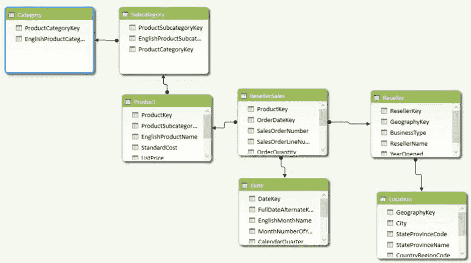

图 14-1. 商店销售模型

根据表 14-2 中列出的信息，重命名表列，并从客户端工具中显示或隐藏列。

表 14-2. 表与列属性

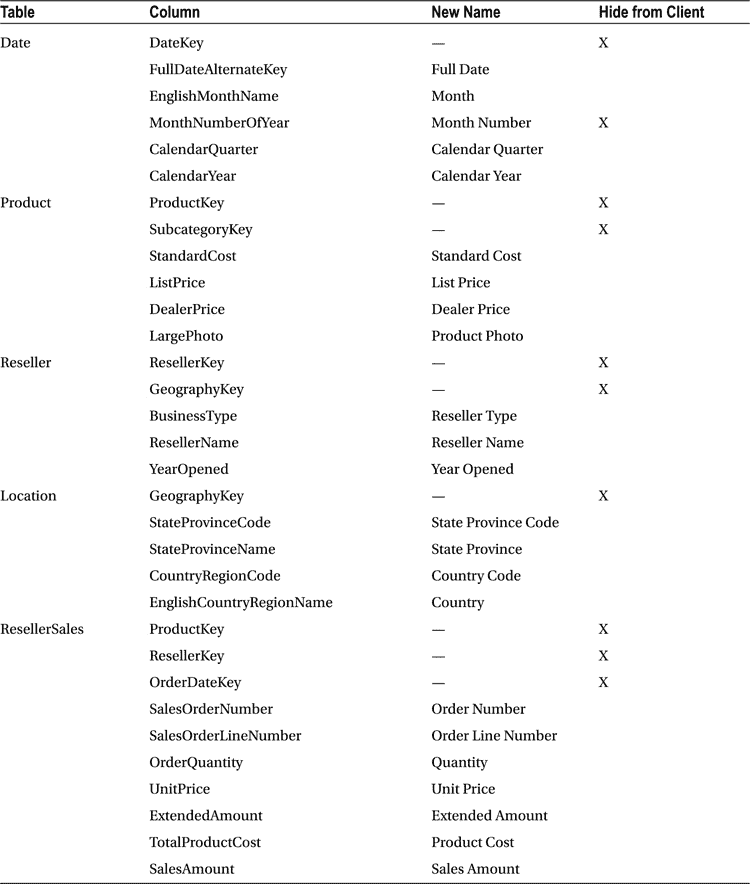

在 `Date` 表中，创建一个年份 - 季度 - 月份的日历层次结构。将此表标记为日期表，并使用 `Full Date` 列作为键。按 `Month Number` 列对 `Month` 列进行排序。设置 `Full Date` 列的格式，使其仅显示日期而不显示时间。

#### 创建计算列

使用 DAX `RELATED` 函数，在 `Product` 表中为产品子类别和产品类别创建计算列。

```
[Category]
=IF(ISBLANK([ProductSubcategoryKey]),"Misc",
    RELATED(Category[EnglishProductCategoryName]))

[Subcategory]
=IF(ISBLANK([ProductSubcategoryKey]),"Misc",
    RELATED(Subcategory[EnglishProductSubcategoryName]))
```

从任何客户端工具中隐藏 `Category` 和 `Subcategory` 表。如果 `ProductSubcategoryKey` 为空，则使用 `"Misc"` 填充 `Category` 和 `Subcategory` 列。最后，创建一个名为 **Prd Cat** 的层次结构，其中包含 `Product Category` 和 `Product Subcategory` 列。

#### 创建度量值

在 `ResellerSales` 表中添加以下度量值：

```
Month Sales:=TOTALMTD(SUM([Sales Amount]),'Date'[Full Date])

Prev Month Sales:=CALCULATE(Sum([Sales Amount]),PREVIOUSMONTH('Date'[Full Date]))

Monthly Sales Growth:=[Month Sales] - [Prev Month Sales]

Monthly Sales Growth %:=DIVIDE([Monthly Sales Growth],[Prev Month Sales],0)
```

通过创建如图 14-2 所示的数据透视表来测试您的度量值。

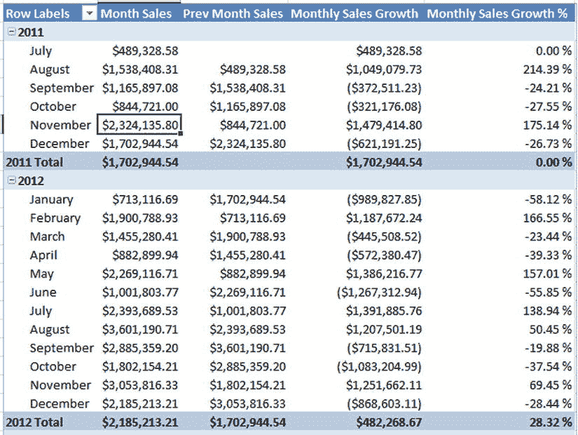

图 14-2. 在数据透视表中查看度量值

现在，您需要创建一个度量值，以确定在计算销售额的月份，某个店铺是否已开业至少一年。在 `Reseller` 表中，添加以下度量值：

```
Years Open:=Year(FIRSTDATE('Date'[Full Date])) - Min([Year Opened])

Was Open Prev Year:=If([Years Open]>0,1,0)
```

创建一个数据透视表来测试您的度量值，如图 14-3 所示。请记住，只有在按年份筛选时，这些度量值才有意义。

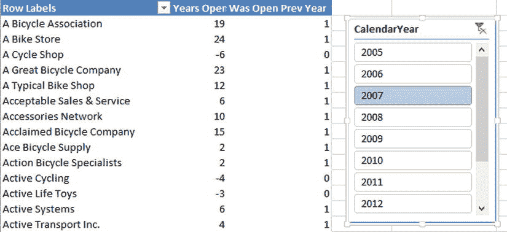

图 14-3. 测试度量值

现在，您可以组合这些度量值，以便只包括在销售时已开业至少一年的经销商。创建以下度量值：

```
Month Sales Filtered:=Calculate([Month Sales],FILTER(Reseller,[Was Open Prev Year]=1))
```


```dax
Prev Month Sales Filtered:=CALCULATE([Prev Month Sales],
    Filter(Reseller,[Was Open Prev Year]=1))

Monthly Sales Growth Filtered:=[Month Sales Filtered]-[Prev Month Sales Filtered]

Monthly Sales Growth Filtered %:=DIVIDE([Monthly Sales Growth Filtered],
    [Prev Month Sales Filtered],0)
```

通过创建如图 Figure 14-4 所示的 Power Pivot 表来测试你的新度量值。你应该能看到经过筛选和未经筛选的度量值之间的差异。

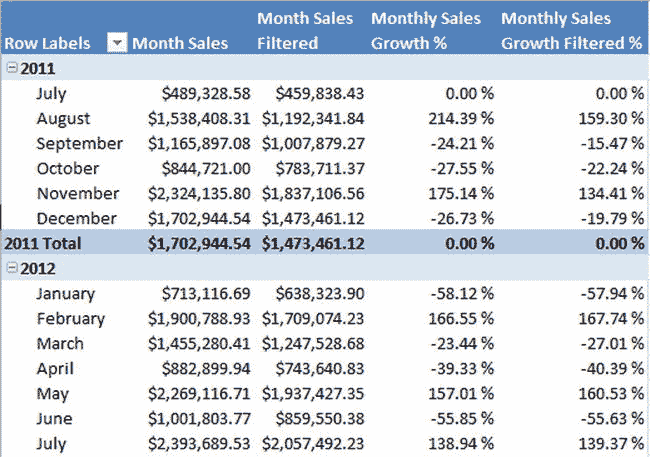

图 14-4 测试筛选后的度量值

#### 创建仪表板

在 Power View 中创建仪表板之前，你需要更新一些表设置以优化模型，使其适用于 Power View。表 14-3 列出了你需要进行的表设置。

表 14-3 为 Power View 优化设置

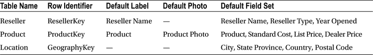

此外，将 表 14-4 中列出的列标记为相应的数据类别。

表 14-4 设置数据类别

| 表 | 列 | 数据类别 |
| --- | --- | --- |
| Location（位置） | City（城市） | City（城市） |
| State Province（州/省） | State or Province（州或省） |
| Country（国家） | Country（国家） |
| Postal Code（邮政编码） | Postal Code（邮政编码） |
| Product（产品） | Product Photo（产品照片） | Image（图像） |

在 `Date` 表中，设置字段使其不进行汇总。

若要创建仪表板，请插入一个 Power View 报表。将该报表命名为 `Reseller Sales`，并添加一个柱形图，该柱形图使用经过筛选的月度销售额按月份和经销商类型显示销售额。向报表添加一个切片器，以控制图表显示的日历年。由于 2011 年之前没有销售额，请筛选视图，使其仅显示 2011 年至 2014 年。你的报表应类似于图 14-5。

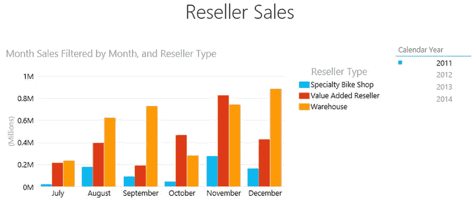

图 14-5 经销商销售额报表

现在，你需要进行另一项经销商分析，以查找月份、季度和年份的最佳月销售额。为此，你需要在模型中添加一个新度量值。该度量值使用 `VALUES` 和 `MAXX` 函数来查找经销商月销售额的最大值。

```dax
Max Reseller Sales:=MAXX(VALUES(Reseller[ResellerKey]),[Month Sales])
```

在模型中添加了新的度量值后，在 Power View 报表中添加另一个柱形图，显示每个月的经销商最大销售额。请注意，这些图表是交互式的；如果你单击一个图表中的某个柱形，它将相应地筛选另一个图表（参见图 14-6）。

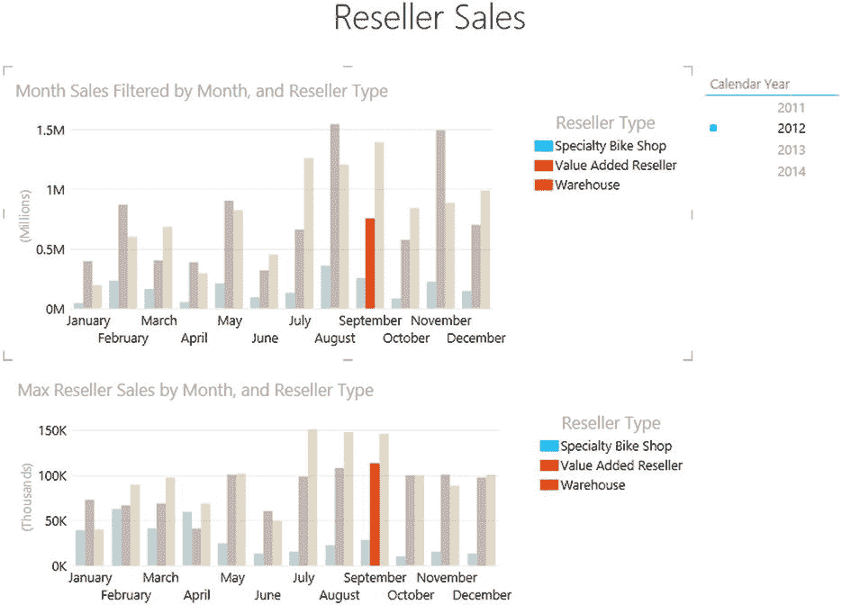

图 14-6 添加最大经销商销售额图表

为了更进一步，假设你想要获取该期间内月销售额最高的经销商的名称。为此，你需要组合一系列表达式来检索月销售额最高的经销商的名称。首先，你需要确定哪个经销商的月销售额等于月销售额最大值。如果满足条件，则将其标记为值 `1`；否则，标记为 `BLANK`。

```dax
IF([Month Sales]=CALCULATE([Max Reseller Sales],
    Values(Reseller[Reseller Name])),1,BLANK())
```

下一步是使用 `FIRSTNONBLANK` 函数来查找值为 `1` 的经销商。

```dax
FIRSTNONBLANK(Reseller[Reseller Name],
    IF([Month Sales]=CALCULATE([Max Reseller Sales],
    Values(Reseller[Reseller Name])),1,BLANK()))
```

最后，你需要确保在检查的期间内确实存在月销售额。将这些公式组合到 `Top Monthly Reseller` 度量值中，如下所示：

```dax
Top Monthly Reseller:=If(ISBLANK([Month Sales]),
    BLANK(),FIRSTNONBLANK(Reseller[Reseller Name],IF([Month Sales]=
    CALCULATE([Max Reseller Sales],Values(Reseller[Reseller Name])),1,BLANK())))
```

  
这次，在 Excel 工作表中构建仪表板。添加一个图表，展示您所关注的年度各月销售额增长百分比，再添加一个数据透视表，显示每个月的最大经销商销售额和经销商名称。此外，还要添加一个用于年份的切片器、一个用于经销商类型的切片器，以及一个用于国家/地区的切片器。您的仪表板应类似于图 14-7。  

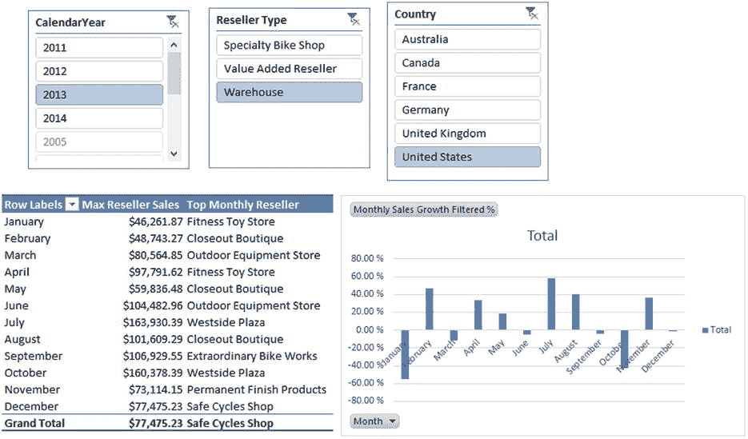  

图 14-7。Excel 工作表中的最终仪表板  

完成仪表板并进行实验后，保存并关闭 Excel。  

## 用例 2：销售配额分析  

在本场景中，您将使用与用例 1 相同的自行车公司销售团队的销售数据。这次，您需要使用 Power View 创建一个仪表板，让销售经理能够跟踪销售团队的业绩。您需要将实际销售额与销售团队的销售配额进行比较。虽然进行比较所需的度量值并不复杂，但销售数据和配额数据的粒度处于不同级别，这带来了挑战。  

### 加载数据  

创建一个名为 `SalesRepAnalysis.xlsx` 的新 Excel 工作簿。在 `Chapter14Labs` 文件夹中有一个名为 `UseCase2` 的子文件夹；该文件夹包含一个名为 `SalesRepAnalysis.accdb` 的 Access 数据库。以此作为数据源，导入表 14-5 中列出的数据表和列。  

表 14-5。要导入的表和列  

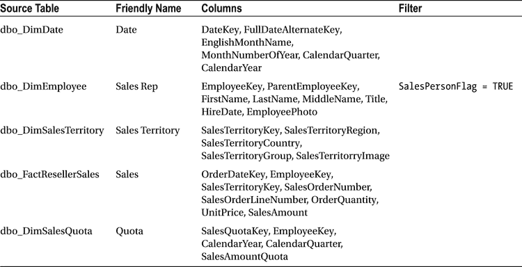  

### 创建模型  

导入表后，根据表 14-6 中列出的信息，重命名表列，并在客户端工具中显示或隐藏相应列。  

表 14-6。表和列属性设置  

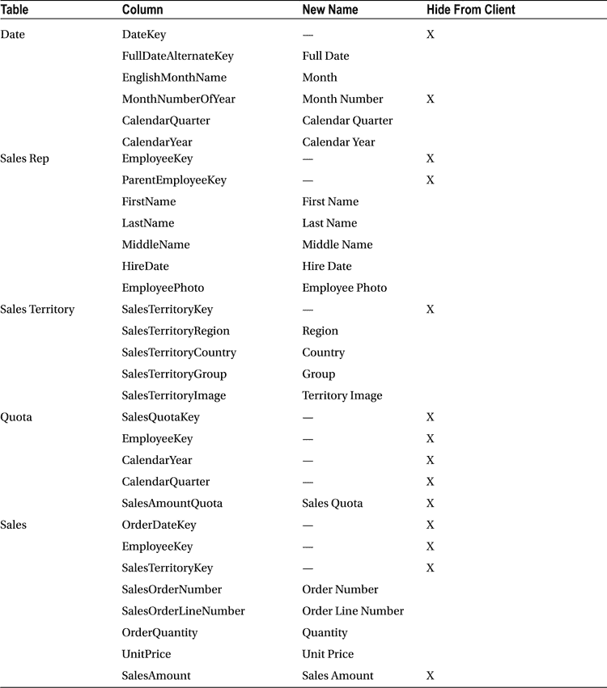  

为了在表之间创建适当的关系，您需要创建一个包含日历年份和季度的销售期间表。要获取此表，请使用现有的与 `SalesRepAnalysis.accdb` Access 数据库的连接。这次，使用以下查询获取数据（确保友好查询名称为 Sales Period）：  

```
Select distinct CalendarYear & CalendarQuarter as PeriodKey,
CalendarYear as [Period Year], CalendarQuarter  as [Period Quarter] from dbo_DimDate
```

在配额表中，使用 DAX 函数 `CONCATENATE` 创建一个 PeriodKey 列。  

```
[PeriodKey]
=CONCATENATE([CalendarYear],[CalendarQuarter])
```

销售额表处理起来稍复杂一些。首先，在销售额表和日期表之间创建关系。接着，使用 `RELATED` 函数在销售额表中创建年度期间和季度期间。然后使用 `CONCATENATE` 函数在销售额表中创建 `PeriodKey` 列。  

```
[Period Year]
=Related('Date'[Calendar Year])
[Period Quarter]
=RELATED('Date'[Calendar Quarter])
```

在客户端工具中隐藏表中的 `PeriodKey`。同时隐藏配额表和销售额表中的 `Period Year` 和 `Period Quarter` 列。  

现在，您可以在模型中完成表关系的创建。图 14-8 展示了最终模型应呈现的样子。  

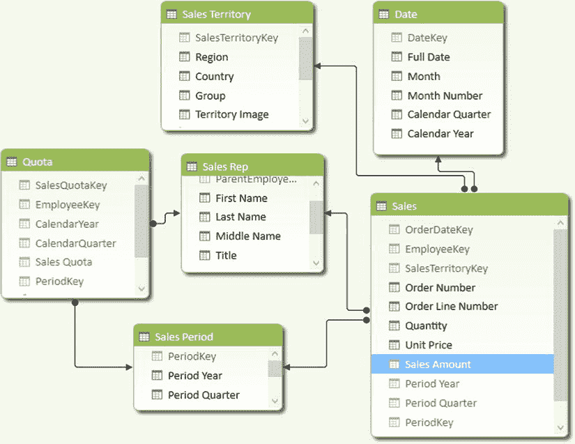  

图 14-8。定义了关系的销售代表分析模型  

接下来，在销售区域表中使用组、国家/地区和区域字段创建一个区域层次结构。在销售期间表中创建另一个名为期间（Period）的层次结构，使用 `Period Year` 和 `Period Quarter` 字段。在销售代表表中，通过用逗号连接 `Last Name` 和 `First Name` 列，添加一个名为 `Sales Rep Name` 的计算列。  

### 创建度量值  

在销售额表中添加以下度量值：  

```
Total Sales:=SUM([Sales Amount])
```

在配额表中添加以下度量值：  

```
Total Quota:=Sum([Sales Quota])

Variance:=[Total Sales]-[Total Quota]
```  


```markdown
`Variance := [Variance]/[Total Sales]` 为销售代表创建一个关键绩效指标（KPI），其中销售额超过配额 5% 为良好，低于配额 5% 则为差。该 KPI 基于 `Total Sales` 度量值，并与总 `Quota` 度量值进行比较。

通过创建数据透视表来测试度量值，如图 14-9 所示。

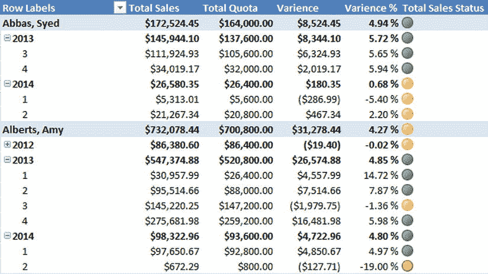

图 14-9. 在数据透视表中测试销售 KPI

#### 创建仪表板

在 Power View 中创建仪表板之前，请更新部分表格设置，以优化模型与 Power View 的兼容性。表 14-7 列出了你需要调整的表格和设置。

表 14-7. 针对 Power View 的优化设置

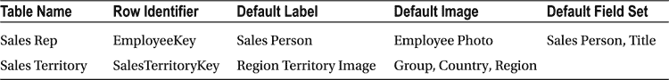

此外，请将表 14-8 中列出的列标记为相应的数据类别。

表 14-8. 设置数据类别

| 表 | 列 | 数据类别 |
| --- | --- | --- |
| Sales Rep | Hire Date | 日期 |
| Employee Photo | 图像 |
| Sales Territory | Region | 国家/地区 |
| Country | 国家/地区 |
| Territory Image | 图像 |

在 `Period` 和 `Date` 表中，设置字段使其不进行汇总。

插入一个 Power View 报表，并将其命名为 **Sales Rep Performance**。使用磁贴功能，在标题区域显示不同的销售原因，并在详细信息区域以卡片形式显示销售代表信息（参见图 14-10）。


图 14-10. 使用磁贴和卡片显示销售代表信息

在磁贴详细信息区域内添加一个矩阵，显示按时间段和销售代表划分的销售总 KPI。关闭矩阵的汇总总计。在磁贴区域之外，添加一个时间段年份切片器，以及一个展示各销售区域总销售额的表格。你还可以添加视图筛选器，以筛选掉无销售额的年份和 NA 区域。最终的仪表板应类似于图 14-11。

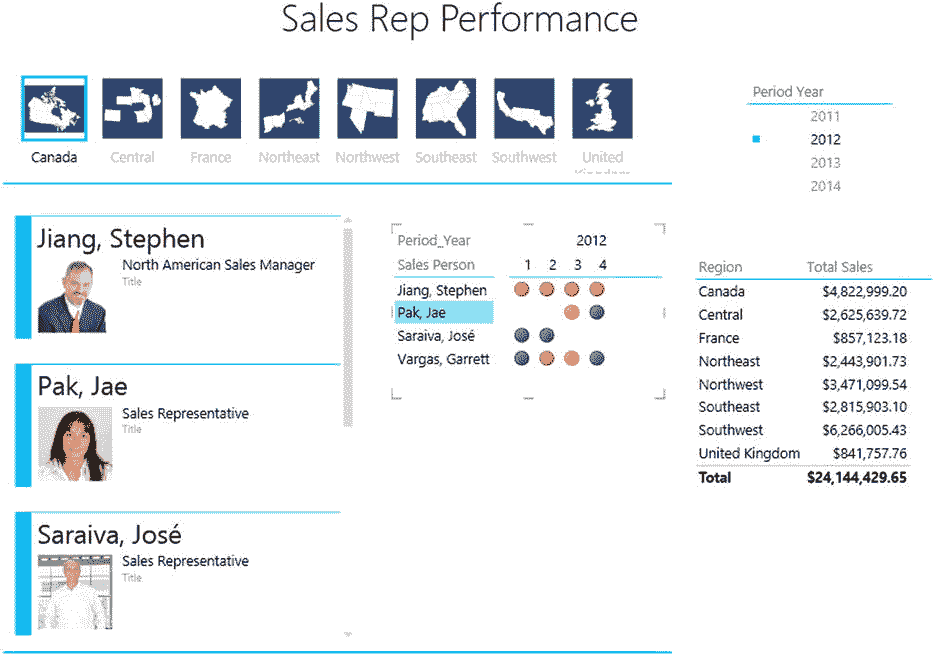

图 14-11. 最终的销售代表绩效仪表板

完成仪表板并测试后，保存并关闭 Excel。

### 用例 3：传感器分析

在此场景中，你供职于一家电力公司，该公司使用传感器监控设备。传感器监测各种电力读数，包括电力中断和电压尖峰。当传感器检测到问题时，会触发一个记录报警信号。你需要创建一个地图，使分析人员能够查看并比较不同时间段的电力中断和电压尖峰情况。

#### 加载数据

所需数据位于多个文本文件中。在将数据加载到 Power Pivot 模型之前，你需要对数据进行清理和处理。因此，你将使用 Power Query 来加载数据。

在 `Chapter14Labs` 文件夹中找到名为 `UseCase3` 的文件夹。该文件夹包含四个文件，其中包含传感器数据以及完成分析所需的相关数据。创建一个名为 `PowerAnalysis.xlsx` 的新 Excel 工作簿。使用 Power Query，连接到 `UseCase3` 文件夹中的 `Alarms.csv` 文件。你应该包含以下列：`PREMISE_NUMBER`、`METER_NUMBER`、`OP_CENTER`、`Type` 和 `DateKey`。将查询重命名为 **Alarms**，取消选中“加载设置”，然后保存查询。添加第二个查询 **AlarmTypes**，从 `AlarmType.txt` 文件中获取报警类型数据。现在，你可以删除 `SHORT_CODE` 列并保存查询。

重新打开 `Alarms` 查询，并使用相应的键将其与 `AlarmTypes` 查询合并（参见图 14-12）。

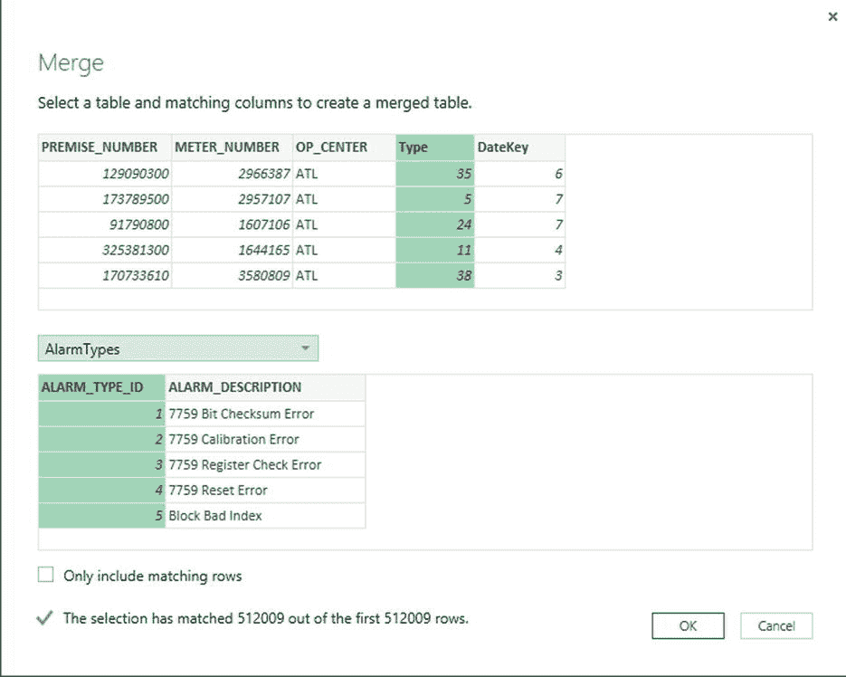

图 14-12. 将 `AlarmType` 查询与 `Alarms` 查询合并
```

可以移除 `Alarm Type` 键，并将 `ALARM_DESCRIPTION` 重命名为 `Alarm Type`。

重复前面的步骤，用 `Date.csv` 文件中的日期替换 `DateKey` 列。使用 `Locations.txt` 文件，根据 `OP_CENTER` 为 `Alarms` 查询添加经度和纬度值。你可以重命名列，使其使用相同的命名约定。你的报警查询应类似于图 14-13。

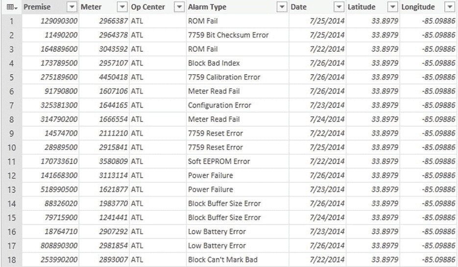

图 14-13：添加了纬度和经度数据的报警查询。

接下来，筛选数据，将报警类型限制为 `power failure` 和 `high AC volts`。完成此操作后，你可能会注意到 `Meter` 列中存在一些错误值；请继续并删除这些错误。现在，你可以按日期、运营中心、报警类型、经度和纬度对报警计数进行聚合分组（参见图 14-14）。

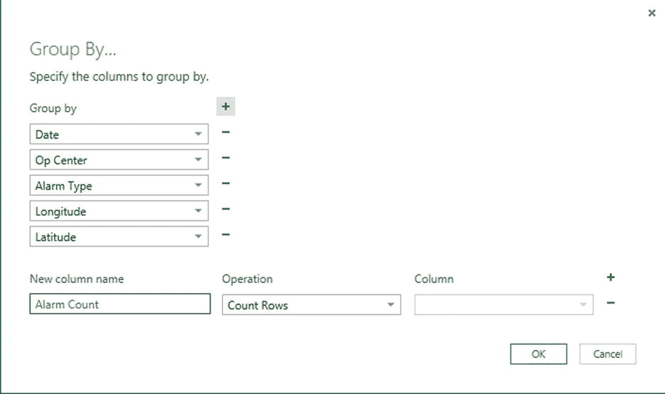

图 14-14：聚合和分组报警数据。

聚合数据后，在“加载设置”下勾选“将数据添加到数据模型”，然后应用并关闭查询。

准备好用于地图绘制的数据后，启动 Power Map 设计器，创建一个显示随时间变化的平均计数的柱形图，如图 14-15 所示。

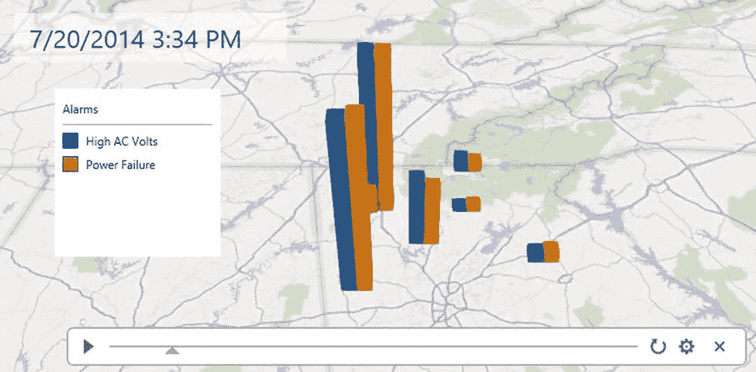

图 14-15：显示随时间变化的报警计数的 Power Map。

在 Power Map 中创建并探索报警数据后，保存并关闭 Excel。

#### 总结

本章提供了一些用例，帮助你评估对本书其他主题的掌握程度。本书的目标是向你介绍微软自助式 BI 工具栈中的各种工具。尽管本书使用的是桌面版 Excel 及其 BI 插件，你也可以使用这些工具的 Office 365 版本。我希望你已经获得了足够的信心和经验，能够开始使用这些工具分析并深入了解自己的数据。

既然你已经牢固掌握了如何使用这些工具，你应该能够自如地处理更复杂的主题。有许多优秀资源涵盖了可用于分析数据的不同技术和模式。微软的 Power BI 网站（`www.microsoft.com/en-us/powerbi/default.aspx`）、Bill Jelen 的网站（`www.mrexcel.com`）以及 Rob Collie 的 Power Pivot Pro 网站（`www.powerpivotpro.com`）都是极好的资源。要了解更多高级主题，请查看 Chris Webb 的 BI 博客（`http://cwebbbi.wordpress.com`）以及 Marco Russo 和 Alberto Ferrari 的 SQLBI 网站（`www.sqlbi.com/`）。

