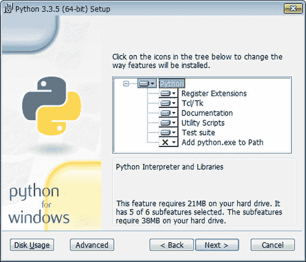

# 第 3 章 程序员眼中的 Python

## 基本构建块

Python 是一种非常易读的语言。假设您之前有一些编程经验，您应该能够轻松阅读并理解本书中呈现的代码。话虽如此，如果本书不涉及 Python 编程语言的一些内容，那将是不完整的。

在本章中，我将带您快速浏览 Python 的基本构建块，并沿途提供简短的示例。我们将从交互式和非交互式调用及使用 Python、输入表达式以及运行脚本的基础知识开始。接下来，我们将介绍大多数现代编程语言的基本构建块：数据类型、结构、变量、打印、流程控制和函数。在简要概述了面向对象编程（OOP）之后，我们将以模块和包的讨论作为结束。

请记住，该语言的完整内容远非一章所能涵盖。我略去了那些对数据分析和可视化并非关键的 Python 主题。如果您想了解更多关于 Python 编程语言的知识，本章末尾的“最终说明与参考资料”部分列出了一些更全面的 Python 相关书籍，它们将是宝贵的资源。

从书籍设计的角度来看，本章出现在开头是合理的。但这不应束缚您；您可以随意跳过它，并在以后根据需要随时回来查阅。

## 什么是 Python？

广义上讲，Python 是一种开源、面向对象的高级编程语言。（更详细的描述，请参见`http://www.python.org/about/`。）Python 还围绕自身形成了一种文化。

您会发现诸如“Pythonic”、“请求原谅比请求许可更容易”（EAFP）或“内置电池”等概念，这些共同证明了 Python 不仅仅是一种编程语言。据传，许多开发者最初只是将这种语言作为解决特定问题的简单工具；但随着时间的推移，他们完全被吸引，甚至开始用 Python 写俳句。恐怕我没有那么艺术细胞，所以您不会在本书中看到任何俳句。

以下是我认为对于有效使用 Python 进行数据分析和可视化最重要的语言特性：

- **开源**：是的，我认为这是 Python 的基本特性之一。Python 及其软件包由一个活跃的社区开发。该语言不断演变和变化，构建在一个基于讨论、实际需求以及人们必须解决的真实问题的动态环境之上。这种方法确保了一种有望经得起时间考验的优秀语言。
- **易于学习**：Python 很容易学习，特别是如果您熟悉其他编程语言——Python 将多种编程语言和编程范式的最佳特性融合于一身。
- **“内置电池”**：Python 的标准库中包含大量库（本书将探讨其中几个）。额外的软件包可以无缝安装和使用。您应该能够在不离开 Python 环境的情况下完成大部分（如果不是全部）与数据分析和可视化相关的工作。
- **多功能性**：Python 的多功能性体现在它既支持作为快速应用开发工具的早期开发阶段，也支持需要更结构化编程范式的项目后期阶段。
- **交互性**：以交互方式运行 Python 的能力为您提供了极大的灵活性。下一节将详细介绍这一点。

因为我认为展示 Python 是什么比试图定义它更容易，让我们开始吧。

## 交互式 Python

以交互方式运行 Python（通过命令行界面 CLI）是一种令人羡慕的能力。使用交互式 CLI 使您能够理解编程语言以及您编写代码时的工作方式。当您编写代码并执行命令时，您会立即收到反馈。所提供的反馈使您能够检查结果，看看您所想的与实际发生的是否一致；也就是说，它让您确定是否正确地编写了 Python 代码。这并不是一个新概念；我使用的第一个编程环境本质上也是交互式的：Sinclair ZX-81 上的 Basic（如需怀旧，请参见`http://en.wikipedia.org/wiki/Zx-81`）。有时，当我编写 C 代码时，我真希望现在也能像当时那样做。

Python 的交互性由其创建者 Guido van Rossum 在其“Python 教程”中优雅地介绍，该教程可在`https://docs.python.org/3.3/tutorial/`获取。我们将从数据分析和可视化的角度，对如何以交互方式运行 Python 进行简短介绍，以此开始本章。

### 调用 Python

如何调用 Python 取决于您的平台：

- 在 Windows 中，假设您已安装二进制文件，请单击“开始”“所有程序”“Python 3.3”“Python (命令行)”或“IDLE (Python GUI)”（如果您更喜欢 GUI 环境）。您现在可能已经拥有更新的版本。
- 在 Windows 系统下，通过 Cygwin 启动一个 Cygwin bash shell，并执行以下命令：
```
$ python
```
- 在 Linux 系统下，打开一个终端并执行相同的命令：
```
$ python
```
- 要退出 Python，可以按 `Ctrl+D` 或输入以下内容：
```
>>> exit()
```

#### 输入命令

在交互模式下启动 Python 后，你会看到版本信息以及一个简短的介绍性命令列表：`help`、`copyright`、`credits` 和 `license`。同时还会看到 Python 提示符 `>>>`。

 **注意** 当你在本书的任何代码清单中遇到 `>>>` 提示符时，这表示该命令是在 Python 解释器中以交互方式发出的，你应该在自己的 Python 解释器中重复相同的命令来亲自尝试。同样，当你在代码行开头遇到三个点（`...`）时，表示这是上一行交互式输入文本的延续。

通过输入命令名称并按 `Enter` 键来执行这些命令（从现在开始，我将不再提及按 `Enter` 键或讨论如何删除字符；我假设你知道如何使用命令行界面）。以下是执行 `help` 命令的输出：
```
>>> help
Type help() for interactive help, or help(object) for help about object.
```

Python 的命令行界面允许输入语句和计算表达式。下面描述了一些基本的用法。尝试它们以感受 Python 的交互特性：
```
>>> 1+2+3+4+5+6+7+8+9
```
```
>>> 22*2
```
```
>>> a = 4
>>> a*4
```
```
>>> 'a'*4
```
```
'aaaa'
```
```
>>> sqrt(a)
```
```
Traceback (most recent call last):
  File "<stdin>", line 1, in <module>
NameError: name 'sqrt' is not defined
```

前几行使用 Python 进行基本的算术运算。与使用计算器相比，使用交互式 Python 的好处之一是你可以轻松编辑之前的输入；只需按 `Up-Arrow` 键滚动浏览之前输入的条目并进行编辑。此外，你还可以回溯步骤并找到拼写错误。但这并不是使用 Python 的主要原因，只是一个额外的好处。

第三行是一个赋值语句：它将值 `4` 赋给变量 `a`。下一行打印出 `a` 乘以 4 的值。你很快就会学到更多关于变量、函数和语句的知识；但现在，让我们先了解一下交互式环境，并让你快速掌握如何高效地使用它。

下面一行展示了 Python 的字符串处理能力。字符串通常用引号括起来，所以下一个命令将字符串 `'a'` 乘以 4。结果正是如此：`'a'` 乘以四次得到 `'aaaa'`——非常酷。

最后一行展示了当解释器遇到问题时会怎样：它会引发一个异常并将原因报告给用户。在这个特定例子中，解释器不知道函数 `sqrt()`；如果我们通过执行 `from math import sqrt` 导入该函数，这个问题很容易解决——但我们将在后面介绍。

#### 结果变量

每当 Python 执行一条语句时，结果会存储在一个名为 `_` 的特殊变量中。这在手动计算时非常有用：
```
>>> 1+2+3+4+5+6+7+8+9
```
```
>>> _
```
```
>>> _ + 10
```
```
>>> _
```
```
>>> _ / 5
```
```
11.0
```

如本例所示，结果变量会不断更新，请记住这一点。

#### 交互式帮助系统

交互式帮助系统在学习语言和编程时都是一个非常有价值的工具。Python 有大量的函数、模块和包，因此帮助系统是必不可少的。顾名思义，帮助系统是一个交互式系统。

调用它很简单（注意需要空括号）：
```
>>> help()
```

输入 `quit` 退出系统。输入一个函数名来阅读关于它的信息（例如，`print`）。

如果你输入 `sqrt`，帮助系统会回复说没有关于 `sqrt` 的文档。原因是 `sqrt` 是 *math* 模块的一部分；要查看其帮助信息，你需要输入 `math.sqrt`。关于模块的更深入讨论，请参考本章后面的“模块和包”部分。

你也可以使用 `help(function)` 查看特定函数的帮助（非交互式）：
```
>>> help(print)
```
```
Help on built-in function print in module builtins:

print(...)
    print(value, ..., sep=' ', end='\n', file=sys.stdout, flush=False)

Prints the values to a stream, or to sys.stdout by default.
    Optional keyword arguments:
    file:  a file-like object (stream); defaults to the current sys.stdout.
    sep:   string inserted between values, default a space.
    end:   string appended after the last value, default a newline.
    flush: whether to forcibly flush the stream.
```

实际上，当你执行 `help(function)` 命令时，会打印出该函数的文档字符串。你可以在本章后面的“定义函数”部分了解更多关于文档字符串的信息。

#### 移动目录

有时，需要在 Python 解释器中更改当前工作目录。如果代码和数据位于不同的目录中，这一点尤其重要；根据情况需要，切换到另一个目录可能会更容易。

假设你定义了一个函数，该函数接受一个文件名作为输入，读取它并进行一些处理。此外，这个函数是在你使用解释器时以交互方式定义的。现在你想对一些文件运行这个函数，但这些文件的路径又长又繁琐。在这种情况下，切换到文件所在的目录并使用相对较短的文件名（即可以省略路径）来执行函数会容易得多。

`os` 模块提供了这个功能。你已经在第 1 章中见过 `os` 模块；然而，这次我们用它来在解释器中移动目录：
```
>>> import os
>>> os.getcwd()
```
```
'/home/shai/python'
```
```
>>> os.listdir()
```
```
['src', 'data']
```
```
>>> os.chdir('src')
>>> os.getcwd()
```
```
'/home/shai/python/src'
```
```
>>> os.chdir('/home/shai/python/data')
>>> os.getcwd()
```
```
'/home/shai/python/data'
```
```
>>> os.chdir('../src')
>>> os.getcwd()
```
```
'/home/shai/python/src'
```
```
>>> os.listdir('/home/shai/python/data')
```
```
['GPS-2008-06-05-13-02-56.csv']
```

在这个代码清单中，我使用了几个函数。第一行导入了包含移动目录所需函数的 `os` 模块。然后我使用了 `os` 模块中的几个函数：

- 函数 `os.listdir(path='.')` 返回目录内容的列表。`path` 参数是一个字符串，包含要列出的目录名称。如果未提供字符串参数，则假定为包含单个点（`'.'`）的字符串；即假定为当前目录，此时函数返回当前目录的内容。

 **注意** 当你遇到一个函数参数带有赋值运算符时，这意味着如果未提供参数，这就是默认参数，如本例所示：`os.listdir(path='.')`。

- 要找出你当前的工作目录，请执行命令 `os.getcwd()`。此函数不接受任何参数。
- 最后，`os.chdir(path)` 函数接受一个字符串作为参数，并根据该字符串相应地更改目录。该函数既接受相对目录路径（例如，`'../src'`），也接受完整目录路径（例如，`'/home/shai/python/data'`）。

 **提示** 在 IPython（参见第 2 章）中，你可以像在 Linux shell 中一样使用命令 `cd`、`ls` 和 `pwd`，而无需使用 `os` 模块的函数（它们输入起来更快！）。

## 运行脚本

交互式环境只能帮你到这里。最终，你将需要编写程序（脚本），并以非交互方式或从 Python 解释器内部运行它们。

编写脚本最常见的原因是你需要多次执行某项任务。假设你公司的会计使用非线性折旧方程，他们请你（他们最喜欢的程序员）帮个私人忙，于是你决定编写一个基于网页的折旧计算器。或者，你所在医疗器械公司的临床人员经常需要访问大型且需要处理的日志文件，因此他们请你为每位患者编写一份基于这些日志文件的每日事件总结报告，或者……嗯，你懂的。

通常，我会在编写脚本的同时并行使用交互式环境。也就是说，我以交互方式运行 Python，执行几条语句，赋值一些变量，并绘制一些图表；如果一切顺利，我会将执行过的命令复制到我存放脚本的编辑器中。

 **提示** 在 IPython 中，你可以发出命令 `history` 来查看最近输入的命令列表。

交互式编码的好处在于，你无需额外的调试工具就能检查代码中的变量和数据结构。如果脚本引发异常，你可以立即访问所有变量和数据结构：你可以重现错误并可能修复 bug。

一旦你的脚本准备就绪（好吧，它从来都不是真正*就绪*的，我们姑且认为它已准备好进行测试驱动），你有以下几种运行方式：

*   从 GUI 环境运行脚本：运行 IDLE（Python GUI），选择 File  Open 并选择要运行的脚本。这将在 IDLE 编辑器中打开 Python 脚本（如果它已打开，则无需重新打开）。要运行脚本，请按 **F5** 或从 Run 菜单中选择 Run Module。输出应显示在 Python GUI shell 中。
*   从 Python 的 CLI 运行脚本。这可以通过发出命令 `exec(open('scriptname.py').read())` 来实现；这是我在开发时最喜欢的选项。在 Python 2.x 版本中，另一种方法是使用 `execfile('scriptname.py')`。我更喜欢这种方法而非 GUI 环境的原因是，我喜欢在非 IDE 的编辑器中编辑代码。

 **提示** 如果你使用 IPython，可以发出命令 `run path/filename.py`；好处是你可以使用字符补全来选择文件名，并且可以向脚本提供命令行参数：`run path/filename.py param1 param2`。

*   从 shell 或命令窗口调用脚本（非交互模式）。
*   即使你可能在交互式 Python 中开发了脚本，最好也在 shell 中测试一下，特别是当你分发代码供他人使用时：他们可能不想以交互方式运行代码。要从 Linux shell 或 Cygwin 运行脚本，请使用以下命令：
    ```
    $ python path/filename.py
    ```
    在 Windows 中，请使用以下命令：
    ```
    c:\python33\python.exe path\filename.py
    ```
    在 Windows 中，你还可以设置 `PATH` 变量以包含 Python 目录路径 `c:\python33`（假设你使用的是 Python 3.3），这样调用脚本时就不需要 Python 可执行文件的完整路径：
    ```
    path=%path%;c:\python33
    python path\filename.py
    ```
    在较新版本的 Python 中，可以在安装过程中通过选择 *Add python.exe to Path* 选项（默认未启用）来设置 `PATH` 变量，如图 3-1 所示。



图 3-1. 将 python.exe 添加到 Path

*   最后，还可以同时享受交互模式和非交互模式！这可以通过使用 `-i` 开关运行脚本来实现，该开关会在脚本运行*后*打开一个 Python shell，让你以交互方式检查变量：
    ```
    $ python –i somescript.py
    ```

 **提示** 由于反斜杠字符（`\`）在字符串中具有特殊含义（我们稍后会讲到），并且也用作 Windows 中的路径分隔符，因此在处理文件名和文件路径时最好使用斜杠（`/`）字符。如果可能，请使用相对路径（例如 `../data` 而不是 `c:\data`）；你的代码将跨操作系统可移植，并且更易于阅读。

就是这样。我认为我们现在可以开始学习语言本身了。

## 数据类型

Python 的数据类型与其他编程语言中的数据类型类似；你会看到字符串和数字，就像在 Basic 中一样。但即使在这些基本数据类型中，也有一些你应该了解的细节；例如，`int` 数据类型支持无限整数精度。

### 数字

我们从数字开始。Python 原生支持 `int`、`float` 和 `complex`。

#### 整数

`int` 数据类型提供无限整数精度，因此你可以使用的整数值没有限制：

```
>>> 2**70
1180591620717411303424
>>> 2**700
101412048018258352119736256430080000000000000000000000000000000000000000000000000000000000000000000000000000000000000000000000000000000000000000000000000000000000000000000000000000000000000000000000000000000000000000000000000000000000000000000000000000000000000000000000000000000000000000000000000000000000000
```

我引入了幂运算符，用 `**` 表示，因此 `2**70` 是 2⁷⁰。

#### 其他有用的进制

2 的幂进制是计算系统固有的。一个字节是 2⁸，而不是十进制系统的幂。因此，能够将 2 的幂进制（如十六进制或八进制）的值与十进制系统相互转换非常重要。

 **注意** 八进制如今不太流行了。然而，一些八进制表示法仍然活跃，包括 Linux 系统中的文件权限。

十六进制值以 `0x` 开头。因此，`0x20` 是 32（十进制）。你可以对数字 A–F 使用大写或小写字母：

```
>>> 0xaB
171
>>> 0xff
255
```

八进制值以零和字符 O 开头（即 `0o` 或 `0O`）。因此 `0o20` 是 16（十进制）：

```
>>> 0o20
16
```

请注意，在 Python 2.x 中，八进制值仅以零开头，不带字符 O。

类似地，二进制值以零和字符 B 开头（即 `0b` 或 `0B`）。因此，`0b111` 是 7（十进制）：

```
>>> 0b111
7
```

无论你如何输入数字；也就是说，无论你使用什么进制，它们在 Python 中仍然作为数字保留。如果你想查看不同的进制表示，请使用 `bin()`、`oct()` 和 `hex()` 函数调用。这些函数返回一个字符串：

```
>>> hex(100)
'0x64'
>>> oct(100)
'0o144'
>>> bin(100)
'0b1100100'
```

你还可以使用函数 `int(str, radix=10)` 执行任何其他进制转换，该函数返回一个数字，而不是字符串。如果未指定 `radix`，则假定为 10：

```
>>> int('100')
100
>>> int('100', 3)
9
```

如果你想将 100 从三进制转换为十进制值，请编写 `int('100', 3)` 或 `int(str(100), 3)`。如果你希望使用变量，后者更有用；即 `int(str(variable), base)`。

如果你将一个浮点数值传递给`int()`函数，结果会是一个截断后的整数值：

```
>>> int(2.2)
2
```

可以使用比十六进制（基数为 16）更高的进制，通过使用字母表中越来越多的字母作为新数字来表示基数。在基数为 17 时，添加字符`g`；在基数为 18 时，使用字符`h`，依此类推。因此，基数为 17 的数字`'ggg'`应为 17³–1：

```
>>> int('ggg', 17)
4912
>>> 17**3-1
4912
```

这种进制支持最高到 36，对应字符`z`。

### 比较

你可以使用常规运算符比较值：`>`和`<`分别表示大于和小于。相等性检查使用双等号（`==`）进行，以区别于由单等号（`=`）表示的赋值符号。不等号为`!=`，你还可以使用`>=`和`<=`进行大于或等于以及小于或等于的比较。

```
>>> 2*3 > 5
True
>>> 2*3 != 5
True
```

某些比较是不允许的；例如，你不能将复数（在下一节中描述）与整数值进行比较：

```
>>> 1+1j > 2
Traceback (most recent call last):
  File "<stdin>", line 1, in <module>
TypeError: unorderable types: complex() > int()
```

### 位运算

位运算符类似于 C 语言的位运算符，如表 3-1 所示。

**表 3-1.** 位运算

| 运算符 | 描述 | 示例 |
| --- | --- | --- |
| `~` | 按位取反 | `~0x0ff+0x100`返回`0`。 |
| `<<` | 左移 | `1<<8`返回`256`。 |
| `>>` | 右移 | `256>>2`返回`64`。 |
| `^` | 按位异或（XOR） | `0xff ^ 0xf0`返回`15`（`0x0f`）。 |
| `&` | 按位与（AND） | `0xff & 0x0f`返回`15`（`0x0f`）。 |
| `&#124;` | 按位或（OR） | `0x0f &#124; 0xf0`返回`255`（`0xff`）。 |

### 增强赋值

增强赋值引入了运算符`+=`、`-=`、`*=`、`/=`、`//=`、`%=`、`**=`、`<<=`、`>>=`、`&=`、`^=`和`|=`。这种表示法类似于 C/C++ 语法。也就是说，你可以写`a += 1`来代替`a = a+1`。类似地，你可以写`a >>= 1`来代替`a = a >> 1`。请注意，Python 不支持自增运算符`++`。

### 浮点数和复数

浮点数值已经存在了相当长的时间，并且无法避免。Python 的`float`数据类型等同于 C 语言的`double`，因此它实际上比 C 语言的`float`更精确（C 语言的`float`字节数少于 C 语言的`double`）。

浮点数值用点号或表示指数记数法的字符`e`或`E`表示。如果你想确保你的值是`float`类型，可以添加尾随点号（或点零，或`e`/`E`），或者显式使用`float()`函数。`float()`函数也用于将值转换为`float`类型。只要转换可行，它既适用于字符串也适用于数字。使用返回变量、函数类型的`type()`函数，你总能确认一个变量是整数、浮点数值还是其他类型：

```
>>> type(2)
<class 'int'>
>>> type(2.2)
<class 'float'>
>>> float(2)
2.0
>>> 1e3
1000.0
>>> float('2.5')
2.5
```

`complex`数据类型表示复数，由两个浮点数值组成，一个表示实部，一个表示虚部。虚部以尾随字母`j`（或`J`）表示。可以使用`imag`和`real`属性访问实部和虚部，如下所示：

```
>>> a = 1+2j
>>> a.real
1.0
>>> a.imag
2.0
```

你可以像对浮点数一样，对复数使用大多数运算符。

一旦计算中涉及复数，剩余的计算将保持为`complex`类型，即整数和浮点数值会被提升为复数值。你可以使用`complex(real[, imag])`函数将数字转换为复数。如果提供了`imag`，它保存复数的虚部值：

```
>>> complex(10)
(10+0j)
>>> complex(10, 2)
(10+2j)
```

第 7 章将进一步讨论`complex`数据类型，并在一些示例中使用它。

### 字符串

根据经典的 Python 定义，字符串是不可变的字符序列。这意味着字符串是一个你不能更改的字符序列。我知道这起初可能看起来很奇怪：你可能会想，“如果我不能修改字符串的字符，我该如何处理字符串？”答案是，你可以基于当前字符串创建新字符串。

#### 表示字符串

有几种表示字符串的方法：单引号`'string'`、双引号`"string"`和三双引号`"""string"""`（呼），仅举几例。还有更多：最值得注意的是由字母`r`表示的原始字符串，例如`r"string"`。

要表示一个基本字符串，请按如下方式使用单引号：

```
>>> 'split'
'split'
```

如果你的字符串中包含引号，你必须用反斜杠（`\`）对其进行转义：

```
>>> 'it\'s a split'
"it's a split"
```

我们对单词`it's`中的引号进行转义的原因，是为了让字母`s`前的引号不会终止字符串。

单引号和双引号是可互换的。因此，我们可以通过将包围的引号（开头和结尾的引号）替换为双引号，在不转义单词`it's`中的引号的情况下达到相同的结果：

```
>>> "it's a split"
"it's a split"
```

但是，如果我们想要一个字符串，它实际上也包含引号前的反斜杠——一个看起来完全像`it\'s a split`的字符串呢？好吧，一种选择是同时转义反斜杠和引号：

```
>>> 'it\'\\s a split second'
"it'\\s a split second"
>>> print('it\'\\s a split second')
it'\s a split second
```

注意解释器表示该字符串的方式与打印它的方式不同。

这种模式可能会持续下去，使事情更难理解。相反，我们可以使用原始字符串：

```
>>> r"it\'s a split second"
"it\\'s a split second"
>>> print(r"it\'s a split second")
it\'s a split second
```

原始字符串意味着跟在字符`r`和起始引号之后、结束引号之前的所有内容都应被按字面意义处理。使用原始字符串时，你基本上是在说“让 Python 转义需要转义的内容，并返回一个合适的字符串给我！”

 **注意** 原始字符串在正则表达式中很常见，以避免在多个层面上转义特殊含义的字符。详见第 5 章。

你可以使用反斜杠跨多行输入字符串：

```
>>> "it's a \
... split second"
"it's a split second"
```

这显然可能带来更多麻烦——如果你*真的*希望反斜杠和换行符都出现呢？别担心，是时候使用三双引号（或三单引号，它们可互换）了：

```
>>> """it's a split
... second"""
"it's a split\nsecond"
>>> print(_)
it's a split
second
```

如果所有这些听起来太令人困惑，那你并不孤单。要熟悉这些注意事项，请以交互方式启动 Python 并进行实验！有关字符串的更多信息，请参阅在线 Python 文档，网址为`https://docs.python.org/3.3/library/stdtypes.html#text-sequence-type-str`。

Python 也支持 Unicode 字符串；我将在第 5 章中简要介绍。

### 字符串操作

那么，你能对字符串做些什么呢？表 3-2 列出了一些可对字符串执行的操作及示例。在示例中，我选择了无需转义的字符串，以便于理解；不过，同样的操作也适用于之前描述的任何字符串表达式。

**表 3-2.** 字符串操作

| 运算符 | 描述 | 示例 |
| --- | --- | --- |
| **加法与乘法** |  |  |
| `str1+str2` | 拼接字符串 `str1` 和 `str2`。 | `'split '+'second'` 返回 `'split second'`。 |
| `str*n` | 将字符串 `str` 重复拼接 `n` 次。 | `'second '*3` 返回 `'second second second '`。 |
| **索引与切片** |  |  |
| `n` 和 `m` 是小于字符串 `str` 长度的正整数。负值从字符串末尾开始计数。 |  |  |
| `s[n]` | 获取 `s` 的第 `n` 个字符。 | `'split'[3]` 返回 `'i'`。 |
| `s[n:m]` | 获取从第 `n` 个字符到第 `m` 个字符（不含第 `m` 个字符）的字符串切片。如果 `n` 或 `m` 为负，则从字符串末尾开始计数。 | `'split second'[6:12]` 返回 `'second'`。`'split second'[-6:-2]` 返回 `'seco'`。 |
| `s[:m]` | 等同于 `n=0` 时的 `s[n:m]`。 | `'split second'[:3]` 返回 `'spl'`。 |
| `s[n:]` | 获取从第 `n` 个字符到末尾的字符串切片。 | `'split second'[6:]` 返回 `'second'`。 |

你可以使用 `in` 运算符检查某个字符是否在字符串中：

```
>>> 'd' in 'abcde'
True
```

你可以使用 `len()` 函数计算字符串中的字符数：

```
>>> len('abcde')
5
```

`in` 和 `len()` 都适用于其他序列，你很快就会看到。

第 5 章将更详细地讨论字符串（包括 Unicode 字符串和原始字符串）。

## 布尔值

我直到现在才讨论布尔值，是因为布尔值在其他数据类型的上下文中才能大放异彩。布尔值可以取两个值：`True`（`1`）或 `False`（`0`）。

```
>>> a = True
>>> a > 1
False
```

```
>>> a == 1
True
```

```
>>> type(a)
<class 'bool'>
```

你可以使用 `bool()` 函数将值转换为布尔值。空字符串、其他空序列以及任何形式的零值都被视为 `False`：

```
>>> bool(0)
False
```

```
>>> bool(5)
True
```

```
>>> bool("")
False
```

```
>>> bool("s")
True
```

## 逻辑运算

逻辑运算 `and`、`or` 和 `not` 作用于布尔值。我假设你知道如何使用它们。让我们看看你是否知道以下问题的答案：

```
>>> 5 > 1 and ((4<3) or 2+4 < 5 and not 6 < 2)
```

（如果你不确定，只需在 Python 中输入它并观察结果。）

## 数据结构

作为一种高级编程语言，Python 还提供了额外的、更复杂的数据类型，我称之为数据结构。这些包括列表、元组、字典和集合等。数据结构使编程体验更加愉快。Python 文档不一定像我这样区分数据类型和数据结构。我这样区分的目的在于将讨论分为两类：你可能会在流行编程语言（如 C）中遇到的简单数据类型；以及你可能会在更高级的编程语言（如 Python 和 Perl）中看到的更复杂的数据类型，即数据结构。无论本章如何分类，就 Python 而言，两者都是内置数据类型。

从某种意义上说，你已经接触过数据结构：字符串和复数。字符串是一个不可变的序列，很难说是一种“简单”的数据类型。

相比之下，C 编程语言不支持原生的字符串数据类型，而是支持字符数组，这表明字符串并非真的那么基础。但字符串仍然有限——它是一个字符序列。那么其他对象的序列呢？还有可变（可更改）的序列呢？

别担心，Python 也提供了这些。Python 中的列表是任意数据类型的可变序列。元组与列表非常相似，只是它是不可变的。我们还将讨论一些更复杂的数据结构，它们能让编程更加有趣。你已经在第 1 章中见过字典对象，我们将探讨该数据结构以及集合对象。Python 也是一种面向对象的编程语言；因此，在讨论函数之后，我们将介绍类对象。

 **注意** Python 提供了额外的原生数据类型和结构，但其中大部分超出了本书的范围；它们对于数据分析和可视化并非必需（文件数据类型可能是个例外，将在第 5 章中讨论）。更多信息，请参阅 Python 标准库 – 内置类型，`https://docs.python.org/3.3/library/stdtypes.html`。

### 列表

`list` 是对象的可变序列。列表用方括号表示：

```
>>> [1, 'hey', 1+2j]
[1, 'hey', (1+2j)]
```

你也可以使用 `list()` 函数创建列表。这在将不同序列（例如，从字符串）转换为列表时很有用：

```
>>> list('some text')
['s', 'o', 'm', 'e', ' ', 't', 'e', 'x', 't']
```

列表可以被修改。你可以使用 `+` 运算符向列表添加另一个元素。`+` 运算符拼接列表，因此你必须提供另一个列表：

```
>>> [1, 'hey', 1+2j] + ['hey', 'hey']
[1, 'hey', (1+2j), 'hey', 'hey']
```

然而，以下操作会失败，因为你不能将整数添加到列表中：

```
>>> [1,2,3] + 2
Traceback (most recent call last):
  File "<stdin>", line 1, in <module>
TypeError: can only concatenate list (not "int") to list
```

正确的方法是形成另一个仅由值 `2` 组成的列表：

```
>>> [1,2,3] + [2]
[1, 2, 3, 2]
```

如果你希望将值 `2` 添加到列表 `[1, 2, 3]` 的每个元素中，即将列表修改为 `[3, 4, 5]`，你将在本章后面的“for 语句”和“列表推导式”部分了解具体方法。

列表本身也是一个对象，因此你可以在列表中嵌套列表：

```
>>> [[1, 2], [3, 4]]
[[1, 2], [3, 4]]
```

现在事情变得复杂了，无论是在描述对象还是实际执行操作方面。假设你想将另一个列表 `[5, 6]` 添加到前面的示例中。你希望如何添加？更新后的列表应该是 `[[1, 2], [3, 4], [5, 6]]`、`[[1, 2], [3, 4], 5, 6]` 还是 `[[[1, 2], [3, 4]], [5, 6]]`（这确实有点故意刁难）？

我喜欢将数据结构 `[[1, 2], [3, 4]]` 描述为一个行列表。第一行是 `[1, 2]`，第二行是 `[3, 4]`。

以下是一些拼接列表的方法：

```
>>> [[1, 2], [3, 4]] + [5, 6]
[[1, 2], [3, 4], 5, 6]
```

```
>>> [[1, 2], [3, 4]] + [[5, 6]]
[[1, 2], [3, 4], [5, 6]]
```

第一行添加了元素 `5` 和 `6`。第二行添加了行 `[5, 6]`。

另一种选择是使用变量 `L` 来保存列表，并使用 `append()` 和 `extend()` 方法：

```
>>> L = [[1, 2], [3, 4]]
>>> L.append([5, 6])
>>> L
[[1, 2], [3, 4], [5, 6]]
```

```
>>> L.extend([7, 8])
>>> L
[[1, 2], [3, 4], [5, 6], 7, 8]
```

方法 `append()` 向列表添加一个项目——在本例中，是列表 `[5, 6]`。

方法 `extend()` 将序列中的元素逐个添加到列表末尾——在此例中，添加的元素是 `7` 和 `8`。一开始可能有点难理解，但请交互式地操作列表，以掌握如何正确使用它们。列表与字符串类似，也可以进行索引：

```
>>> L = [['hey', '1'], [2, 3, 4], '']
>>> L[0]
['hey', '1']
```
```
>>> L[1]
[2, 3, 4]
```
```
>>> L[1][1]
3
```

最后一条语句 `L[1][1]` 需要一些解释。语句 `L[1]` 返回列表中的第二个元素（索引从 0 开始，因此索引 1 是第二个元素）。为了便于理解，我们可以在心里将 `L[1]` 赋值给变量 `M`。然而，变量 `M` 本身也是一个列表：`[2, 3, 4]`。因此我们显然也可以对 `M` 进行索引：`M[1]` 的值是 `3`。与其分两步完成，我们可以更简洁地写成 `L[1][1]`。

列表与字符串非常相似，也可以进行切片：

```
>>> L = [['hey', '1'], [2, 3, 4], '']
>>> L[0:-1]
[['hey', '1'], [2, 3, 4]]
```
```
>>> L[:-1]
[['hey', '1'], [2, 3, 4]]
```
```
>>> L[1:]
[[2, 3, 4], '']
```

切片中的负索引表示从列表末尾向前计数。因此，索引 `-1` 表示最后一个元素。另外，请注意，切片时如果省略某个索引，则默认值为 0 或列表末尾，具体取决于省略的是哪个索引。

你可以使用 `in` 运算符检查某个元素是否在列表中：

```
>>> 'hey' in ['hey', 'hey', 'split', 'second']
True
```

你可以使用 `len()` 语句统计列表中的元素个数：

```
>>> len([['hey', '1'], [2, 3, 4], ''])
3
```

由于列表是可变的，因此可以重新赋值：

```
>>> L = [['hey', '1'], [2, 3, 4], '']
>>> L[1] = [4, 5, 6]
>>> L
[['hey', '1'], [4, 5, 6], '']
```

列表还可以使用 `del` 语句删除元素：

```
>>> L = [['hey', '1'], [2, 3, 4], '']
>>> del L[0]
>>> L
[[2, 3, 4], '']
```

列表还有方法，即仅对列表对象进行操作的函数（例如前面展示的 `append()` 和 `extend()`）。要使用某个方法，请在列表对象后加一个点，然后跟上函数名，并在括号内传入参数（如果没有参数，则使用空括号）：

```
>>> L = ['hey', 'hey', 'split', 'second']
>>> L.count('hey')
2
```
```
>>> L.sort()
>>> L
['hey', 'hey', 'second', 'split']
```

我使用了 `count()` 方法（用于统计列表中某个元素出现的次数）和 `sort()` 方法（用于对列表进行排序）。表 3-3 描述了一些列表方法及其示例。在示例中，假设 `L` 为 `['second', 'second', 8]`。

表 3-3. 列表方法

| 方法 | 描述 | 示例 |
| --- | --- | --- |
| `append(obj)` | 向列表末尾添加一个元素。 | `L.append('hey')` 将 `L` 改为 `['second', 'second', 8, 'hey']`。 |
| `count(val)` | 返回 `val` 在列表中出现的次数。 | `L.count('second')` 返回 `2`。 |
| `extend(iterable)` | 从 `iterable`（关于迭代器和可迭代对象的更多内容，请参见本章后续部分）中添加元素到列表。 | `L.extend(range(2))` 将 `L` 改为 `['second', 'second', 8, 0, 1]`。 |
| `index(val, [start, [stop]])` | 返回 `val` 在列表中的第一个索引。如果提供了 `start`，则此方法返回第一个大于 `start` 的索引；如果提供了 `stop`，则索引还必须小于 `stop`。 | `L.index('second')` 返回 `0`。`L.index('second', 1)` 返回 `1`。`L.index('second', 2, 3)` 抛出异常 `x not in list`。 |
| `insert(n, obj)` | 在索引 `n` 处插入一个对象。 | `L.insert(2, 'me')` 将 `L` 改为 `['second', 'second', 'me', 8]`。 |
| `pop([n])` | 返回列表中第 `n` 个元素并将其移除。如果未提供 `n`，则此方法返回最后一个元素。 | `L.pop()` 返回 `8`，修改后的列表为 `['second', 'second']`。`L.pop(-3)` 返回 `'second'`，修改后的列表为 `['second', 8]`。 |
| `remove(val)` | 移除列表中第一次出现的 `val`。 | `L.remove('second')` 将 `L` 改为 `['second', 8]`。 |
| `reverse()` | 反转列表。 | `L.reverse()` 将 `L` 修改为 `[8, 'second', 'second']`。 |
| `sort()` | 对列表进行排序。你可以向列表提供一个排序函数；参见 `help(list.sort)`。 | `L.sort()` 会引发异常，因为数字和字符串之间的排序未定义。对于 `L = ['zoo', 'a']`，`L.sort()` 将 `L` 改为 `['a', 'zoo']`。 |

### 元组

元组是一个不可变的（不可更改的）对象序列。元组用圆括号表示，并可以使用 `tuple()` 函数创建：

```
>>> (1, 2, 3)
(1, 2, 3)
```
```
>>> tuple('hey')
('h', 'e', 'y')
```

元组不一定需要圆括号；仅仅添加一个逗号就表明该表达式是一个元组：

```
>>> 1, 2
(1, 2)
```
```
>>> 1,
(1,)
```
```
>>> (1)
1
```

表达式 `(1)` 不是一个元组：它是括号内的值 `1`，仅被视为数字 1。

元组的行为与列表非常相似，但有一个例外：你不能修改元组。但是，你可以基于现有元组创建一个新的元组：

```
>>> tuple([1, 2, 3])
(1, 2, 3)
```
```
>>> _ * 2
(1, 2, 3, 1, 2, 3)
```

在第一条语句中，我基于一个列表创建了一个元组。请注意，`tuple(1, 2, 3)` 会引发异常，因为函数 `tuple()` 期望一个参数，而不是三个。在前面的代码中，我传递了一个列表作为参数：`[1, 2, 3]`。我也可以写成 `tuple((1, 2, 3))`，效果相同：表达式中的第一组外层圆括号是函数括号；内层的是元组括号。在列出的第二条语句中，我通过将结果变量相乘，基于第一个元组创建了第二个元组。

元组可以包含不同的数据类型和数据结构：

```
>>> ([1, 2], (3, 4))
([1, 2], (3, 4))
```

上面是一个包含一个列表和一个元组的元组。

元组也可以像列表和字符串一样进行索引。请记住，索引需要使用方括号，而不是圆括号：

```
>>> ([1, 2], (3, 4))[0]
[1, 2]
```
```
>>> ([1, 2], (3, 4))[1]
(3, 4)
```
```
>>> ([1, 2], (3, 4))[1][0]
3
```

元组也可以进行切片，从而生成一个新的元组：

```
>>> ([1, 2], (3, 4))[1:]
((3, 4),)
```

然而，元组不能被重新赋值：

```
>>> a = (['hey', '1'], '')
>>> a[0] = 0
Traceback (most recent call last):
  File "<stdin>", line 1, in <module>
TypeError: 'tuple' object does not support item assignment
```

但是，元组内的列表可以被更改，因为列表是可变的：

```
>>> a = (['hey', '1'], '')
>>> a[0][0] = 'wow'
>>> a
(['wow', '1'], '')
```

可以使用 `in` 运算符检查某个元素是否在元组中：

```
>>> 1 in (2, 3)
False
```

最后，通常使用元组来执行多重赋值，这也称为解包：

```
>>> a, b = 1, 2
>>> a + b
3
```

# 字典

*字典*是可变序列，它将一个*键*与一个*值*关联起来。键必须是唯一的，而值则不必。在思考字典时，我喜欢使用电话簿的比喻。每个电话号码（键）都对应一个条目（值），通常是一个人；然而，一个人（值）可以拥有多部电话（键）。键和值对象可以是大多数数据类型，但也有例外（例如，另一个字典）。

创建字典的方法有多种。

例如，你可以使用`dict()`函数配合`(key, value)`元组序列，或者使用花括号（`{}`）并用冒号分隔键和值：

```
>>> dict((('split', 8), ('second', 1)))
{'second': 1, 'split': 8}
>>> {'split':8, 'second':1}
{'second': 1, 'split': 8}
>>> type(_)
<class 'dict'>
```

第一个表达式中有很多括号：最外层是函数`dict()`的括号，最内层是具体的元组对，中间层则表示一个元组的元组，因为`dict()`只能接受一个参数。一种更易读的方式是向`dict()`传递一个元组列表，而不是元组的元组：

```
>>> dict([('split', 8), ('second', 1)])
{'second': 1, 'split': 8}
```

你可以使用方括号从字典中检索值：

```
>>> d = dict([('split', 8), ('second', 1)])
>>> d['split']

```

检查字典中的成员关系使用`in`运算符，它默认检查字典的键，而不是值。如果你想检查值，请使用`values()`方法：

```
>>> D = dict([('split', 8), ('second', 1)])
>>> 'split' in D
True
>>> 8 in D
False
>>> 8 in D.values()
True
```

你也可以使用方括号来更改和赋值新值：

```
>>> D = dict([('split', 8), ('second', 1)])
>>> D['python'] = 'snake'
>>> D
{'split': 8, 'second': 1, 'python': 'snake'}
>>> D['python'] = 'programming language'
>>> D
{'split': 8, 'second': 1, 'python': 'programming language'}
```

在上面的例子中，对键`'python'`的第二次赋值会用值`'programming language'`覆盖之前的值`'snake'`。

仔细想想，现实世界中的字典可能为一个键提供多个条目：单词“python”既可以指一种无毒、绞杀性的蛇，也可以指一种开源编程语言。这种行为也可以在 Python 字典中模拟；只需让值包含一个列表即可：

```
>>> D = dict()
>>> D['python'] = ['snake', 'programming language']
>>> D
{'python': ['snake', 'programming language']}
```

字典是使用哈希算法实现的。这意味着从键中检索值非常高效。互联网上有大量关于哈希算法和哈希函数的信息，如果你有兴趣了解它们的工作原理，可以查阅相关资料（一个好的起点是`https://en.wikipedia.org/wiki/Hash_function`）。如果使用得当，字典可以简化你的代码并使其效率更高。在第 4 章中，我将展示一个使用字典在硬盘上定位重复文件的示例。

## 表 3-4. 字典方法

下表列出了字典的成员函数。在表中的示例中，假设`D`是`{'second': 1, 'split': 8}`。

| 方法 | 描述 | 示例 |
| --- | --- | --- |
| **函数** |  |  |
| `clear()` | 移除字典中的所有项。 | `D.clear()`将`D`变为`{}`。 |
| `copy()` | 返回`D`的浅拷贝（参见本章后面的“变量”部分）。 | `D2 = D.copy()`。 |
| `fromkeys(K[, v])` | 根据键`K`创建一个字典。如果提供了`v`，则所有值都设置为`v`。 | `{}.fromkeys(['split', 'second'], 8)`返回`{'second': 8, 'split': 8}`。 |
| `get(k[, def])` | 返回与键`k`关联的值。如果`k`不在字典中，则此方法返回提供的`def`（如果提供了的话）。 | `D.get('first', 1)`返回`1`。 |
| `items()` | 返回键值对元组。 | `D.items()`返回`dict_items([('split', 8), ('second', 1)])`。 |
| `keys()` | 返回键的列表。 | `D.keys()`返回`dict_keys(['second', 'split'])`。 |
| `pop(k[, def])` | 返回与键`k`关联的值并将其从字典中移除。如果`k`不在字典中，则此方法返回提供的`def`（如果提供了的话）；否则，会引发异常。 | `D.pop('split')`返回`8`并将`D`变为`{'second': 1}`。 |
| `popitem()` | 返回一个任意的键值对元组，并将该对从字典中移除。 | `D.popitem()`返回`('second', 1)`并将`D`变为`{'split': 8}`。 |
| `setdefault(k[,def])` | 返回与键`k`关联的值。如果`k`不在字典中，则此方法返回提供的`def`（如果提供了的话）并将`D[k]`设置为`def`。 | `D.setdefault('hey', 6)`返回`6`并将`D`变为`{'second': 1, 'hey': 6, 'split': 8}`。 |
| `update(e)` | 使用字典`e`中的数据更新字典。 | 请参见本节后面的示例。 |
| `values()` | 返回值的列表。 | `D.values()`返回`dict_values([1, 8])`。 |

虽然这些成员函数大多易于理解，但有两个需要更多解释：`update()`和`get()`。

方法`update()`使用另一个字典中的键值对来更新字典。为便于讨论，我将引用函数调用`D1.update(D2)`。如果一个键同时存在于字典`D1`和`D2`中，则`D1`中与该键关联的值会被更新为字典`D2`中的值。如果`D2`中的某个键在`D1`中不存在，则它及其值会被添加到`D1`中。以下示例说明了这种行为：

```
>>> d1 = {'second': 1, 'split': 8}
>>> d2 = {'second': 3, 'hey': 7}
>>> d1.update(D2)
>>> d1
{'second': 3, 'split': 8, 'hey': 7}
```

与键`'second'`关联的值被更新了，并且键值对`'hey': 7`被添加了进来。

我想讨论的下一个成员函数是`get()`。起初，这看起来有点奇怪；`get()`与直接使用方括号访问键有何不同？区别在于，如果你使用方括号且键不在字典中，则会引发`KeyError`异常。函数`get()`允许你检查一个键是否在字典中；此外，如果键不在字典中，该函数还会返回一个默认值。用一个例子来说明它的用处可能是个好方法。

考虑第 1 章中介绍的`list_gps_commands()`函数（我已移除文档字符串），如下面的代码清单 3-1 所示。

***代码清单 3-1***. 函数`list_gps_commands()`

```
def list_gps_commands(data):
    gps_cmds = dict()
    for row in data:
        try:
            gps_cmds[row[0]] += 1
        except:
            gps_cmds[row[0]] = 1
    return gps_cmds
```

为了进一步说明这个例子，让我们构建一个简短的 GPS 命令列表`L`，稍后将其排序到字典中，这样你就可以亲自尝试这个例子。首先，我们执行一组类似于函数`list_gps_commands()`中详述的命令：

```
>>> l = ['$GPGSA', '$GPGSV', '$GPGSV', '$GPGSV', '$GPRMC', '$GPGGA']
>>> D1 = dict()
>>> for elem in L:
...     try:
...         D1[elem] += 1
...     except KeyError:
...         D1[elem] = 1
...
>>> D1
{'$GPGSA': 1, '$GPGSV': 3, '$GPGGA': 1, '$GPRMC': 1}
```

这种方法很简单。我们首先尝试访问字典中的一个键。如果键存在，我们就递增计数。如果键不存在，则会引发异常，这意味着它是一个新条目，因此我们将其设置为`1`。

第二种方法是使用`in`语句检查字典中是否存在某个键，然后使用`if`语句进行后续处理，如下所示：

```
>>> l = ['$GPGSA', '$GPGSV', '$GPGSV', '$GPGSV', '$GPRMC', '$GPGGA']
>>> D2 = dict()
>>> for elem in L:
...     if elem in D2:
...         D2[elem] += 1
...     else:
...         D2[elem] = 1
...
```

# 字典

```python
{'$GPGGA': 1, '$GPGSA': 1, '$GPGSV': 3, '$GPRMC': 1}
```

一种更优雅的方法是使用带有默认值`0`的`get()`方法：

```python
>>> L = ['$GPGSA', '$GPGSV', '$GPGSV', '$GPGSV', '$GPRMC', '$GPGGA']
>>> D3 = dict()
>>> for elem in L:
...     D3[elem] = D3.get(elem, 0)+1
... >>> D3
```

```python
{'$GPGSA': 1, '$GPGSV': 3, '$GPGGA': 1, '$GPRMC': 1}
```

我在第1章中选择了第一种方法，因为我认为它对不熟悉该语言的人来说更清晰。然而，熟悉Python语言的人可能会选择这里介绍的最后一种方法；它更清晰、更优雅。

## 集合

我们目前要介绍的最后一个数据结构是集合。集合是唯一项的序列。要创建集合，请使用`set()`函数：

```python
>>> set(['split', 'second'])
```

```python
{'split', 'second'}
```

```python
>>> set(['split', 'second']*8)
```

```python
{'split', 'second'}
```

如果你向`set()`函数传递一个重复项，它不会被添加到集合中。这在第二个语句中有所体现，该语句将一个乘以8的列表作为参数传递。

从某种意义上说，你已经接触过集合了：字典中的键构成一个集合，因为它们是唯一的项。

集合操作与你之前看到的序列略有不同。它们源自数学运算，包括交集、并集和差集等：

```python
>>> S1 = set(['split', 'second'])
>>> S2 = set(['split', 8])
>>> S1 | S2
```

```python
{8, 'split', 'second'}
```

```python
>>> S1.union(S2)
```

```python
{8, 'split', 'second'}
```

```python
>>> S1 & S2
```

```python
{'split'}
```

```python
>>> S1 - S2
```

```python
{'second'}
```

```python
>>> S1.difference(S2)
```

```python
{'second'}
```

```python
>>> S2.difference(S1)
```

```python
{8}
```

运算符`|`等同于成员函数`union()`。运算符`&`等同于成员函数`intersection()`。运算符`–`等同于成员函数`difference()`；并且与常规减法非常相似，顺序很重要：`S1-S2`与`S2-S1`不同。

表3-5列出了一些集合函数。在示例中，假设`S1`等于`set([8, 'hey'])`。

### 表3-5. 集合方法

| 方法 | 描述 | 示例 |
| --- | --- | --- |
| `add(obj)` | 将`obj`添加到集合中。 | `S1.add(9)`将`S1`更改为`{8, 'hey', 9}`。 |
| `clear()` | 移除集合中的所有元素。 | `S1.clear()`将`S1`更改为`set()`。 |
| `copy()` | 返回`S1`的浅拷贝（请参阅本章后面“变量”部分中关于浅拷贝的讨论）。 | `S2 = S1.copy()`。 |
| `difference(S2)` | 返回两个集合的差集。这等同于`S1-S2`。 | `S1.difference(set([8]))`返回`{'hey'}`。 |
| `difference_update(S2)` | 类似于`difference()`，但会修改集合（不仅仅是返回一个副本）。 | `S1.difference_update(set([8]))`将`S1`更改为`{'hey'}`。 |
| `discard(v)` | 从集合中移除元素`v`。如果`v`不在集合中，则什么也不会发生（不会引发异常）。 | `S1.discard(8)`将`S1`更改为`{'hey'}`。 |
| `intersection(S2)` | 返回`S1`和`S2`的交集。这等同于`S1 & S2`。 | `S1.intersection(['hey'])`返回`{'hey'}`。 |
| `intersection_update(S2)` | 类似于`intersect()`，但会修改集合（不仅仅是返回一个副本）。 | `S1.intersection_update(['hey'])`将`S1`更改为`{'hey'}`。 |
| `issubset(S2)` | 如果`S1`是`S2`的子集（`S1`的所有元素都出现在`S2`中），则返回`True`。 | `S1.issubset(set(['hey', 8, 'na']))`返回`True`。 |
| `issuperset(S2)` | 如果`S1`是`S2`的超集（`S2`的所有元素都出现在`S1`中），则返回`True`。 | `S1.issuperset(set([8]))`返回`True`。 |
| `pop()` | 返回一个任意元素并将其从集合中移除。 | `S1.pop()`返回`8`并将`S1`更改为`{'hey'}`。 |
| `remove(val)` | 从集合中移除`val`。如果`val`不在集合中，此方法会引发异常。 | `S1.remove('hey')`将`S1`更改为`{8}`。 |
| `symmetric_difference(S2)` | 返回对称差集。这等同于`(S1-S2) | (S2-S1)`。 | `S2 = set(['jude','hey'])`。`S1.symmetric_difference(S2)`返回`{'jude', 8}`。 |
| `symmetric_difference_update(S2)` | 类似于`symmetric_difference()`，但会修改集合（不仅仅是返回一个副本）。 | |
| `union(S2)` | 返回`S1`和`S2`的并集（出现在两个集合中的所有唯一元素）。 | `S1.union(set(['na',8]))`返回`{8, 'na', 'hey'}`。 |
| `update(S2)` | 类似于`union()`，但会修改集合（不仅仅是返回一个副本）。 | `S1.update(set(['na', 8]))`将`S1`更改为`{8, 'na', 'hey'}`。 |

我发现我使用集合的频率远低于字典。然而，有时使用集合会非常优雅。考虑我们之前关于枚举GPS命令的字典讨论中的示例。现在假设你不在乎GPS命令出现了多少次，只关心存在哪些类型的GPS命令。你可以使用集合轻松实现这一点：

```python
>>> L = ['$GPGSA', '$GPGSV', '$GPGSV', '$GPGSV', '$GPRMC', '$GPGGA']
>>> S = set(L)
>>> S
```

```python
{'$GPGGA', '$GPGSV', '$GPGSA', '$GPRMC'}
```

## 变量

Python中的变量与大多数其他编程语言中的变量类似。变量名可以由字符、数字和下划线组成；但是，它们必须以字符或下划线开头，并且不能包含空格。我建议你避免使用诸如`_02`（这是一个合法的变量名）之类的奇怪变量名，因为它可能导致一些令人困惑的代码。考虑`_02 = 3`；这看起来就不对劲。

关于Python中数据结构的变量，一个重要的概念是绑定。当你将变量`b`赋值为等于变量`a`（假设`a`是一个列表）时，Python不会将`a`的内容复制到`b`。相反，它会设置或绑定`a`和`b`以引用同一个对象。这是为了实现速度和性能：

```python
>>> a = [1, 2]
>>> b = a
>>> b[0] = 'hey'
>>> a
```

```python
['hey', 2]
```

```python
>>> b
```

```python
['hey', 2]
```

如果你确实想要数据结构的真实副本，而不仅仅是另一个引用，你有几个选择：

*   某些数据结构（例如字典）提供了`copy()`方法。
*   在某些情况下，你可以使用构造函数创建另一个项，例如`L2 = list(L1)`。
*   你可以使用标准库中的*copy*模块：

```python
>>> import copy
>>> a = [1, 2]
>>> b = copy.copy(a)
>>> b[0] = 0
>>> a, b
```

```python
([1, 2], [0, 2])
```

 **注意** 如果变量是一个更复杂的结构（例如，一个行列表），仅使用`copy.copy()`是不够的，因为新构造的列表仍然指向原始列表中的行。在这种情况下，你可能需要使用`copy.deepcopy()`。有关浅拷贝、深拷贝和惰性拷贝的更多信息，请参阅`http://en.wikipedia.org/wiki/Object_copy`。

## 语句

你已经看到了语句的实际应用，但Python是一种不断发展的丰富语言，因此这里还有很多内容需要介绍。为了让你入门，我将讨论分为三类语句：打印、用户输入和流程控制。在此过程中，我们还会穿插讨论注释、迭代器和列表推导式。

### 打印

大多数编程语言中的基本函数之一是`print()`函数。

你可以使用`print()`来显示Python对象：

```
>>> print(2**100)

>>> print(1+1j)
(1+1j)
>>> print(0x20)

>>> print("String")
String
>>> print(['short list'])
['short list']
>>> print(('a', 'tuple'))
('a', 'tuple')
>>> print(dict([('hey', 'jude'), (8, 1)]))
{8: 1, 'hey': 'jude'}
>>> print(set([1, 2, 1]))
{1, 2}
```

 **提示** 模块`pprint`中的函数`pprint`提供了`print()`函数的替代方案，它能以更“美观”的方式格式化输出，例如避免单词换行。这在显示大型数据结构时尤其有用。要使用它，请`import pprint`并执行命令`pprint.pprint(object)`。

#### 抑制换行

`print()`函数的默认行为是在每次打印后添加一个换行符，如下所示：

```
>>> for i in [1, 2, 3]:
...     print(i)
...
```

要抑制换行，请向`print()`函数添加参数`end=''`：

```
>>> for i in [1, 2, 3]:
...     print(i, end='')
...
1 2 3
```

#### 格式规范

`print()`函数类似于C语言的`printf()`函数，它接受`%[flags][w][.pre]type`形式的格式规范。除了`%`和`type`字段外，所有参数都是可选的。格式规范最简单的用法是配合`%`运算符，如下所示：

```
>>> print("%d" % 2**4)

```

如果存在多个说明符，请在`%`运算符后提供一个元组：

```
>>> print("%d: %s=%d" % (1, 'hey', 8))
1: hey=8
```

运算符`%`位于要打印的字符串之后，包含要格式化值的元组之前。

 **注意** 函数`printf()`（`print()`基于它实现）是一个复杂的函数，拥有相当多的选项和参数。本节内容相当详细，应该能满足你日常编程的大部分需求。然而，如果你想进一步探索`print()`和`printf()`，`prinft()`手册页（也称为man页）是一个很好的信息来源。在任何Linux（或Cygwin）提示符下，输入`man 3 printf`即可获得准确的概述。这是C语言级别的文档，但不需要C编程技能。

`type`字段可以有多个值，但每个规范中只允许一个值（例如，格式说明符`%sd`将被解释为一个字符串，后跟字符`d`）。表3-6提供了精简的类型列表。

表3-6. 打印格式规范类型

| 字符 | 类型 |
| --- | --- |
| `d` | 整数 |
| `e`, `E` | 浮点数的工程记数法，分别使用`e`或`E`（尾数和指数始终存在。） |
| `f` | 浮点数 |
| `g` | 采用`f`或`e`形式的浮点数，省略尾随零和不需要的小数点 |
| `o` | 八进制 |
| `s` | 字符串 |
| `x`, `X` | 十六进制（小写），十六进制（大写） |

`flags`值可以取以下几个值：

*   一个数字，指定左对齐的字符数
*   字符`+`，指定如果是数值，则必须显示符号（`+`或`-`）
*   字符`–`，指定文本应左对齐
*   字符`#`，修改某些数值类型的行为（超出本讨论范围——请参考文档）
*   字符`0`，用于在左侧用零填充值

以下是一些示例：

```
>>> print("%d" % 2)

>>> print("%5d" % 2)

>>> print("%+5d" % 2)
   +2
>>> print("%-+5d**" % 2)
+2   **
>>> print("%05d" % 2)

```

`w`值指定最小宽度。如果要打印对象的宽度小于`w`，则输出会在左侧用空格填充。如果大于`w`，则按原样显示该值：

```
>>> print("%10s" % 'Really long string')
Really long string
>>> print("%10s" % 'shorter')
   shorter
```

`pre`值前面带有一个点，指定浮点数的*最大*小数位数、字符串中要打印的*最大*字符数或整数中的*最小*位数：

```
>>> print("%.2f, %.3s, %.4d" % (1/3, 'this will be truncated', 1))
0.33, thi, 0001
```

你可以混合搭配格式说明符。以下是一个使用了多个格式说明符的`print()`调用：

```
>>> print("%+08.3f" % (1/9))
+000.111
```

字符`+`强制在输出中显示符号，数字`0`负责零填充，数字`8`强制输出至少八个字符长（加号、三个数字、点号和另外三个数字），点号后跟`3`确保最多显示三位小数，最后字符`f`表明这是一个浮点数。

当你想要创建格式正确且可以在报告中显示的文本输出时，以这种方式使用`print()`特别有用。

格式说明符配合`%`运算符，不仅可以用于打印，还可以用于格式化字符串：

```
>>> s = "%+08.4f" % (1/3)
>>> s
'+00.3333'
```

### 用户输入

Python中的用户输入是使用`input([prompt])`函数完成的（在Python 2.x中，该函数称为`raw_input()`）。该函数打印`prompt`字符串，从标准输入读取一个字符串，并返回它，同时去除行尾字符。`prompt`参数是可选的：

```
>>> s = input("How many times? ")
How many times? 7
>>> print("split "*s)
Traceback (most recent call last):
  File "<stdin>", line 1, in <module>
TypeError: can't multiply sequence by non-int of type 'str'
>>> print("split "*int(s))
split split split split split split split
```

函数`input()`返回一个字符串；因此，即使我输入了一个数值，该函数也会返回字符串`"7"`。我使用`int()`函数将字符串转换为数字。

在Windows中，经常会在脚本末尾看到`input()`。这可以确保命令窗口保持打开状态，等待用户输入并显示运行脚本的结果。Windows中的默认行为是此窗口会自动关闭，阻止用户读取输出，因此`input()`覆盖了此行为。

当然，Python还支持其他几种输入方式，例如文件和命令行参数，你将在后续章节中学习到。

### 注释

注释以符号 `#` 开头，前提是该符号不属于字符串的一部分：

```
>>> print("Some text") # 这是一条注释
```

```
Some text
```

```
>>> # 整行都是注释
... >>> print("此符号 # 之后的文本不是注释")
```

```
Text after this sign # is not a comment
```

## 流程控制

流程控制语句——例如 `if`、`try`、`for`、`break` 和 `continue`——控制脚本的行为。Python 提供了多种流程控制语句，其中一些与其他编程语言类似。通常，流程控制语句后跟一个代码块，该代码块需要向左缩进。这种缩进是必需的，因为它定义了代码块。代码块中的所有行必须保持相同的缩进量。

### if、elif、else

`if` 语句遵循以下语法：

```
if Condition1:
    Block1
elif Condition2:
    Block2
elif Condition3:
    Block3
.
.
.
else:
    ElseBlock
```

如果 `Condition1` 的值为 `True`，则执行 `Block1` 中的代码。`Block1` 可以有多行，并且必须缩进到同一级别。如果 `Condition1` 为 `False`，则评估 `Condition2`，如果它为 `True`，则执行 `Block2`。以此类推，直到 `Block3` 等。如果所有条件都不满足，则执行 `ElseBlock`。

`if`、`elif` 和 `else` 语句应左对齐。每个代码块中的语句应左对齐到相同的缩进级别。`if`、`elif` 和 `else` 语句后的冒号是必需的。示例如下：

```
>>> if 3 > 10:
...     print("检查 3 是否大于 10")
...     print("是的！")
... elif ord('A') == 65:
...     print("'A' 的序数值是 65")
... else:
...     print("全部失败，没有成功")
...
```

```
Ordinal of 'A' is 65
```

除了 `if` 语句外，其他所有语句（`elif`、`else`）都是可选的。对于简短的 `if` 语句，你可以将代码块写在 `if` 语句的同一行：

```
>>> if 's' < 't': print("是的")
...
```

```
Yeap
```

条件可以更复杂，并且可以包含诸如 `and` 和 `or` 之类的条件运算符：

```
>>> x = 25
>>> if x > 20 and x%2 == 1:
...     print("奇数*且*大于 20！")
...
```

```
Odd *and* over 20!
```

### pass 语句

`pass` 语句不执行任何操作，可以用作占位符，例如在多个 `if` 赋值中：

```
>>> x = 0.2
>>> if x < 0.1:
...     print("太小")
... elif x < 0.3:
...     pass
... elif x > 0.5:
...     print("大")
... else:
...     print("巨大")
...
```

```
>>>
```

如你所见，什么也没发生，这正是我想要的。

### 异常：try、else 和 finally

异常是 Python 处理运行时问题的机制。在第 1 章中，你看到了报告的异常并学习了如何捕获它们；也就是说，你学会了如何防止它们停止程序执行。你可能还记得，你可以使用以下语法在异常停止程序执行之前捕获或拦截它们：

```
try:
    TryBlock
except [ExceptionType1]:
    ExceptBlock1
except [ExceptionType2]:
    ExceptBlock2
finally:
    FinallyBlock
```

如果在 `TryBlock` 内发生异常，则执行 `ExceptBlock1`。如果指定了 `ExceptionType1`，则仅捕获类型为 `ExceptionType1` 的异常。你可以使用多个 `except` 子句来处理不同类型的异常。`FinallyBlock` 是可选的，并在 `try` 和 `except` 部分都执行完毕后执行。

首先，让我们看看一个异常在未被捕获时的表现：

```
>>> str = 'second '
>>> n = '7'
>>> print(str*n)
```

```
Traceback (most recent call last):
  File "<stdin>", line 1, in <module>
TypeError: can't multiply sequence by non-int of type 'str'
```

引发此异常的原因是运算符 `*` 不知道如何将 `'second '` 乘以 `'7'`（它知道如何执行 `'second '*7`，但那是另一条语句）。

如你所见，引发的异常是 `TypeError` 异常。让我们捕获它并打印出来：

```
>>> str = 'second '
>>> n = '7'
>>> try:
...     print(str*n)
... except TypeError as e:
...     print("捕获到异常！", e)
... finally:
...     print("无论是否发生异常，这行都会执行")
...
```

```
Exception caught! can't multiply sequence by non-int of type 'str'
This will be run regardless
```

我们在 `except` 块中捕获了异常，并打印了异常内容（请注意，在 Python 2.x 中，`except` 语句略有不同，不使用保留字 `as`。而是写成：`except TypeError, e:`）。最后，执行了 `finally` 块中的代码。让我们再次运行它，这次不触发异常：

```
>>> str = 'second '
>>> n = 7
>>> try:
...     print(str*n)
... except TypeError as e:
...     print("捕获到异常！", e)
... finally:
...     print("无论是否发生异常，这行都会执行")
...
```

```
second second second second second second second
This will be run regardless
```

如你所见，无论是否引发异常，`finally` 块中的代码都会执行。

现在让我们触发一个不是 `TypeError` 类型的异常。我将把 `print(str*n)` 行修改为 `print(1/0)`，这会引发一个不同的异常：

```
>>> try:
...     print(1/0)
... except TypeError as e:
...     print("捕获到异常！", e)
...
```

```
Traceback (most recent call last):
  File "<stdin>", line 2, in <module>
ZeroDivisionError: division by zero
```

这次，异常没有被代码捕获（它没有打印 `Exception caught!`），并由解释器处理，因为它不是 `TypeError` 类型。为了捕获这个异常，我应该在 `except` 子句中使用 `ZeroDivisionError` 异常，而不是 `TypeError` 异常。

如果你不指定异常条件，则会捕获所有异常：

```
>>> try:
...     print(1/0)
... except:
...     print("捕获到异常！")
...
```

```
Exception caught!
```

作为一般规则，尽量让你的异常具体化；也就是说，尽量指定异常条件。如果异常列表太长，也许宽范围异常捕获（即不带条件）是更好的方法。

异常是流程控制的基本组成部分。“请求原谅比获得许可更容易”（EAFP）这一概念通过异常机制得以体现。与其预先检查下一段代码的输入是否正常，不如执行操作，然后如果发生错误，用异常来捕获它。

异常可能发生在代码的深层。例如，假设 `function1()` 调用了 `function2()`，而 `function2()` 又调用了 `function3()`。现在假设 `function3()` 中发生了一个异常。如果 `function3()` 没有使用 `try`/`except` 机制处理该异常，异常会传递到 `function2()`。如果 `function2()` 没有处理该异常，`function1()` 有机会处理。最后，如果 `function1()` 也没有处理该异常，解释器将发出异常并打印原因。

在前面的场景中，当 `function3()` 确实处理了异常时，它不会在 `function2()` 中再次出现。但是，如果你希望捕获异常并将其传递给调用函数，你可以这样做。虽然这超出了本讨论的范围，但你可以在 `https://docs.python.org/3.3/reference/executionmodel.html` 的在线文档的“异常”部分找到更多详细信息。

你也可以引发自己的异常。如果你编写代码并希望确保其被正确使用，这很有价值。假设你的算法只处理奇数；一个好的方法是检查传递给算法的参数是否为奇数。如果不是，则引发一个异常：

```
>>> n = 6
>>> if not n%2 == 1:
...     raise ValueError("值必须为奇数")
...
```

```python
Traceback (most recent call last):
  File "<stdin>", line 2, in <module>
ValueError: value must be odd
```

在上面的例子中，我使用了一个现有的异常 `ValueError`。你可以创建自己的异常，也可以使用现有的异常。更多详情和现有异常列表，请参考 Python 的在线文档：`https://docs.python.org/3.3/library/exceptions.html`。

### 迭代器

在介绍 `for` 语句之前，我想先介绍一个重要的概念：迭代器。迭代器是一种一次返回一个元素的对象，而不是返回完整的序列。可以被迭代的对象称为可迭代对象。使用迭代器比使用序列更节省内存。例如，函数 `range(1000)` 创建的可迭代对象比列表消耗的内存少得多：调用 `range()` 会从 0 到 1000（不包括 1000）逐个生成值。

 **注意** 在 Python 2.x 中，`range()` 返回一个值的列表，而不是可迭代对象；在 Python 2.x 中，可迭代对象是通过调用 `xrange()` 生成的。在 Python 3.x 中，函数 `xrange()` 已被移除；要生成实际的列表而不是可迭代对象，请使用 `list()`，例如：`list(range(1000))`。

Python 高度依赖迭代器，并提供了大量适用于我已介绍过的数据结构的迭代器。迭代器最好在 `for` 语句的上下文中理解，因此我们接下来看看这个语句。

### for 语句

`for` 语句是 Python 中最通用的语句之一，其语法如下：

```python
for element in sequence:
    ForBlock
```

如果块只有一行，`ForBlock` 可以放在与 `for` 语句相同的行上。块的缩进规则与 `if` 语句（以及任何其他块）相同：它们必须缩进到相同的级别。

`for` 语句将 `element` 赋值为 `sequence` 中的一个值，并执行 `ForBlock`。这会对 `sequence` 中的所有值执行：

```python
>>> for elem in ['hey', 'jude', 8]:
...      print(elem)
...
```

```
hey
jude

```

`for` 语句也可以操作迭代器。如果你对类似 C 语言 `for` 函数的格式感兴趣，可以使用 `range()` 函数：

```python
>>> for x in range(5):
...    print(x)
...
```

```

```

可以嵌套 `for` 循环（将一个循环放在另一个循环内部），如下所示：

```python
>>> for x in range(5):
...     for y in range(5):
...         print("%4d" % (x*5+y), end='')
...     print()
...
```

```
   0   1   2   3   4
   5   6   7   8   9
  10  11  12  13  14
  15  16  17  18  19
  20  21  22  23  24
```

`for` 语句在迭代器的上下文中表现出色。下面介绍几个迭代器。

`reversed(seq)` 迭代器按相反顺序从序列中一次返回一个元素：

```python
>>> for x in reversed(['split', 'second']): print (x)
...
```

```
second
split
```

迭代器 `enumerate(seq)` 返回序列中元素的索引和元素本身，以元组形式返回：

```python
>>> for i, elem in enumerate(['split', 8, 'second']):
...     print (i, "-->", elem)
...
```

```
0 --> split
1 --> 8
2 --> second
```

另一个例子：要遍历字典中的（键，值）对，请使用成员函数 `items()`：

```python
>>> d = {'split':8, 'second':1}
>>> for k, v in d.items():
...     print(k, "-->", v)
...
```

```
split --> 8
second --> 1
```

### 列表推导式

列表推导式适用于列表，但除非你理解 `for` 语句，否则很难解释清楚。列表推导式是一种从列表创建列表的高效方法，但它使用的符号与常规的 `for` 循环略有不同。

列表推导式的语法如下：

```python
[f(x) for x in list if condition]
```

`condition` 子句是可选的：

```python
>>> [x*x for x in range(10) if x > 5]
```

```
[36, 49, 64, 81]
```

```python
>>> [x**2 for x in range(6, 10)]
```

```
[36, 49, 64, 81]
```

你也可以编写嵌套的列表推导式，类似于嵌套的 `for` 循环：

```python
>>> [(x, y) for x in range(3) for y in range(3)]
```

```
[(0, 0), (0, 1), (0, 2), (1, 0), (1, 1), (1, 2), (2, 0), (2, 1), (2, 2)]
```

这是一个棘手的概念，让我们看看发生了什么。在脑海中将 `(x, y) for x in range(3)` 替换为 `inner_statement`。现在列表推导式看起来像这样：`[inner_statement for y in range(3)]`。现在 `inner_statement` 对 `y` 的每个值（取 `0`、`1` 和 `2`）执行。然而，`inner_statement` 本身是一个列表推导式，它对 `x` 的每个值（取 `0`、`1` 和 `2`）生成一个元组 `(x, y)`。最终结果：对于每个 `y` 值和每个 `x` 值，返回 `(x, y)`。

你会在本书中看到列表推导式的许多用法。

### while 语句

`while` 语句是对 `for` 循环的补充，最适合在循环终止前需要满足某个条件时使用。例如，第 1 章 使用 `while` 语句来允许记录 GPS 数据，直到按下 **Ctrl+C**。

`while` 的语法如下：

```python
while condition:
    WhileBlock
```

只要 `condition` 求值为 `True`，就会执行 `WhileBlock`：

```python
>>> import random
>>> while random.random() < 0.9: print("*")
...
```

```
*
*
*
```

只要 0 到 1 之间的随机数小于 0.9，这个例子就会继续每行打印一个星号。我使用了模块 `random` 中的函数 `random()`（参见第 7 章）。

# Python 编程：循环、函数与面向对象

## break 和 continue 语句

`break` 和 `continue` 语句用于修改循环或块内的行为。`break` 语句退出流程控制块；`continue` 语句停止执行当前块，但继续下一次迭代。

```python
>>> for x in range(5):
...     if x == 3: break
...     print(x)
...
```

```python
>>> for x in range(5):
...     if x == 3: continue
...     print(x)
...
```

在第一个 `for` 语句中，当 `x` 等于 `3` 时，我使用了 `break` 语句，从而终止了 `for` 循环。在第二个 `for` 语句中，当 `x` 等于 `3` 时，我只是跳过了块的执行，抑制了 `print()` 函数，但继续处理下一个值。

## 一些内置函数

现在让我们来看看前面章节未涉及的一些 Python 内置函数。所谓内置，是指在使用这些函数之前不需要任何 `import` 命令。表 3-7 按字母顺序列出了这些函数。

**表 3-7.** 一些有用的 Python 内置函数

| 语句 | 描述 | 示例 |
| --- | --- | --- |
| `all(s)` | 如果 `s` 的所有元素都不为 `False`，则返回 `True`。 | `all(['hi', 2])` 返回 `True`。`all(['', 2])` 返回 `False`。 |
| `any(s)` | 如果 `s` 的某些元素为 `True`，则返回 `True`。 | `any(['', 2])` 返回 `True`。`any([])` 返回 `False`。 |
| `chr(n)` | 返回与 `n` 关联的 Unicode 字符。 | `chr(65)` 返回 `'A'`。 |
| `ord(ch)` | 返回 `ch` 的序数值。这是 `chr(n)` 的逆操作。 | `ord('A')` 返回 `65`。`ord(chr(80))` 返回 `80`。 |
| `range([i, ] j[, k])` | 返回一个虚拟的数字序列，从 `i`（如果提供；默认为 0）开始，到 `j` 之前结束，步长为 `k`（如果提供；默认为 `1`）。 |  |
| `sorted(s)` | 返回排序后的序列 `s`。 | `sorted('hey')` 返回 `['e', 'h', 'y']`。 |
| `sum(s)` | 返回 `s` 的总和。 | `sum(range(10))` 返回 `45`。 |
| `type(obj)` | 返回 `obj` 的类型。 | `type(1j)` 返回 `<class 'complex'>`。 |
| `zip(s1[, s2])` | 返回一个元组列表，每个元组由序列中相同位置的元素组成。`s2` 是可选的。 |  |

其中一些函数非常有用。例如，以下是使用 `zip()` 函数的方法：

```python
>>> for elem in zip(range(2), ['hey', 'jude']):
...    print(elem)
...
(0, 'hey')
(1, 'jude')
```

`range(2)` 中的每个元素（即 0 和 1）都与列表 `['hey', 'jude']` 中的一个元素配对。关于 `zip()` 函数的一个有趣用法，请参阅第 7 章中的牛顿分形示例。

## 定义函数

函数是重用代码的便捷方式。Python 中的函数类似于其他编程语言中的过程、子程序和函数。返回值和不返回值的函数之间没有区别——两者都被视为函数。（在某些编程语言中，如果函数不返回值，它会被赋予不同的名称，例如过程或子程序。）

函数的声明方式如下：

```
def funcname(arguments):
    FunctionBody
```

关键字 `def` 定义了函数的开始。函数名是 `funcname`；`arguments` 是可选的：

```python
>>> def f1():
...    print("F1")
...
>>> f1()
F1

>>> def f2(n):
...    print("F2"*n)
...
>>> f2(10)
F2F2F2F2F2F2F2F2F2F2
```

我定义了两个函数：`f1()` 和 `f2()`。函数 `f1()` 不需要参数，而函数 `f2()` 需要一个参数。使用（调用）这些函数需要添加一对括号。

你也可以在函数名的参数列表中使用赋值来指定可选参数，如下所示：

```python
>>> def f3(n, s="F3"):
...    print(s*n)
...
>>> f3(2)
F3F3

>>> f3(2, 'F4!')
F4!F4!
```

在第一次调用 `f3()` 时，`s` 的默认值是 `"F3"`。在第二次调用中，该值被赋值为字符串 `'F4!'`。

函数可以使用 `return` 语句返回值：

```python
>>> def f5(n):
...    return "f5"*n
...
>>> f5(5)
'f5f5f5f5f5'

>>> a = f5(3)
>>> a
'f5f5f5'
```

`return` 语句不一定非要出现在函数的末尾；然而，当函数执行到 `return` 时，它会结束执行。

函数通常使用*文档字符串*（docstrings）进行文档化（在以下代码中加粗显示）：

```python
>>> def f6(n=1, s="f6"):
...     """Returns a string composed of the string s, repeated n times.
...     n and s are both optional."""
...     return s*n
...
>>> help(f6)
Help on function f6 in module __main__:

f6(n=1, s='f6')
    Returns a string composed of the string s, repeated n times.
    n and s are both optional.

>>> f6()
'f6'
```

在函数声明之后立即使用文档字符串的好处是，执行 `help(funcname)` 会返回该文档字符串，这是记录函数的一种极好方式。

## 生成器

生成器是用于创建迭代器的函数。生成器与常规函数的主要区别在于，生成器使用 `yield` 语句一次返回一个元素；然而，它们可以在后续对迭代器的调用中持续返回值。与此相反，函数使用 `return` 语句只返回一个元素，然后退出（它可能是一个序列或元组，但本质上是一个对象）：

```python
>>> def odd(s):
...     """A generator function to iterate through odd elements of s."""
...     i = 0
...     while(i < len(s)):
...         yield s[i]
...         i += 2
...
>>> for i in odd(['hey', 'split', 'second', 8]):
...    print(i)
...
hey
second
```

在前面的示例中，我定义了一个名为 `odd()` 的迭代器，它生成列表中的奇数元素（即第一个、第三个、第五个，依此类推）。我使用 `while` 循环和适当的索引实现了这个迭代器。

还有其他方法可以用来实现这个迭代器，但重要的是要理解使用迭代器背后的动机是效率。另一种实现方式是使用步长为 2 的索引运算符，如下所示：

```python
>>> def odd(s):
...     """A generator function to iterate through odd elements of s"""
...     for elem in s[::2]:
...         yield elem
```

虽然这看起来像是更优雅的代码，但我认为它并不那么好。`for` 循环创建了整个列表 `s[::2]`（尽管大小减半），而大列表在内存方面并不高效。

## 生成器表达式

生成器表达式，或*genexps*，是实现简单生成器的一种紧凑方法。生成器表达式遵循以下语法：

```
(f(x) for element in sequence if condition)
```

从某种意义上说，它们与列表推导式非常相似，区别在于它们是迭代器而不是列表。因此，它们更节省内存。以下是使用生成器表达式实现 `odd()` 生成器函数的方法：

```python
>>> l = ['hey', 'split', 'second', 8]
>>> odd = (x for x in l[::2])
>>> for i in odd:
...     print(i)
...
hey
second
```

以下是一行完成的版本：

```python
>>> l = ['hey', 'split', 'second', 8]
>>> for i in (x for x in l[::2]):
...     print(i)
...
hey
second
```

如果我更注意内存使用，我会注意到在 `for` 循环中创建了另一个列表：`l[::2]`，这可能不是一个好主意（从内存敏感型应用的角度来看）。另一种方法是使用 `range()` 迭代器，如下所示：

```python
>>> l = ['hey', 'split', 'second', 8]
>>> odd = (l[i] for i in range(0, len(l), 2))
>>> for elem in odd:
...     print(elem)
...
hey
second
```

这可能不太清晰，但这是一个更注重内存的实现。或者，你也可以使用 `enumerate()` 迭代器，遍历列表元素，并且仅当索引为奇数时才打印元素。判断索引是奇数还是偶数可以使用模（`%`）运算符，它返回除以一个数后的余数——在我们的例子中是 `2`：

```python
>>> l = ['hey', 'split', 'second', 8]
>>> odd = (elem for i, elem in enumerate(l) if not (i % 2))
>>> for elem in odd:
...     print(elem)
...
hey
second
```

如果你只想遍历项目而不需要列表本身，你应该选择使用生成器表达式而不是列表推导式。除非你使用非常大的数据结构（达到计算机内存规模），否则使用两者都可以。

## 面向对象编程

到目前为止，你可能已经推断出 Python 是一种面向对象的编程语言。你已经看到了这方面的证据。例如，数据结构 `list`，其方法本质上是成员函数，就是一个对象。

本节的目的在于快速介绍面向对象编程的语法，并展示如何实现一个基本对象。我不详细讨论面向对象编程（OOP）的原因是，本书主要涉及使用对象，而不是编写它们。如果你想了解更多关于编写对象的信息，请参考在线 Python 文档和本章末尾的参考资料。

在 Python 中实现面向对象编程的基本数据结构是*类*。类具有称为*方法*的函数和称为*属性*的变量。以下是一个名为 `Odd` 的简单类，它实现了奇数功能；即，它检索奇数元素：

**列表 3-2.** odd.py 的列表

```python
class Odd:
    def __init__(self, s=[]):
        self.sequence = s
    def odd(self):
        return self.sequence[::2]
```

第一行定义了一个名为 `Odd` 的类。从这里开始，按照常规块规则缩进的函数和变量表示属于类 `Odd` 的函数和变量。我定义了两个函数。第一个函数是*构造函数* `__init__`（两侧各有两个下划线）。每当对象被实例化或创建时，就会调用构造函数。要实例化一个类对象，请使用带括号的 `Odd` 类。以下是实例化 `Odd` 类对象的一些方法（请确保先执行前面的脚本）：

```python
>>> odd1 = Odd()
>>> odd2 = Odd('a string')
>>> odd3 = Odd(['hey', 'split', 'second', 8])
```

我选择的实现方式是，如果提供了参数，则将变量 `self.sequence` 赋值为该参数。请注意参数 `self` 的使用：单词 `self` 是一种约定，而不是保留字。每当你调用类的属性或方法时，参数 `self` 会自动传递，但无需显式写出。也就是说，要实例化一个 `Odd` 对象，你输入的是 `Odd(s)` 而不是 `Odd(self, s)`。通过传递（隐藏的）参数 `self`，Python 能够区分不同的创建对象。我喜欢用的一个类比是，`self` 类似于 C++ 中的 `this` 语句。

这里另一个重要的概念是作用域。如果我没有使用 `self.sequence` 这种写法，而是直接写了 `sequence`，那么被更新的将是函数（而非类）的局部变量 `sequence`。一旦函数返回，该变量就会消失。为了确保类变量 `sequence` 被更新（而不是函数的局部变量），我使用了 `self.sequence` 这种写法。

我定义的第二个函数是 `odd()`，它返回序列中的奇数元素。要调用该函数，请在 `Odd` 对象后使用点运算符，如下所示：

```python
>>> odd3 = Odd(['hey', 'split', 'second', 8])
>>> odd3.odd()
```

```
['hey', 'second']
```

到目前为止，我只展示了方法，但类 `Odd` 也包含一个变量：`sequence`。要访问这个变量，你也可以使用点运算符：

```python
>>> odd3 = Odd(['hey', 'split', 'second', 8])
>>> odd3.sequence
```

```
['hey', 'split', 'second', 8]
```

Python 中的面向对象编程还有很多内容，包括其他面向对象编程语言中出现的大多数概念，例如继承和运算符重载，仅举两例。同样，如果你需要了解更多关于 Python 面向对象编程和设计的内容，本章末尾的参考资料应该是有价值的资源。

## 模块与包

Python 的强项之一是其拥有大量现成可用的包。你已经了解了如何在第 2 章中安装包；现在是时候学习如何使用它们了。

模块是一组函数和数据结构的集合。本质上，它类似于一个类。访问模块是通过使用模块的命名空间，后跟一个点来访问函数和变量。包是模块的集合。访问包内的模块是通过使用点运算符来完成的。

了解可以用 C 和 C++ 的模块来扩展 Python 也是很有价值的。从 Python 用户的角度来看，你只需导入一个模块并按原样使用它，无论它是否是用另一种编程语言编写的。

### import 语句

`import` 语句加载一个模块，从而允许我们访问该模块内的函数和变量。你可以通过以下几种方式发出 `import` 语句：

```
import module
import module as name
from module import function
from module import function as name
from module import *
```

第一种方法 `import module` 会加载一个带有其命名空间的模块。要访问模块函数，请使用 `module.function()`。第二种方法加载模块但对其重命名；要使用其函数，请使用 `name.function()`。

第三条语句仅从模块中导入一个函数；要访问它，只需使用其名称：`function()`。你可以通过用逗号分隔函数来以这种方式导入多个函数。第四条语句与第三条相同，只是函数的名称现在是 `name`；要调用该函数，请输入 `name()`。最后，最后一条 `import` 语句从模块中加载所有函数；要访问这些函数，你只需输入它们的名称（不带模块名）。

你也可以导入整个包（将模块名替换为包名），或者通过使用点运算符导入包内的模块，如下所示：

```
import package.module
```

以下是一些示例：

```python
>>> import math
>>> math.pi
```

```
3.141592653589793
```

```python
>>> math.sqrt(4)
```

```
2.0
```

```python
>>> import math as m
>>> m.pi
```

```
3.141592653589793
```

```python
>>> m.sqrt(4)
```

```
2.0
```

```python
>>> from math import sqrt
>>> sqrt(4)
```

```
2.0
```

```python
>>> from math import sqrt as square_root
>>> square_root(4)
```

```
2.0
```

```python
>>> from math import *
>>> sin(0)
```

```
0.0
```

是加载整个模块还是只加载模块的一部分，完全取决于你（以及你拥有的内存量）。有时，加载整个模块更容易；其他时候，能够加载带有其命名空间的模块很重要，例如当两个模块具有相同的函数名时（例如，模块 `math` 和 `cmath`——参见第 7 章）。

### 系统中安装的模块

在开始导入模块并阅读其函数之前，了解当前系统中安装并可用哪些模块会很有价值。别忘了 Python 标准库非常庞大，有大量的模块和包可供选择。也许你正在寻找的函数已经存在于标准库中了？当然，你可以参考在线文档，但也可以参考交互式帮助系统。

你可以通过输入 `help()` 来调用交互式帮助系统。在帮助提示符下，输入 `modules`。这将提供你系统中可用模块的列表。输入 `help(modulename)` 可以阅读有关该模块的更多信息。

### dir 语句

另一个有用的语句是 `dir` 语句，它列出特定对象（例如，类）的内容。在此上下文中，它还会列出模块的方法和属性：

```python
>>> dir(math)
```

```
['__doc__', '__loader__', '__name__', '__package__', 'acos', 'acosh', 'asin', 'asinh', 'atan', 'atan2', 'atanh', 'ceil', 'copysign', 'cos', 'cosh', 'degrees', 'e', 'erf', 'erfc', 'exp', 'expm1', 'fabs', 'factorial', 'floor', 'fmod', 'frexp', 'fsum', 'gamma', 'hypot', 'isfinite', 'isinf', 'isnan', 'ldexp', 'lgamma', 'log', 'log10', 'log1p', 'log2', 'modf', 'pi', 'pow', 'radians', 'sin', 'sinh', 'sqrt', 'tan', 'tanh', 'trunc']
```

如果你正在探索模块中的函数，或者忘记了函数的确切名称，这会非常有用。

## 最后说明与参考资料

要涵盖整个 Python 编程语言远远超出了本章和本书的范围。然而，本章应该能让你快速上手，并且你将能够顺利阅读本书的其余部分，几乎不需要额外的参考资料。话虽如此，本书的目的之一就是向你介绍这门语言，并在你想扩展知识时提供额外的资源。

我发现以下参考资料很有价值，希望它们对你也有用：

*   Guido van Rosso 的《Python 教程》，`https://docs.python.org/3.3/tutorial/`
*   Python 标准库，`https://docs.python.org/3.3/library/`
*   Magnus Lie Hetland 所著的《Beginning Python: From Novice to Professional, Second Edition》（Apress，2008）
*   Mark Pilgrim 所著的《Dive into Python》（Apress，2004；也可在 `http://www.` 获取免费在线版本）

