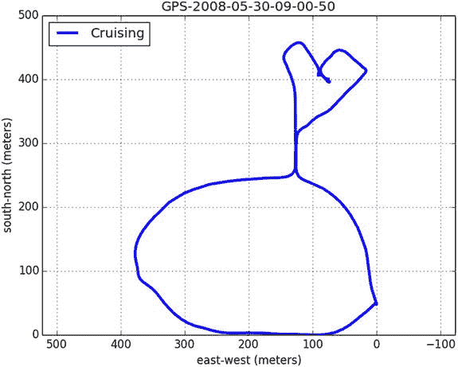
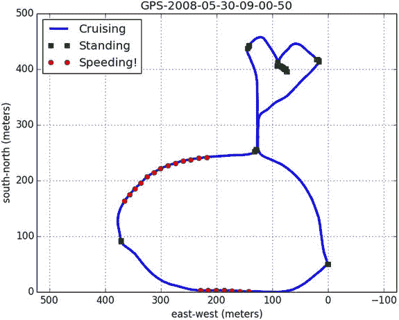
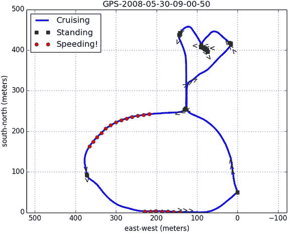
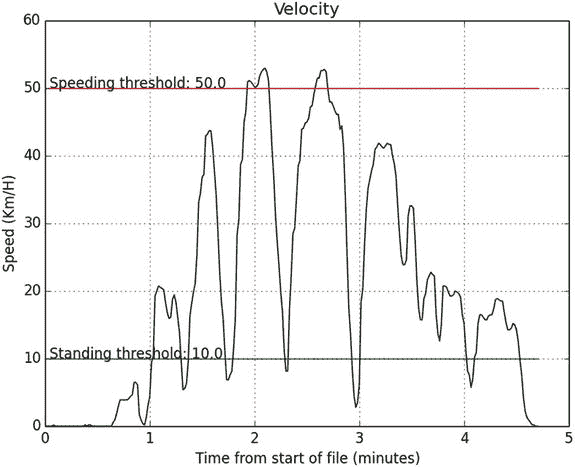
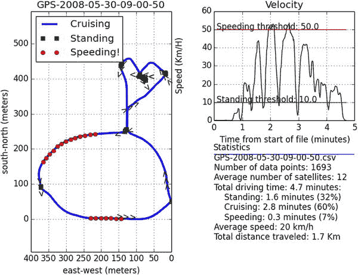

# 探索数据可视化世界

## 案例研究

作为一名工程师，我无时无刻不在与数据打交道。我解析日志文件、分析数据、估算数值，并将结果与理论进行比较。事情并不总是吻合。因此，我会反复检查分析结果，进行更多计算，或运行模拟以更好地理解结果。我会参考以前的工作，因为思路相似，有时则因为思路不同。我查看图表，意识到自己遗漏了一些关键信息。于是我补充缺失的数据，但这些数据充满噪声，需要过滤。最终，我意识到自己的算法实现很糟糕，或者存在效果更好的算法，于是又回到了起点。这是一个迭代过程：调整、测试、再调整，直到对结果满意为止。

这些都是围绕研发（R&D）工作的任务。老实说，这并没有系统的方法。大多数时候，研究就是有组织的混乱。然而，重点应该放在“有组织”上，而不是“混乱”。数据应该以清晰连贯的方式进行分析和呈现。图表的来源应该被充分理解并验证其准确性。算法应该经过测试并证明能按预期工作。系统应该具有灵活性。引入新思路并挑战以往方法应该很容易，在当前数据上测试新想法应该快速高效。

在本书中，我将尝试解决与数据处理和可视化相关的所有主题：管理文件和目录、读取各种格式的文件，以及使用类似于 MATLAB 和 GNU-Octave 的高级编程语言执行信号处理和数值分析。在此过程中，我将教你 Python，一种丰富而强大的编程语言。

简而言之，《Python 数据可视化入门》涉及使用 Python 编程语言对数据进行处理、分析、操作和可视化。本书涵盖以下内容：

*   数据分析和可视化所需的 Python 编程语言基础知识。
*   数据文件、格式和组织，以及选择文件格式、存储和组织数据以实现快速高效数据处理的方法和指南。
*   现成的 Python 包，用于数值分析、信号和图像处理、绘图和图表绘制等。

为了展示其可能性，本章将提供一个案例研究，演示如何使用 Python 收集 GPS 数据，在可视化之前分析数据，并绘制结果。

然而，在开始之前，你应该了解一些关于 Python 的基础知识。Python 是一种*解释型*编程语言。这意味着每条命令都是先读取再执行。这与编译型编程语言形成对比，后者会先评估（编译）整个程序，然后再执行。解释型编程语言的一个重要特性是易于交互式运行。也就是说，你可以执行一条命令，检查结果，再执行更多命令，检查更多结果，以此类推。交互式运行 Python 的能力非常有用，它让你可以在学习过程中随时检查相关主题。

也可以以非交互方式在 Python 中运行程序，这些程序被称为*脚本*，有几种方法可以实现。你可以通过在交互式 Python 提示符下发出命令`exec(open('scriptname.py').read())`来运行脚本。或者，你可以在操作系统的命令行界面中输入`python scriptname.py`。如果你使用的是 IPython，可以改用命令`run scriptname.py`；如果你运行的是 IDLE（Python GUI），可以打开脚本并按**F5**执行它。`.py`扩展名是一种常见约定，用于将 Python 脚本与其他文件区分开来。本章描述的案例研究既利用了脚本，也利用了交互式运行 Python 的方式。

 **注意** 能够区分交互式会话和 Python 脚本非常重要。当代码以`>>>`开头时，表示该代码是在 Python 交互式环境中运行的。如果出现省略号符号（`. . .`），则表示该代码是之前交互式输入命令的延续。跟在`. . .`或`>>>`符号后面的文本行是 Python 对已发出命令的响应。不以`>>>`开头的代码列表是在编辑器中编写的脚本；要执行它，你需要将其保存为`scriptname.py`（或其他名称），并按照前面描述的方式执行。

## 收集数据


### 我们花费大量时间记录和分析数据。数据的存储格式取决于采集工具、数据性质（例如图片与采样模拟数据）、后续处理数据的应用程序以及个人偏好。数据文件大小不一：有些文件非常大，另一些则较小但数量众多。数据组织方式又增加了一层复杂性。文件可以按日期存储在目录中、集中存放在一个大目录或数据库中，或采用完全不同的方案。通常，数据文件的数量或每个文件的数据量过大，无法通过编辑器或查看器快速浏览。我们需要借助方法和工具来查找数据并进行分析，从而得出有意义的结果。您很快就会发现，Python 提供了完成这一任务所需的所有工具。

## 案例研究：GPS 数据

您刚收到一个 USB GPS 接收器作为生日礼物！您想分析 GPS 数据，了解自己超速的频率以及在交通拥堵中花费的时间。您希望追踪一年甚至更长时间的数据。于是您决定用 Python 记录、分析和可视化 GPS 数据。

一些硬件背景知识：大多数 USB GPS 接收器表现为串口（蓝牙 GPS 设备也是如此）。这意味着一旦连接 GPS（假设安装正确），读取 GPS 数据就像打开与 GPS 关联的 COM 端口并读取数值一样简单。GPS 值通常是纯文本值：数字和文本。当然，如果您计划从汽车上记录 GPS 数据，将其连接到笔记本电脑而非台式机会更合理。

 **注意** 如果您希望亲自输入命令并查看结果，以跟随本章剩余内容，建议先参考第 2 章在系统上安装 Python。不过，这不是必须的，您也可以先通读本章以了解本书及其目的。事实上，我鼓励您在积累更多 Python 经验后，再回到本章重新阅读。

为了能够从 Python 访问串口，我们将使用 `pySerial` 模块。顾名思义，`pySerial` 允许无缝访问串口（`pySerial` 模块需要下载并安装；详见第 2 章）。要使用 `pySerial`，我们必须先将模块读入内存，即使用 `import` 命令导入它。如果一切顺利，我们将再次看到 Python 提示符。

```
>>> import serial
```

### 扫描串口

接下来，我们需要找到串口参数：波特率和端口号。波特率是 GPS 的参数，因此最好查阅 GPS 手册（如果找不到此信息，请别担心，我稍后会讨论如何“猜测”它）。端口号由您的操作系统决定。如果您不确定如何查找端口号，或者插拔 GPS 时端口号不断变化，可以使用以下代码来识别活动的串口（参见清单 1-1a）。

***清单 1-1a***。扫描串口（Linux）

```
>>> from serial.tools.list_ports import comports
>>> comports()
```

```
[('/dev/ttyS3', 'ttyS3', 'n/a'), ('/dev/ttyS2', 'ttyS2', 'n/a'), ('/dev/ttyS1',
'ttyS1', 'n/a'), ('/dev/ttyS0', 'ttyS0', 'n/a'), ('/dev/ttyUSB0',
'公司名称和设备信息应在此处', 'USB VID:PID=xxxx:yyyy')]
```

清单 1-1a 告诉我们有四个名为 `/dev/ttySn` 的串口，其中 `n` 是小于或等于 3 的整数。还有一个名为 `/dev/ttyUSB0` 的端口，这正是我要找的端口。

在 Windows 中，代码略有不同。原因在于：`comport()` 函数返回的是一个*生成器表达式*，而不是可用端口的列表（您将在第 3 章中了解更多关于生成器表达式的知识）。清单 1-1b 展示了该脚本的 Windows 版本。

***清单 1-1b***。扫描串口（Windows）

```
>>> from serial.tools.list_ports import comports
>>> >>> list(comports())
```

```
[('COM6', '公司名称和设备信息', 'USB VID:PID=xxxx:yyyy')]
```

这是对 Python 相当快速的介绍！首先，让我们逐行剖析代码。第一行 `from serial.tools.list_ports import comports` 允许我们访问名为 `comports()` 的函数。通过使用 `import` 命令，我们加载了 `comports()` 函数并能够使用它。`comports()` 函数是名为 `tools` 的模块（模块是函数和数据结构的集合）的一部分。`serial` 包是与串口相关的模块集合，其中一个是 `tools`。访问包内的模块使用点运算符。这是您在 Python 中会经常看到的写法：`from package.module import function`（更多内容请参见第 3 章）。

第二行调用了 `comports()` 函数；在 Linux 和 Windows 版本中，它都返回一个可用串口的列表。在 Linux 版本中，列表通过直接调用 `comports()` 函数返回。在 Windows 版本中，使用了一种更复杂的机制，称为生成器表达式。这是一个相当高级的话题，将在第 3 章中讨论，因此我们暂时跳过。在两个版本中，列表都由成对的值组成。第一个值是串口的位置，第二个是描述信息。记下串口位置，下一节会用到。

### 记录 GPS 数据

让我们开始收集数据。输入清单 1-2 中的代码，并将其保存到文件 `record_gps.py` 中。

***清单 1-2***。`record_gps.py`

```
import time, serial

#### 将这些参数改为您的 GPS 参数
port = '/dev/ttyUSB0'  # 在 Windows 中，将其设置为 'COMx'
ser = serial.Serial(port)

ser.baudrate = 4800
fmt = "../data/GPS-%4d-%02d-%02d-%02d-%02d-%02d.csv"

filename = fmt % time.localtime()[0:6]
f = open(filename, 'wb')
while True:
    line = ser.readline()
    f.write(line)
    print(line)
```

 **注意** 如果您的 GPS 不支持通过串口访问，并且您希望跟随本章内容，可以从本书官方网站下载示例数据文件，然后继续学习。

这次我们导入了另一个模块：`time`。`time` 模块提供了对日期和时间函数的访问，我们将用它来命名 GPS 数据文件。我们还引入了一个重要概念：注释！Python 中的注释用 `#` 号表示，类似于 C++ 的双斜杠注释 `//`。从该符号开始到行尾的所有内容都被视为注释。如果 `#` 号位于行首，则整行都是注释，通常用于描述下一行或代码块。`#` 号表示注释的例外情况是当它被引号括在字符串中时，例如：`"#"`。


别忘了修改变量 `port` 的值，使其指向清单 1-1 中端口扫描代码返回的串口位置。你还应该设置合适的波特率。确定波特率并不复杂，但最好查阅一下手册。我的波特率是 4800；如果你不确定自己的波特率，可以调整这个参数。脚本 `record_gps.py` 会将 GPS 的输出打印到屏幕上，这样你就可以更改波特率值（尝试 1200、2400、4800 和 9600 这几个值），直到看到有意义的结果（即文本和数字）。

运行 `record_gps.py`（我稍后会介绍其工作原理）会输出 GPS 数据：

```
>>> exec(open('record_gps.py').read())
$GPRMC,140053.00,A,4454.1740,N,09325.0143,W,000.0,128.7,300508,001.1,E,A*2E
$GPGGA,140053.00,4454.1740,N,09325.0143,W,1,09,01.1,00289.8,M,-030.7,M,,*5E
$GPGSA,A,3,21,15,18,24,26,29,06,22,,03,,,02.0,01.1,01.7*04
$GPGSV,3,1,12,21,75,306,40,15,59,075,46,18,57,269,49,24,56,115,46*79
$GPGSV,3,2,12,26,48,059,43,29,27,188,48,06,25,308,41,22,18,257,33*7D
$GPGSV,3,3,12,08,14,060,,03,11,320,32,09,06,144,,16,04,311,*7C
$GPRMC,140054.00,A,4454.1740,N,09325.0143,W,000.0,128.7,300508,001.1,E,A*29
$GPGGA,140054.00,4454.1740,N,09325.0143,W,1,09,01.1,00289.8,M,-030.7,M,,*59
$GPGSA,A,3,21,15,18,24,26,29,06,22,,03,,,02.0,01.1,01.7*04
```

数据在显示的同时会被记录到文件中。当你想停止查看和记录 GPS 数据时，请按下 `Ctrl+C`。如果你在交互式 Python 环境中运行，一旦按下 `Ctrl+C`，请务必关闭串口，否则你将无法重新运行脚本 `record_gps.py`。要关闭端口，请执行以下命令：

```
>>> ser.close()
```

关闭文件也是一个好习惯：

```
>>> f.close()
```

让我们仔细看看 `record_gps.py`，以深入了解其工作原理。该脚本的核心在于以下几行代码：

```
while True:
    line = ser.readline()
    f.write(line)
    print(line)
```

这是一个直接的实现。第一行 `while True:` 指示接下来的代码块应无限期运行；也就是说，处于一个无限循环中。这就是为什么你需要按下 `Ctrl+C` 来停止记录。接下来的三行会连续执行。它们从串口读取一行文本，将其存储到文件中，并打印到屏幕上。读取 GPS 数据由命令 `line = ser.readline()` 执行。将数据写入文件以供后续处理由 `f.write(line)` 完成。将数据打印到屏幕以便用户获得视觉反馈则由 `print(line)` 实现。

 **注意** Python 中的缩进（空格数量）很重要，因为它将命令组合在一起。在交互模式下使用 Python 时也是如此。所有具有相同缩进的行被视为一个代码块。Python 的缩进相当于 C/C++ 中的花括号——`{}`。

## 数据组织

接下来，我们来选择文件格式、文件命名约定和数据存储位置。没有一个适用于所有情况的单一完美解决方案，但方法和思路很简单。我在这里使用的方法基于文件名。我将向你展示如何以一种便于后续自动处理的方式来命名数据文件。

## 文件格式

文件格式是一组描述文件内容的规则。对于 GPS 问题，我们将选择逗号分隔值（CSV）文件格式。CSV 文件是值由逗号分隔的文本文件，如下例所示：

```
$GPGSV,3,2,12,06,43,096,37,07,41,291,38,16,39,052,32,27,34,291,34*76
$GPGSV,3,3,12,19,26,152,35,08,06,280,,10,00,337,,00,00,000,*74
$GPRMC,233547.32,A,4455.6446,N,09329.3400,W,030.1,272.5,040608,001.1,E,A*2E
$GPGGA,233547.32,4455.6446,N,09329.3400,W,1,06,02.8,00299.0,M,-030.7,M,,*5A
```

CSV 是一种流行的格式，大多数电子表格软件、数据库应用程序以及文本编辑器（因为它们实际上就是文本文件）都能识别。事实证明，大多数 USB-GPS 接收器的数据已经是逗号分隔的，因此只需将这些信息原样保存到文件中即可。

### 文件命名约定

现在，让我们看看如何为我们的数据文件选择合适的文件名。文件名应该是唯一的，这样文件就不会被意外覆盖。文件名也应该是描述性的；也就是说，它们应该告诉我们一些关于内容的信息。最后，我们希望文件扩展名能告诉我们如何查看该文件。后者通常通过选择合适的扩展名来实现——在我们的例子中是 `.csv`。以下是我为此示例选择的命名约定：

*   包含 GPS 数据的文件名将以文本 “GPS-” 开头。
*   接下来是 ISO 格式的日期和时间，省略分隔冒号，并在日期和时间之间加一个连字符：`YYYY-mm-dd-HH-MM-SS`，其中 `YYYY` 代表年，`mm` 代表月，`dd` 代表日，`HH` 代表小时，`MM` 代表分钟，`SS` 代表秒。如果某个值是一位数而需要两位数，则该值前面会补零。例如，五月将表示为 `05`，而不是 `5`。有关 ISO 格式的更多信息，请参考 ISO 8601，“数据元素和交换格式——信息交换——日期和时间的表示”（`http://www.iso.org`）。
*   所有文件都将具有 `.csv` 扩展名。

遵循这些约定，文件名可能如下所示：

```
GPS-2008-05-30-09-10-52.csv
```

### 数据存储位置

这是我们存储数据文件的地方：

*   所有数据文件都存储在目录 `data` 中。所有脚本都存储在目录 `src` 中。这两个目录都在同一个父目录 `Ch1` 下。因此，从 `src` 到 `data` 的相对路径是 `../data`。我们将在本书中遵循此约定。
*   添加一个 `Readme.txt` 文件也是一个好主意。自述文件是纯文本文件，以合理的详细程度描述目录的内容。此类文件通常描述数据源、数据采集系统、负责数据收集的人员、收集数据的原因等。以下是一个示例：

```
Data recorded from a USB GPS receiver, connected to a Lenovo laptop T60.
Data was gathered via the serial port stored to clear text files (CSV).
Measurements were taken to estimate speed and time spent in traffic.
Gathered by Shai Vaingast.
Date: throughout 2008, see file timestamps.
```

## 数据分析

一旦数据组织好并可以从文件中访问，下一步就是提取信息。信息可以是与当前问题相关的值、图表或报告。

其理念是利用 Python 的脚本能力和广泛可用的现成包，编写一个完全自动化的应用程序来处理、分析和可视化数据。脚本是用高级编程语言相对快速地编写的小段代码。这里的关键词是生产力，即快速更改和测试算法并提取结果的能力。脚本在处理速度方面可能效率不高，但如果编写得当，它们不应减慢运行时间。例如，脚本可以生成图表，或搜索硬盘驱动器上的数据文件，分析日志文件，并提取最高和最低温度。在我们的案例中，当然，我们将使用它们来分析 GPS 数据。

在我们的 GPS 案例研究中，我们将使用以下算法：

1.  编译所有数据文件的列表。
2.  对于每个文件：
    1.  读取数据。
    2.  处理数据。
    3.  绘制数据图表。

### 遍历目录

为了编译包含 GPS 数据的所有文件的列表，我们使用模块 `os` 提供的函数 `os.walk()`，该模块是 Python 标准库的一部分。要使用 `os`，我们执行 `import os`：

```
>>> import os
>>> for root, dirs, files in os.walk('../data'):
...    print(root, dirs, files)
...
```


```
../data [] ['GPS-2008-05-30-09-00-50.csv', 'GPS-2008-05-30-09-10-52.csv',
'Readme.txt']
```

 **注意**  要在 Python 解释器中切换目录，首先需要执行 `import os`。然后，要切换到一个目录，请执行 `os.chdir(directory_path)`。要列出目录内容，可以使用 `os.listdir(directory_path)`。一些解释器（如 IPython）除了其他增强功能外，还允许你使用类似 shell 的命令，例如 `cd` 和 `ls`，这大大提高了可用性。

函数 `os.walk()` 会递归遍历 `data` 目录及其子目录，查找文件和文件夹，然后将结果存储在变量 `root`、`dirs` 和 `files` 中。第二行打印出搜索的根目录。在我们的例子中，这意味着 `../data`（注意相对路径），然后是子目录，最后是文件本身，以列表形式呈现。到目前为止，我只记录了两个数据文件；但随着时间的推移，更多数据会被添加到这个文件夹中，文件数量可能会大幅增加。由于 `data` 文件夹中没有子目录，因此 `dirs` 对应的输出应该是一个空列表，用 `[]` 表示。

在这里使用 `os.walk()` 函数有点大材小用。在我们的例子中，`data` 目录没有任何子目录，我们完全可以像下面这样，使用 `os.listdir()` 函数调用来列出目录内容：

```
>>> os.listdir('../data')
```

```
['GPS-2008-30-05-09-00-50.csv', 'GPS-2008-30-05-09-10-52.csv', 'Readme.txt']
```

然而，`os.walk()` 非常有用。将文件分组存放在目录中是很常见的。在这些目录中，你可能还会有子目录，存放更多的文件。例如，你可能希望根据记录数据的 GPS 来对文件进行分组。或者，如果另一个驾驶员正在记录 GPS 数据，你可能希望将这些数据放在 `data` 目录下的一个单独子目录中。在这些情况下，`os.walk()` 正是你所需要的。

现在我们已经有了 `data` 目录中所有文件的列表，我们可以只处理那些扩展名为 `.csv` 的文件。我们可以使用 `endswith()` 函数来实现这一点，该函数检查字符串是否以 "csv" 结尾。不以 "csv" 结尾的文件会使用 `continue` 命令跳过：`continue` 指示 `for` 循环跳过当前执行并继续处理下一个元素。以 "csv" 结尾的文件则会被读取和处理。为了从目录和文件名创建完整的文件路径，我们使用 `os.path.join()` 函数，如代码清单 1-3 所示。

***代码清单 1-3***. 仅处理 CSV 文件

```
for root, dirs, files in os.walk('data'):
    for filename in files:
        # 创建包含路径的完整文件名
        cur_file = os.path.join(root, filename)
        if filename.endswith('csv'):
            y = read_csv_file(cur_file)
        else:
            continue

#### 从这里开始，只处理扩展名为 .csv 的文件
```

## 读取 CSV 文件

我们的下一步是读取文件。我们再次求助于 Python 的内置模块，这次是 `csv` 模块。尽管 CSV 文件格式非常流行，但没有明确的定义，每个电子表格和数据库都使用自己的“方言”。我们将处理的文件遵循最基本的 CSV 文件方言，因此我们将使用 Python 的 `csv` 模块的默认行为。由于我们将读取多个 CSV 文件，因此定义一个函数来执行此任务是合理的。代码清单 1-4 展示了这个函数。

***代码清单 1-4***. 一个用于读取 CSV 文件的函数

```
def read_csv_file(filename):
    """读取一个 CSV 文件并将其作为行列表返回。"""

data = []
    for row in csv.reader(open(filename)):
        data.append(row)
    return data
```

第一行定义了一个名为 `read_csv_file()` 的函数。CSV 文件支持是通过 `csv` 模块引入的，因此我们在调用该函数之前必须执行 `import csv`。该函数接受一个变量 `filename`，并返回一个包含文件中数据的行数组。换句话说，读取的每一行都会被处理并成为一个列表，其中每个逗号分隔的值都是该列表中的一个元素。该函数返回一个由这些列表组成的数组，如下例所示：

```
>>> import csv
>>> x = read_csv_file('../data/GPS-2008-06-04-09-03-45.csv')
>>> len(x)
```

```

```

```
>>> x[10]
```

```
['$GPGSV', '3', '3', '12', '29', '10', '040', '', '16', '01', '302', '', '26', '01',
'037', '', '00', '00', '000', '*72']
```

```
>>> x[1676]
```

```
['$GPGSV', '3', '1', '12', '21', '86', '258', '43', '18', '66', '286', '20', '15', '50',
'059', '45', '24', '44', '126', '43*72']
```

`len(x)` 告诉我们这个列表数组的大小。这也是我们确保数据确实被读入数组的一种粗略方法。

函数中的第二行被称为 *文档字符串*，其特点是用三个引号（`"""`）以如下方式包围文本：`"""文档字符串"""`。在这种情况下，文档字符串用于记录函数；也就是说，它使我们能够解释函数的功能。执行命令 `help(funcname)` 会显示其文档字符串：

```
>>> help(read_csv_file)
```

```
Help on function read_csv_file in module __main__:

read_csv_file(filename)
    Reads a CSV file and return it as a list of rows.
```

当你需要提醒自己某个函数的功能时，应该使用 `help()`。`help()` 可以用于函数以及模块。例如，以下是对 `csv` 模块调用 help：

```
>>> help(csv)
```

```
Help on module csv:

NAME
    csv - CSV parsing and writing.

DESCRIPTION
    This module provides classes that assist in the reading and writing
    of Comma Separated Value (CSV) files, and implements the interface
    described by PEP 305.  Although many CSV files are simple to parse,
    the format is not formally defined by a stable specification and
    is subtle enough that parsing lines of a CSV file with something
    like line.split(",") is bound to fail.  The module supports three
    basic APIs: reading, writing, and registration of dialects.
```

`data = []` 这一行声明了一个名为 `data` 的变量，并将其初始化为一个空列表。我们将使用 `data` 来存储来自 CSV 文件的值。

`csv` 模块通过自动化许多与读取 CSV 文件相关的任务来帮助我们读取它们。我将在第 4 章和第 5 章中更详细地讨论 CSV 文件和 `csv` 模块；本章仅提供一个概述。

以下是使用 `csv` 模块读取 CSV 文件的步骤：

1.  打开文件以供读取。
2.  创建一个 `csv.reader` 对象。`csv.reader` 对象具有帮助我们读取 CSV 文件的函数。
    1.  使用 `csv.reader` 对象，从文件中逐行读取数据。
    2.  将每一行追加到变量 `data` 中。
3.  关闭文件。

让我们逐步尝试一下：

```
>>> import csv
>>> f = open('../data/GPS-2008-06-04-09-03-45.csv')
>>> cr = csv.reader(f)
>>> for row in cr:
...     print(row)
```


```
['$GPGSA', 'A', '3', '21', '18', '15', '24', '', '22', '', '', '', '', '', '',
'03.5', '02.2', '02.7*09']
['$GPGSV', '3', '1', '12', '21', '86', '267', '39', '18', '66', '286', '44',
'15', '51', '060', '43', '24', '45', '125', '30*7A']
['$GPGSV', '3', '2', '12', '06', '28', '300', '33', '22', '27', '265', '31',
'03', '18', '312', '27', '29', '15', '185', '31*7C']
['$GPGSV', '3', '3', '12', '09', '15', '138', '31', '16', '00', '301', '',
'19', '00', '332', '', '00', '00', '000', '*70']
['$GPRMC', '140706.24', 'A', '4455.6241', 'N', '09328.0519', 'W', '011.4',
'152.7', '040608', '001.2', 'E', 'A*25']
['$GPGGA', '140706.24', '4455.6241', 'N', '09328.0519', 'W', '1', '04', '03.0',
'00295.1', 'M', '-030.7', 'M', '', '*51']
['$GPGSA', 'A', '3', '21', '18', '15', '24', '', '', '', '', '', '', '', '',
'08.9', '03.0', '08.4*04']
```

```
>>> f.close()
```

首先，我们打开数据文件并将其赋值给变量 `f`。现在可以通过变量 `f` 来引用已打开的文件。接下来，我们创建一个 `csv.reader` 对象 `cr`。我们将 `csv.reader` 对象 `cr` 与文件 `f` 关联起来。然后，我们遍历 `csv.reader` 对象的每一行并打印该行。最后，我们通过调用 `f.close()` 来关闭文件。在完成文件操作后关闭文件是一种良好的实践；但如果你忘记这样做，一旦变量 `f` 不再使用，Python 会自动关闭该文件。

 **注意**  在执行命令后，你可能会收到类似这样的错误：`UnicodeEncodeError: 'charmap' codec can't encode character '\uABCD'`。如果发生这种情况，请在文本编辑器中打开 GPS 文件，确保文件包含正确的字母数字字符。请务必删除包含非字母数字字符的行。

Python 还允许你实现*级联函数*，即你可以根据其他函数的结果调用新函数。这个过程可以重复多次。级联（通常）能增加清晰度并生成更优雅的脚本。在我们的例子中，变量 `f` 对我们来说并不重要，因此我们在将其附加到 `csv.reader` 对象后便丢弃了它。我们可以通过级联函数，将前面的代码改写为如下形式：

```
>>> cr = csv.reader(open('../data/GPS-2008-06-04-09-03-45.csv')):
>>> for row in cr:
...     print(row)
```

变量 `cr` 也是如此，我们可以级联多个函数，生成更紧凑的代码行：

```
>>> for row in csv.reader(open('../data/GPS-2008-06-04-09-03-45.csv')):
...     print(row)
```

虽然脚本可能更短，但性能并没有提升。因此，建议仅在能增加清晰度时才使用级联函数；你很可能以后会编辑这段代码，能够理解代码的意图非常重要。事实上，有时不级联函数可能更有用，因为你可能需要访问中间变量（例如本例中的 `f` 和 `cr`）。

`csv.reader` 对象将我们读取的每一行转换为一个字段行，形式为列表。然后，该行被追加到一个行列表中，并存储在变量 `data` 中。

 **注意**  到目前为止，你已经多次看到点符号（`.`）。它的用法可能有点令人困惑，因此有必要解释一下。点符号用于访问模块的函数成员，以及对象（类）的函数成员。你已经在模块的成员函数（如 `csv.reader()`）中见过它，也在对象（如 `f.read()`）中见过它。在后一种情况中，它意味着文件对象有一个成员函数 `read()`，并且调用该函数来操作变量 `f`。要访问这些函数，我们使用点运算符。我们将在第 3 章中再次提及这一点。最后，我们使用省略号符号（`...`）来表示在 Python 中交互式输入命令时的行延续。

## 分析 GPS 数据

GPS 格式（也称为 NMEA 0183）包含许多头部标记，其中一些包含对我们任务有用的信息。让我们仔细看看 GPS 数据：

*   每一行似乎都以一个文本头部标记开头，以字符 `$GP` 开始。
*   有几种头部标记（例如，`$GPGSA` 和 `$GPRMC`）。
*   头部之后是其他值，其中大部分是数字。

 **注意**  NMEA 代表美国国家海洋电子协会（National Marine Electronics Association）；更多信息请参见 `http://www.nmea.org`。NMEA 0183 数据格式的描述见 `http://www.gpsinformation.org/dale/nmea.htm`。

如前所述，我们的数据文件中出现了几个 `$GP` 头部标记，但我们需要确定哪些标记与我们相关。首先，了解一下我们的数据文件中究竟存在哪些 NMEA 标准的头部标记会很有帮助。一种方法是打开文件，查找头部，并在看到每个新头部时将其记下。当然，另一种方法是使用 Python 为我们完成这项工作。

Python 是一种非常高级的编程语言。因此，它内置了对*字典*（在 Perl 中也称为关联数组）的支持，字典是一种键和值之间具有一对一关系的数据结构，非常类似于真实的字典。然而，传统的字典通常一个键对应多个值；也就是说，一个词（键）有多个解释（值）。你可以使用字典对象 `dict` 轻松地在 Python 中实现这一点，方法是将一个列表值赋给一个键。这样，每个键可以有多个条目，因为该键关联到一个可以容纳多个值的列表。实际上，这仍然是一对一的关系，但暂时先说到这里。我将在后续章节中更详细地介绍字典。我们在这里要做的是使用字典对象来记录每个头部被遇到的次数。我们的键将是 GPS 头部标记，我们的值将是一个表示出现次数的数字。每当遇到一个键时，我们就递增该值，如清单 1-5 所示。

***清单 1-5***. 函数 `list_gps_commands()`

```
def list_gps_commands(data):
    """统计观察到的 GPS 命令的出现次数。

返回一个字典对象。"""

gps_cmds = dict()
    for row in data:
        try:
            gps_cmds[row[0]] += 1
        except KeyError:
            gps_cmds[row[0]] = 1

return gps_cmds
```

关于这个函数，有几点需要注意。首先，文档字符串跨越多行，这是文档字符串的主要优点之一。文档字符串将显示函数中所示的所有空格和换行符。其次，我们初始化一个变量 `gps_cmds` 作为我们的字典。然后，我们处理 GPS 数据中的每个列表：我们只关心每一行的第一个元素，因为那是保存 GPS 头部标记的值。然后，我们递增与键关联的值：`gps_cmds[row[0]] += 1`。我们使用 `+=` 操作将值递增 1，类似于 C 语言中的做法（然而，Python 不使用 `++` 运算符）。如果键不存在（这会在我们遇到新的头部标记时发生），则会引发异常。我们通过 `except KeyError` 语句捕获该异常。在异常情况下，我们将与该键关联的字典值设置为 `1`。

我们可以使用字典方法 `get()` 更紧凑地编写函数 `list_gps_commands()`；详情请参见第 3 章。

让我们分析一些 GPS 数据：

```
>>> x = read_csv_file('../data/GPS-2008-05-30-09-00-50.csv')
>>> list_gps_commands(x)
```

```
{'$GPGSA': 282, '$GPGSV': 846, '$GPGGA': 282, '$GPRMC': 283}
```


好的，作为一名高级文档工程师和翻译员，我将严格遵循您提供的注意事项和示例格式，将给定的英文文本翻译成中文。


我的 GPS 生成了四种不同的 GPS 头部信息。其中，只有两种是我们感兴趣的：`$GPGSV`（包含可见卫星数量，这非常重要！）和 `$GPRMC`（包含位置和速度信息）。

我们需要编写一个函数来处理 GPS 数据。每当头部字段是 `$GPGSV` 或 `$GPRMC` 时，该函数提取相关信息并将其存储在数值数组中，以便后续处理。数值数组由 *NumPy* 模块引入，因此我们需要 `import numpy`。由于我们将大量使用 *NumPy*、*SciPy* 和 *matplotlib* 的功能，更简单的方法是 `import pylab`，它会导入所有这些模块，如下所示：

```
>>> from pylab import *
```

 **注意** *PyLab* 这个名称来源于 Python 和 MATLAB。*PyLab* 模块在 Python 中提供了类似 MATLAB 的功能。

## 提取 GPS 数据

对于 `$GPGSV` 头部，卫星数量是第四个字段。对于 `$GPRMC` 头部，我们有更多有趣的信息。第二个字段是时间戳，第四个字段是纬度，第六个字段是经度，第八个字段是速度。更多细节请参考 NMEA 0183 格式。表 1-1 总结了 `$GPRMC` 行中的字段及其值。

表 1-1. `$GPRMC` 信息（摘录）

| 字段名 | 索引 | 格式 |
| --- | --- | --- |
| 头部 | 0 | `$GPRMC`（固定） |
| 时间戳 | 1 | *hhmmss.ss* |
| 纬度 | 3 | *DDMM.MMM* |
| 经度 | 5 | *DDDMM.MMM* |
| 速度 | 7 | *VVV.V* |

关于 `$GPRMC` 中的信息，我们需要记住一些注意事项。例如，让我们看一个任意行的时间戳：

```
>>> x[12]
```

```
['$GPRMC', '140055.00', 'A', '4454.1740', 'N', '09325.0143', 'W', '000.0',
'128.7', '300508', '001.1', 'E', 'A*28']
```

在这个输出中，时间戳显示为 `'140055.00'`。它遵循格式 *hhmmss.ss*，其中 *hh* 是表示小时的两位数字（始终为两位数字——如果小时是一位数，比如早上 7 点，则会在前面加 0），*mm* 是表示分钟的两位数字（同样始终为两位数字），*ss.ss* 是表示秒和秒的小数部分的五个字符（四位数字加小数点）。还有北/南字段以及东/西字段。这里，为简单起见，我们假设为北半球，但您可以通过读取整个 `$GPRMC` 结构轻松更改这些值。

 **注意** 在 ISO 时间格式中，我们使用 *HHMMSS* 表示小时、分钟和秒。在这种情况下，我们遵循 NMEA 的约定，使用 *hhmmss.ss* 表示小时、分钟和秒，然后使用 *DD* 和 *MM* 表示角度度数和分钟。

时间戳字符串处理起来有点麻烦，尤其是在绘制数据时。第一个原因是它是一个字符串，而不是数字。但即使将其转换为数字，该系统也不利于绘图，因为一分钟有 60 秒，而不是 100 秒。因此，我们要做的是“线性化”时间戳。为此，我们将时间戳转换为自午夜以来经过的秒数，如下所示：*T = hh * 3600 + mm * 60 + ss.ss*。

我们遇到的第二个问题是 *hh*、*mm* 和 *ss.ss* 是字符串，而不是数字。在 Python 中，将字符串相乘会得到完全不同的结果。在这种情况下，我们必须先将字符串转换为数值。具体来说，我们希望使用浮点数（即 `float`），因为表示秒的字符串中包含小数点。所有这些都可以很好地整合如下：

```
>>> row = x[18]
>>> row
```

```
['$GPRMC', '140056.00', 'A', '4454.1740', 'N', '09325.0143', 'W', '000.0',
'128.7', '300508', '001.1', 'E', 'A*2B']
```

```
>>> float(row[1][0:2])*3600+float(row[1][2:4])*60+float(row[1][4:6])
```

```
50456.0
```

运算符 `[]` 表示索引，因此 `row[0]` 是头部，`row[1]` 是 `row` 的第二个字段（计数从零开始），它是一个字符串。字符串的前两个字符用 `[0:2]` 表示；从字符串中截取字符称为 ***字符串切片***。因此，要访问第一个字段的前两个字符，我们写为 `row[1][0:2]`。后续章节将详细介绍字符串及其切片方法。

接下来，我们处理纬度和经度。我们面临与时间戳相同的问题，只是这里处理的是度数。纬度遵循格式 *DDMM.MMM*，其中 *DD* 表示度数，*MM.MMM* 表示分钟。这次，我们将使用度数；将分钟转换为度数可以使后续计算更简单。要将纬度转换为十进制度数，我们需要将分钟除以 60：

```
>>> row = x[18]
>>> row
```

```
['$GPRMC', '140056.00', 'A', '4454.1740', 'N', '09325.0143', 'W', '000.0',
'128.7', '300508', '001.1', 'E', 'A*2B']
```

```
>>> float(row[3][0:2])+float(row[3][2:])/60.0
```

```
44.9029
```

对于纬度信息，我们需要第四个字段，因此使用 `row[3]`。这个例子还引入了另一种表示法 `[2:]`，它指的是从第三个字符到字符串末尾的切片。

需要注意的是，自 Python 3.x 起，除法的默认行为发生了变化。在 Python 2.x 中，默认除法是整数除法。在 Python 3.x 中，默认除法是浮点数除法。执行表达式 `100/60` 在 Python 2.x 和 Python 3.x 中返回的结果不同，如下所示：

在 Python 2.x 中，将 100 除以 60 返回以下结果：

```
>>> 100/60
```

```
1
```

在 Python 3.x 中，它返回以下结果：

```
>>> 100/60
```

```
1.6666666666666667
```

为了确保在 Python 2.x 中进行浮点数除法，通常的做法是添加一个小数点，即 `100/60.0`（注意点零）。在 Python 3.x 中添加小数点也可以（尽管不是必需的，因为浮点数除法是默认行为）。但是，如果您想在 Python 3.x 中执行整数除法呢？答案很简单：使用整数除法运算符 `//`：

```
>>> 100//60
```

```
1
```

在本书中，我们将使用 Python 3.x 的默认浮点数除法。

也可以使用 `int()` 函数将值转换为整数值，如下所示：

```
>>> int(100/60)
```

```
1
```

经度信息与纬度类似，但有一个细微差别：经度度数是三个字符而不是两个（最多 180 度，而不仅仅是 90 度），因此字符串的索引不同。

清单 1-6 展示了处理 GPS 数据的完整函数。

***清单 1-6***. 函数 `process_gps_data()`

```
NMI = 1852.0
def process_gps_data(data):
    """Processes GPS data, NMEA 0183 format.

    Returns a tuple of arrays: latitude, longitude, velocity [km/h],
    time [sec] and number of satellites.
    See also: http://www.gpsinformation.org/dale/nmea.htm.
    """

    latitude    = []
    longitude   = []
    velocity    = []
    t_seconds   = []
    num_sats    = []

    for row in data:
        if row[0] == '$GPGSV':
            num_sats.append(float(row[3]))
        elif row[0] == '$GPRMC':
            t_seconds.append(float(row[1][0:2])*3600 + \
                float(row[1][2:4])*60+float(row[1][4:6]))
            latitude.append(float(row[3][0:2]) + \
                float(row[3][2:])/60.0)
            longitude.append((float(row[5][0:3]) + \
                float(row[5][3:])/60.0))
            velocity.append(float(row[7])*NMI/1000.0)

    return (array(latitude), array(longitude), \
            array(velocity), array(t_seconds), array(num_sats))
```

以下是关于 `process_gps_data()` 函数的一些说明：


*   `NMI`被定义为`1852.0`，即一海里对应的米数，也等于赤道上的一分。常量`NMI`未在函数内部定义的原因是，我们也希望在函数外部使用它。
*   我们通过将返回值`latitude`、`longitude`、`velocity`、`t_seconds`和`num_sats`设置为空列表`[]`来初始化它们。初始化列表会创建它们，并允许我们使用`append()`方法向列表中添加值。
*   `if`和`elif`语句不言自明：`if`是条件子句，`elif`相当于“否则，如果”。也就是说，如果第一个条件不成立，但下一个条件成立，则执行后续代码块。
*   出现在多个计算和`return`行中的符号`\`表示操作在下一行继续。
*   最后，返回值是一个数组元组。*元组*是一个不可变的序列，意味着你不能更改它。因此，元组表示一个不可变的项目序列（与列表相对，列表是可变的序列）。我们返回元组（而不是二维数组）的原因是，我们可能返回不同长度的列表：卫星数量列表的长度可能与经度列表的长度不同，因为它们来自不同的头部标记。

以下是调用`process_gps_data()`的方法：

```
>>> y = read_csv_file('../data/GPS-2008-05-30-09-00-50.csv')
>>> (lat, long, v, t, sats) = process_gps_data(y)
```

第二行引入了序列解包，它允许进行多重赋值。有了这些函数，我们就可以绘制数据了！

## 数据可视化

下一步是可视化数据。我们将大量依赖`matplotlib`包。我们已经通过命令`from pylab import *`导入了`matplotlib`，因此目前无需额外导入。是时候读取数据并绘制轨迹了。

我们的第一个问题是信息以纬度和经度给出。纬度和经度是球面坐标，即球体（地球）上的点。但我们想要一个类似地图的图，它使用笛卡尔坐标，即`x`和`y`。因此，我们首先必须将球面坐标转换为笛卡尔坐标。我们将使用清单 1-7 中所示的快速但粗略的方法来做到这一点；只要行进距离相对于地球半径较小，这种方法实际上相当准确。

**清单 1-7.** “快速但粗略的”球面到笛卡尔坐标转换

```
x = longitude*NMI*60.0*cos(latitude)
y = latitude*NMI*60.0
```

为了证明这一点，请考虑以下推理：当你向北极移动时，你所在位置的周长变得越来越小，直到北极点处为零。因此，在纬度 0°（赤道）处，每度（经度）意味着比在纬度 45° 处行进更远的距离。这就是为什么`x`不仅取决于经度值本身，还取决于纬度：纬度越高，经度变化在距离上的影响越小。另一方面，`y`（南北方向）不依赖于经度。

接下来要理解的是，地球是一个球体；每当我们绘制 x-y 地图时，我们实际上只是绘制该球体在我们选择的平面上的投影。因此，我们将其表示为`(px, py)`，其中`p`代表“投影”。我们将最东南的点作为 GPS 数据投影的起点：`(px, py) = (0, 0)`。这转化为清单 1-8 中所示的代码。

**清单 1-8.** 将行进轨迹投影到笛卡尔坐标

```
py = (lat-min(latitude))*NMI*60.0
px = (long-min(longitude))*NMI*60.0*cos(D2R*latitude)
```

需要注意的几点包括：

*   变量`py`和`px`是浮点值数组。使用*NumPy*，我们可以无缝地对整个数组进行操作。
*   `D2R`是一个等于π/180 的常量，用于将度转换为弧度。
*   为了将 y 轴设置在最小纬度处，将 x 轴设置在最小经度处，我们从纬度和经度值中分别减去最小纬度和最小经度值。

## GPS 位置图

现在，期待已久的时刻到了：绘制 GPS 数据。为了能够跟随并绘制数据，请确保按照前面的详细说明定义函数`read_csv_file()`和`process_gps_data()`，并将文件名变量设置为指向你的 GPS 数据文件。我已抑制了`matplotlib`的响应，以便代码更易于理解：

```
>>> filename = 'GPS-2008-05-30-09-00-50.csv'
>>> y = read_csv_file('../data/'+filename)
>>> (lat, long, v, t, sats) = process_gps_data(y)
>>> px = (long-min(long))*NMI*60.0*cos(D2R*lat)
>>> py = (lat-min(lat))*NMI*60.0
>>> figure()
>>> gca().axes.invert_xaxis()
>>> plot(px, py, 'b', label='Cruising', linewidth=3)
>>> title(filename[:-4])
>>> legend(loc='upper left')
>>> xlabel('east-west (meters)')
>>> ylabel('south-north (meters)')
>>> grid()
>>> axis('equal')
>>> show()
```

图 1-1 显示了结果，相当令人满意。



**图 1-1.** GPS 数据

我们使用了大量新函数，它们都是`matplotlib`包的一部分：`plot()`、`grid()`、`xlabel()`、`legend()`等。其中大部分不言自明：

*   `xlabel(string_value)`和`ylabel(string_value)`分别在 x 轴和 y 轴上打印标签。我们使用`title(string_value)`在图形上方打印标题。标题中的字符串值是文件名直到末尾，减去四个字符（以便不显示“.csv”）。我们通过使用负值的字符串切片来实现这一点，这表示“从末尾开始”。
*   `legend()`在图例框中打印与图形关联的标签。`legend()`高度可配置（详情请参见`help(legend)`）。该示例将图例绘制在左上角。
*   `grid()`绘制网格线。你可以相当广泛地控制网格的行为。
*   `plot()`需要额外解释，因为它是最通用的。命令`plot(px, py, 'b', label='Cruising', linewidth=3)`使用字符`'b'`指定的蓝色绘制`px`和`py`。该图被标记为“Cruising”；因此，稍后当我们调用`legend()`函数时，正确的文本将与数据关联。最后，我们将线宽设置为 3。
*   函数`axis()`控制图形轴的行为。通常，我不会调用`axis()`函数，因为`plot()`在选择正确的值方面做得很好。然而，在这种情况下，正确可视化数据很重要。这意味着我们需要 x 轴和 y 轴具有相等的增量，以便图形真实反映所描绘的路径。这通过调用`axis('equal')`实现。还有其他值可以控制轴的行为，如`help(axis)`所述。
*   最后，`gca().axes.invert_xaxis()`是一个相当特殊的补充。它源于我们喜欢查看地图和方向的方式。在经度上，递增的值从右到左显示。然而，在数学图形中，递增的值通常从左到右显示。此函数调用指示 x 轴从右到左递增，就像地图一样。
*   当我们完成图形准备后，调用`show()`函数显示输出。

包含前述函数的`Matplotlib`是一个全面的绘图包，将在第 6 章中更详细地探讨。

## 注释图形


我们希望在 GPS 图中添加更多信息。例如，我们想知道在哪里停车以及在哪里超速。为此，我们使用`find()`函数，它是`PyLab`包的一部分。`find()`函数返回满足条件的索引数组。在我们的例子中，我们想知道以下内容：

```
>>> STANDING_KMH = 10.0
>>> SPEEDING_KMH = 50.0
>>> Istand = find(v < STANDING_KMH)
>>> Ispeed = find(v > SPEEDING_KMH)
>>> Icruise = find((v >= STANDING_KMH) & (v <= SPEEDING_KMH))
```

我们还计算了巡航（即既不超速也不停车）的时间，以便后续处理。

为了在图上标注这些点，我们在当前图的基础上再添加一个绘图。不过，这次我们改变了绘图的颜色，并使用符号而不是实心蓝线。组合`'sg'`表示绿色方块符号（`g`代表绿色，`s`代表方块）；组合`'or'`表示红色圆圈（`r`代表红色，`o`代表圆圈）。我建议你为停车和超速使用不同的符号，而不仅仅是颜色，因为图形可能会在单色打印机上打印。`plot()`函数支持多种符号和颜色；详情请查阅交互式帮助。我们绘制的值仅是由`find()`函数返回的那些值：

```
>>> plot(px[Istand], py[Istand], 'sg', label='Standing')
>>> plot(px[Ispeed], py[Ispeed], 'or', label='Speeding!')
>>> legend(loc='upper left')
```

图 1-2 显示了结果。



图 1-2. 带有额外速度信息的 GPS 数据

我们还想知道汽车行驶的方向。为了实现这一点，我们将使用`text()`函数，它允许我们将字符串写入图中的任意位置。因此，要在位置(10,10)添加文本“Hi”，我们执行命令`text(10, 10, 'Hi')`。`text()`函数的一个优点是我们可以以任意角度旋转文本。要在位置(10,10)以 45 度角绘制“Hi”，我们执行`text(10,10, 'Hi', rotation=45)`。我们实现方向信息的方法是以汽车行驶的角度旋转文本“>>>”。我们只执行十次，以免“>”符号使图形过于杂乱。计算汽车在给定点`i`的行驶方向如清单 1-9 所示。

***清单 1-9***. 计算行驶方向

```
dx = px[i+1]-px[i]
dy = py[i+1]-py[i]
heading = arctan2(dy, dx)
```

虽然我们可以使用`arctan(dy/dx)`来计算方向，但我选择使用`arctan2(dy,dx)`函数。使用`arctan2()`而非`arctan()`的好处有两点：1) 没有除法，因此不会在`dx`为零时导致除零异常；2) `arctan2()`保留从-180 度到 180 度的角度，而`arctan()`仅产生 0 度到 180 度之间的值。以下代码添加了方向符号：

```
>>> for i in range(0, len(v), len(v)//10-1):
...     text(px[i], py[i], ">>>", \
...         rotation = arctan2(py[i+1]-py[i], -(px[i+1]-px[i]))/D2R, \
...         ha='center')
```

请注意，我使用了整数除法来计算十个索引，如下所示：`len(v)//10-1`。原因：数组的索引必须是整数，不能是浮点数（数组中不存在第 1.37 个元素）。

图 1-3 显示了生成的图形。



图 1-3. 带有行驶方向的 GPS 图

## 速度图

我们现在来绘制速度图。这要简单得多：

```
>>> figure()
>>> t = (t-t[0])/60.0
>>> plot(t, v, 'k')
>>> plot([t[0], t[-1]], [STANDING_KMH, STANDING_KMH], '-g')
>>> text(t[0], STANDING_KMH, \
...      " Standing threshold: "+str(STANDING_KMH))
>>> plot([t[0], t[-1]], [SPEEDING_KMH, SPEEDING_KMH], '-r')
>>> text(t[0], SPEEDING_KMH, \
...      " Speeding threshold: "+str(SPEEDING_KMH))
>>> grid()
>>> title('Velocity')
>>> xlabel('Time from start of file (minutes)')
>>> ylabel('Speed (Km/H)')
>>> show()
```

我们首先使用`figure()`命令打开一个不同的图形。接着，我们将时间刻度单位转换为分钟，这个值对大多数人来说比秒更容易理解。选择合适的测量单位很重要。大多数人会觉得“我开了 30 分钟”比“我开了 1800 秒”更容易理解。我们还将时间轴设置为从`t[0]`开始。接下来，我们用黑色绘制速度随时间变化的函数。好的图形需要标注，因此我们选择添加两条线来描述停车和超速的阈值，以及描述这些阈值的文本。为了生成文本，我们将文本“Standing threshold”与阈值（使用`str()`将其转换为字符串后）结合起来，并使用`+`运算符连接字符串。最后，当然是标题、*x*和*y*轴标签以及网格。图 1-4 显示了最终结果。



图 1-4. 速度随时间变化图

### 子图

我们还希望显示一些统计数据。但在那之前，最好将所有图形（GPS 图、速度图和统计图）合并到一个图中。为此，我们使用`subplot()`函数。`subplot()`是一个`matplotlib`函数，它将绘图区域划分为几个称为子图的较小部分，并选择要处理的子图。例如，`subplot(1, 2, 1)`通知后续的绘图命令，要处理的区域是 1 行 2 列的子图，并且当前选中的子图是 1；换句话说，它是绘图区域左侧的一半。`subplot(2, 2, 2)`将选择右上角的子图；`subplot(2, 2, 4)`将选择右下角的子图。在这种场景下，我发现最易读的选择是让 GPS 数据占据绘图区域的一半，速度图占据四分之一，统计图占据另外四分之一。每次`subplot()`调用应在调用绘图命令（例如`plot()`）之前进行。

## 文本

有时，传达信息的最佳方式是使用文本，而不是图形。在本节中，我们将工作范围限制在统计图所在的四分之一区域。我们的第一个任务是去掉绘图框架以及*x*和*y*刻度。我们只需要一个空白画布来显示文本。我们可以通过执行以下命令来实现：

```
>>> subplot(2, 2, 4)
>>> axis('off')
```

第一次调用`subplot()`将我们的工作区域选择为右下角的四分之一区域。第二行代码移除坐标轴并隐藏框架框。

是时候计算一些统计数据了。GPS 数据似乎以固定的时间间隔（通常为一秒）发送。因此，要计算停车时间（以秒为单位），我们计算向量`Istand`的长度。同样，要计算超速时间，我们可以计算`Ispeed`的长度。为了估算这些值所占的百分比，我们将`Istand`和`Ispeed`向量的长度除以速度向量的长度，再乘以 100。要计算平均速度，我们使用`mean()`函数，它是`PyLab`的一部分。

我们还希望计算总行驶距离。距离可以计算为每两个连续数据点之间距离的总和。`diff()`函数返回输入向量的差分向量：

```
>>> diff([1, 4, 0, 2])
```

```
array([ 3, -4,  2])
```

这非常有用，因为我们现在可以计算距离：

```
>>> sum(sqrt(diff(px)**2+diff(py)**2))
```

```
1652.1444099624528
```


这样，我们就能得到总行驶距离。

为了自动化打印统计信息的整个过程，我们将要打印的文本存储在变量 `stats` 中，它是一个字符串列表。我们还使用了一种类似于 C 语言 `printf()` 函数的字符串格式化方法，尽管语法略有不同。`%s` 表示字符串，而 `%f` 表示浮点数。在我们的例子中，`%.1f` 表示小数点后保留一位的浮点数，`%d` 表示整数。以下代码生成了统计文本：

```
>>> Total_distance  = float(sum(sqrt(diff(px)**2+diff(py)**2))/1000.0)
>>> Stand_time  = len(Istand)/60.0
>>> Cruise_time = len(Icruise)/60.0
>>> Speed_time  = len(Ispeed)/60.0
>>> Stand_per   = 100*len(Istand)/len(v)
>>> Cruise_per  = 100*len(Icruise)/len(v)
>>> Speed_per   = 100*len(Ispeed)/len(v)
>>> Stats=['Statistics', \
...    '%s' % filename, \
...    'Number of data points: %d' % len(y), \
...    'Average number of satellites: %d' % mean(sats), \
...    'Total driving time: %.1f minutes:' % (len(v)/60.0), \
...    '    Standing: %.1f minutes (%d%%)' % \
...    (Stand_time, Stand_per), \
...    '    Cruising: %.1f minutes (%d%%)' % \
...    (Cruise_time, Cruise_per), \
...    '    Speeding: %.1f minutes (%d%%)' % \
...    (Speed_time, Speed_per), \
...    'Average speed: %d km/h' % mean(v), \
...    'Total distance travelled: %.1f Km' % Total_distance ]
```

为了在画布上打印文本，我们再次使用了 `text()` 函数。这次，我们使用了一个 `for` 循环，遍历 `stats` 列表中的每一个字符串：

```
>>> for index, stat_line in enumerate(reversed(stats)):
...    text(0, index, stat_line, va='bottom')
...
>>> plot([index-.2, index-.2])
>>> axis([0, 1, -1, len(stats)])
```

我们引入了两个新函数。一个是 `reversed()`，它按逆序返回 `stats` 中的元素。第二个是 `enumerate()`，它不仅返回 `stats` 数组中的每一行，还返回每一行的索引。因此，当变量 `stat_line` 被赋值为 `'Average speed...'` 时，变量 `index` 被赋值为 `8`，这表示 `stats` 中的第九行。我们想知道索引的原因是将其用作 y 轴上的位置。最后，文本的垂直对齐方式选择为 `bottom`，如参数 `va='bottom'` 所示（`va` 是 vertical alignment 的缩写）。

## 整合所有代码

最后，清单 1-10 展示了用于分析和绘制 `data` 目录下所有 GPS 文件的完整代码。

***清单 1-10***. 脚本 gps.py

```
from pylab import *
import csv, os

### constant definitions
STANDING_KMH = 10.0
SPEEDING_KMH = 50.0
NMI = 1852.0
D2R = pi/180.0

def read_csv_file(filename):
    """Reads a CSV file and return it as a list of rows."""

data = []
    for row in csv.reader(open(filename)):
        data.append(row)
    return data

def process_gps_data(data):
    """Processes GPS data, NMEA 0183 format.

Returns a tuple of arrays: latitude, longitude, velocity [km/h],
time [sec] and number of satellites.
See also: http://www.gpsinformation.org/dale/nmea.htm.
    """

latitude    = []
    longitude   = []
    velocity    = []
    t_seconds   = []
    num_sats    = []

for row in data:
        if row[0] == '$GPGSV':
            num_sats.append(float(row[3]))
        elif row[0] == '$GPRMC':
            t_seconds.append(float(row[1][0:2])*3600 + \
                float(row[1][2:4])*60+float(row[1][4:6]))
            latitude.append(float(row[3][0:2]) + \
                float(row[3][2:])/60.0)
            longitude.append((float(row[5][0:3]) + \
                float(row[5][3:])/60.0))
            velocity.append(float(row[7])*NMI/1000.0)

return (array(latitude), array(longitude), \
        array(velocity), array(t_seconds), array(num_sats))

### read every data file, filter and plot the data
for root, dirs, files in os.walk('../data'):
    for filename in files:
        # create full filename including path
        cur_file = os.path.join(root, filename)
        if filename.endswith('csv'):
            y = read_csv_file(cur_file)
        else:
            continue

### only files with the .csv extension from here on

### process GPS data
        (lat, long, v, t, sats) = process_gps_data(y)

### translate spherical coordinates to Cartesian
        py = (lat-min(lat))*NMI*60.0
        px = (long-min(long))*NMI*60.0*cos(D2R*lat)

### find out when standing, speeding or cruising
        Istand = find(v < STANDING_KMH)
        Ispeed = find(v > SPEEDING_KMH)
        Icruise = find((v >=STANDING_KMH) & (v <= SPEEDING_KMH))

### left side, GPS location graph
        figure()
        subplot(1, 2, 1)

### longitude values go from right to left,
        # we want increasing values from left to right
        gca().axes.invert_xaxis()

plot(px, py, 'b', label=' Cruising', linewidth=3)
        plot(px[Istand], py[Istand], 'sg', label=' Standing')
        plot(px[Ispeed], py[Ispeed], 'or', label=' Speeding!')

### add direction of travel
        for i in range(0, len(v), len(v)//10-1):
            text(px[i], py[i], ">>>", \
                rotation=arctan2(py[i+1]-py[i], -(px[i+1]-px[i]))/D2R, \
                ha='center')

### legends and labels
        title(filename[:-4])
        legend(loc='upper left')
        xlabel('east-west (meters)')
        ylabel('south-north (meters)')
        grid()
        axis('equal')

# top right corner,  speed graph
        subplot(2, 2, 2)

### set the start time as t[0]; convert to minutes
        t = (t-t[0])/60.0
        plot(t, v, 'k')

### plot the standing and speeding threshold lines
        plot([t[0], t[-1]], [STANDING_KMH, STANDING_KMH], '-g')
        text(t[0], STANDING_KMH, \
            " Standing threshold: "+str(STANDING_KMH))
        plot([t[0], t[-1]], [SPEEDING_KMH, SPEEDING_KMH], '-r')
        text(t[0], SPEEDING_KMH, \
            " Speeding threshold: "+str(SPEEDING_KMH))
        grid()

### legend and labels
        title('Velocity')
        xlabel('Time from start of file (minutes)')
        ylabel('Speed (Km/H)')

### right side corner, statistics data
        subplot(2, 2, 4)

### remove the frame and x/y axes. we want a clean slate
        axis('off')

### generate an array of strings to be printed
        Total_distance  = sum(sqrt(diff(px)**2+diff(py)**2)/1000.0)
        Stand_time  = len(Istand)/60.0
        Cruise_time = len(Icruise)/60.0
        Speed_time  = len(Ispeed)/60.0
        Stand_per   = 100*len(Istand)/len(v)
        Cruise_per  = 100*len(Icruise)/len(v)
        Speed_per   = 100*len(Ispeed)/len(v)
        stats = ['Statistics', \
        '%s' % filename, \
        'Number of data points: %d' % len(y), \
        'Average number of satellites: %d' % mean(sats), \
        'Total driving time: %.1f minutes:' % (len(v)/60.0), \
        '    Standing: %.1f minutes (%d%%)' % \
        (Stand_time, Stand_per), \
        '    Cruising: %.1f minutes (%d%%)' % \
        (Cruise_time, Cruise_per), \
        '    Speeding: %.1f minutes (%d%%)' % \
        (Speed_time, Speed_per), \
        'Average speed: %d km/h' % mean(v), \
        'Total distance traveled: %.1f Km' % Total_distance ]

### display statistics information
        for index, stat_line in enumerate(reversed(stats)):
            text(0, index, stat_line, va='bottom')

### draw a line below the "Statistics" text
        plot([index-.2, index-.2])

### set axis properly so all the text is displayed
        axis([0, 1, -1, len(stats)])
show()
```

图 1-5 展示了最终结果。



图 1-5. 对某些 GPS 数据运行 gps.py 的输出结果

## 最后说明与参考资料


### GPS 问题与开发环境

此处描述的 GPS 问题本质上是研发性质的工作：它涉及计算与中间结果，而非最终产品。研究或研发工作，尤其是可行性研究，需要快速响应。这意味着要尽可能使用现成的工具，并将它们组合起来完成任务。如果这些工具价格低廉，甚至是免费的，那更是使用它们的理由。

在本书中，我们将探讨不同的软件包和模块，并展示如何利用它们进行数据分析和可视化。我们将遵循开源软件这一主题，包括根据 GNU 通用公共许可证 (GPL) 和 Python 软件基金会 (PSF) 许可证发布的软件。这些工具的例子包括 GNU/Linux，当然还有 Python。

使用 Python 开发数据分析和可视化脚本有几个好处：

*   代码开发和编写速度快，这对研究工作很有吸引力。
*   现成的软件包进一步提高了生产力，并确保了结果的准确性。
*   脚本引入了自动化。修改算法很容易实现。

本书将详细介绍大量脚本，我旨在涵盖你在实际工作中可能遇到的大部分问题。从简单的一行命令到更复杂的脚本，示例包括用 Python 编写的处理二进制文件、合并来自不同来源的数据、执行文本解析、使用高级数值算法等等的脚本。我们将特别关注数据可视化以及如何在 Python 中获得令人满意的结果。不过，首先，你必须搭建并运行 Python 环境，这将在下一章中介绍。

如果你想更全面地了解 Python（不一定是针对数据分析和可视化），Python 官方网站是一个极好的资源：

*   Python 编程语言——官方网站，`http://www.python.org`

本章中使用的其他参考资料包括：

*   `pySerial`，`http://pyserial.sourceforge.net/`
*   “数据元素和交换格式——信息交换——日期和时间的表示”，`http://www.iso.org`
*   NMEA 0183，`http://www.nmea.org` 和 `http://www.gpsinformation.org/dale/nmea.htm`

