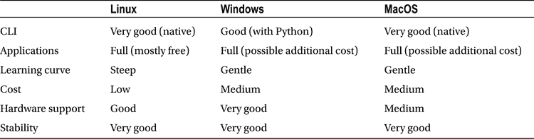
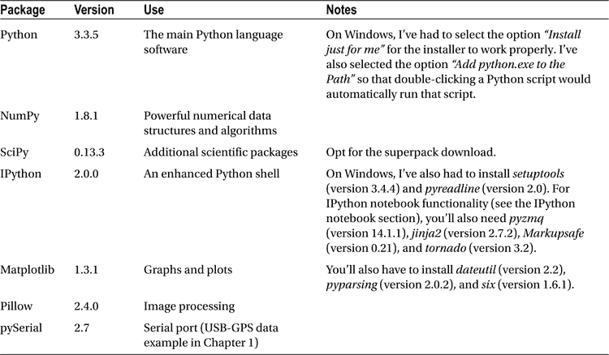
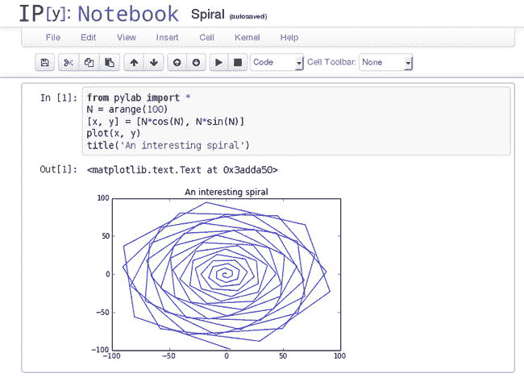
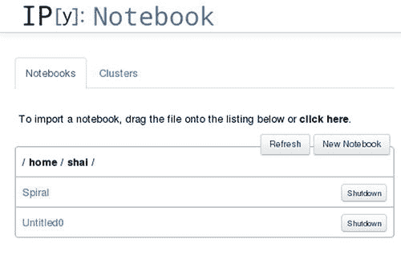
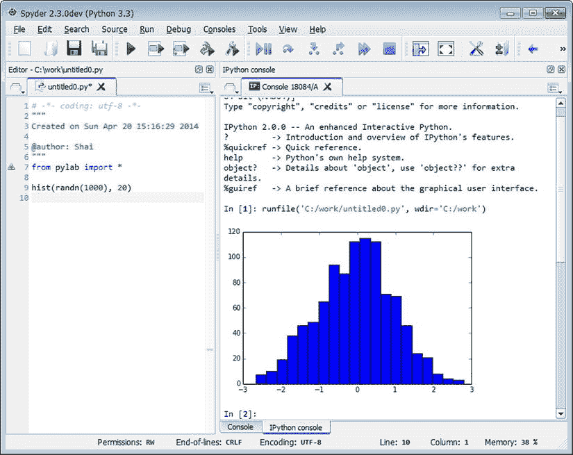
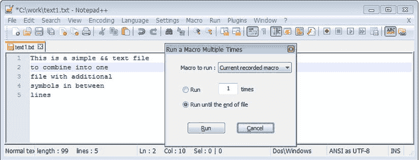

# 第 2 章：环境


## 行业工具

第 1 章 通过一个涉及 GPS 数据收集、分析和可视化的案例研究，展示了 Python 的实际应用。要自己使用 Python，你首先需要构建自己的开发环境。本章将引导你了解所需的各种软件组件，并帮助你权衡安装选项。除非你已经熟悉 Python 并且安装了我们在第 1 章中使用的软件包，否则请继续阅读。

建立一个用于分析和可视化数据的可靠环境，需要通用软件组件，以及 Python 和一些用于数据分析和可视化的额外 Python 包。对于通用软件，你需要：

*   一个操作系统 (OS)
*   一个用于编写代码的文本编辑器
*   一个图像查看器
*   用于展示和查看结果的工具
*   一个版本控制系统

在接下来的章节中，我们将更详细地审视这些组件的选项，并推荐一些可以提高生产力的组件。如果你已经对某个通用软件组件感到满意，请务必使用它，而不是这里推荐的。另一方面，所讨论的特定于 Python 的组件是运行本书示例所需的工具。当一个组件是必需组件时，我会明确说明。本章以线性方式介绍各种软件组件，从基础开始逐步构建——首先是操作系统，然后是 Python 和 Python 包，最后是支持性软件组件。

 **注意** 尽管本章以线性方式组织，但如果你已经知道将要使用哪些应用程序，可以随意跳过通用软件组件部分。但是，你应该确保正确安装了特定于 Python 的组件；本书中提供的代码均基于此假设。

## 操作系统

开发环境建立在操作系统之上。作为基础，你的选择可以是基于 UNIX 的操作系统（例如 GNU/Linux 和 Mac OS X）或 Windows。我们将重点介绍 Linux 和 Windows，但由于 Mac OS 是基于 UNIX 的操作系统，因此关于 Linux 的大部分讨论也适用于它。有关支持的操作系统的完整列表，请参阅 Python 网站 (`https://www.python.org`)，该网站是所有 Python 相关内容的极好资源。

### GNU/Linux

Linux 是一个通用术语，用于描述基于 Linux 内核的类 UNIX 操作系统。Linux 发行版是一个集合，包含 Linux 内核以及提供完整操作系统的附加软件包。大多数发行版提供的功能不仅仅是基本的操作系统功能；它们还提供额外的软件包，例如多媒体应用程序、游戏、办公生产力套件等等。大多数 Linux 发行版中的相当一部分软件包都基于 GNU 项目 (`http://www.gnu.org`)——因此得名 GNU/Linux。

目前有大量的 Linux 发行版 (distros) 可用，包括（但不限于）以下：

*   Fedora 项目：`https://www.fedoraproject.org`
*   Debian：`https://www.debian.org`
*   Ubuntu：`http://www.ubuntu.com`
*   Gentoo：`http://www.gentoo.org`

这些大多是优秀的发行版。如果你打算走 Linux 路线，花些时间熟悉这些发行版，以便决定最适合你需求（或者也许更贴切地说，最适合你个性）的发行版。有关各种 Linux 发行版的并排比较，请参考 `http://en.wikipedia.org/wiki/Comparison_of_Linux_distributions`。

了解如何在所选 Linux 发行版中安装应用程序尤其重要。大多数发行版都带有包管理工具（例如，Fedora 上的 `rpm`/`PackageKit`/`Yum`，Debian/Ubuntu 上的 `apt-get`/`APT`，以及 Gentoo 上的 `emerge`/`Portage`），这些工具可以下载应用程序并将其安装到你的 Linux 操作系统上。通常，包管理工具会与在线仓库同步，并支持下载和升级软件。它们还会处理任何版本冲突，并执行实际的安装任务，例如复制文件和更新系统信息。

作为一般规则，你应该选择使用 Linux 发行版内置的包管理工具来安装本章讨论的软件组件，包括 Python 及其包，而不是手动安装；这将确保 Linux 系统的稳定性。如果所需的软件应用程序无法通过 Linux 发行版的包管理工具获得，你可以手动安装该应用程序。这不是一项简单的任务，需要一些 Linux 专业知识。（另一方面，手动安装 Python 包则很简单，你将在后面的“手动安装 Python 包”部分中了解到。）

### Windows

在当今可用的 Windows 版本中，选择微软当前支持的版本。与 Linux 不同，在选择 Windows 作为操作系统后，你仍然需要选择运行 Python 的确切环境。三个主要选项是：

*   独立（原生）
*   Cygwin
*   虚拟机 (VM)

#### 独立（原生）


除非你有强烈的理由反对，否则在 Windows 上，这应该是你的首选：直接安装原生 Python，无需额外环境。这种方式安装更省事，代码运行速度更快，并且可以轻松地将 Python 内容直接复制粘贴到文档中。Python 以一个带有安装程序的可执行文件形式提供。下载后，双击该可执行文件并安装 Python（稍后会详细介绍 Python 的安装）。我们接下来要处理的大多数其他包也以这种方式捆绑，因此安装它们也应该很简单。

如果你想要安装一个没有附带安装程序的包，则必须查阅该包的文档。顺便说一句，无论你选择独立安装方式还是接下来建议的其他方法（或 Linux），总会有一些包需要手动安装，因此了解如何进行手动包安装是很有价值的。

#### Cygwin

Cygwin（`http://www.cygwin.com`）环境运行在 Windows 上，并提供类 UNIX 功能。即使你是忠实的 Windows 用户，它也是一个优秀的软件产品。

Cygwin 附带一个在 Windows 上运行的 GUI 安装程序。Cygwin Net Release Setup Program 允许你选择并安装软件包。请注意，Cygwin 有两个版本：64 位版本和 32 位版本；请确保你安装了与操作系统匹配的正确版本。Cygwin 安装程序实际上是一个包管理工具，就像大多数 Linux 发行版中的任何其他包管理工具一样。当你浏览包列表时，你会发现有大量的选择；但这不应让你望而却步。安装默认选项即可，因为你知道随时可以返回并添加或删除应用程序；只需重新运行 Cygwin 安装程序即可。安装 Cygwin 后，通过“开始  所有程序  Cygwin  Cygwin Terminal”来运行它。

Cygwin 提供了大量额外的开源软件包，包括 Python。如果你想要额外的功能——如 `bash` shell、SSH、编辑器、查看器、版本控制系统、X 功能等——那么 Cygwin 是一个绝佳的选择。缺点是对于经验不足的用户来说，它比独立安装方式稍微复杂一些。与原生安装相比，使用 Cygwin 也会有一点性能损失。例如，在我的电脑上，一个简单的 `for` 循环求和值在 Cygwin 的 Python 中比原生 Python 安装慢了 20%。

 **注意** Cygwin 处理驱动器的方式与 Windows 不同，因为它遵循 UNIX 目录结构。如果你将 Cygwin 安装在 `c:\cygwin` 下，则该目录通常被表示为最顶层目录：`/`。要访问 `c:\cygwin` 之外的目录，请使用以下表示法：`/cygdrive/disk` 或 `disk:/`。例如，如果一个文件位于 `c:\data`，则在 Cygwin 中可以通过 `/cygdrive/c/data` 或 `c:/data` 访问它。

#### 虚拟机

第三种选择，稍微特殊一些，是运行虚拟机（VM）。虚拟机允许你在主机操作系统（此处为 Windows 或 Mac OS）中运行 Linux 操作系统（或其他操作系统）。此选项适合更有经验的用户：安装和配置 VM 并非易事。

每当我需要进行交叉开发——即开发一个需要在 Windows 和 Linux 上都能运行的应用程序时——我会在 Windows 中进行开发，并在 Windows 中运行一个 Linux VM。这样，我可以轻松地在两个操作系统中检查代码，而无需切换电脑。VM 的另一个优点是熟悉 Windows 和 Linux 的应用程序：VM 允许你在同一台电脑上使用这两个系统的应用程序。

在 Windows 上，目前有几种可用的 VM：

*   Oracle VM VirtualBox（`https://www.virtualbox.org/`）。VirtualBox 供个人免费使用；详情请参阅 Oracle 的许可常见问题解答（`https://www.virtualbox.org/wiki/Licensing_FAQ`）。
*   VMware（`http://www.vmware.com`）。此 VM 也有一个免费版本，名为 VMware Player。
*   适用于 MacOS 的 Parallels（`http://www.parallels.com`）。Parallels 是商业软件。

 **提示** 如果你只是想尝试一下 Linux，但不想走完整安装操作系统的流程，那么运行虚拟机可能是一个不错的选择。如果是这种情况，还可以选择运行 Live CD，这基本上意味着从 CD-ROM 启动一个功能完整的 Linux 操作系统。目前有相当多的 Live CD 可用；一个知名的选择是 Knoppix（`http://knoppix.net/`）。

使用 VM 的缺点之一是性能会有所损失。话虽如此，VM 的实现和计算能力的不断增强使得这种代价相对较小。

## 选择操作系统

哪个操作系统是 Python 最坚实的基础？从数据分析和可视化的角度来看，Linux 是完美的匹配。主要原因是 Linux 拥有强大的命令行界面（CLI），而 Windows 则严重依赖图形用户界面（GUI）。

当你处理大量文件时，CLI 比 GUI 更具优势。考虑重命名大量文件，例如，你上次度假时拍摄的照片。大多数相机生成的文件遵循顺序命名方案：`DSB00001.jpg`、`DSB00002.jpg` 等等，这相当晦涩。另一方面，你可能希望将这些文件重命名为更具信息性的名称，例如 `Vacation2014-03-20-NNNNN.jpg`，其中 `NNNNN` 是运行索引。因此，名为 `DSB00002.jpg` 的文件现在将被命名为 `Vacation2014-03-20-00002.jpg`。你可以使用 GUI 和 CLI 来执行此任务：

*   使用 GUI 方法，你必须为每个文件指向、单击并键入新名称。对于少量图片来说，这可能是完全合理的；但随着数量的增加，这项任务变得繁琐且耗时。
*   CLI 方法是编写一条命令来一次性重命名所有文件。如果你熟悉 Bash，你可能会发出以下命令：

```
$ for fn in DSB*.jpg; do mv $fn ${fn/DSC/Vacation2014-03-20-}; done
```

（有很多方法可以用 CLI 做到这一点，这只是我喜欢的一种。我不会在本书中讨论 Bash。）对于少量图片来说，这似乎有些大材小用；然而，一旦文件数量增加，CLI 方法就能显著节省时间。

当然，重命名文件是一项简单的任务，Windows 也通过其命令提示符（Windows 版本的 CLI）支持该任务。然而，即使是这样简单的任务，在 Windows 中也不简单，除非你安装额外的软件或编写一些代码来执行该任务（尽管最新版本的 Windows 也引入了支持 GUI 和 CLI 界面的 shell 功能）。对于更复杂的数据管理任务，以 CLI 为中心的方法比 GUI 好得多。一个围绕 CLI 构建的操作系统通常是管理数据文件的更好选择。

 **注意** 无论你选择哪种操作系统，都没有对错之分——本书中介绍的概念（和代码）都能正常工作。

在选择操作系统时，需要考虑以下几点：


*   Linux 是一个稳定且功能强大的操作系统。使用 Linux 的好处包括低成本（通常免费）、强大的 CLI 以及活跃且支持度高的社区。Linux 的主要缺点是，如果你不熟悉该操作系统，会有一个学习曲线——尽管在当今的发行版中，这个曲线已经显著平缓。此外，对硬件的支持不如 Windows 那样全面。如果你的工作涉及使用 Linux 不支持的现有硬件来生成数据，这可能是一个严重的缺点。
*   Windows 是一个广泛流行的操作系统。大多数用户都在某种程度上使用过 Windows，因此学习曲线非常平缓（如果有的话）。对硬件的支持非常好；大多数硬件供应商将 Windows 作为其主要操作系统。Windows 的缺点包括缺乏强大的 CLI，以及操作系统和额外软件应用程序的成本。
*   Mac OS 相当流行，这是有原因的：它结合了 GUI 体验和 UNIX 的强大功能。尽管它在数据分析和可视化领域相对较新，但由于这两个特性，我预感你会看到越来越多的 Mac OS 被使用。Mac OS 的缺点是成本及其对旧硬件的支持。

表 2-1 总结了每种操作系统选择的优缺点。

表 2-1. Linux、Windows 和 Mac OS 作为数据处理和可视化开发环境的对比



### 那么，为什么要选择？使用多个操作系统

Python 的好处在于它将操作系统从问题中消除了。Python 是一个完整的环境，采用“内置电池”的方法：安装 Python 后，你应该基本上可以开箱即用；标准库提供了完整的功能。这意味着，突然间，Windows 也拥有了一个强大的 CLI：Python 解释器。考虑到这一点，操作系统的选择更多地变成了个人偏好。例如，我同时使用 Linux 和 Windows 进行数据分析和可视化：我的 Linux 机器是一台固定的家庭服务器，所以我不能在开车时用它来记录 GPS 数据；我的笔记本电脑运行 Windows，为我完成这项工作。

如果你需要比 Python 提供的更多类似 UNIX 的功能，但仍想使用 Windows，你可以选择 Cygwin，它提供了许多移植到 Windows 的 GNU 工具。事实上，如果我需要一些 GUI 交互工作（Linux 机器藏在桌子下面，没有显示器），我会使用 Cygwin 的 X 服务器并连接到我的 Linux 机器。

如果你计划在同一台计算机上同时安装 Windows 和 Linux 来分析数据（这被称为双启动），请考虑如何在 Linux 和 Windows 分区之间传输数据。有几种方法：拥有一个 Linux 和 Windows 都能处理的共享分区（某些情况下为 FAT32、NTFS），通过 USB 设备传输文件，甚至通过网络连接到另一台机器。每种方法都有其优点，但请记住，你可能要处理大量文件，因此最好能访问共享资源上的数据。

 **警告** 安装操作系统是一项耗时的任务，如果你打算双启动，所需时间会加倍。你应该查阅你的 Linux 发行版的文档，了解如何最好地实现双启动；在决定先安装哪个操作系统（Linux 或 Windows）时尤其如此。双启动是一个高级主题，不建议初学者尝试。

使用双启动系统有时会很烦人，特别是因为你需要重启才能切换操作系统。此外，安装过程有点风险。例如，在重新分区硬盘时，你可能会丢失数据（尽管如果你知道自己在做什么，这种情况是可以避免的）。为了最大程度地减少烦恼和风险，虚拟机是一个很好的替代方案：数据不受重新分区的影响，并且不需要实际重启。我的电脑足够强大，可以在 Windows 中以出色的性能将 Linux 作为虚拟机运行。如果你想使用这种设置，再次考虑如何在主机操作系统和目标操作系统之间共享数据。一种常见（且良好）的方法是使用虚拟网络接口传输文件。另一种选择是使用共享文件夹，例如 Oracle 的 VirtualBox 增强功能提供的共享文件夹。

在 Mac OS 上，这些解决方案在某种程度上不那么必要；Mac OS 本身就是一个类似 UNIX 的操作系统。

## Python 环境

到现在为止，你应该已经选择并安装了你喜欢的操作系统。你也应该熟悉下载和安装软件包。现在是安装 Python 的时候了。本节讨论如何安装 Python 和 Python 包，以便编写数据分析和可视化脚本。第 3 章 更详细地讨论了如何在交互式 shell 中使用 Python 以及运行独立应用程序。在这里，我将重点介绍 Python 发行版、Python IDE 和 Python 包。

 **注意** 模块是 Python 文件。包是驻留在目录中的模块集合（包中的模块还共享一个额外的 `__init__.py` 文件）。在本书中，每当我提到包或模块时，我会使用斜体。包的示例有 *SciPy* 和 *NumPy*。模块的示例有 *time* 和 *random*。有关导入模块和包的信息，请参见第 3 章，“`import` 语句”。

### 版本

我在本书中主要介绍的 Python 版本是 Python 3.3。作为一般规则，你应该选择最新的 Python 版本。不幸的是，这并不总是可能的：

*   在撰写本文时，Python 3.4 已经发布。然而，本书中使用的所有包尚未完全跟上，因此我不得不坚持使用 Python 3.3。
*   某些操作系统，例如 Gentoo Linux 发行版，严重依赖 Python 进行系统管理，升级需要大量测试以确保系统稳定。因此，即使有新的 Python 版本可用，你可能还无法使用它。有一些变通方法，例如在一台机器上安装多个 Python 版本；同样，请参考你的 Linux 发行版以获取更多信息，因为此主题超出了本章的范围。

在升级到更新的 Python 版本之前，请确保你将使用的所有包都支持新版本。写下你将使用的所有包及其版本号。另外，请务必特别注意以下几点：

*   你正在使用的操作系统，无论是 Windows、Linux 还是 MacOS。
*   你的操作系统是 64 位还是 32 位？通常，64 位包版本的下载文件名中包含文本 `amd64` 或 `x86-64`；32 位版本的下载文件名中包含文本 `win32`（Windows）或 `x86`（Linux）。
*   确切的 Python 版本。例如，如果你要下载 *NumPy* 1.8 版本，请确保下载为 Python 3.3 编译的 *NumPy* 版本。

寻找最新 Python 包的一个好的起点是 PyPI——Python 包索引，`https://pypi.python.org/pypi`。表 2-2 总结了本书中使用的 Python 及其包的版本。

表 2-2. 本书中使用的 Python 和 Python 包的版本




#### 本书中的代码

本书中展示的代码在大多数 3.x 版本上无需或仅需极少量修改即可运行。至于 2.x 版本，则需进行小幅调整；最值得注意的是，你需要将除法运算符（`/`）替换为整数除法运算符（`//`）（反之亦然），因为数字除法的默认行为有所不同（更多信息请参阅第 1 章中的“提取 GPS 数据”一节）。或者，你也可以添加一行代码 `from __future__ import print_function, division`，以便在 Python 2.x 版本中使用本书中的脚本。

如果表 2-2 的列表让你望而生畏，不妨选择安装一个包含所有这些包的 Python 发行版；有关建议，请参阅本章后面的“包含科学计算包的 Python 发行版”一节。

 **注意** 请务必确保你下载和安装的包版本与你使用的 Python 版本兼容。某些包会保留旧版本，以备你需要兼容性支持。

## Python

你可以从 `https://www.python.org/downloads/` 为你的特定操作系统下载 Python 实现。请仔细阅读并选择适合你操作系统的下载版本。再次强调，如果你运行的是 Linux 操作系统，建议使用该系统的包管理工具，而不是从 Python 网站下载并安装。同样适用于 Cygwin：尽可能使用 Cygwin 安装程序。在 Windows 上，通常的做法是使用上述网址中附带安装程序的 Python 二进制文件。虽然你也可以从源代码安装 Python——即下载源代码并在你的操作系统上编译——但我除了出于好奇想验证代码确实能正确编译之外，还没找到这样做的理由。

如果你想知道 Jython（一种纯 Java 编写的 Python 实现，请参见 `http://www.jython.org`）或 IronPython（一种基于微软 .NET 平台的 Python 实现，请参见 `http://ironpython.net/`）是否可行，恐怕它们并不适合本书。本书中的大量代码和示例严重依赖于那些无法在 Jython 或 IronPython 上运行的包。其他 Python 替代实现可以在 Python 网站 `https://www.python.org/download/alternatives/` 上找到；同样，这些替代方案不在本书的讨论范围之内。

## 包含科学计算包的 Python 发行版

另一种选择是使用一个已经捆绑了大量我们将要用到的 Python 包的 Python 发行版。如果你不想费心逐个安装包，或者迫不及待地想跳过安装阶段直接运行代码，那么这些发行版是不错的选择。以下是一些可选方案：

*   Enthought Canopy：`https://www.enthought.com/products/canopy/`
*   Python(x,y)：`https://code.google.com/p/pythonxy/`
*   WinPython：`http://winpython.sourceforge.net/`
*   Anaconda：`https://store.continuum.io/cshop/anaconda/`

如果你选择了包含科学计算包的 Python 发行版，则可以跳过本章后面与 Python 集成开发环境、*SciPy*、*NumPy*、*matplotlib* 和 IPython 相关的章节。包含科学计算包的 Python 发行版会直接内置这些包。

## Python 集成开发环境

集成开发环境（IDE）简单来说，就是帮助程序员编写代码的应用程序。通常，IDE 由语言引擎（Python）、编辑器、调试器、文档以及可能的其他生产力工具组成。虽然完全可以在没有 IDE 的情况下使用 Python，但使用 IDE 将大大提高你的生产力，并让你更快地学习。

有几种可用的 Python IDE；我们将探讨 IDLE、IPython（我个人最喜欢的）、IPython Notebook 和 Spyder。

### IDLE

IDLE（`https://docs.python.org/3.3/library/idle.html`）是一个跨平台的 Python GUI IDE。如果你是从 Windows 二进制文件安装的，IDLE 会自动安装；通过“开始” “所有程序” “Python 3.3” “IDLE (Python GUI)” 即可访问。IDLE 是一个功能强大的 IDE，具有以下特性：与 Python 解释器无缝集成、编辑器、调试器和帮助系统。它是一个让你快速上手并运行起来的绝佳环境，尤其是当你编程新手时。

使用 IDLE 的好处之一是，你可以在一个专为 Python 设计的编辑器中编写代码（文件  新建文件 或 **CTRL-N**），然后通过按 **F5** 键轻松地在 IDLE 中执行它。如果使用命令行界面（CLI）方法，你需要调用 Python 并指定要执行的文件（更多内容请参阅第 3 章）。

### IPython

当你开始使用 CLI 时，你会意识到有些功能你确实希望得到增强。IPython（`http://ipython.org/`）提供了一个增强的交互式 Python shell。我强烈推荐它，主要是因为数据分析和可视化本质上是交互式的。IPython 支持大多数平台。以下是 IPython 附带的一些新增功能：

*   制表符补全，涉及变量、函数、方法、属性和文件名的补全。制表符补全是通过 GNU Readline 库（`http://cnswww.cns.cwru.edu/php/chet/readline/rltop.html`）实现的，并且非常容易让人上瘾。一旦你体验过 GNU Readline，就很难再回到普通的 CLI。
*   命令历史功能：输入命令 `history` 可以查看你最近输入的所有命令。你可以将这些命令复制粘贴到 Python 脚本中，从而节省时间和精力。
*   与系统 shell 无缝集成：例如，你可以使用 `ls –l` 或 `cd /home/user`。
*   彩色输出。

IPython 并非必需，但*强烈推荐*。它是我个人最喜欢的用于编写 Python 代码的增强应用程序。

IPython 附带 Windows 安装程序，并且可在大多数包管理工具以及 Cygwin 上使用。根据你的操作系统，你可能需要安装 GNU Readline；在 Windows 上，你还需要安装 PyReadline（`http://ipython.org/pyreadline.html`）。请查阅 IPython 的安装文档。

 **注意** IPython 应在 Python、GNU Readline 和 PyReadline 安装之后再进行安装。

### 使用 IPython 和 GNU Readline 进行字符补全

使用 GNU Readline 进行字符补全是交互式 CLI 的一个受欢迎的功能。使用 IPython，字符补全可用于补全以下内容：

*   变量名
*   方法和属性名
*   文件名

要调用字符补全，首先输入你想要写的单词的前几个字符，然后按 **Tab** 键，让 GNU Readline 尝试为你补全该单词。以下来自 IPython：

```
In [1]: s = "A string"

In [2]: s.is
s.isalnum      s.isdigit      s.isnumeric    s.istitle
s.isalpha      s.isidentifier s.isprintable  s.isupper
s.isdecimal    s.islower      s.isspace
In [2]: s.is
```

在输入 `s.is` 之后，我按下了 **Tab** 键，然后看到了一系列选项。如果我输入了 `s.isdi` 并按下 **Tab**，那么整个 `s.isdigit` 就会自动出现在提示符下。

GNU Readline 的工作方式是，它通过搜索与键入字符匹配的变量、函数、方法、属性或文件名来尝试补全单词。如果只有一个匹配选项，该单词会自动显示在提示符下。如果有多个选项，则会显示所有选项。要选择你希望补全的选项，请提供下一个字符，然后再次按 **Tab** 键。如果没有与键入单词匹配的内容，则不会发生任何操作。


你还可以使用自动补全功能来探索某个类的方法和属性，或者任何其他命名空间。在下面的代码清单中，我在输入 `a.`（注意那个点）后按下了 **Tab** 键：

```
In [1]: a = dict()
In [2]: a.
a.clear    a.fromkeys    a.items    a.pop        a.setdefault     a.values
a.copy     a.get         a.keys     a.popitem    a.update
```

### IPython Notebook

IPython 一个令人兴奋且相对较新的功能是 IPython Notebook（参见 `http://ipython.org/notebook.html`）。IPython Notebook 提供了一个基于 Web 的交互式 Python 脚本环境，既能执行代码，也能嵌入图形。此外，它还允许你通过 IPython Notebook 查看器（参见 `http://nbviewer.ipython.org/`）与读者共享笔记本，或者将笔记本导出为 PDF 或 HTML 等其他格式。图 2-1 展示了一个示例。

当你安装 IPython 时，IPython Notebook 会自动安装。但是，为了让 IPython Notebook 正常工作，还必须安装以下软件包（它们提供了基于 Web 的功能以及 HTML 模板）：



图 2-1. IPython Notebook

*   软件包 *pyzmq*，参见 `https://github.com/zeromq/pyzmq`
*   软件包 *jinja2*，参见 `http://jinja.pocoo.org/`
*   软件包 *markupsafe*，参见 `https://github.com/mitsuhiko/markupsafe`
*   软件包 *tornado*，参见 `http://www.tornadoweb.org/`

一旦你启动 IPython Notebook，你看到的第一个屏幕将类似于图 2-2 所示。



图 2-2. IPython 仪表盘

你可以通过点击“新建笔记本”按钮来创建一个新笔记本，或者点击一个已有的活动笔记本。在上面的示例中，活动笔记本的标题是 *Spiral* 和 *Untitled0*。你可以通过点击“关闭”按钮来关闭笔记本。重命名笔记本通常是在笔记本页面本身通过点击笔记本名称来完成的。

创建笔记本后，你就可以开始输入命令和语句了。这些命令和语句不会立即被求值（即执行），直到你通过上方的播放按钮运行该单元格或按下 **Shift-Enter** 键。有关 IPython 和 IPython Notebook 中可用命令的快速参考表，请参见 `http://damontallen.github.io/IPython-quick-ref-sheets/`。

默认行为是，每当你创建一个图形时，会弹出一个包含该图形的窗口。要让图形嵌入在网页中，如图 2-1 所示，你可以执行以下操作之一：在笔记本中将命令 `%pylab inline` 作为第一条命令发出，或者将参数 `--pylab=inline` 传递给 IPython。在 Windows 中，看起来像这样（在一行内）：

```
C:\Python33\python.exe "C:\Python33\scripts\ipython3-script.py" notebook --pylab inline
```

在 Linux 中，看起来像这样：

```
$ ipython notebook --pylab inline
```

### Spyder

Spyder（`http://code.google.com/p/spyderlib/`）是一个专为 Python 设计的开源集成开发环境（IDE）。它功能丰富，可在大多数操作系统上运行。Spyder 内置了带有语法着色、代码补全、调试器支持等功能的编辑器。它是一个非常优秀的 IDE。

安装 Spyder 有几种方法（参见图 2-3）：使用包含科学计算包的 Python 发行版，如 Python(x,y)、WinPython 或 Anaconda（参见本章前面部分）；使用二进制安装程序；或者从源代码手动安装。如果你在 Windows 中手动安装，还需要软件包 *PySide*（`http://qt-project.org/wiki/PySide`）、*pyzmq*（`https://github.com/zeromq/pyzmq`）和 *pygments*（`http://pygments.org/`）。同样，如果你使用包含科学计算包的 Python 发行版，则不需要任何额外的软件包。



图 2-3. Spyder IDE

## 科学计算

本书的很大一部分内容致力于在可视化之前处理数据。有两个软件包帮助我们实现这一目标：*NumPy* 和 *SciPy*。*NumPy* 将在第 7 章中讨论，*SciPy* 将在第 8 章中介绍。这两个软件包与 *matplotlib* 结合使用时，其行为类似于大多数高端数学软件包，例如开源的 GNU Octave（`http://www.octave.org`）和商业化的 MATLAB（`http://www.mathworks.com`）。事实上，这三个软件包协同工作甚至有一个专门的名称：*PyLab*，它是 Python 和 MATLAB 的结合。*SciPy*、*NumPy* 和 *matplotlib* 都是开源软件包，是运行本书中代码所必需的。

### NumPy

*NumPy* 提供了一个强大的 N 维数组，这是我们将要执行的大部分数据处理的基础。你在第 1 章的 GPS 示例中已经见识过它的作用。*NumPy* 还提供了额外的数值计算能力：线性代数、傅里叶变换等。

*NumPy* 是一个成熟稳定的软件包，可以从 `http://www.numpy.org/` 下载并安装。*NumPy* 将在第 7 章和第 8 章中讨论。

### SciPy

*SciPy* 构建在 *NumPy* 之上，并增加了额外的科学计算工具。这些工具包括数值积分、微分方程、插值、信号处理、优化、线性代数等。

即使你对科学计算不感兴趣，我也鼓励你尝试一下 *SciPy*——它为 *NumPy* 提供了非常有用的附加实用函数，并且在本书中被广泛使用。

*SciPy* 可以从 `http://www.scipy.org/` 下载并安装，并将在第 8 章中介绍。

 **注意** *SciPy* 依赖于 *NumPy*，应在安装 *NumPy* 之后安装。

### Matplotlib

可视化是最后一步，它以图形方式向观众展示数据，传达思想，并高效优雅地捕获信息。本书中的绘图将严重依赖于 *matplotlib* 软件包，其维护地址为 `http://matplotlib.org/`。


`Matplotlib` 是一个与 `NumPy` 和 `SciPy` 配合良好的绘图包。该包是跨平台的，可在 Linux、Windows 和 Mac OS 上运行。`Matplotlib` 可以使用多种引擎生成交互式和基于文件的图表。因此，你可以将其用于交互式工作，这在算法设计的早期阶段非常有用。你也可以在自动模式下使用它，例如批处理，将结果绘制到共享目录或 Web 服务器上。`Matplotlib` 既简单易用又高度可定制，是一个非常适合我们需求的优秀包。它支持多种图表类型，并具有出色的图形注释功能。

 **提示** `Matplotlib` 提供了一些额外的工具包。结合第 1 章来看，一个特别有趣的工具包是 `basemap` 工具包，它允许你处理地图投影。`basemap` 工具包不随 `matplotlib` 一起分发；更多详情请参考 `matplotlib` 的网站。关于其他 `matplotlib` 工具包的讨论，请参考第 6 章。

## 图像处理

图像处理提供了拼图的最后一块。它是数据可视化的重要组成部分，将在第 9 章中详细讨论。我们将使用 Python 图像库（PIL）的一个分支，名为 `Pillow`，来提供图像处理支持。

`Pillow` 为 Python 增强了出色的图像处理能力。它支持大多数流行的图像文件格式，并提供了丰富的函数来操作图像数据。`Pillow` 与 `NumPy` 结合，为 Python 提供了一个功能非常强大的图像处理环境。

## PySerial

在第 1 章中，我们使用 `pySerial` 通过串口捕获 GPS 数据。`PySerial` 可在 `http://pyserial.sourceforge.net/` 获取。每当需要访问串口时，`PySerial` 都是一个极好的选择。

## 手动安装 Python 包

如前所述，某些 Python 包没有独立的安装程序。在这种情况下，你必须执行手动安装。别担心，这比听起来要简单。

一般来说，最好阅读文档并按照说明操作。也就是说，大多数 Python 包的安装步骤都类似：

1.  下载包。
2.  将包解压到一个临时目录。大多数包以压缩文件形式分发，扩展名为 `.tar.gz` 或 `.zip`，甚至是自解压的 `.exe` 文件。你需要将包解压到一个临时目录。有时，扩展名为 `.tar.gz` 的文件会以 `.tar.tar` 的形式下载。如果是这种情况，请将文件重命名为扩展名为 `.tar.gz` 的文件，然后像往常一样继续解压。
3.  在临时目录中运行 `python setup.py install`。当然，这必须在 Python 已安装并在你的系统上正常工作之后进行。

例如，我在 Cygwin 上安装 `pySerial` 的步骤如下：

```
$ tar -zxvf pyserial-2.7.tar.gz
$ cd pyserial-2.7
$ python setup.py install
```

第一个命令将下载的文件解压到一个新创建的名为 `pyserial-2.7` 的目录中；新目录的创建由应用程序 `tar` 自动完成，并会报告给用户。如果你运行的是 Windows（而不是 Cygwin），你可以使用本机 Windows 工具（如 7-Zip (`http://www.7-zip.org/`)）来解压文件；`tar` 应用程序在 Linux 中可用，并且通常随操作系统预装。第二个命令将目录更改为临时目录。第三个命令执行安装并确保包已正确安装。

你也可以使用 `setuptools` 包（其中包含 `easy_setup` 工具），可从 `https://pypi.python.org/pypi/setuptools` 获取。这个包让你能更好地控制安装和维护包，尤其是那些依赖于其他包的包。该包的另一个好处是，你还可以在没有 root（超级用户）权限的机器上安装 Python 包。

## 安装总结

表 2-3 总结了前面讨论的 Python 包，并指出了运行本书示例所需的软件。

表 2-3. 包安装总结

| 软件/包 | 功能 | 是否必需？ |
| --- | --- | --- |
| Python | Python 编程语言 | 是 |
| IDLE | Python IDE | 否 |
| IPython, Readline | Python CLI 增强 | 否 |
| IPython notebook | 基于 Web 的 Python 环境 | 否 |
| Spyder | Python IDE | 否 |
| `NumPy` | N 维数组和数学包 | 是 |
| `SciPy` | 科学工具 | 是 |
| `Matplotlib` | 绘图和图表包 | 是 |
| `Pillow` | Python 图像库 | 部分（第 7 章和第 9 章） |
| `PySerial` | 串行接口 | 部分（第 1 章） |

## 其他应用程序

到目前为止，你应该已经拥有一个可用的开发环境，其中包括你选择的操作系统、Python 和 Python 包。我们现在转向其他软件应用程序，以完善一个用于在 Python 中开发和运行数据分析和可视化脚本的环境。本节建议从开源软件世界中选取一些工具来增强开发环境。虽然也有优秀的商业应用程序，但我不会涉及这些。建议的应用程序对我来说非常好用，但你可能有自己的偏好，甚至是这里没有提到的应用程序。请务必使用你最喜欢的工具；本节主要面向那些需要一些起点的人。

### 编辑器

开发者工具包中最重要的工具是文本编辑器。把它想象成你的瑞士军刀：它可以用来阅读、编写或修改脚本；查看数据文件；作为想法的草稿本；以及作为中间复制粘贴的剪贴板等。基本的文本编辑器很快就会让你感到沮丧，因为有些编辑器在可编辑的文件大小上有限制，有些不允许同时打开多个文件，还有一些缺少语法高亮或书签功能。

### 为你选择合适的编辑器

编辑器在你的开发环境中扮演着重要角色。学习使用新编辑器需要一些时间，因此在选择文本编辑器或从当前编辑器切换时，请考虑以下几点：

*   易用性：这一点显而易见。编辑器是否易于使用且直观？是否有学习曲线；如果有，需要多长时间才能掌握？
*   多文件编辑：你可能需要处理大量的脚本文件，甚至是在编辑器中检查数据文件。用一个应用程序处理所有这些文件可以消除桌面上的杂乱，通常也更容易处理。
*   最大文件大小：你可以在编辑器中打开的最大文件是多少？同样，当你想查看大型数据文件时，了解这一点很有用。
*   语法高亮：此功能以不同的颜色或字体显示编程语言的保留或特定语法，使代码更易于查看。大多数支持语法高亮的编辑器都内置了对多种编程语言的支持，包括 Python。此功能很方便，因为它会高亮显示可能的语法错误，并使代码更具可读性。
*   行号：错误和警告通常会返回它们发生的行信息。因此，能够知道是哪一行导致了错误而无需逐行计数非常重要。一些编辑器还支持跳转到指定行的命令，如果你的代码很长，这会很有用。最后，行号在与他人沟通时也很有帮助。


#### 最近使用的文件列表

这是一个实用的功能，让你无需指定完整路径，就能轻松访问最近查看或编辑过的文件。

#### 书签

书签功能便于导航，在处理大型文件时尤其有用。

#### 宏支持与宏录制

宏以及录制和回放宏的能力可以提升工作效率（参见侧边栏“录制宏”）。

#### 自动补全

此功能类似于之前侧边栏“Readline 中的字符补全”中描述的字符补全（但通常使用不同的按键组合，例如 `Ctrl+Space`）。它可以提高工作效率，但需要一些时间来适应。

#### 其他功能

以上是我认为重要的功能列表。你可能有不同的需求和标准，因此请记下它们，并以此为依据选择适合你的编辑器。

### 录制宏

宏录制器是一种无需实际编写代码即可快速有效地实现自动化的方法。假设你想将文件中的每两行连续的行合并为一行，并在中间加上 `&&` 符号。这通过搜索和替换并不容易实现（除非你的搜索和替换也支持换行符）。当然，你可以编写一个 Python 脚本来完成，但假设在这种特定情况下，因为只操作一次，所以自动化没有意义。这正是使用宏录制器的场景。步骤如下：

1. 将光标移动到文件开头（或在某些编辑器中按 `Ctrl+Home` 到达那里）。
2. 启动宏录制器并执行以下操作：按 `End` 键到达行尾，按 `Del` 键删除行分隔符并将两行合并为一行，输入 `&&`，按 `向下箭头` 键向下移动一行，然后按 `Home` 键到达下一行的开头。
3. 停止宏录制器以完成宏的录制。这个序列将两行合并为一行，并在中间添加 `&&`。请注意，我使用的是键盘而非鼠标；这一点很重要，因为大多数编辑器中的宏录制器不支持鼠标录制。
4. 接下来，运行宏 N 次，其中 N 是文件行数除以 2（记住，每个宏合并两行）。或者，你可以为每一对要合并的行运行该宏。

某些编辑器提供了将宏运行到文件末尾的选项。下图显示了 Notepad++ 中的宏录制器。



宏高度依赖于光标的位置。如果你将光标移动到文件末尾再运行宏，可能会得到一些意想不到的结果。

### 文本编辑器简表

表 2-4 列出了一些流行的文本编辑器。将此表作为选择编辑器的起点。这绝不是一份详尽的可用编辑器列表，因此请多方比较并利用互联网查找更多信息。

表 2-4. 开源编辑器简表

| 编辑器 | 操作系统/环境 | 备注 |
| --- | --- | --- |
| Notepad++ `http://notepad-plus-plus.org/` | Windows | 具备本章前面描述的所有功能及更多功能。缺点：仅适用于 Windows。Linux 用户抱歉了。 |
| SciTE, Scintilla Text Editor `http://www.scintilla.org/SciTE.html` | Windows, X | 一款非常优秀的文本编辑器，尤其适合同时在 Windows 和 X 环境下开发：一个编辑器可用于两个平台。它在允许打开的文件数量和宏录制功能方面有所欠缺。 |
| GNU Emacs `http://www.gnu.org/software/emacs/` | Windows, Linux, X, Cygwin | 功能非常丰富的编辑器。可在大多数平台上运行，包括基于文本的 CLI（Linux）、X、Windows 以及 Cygwin。如果你是 Emacs 新手，需要一定的学习曲线。 |
| Vim `http://www.vim.org` | Windows, Linux, X, Mac OS | 功能非常丰富的编辑器，可在大多数平台上运行；具备前面描述的大部分功能及更多功能（例如，十六进制编辑器）。 |
| GNU Nano `http://www.nano-editor.org/` | Linux, Cygwin, Windows | 基于文本（非图形化）的轻量级编辑器。缺少某些功能，但在体积和性能方面有所弥补。是通过 telnet 或 SSH 连接编写代码时的好选择。 |

### 二进制编辑器

有时，编辑二进制文件也很有用（关于二进制文件的讨论，请参见第 10 章）。二进制文件通常无法使用常规编辑器查看或编辑（Vim 可能是个例外）。`Hexedit` (`http://rigaux.org/hexedit.html`) 是一个允许编辑二进制文件的有用工具。它显示十六进制值及其 ASCII 表示（如果可用），并允许编辑十六进制和 ASCII 值。我不建议使用 `hexedit` 编写二进制文件，而是用它来调整或修改二进制文件。`Hexedit` 在大多数 Linux 发行版以及 Cygwin 中均可使用。要调用 `hexedit`，请执行以下命令：

```
$ hexedit filename
```

在 `hexedit` 中，按 `F1` 键将调出帮助屏幕。要退出 `hexedit` 而不保存，请按 `Ctrl+C`。

### 电子表格

电子表格是数据处理和可视化的绝佳工具。用户能够轻松地从各种文件格式导入数据、整理数据并生成图表，这一点非常出色。

逗号分隔值（CSV，有时也称为字符分隔值）是一种极其有用的文件格式，几乎所有电子表格应用程序都支持它。CSV 文件广泛用于数据分析和可视化，能够轻松编辑它们是电子表格的一大优势。

大多数电子表格都配备了额外的工具，如线性回归、统计计算、财务函数等。更有经验的用户可能能够使用宏来自动化任务或在输入新数据时更新结果。由于这些特性，电子表格无疑会补充你的开发环境。

然而，电子表格并非数据处理的最佳选择。它们是为交互式点击（GUI）用户设计的，这使得它们在脚本自动化方面不太自然。它们能处理的数据量也有限——通常你必须在电子表格中打开整个文件，这对于大文件来说可能是个问题。最后，它们缺乏内在的文档记录——很难捕捉和记录你为得到结果所采取的步骤。

因此，本书不会使用电子表格；但是，在适当的时候我会提及它们的用法。例如，了解如何向电子表格导出数据和从电子表格导入数据是很有价值的。

可以考虑的两款开源电子表格应用程序是：

*   Gnumeric (`http://www.gnumeric.org/`)，一款免费的电子表格软件。
*   Calc (`https://www.libreoffice.org/`) 是 LibreOffice 项目的一部分，可在大多数平台上使用。

### 文字处理器

最后，编写报告或演示文稿来展示你的工作成果可能很有价值。你可能还想以 HTML 或 PDF 格式发布结果。同样，有几款开源应用程序可用，最值得注意的是：

*   AbiWord (`http://www.abisource.com/`) 是一款文字处理应用程序，适用于 Windows、GNU/Linux 和 Mac OS。
*   Writer (`https://www.libreoffice.org/`) 是 LibreOffice 项目的一部分，可在大多数平台上使用。

### 图像查看器

如果你计划执行图像处理任务，则需要一个图像查看工具。即使你并非真正执行图像处理任务——例如，你只是以 PNG 和 JPG 等已知文件格式生成图表——图像查看工具仍然是必需的。

Windows 内置了对大多数流行图像格式的支持。


在 Linux 上，GNOME 和 KDE 桌面环境都自带内置图像查看器。此外，在 Windows 和 Linux 上都可以使用网页浏览器打开图像，因为浏览器也支持大多数图像格式。换句话说，你不需要安装任何东西。使用你的操作系统自带的图像查看器或网页浏览器即可。

### 版本控制系统

版本控制系统（VCS，也称为软件配置管理 SCM）能够管理一个或多个文档的多个修订版本，并具备完整的历史记录、标记和日期功能。大多数软件包还支持多个开发者同时处理同一个文件。VCS 使你能够回退到之前可用的版本，检查当前版本与旧版本之间的差异，甚至可以根据日期查看文档的某个版本。它可能保存诸如谁编辑了文件或分配给文档以标记其状态的标签等信息。

VCS 越来越被认为是开发团队必备的工具。但即使是单个开发者也能从使用 VCS 中受益。这些管理系统越来越受欢迎，原因很充分：它们节省时间并有助于管理软件项目。因此，它们是增强开发环境的好软件。使用 VCS 的缺点在于它并非易于掌握，或许应该等到你对编程环境感到得心应手之后再考虑。为了帮助抵消 VCS 带来的复杂性，一些系统也提供了图形用户界面前端。

#### 使用版本控制系统

简而言之，当你使用版本控制系统时，遵循四个基本步骤：

1.  检出项目：创建文档最新版本的本地副本。
2.  更新本地副本：编辑源代码、修复错误、添加功能。
3.  审查更改：确保修改了正确的文件。
4.  提交更改：将你所做的更改保存到版本控制仓库中。

当你从 VCS 仓库中检出文档时，系统会确保你拥有最新的版本以供使用。这通常只做一次；之后，你更新本地副本。然后修改文档，一旦对结果满意，就审查更改。可以通过对你拥有的文件与仓库中的副本执行`diff`来审查更改。然后提交你的更改（也称为检入），并可能添加更改的描述。后续的修改遵循步骤 2 到 4。

版本控制系统会在发生冲突时通知你。例如，假设你检出了文档的版本 1，但当你想要提交更改时，另一个开发者已经检入了他的文档版本：系统会提醒你可能存在冲突，因为你试图更新一个现在是版本 2 的文档，而你之前处理的是版本 1。

系统还会维护项目的完整历史记录。因此，即使你是项目中唯一的工作人员，回退到项目先前版本的能力就像检出旧版本一样简单。大多数系统允许你根据日期、修订版本甚至是你之前提供的标签来检出文档。由于系统维护了如此完整的历史记录，大多数开发者认为你应该尽可能频繁地提交更改——你不会对“好的”发布版本产生负面影响。

最后一点：如果可以，选择使用文本文件而不是二进制文件。大多数 VCS 系统支持对文本文件执行`diff`，这是一个非常有价值的工具。对于文件的二进制版本（例如，可执行文件），`diff`除了说明当前版本与仓库中的版本不同之外，几乎提供不了什么信息。

以下是我经常使用的一组命令，用于处理我正在持续编辑的本地副本，一旦我完成对本地副本的编辑。

使用 Mercurial，我执行以下命令：

```
$ hg status
$ hg commit filename
$ hg push
$ hg update
```

第一个命令检查项目的状态：哪些文件被修改了。第二个和第三个命令检入本地副本并更新仓库（Mercurial 存储文件的地方）。最后一个命令确保我的本地目录中有项目的最新版本。

在 CVS 中，我遵循一组类似的命令：

```
$ cvs diff
$ cvs commit
$ cvs update
```

以下是一些开源 VCS 软件应用程序的链接：

*   CVS（`http://www.nongnu.org/cvs/`）是一个广泛流行的系统，拥有包括基于 Web 的在内的多个图形用户界面。
*   Subversion（`http://subversion.tigris.org/`）是另一个在大多数平台上广泛流行的系统。
*   Mercurial（`http://mercurial.selenic.com/`）是一个为分布式项目设计的轻量级 VCS 包。
*   Git（`http://git-scm.com/`）。

#### 示例：本书的目录结构

版本控制系统理论上听起来不错，但在实践中如何运作呢？以本书为例：在写作时，我使用一个 VCS 系统来控制每一章的文档、图像、源代码和数据。我组织了目录结构，使得每一章都有一个名为`ChXX`的目录，其中 X 是章节编号。在每个章节对应的目录中，我添加了四个额外的目录，分别命名为`doc`、`data`、`images`和`src`。我将写作内容放在`doc`目录中，数据文件放在`data`目录中，图像（例如嵌入在文档中的那些）放在`images`目录中，源代码放在`src`目录中。

```
Book
    Ch1
        data
        images
        src
        doc
    Ch2
        data
        images
        src
        doc
    ...
```

这种目录结构的一个附带好处是，它可以帮助你设想项目的外观。如果你在第一段代码（在我的例子中是第一章）中意识到某些重要内容，但它实际上不属于那里，那么只需将这些想法和代码转储到相关目录中，以备将来处理。

 **提示** 这种目录结构在源代码清单中也很明显。由于源代码位于`ChXX/src`目录中，数据文件位于`ChXX/data`目录中，因此到`data`目录的相对路径是`../data`。类似地，到`images`目录的相对路径是`../images`。

我决定为本书使用 VCS 系统的原因很简单。因为有多位编辑在审阅每个文档，这种情况非常类似于一个文档有多个开发者。在项目的任何阶段，我都会将不同修订版本的某些文档交给编辑，重新审阅其他文档，并将另一个版本发送给审阅者。有些编辑会回复我已经更新过的修订版本，因此我必须知道他们编辑的是哪个文档。使用版本控制系统来管理文档的所有修订版本要容易得多。我可以立即查看每个文件的状态；如果需要，我可以恢复到旧版本，并且我立即知道本地目录中当前拥有的是哪个版本。

## 许可协议

本章描述的大多数软件都是开源且免费的（Windows 和其他商业软件包，如 MATLAB 和 VMware，显然是例外）。也就是说，对于开源软件的使用存在一些限制，特别是如果你打算分发你的应用程序。存在多种软件许可协议，我敦促你仔细阅读每一条。这同样适用于商业软件：确保你阅读了许可协议。

以下是本章描述的一些软件的许可协议列表。


#### 排版后的内容

这份内容既不完整也不全面，且许可证可能随时间变化，因此请务必查阅最新的许可证文档：

- GNU 许可证，包括 GPL 和 LGPL：这些许可证涵盖了本章描述的大量软件包：`http://www.gnu.org/licenses/licenses.html`。
- Linux 发行版许可证：请参考您所选发行版的相应网页。
- Cygwin：请参考 Cygwin 中安装的许可证文档，通常位于 `c:\cygwin\usr\share\doc\common-licenses` 或 `c:\cygwin64\usr\share\doc\common-licenses`，以及 `http://cygwin.com/licensing.html`。
- VMware：`http://www.vmware.com/`。
- Python：`https://docs.python.org/2/license.html`。
- Enthought (EPD)：`https://www.enthought.com/`。
- IPython：`http://ipython.scipy.org/`。
- Matplotlib：`http://matplotlib.org/users/license.html`。
- SciPy：`http://www.scipy.org/scipylib/license.html`。
- NumPy：`http://docs.scipy.org/doc/numpy/license.html`。
- Pillow (Python Imaging Library)：`http://pillow.readthedocs.org/en/latest/about.html`。
- PySerial：`http://pyserial.sourceforge.net/appendix.html`。
- Scintilla 和 SciTE：`http://scintilla.sourceforge.net/License.txt`。
- Mercurial：`http://mercurial.selenic.com/wiki/License`。
- Subversion：`http://subversion.tigris.org/license-1.html`。

## 最终说明与参考资料

至此，您应该拥有一个完整的开发环境，它提供了该领域所需的所有工具。请尝试使用您的环境并熟悉它；在接下来的章节中，您将频繁使用它。

有大量可用的 Python 软件包，并且每天都有新的软件包被编写出来。关于 Python 软件包的两个良好信息来源是：

- PyPI，Python 包索引，`https://pypi.python.org/pypi`。这是一个庞大的 Python 软件包仓库。
- 由 Christoph Gohlke 维护的非官方 Windows Python 扩展包二进制文件，`http://www.lfd.uci.edu/~gohlke/pythonlibs/`。该网站提供了许多以二进制安装文件形式讨论的软件包。

