# 第 6 章


# 图形与图表

## 数据可视化

图形和图表是呈现数据的有效方法。如果做得好，一张图传达的信息可能比整篇文章还要好。

图形应该传达的内容取决于你的目标受众。因此，在绘制图形时，请牢记这一点。如果你的目标受众是技术人员，他们可能需要额外的技术信息。

如果你的目标受众是投资者，则需要另一种方法。在本章中，我不会讨论该呈现什么和不该呈现什么；相反，我将向你展示如何呈现。示例包括如何绘制条形图和饼图，如何添加标记和控制线条刻度，如何使用文本和箭头注释图形等等。

无论你的目标受众是谁，有些想法和方法始终是正确的。数据来源应准确且经过验证。图形应能通过运行生成它们的代码轻松重现。（你的老板有多少次要求你修改上一份报告？如果图形是用有文档记录的脚本生成的，那么这样做会很容易。）最后，你的图形应该美观。咨询同事也可能有益：他们从图形中理解了什么？关键思想是否被捕捉到了？输出是否专业？

在本章中，我们将讨论创建和注释图形的基础知识。我们将从探索 `plot()` 函数开始，继续讲解文本和网格注释，探索其他一些类型的图形，最后介绍补丁（patches），这是一种将图形对象附加到图形上的方法。

## `matplotlib` 包

`matplotlib` 包，可在 `http://matplotlib.org/` 获取，是本书中使用的主要图形和图表绘制工具。该包功能多样且高度可配置，支持多种图形界面。`matplotlib` 与 `NumPy` 和 `SciPy`（参见第 7 章和第 8 章）一起，提供了类似 MATLAB 的绘图功能。

在数据分析和可视化背景下使用 `matplotlib` 的好处如下：

*   绘制数据简单直观。
*   性能出色；输出专业。
*   与 `NumPy` 和 `SciPy`（用于信号处理和数值分析）无缝集成。
*   该包高度可定制和可配置，能满足大多数人的需求。

该包功能非常广泛，例如，允许将图形嵌入到图形用户界面中。目前，该包支持多种图形界面，包括 wxPython (`http://www.wxpython.org/`) 和 PyGTK (`http://www.pygtk.org/`) 等。然而，GUI 主题超出了本书的范围。我们将专注于绘制图形，而不是讨论 GUI 引擎本身。有关 `matplotlib` 的完整说明，请尝试在线文档，该文档以 PDF 格式提供，网址为 `http://matplotlib.sourceforge.net/Matplotlib.pdf`。

接下来，你应该确保已安装 `matplotlib` 并能正常工作。如果需要有关安装该包的更多信息，请参阅第 2 章或访问该包的网站。

## 交互式图形与图像文件

有几种方法可以使用 `matplotlib`：

*   创建要在 Web 服务器上提供的动态内容。例如，你可以动态生成股票价格图像，或在地图上显示交通信息。
*   将其嵌入到图形用户界面中，允许用户与应用程序交互以可视化数据。
*   自动处理数据并以多种文件格式生成输出，包括 JPEG、PNG（便携式网络图形——参见 `http://www.libpng.org/pub/png/`）、PDF 和 PostScript (PS)。此选项最适合批量处理大量文件。
*   在 X 或 Windows 中，使用 Python shell 交互式运行。此选项在代码开发阶段非常有用。

在上述选项中，考虑到本书的主题，我们将探讨两种：生成不同文件格式的图形以及交互式使用 `matplotlib`。我通常根据代码所处的阶段使用这两种选项。在开发的早期阶段，我会使用一小部分数据样本进行交互式工作：绘图、放大、更改图形参数、注释，然后重复此过程。

一旦我的代码准备就绪，我就让它（可以这么说）处理完整的数据文件集。由于这可能意味着数十甚至上百个图形窗口，我更喜欢将它们写入文件，然后使用图像查看器逐个查看结果。那么，让我们开始吧。首先也是最重要的，按如下方式导入 `PyLab`：

```python
>>> from pylab import *
```

如前所述，这会导入 `matplotlib`、`NumPy` 和 `SciPy`。虽然一般来说，你不应该如此随意地导入所有内容，但在 `PyLab` 的情况下应该例外：将整个包加载到内存中工作起来要方便得多；除非内存是限制因素，否则其可用性非常出色。接下来，我将假设你已经按上述方式导入了 `PyLab`。

**这个函数来自哪里？**

对一些人（尤其是经验丰富的 Python 开发者）来说，一个令人沮丧的问题是，执行 `from pylab import *` 命令会导入多个包。你如何知道某个特定函数是属于 `NumPy` 还是 `matplotlib`？解决方案很简单——使用 `help`！例如，以下是 `help(diff)` 的输出：

```
>>> help(diff)
Help on function diff in module numpy.lib.function_base:
diff(a, n=1, axis=-1)
    Calculate the nth order discrete difference along given axis.
```

正如你在第一行所见，`diff()` 是来自 `NumPy` 包的一个函数，更具体地说，来自 `numpy.lib.function_base`。

我们的下一步是绘制一个图形。我们将绘制列表 `[0, 1, 2]`：

```python
>>> plot(range(3))
```

```
[<matplotlib.lines.Line2D object at 0x00000000058800F0>]
```

目前还没有可见的输出（除了 `matplotlib` 的响应），原因是我们尚未指定希望如何绘制图形：是交互式图形还是硬拷贝文件。

### 交互式图形

交互式图形，如图 6-1 所示，会在一个单独的窗口中绘制图形。如果你希望使用此选项，请在 Python shell 中输入 `show()`，或在脚本中调用函数 `show()`。

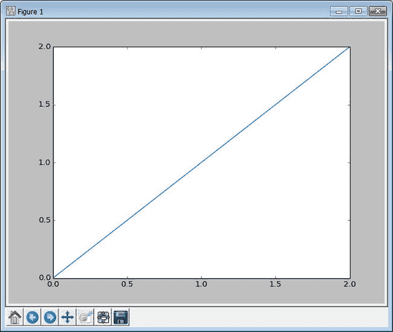

**图 6-1.** 一个交互式图形

函数 `show()` 会打开一个交互式窗口。以下是关于此窗口的几点说明：

- 窗口是有编号的，正如你看到的标签“Figure 1”。如果你有多个窗口，并希望后续的图形覆盖或显示在特定图形上，这一点非常有用。要在图形之间切换，请使用 `figure(n)` 函数，其中 `n` 代表图形索引。如果你想要一个新图形，并且不特别关心图形索引，请执行命令 `figure()`，它会创建一个具有下一个可用索引的空图形。
- x 轴和 y 轴是自动创建的，以适应数据。在很多情况下，`matplotlib` 能出色地自动选择合适的坐标轴（如本例所示）。但是，如果你希望显示不同的数值范围，可以使用 `axis()` 命令来实现；你将在本章后面的“坐标轴”部分了解更多信息。
- 鼠标的位置会显示在图形的右下角。如果你试图放大数据并找到特定的数据点，这非常有用。当你将图形绘制到文件（即非交互模式）时，此功能不可用。
- 在图形的左下角有几个按钮，允许你与图形进行交互。最左边的五个按钮用于缩放和缩放历史记录。从左数第一个按钮（带有房子图标）用于将坐标轴更改回原始绘图坐标轴。左右箭头按钮用于在之前的坐标轴更改之间向后和向前循环。第四个按钮允许你更改坐标轴的原点，从左数第五个按钮启用缩放功能。从左数第六个按钮控制绘图相对于包含窗口的边距。

最后，第七个按钮允许你将图像保存到磁盘。

 **注意** 如果你没有在 Python 中交互式地使用 `matplotlib`，请确保在所有图形生成*之后*再调用函数 `show()`，因为它会进入一个用户界面主循环，从而停止其余代码的执行。这种行为背后的原因是 `matplotlib` 也被设计为嵌入到 GUI 中。如果你在交互式 Python 中工作，请执行命令 `ion()`（代表“interactive on”）；这将自动生成图形，无需调用 `show()`。要恢复此行为，请执行 `ioff()`（代表“interactive off”）。

### 将图形保存到文件

函数 `savefig()` 允许你将不同格式的图像写入文件。开箱即用，`matplotlib` 支持多种文件格式，包括 PDF、PNG 和 PS。生成包含图形的文件的最简单方法是执行 `savefig(filename)`，其中 `filename` 包含与你选择的图像格式关联的扩展名：

```python
>>> figure()
```

```
<matplotlib.figure.Figure object at 0x0000000002CAE160>
```

```python
>>> plot(arange(3))
```

```
[<matplotlib.lines.Line2D object at 0x000000000826FEF0>]
```

```python
>>> savefig('../images/line.png')
>>> from glob import glob
>>> glob('../images/*.png')
```

```
['../images/line.png']
```

我假设你遵循本书的目录结构（见第 2 章），并且可以通过相对路径 `../images` 访问 `images` 目录。我还介绍了 `glob` 模块，它用于执行文件的通配符搜索；你将在第 10 章中了解更多关于 `glob` 的信息。

你应该能够在大多数图像查看器或 Web 浏览器中查看该图形。

 **注意** `Matplotlib` 会在创建对象时返回它们。在前面的示例中，返回的绘图对象由行 `[<matplotlib.lines.Line2D object at 0x000000000826FEF0>]` 表示。接下来，我将省略这些响应，以使交互式代码更易于理解。

我调用了函数 `savefig()`，并将文件扩展名作为包含文件名的字符串的一部分，指示 `savefig()` 创建一个 PNG 文件。类似地，我可以通过执行 `savefig('line.ps')` 来创建一个 PostScript 文件。

字典对象 `FigureCanvasBase.filetypes` 保存了系统中支持的文件类型列表：

```python
>>> from pprint import pprint
>>> pprint(FigureCanvasBase.filetypes)
```

```
{'eps': 'Encapsulated Postscript',
 'jpeg': 'Joint Photographic Experts Group',
 'jpg': 'Joint Photographic Experts Group',
 'pdf': 'Portable Document Format',
 'pgf': 'LaTeX PGF Figure',
 'png': 'Portable Network Graphics',
 'ps': 'Postscript',
 'raw': 'Raw RGBA bitmap',
 'rgba': 'Raw RGBA bitmap',
 'svg': 'Scalable Vector Graphics',
 'svgz': 'Scalable Vector Graphics',
 'tif': 'Tagged Image File Format',
 'tiff': 'Tagged Image File Format'}
```

**在复杂模块中找到你需要的内容**

那么，我是如何发现 `FigureCanvasBase.filetypes` 保存了支持的文件类型的呢？我通读了整个手册吗？几乎没有。我们使用的一些包非常大，掌握控制其行为的变量和对象的所有细节并非易事。所以我使用了一些快速而粗糙的技巧。虽然它们可能不是“正确”的做法，但它们能帮助我完成任务，这才是真正重要的。那么，让我向你展示我是如何找出可用文件类型的。

为了找出基础文件类型，我使用一个虚假的文件格式调用了 `savefig()`：`savefig('a.ext')`。结果当然是一个异常（`ValueError`）；然而，我也收到了一些有用的信息：`"Supported formats: eps, jpeg, jpg, pdf, pgf, png, ps, raw, rgba, svg, svgz, tif, tiff."`

但这不是我想要的；我想要的是文件格式的枚举，这样我就可以对它们进行索引，而不是解析异常返回的字符串。因此，我从异常输出中追溯了错误的来源：错误源自文件 `C:\Python33\lib\site-packages\matplotlib\backend_bases.py` 的第 2070 行。接着，我打开了 `backend_bases.py` 文件，跳转到第 2070 行，并开始阅读代码。Python 是一种非常易读的语言，我没花多长时间就发现这些格式可以通过 `self.get_supported_filetypes()` 获得，它基本上只是返回属性 `filetypes`。由于 `self` 指向容器对象，我向上滚动了一些，发现函数 `get_supported_filetypes()` 是类 `FigureCanvasBase` 的一部分——因此，也就是 `FigureCanvasBase.filetypes`。

阅读 `matplotlib` 生成的异常，以及探索模块及其名称，也帮助我找到了对象 `matplotlib.colors.cnames` 和 `matplotlib.colors.ColorConverter.colors`，两者都列出了可能的颜色（参见本章后面的“颜色”部分）。话虽如此，阅读手册也是一个非常可行的选择。

你可以向 `savefig()` 传递一个图像格式参数来控制生成的输出文件，而不是在文件名字符串中指定它。你还可以控制其他参数，例如每英寸点数（dpi）和图形颜色的面颜色。`savefig()` 的更通用形式是 `savefig(fname[, param1=value1][, param2=value2], ...)`。表 6-1 列出了一些参数。在示例中，假设 `fn` 是一个包含文件名的字符串。

表 6-1. `savefig()` 参数

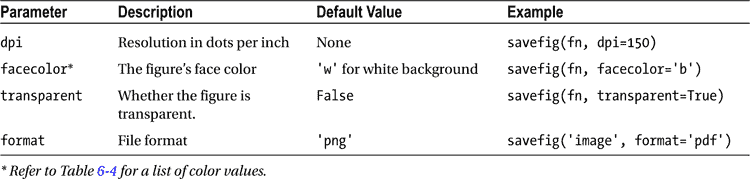

你可以组合多个参数，如下例所示：

```
savefig('file', dpi=150, format='png')
```

函数 `savefig()` 支持其他选项；有关完整说明，请参阅 `help(savefig)`。

 **注意** 并非所有图像格式都支持透明度，尤其是 JPEG。如果你需要透明背景，请选择支持透明度的图像格式，例如 PNG。

### 绘制图形

本节详细介绍绘制图形的基本构建块：`plot()` 函数以及如何控制它以生成我们所需的输出。我们在本书中广泛使用了 `plot()` 命令。现在是时候更仔细地研究它了。

`plot()` 函数高度可定制，可容纳各种选项，包括绘制线条和/或标记、线宽、标记类型和大小、颜色以及用于关联每个绘图的图例。`plot()` 的功能类似于 MATLAB (`http://www.mathworks.com`) 和 GNU-Octave (`http://www.gnu.org/software/octave/`)，但有一些细微差别，这主要是由于 Python 的语法与 MATLAB 和 GNU-Octave 不同。

### 线条和标记

我们将首先使用`NumPy`创建一个要绘制的向量（有关`NumPy`包的完整说明，请参见第 7 章）：

```
>>> figure()
>>> y = array([1, 2, -1, 1])
>>> plot(y)
>>> show()
```

如果你没有安装带有`matplotlib`的 GUI，请将`show()`替换为`savefig('filename')`，然后在图像查看器中打开生成的图像文件。

 **注意** 今后，我将从代码清单中省略`show()`调用。如果你想跟着做，请务必发出`show()`或`savefig()`。

我将向量`y`作为输入传递给`plot()`。结果，`plot()`使用自动递增的整数作为 x 轴绘制了向量`y`的图形。也就是说，如果你不提供 x 轴值，`plot()`会自动为你生成一个：`plot(y)`等价于`plot(range(len(y)), y)`。

因此，让我们提供 x 轴值（由变量`t`表示）：

```
>>> figure()
>>> y = array([1, 2, -1, 1])
>>> t = array([10, 11, 12, 13])
>>> plot(t, y)
>>> show()
```

调用函数`figure()`会生成一个新的图形来绘制，这样我们就不会覆盖之前的图形。

让我们看看更多的选项。接下来，我们想要将`y`绘制为`t`的函数，但只显示标记，不显示线条。这很容易做到：

```
>>> figure()
>>> plot(t, y, 'o')
>>> show()
```

要选择不同的标记，请将字符`'o'`替换为另一个标记符号。表 6-2 列出了一些流行的选择；发出`help(plot)`可提供可用标记的完整说明。

表 6-2. 可用绘图标记示例

| 字符 | 标记符号 |
| --- | --- |
| `'o'` | 圆形 |
| `'^'` | 向上三角形 |
| `'s'` | 正方形 |
| `'+'` | 加号 |
| `'x'` | 叉号（乘法） |
| `'D'` | 菱形 |

正如有不同的标记一样，也有不同的线条样式，表 6-3 列出了其中一些。

表 6-3. 可用绘图线条样式示例

| 字符 | 线条样式 |
| --- | --- |
| `'-'` | 实线 |
| `'--'` | 虚线 |
| `'-.'` | 点划线 |
| `':'` | 点线 |

如果你同时需要标记和线条，请将线条样式和标记的符号连接起来。要绘制点划线线条和菱形符号作为标记，请发出以下命令：

```
>>> plot(t, y, 'D-.')
>>> show()
```

图 6-2 显示了本节示例的输出。

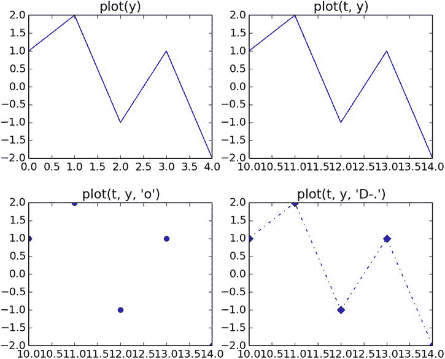

图 6-2. 前面示例的输出：无 x 值的线图（左上）、有 x 值的线图（右上）、标记图（左下）以及标记和线图（右下）

### 在一个图形上绘制多个图形

我们使用图形来可视化数据并进行比较。还有什么比在一个图中显示多个图形更自然的呢，这样我们就可以比较结果？在`matplotlib`中有两种方法可以做到这一点。第一种方法是在`plot()`函数中添加更多向量：

```
>>> plot(t, y, t, 2*y)
```

你也可以这样做：

```
>>> plot(t, y, '+', t, 2*y, 's-')
```

第二种方法是重复调用`plot()`。有时你可能只有部分数据要绘制。假设你有向量`y`，但随后你修改了它，并希望同时打印原始向量和新修改的向量。你该怎么办？一种选择是存储中间值，但如果你有 20 个这样的值呢？那将意味着用 20 多个参数调用`plot()`。

当你对已存在的图形调用`plot()`时，有两种可能的结果。一种是图形被擦除，并绘制新图。另一种是图形不被擦除，新图被添加到图形中。此行为由图形的保持状态决定。你可以使用`hold()`函数控制保持状态：调用`hold(True)`将确保新图不会擦除图形，而`hold(False)`则相反。不带参数发出`hold()`命令将切换保持状态。作为一般规则，最好指定你需要的保持行为，而不是依赖默认行为；即`hold(True)`或`hold(False)`。

### 线宽和标记大小

接下来，我们将研究控制线宽和标记大小。我们通过向`plot()`传递`linewidth`（或简写为`lw`）和`markersize`（或简写为`ms`）参数来实现，如清单 6-1 所示。两个参数都接受浮点值；默认值为 1。

***清单 6-1***.

#### 在同一张图中绘制多条不同线型和标记的曲线

```
I = arange(6)
plot(I, sin(I), 'o', I, cos(I), '-', lw=3, ms=8)
title("plot(I, sin(I), 'o', I, cos(I), '-', lw=3, ms=8)")
show()
```

图 6-3 展示了该示例的结果。

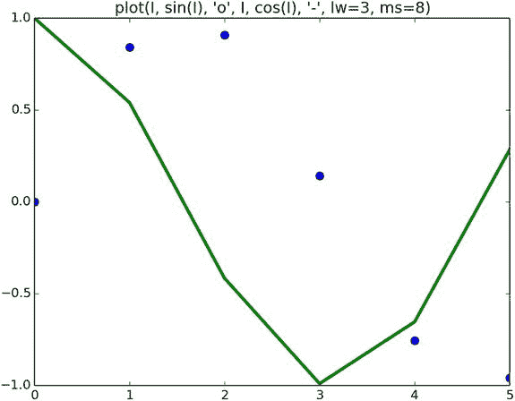

图 6-3. 在同一张图中绘制多条曲线

当你在一个 `plot()` 函数调用中绘制多条线时，参数 `linewidth` 和 `markersize` 会控制同一个 `plot()` 命令中的*所有*线条。如果你希望在同一张图中使用不同的线型或不同的标记大小，可以分别调用 `plot()` 函数绘制每条线，并使用 `hold()` 函数，如代码清单 6-2 所示。

***代码清单 6-2***. 同一张图中的不同线宽

```
figure(); hold(True)
I = arange(6)
plot(I, sin(I), lw=4)
plot(I, cos(I), lw=2)
show()
```

### 颜色

绘图基础列表中的最后一项是控制颜色。与标记样式和线型一样，你可以根据表 6-4 中的列表，使用一个字符来控制颜色。

表 6-4. 颜色字符查找表

| 字符 | 颜色 |
| --- | --- |
| `'b'` | 蓝色 |
| `'c'` | 青色 |
| `'g'` | 绿色 |
| `'k'` | 黑色 |
| `'m'` | 品红色 |
| `'r'` | 红色 |
| `'w'` | 白色 |
| `'y'` | 黄色 |

你可能已经注意到，如果未指定颜色，`matplotlib` 会自动为后续的线条图选择不同的颜色。你可以通过提供颜色字符来选择偏好的颜色：

```
>>> figure()
>>> I = arange(6)
>>> plot(I, sin(I), 'k+-', I, cos(I), 'm:')
>>> show()
```

这将绘制两条线：第一条是带有加号标记和实线的黑色线条，第二条是品红色的虚线。

如果你想要表 6-4 中没有的颜色，可以从字典对象 `matplotlib.colors.cnames` 中选择。该字典提供了更丰富的颜色选择，包含一百多种颜色值。最后，如果该字典仍不够用，你可以提供显式的红绿蓝（RGB）值。如果你使用字典值或显式的 RGB 值，则必须将 `color` 参数作为参数传递给 `plot()` 调用：

```
>>> plot(randn(5), 'y', lw=5) # 来自颜色表的 'y'
>>> plot(randn(5), color='yellowgreen', lw=5) # 使用 matplotlib.colors.cname
>>> plot(randn(5), color='#ffff00', lw=5) # 显式的黄色 RGB
```

有关颜色的更多信息，请参阅 `help(matplotlib.colors)`。

在前面的示例中，我使用了函数 `randn(n)` 来生成一个大小为 5 的随机向量。

## 控制图形

为了使图形美观地传达思想，数据虽然非常重要，但并非全部。网格和网格线，结合适当的坐标轴和标签选择，提供了额外的信息层，增加了清晰度，并有助于图形的整体呈现。

现在我们已经掌握了绘制线条和标记的基础知识，接下来让我们通过控制 x 轴和 y 轴的行为以及设置网格线来控制图形。

### 坐标轴

`axis()` 函数控制 x 轴和 y 轴范围的行为。如果你不向 `axis()` 提供参数，返回值将是一个形式为 `(xmin, xmax, ymin, ymax)` 的元组。你可以通过指定新值来使用 `axis()` 设置新的坐标轴范围：`axis([xmin, xmax, ymin, ymax])`。如果你只想设置或获取 x 轴值或 y 轴值，可以分别使用函数 `xlim(xmin, xmax)` 或 `ylim(ymin, ymax)`。

除了范围限制外，`axis()` 函数还接受以下值：`'auto'`、`'equal'`、`'tight'`、`'scaled'` 和 `'off'`。

值 `'auto'`（默认行为）允许 `plot()` 选择它认为的最佳值。值 `'equal'` 强制每个 x 值与每个 y 值具有相同的*长度*，这在试图传达物理距离（例如 GPS 绘图）时非常重要。值 `'tight'` 会导致坐标轴发生变化，使得 x 和 y 的最大值和最小值都触及图形的边缘。值 `'scaled'` 会改变 x 轴和 y 轴的范围，使得 x 和 y 具有相同的长度（即宽高比为 1）。最后，调用 `axis('off')` 会移除坐标轴和标签。

为了说明这些坐标轴行为，我将绘制一个圆（参见代码清单 6-3）。

***代码清单 6-3***. 绘制一个圆

```
R = 1.2
I = arange(0, 2*pi, 0.01)
plot(sin(I)*R, cos(I)*R)
show()
```

我选择半径为 1.2 的圆的原因是，对于“更规整”的半径数值（例如 1.0 或 2.0），自动坐标轴解决方案效果非常好，很难展示不同坐标轴选项的效果。

图 6-4 展示了对该圆应用不同坐标轴值的结果。

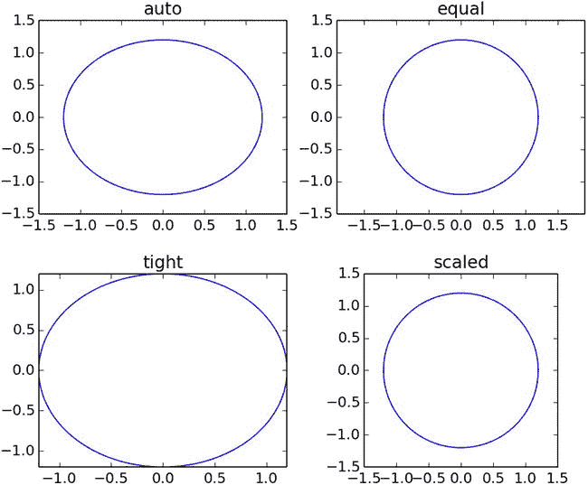

图 6-4. 控制坐标轴行为

### 网格和刻度

函数 `grid()` 在当前图形中绘制网格。网格由一组与 x 刻度和 y 刻度重合的水平虚线和垂直虚线组成。你可以通过调用 `grid()` 来切换网格，或者分别使用 `grid(True)` 或 `grid(False)` 将其设置为可见或隐藏。

要控制刻度（并同时有效地更改网格线），请使用函数 `xticks()` 和 `yticks()`（参见代码清单 6-4 和图 6-5）。这些函数的行为与 `axis()` 类似：如果不传递参数，它们会返回当前刻度；你也可以在提供参数后使用这些函数来设置刻度。这些函数接受一个包含刻度数值的数组，以及一个可选的包含文本标签的元组。如果未提供标签元组，则使用刻度数值作为标签。

***代码清单 6-4***. 网格和刻度示例

```
R = 1.2
I = arange(0, 4*pi, 0.01)
plot(sin(I)*R, cos(0.5*I)*R)
axhline(color='gray')
axvline(color='gray')
grid()
xticks([-1, 0, 1], ('Negative', 'Neutral', 'Positive'))
yticks(arange(-1.5, 2.0, 1))
show()
```

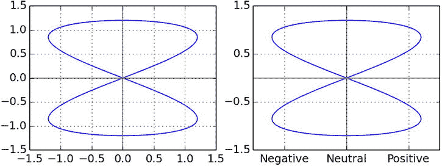

图 6-5. 控制网格和坐标轴：左侧图形显示默认的 `xticks()`，而右侧图形显示标签

图 6-5 展示了代码清单 6-4 生成的输出：未执行最后两次 `xticks()` 和 `yticks()` 调用（左侧图形）以及执行了 `xticks()` 和 `yticks()` 调用（右侧图形）。请注意 x 轴上的标签。

我还使用了函数 `axvline()` 和 `axhline()`，它们分别绘制一条穿过 x 轴和 y 轴的线。`axhline()` 和 `axvline()` 函数接受许多参数，包括 `color`、`linewidth` 和 `linestyle` 等。

### 子图

在本章前面的一些图中，我在一张图中显示了几个较小的图形；这些被称为子图。`subplot()` 函数将图形分割成子图，并选择当前子图。子图从左到右、从上到下编号，因此左上角的子图是 1，右下角的子图等于子图的数量。请注意，这与 Python 中使用的默认计数方式不同：编号从 1 开始，而不是从 0 开始。

要将图形分割成 2×2 的子图并选择左上角的子图进行绘制，请执行 `subplot(2, 2, 1)`。

或者，你可以传入字符串 `'221'`，其效果相同：`subplot('221')`。还可以在一个图形中组合不同大小的子图。这有点复杂，需要使用不同尺寸的子图进行绘制。清单 6-5 展示了一个示例，该示例在图形的上半部分生成一个子图，在下半部分生成两个子图，其结果见图 6-6。

**清单 6-5**。不同尺寸的子图

```python
figure()
subplot(2, 1, 1)
title('上半部分')
subplot(2, 2, 3)
title('下半部分，左侧')
subplot(2, 2, 4)
title('下半部分，右侧')
show()
```

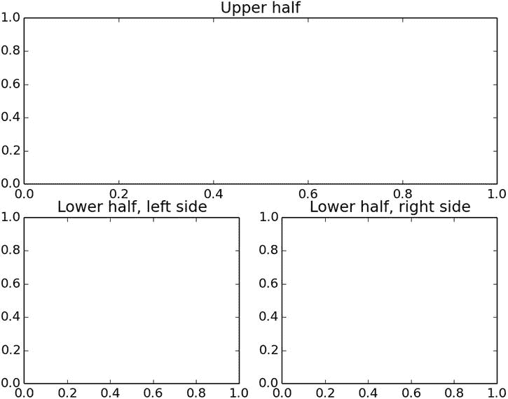

图 6-6。不同尺寸的子图

 **提示** 子图在可视化同一数据的多个方面时特别有用。例如，第 1 章 GPS 示例中的图 1-5 在一个子图中显示 x 和 y 坐标，在另一个子图中显示速度。事件（例如超速）在两个子图中都被标记出来，从而在两个子图之间建立了视觉联系。

### 擦除图形

函数 `cla()` 和 `clf()` 分别用于清除坐标轴和图形。当你在交互式环境中工作，并希望清除当前坐标轴（即将坐标轴设置为默认值并清除绘制的线条）时，这些函数非常有用。也可以使用 `clf()` 函数完全清除图形，同时擦除坐标轴和子图。

最后，你可以选择完全关闭图形窗口；这可以通过调用函数 `close()` 来实现。如果你向 `close()` 提供一个数字，则会关闭与该数字关联的图形。因此，`close(1)` 将关闭图 1，而保持其他图形打开。如果你想关闭所有图形，请执行 `close('all')`。

## 添加文本

有几种选项可以用文本注释你的图形。你已经看到了一些，例如使用 `xticks()` 和 `yticks()` 函数。以下函数将让你对图形中的文本有更多控制。

### 标题

函数 `title(str)` 将 `str` 设置为图形的标题，并显示在绘图区域上方。该函数接受表 6-5 中列出的参数。

表 6-5。文本参数

| 参数 | 描述 | 值 |
| --- | --- | --- |
| `fontsize` | 控制字体大小 | `'large'`、`'medium'`、`'small'` 或实际大小（例如 `50`） |
| `verticalalignment` 或 `va` | 控制垂直对齐方式 | `'top'`、`'baseline'`、`'bottom'`、`'center'` |
| `horizontalalignment` 或 `ha` | 控制水平对齐方式 | `'center'`、`'left'`、`'right'` |

所有对齐方式都基于默认位置，即图形上方居中。因此，设置 `ha='left'` 将从中间（水平方向）开始打印标题，并向右侧延伸。类似地，设置 `ha='right'` 将使标题在图形中间（水平方向）结束。垂直对齐方式同理。以下是使用 `title()` 函数的示例：

```python
>>> title('左对齐，大标题', fontsize=24, va='baseline')
```

### 轴标签和图例

函数 `xlabel()` 和 `ylabel()` 与 `title()` 类似，只是它们分别用于设置 x 轴和 y 轴的标签。这两个函数都接受表 6-5 中的文本参数：

```python
>>> xlabel('时间 [秒]')
```

接下来要介绍的文本函数是 `legend()`。`legend()` 函数添加一个图例框，并将绘图与文本关联起来：

```python
>>> I = arange(0, 2*pi, 0.1)
>>> plot(I, sin(I), '+-', I, cos(I), 'o-')
>>> legend(['sin(I)', 'cos(I)'])
>>> show()
```

图例的顺序将文本与绘图关联起来。如果我使用反转的列表调用 `legend()`，结果将是错误的图例。

另一种方法是在调用 `plot()` 函数时指定 `label` 参数，然后不带参数调用 `legend()`：

```python
>>> I = arange(0, 2*pi, 0.1)
>>> plot(I, sin(I), '+-', label='sin(I)')
>>> plot(I, cos(I), 'o-', label='cos(I)')
>>> legend()
>>> show()
```

图 6-7 展示了添加 x 轴标签和图例的效果。

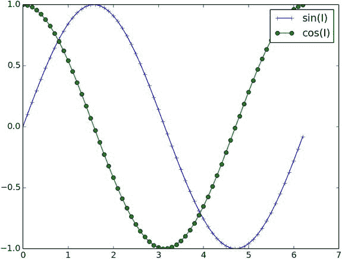

图 6-7。添加 x 轴标签和图例

你还可以通过 `loc` 参数控制图例框的位置。如果你不希望图例文本遮挡图形线条，这一点很重要。`loc` 可以取以下值之一：`'best'`、`'upper right'`、`'upper left'`、`'lower left'`、`'lower right'`、`'right'`、`'center left'`、`'center right'`、`'lower center'`、`'upper center'` 和 `'center'`。除了使用字符串，你还可以使用数字：`'best'` 对应 `0`，`'upper left'` 对应 `1`，`'center'` 对应 `10`。使用值 `'best'` 会将图例移动到不太可能隐藏数据的位置；但是，在性能方面可能会有一些影响。

函数 `legend()` 还有其他选项，例如可以添加投影阴影、控制图例内文本之间的间距等。更多信息请查阅交互式帮助。

### 文本渲染

函数 `text(x, y, str)` 接受图形单位中的坐标 `x`、`y` 和要打印的字符串 `str`。它还会在图形上渲染该字符串。你可以使用表 6-5 中的参数修改文本对齐方式。以下代码将在位置 (0, 0) 处打印文本：

```python
>>> figure()
>>> plot([-1, 1], [-1, 1])
>>> text(0, 0, '原点', va='center', ha='center')
>>> show()
```

函数 `text()` 还有许多其他参数，例如 `rotation`（已在第 1 章中使用）和 `fontsize`。有关参数的完整列表，请参阅 `help(text)`。

### 数学符号和表达式

我们列表中的最后一个文本相关函数是用于渲染数学符号和表达式的。使用 *matplotlib* 提供的数学符号的语法类似于 TEX。要渲染数学表达式，请使用原始字符串，并用 `$` 符号将数学表达式括起来。对于希腊字母，以斜杠开头，后跟字母名称。因此，要打印 Alpha (α)，你的字符串应为 `r'$\alpha$'`。分数可以使用 `\frac{分子}{分母}` 表示法创建；例如，`r'$\frac{\pi}{4}$'` 表示符号 π 除以四。下标用下划线表示，因此要渲染文本 a[i]，请写为 `r'$a_i$'`。

本书无法涵盖 *matplotlib* 支持的全部 TEX 语法。有关更多信息，请参考 *matplotlib* 在线网站（在本书编写时，以下链接可用：`http://matplotlib.sourceforge.net/users/mathtext.html`）。也就是说，当你在本书中遇到数学表达式时，你很可能能够通过本节介绍的少量命令来理解其工作原理。

### 示例：汇总图

清单 6-6 中的示例脚本总结了到目前为止我们讨论过的函数：用于绘图的 `plot()`；用于文本注释的 `title()`、`xlabel()`、`ylabel()` 和 `text()`；以及用于网格控制的 `xticks()`、`ylim()` 和 `grid()`。

**清单 6-6**。绘图汇总示例

```python
I = arange(0, 2*pi+0.1, 0.1)
plot(I, sin(I), label='sin(I)')
title('Function f(x)=sin(x)')
xlabel('x [rad]', va='bottom')
ylabel('sin(x)')
text(pi/2, 1, 'Max value', ha='center', va='bottom')
text(3*pi/2, -1, 'Min value', ha='center', va='top')
xticks(linspace(pi/2, 2*pi, 4), (r'$\frac{\pi}{2}$', r'$\pi$', r'$\frac{3\pi}{2}$', r'$2 \pi$'), fontsize=20)
xlim([0, 2*pi])
ylim([-1.2, 1.2])
grid()
show()
```

此示例的结果显示在图 6-8 中。

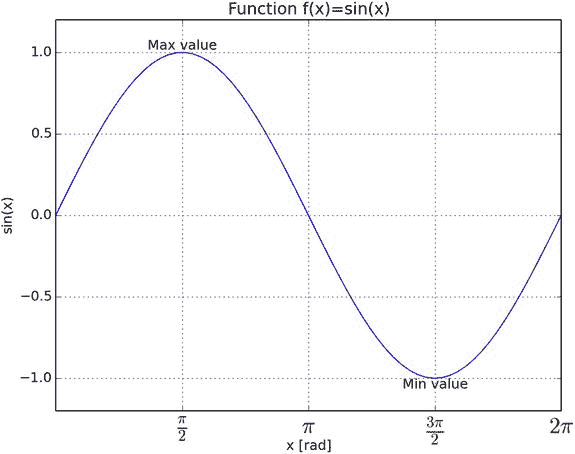

图 6-8。绘图汇总示例

## 更多图形类型

虽然常规的折线图和标记图是出色的可视化工具，但它们并非唯一的工具。本节将快速概述其他一些二维图形选项。

### 条形图

条形图是许多人的最爱，它允许对多个数值进行定量比较。要使用条形图，请调用函数 `bar(left, height)`，其中 `left` 是条形的 x 坐标，`height` 是条形的高度。函数 `bar()` 允许进行大量自定义；输入 `help(bar)` 将提供大部分详细信息。

#### 示例：GDP，排名前 N 的国家

对于这个绘制各国购买力平价（GDP）的示例，你需要 CIA 的 GDP 排名文件，该文件可从 CIA 世界概况（`https://www.cia.gov/library/publications/the-world-factbook/rankorder/rawdata_2001.txt`）获取；这是一个制表符分隔的文件，非常适合轻松进行数据处理。我假设你已经下载了该文件并将其保存在文件夹 `Ch6/data` 中；源代码位于 `Ch6/src`，输出文件位于 `Ch6/images`。

首先，我们将定义一个函数来读取数据（我们将在本章的几个示例中使用它）。代码清单 6-7 中的代码应保存为文件 `src/read_world_data.py`。

**代码清单 6-7**。函数 `read_world_data.py`

```python
import csv, re

def read_world_data(N=10, fn='../data/rawdata_2001.txt'):
    """一个用于读取 CIA 世界概况文件的函数。N 是要处理的国家数量。"""

    # 初始化返回列表
    gdp, labels= [], []

    # 读取并处理数据
    for i, row in enumerate(csv.reader(open(fn), delimiter='\t')):
        # 移除美元符号、逗号和空格字符
        gdp_value = re.sub(r'[\$, ]', '', row[2])

        # 以十亿美元为单位存储数据
        gdp.append(float(gdp_value)/1e9)
        labels.append(row[1].strip())

        # 处理完 N 个国家后停止分析数据
        if i == N-1:
            break
    return (gdp, labels)
```

该函数读取前 N 个国家的数据，并返回它们的 GDP 以及国家名称。我使用了两个模块。第一个是 `csv` 模块，用于读取制表符分隔的数据。第二个是 `re` 模块，用于去除 GDP 值字段中的美元符号、逗号和空格字符。

有了 `read_world_data()` 函数，我们开始绘制条形图（参见代码清单 6-8）。

**代码清单 6-8**。绘制 GDP 条形图

```python
##### 一个绘制 GDP 条形图的脚本
from pylab import *
from read_world_data import read_world_data

##### 初始化变量，N 是国家数量
N = 5

gdp, labels = read_world_data(N)

##### 绘制条形图
bar(arange(N), gdp, align='center')

##### 添加文本注释
xticks(arange(N), labels, rotation=-10)
for i, val in enumerate(gdp):
    text(i, val/2, str(val), va='center', ha='center', color='yellow')
ylabel('$ (十亿)')
title('GDP 排名，数据来自 CIA 世界概况')
show()
```

这个脚本现在应该很容易读懂。请注意，我从一个单独的文件 `read_world_data.py` 中导入了函数 `read_world_data()`，该函数已在代码清单 6-7 中定义。

我还选择在调用 `xticks()` 时将水平轴上的文本标签旋转了 10 度。这种旋转确保了 `'United States'` 和 `'European Union'` 的标签不会重叠。

图 6-9 展示了我们目前的条形图。

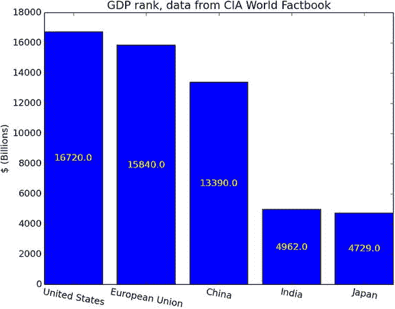

图 6-9。显示世界 GDP 排名的条形图

也可以添加误差线。要添加相当于 ±10000 亿美元的误差线（误差够大吧？），请在代码清单 6-8 所示的脚本中，在 `bar()` 函数调用之后添加以下代码行：

```python
errorbar(arange(N), gdp, 1000*ones(N), color='k')
```

最后，如果你需要水平条形图而不是垂直条形图，可以使用函数 `barh()` 来绘制（但在这种情况下，请记得交换 x 轴和 y 轴的标签及刻度）。

### 直方图

直方图是显示数值频率或出现次数的图表。在 *matplotlib* 中，函数 `hist()` 用于计算和绘制直方图。至少，你必须提供一个数值数组。你可以通过如下方式指定直方图的单元格数量：`hist(values, numcells)`。或者，你也可以指定直方图的区间：`hist(values, bins)`，其中 `bins` 是一个包含直方图区间值的列表。`hist()` 的返回值是一个包含概率、区间和补丁（patches）的元组。补丁用于创建条形；我将在本章后面的“补丁”部分详细介绍。

函数 `hist()` 还有其他自定义选项，包括直方图的方向（垂直或水平）、条形的对齐方式等。同样，请参考交互式帮助：`help(hist)`。

#### 示例：GDP 直方图

我们再次使用 CIA 世界概况中的 GDP 排名；这次我们想绘制 N 个最大经济体的直方图。同样，我们使用前一个示例中实现的 `read_world_data()` 函数（参见代码清单 6-9）。

**代码清单 6-9**。绘制 GDP 直方图

```python
##### 一个绘制 GDP 直方图的脚本
from pylab import *
from read_world_data import read_world_data

##### 初始化变量；N 是国家数量，B 是区间大小
N, B = 20, 1000

gdp, labels = read_world_data(N)

##### 绘制直方图
prob, bins, patches = hist(gdp, arange(0, max(gdp)+B,B), align='left')

##### 添加文本注释
for i, p in enumerate(prob):
    percent = '%d%%' % (p/N*100)
    # 仅注释非零值
    if percent != '0%':
        text(bins[i], p, percent,
            rotation=45, va='bottom', ha='center')
ylabel('国家数量')
xlabel('收入，十亿美元')
title('GDP 直方图，%d 个最大经济体' % N)
show()
```

# 一些坐标轴操作

```
xlim(-B/2, bins[-1]-B/2)
show()
```

图 6-10 显示了生成的图形。

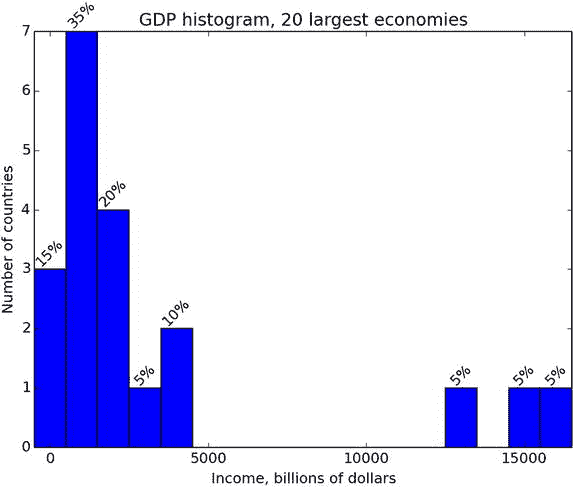

图 6-10. N 个最大经济体的 GDP 直方图

同样，这个脚本应该很容易读懂。我想请你注意一下，我通过调用函数 `xlim()` 对 x 轴进行的一个看似奇怪的修改。这样做的目的是修改 x 轴范围的默认行为。进行此修改的原因是，由于我为直方图区间选择了 `'center'` 对齐方式，自动的 x 轴范围包含了负值。这是因为最左边的区间以零为中心，但它有一定的宽度，其中一部分位于负 x 轴上。我不喜欢这种行为，因此选择通过手动设置坐标轴来覆盖它。我没有设置一个固定的数值，而是通过从坐标轴中减去半个区间宽度 `B/2` 来修改 x 轴。

### 作为一般规则，当你像这样修改默认行为时，请尽量使用参数（在前面的示例中，你应该使用参数 `B`，而不是数值 `1000`，并通过 `xlim()` 获取当前值）；这将使脚本更灵活，能够适应更广泛的输入值。

## 饼图

饼图的使用与条形图一样简单。实现饼图的函数是 `pie(x)`，其中 `x` 包含要绘制的值。

### 示例：GDP 饼图

清单 6-10 展示了一个生成饼图的脚本，结果如图 6-11 所示；同样，此示例使用了函数 `read_world_data()`。

***清单 6-10***。绘制 GDP 饼图

```
##### a script to plot GDP pie chart
from pylab import *
from read_world_data import read_world_data

##### initialize variables, N is the number of countries
N = 10

gdp, tags = read_world_data(N)
```

##### plot the bar chart
`pie(gdp, labels=tags)`
`axis('equal')`
`title('GDP rank, data from CIA World Factbook')`
`show()`

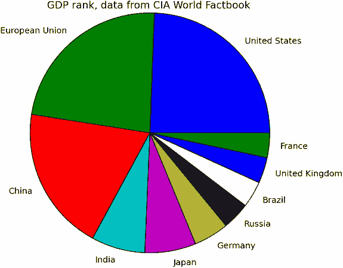

图 6-11。GDP 饼图，显示 N 个最大经济体

我决定使用变量`tags`而不是`labels`，这样对`pie()`的调用就不会那么令人困惑。如果我坚持使用原始名称`labels`，那么对`pie()`的调用将是`pie(gdp, labels=labels)`。这仍然可以工作，但在我看来，会显得有些混乱。

### 对数图

函数`semilogx()`和`semilogy()`分别用于以对数刻度绘制 x 轴和 y 轴。`semilogy()`类型的对数图在绘制功率或强度值时很常见，例如测量地震能量的里氏震级标度。同样，例如，与频率一起使用的量的测量值通常绘制在对数 x 刻度上，表示倍频程和十倍频程。还可以选择使用`loglog()`图，这意味着 x 轴和 y 轴都是对数的。这在工程领域常见的伯德图中就是这种情况。

所有这三个函数`semilogx()`、`semilogy()`和`loglog()`都可以使用与`plot()`函数类似的参数进行修改。

函数`logspace(start, stop, numpoints=50, endpoint=True, base=10.0)`可用于创建要与上述函数一起绘制的值范围。`start`和`stop`值是指数值。函数`logspace()`在`10^(start)`和`10^(stop)`之间生成对数间隔的值。你可以通过指定`endpoint = True`来决定是否返回结束值`10^(stop)`。如果你想要 10 以外的底数，请将`base`设置为你需要的值：

```python
>>> figure()
>>> I = 2*logspace(1, 5, 5)
>>> I
```

```
array([  2.00000000e+01,   2.00000000e+02,   2.00000000e+03,
         2.00000000e+04,   2.00000000e+05])
```

```python
>>> semilogx(I, [20, 19, 8, 2, 2], '+-', lw=2)
>>> title('Logarithmic plot, semilogx()')
>>> xlabel('Frequency [Hz]')
>>> ylabel('Amplitude [dB]')
>>> grid()
>>> show()
```

图 6-12 显示了前面示例的结果。

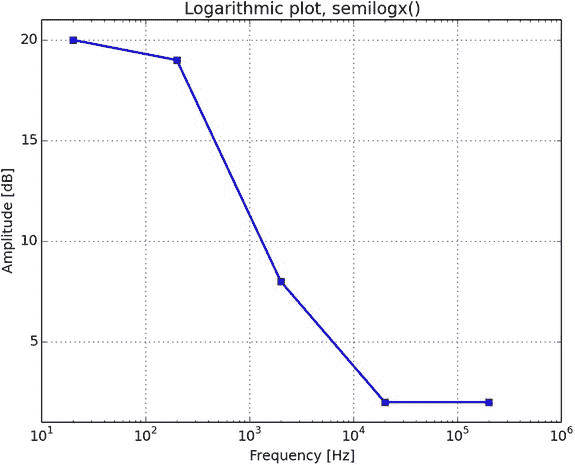

图 6-12。一个对数图

请注意，当使用`semilogx()`、`semilogy()`和`loglog()`绘图时，标签是原始值，而不是值的对数。如果你想打印对数值，你可能应该使用常规的`plot()`函数，并传入值的`log()`或`log10()`。例如，这在估算以分贝 (dB) 为单位的能量时很有用：

```python
>>> def db(x):
...     """Returns the value of x, in decibels."""
...     return 20*log10(abs(x))
...
>>> plot(db(array([1000, 980, 970, 400, 30, 2, 1, 1])))
>>> title('Logarithmic plot, dB)')
>>> xlabel('Frequency [Hz]')
>>> ylabel('Amplitude [dB]')
>>> xticks(arange(8), 10**arange(8))
>>> grid()
>>> show()
```

### 极坐标图

极坐标图绘制极坐标值：给定角度处的半径。极坐标图通常用于绘制天线辐射方向图，因为它们描绘了天线在任何给定角度发射的能量。极坐标图使用`polar(theta, r)`函数实现。

要沿半径设置标签，请使用`rgrids(radii, labels)`函数，其工作方式类似于`xticks()`和`yticks()`。如果你不提供`labels`值，则使用`radii`值作为标签。你还可以设置绘制标签的`angle`（默认值为 22.5 度）。类似地，函数`thetagrids()`绘制角度刻度和标签，如清单 6-11 所示。

***清单 6-11***。一个极坐标图

```python
theta = arange(0, 2*pi, 0.01)
polar(theta, cos(theta), theta, -cos(theta))
rgrids([0.5, 1.0], ['Half', 'Full'])
theta_labels = ['0', r'$\frac{\pi}{2}$', r'$\pi$', r'$\frac{3\pi}{2}$']
thetagrids(arange(0, 360, 90), theta_labels, fontsize=20)
title(r'A polar plot of $\pm cos(\theta)$', va='bottom')
show()
```

图 6-13 显示了生成的极坐标图。

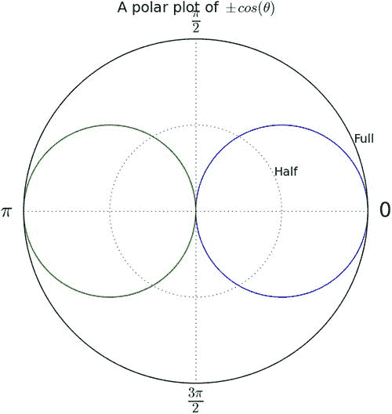

图 6-13。一个极坐标图

在标题中，我使用了由`'$\pm$'`表示的 ± 符号。

### 茎叶图

茎叶图为每个`(x, y)`值绘制一条从`(x, 0)`到`(x, y)`的垂直线，并在`(x, y)`处绘制一个标记。茎叶图用于表示离散数据，在绘制滤波窗口时很流行（参见清单 6-12）。

***清单 6-12***。滤波窗口的茎叶图

```python
from pylab import *
N = [4, 8, 16, 64]
for i, n in enumerate(N):
    subplot(2, 2, i+1)
    stem(arange(n), hamming(n))
    xticks(arange(0, n+1, n/4))
    yticks([0, 0.5, 1])
    xlim(-0.5, n+0.5)
    title('N=%d' % n)
show()
```

图 6-14 显示了此清单的结果。

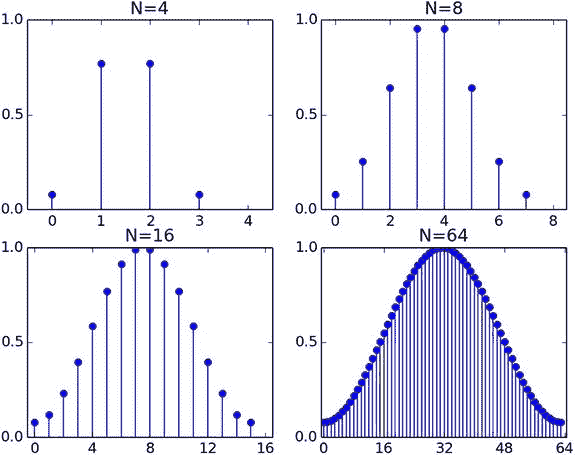

图 6-14。不同 N 值的汉明窗的茎叶图

在前面的示例中，我使用了`hamming()`函数来创建一个汉明窗，该窗口常用于滤波值。

### 其他图形

`Matplotlib`还支持大量用于描绘更复杂数据的图形。以下是可用的一些图形的简短列表：

*   函数`contour()`和`contourf()`用于等高线图。等高线图绘制连接相等`(x, y)`值对的线。它们用于天气图，详细描述等压线或等温线。在地形图中，它们详细描述地形；等等。
*   函数`specgram()`显示数据随时间变化的频率内容。例如，`specgram()`可用于绘制声波频率随时间变化的函数。
*   `contour()`和`specgram()`函数都依赖于颜色映射来描绘数据。颜色映射是值与颜色之间的关系。`Matplotlib`提供了一组颜色映射，包括诸如`autumn()`和`hot()`之类的名称，以方便选择颜色映射。
*   函数`quiver()`实现箭头图，通常用于描述物理学中的场。箭头图是一组箭头，描绘每个点的力（方向和大小）。

#### 示例：绘制信号的频率内容

有时，绘制信号随时间变化的频率成分是有价值的。

例如，在音频信号中，不同的频率代表不同的音符，因此将频率绘制为时间的函数是一种可能的“音乐可视化”。在本示例中，如清单 6-13 所示，我们创建了一个由多个离散频率组成的信号，并使用`specgram()`将这些频率显示为时间的函数。

***清单 6-13***. 信号的频谱图

```python
from pylab import *

Fs = 256
times = [3, 7, 5]
frequencies = [100, 20, 80]

y = array([])
for t, f in zip(times, frequencies):
    x = cos(2*pi*arange(t*Fs)/Fs*f)
    y = append(y, x)

specgram(y, 256, Fs)
xlabel('Time [sec]')
ylabel('Frequency [Hz]')
axis([0, 14.5, 0, 128])
show()
```

我将采样频率设置为每秒 256 个样本，并创建了一个由 100 赫兹（持续 3 秒）、20 赫兹（持续 7 秒）和 80 赫兹（持续 5 秒）组成的信号。然后使用`specgram()`绘制信号，结果如图 6-15 所示。

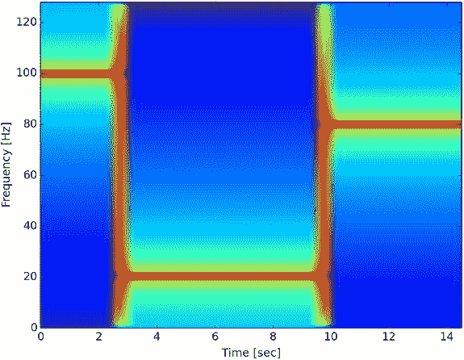

图 6-15. 频谱图

图 6-15 清晰地显示，在前 2 秒内，频率为 100 赫兹；接下来的 8 秒内，频率为 20 赫兹；最后 5 秒内，信号频率为 80 赫兹。

 **注意** 如果仔细观察该图，您会注意到频谱图中存在半秒的偏移。这是由于使用了大小为 128 个样本的重叠窗口。有关重叠窗口的信息，请参阅`help(specgram)`。

您可以使用颜色映射函数更改用于显示频谱图的颜色。只需在脚本末尾调用`hot()`或`autumn()`，然后观察结果。有关可用颜色映射的完整说明，请参阅`help(colormaps)`。

### 示例：斥力场

以下示例说明了如何使用`quiver()`描绘力场。在图形中的每个点，箭头指向作用力的方向及其大小，大小由箭头的尺寸表示：

```python
from pylab import *

x = arange(-5, 6, 1)
y = arange(-5, 6, 1)

u, v = meshgrid(x, y)
quiver(u, v)

xticks(range(len(x)), x)
yticks(range(len(y)), y)

axis([-1, 11, -1, 11])
axis('scaled')
title('A repelling force field!')
show()
```

我使用了函数`meshgrid(x, y)`，该函数生成两个矩阵：第一个是`x`值的重复矩阵，第二个是`y`值的重复矩阵。输出用于绘制箭袋图，如图 6-16 所示。然后我更新了坐标轴以反映正确的范围。

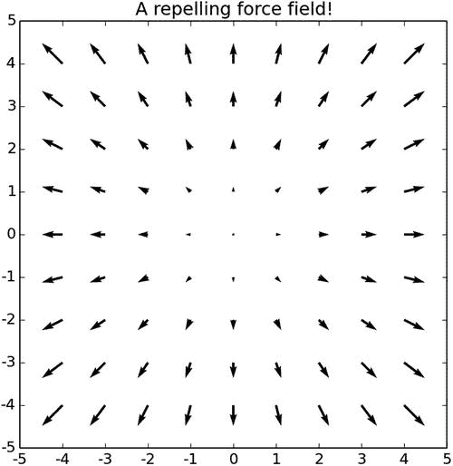

图 6-16. 描绘力场的箭袋图

### 示例：等高线图

等高线图（也称为等高线地图）是由等高线组成的图形。每条等高线连接等值的点。等高线图的示例包括描述山谷和丘陵的地形图，以及显示等压线（等压线）的气象图。

要生成等高线图，您需要一个对应于函数`z = f(x, y)`的矩阵，其中`x`和`y`是自变量（例如，地形图上的纬度和经度），`z`是函数值（例如，地形图上的高度）。

在以下示例中，我通过调用`x = arange(-5, 5, 0.1)`生成从 -5 到 5 的`x`值。我对`y`值也做了同样的操作。然而，函数`z = f(x, y)`需要一个矩阵，而`x`和`y`是向量。因此，下一步涉及从`x`和`y`创建一个网格。这是通过调用`u, v = meshgrid(x, y)`完成的；`u`对应于`x`值，而`v`对应于`y`值。使用网格的好处是，现在我可以像通常的数学表达式一样编写函数。

例如，单位球面的方程是`x² + y² + z² = 1`，上半单位球面是`z = sqrt(1 - x² - y²)`。这在 Python 中转换为`z = sqrt(1 - u**2 - v**2)`，但您需要处理负值的平方根（请参阅本章后面的“示例：非矩形等高线图”部分）。在等高线示例中，我选择了一个有趣的函数：`z = 2*u**2 + v**2 - u*v + 10*u`。清单 6-14 显示了代码和生成的等高线图。

***清单 6-14***. 等高线图

```python
from pylab import *

x = arange(-5, 5, 0.1)
y = arange(-5, 5, 0.1)
u, v = meshgrid(x, y)

z = 2*u**2 + v**2 - u*v + 10*u
contour(x, y, z, 10)
title('A contour map')
show()
```

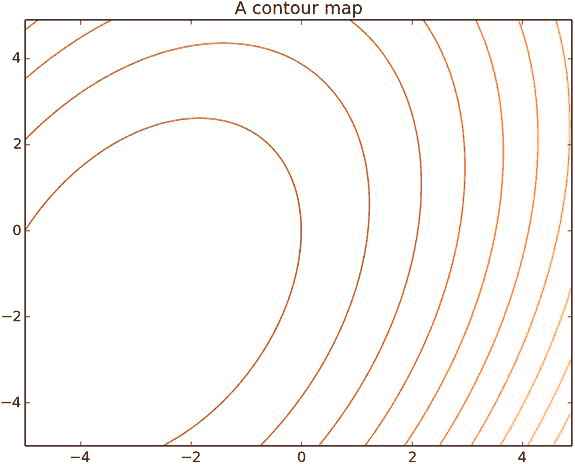

图 6-17. 函数`z = 2x² + y² - xy + 10x`的等高线图

### 示例：非矩形等高线图

如果前面示例中的网格数据不是矩形怎么办？假设它是梯形或圆形。在这种情况下，您如何生成等高线图？技巧是生成一个包围的矩形网格，并将感兴趣区域之外的值设置为`None`。

清单 6-15 中的代码使用函数`contourf()`生成了一个填充等高线图。该清单显示了球体等高线的矩形网格和非矩形网格。`z² = 1 - x² - y²`的负值位于球体外部，它们要么被设置为零，要么不被绘制。

***清单 6-15***. 使用矩形网格和非矩形网格的球体填充等高线图

```python
from pylab import *

x = linspace(-1.5, 1.5, 1000)
y = linspace(-1.5, 1.5, 1000)
u, v = meshgrid(x, y)

subplot(2, 2, 1)
z = 1 - u**2 - v**2
z[nonzero(z < 0)] = 0
contourf(x, y, sqrt(z), 10)
title('A contour map')
axis('equal')
axis('off')

subplot(2, 2, 2)
z = 1 - u**2 - v**2
z[nonzero(z < 0)] = None
contourf(x, y, sqrt(z), 10)
title('Non-rectangular contour map')
axis('equal')
axis('off')
show()
```

请注意，我如何使用函数`nonzero()`根据所需的网格将`z`的值设置为`0`或`None`。

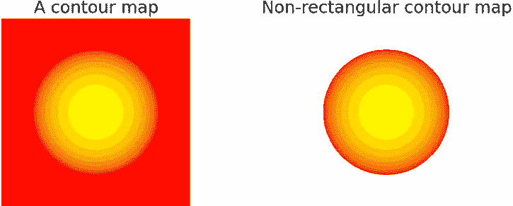

图 6-18. 使用矩形网格（左）和非矩形网格（右）的球体填充等高线图

## 获取和设置值

当您开始绘图并生成可视化输出时，您会发现您越来越多地使用“辅助”函数，这些函数不一定绘制数据，而是控制图形行为并按您想要的方式排列标签。

到目前为止，我们使用了两种方法来修改绘图行为。一种使用专用函数，如`axis()`、`xlim()`和`ylim()`来控制绘图范围。另一种方法是将参数传递给函数，例如`text()`函数中的`rotation`参数。

还有第三种方法可用，它利用了`matplotlib`的面向对象设计。它涉及两个函数，`setp()`和`getp()`，用于检索和设置`matplotlib`对象的参数。使用`setp()`和`getp()`的好处是易于实现自动化。

到目前为止，我们抑制了`matplotlib`的输出，以便交互式脚本更容易理解。但现在让我们看看这些输出。每当您发出`plot()`命令时，`matplotlib`会返回一个`matplotlib`对象的`list`。这一点很重要；调用`plot()`的返回值是一个对象列表，而不是`matplotlib`对象本身，即使您只绘制一条线：

```python
>>> from pylab import *
>>> p = plot(arange(5))
>>> type(p)
```

```
<class 'list'>
```

```python
>>> type(p[0])
```

```
<class 'matplotlib.lines.Line2D'>
```

函数`setp(matobj)`打印出您可以为`matobj`设置的属性列表，其中`matobj`是一个`matplotlib`对象。

### `setp()` 和 `getp()` 函数

该函数接受一个`matplotlib`对象列表或仅接受一个对象：

```python
>>> setp(p[0])
```

```
agg_filter: unknown
alpha: float (0.0 transparent through 1.0 opaque)
animated: [True | False]
antialiased or aa: [True | False]
axes: an :class:`~matplotlib.axes.Axes` instance
clip_box: a :class:`matplotlib.transforms.Bbox` instance
clip_on: [True | False]
```

（请注意，`setp()`的额外输出已被抑制。）

如果你不确定某个参数可以取哪些值，可以执行`setp(p, 'param')`：

```python
>>> setp(p[0], 'visible')
```

```
visible: [True | False]
```

要隐藏绘图，你可以执行以下命令：

```python
>>> setp(p[0], visible=False)
```

或者，你可以通过执行以下命令来设置与线条关联的标签：

```python
>>> setp(p[0], label='Line1')
>>> legend()
```

函数`setp()`也接受`matplotlib`对象列表，在这种情况下，列表中的所有`matplotlib`对象都将被设置。

 **注意**  要查询可接受的参数，请将要查询的参数用引号括起来：`setp(p, 'linewidth')`。要设置参数值，不要包含引号，但要使用赋值语句：`setp(p, linewidth=4)`。

类似地，要检索值，请使用`getp()`函数。`getp()`函数要求提供一个`matplotlib`对象，而不是对象列表，因此它稍微不那么宽容。我们到目前为止一直使用的变量`p`实际上是一个包含一个`matplotlib`对象的列表，所以我们需要对其进行索引：

```python
>>> getp(p[0], 'linewidth')
```

```
1.0
```

### 设置图形和轴参数

在前面的示例中，我们存储了调用`plot()`函数的返回值，该返回值是一个线条的`matplotlib`对象。具体来说，我们存储了我们绘制的线条——嗯，是一个包含一条线的列表。但是我们如何修改图形或轴的行为呢？

函数`gcf()`返回当前图形的句柄。函数`gca()`返回当前轴的句柄。有了这些，我们现在可以修改轴和图形参数。

要设置 y 轴标签，除了调用`ylabel('Y value')`，我们还可以发出以下命令：

```python
>>> setp(gca(), ylabel='Y value')
```

但是，以这种方式使用`setp()`比简单地调用`ylabel()`有什么好处呢？答案是自动化。让我们看一个例子。

### 示例：修改子图参数

假设你想编写一个函数，该函数接收一个图形编号，然后修改该图形中所有子图的标题（如果存在的话），使其成为编号标题。例如，对于一个包含 2x2 子图的图形，你希望子图标题为 1 到 4（如果它们都存在的话）。在这种情况下，你事先不知道一个图形中有多少个子图。

这是使用`setp()`和`getp()`的理想情况，如清单 6-16 所示。

***清单 6-16***. 子图编号

```python
from pylab import *

def number_subplots(fignum):
    """为图形中的子图编号。"""
    # 切换到请求的图形
    figure(fignum)
    fig = gcf()
    for i, fig_axe in enumerate(getp(fig, 'axes')):
        fig_axe.set_title(str(i+1))
    axis()
show()
```

关于`number_subplots()`函数，有几点需要牢记。首先，我们通过调用`figure(fignum)`将焦点设置到我们想要处理的图形上。接下来，我们使用`gcf()`获取该图形的句柄。下一步假设你对`matplotlib`对象结构有一定的了解。但即使你不熟悉这个结构，通过探索对象来弄清楚发生了什么也是相当简单的。为了说明这一点，创建一个包含两个空子图的简单图形：

```python
>>> figure()
>>> ax1 = subplot(2, 1, 1)
>>> ax2 = subplot(2, 1, 2)
```

现在使用`getp(gcf())`检索当前图形的属性：

```python
>>> getp(gcf())
```

```
agg_filter = None
alpha = None
animated = False
axes = [<matplotlib.axes.AxesSubplot object at 0x00000000...
children = [<matplotlib.patches.Rectangle object at 0x0000000...
```

（我已经删除了额外的输出行，因为它们对讨论不重要。）

现在仔细查看两个属性：`axes`和`children`。参数`axes`保存一个值列表，参数`children`保存另一个值列表。进一步检查表明，`axes`对象都包含在`children`值中。实际上，这两个轴就是两个子图的轴。因此，要获取这些轴的列表，我们可以像代码中那样简单地调用`getp(gcf(), 'axes')`。然后我们设置标题并调用`axis()`函数来强制重绘。

`number_subplots()`函数的实现有一个注意事项：编号是按照子图的创建顺序进行的。也就是说，如果左下角的子图是在左上角的子图之前创建的，那么它将具有较小的标题值，而不是常规的子图编号（从左到右，从上到下）。如果你想改变这一点，你必须查看子图的位置并相应地分配编号。这有点复杂，而且教育意义不大，所以我选择将其排除在讨论之外。

许多可以通过`setp()`和`getp()`访问的参数也可以通过专用函数访问。除了使用`setp()`设置 y 轴标签参数外，你还可以调用`ylabel()`函数。在可能的情况下，我更喜欢使用函数版本而不是`setp()`和`getp()`，因为我认为它更容易理解。

通过内置的`dir()`函数探索`matplotlib`对象也是探查`matplotlib`对象功能的非常好的方法。大多数函数都是不言自明的，它们允许你设置和检索与`matplotlib`对象关联的值。如果你不确定，请在交互式 Python 会话中使用`help()`函数。基于部分比较，我确定`matplotlib`对象方法等同于`getp()`和`setp()`可用的属性。这意味着你可以使用以下任何一种：

```python
>>> matobj = gcf()
>>> [func for func in dir(matobj) if func.startswith('get')]
```

```
['get_agg_filter', 'get_alpha', 'get_animated', 'get_axes', 'get_children', 'get_clip_box', 'get_clip_on', 'get_clip_path', 'get_contains', 'get_default_bbox_extra_artists', 'get_dpi', 'get_edgecolor', 'get_facecolor', 'get_figheight', 'get_figure', 'get_figwidth', 'get_frameon', 'get_gid', 'get_label', 'get_path_effects', 'get_picker', 'get_rasterized', 'get_size_inches', 'get_sketch_params', 'get_snap', 'get_tight_layout', 'get_tightbbox', 'get_transform', 'get_transformed_clip_path_and_affine', 'get_url', 'get_visible', 'get_window_extent', 'get_zorder']
```

最后一点：使用`setp()`和`getp()`或`matplotlib`对象的 set 和 get 方法是一个高级主题。这些函数允许更精确地控制绘图和图形的行为，但它们不容易掌握。此外，它们需要对`matplotlib`对象层次结构有很好的理解。无论复杂性如何，我相信这是一个重要的概念。随着你绘制更多的图形并处理更多的数据，你会发现默认功能虽然很棒，但并非*完全*是你想要的。在这些情况下，求助于`setp()`和`getp()`是一个不错的选择。至此，我希望你已经看到了它们足够多的好处以及如何使用它们，以至于你会感到可以舒适地自己进行实验。

## 补丁

到目前为止，我们处理了文本和线条，它们都是作为`matplotlib`对象实现的。但有时这两个对象是不够的。第三个对象，补丁，允许我们绘制其他不一定属于线条或文本类别的形状。

要使用补丁，你需要将它们分配到一个已经存在的图形上，因为从某种意义上说，补丁是“修补”在图形之上的。表 6-6 提供了可用补丁类型的概述。

表 6-6 列出了部分可用的图形块。在该表中，符号`xy`表示一个由`(x, y)`值组成的列表或元组。

| 图形块 | 描述 |
| --- | --- |
| `Arrow(x, y, dx, dy)` | 一个箭头，起始于位置`(x, y)`，终止于位置`(x+dx, y+dy)` |
| `Circle(xy, r)` | 一个以`xy`为圆心、`r`为半径的圆 |
| `Ellipse(xy, w, h, angle)` | 一个以`xy`为中心，宽度为`w`，高度为`h`，并旋转了`angle`度的椭圆 |
| `Polygon([xy1, xy2, xy3,...])` | 一个由`xy`点指定的顶点构成的多边形 |
| `Wedge(xy, r, theta1, theta2)` | 一个以`xy`为中心，半径为`r`，起始角度为`theta1`，终止角度为`theta2`的扇形（圆的一部分） |
| `Rectangle(xy, w, h)` | 一个起始于`xy`，宽度为`w`，高度为`h`的矩形 |

要使用图形块，请遵循以下步骤：

1.  绘制一个图形。
2.  创建一个图形块对象。
3.  使用`add_patch()`函数将图形块对象附加到图形上。

 **注意** 例如，添加一个箭头图形块可能看起来需要相当多的步骤；然而，这三个步骤可以简洁地合并到一行代码中。要绘制一个从`(0, 0)`到`(1, 1)`的箭头，执行`gca().add_patch(Arrow(0, 0, 1, 1))`。

### 示例：向图形添加箭头

在这个示例中，我们将绘制一个图形，并用箭头连接图形上的每两个点。

首先绘制一个简单的图形：

```python
>>> x = arange(10)
>>> y = x**2
>>> plot(x, y)
```

现在创建一个包含所有箭头的列表：

```python
>>> arrows = [(x0, y0, dx, dy) for (x0, y0, dx, dy) in \
... zip(x, y, diff(x), diff(y))]
```

下一部分有点技巧性。首先，函数`diff()`计算向量中每两个元素之间的差值。例如，`diff([1, 2, 3, 30])`的结果是`[1, 1, 27]`。这正是我们为`Arrow()`函数所需的`dx`和`dy`值。其次，我们使用`zip()`函数组合`x`、`y`、`dx`和`dy`，并通过列表推导式返回一个元组列表。幸运的是，`zip()`使用最短的向量，因此即使`diff()`生成的向量长度少 1，这也不是问题。

现在剩下的就是遍历这个列表推导式，并将箭头附加到图形上：

```python
>>> cur_axes = gca()
>>> for x0, y0, dx, dy in arrows:
...    cur_axes.add_patch(Arrow(x0, y0, dx, dy))
>>> title('Arrows!')
>>> show()
```

图 6-19 展示了添加箭头后的效果。

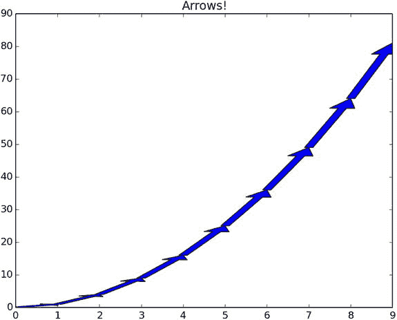

图 6-19. 添加箭头图形块

毋庸置疑，`Arrow()`（以及其他图形块）可以进行大量自定义；你可以调整颜色、长度、宽度等。

### 示例：其他图形块

代码清单 6-17 中的代码生成一个图形块对象列表，并将它们附加到一个图形上。该图形最初是空的。

***代码清单 6-17***. 一些图形块

```python
from pylab import *
```

## 将图形块导入当前命名空间

`from matplotlib.patches import Ellipse, Wedge`

## 一些图形块的列表

`my_patches = [Arrow(0, 4, 0, -4, facecolor='g'), Circle([-2, 2], 1.5, linewidth=4, fc='orange'), Ellipse([2, 3], 4, 1, 45.0, edgecolor='r'), Polygon([[4, 2], [3, 3], [1, -1], [3, -1]], ls='dashed', fill=False), Wedge([-1, 0], 3, 200, 300, fc='m', ec='m'), Rectangle([1, -2], 3, -2, fill=False, lw=5, ec='r')]`

## 绘制一个图形

`figure()`
`axis([-5, 5, -5, 5])`

## 添加图形块

```python
cur_ax = gca()
for p in my_patches:
    cur_ax.add_patch(p)

title('Patches')
show()
```

图 6-20 展示了代码清单 6-17 中代码的运行结果。

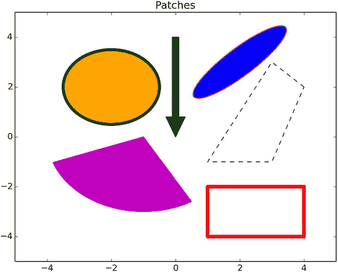

图 6-20. 一些图形块

当你执行`from pylab import *`时，图形块对象`Ellipse`和`Wedge`不会自动导入到当前命名空间（这与`Arrow`、`Circle`、`Polygon`和`Rectangle`不同）。因此，我通过语句`from matplotlib.patches import Ellipse, Wedge`手动将它们导入到命名空间中。

我还向这些图形块传递了参数，以展示如何使用它们：`facecolor`（或`fc`）、`edgecolor`（或`ec`）、`linestyle`（或`ls`）、`linewidth`（或`lw`）和`fill`。

## 3D 绘图

在本书的第一版中，`matplotlib`不支持 3D 绘图。随着`matplotlib`新版本的出现，通过`mplot3d`工具包（参见`http://matplotlib.org/mpl_toolkits/mplot3d/tutorial.html`）也提供了 3D 绘图功能，该工具包是`matplotlib`的一部分。

延续“示例：等高线图”一节中的球体，我们现在转向绘制球体的实际 3D 图。函数`plot_surface()`用于绘制 3D 曲面（参见代码清单 6-18）。

***代码清单 6-18***. 球体的 3D 曲面图

```python
from pylab import *
from mpl_toolkits.mplot3d import Axes3D

x = linspace(-1, 1, 100)
y = linspace(-1, 1, 100)
u, v = meshgrid(x, y)

fig = figure()
z = 1-u**2-v**2
z[nonzero(z<0)] = 0
ax = fig.gca(projection='3d')
ax.plot_surface(u, v, z)
title('A sphere on a plane')
show()
```

在导入`PyLab`之后，我导入了`mplot3d`工具包。

要生成 3D 图，你首先需要做的是使用参数`projection='3d'`创建一个`Axes3D`对象。这通过代码行`ax = fig.gca(projection='3d')`完成。变量`ax`是一个`Axes3D`对象；要访问 3D 函数，你必须使用`Axes3D`的成员函数（例如，代码清单 6-18 中的`ax.plot_surface()`）。

生成的 3D 图如图 6-21 所示。

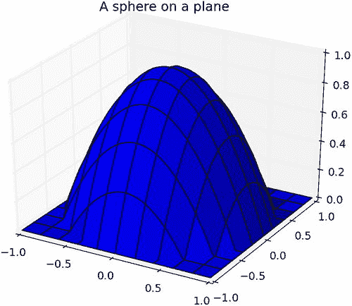

图 6-21. 平面上球体的 3D 图

其他 3D 绘图包括`contour()`和`contourf()`（只需在代码清单 6-18 中将`ax.plot_surface()`替换为`ax.contour()`或`ax.contourf()`即可）。图 6-22 展示了 3D 等高线图。

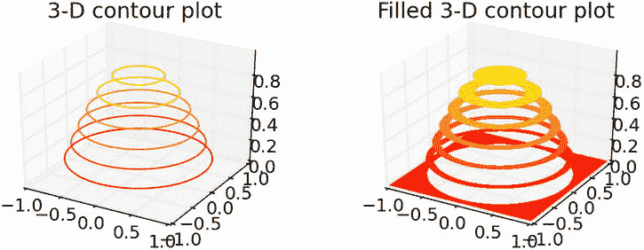

图 6-22. 3D 等高线图

`mplot3d`工具包还支持绘制 3D 线图（函数`plot()`）和散点图（函数`scatter()`），如代码清单 6-19 所示。

***代码清单 6-19***. 3D 线图

```python
from pylab import *
from mpl_toolkits.mplot3d import Axes3D

N = 50
theta = linspace(0, 2*pi, N)
x = cos(theta)
y = sin(theta)
z = linspace(0, 1, N)

fig = figure()

### 第一个 3D 子图
ax1 = fig.add_subplot(2, 2, 1, projection='3d')
ax1.plot(x, y, z)
title('3D line plot')

### 第二个 3D 子图
ax2 = fig.add_subplot(2, 2, 2, projection='3d')
x = cos(theta) + randn(N)/10
y = sin(theta) + randn(N)/10
z = linspace(0, 1, N)
ax2.scatter(x, y, z)
title('3D scatter plot')
show()
```

在这个示例中，我还介绍了 3D 子图。通过调用`fig.add_subplot(..., projection='3d')`来添加 3D 子图。请注意，要创建 3D 子图，你必须在创建子图时传递参数`projection='3d'`。代码清单 6-19 的运行结果如图 6-23 所示。

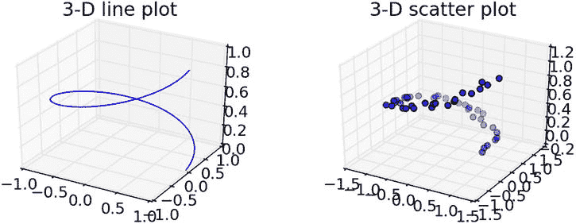

图 6-23. 3D 线图

## Basemap 工具包

`Basemap`工具包（参见`http://matplotlib.org/basemap/`）基于`matplotlib`，支持在 Python 中绘制 2D 数据地图。

### 示例：法国机场

以下“示例：法国机场”一节使用了`basemap`的许多功能，应能提供足够的信息帮助您上手使用该包。如需完整说明，请参阅`basemap`的文档。

在本示例中，我将法国机场的位置绘制在法国地图上。为此，我使用了 METAR 气象报告中的信息。飞行员在飞行准备阶段会使用 METAR 气象报告，其中包含能见度和风速等信息。每个气象站都有一个指定的四字符代码，前两个字符代表国家，后两个字符与机场相关联。法国的 METAR 站代码以 LF 开头。例如，`LFPB`是巴黎勒布尔热机场的站代码。这些站的完整列表可在国家大气研究中心获取（直接链接：`http://weather.rap.ucar.edu/surface/stations.txt`）。首先下载此文件并将其保存到目录`../data/stations.txt`中。代码清单 6-20 中展示的代码假定该文件位于该目录位置。您还需要下载并安装`basemap`工具包（`http://matplotlib.org/basemap/users/download.html`）。如需手动安装，请参阅第 2 章。

***代码清单 6-20***. 法国机场

```python
from pylab import *
from mpl_toolkits.basemap import Basemap

#### 读取 METAR 机场代码，获取经纬度值
airports = {}
metar_codes = open('../data/stations.txt').readlines()
for row in metar_codes:
    code = row[20:24] # METAR 代码
    if(code.startswith('LF')):
        lat = float(row[39:41])+float(row[42:44])/60
        lon = float(row[47:50])+float(row[51:53])/60
        if(row[53]=='W'): lon = -lon
        if(row[44]=='S'): lat = -lat
        name = row[:20].split('/')[0].strip().title()
        airports[code] = [lon, lat, name]

#### 绘制地图
m = Basemap(llcrnrlon=-5.0, llcrnrlat=41.0, urcrnrlon=10.0, urcrnrlat=51.5,
    projection='merc', resolution='h', suppress_ticks=False)
m.drawcoastlines()
m.bluemarble(scale=0.5)
m.drawmapboundary(fill_color='lightblue')
m.drawcountries(linewidth=1)
m.drawmapscale(-2.0, 41.5, -2.0, 41.5, 500, units='km')
axis('off')
```

#### 绘制机场

```python
for site, [lon, lat, name] in airports.items():
    xpt, ypt = m(lon, lat)
    text(xpt, ypt, ' '+name, va='center', ha='left', fontsize=9,
        color='white')
    plot(xpt, ypt, 'wo')
title('法国的 METAR 站点')
show()
```

首先，我们导入`PyLab`和`basemap`工具包。接着，初始化一个名为`airports`的字典对象。字典对象`airports`以 METAR 代码为键，以包含经度、纬度和机场名称的列表为值。然后，我们读取整个`stations.txt`文件，并将其存储为字符串列表的`metar_codes`变量；每个字符串对应文件中的一行。接下来，我们检索站点的 METAR 代码。我们通过切片`metar_codes`中每个字符串的第 20-24 个字符来实现；该值存储在变量`code`中。由于法国的 METAR 代码以 LF 开头（您可以通过读取`stations.txt`文件并滚动到 FRANCE 部分来验证），我们检查`code`是否以`'LF'`开头。如果是，则开始处理机场数据。我们再次使用字符串切片，并将字符串转换为浮点值以存储经纬度信息。注意除以 60 的操作；这是将度转换为度的小数部分所必需的。此外，在西半球，经度值为负；在南半球，纬度值为负。

到目前为止，我使用了基本的 Python 功能，但现在我将转向`basemap`工具包。首先，我创建一个名为`m`的`basemap`对象，并初始化该对象以显示法国区域。

初始化参数`llcrnrlon`代表左下角经度；类似地，初始化参数`urcrnrlat`代表右上角纬度。我选择了`'merc'`（墨卡托）投影，该投影决定了如何将球体（地球）投影到平面（我们的绘图）上。完整的投影列表可在`http://matplotlib.org/basemap/api/basemap_api.html`获取。接下来，我绘制海岸线（`m.coastlines()`），添加蓝色大理石着色（`m.bluemarble()`），绘制国家边界（`m.drawmapboundary()`），然后将地图比例尺设置为公里（`m.drawmapscale()`）。

最后一部分绘制了字典对象`airports`中的机场。我们通过使用`basemap`对象`m`转换经纬度值来实现，如下所示：`xpt, ypt = m(lon, lat)`。

结果如图图 6-24 所示。

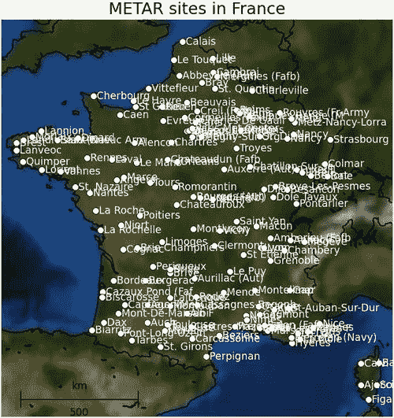

图 6-24。法国的 METAR 站点

## 最后说明与参考

我们已经探索了`matplotlib`包，这是一个支持在 Python 中绘图的丰富包。`matplotlib`的强项在于，它能够轻松绘制简单和复杂的图形，并提供大量自定义选项。如果您不熟悉该包，请尝试使用 IPython 的 Tab 补全功能，辅以`help()`、反复试验和手册来探索它。综合运用这些技巧，您很快就能获得出色的结果。

本章的示例涵盖了与图形和绘图相关的广泛主题和情况。虽然您的需求可能有所不同，但您现在应该拥有独立探索`matplotlib`包所需的工具。

`matplotlib`网站是一个极好的信息来源，我鼓励您探索它并了解更多关于该包的信息：

*   `matplotlib`网站，`http://matplotlib.org/`
*   `Mplot3d`工具包，`http://matplotlib.org/mpl_toolkits/mplot3d/tutorial.html`
*   `basemap`工具包，`http://matplotlib.org/basemap/`

