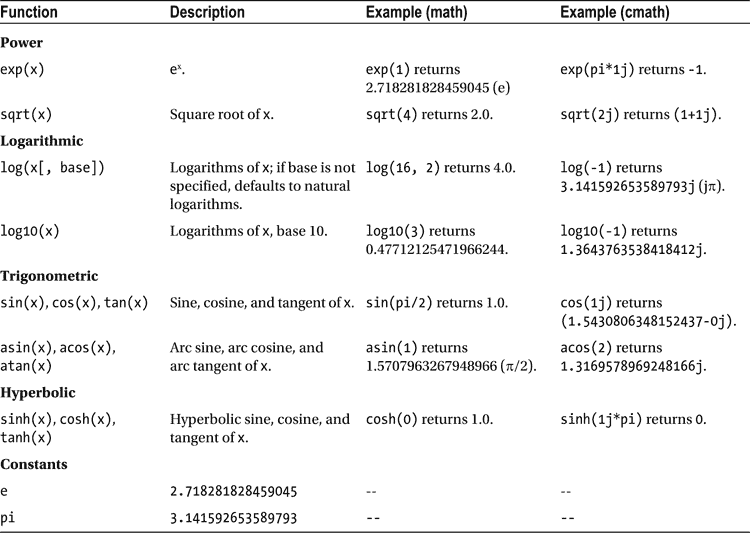
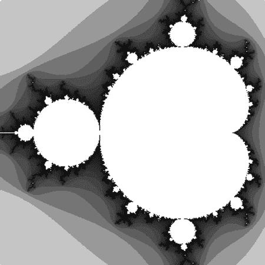
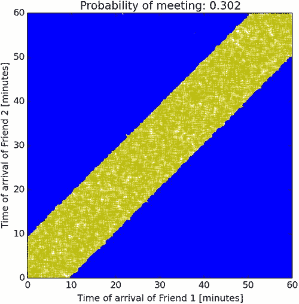
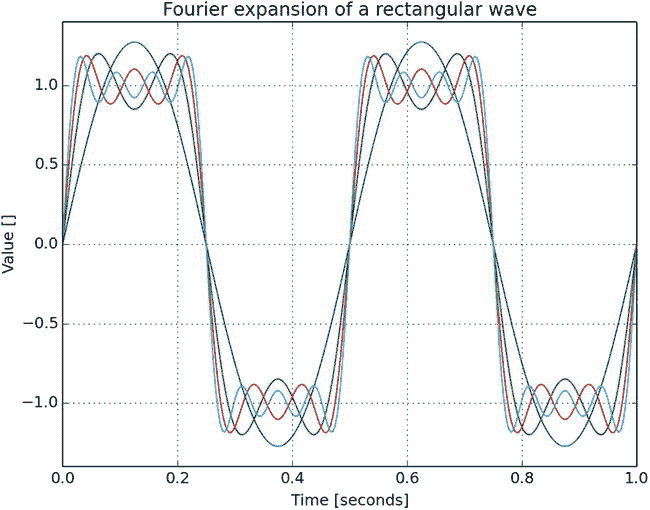
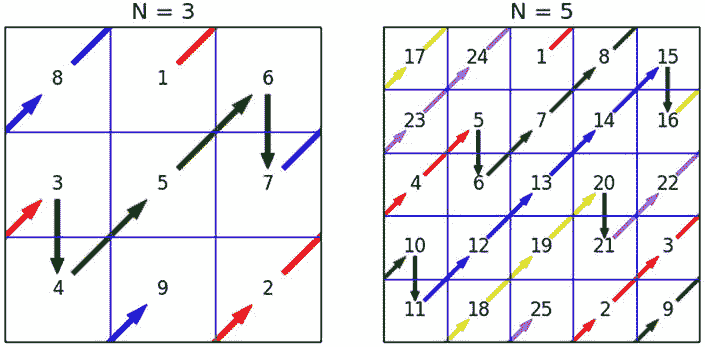

# 第 7 章


## 数学游戏

### 可视化前的数据预处理

数学是数据可视化的基本工具。Python 提供了出色的数学支持，使其成为在可视化之前执行分析的理想开发环境。Python 的交互性使得操作数据和观察中间结果变得容易。Python 还使得修改结果并快速绘图变得简单。我喜欢使用 Python 进行数据可视化的另一个原因是：有大量流行、免费、成熟的数值包可用。最后，Python 结构清晰，允许开发生产级代码来生成高质量报告。

在本章中，我们将探索 Python 的数学能力，包括其内置模块`math`、`cmath`、`random`、`decimal`和`fractions`。我们还将介绍`NumPy`，这是一个我们将在后续章节中广泛使用的优秀包（我们在前面的章节中也使用过）。`NumPy`提供了强大的 n 维数组、向量和矩阵运算、线性代数以及更多功能。

### 模块`math`和`cmath`

Python 提供了两种数学模块：`math`和`cmath`。`math`模块包含大多数编程语言通用的函数，本质上使用了 C 语言的数学函数调用。`math`模块中的函数返回浮点数。如果参数不合适，将引发错误：

```python
>>> import math
>>> math.sqrt(-1)
```

```
Traceback (most recent call last):
  File "<stdin>", line 1, in <module>
ValueError: math domain error
```

模块`cmath`返回复数结果：

```python
>>> import cmath
>>> cmath.sqrt(-1)
```

```
1j
```

Python 通过内置的`complex`数据类型原生支持复数。这可能是 Python 作为数值计算平台受欢迎的一个促成因素。

复数虚部的表示有一个尾随的“j”，如前面的示例所示。大多数算术运算和函数调用都可以对复数执行。如果你不需要复数支持，建议使用`math`而不是`cmath`。首先，如果函数的参数超出定义域，它会提供有价值的异常信息，如前所示。其次，`cmath`总是返回复数结果，即使结果可以表示为非复数，在这种情况下虚部值为零。最后，有些函数仅在`math`模块中可用，如表 7-1 所列。

表 7-1. 仅在`math`模块中可用的函数

| 函数 | 描述 | 示例 |
| --- | --- | --- |
| `atan2(y, x)` | 返回`y/x`的反正切，考虑符号和除以零的情况。 | `atan2(2, 0)`返回 1.5707963267948966 (π/2)。`atan2(-1, -1)`返回−2.356194490192345 (−3π/4)。 |
| `ceil(x)` | 返回大于或等于`x`的最小整数。 | `ceil(2.5)`返回 3。`ceil(-2.5)`返回-2。 |
| `degrees(x)` | 从弧度转换为度。 | `degrees(1)`返回 57.29577951308232。 |
| `erf(x)` | 返回`x`处的误差函数。 | `erf(2)`返回 0.9953222650189527。 |
| `erfc(x)` | 返回`x`处的互补误差函数。 | `erfc(2)`返回 0.004677734981047268。 |
| `expm1(x)` | 返回`ex-1`；避免`x`值较小时精度损失。 | `expm1(0.01)`返回 0.010050167084168057。 |
| `factorial(x)` | 返回`x`! | `factorial(5)`返回 120。 |
| `floor(x)` | 返回小于或等于`x`的最大整数。 | `floor(2.5)`返回 2。`floor(-2.5)`返回-3。 |
| `fabs(x)` | 返回`x`的绝对值。 | `fabs(-2.5)`返回 2.5。 |
| `fmod(x, y)` | 返回`x`除以`y`的余数。 | `fmod(2.5, 2)`返回 0.5。`fmod(-2.5, 2)`返回-0.5。`fmod(2.5, -2)`返回 0.5。`fmod(-2.5, -2)`返回-0.5。 |
| `frexp(x)` | 返回指数`e`和尾数`m`，使得`x=m·2`^(`e`)。 | `frexp(2.5)`返回(0.625, 2)。`frexp(-2.5)`返回(-0.625, 2)。 |
| `fsum(iterable)` | 返回可迭代对象中各项的和。 | `fsum([0.1, 1.2, -0.6])`返回 0.7。 |
| `gamma(x)` | 返回`x`处的伽马函数。 | `gamma(6)`返回 120。 |
| `hypot(x, y)` | 返回`√(x`^(`2`)`+y`^(`2`)`)`。 | `hypot(3, 4)`返回 5.0。 |
| `ldexp(m, e)` | 返回 m·`2`^(`e`)。 | `ldexp(0.625, 2)`返回 2.5。`ldexp(-0.625, 2)`返回-2.5。 |
| `lgamma(x)` | 返回`x`处伽马函数绝对值的自然对数。 | `lgamma(6)`返回 4.787491742782047。 |
| `log1p(x)` | 返回`1+x`的自然对数；避免`x`值较小时精度损失。 | `log1p(0.01)`返回 0.009950330853168083。 |
| `log2(x)` | 返回`x`的以 2 为底的对数。 | `log2(10)`返回 3.321928094887362。 |
| `modf(x)` | 返回`x`的整数部分和小数部分。 | `modf(2.5)`返回(0.5, 2.0)。`modf(-2.5)`返回(-0.5, -2.0)。 |
| `pow(x, y)` | 返回`x`^y。 | `pow(2, 3)`返回 8。 |
| `radians(x)` | 从度转换为弧度。 | `radians(1)`返回 0.017453292519943295。 |
| `trunc(x)` | 截断小数点后的数字；返回值为整数。 | `trunc(2.5)`返回 2。`trunc(-2.5)`返回-2。 |

表 7-1 中列出的一些函数在 Python 3.x 和 Python 2.x 中的行为不同。在 Python 2.x 中，返回类型通常是`float`（即使实际值是整数，也表示为浮点数）。在 Python 3.x 中，如果可能返回整数，则返回值为`int`类型。

例如，在 Python 2.7.6 中，`ceil()`的返回类型是`float`：

```python
>>> from math import ceil
>>> ceil(2.5)
```

```
3.0
```

```python
>>> type(ceil(2.5))
```

```
<type 'float'>
```

而在 Python 3.3.5 中，`ceil()`的返回值是`int`：

```python
>>> from math import ceil
>>> ceil(2.5)
```

```
3
```

```python
>>> type(ceil(2.5))
```

```
<class 'int'>
```

大多数幂、对数、三角和双曲函数在`math`和`cmath`模块中都可用（参见表 7-2）。例外情况是函数`atan2(x, y)`、`hypot(x, y)`、`expm1(x)`、`log1p(x)`、`log2(x)`和`pow(x, y)`。这些函数仅在`math`中可用，因为它们在复数数学中用途有限。

表 7-2. `math`和`cmath`模块中的幂、对数、三角和双曲函数



**函数`atan2`**

函数`atan2(y, x)`非常有用，因为它能保持平面中点的角度值，如第 1 章所示。也就是说，如果`x`和`y`表示平面中的坐标，`atan2(y, x)`返回从原点(0,0)出发的角度。考虑位于(1, 1)的点：其角度为 45 度（π/4），而点(–1,–1)的角度为-135 度（或 225 度）。如果使用`atan(y/x)`，点(1, 1)和(–1,–1)都会得到 45 度，从而丢失象限信息。然而，如果使用`atan2()`，则会返回正确的值。

`atan2(y, x)`的一个附带好处是，当`x`为零时，它能正确计算角度，而`atan(y/x)`会引发异常。函数`atan2()`在复数数学中不是特别有用，因为值已经代表了笛卡尔点。

### 示例：曼德勃罗集

分形可能是最著名的数学可视化形式，科学家用它来研究混沌系统：其状态随时间变化高度依赖于初始条件的系统。在下面的示例中，我们将使用复数数学来创建描绘曼德勃罗集的分形。在此过程中，我们将看到 Python 复数数学的能力，并探索一些除了常规绘图之外的数据可视化方法；分形和 Python 是完美的组合。

为了生成这个分形，我们询问对于某个复数`c`，重复执行操作`z=z**2+c`是否会产生一个有界序列。有界序列包含的值低于一个固定值，在本例中为`2`。如果序列是无界的，我们在复平面上的点`c`处记录下我们确定序列无界所经历的迭代次数。最后，我们展示生成的图像。

让我们手动运行一次：

```python
>>> c=0.4+1j*0.5
>>> z=0
>>> z=z**2+c; print(z, abs(z))
```

```
(0.4+0.5j) 0.6403124237432849
```

```python
>>> z=z**2+c; print(z, abs(z))
```

```
(0.31000000000000005+0.9j) 0.9518928511129812
```

```python
>>> z=z**2+c; print(z, abs(z))
```

```
(-0.31389999999999996+1.0580000000000003j) 1.1035838028894773
```

```python
>>> z=z**2+c; print(z, abs(z))
```

```
(-0.6208307900000004-0.16421240000000004j) 0.64218111318053
```

```python
>>> z=z**2+c; print(z, abs(z))
```

```
(0.7584651574982646+0.7038962280395922j) 1.0347653332940918
```

```python
>>> z=z**2+c; print(z, abs(z))
```

```
(0.4797994952905018+1.5677615269249674j) 1.6395376668399924
```

```python
>>> z=z**2+c; print(z, abs(z))
```

```
(-1.827668649625085+2.0044223787089317j) 2.7125784348275634
```

我首先选取了一个任意点`c=0.4+1j*0.5`，然后将`z`的初始值设为零。接着，我重复执行命令`z=z**2+c`并打印`z`的绝对值`abs(z)`。如你所见，`abs(z)`的值逐渐增大；在第七次迭代后，该值大于 2。这意味着在点(0.4, 0.5)处，我将记录`7`作为该值。如果你继续映射出点`c`，最终会得到曼德勃罗集分形（参见图 7-1）。该示例需要`Pillow`模块（关于安装，请参见第 2 章）。

以下是完整代码清单：清单 7-1. `mandelbrot.py`

```python
from PIL import Image, ImageOps  # 创建曼德勃罗集合图像
res = 400
iters = 200

img = Image.new("L", (res, res), 255)
for im in range(res):
    for re in range(res):
        z = 0
        # 缩放比例，用于显示曼德勃罗分形中“有趣”的部分
        c = (re*2/res-1.5)+1j*(im*2/res-1)
        for k in range(iters):
            z = z**2+c
            if abs(z)>2:
                img.putpixel((re, im), 255-k*255/iters)
                break

### 创建灰度级的均匀分布
img = ImageOps.equalize(img)
```

### 保存到文件
```python
img.save('../images/mandelbrot_%d_%d.png' % (iters, res), dpi=(150,150))
```



图 7-1。曼德勃罗集合，1000 次迭代

我们使用 Python 图像处理库 `Pillow`（原名 PIL）来绘制分形。首先从该包中导入两个模块：`Image` 和 `ImageOps`。从 `Image` 模块中，我们使用 `Image.new()` 创建新图像，并使用 `Image.putpixel()` 在指定位置向图像写入单个像素。最后，使用 `Image.save()` 将图像写入文件。从 `ImageOps` 模块中，我们使用 `ImageOps.equalize()` 创建灰度级的均匀分布，从而使分形图像更加突出（有关 `Pillow` 包的详细讨论，请参见第 9 章）。

我们首先创建一个大小为 `res` 的灰度图像，指定分形的分辨率。然后使用 `for` 循环和 `if` 语句编写曼德勃罗集合的代码，以检查收敛性。接下来，我们绘制一个矩形区域，x 轴从 -1.5 到 0.5，y 轴从 -1 到 1。你可以在这一行中看到这一点：`c = (re*2/res-1.5)+1j*(im*2/res-1)`。当你放大不同区域时，会出现有趣的分形，所以不妨尝试查找一下。

接着，我们将迭代次数映射到特定的灰度级别。其思路是：`k=0` 次迭代映射到 255（白色），而 `k=iters` 次迭代映射到值 0（黑色）。我们通过将值 `255-k*255/iters` 写入像素来实现这一点。不同的迭代次数值会产生有趣的结果（参见图 7-2）。


图 7-2。使用多个迭代次数值生成的曼德勃罗集合分形拼贴图

## 示例：牛顿分形

使用 Python 和稍微复杂的数学知识，你还可以使用牛顿-拉夫逊方法（也称为牛顿法）创建分形。牛顿法是一种迭代过程，用于通过初始猜测找到形如 `f(z) = 0` 的方程的数值解（即根）。该方法的一个特点是，在存在多个解的情况下，通常无法根据初始猜测预先知道收敛到哪个解。如果你根据解来映射初始猜测，你会发现它们收敛到的结果会形成一幅称为牛顿分形的图像，这在几何上非常有趣。


**注意** 如果你想了解更多关于牛顿法的信息，请查看 `http://en.wikipedia.org/wiki/Newton%27s_method`；互联网上还有大量其他相关信息。

我们将要映射的函数是 `f(z) = z**4 + 1`。该函数有四个根：

```python
>>> from cmath import pi, cos, sin
>>> solutions = [ cos((2*n+1)*pi/4) + \
... 1j*sin((2*n+1)*pi/4) for n in range(4)]
```

我们可以使用以下语句验证这些确实是方程的解：

```python
>>> from pprint import pprint
>>> pprint([ z**4 for z in solutions])
```

```
[(-1+4.440892098500626e-16j),
 (-1+4.440892098500626e-16j),
 (-1.0000000000000004+6.661338147750941e-16j),
 (-1+8.881784197001252e-16j)]
```

虚部数量级约为 10⁻¹⁶，这是由于三角函数、π 和浮点数表示的不精确性造成的；实际上虚部为零。

牛顿法采用一个初始猜测，并通过应用方程 `z(n+1) = z(n) – f(z(n)) / f'(z(n))` 计算下一个猜测，其中 `f'(z)` 是 `f(z)` 的导数。在我们的例子中，`f(z)/f'(z)` 是 `z-(z**4+1)/(4*z**3)`。为了检查新值是否是一个“好的”解，我们将其重新代入原始方程，并检查它离零有多近。我们通过检查绝对值是否小于 `delta`（一个预定义的小值）来实现这一点。迭代次数表示解收敛的速度。我们将使用它来选择每个解的颜色深度；收敛快的解会更亮。一旦我们的猜测收敛，我们就检查它收敛到了哪个解，并相应地着色。由于有四个解，分形中会有四种颜色（具有不同的颜色深度）。清单 7-2 在区域 (0, 0)–(1, 1) 中生成了示例牛顿分形。

`清单 7-2`。`newton.py`

```python
from PIL import Image
from cmath import *

### 使用牛顿-拉夫逊方法创建 z**4+1 = 0 的分形

### 根查找方法
delta       = 0.000001  # 收敛标准
res         = 800       # 图像大小
iters       = 30        # 迭代次数

### 创建一个用于绘制的图像，将其涂黑
img = Image.new("RGB", (res, res), (0, 0, 0))
```

### 这些是方程`z**4+1 = 0`的解（欧拉公式）

`solutions = [cos((2*n+1)*pi/4)+1j*sin((2*n+1)*pi/4) for n in range(4)]`
`colors = [(1, 0, 0), (0, 1, 0), (0, 0, 1), (1, 1, 0)]`

```python
for re in range(res):
    for im in range(res):
        z = (re+1j*im)/res
        for i in range(iters):
            try:
                z -= (z**4+1)/(4*z**3)
            except ZeroDivisionError:
                # 可能发生除零异常
                continue
            if(abs(z**4+1)<delta):
                break

        # 颜色深度是迭代次数的函数
        color_depth = int((iters-i)*255.0/iters)

        # 找到该猜测收敛到了哪个解
        err = [ abs(z-root) for root in solutions ]
        distances = zip(err, range(len(colors)))

        # 选择与该解关联的颜色
        color = [i*color_depth for i in colors[min(distances)[1]]]
        img.putpixel((re, im), tuple(color))

img.save('../images/newton_z4s_%03d_%03d_%03d.png' % \
    (iters, res, abs(log10(delta))), dpi=(150,150))
```

虽然迭代过程很直接，但确定特定猜测收敛到四个解中的哪一个，然后映射到正确的颜色和颜色深度，需要一些说明。

`colors`列表由红色、绿色、蓝色和黄色组成。每种颜色由一个红-绿-蓝（RGB）值元组表示：

```python
colors = [(1, 0, 0), (0, 1, 0), (0, 0, 1), (1, 1, 0)]
```

变量`color_depth`直接负责显示颜色的深度（或明暗度）。对于较少的迭代次数，`color_depth`更接近255；而对于较多的迭代次数，该数字更接近0，从而使收敛较快的点（迭代次数较少）呈现更亮的颜色。

一旦计算出`color_depth`，我们就找到最接近我们收敛值的解。由于我们使用的是复数，最接近的值是距离最小的值——在复数数学中，即`err = abs(guess-solution)`值最小的那个。

为了实现这一点，我们使用列表推导式生成一个与距离对应的值列表。以下是一个使用任意根的示例：

```python
>>> from cmath import sqrt
>>> z=sqrt(2)/2*(1+1j)
>>> z
```

```
(0.7071067811865476+0.7071067811865476j)
```

```python
>>> err = [abs(z-root) for root in solutions]
>>> err
[1.1102230246251565e-16, 1.414213562373095, 2.0, 1.4142135623730954]
```

接下来，我们将这些值与代表`colors`列表索引的数字0-3组合起来，使用`zip()`函数：

```python
>>> zip(err, range(len(colors)))
<zip object at 0x0000000002BFAC08>
>>> list(_)
[(1.1102230246251565e-16, 0), (1.414213562373095, 1), (2.0, 2), (1.4142135623730954, 3)]
```

然后，我们通过调用`min()`函数来找到最小误差。为了找到正确的颜色，我们索引与`min(distances)[1]`关联的颜色，这是压缩后的可迭代对象中的第二个元素。也许通过交互式演示比解释更容易理解：

```python
>>> distances = list(zip(err, range(len(colors))))
>>> min(distances)
(1.1102230246251565e-16, 0)
>>> min(distances)[1]
0
>>> colors[min(distances)[1]]
(1, 0, 0)
```

 **注意** 为了显示，我从压缩后的值创建了一个列表。在代码清单中，这不是必需的。

最后，我们使用列表推导式将RGB值乘以颜色深度。这是因为`putpixel()`方法需要一个包含RGB值的元组：

```python
color = [i*color_depth for i in colors[min(distances)[1]]]
img.putpixel((re, im), tuple(color))
```

 **提示** 在试验参数时，你可能希望保存一些输出结果。这些运行可能需要相当长的时间才能完成，因此最好为输出使用不同的文件名，而不是单一的文件名。这可以确保文件不会被意外覆盖。这些运行的输出结果取决于输入参数和生成它们的代码（例如，脚本的版本）。因此，我使用的命名约定是在文件名中详细说明用于创建输出的所有参数：

```python
'../images/newton_z4s_%03d_%03d_%03d.png' % (iters, res, abs(log10(delta)))
```

 **注意** 一个更好的方法（尽管在这种情况下会稍微影响美观的输出）是在图像上添加描述所用参数的文本注释。最后，如果你使用版本控制系统（参见第2章），生成输出的脚本版本号无论是放在文件名中还是图像注释中，都是一个非常受欢迎的补充。

图7-3展示了脚本生成的输出拼贴图，其中`resolution=200`，`iters`的值从1到9（左上角是`i = 1`；右下角是`i = 9`）。我们将在第9章中讨论拼贴图。


图7-3. 牛顿分形的拼贴图，迭代次数从1（左上）到9（右下）

图7-4展示了`resolution=800`和`iters=30`的较长运行结果。


图7-4. 最大迭代次数为30的牛顿分形

 **提示** 前面的示例探索了区域(0, 0) – (1, 1)。如果你想探索原点附近，即(0, 0)周围，请将行`z = (re+1j*im)/res`更改为`z = ((re-res/2)+1j*(im-res/2))/res`。

## 模块`decimal`

Python标准库中一个有趣的模块是`decimal`模块。该模块支持定点数和浮点数十进制数，并允许任意精度（与精度有限的浮点数不同）。

使用`decimal`模块不如Python中的常规数字直观；但是，如果你需要更高的精度并且愿意接受一些性能损失，它是一个不错的选择。

通过调用`Decimal()`生成十进制数，如下所示：

```python
>>> from decimal import *
>>> Decimal('3.3')
Decimal('3.3')
>>> Decimal(3.3)
Decimal('3.29999999999999982236431605997495353221893310546875')
```

第一行创建了一个精确值为3.3的十进制数。这是因为使用了字符串`'3.3'`。第二行将数字的浮点表示转换为其十进制表示法。通常，你会希望使用字符串而不是浮点数，除非你是从浮点数转换为十进制数。

你可以像使用Python中的任何其他数字一样使用十进制数：

```python
>>> a = Decimal('3.3')
>>> a*a
Decimal('10.89')
>>> a-13
Decimal('-9.7')
```

十进制数也可以使用多种数学函数：

```python
>>> a = Decimal('3.3')
>>> sqrt(a)
Decimal('1.816590212458494999253519686')
>>> exp(Decimal('1'))
Decimal('2.718281828459045235360287471')
```

有关可用函数的列表，请执行`import decimal`，然后执行`dir(decimal)`。有关`Decimal`成员函数和属性的列表，请执行`dir(decimal.Decimal)`。你可以使用`help()`系统或访问`https://docs.python.org/3.3/library/decimal.html`的在线帮助来探索这些函数。

## 模块`fractions`

另一个有趣的模块是`fractions`模块，它支持有理数算术。基本对象是`Fraction`对象，它由分子和分母组成。该对象接受多种表示形式，如下所示：

```python
>>> from fractions import *
>>> Fraction(2, 7)
Fraction(2, 7)
>>> Fraction('2/7')
Fraction(2, 7)
>>> Fraction(_)
Fraction(2, 7)
>>> Fraction(1.22)
Fraction(5494391545392005, 4503599627370496)
```

第一行`Fraction(2, 7)`生成一个分子为2、分母为7的分数。第二行使用字符串生成一个分数；第三行使用另一个分数（由`_`引用）；最后一行使用浮点数生成一个分数。

你可以使用该模块对分数进行算术运算，如下所示：

```python
>>> Fraction(3, 4)**2
Fraction(9, 16)
>>> Fraction('3.14')
Fraction(157, 50)
>>> Fraction(22, 7) - Fraction('3.14')
Fraction(1, 350)
```

有关可用函数的列表，请执行`import fractions`，然后执行`dir(fractions)`。有关`Fraction`成员函数和属性的列表，请执行`dir(fractions.Fraction)`。你可以使用`help()`系统或访问`https://docs.python.org/3.3/library/fractions.html`的在线帮助来探索这些函数。

## 模块`random`

除了数学函数之外，Python还提供了丰富的随机数库。随机数在各种软件应用中都很重要。在游戏编程中，随机数用于改变游戏中元素的行为，使其更有趣或不可预测。在编写模拟程序时，随机数用于生成模拟现实世界的数据。随机数也可以用来回答概率问题，你很快就会看到。

`random`模块基于多种分布函数提供随机值，包括均匀分布、高斯分布等。`random`模块也自然地支持Python的列表，其随机函数可以对序列进行操作。

表7-3给出了一些有用的随机函数的部分列表。

表7-3. `random`模块的功能

| 函数 | 描述 | 示例/备注 |
| --- | --- | --- |
| **整数** |  |  |
| `randint(a, b)` | 返回`a`和`b`之间的随机整数（包含`a`和`b`）。 | `randint(0, 1)`返回`0`或`1`（随机）。 |
| `randrange([start, ]stop[, step])` | 从`range(start, stop[, step])`中随机选择一个数；不包含终点`stop`。 | `randrange(3, 7, 2)`返回`3`或`5`；不包含`7`。 |
| **浮点数** |  |  |
| `random()` | 返回0.0到1.0之间的实数（不包含1.0）。 | `random()`可能返回`0.11446412321713018`。 |
| `uniform(a, b)` | 返回`a`到`b`之间的实数（不包含`b`）。 | `uniform(120, 220)`返回120到220之间的随机数（不包含220，不考虑舍入）。 |
| `gauss(u, sigma)` | 返回以`u`为均值、`sigma`为标准差的高斯分布值。 | `gauss(1, 2)`可能返回`2.839406209732811`。 |

`random`模块还提供了其他几种随机数分布，例如对数正态分布和威布尔分布等。完整说明请参考Python标准库文档。

### 使用`random`模块解决概率问题

以下示例通过数值计算的方式，使用`random`模块解决基于概率的问题。

#### 示例：硬盘磁头

在本节的第一个示例中，我们使用`random`模块来确定硬盘读取文件时磁头移动的平均距离。我们通过两种变体来解答这个问题。在第一种变体中，我们假设每次读取后磁头都回到硬盘起始位置。在第二种变体中，我们假设磁头不移动；也就是说，它读取数据后停留在原地。

考虑以下（第一种变体）：硬盘磁头通常停留在位置0，代表磁盘的起始位置。文件（大小为零）均匀分布在位置0和1之间，其中1代表磁盘的末端。磁头需要随机访问文件。每次读取后，磁头返回位置0。问题是：磁头移动的平均距离是多少？

答案并不难：平均而言，磁头移动的距离相当于1。这是因为在最低端，磁头从位置0开始，请求的文件也在位置0，因此移动距离为0。在最顶端，磁头从位置0开始，移动到位置1，然后再返回，因此移动距离为2。平均值为1。你可以使用一个简单的脚本来轻松验证这一点：

```python
>>> from random import random
>>> N = 1000 # 磁头寻道的文件数量
>>> tot_dist = 0
>>> for i in range(N):
...      tot_dist += random()*2
...
>>> tot_dist/N
```

```
1.026458180335224
```

`N`的值越大，结果越精确。

现在考虑磁头不返回位置0，而是停留在原地直到被调用去寻道更多数据的情况（第二种变体）。从分析角度计算磁头移动的平均距离稍微困难一些；但通过数值计算，使用一个简单的脚本，解决方案很快就出现了：

```python
>>> from random import random
>>> N = 1000 # 磁头寻道的文件数量
>>> tot_dist, cur_loc = 0, 0
>>> for i in range(N):
...      new_loc = random()
...      tot_dist += abs(cur_loc-new_loc)
...      cur_loc = new_loc
...
>>> tot_dist/N
```

```
0.336151105404132
```

这个数字结果是1/3。

#### 示例：朋友见面

`random`模块对于需要可视化输出的概率问题也很有帮助。在这个示例中，我们模拟两个时间表的时机。尽管示例的主题是两个朋友的到达时间，但你可以轻松地将相同的方法应用于飞机时刻、赶公交或其他会合时间表。

假设两个朋友决定在晚上8点到9点之间见面。

一旦其中一个朋友到达指定会面地点，他会等待他的朋友10分钟。因此，如果朋友1在8:40到达，他会等到8:50等待朋友2出现。朋友1不知道朋友2是否已经提前到达（朋友2也是如此，他不知道朋友1是否已经到达）。然而，两个朋友都足够聪明，知道如果他们例如在8:55到达，他们只需要等到9:00，而不是9:05。问题是：这两个朋友见面的概率是多少？

我们再次求助于`random`模块来帮助我们解决这个问题（参见清单7-3）。只不过这次，我们还对结果进行了可视化，希望能对如何从分析角度解决这个问题有所启发。

***清单7-3***. 朋友见面

```python
from random import random
from pylab import *

N = 40000 # 事件数量

#### 生成 N 个朋友到达时间的事件
friend1, friend2 = [], []
for i in range(N):
    friend1.append(random())
    friend2.append(random())

#### 找出所有朋友见面的情况
met = array([ (x, y) for (x, y) in zip(friend1, friend2) \
    if abs(y-x) < 1.0/6 ])
not_met = array([ (x, y) for (x, y) in zip(friend1, friend2) \
    if abs(y-x) >= 1.0/6 ])
```

# 概率模拟示例

plot(`met`[:, 0], `met`[:,1 ], 'y+', mec='y')
plot(`not_met`[:, 0], `not_met`[:, 1], 'bo', mec='b')
title("见面的概率: %1.3f" % (float(len(`met`))/N))
xlabel('朋友 1 的到达时间 [分钟]')
ylabel('朋友 2 的到达时间 [分钟]')
xticks([n/6 for n in range(7)], [n*10 for n in range(7)])
yticks([n/6 for n in range(7)], [n*10 for n in range(7)])
axis('scaled')
show()

第一步是生成大量事件——本例中为 40,000 个。一个事件由两个数字组成：一个与朋友 1 的到达时间相关，另一个与朋友 2 的到达时间相关。我们将他们的时间都存储在列表中。生成事件的过程在第一个 `for` 循环中执行。函数 `random()` 返回一个介于 0 和 1 之间的值，该值映射到到达时间：0 代表晚上 8 点，1 代表晚上 9 点。

现在我们有了大量的事件，我们需要判断朋友在哪些时间会见面。如果他们的到达时间之差小于 10 分钟，即 10 分钟 / 60 分钟 * 1.0 = 1/6（1.0 是随机值的范围），则朋友会见面。但也有可能是朋友 1 在朋友 2 之后到达，而不是相反。因此，我们应该判断 `friend1-friend2` 是否小于 `1/6`，以及 `friend2-friend1` 是否小于 `1/6`。这可以优雅地编码为 `abs(friend1-friend2) < 1/6`。

实际实现使用列表推导式，返回满足条件 `abs(x-y) < 1/6` 的 `(x, y)` 值元组，这意味着朋友们见面了。然后我们构建这些值的数组（一个 `NumPy` 数组；稍后会详细介绍），这样我们就可以轻松访问 x 和 y 向量，而无需任何 `for` 循环。我们还构建了一个朋友没有见面的时间列表，因为我们希望用不同的颜色和标记绘制两者。

接下来，我们绘制结果并数值计算朋友见面的概率，如图 7-5 所示。



图 7-5. 朋友见面可视化

这种可视化确实很有帮助。中间的带状区域描述了两位朋友见面对应的事件。见面的概率就是这个带状区域的面积，可以通过整个正方形的面积减去左上角三角形和右下角三角形的面积来计算。每个三角形的面积为 `0.5·(5/6)²`，见面的总概率为 `1–(5/6)²=11/36=0.3055`。这与估计的数值（显示在图标题中）非常接近。

## 随机序列

`random` 模块还提供了一组用于操作序列的函数。这些函数包括表 7-4 中列出的函数。

表 7-4. `random` 模块中用于操作序列的函数

| 函数 | 描述 |
| --- | --- |
| `choice(s)` | 从序列 `s` 中返回一个随机元素。 |
| `shuffle(s)` | 打乱序列 `s`。 |
| `sample(s, n)` | 从 `s` 中返回一个大小为 `n` 的子序列。 |

为了演示这些函数的实际应用，我们使用 `zip()` 和 `range()` 可迭代对象创建一副扑克牌列表。每张牌表示为一个元组，包含一个介于 `1` 到 `13` 之间的数字和一个字符 `'S'`、`'H'`、`'D'` 和 `'C'`。这些字母分别对应黑桃、红心、方块和梅花：

```python
>>> from random import choice, shuffle, sample
>>> cards = list(zip(list(range(1, 14))*4, 'S'*13+'H'*13+'D'*13+'C'*13))
>>> cards[:5]
```

```
[(1, 'S'), (2, 'S'), (3, 'S'), (4, 'S'), (5, 'S')]
```

```python
>>> choice(cards)
```

```
(7, 'C')
```

```python
>>> shuffle(cards)
>>> cards[:5]
```

```
[(4, 'C'), (10, 'D'), (1, 'C'), (7, 'C'), (12, 'D')]
```

```python
>>> sample(cards, 5)
```

```
[(12, 'S'), (12, 'H'), (8, 'C'), (8, 'D'), (5, 'S')]
```

## 一副扑克牌

除了上述略显巧妙的方法之外，你还可以通过多种方式实现一副扑克牌。另一种方法是使用双重 `for` 循环。`for` 循环不仅更易于实现和阅读，而且你可以使用花色的完整名称（例如，使用 `'Spade'` 而不是 `'S'`）。或者，你也可以使用 `NumPy` 的 `ndarray` 对象（将在下一节讨论），例如：`zip(arange(52)//4+1, 'SHDC'*13)`。

哪种方法最好？在决定时，你最应该关心的是代码的可读性。别忘了，你也很可能是维护这段代码的人。如果你对双重 `for` 循环更熟悉，那就使用 `for` 循环方法。如果你更习惯压缩扁平数组，那么前面和后面章节中展示的选项都是可行的方法。这属于个人偏好问题，因为性能几乎不成问题。

也就是说，如果可能的话，你应该优先考虑可读性而非性能。毕竟，Python 是一种高级编程语言：如果你真的需要代码性能，其他编程语言可能更合适。甚至，你可以用其他编程语言来扩展 Python。

## NumPy 模块

`NumPy` 的 `ndarray` 对象是本书中许多数据处理和可视化脚本的基本构建块。正如你在前几章中学到的，`from pylab import *` 命令会导入 `NumPy` 包（以及其他包），使我们无需显式调用 `NumPy` 即可使用其 `ndarray` 对象。`NumPy` 包的功能远不止于此，还包括我们将在本章后面介绍的几个函数：财务函数、数学函数、线性代数等。

`NumPy` 的 `ndarray` 对象为 Python 的 `array` 对象提供了大量附加功能，并且与 Matlab 的矩阵数据结构有很多共同之处，包括矩阵运算、线性代数、信号处理等。它还为未来章节中将探讨的更复杂的数值方法提供了基本构建块。“ndarray”代表 N 维数组；顾名思义，该对象支持 N 维数组。在本章的剩余部分，我将互换使用术语“数组”和“ndarray”。在这两种情况下，我指的都是 `NumPy` 的 `ndarray` 对象——一旦导入了 `NumPy`，Python 的 `array` 对象就几乎没什么用了。

 **注意** `NumPy` 是一个功能全面且丰富的包。我只会涵盖对本书讨论的思想重要的主题；因此，本章应被视为对该包的快速介绍。

如果你想了解更多关于 `NumPy` 的信息，请查阅本章末尾的参考资料。

## 数组创建

第 3 章 介绍了 Python 的内置数据结构，包括元组、列表和字典。如果你还记得，创建这些数据结构有几种方法：我们使用方括号创建列表，也使用 `list()` 函数；我们使用花括号创建字典，也使用 `dict()` 函数，等等。与使用符号 `[]` 表示列表、使用符号 `{}` 表示字典不同，`NumPy` 数组没有为其预留特定的符号集。我们的选择是使用 `array()` 函数，或者在创建新数组时使用返回 `ndarray` 的函数。

创建并初始化数组最直接的方法是从列表创建：

```python
>>> from numpy import *
>>> v = array([1, 2])
>>> v
```

```
array([1, 2])
```

```python
>>> type(v)
```

```
<class 'numpy.ndarray'>
```

```python
>>> m = array([[1, 0],[0, 4]])
>>> m
```

```
array([[1, 0],
       [0, 4]])
```

```python
>>> type(m)
```

```
<class 'numpy.ndarray'>
```

表 7-5 列出了几种额外的数组创建方法，这些方法在处理大量数据点时更为有用。

表 7-5. `NumPy` 的数组创建函数

| 函数 | 描述 | 示例 |
| --- | --- | --- |
| **N 维数组** |  |  |
| `array(s)` | 基于序列 `s` 创建一个数组。 | `array(((1, 2),(3, 4)))` 返回 `array([[1, 2], [3, 4]])`。 |
| `ones(t)` | 基于元组 `t` 创建一个用 `1` 初始化的 N 维数组。 | `ones(2)` 返回 `array([ 1., 1.])` `ones((3,3)))` 返回 `array([[ 1., 1., 1.], [ 1., 1., 1.], [ 1., 1., 1.]])`。 |
| `arange([start,] stop[, step])` | 创建一个从 `start` 开始，到 `stop` 结束（但不包括 `stop`），步长为 `step` 的数组。函数 `arange()` 也可以返回非整数值。 | `arange(1, 2, 0.5)` 返回 `array([ 1., 1.5])`。 |
| `linspace(start, stop, num=50)` | 创建一个从 `start` 到 `stop`（包括）的线性间隔向量，大小为 `num`；更多选项请参考交互式帮助。 | `linspace(1, 10, 3)` 返回 `array([ 1., 5.5, 10.])`。 |
| `logspace(start, stop, num=50)` | 类似于 `linspace()`，只是值在对数尺度上从 10^(start) 到 10^(stop) 均匀分布；更多选项请参考在线帮助。 | `logspace(0, 1, 3)` 返回 `array([ 1., 3.16227766, 10.])`。 |

还有一些其他的数组创建函数（`fromfile()`、`empty()`）；但在大多数情况下，你会发现表 7-5 中的函数已经足够。列出的函数中也有一些冗余：`ones(10)` 的结果与 `zeros(10)+1` 相同。

## 切片、索引和重塑

可以使用 `reshape()` 和 `resize()` 函数调整数组的大小，并且可以使用 Python 的切片和索引运算符 `[]` 和 `[:]` 对数组进行索引和切片。这两个函数的区别在于：`resize()` 会调整现有数组的大小，而 `reshape()` 会基于原始数组中的数据返回一个新数组：

```python
>>> a = arange(12).reshape(4, 3)
>>> a
```

```
array([[ 0,  1,  2],
       [ 3,  4,  5],
       [ 6,  7,  8],
       [ 9, 10, 11]])
```

```python
>>> a[1]
```

```
array([3, 4, 5])
```

```python
>>> a[-1]
```

```
array([ 9, 10, 11])
```

```python
>>> a[1, 1]
```

```
4
```

```python
>>> a[:, 1]
```

```
array([ 1,  4,  7, 10])
```

```python
>>> a[1, :2]
```

```
array([3, 4])
```

## N 维数组

`NumPy` 数组是 N 维数组，其创建方式与一维和二维数组相同：

```python
>>> ones((2, 3, 4))
```

```
array([[[ 1.,  1.,  1.,  1.],
        [ 1.,  1.,  1.,  1.],
        [ 1.,  1.,  1.,  1.]],

       [[ 1.,  1.,  1.,  1.],
        [ 1.,  1.,  1.,  1.],
        [ 1.,  1.,  1.,  1.]]])
```

```python
>>> a = ones((2, 3, 4))
>>> a
```

```
array([[[ 1.,  1.,  1.,  1.],
        [ 1.,  1.,  1.,  1.],
        [ 1.,  1.,  1.,  1.]],

       [[ 1.,  1.,  1.,  1.],
        [ 1.,  1.,  1.,  1.],
        [ 1.,  1.,  1.,  1.]]])
```

```python
>>> a[0,...]
```

```
array([[ 1.,  1.,  1.,  1.],
       [ 1.,  1.,  1.,  1.],
       [ 1.,  1.,  1.,  1.]])
```

```python
>>> a[0, 1, ...]
```

```
array([ 1.,  1.,  1.,  1.])
```

对于 N 维数组，有一个有用的运算符 `...`，它表示“所有剩余维度”，类似于运算符 `:`（冒号）。

N 维数组有多大用处？有些人很少用到 N 维，觉得一维或二维就足够用了。根据我的经验，在处理多个参数组合时，N 维数组提供了极佳的数据存储方式。假设有一个包含四个参数的模拟，每个参数都有一系列取值。你想对整个模拟进行映射，即针对每个参数组合计算结果，并存储结果（因为运行时间很长）。你会如何存储这些结果？一种方法是将其写入列表，将数据扁平化。另一种方法是使用 N 维数组。下面的示例将讨论如何使用 N 维数组和扁平化数据结构，将数据存储为多个参数（通常超过两个）的函数。

## 示例：比较抵押贷款

自从我撰写本书第一版以来，次贷危机已经冲击了全球市场，因此我认为在本版中提供一个比较不同抵押贷款的示例是合适的。（我并非金融专家，所以请千万不要将此作为选择抵押贷款的建议！）。让我们从定义问题开始。

固定抵押贷款的还款额是三个参数的函数：贷款金额（也称为现值）、利率和还款期数。银行通常会根据还款期数、个人信用记录，可能还有贷款金额，提供不同的利率。基于这三个参数（现值、利率和还款期数），我们希望绘制出月还款额——即参数范围内每个取值对应的预期月还款额。

在本示例中，假设我们考虑的贷款金额范围是 10 万到 14 万美元，以 2 万美元为增量；抵押贷款利率范围是 3% 到 5%，以 0.5% 为增量；还款期数范围是 60 到 300 期，以 60 期为增量（代表 5 到 25 年，以 5 年为增量）。我们将使用 `pmt()` 函数，该函数是 `NumPy` 包的一部分。该函数返回固定利率抵押贷款的固定月还款额（参见 `http://en.wikipedia.org/wiki/Fixed-rate_mortgage`）。

然后，我们构建代表要映射的值范围的列表。我们使用本章前面描述的 `arange()` 函数来实现这些列表。

### 使用 `ARANGE()` 和 `LINSPACE()` 的便利性

这是另一个说明 `NumPy` 为何比非数学导向的数据结构更便利的例子。要实现一个包含非整数增量的值列表，我们可以使用列表推导式，如下例所示：

`>>> interest_rates = [x/2.0+3 for x in range(5)]`

虽然这完全没问题，但可读性不如下面这种方式：

`>>> interest_rates = arange(3.0, 5.5, 0.5)`

在第一种方法（使用列表推导式）中，你需要做一些数学计算才能确切知道使用了哪些值。在第二种方法中，这些值一目了然：从 3 到 5.5（不包括 5.5），增量为 0.5。

我猜测模块开发者决定在 `arange()` 函数中排除边界值（即上例中的 5.5），是为了使其行为与 `range()` 类似。

我个人更倾向于包含边界值。

或者，你也可以使用 `linspace()` 函数：

`>>> interests = linspace(3.0, 5.0, 5)`

在这个特定示例中，这有点别扭：必须预先计算出值 5（最后一个参数）才能达到 0.5 的增量。

最后一点说明：此抵押贷款示例中的值是年值；要正确使用它们，必须将它们除以 12（月数）和 100（百分比值）。无论如何，这在列表推导式实现和 `arange()` 实现中都是必需的。我将其省略了，以便说明更清晰（请参见代码中变量 `interests` 的赋值）。数组与数值相乘（或相除）的能力将在下一节中展示。

接下来，我们遍历贷款金额、还款期数和利率的范围，然后构建一个数据结构来保存结果：月还款额。当我们检查这两种数据结构时，会看到以下情况：

*   一个扁平化的行列表（`res1`），每一行都是一个包含贷款金额、还款期数、利率和月还款额的列表。这是一个原生的 Python 列表。
*   一个 N 维数组（`res2`），其中每个维度对应一个不同的参数：贷款金额、还款期数、利率、月还款额和贷款成本。这是一个 3 维的 `NumPy` 数组。

清单 7-4 比较了这两种结构。

***清单 7-4***。扁平化数据与 N 维数据，ndflat.py

```python
from numpy import *
loans           = arange(100000, 160000, 20000)
num_payments    = arange(5, 30, 5)*12
interests       = arange(3, 5.5, 0.5)/100.0/12.0

#### 方法 1，将结果存储在列表中
res1 = []
```

#### 方法 2，将结果存储在数组中
```python
res2 = zeros([len(loans), len(num_payments), len(interests)])

for i, loan in enumerate(loans):
    for j, num_pay in enumerate(num_payments):
        for k, interest in enumerate(interests):
            res1.append([loan, num_pay, interest, \
                -pmt(interest, num_pay, loan)])
            res2[i][j][k]=-pmt(interest, num_pay, loan)
```
使用 N 维数组的好处是索引更加简单快捷。例如，假设 `loan` 固定并设置为 `0`，则 `res2` 数组中的结果可以通过 `res2[0, ...]` 访问。要在列表中实现同样的效果，可能需要遍历整个 `res1` 列表并比较第一个参数的值。这在代码和实际性能上都有开销：
```python
>>> exec(open('ndflat.py').read())
>>> for row in res1:
...     if(row[0] == 120000 and row[1] == 120):
...         print(row)
...
```
```
[120000, 120, 0.0025000000000000001, 1158.7289363806954]
[120000, 120, 0.0029166666666666668, 1186.6304095428363]
[120000, 120, 0.0033333333333333335, 1214.941657978555]
[120000, 120, 0.0037499999999999999, 1243.6609050842044]
[120000, 120, 0.0041666666666666666, 1272.7861828689065]
```
```python
>>> res2[1, 1, ...]
```
```
array([ 1158.72893638,  1186.63040954,  1214.94165798,  1243.66090508,
        1272.78618287])
```
然而，列表的结果可读性更强：它们以人类可读的形式显示了所有参数组合。你也可以用 `res2` 实现同样的效果，但这需要一个 `for` 循环：
```python
>>> values = res2[1, 1, :]
>>> for i, v in enumerate(values):
...     row = [loans[1], num_payments[1], interests[i], v]
...     print(row)
...
```
```
[120000, 120, 0.0025000000000000001, 1158.7289363806954]
[120000, 120, 0.0029166666666666668, 1186.6304095428363]
[120000, 120, 0.0033333333333333335, 1214.941657978555]
[120000, 120, 0.0037499999999999999, 1243.6609050842044]
[120000, 120, 0.0041666666666666666, 1272.7861828689065]
```
请注意，`for` 循环在遍历的值列表上使用了 `enumerate()`。

#### 排版后的文档

之所以如此，是因为 `NumPy` 数组需要索引（且索引必须是整数），而 Python 列表则不需要。因此从某种意义上说，列表在代码层面可能更优雅（无需使用 `enumerate()`）。最后，列表实现非常适合存储到 CSV 文件中，而 CSV 本身是一种扁平化的数据结构。话虽如此，你也可以将数组扁平化后做同样的事情。数组扁平化可以通过 N 维循环或嵌套列表推导式实现。以我们的示例为例，以下代码使用列表推导式将三维数组 `res2` 扁平化：
```python
>>> exec(open('ndflat.py').read())
>>> res2.shape
```
```
(3, 5, 5)
```
```python
>>> [n1, n2, n3] = [range(i) for i in res2.shape]
>>> n1, n2, n3
```
```
(range(0, 3), range(0, 5), range(0, 5))
```
```python
>>> flat_res2 = [res2[a, b, c] for a in n1 for b in n2 for c in n3]
```
`res2` 的维度可通过 `res2.shape` 访问。然后我们通过 `[n1, n2, n3] = [range(i) for i in res2.shape]` 这一行创建了三个 `range()` 可迭代对象。最后，我们使用列表推导式生成一个扁平化的数据结构，即列表形式的 `flat_res2`。

尽管 N 维数组是很有趣的数据结构，但本书中的大多数示例都基于一维数组（向量）和二维数组（矩阵），因为它们涵盖了大多数我们可能需要的操作。即使是三维图，实际上也是由二维矩阵表示的：索引代表 x 和 y，单元格的值代表 z。

选择 N 维数组还是扁平化数据结构，取决于你试图解决的具体问题。

## 数学函数

数组支持简单的算术运算，包括加法、减法、除法、乘法和幂运算。你还可以使用 `math` 和 `cmath` 模块中的大多数数学函数（尽管现在它们已作为 `NumPy` 的一部分实现）。

## 示例：可视化矩形波的傅里叶展开

以下示例展示了使用正弦波之和进行矩形波的傅里叶展开。傅里叶展开广泛应用于从求解微分方程到信号处理的众多应用中。此示例将展示如何将 `NumPy` 数组视为值的向量，并像操作函数一样操作该向量。该示例使用正弦波（`NumPy` 数组）的傅里叶展开来生成矩形波（另一个 `NumPy` 数组）。具体来说，清单 7-5 实现了函数 `4 / (π·n)·sin(2π·n·t·N)`，这是矩形波的傅里叶级数展开。参数 `N` 决定要展开的周期数，在示例中设置为 2，以便我们查看两个周期。参数 `n` 决定正弦波的频率；我们探索 `n=1`、`3`、`5` 和 `7` 的值。

***清单 7-5***。可视化傅里叶展开
```python
### 绘制矩形波的傅里叶展开
from pylab import *

### 准备绘图
figure()
hold(True)

### 显示波形的点数
N = 2**8
t = linspace(0, 1, N)
y = zeros(N)

for n in range(1, 8, 2):
    # 正弦波，累加
    y += 4/(pi*n)*sin(2*pi*n*t*2)

    # 绘制图形
    plot(t, y)
```

# 数值分析与信号处理

## NumPy 基础回顾

在进入正题之前，让我们快速回顾一些 NumPy 的基础概念，这些在后续章节中会频繁用到。

### FFT 和绘图

首先，我们通过一个快速傅里叶变换（FFT）的例子来说明如何对信号进行分析和可视化。

#### 标注图形
```python
axis([0, 1, -1.4, 1.4])
grid()
xlabel('时间 [秒]')
ylabel('数值 []')
title('矩形波的傅里叶展开')
show()
```

让我们逐行分析代码。首先，我们导入整个 `PyLab` 包，其中也包含了 `NumPy` 和绘图命令。本例中两者都需要。然后我们准备一个空图：每次新的展开计算都将绘制在前一个之上，因此我们发出 `hold(True)` 命令以确保后续绘图不会擦除现有图形。

命令 `t = linspace(0, 1, N)` 创建了第一个数组对象，但我们也可以使用 `arange()` 函数调用来替代。数组对象 `t` 是一个一维数组，即向量。

我们所有的后续操作和数学函数都将在这个向量上执行。然后我们使用 `zeros()` 函数初始化级数展开变量 `y`。计算的核心在于 `for` 循环。每个正弦波都累加到前一个上，结果存储在 `y` 中。简单的 `y += 4/(pi*n)*sin(2*pi*n*t*2)` 这一行实际上是在操作整个数组，这充分体现了数组对象的强大之处。

然后我们在计算 `y` 的同时绘制它，并在展开完成后标注图形，如图 7-6 所示。



**图 7-6.** 矩形波的傅里叶展开

### 数组方法和属性

数组是对象；因此，它们拥有称为*方法*的函数和称为*属性*的变量。使用 IPython（参见第 2 章），你可以通过按 **Tab** 键触发的字符补全功能列出对象的方法和属性。或者，你也可以执行以下命令：

```python
>>> import numpy
>>> [m for m in dir(numpy.ndarray) if not(m.startswith('__'))]
```

```
['T', 'all', 'any', 'argmax', 'argmin', 'argpartition', 'argsort', 'astype', 'base', 'byteswap', 'choose', 'clip', 'compress', 'conj', 'conjugate', 'copy', 'ctypes', 'cumprod', 'cumsum', 'data', 'diagonal', 'dot', 'dtype', 'dump', 'dumps', 'fill', 'flags', 'flat', 'flatten', 'getfield', 'imag', 'item', 'itemset', 'itemsize', 'max', 'mean', 'min', 'nbytes', 'ndim', 'newbyteorder', 'nonzero', 'partition', 'prod', 'ptp', 'put', 'ravel', 'real', 'repeat', 'reshape', 'resize', 'round', 'searchsorted', 'setfield', 'setflags', 'shape', 'size', 'sort', 'squeeze', 'std', 'strides', 'sum', 'swapaxes', 'take', 'tofile', 'tolist', 'tostring', 'trace', 'transpose', 'var', 'view']
```

我使用上述列表创建了表 7-6。虽然该表只展示了方法和属性的一个子集，但它包含了那些我认为对数据处理和可视化最有用的部分。我还将方法按类别划分，以便于查看。方法用 `()` 表示，而属性则没有尾随括号。在此表中，`a` 指代一个数组变量。

**表 7-6.** 数组方法和属性（部分）

| 函数 | 描述 | 示例 |
| --- | --- | --- |
| **逻辑运算** |  |  |
| `all()` | 如果 `a` 的所有元素都为真（非零），则返回 True。 | `arange(10).all()` 返回 `False`（第一个元素为零）。`arange(-5, -2).all()` 返回 `True`。 |
| `any()` | 如果 `a` 中至少有一个元素为真（非零），则返回 True。 | `arange(10).any()` 返回 `True`。 |
| `nonzero()` | 返回 `a` 中非零元素索引的元组。 | `arange(3).nonzero()` 返回 `(array([1, 2], dtype=int64),)`。 |
| **索引** |  |  |
| `sort()` | 对 `a` 中的元素进行排序。 | `a = arange(3, 0, -1)` 将 `a` 设置为 `array([3, 2, 1])`。`a.sort()` 将 `a` 更改为 `array([1, 2, 3])`。 |
| `searchsorted(x)` | 返回插入 `x` 以保持数组顺序的索引。假定 `a` 已排序。 | `arange(4).searchsorted(1.5)` 返回 `2`。 |
| **修改** |  |  |
| `clip(min, max)` | 如果 `a` 的元素小于 `min`，则返回 `min`；如果 `a` 的元素大于 `max`，则返回 `max`；否则返回该元素。 | `arange(5).clip(1, 3)` 返回 `array([1, 1, 2, 3, 3])`。 |
| `compress(cond)` | 返回一个数组，其元素满足 `cond` 中指定的条件；等价于 `a[cond]`。 | `a = arange(10)` `a.compress(a > 5)` 返回 `array([6, 7, 8, 9])`。`a[a > 5]` 返回 `array([6, 7, 8, 9])`。 |
| `fill(x)` | 将数组的所有值设置为 `x`；等价于 `a[:] = x`。 | `a = zeros([2, 2])`。`a[:] = -1` 将 `a` 设置为 `array([[-1., -1.], [-1., -1.]])`。 |

### NumPy 数组方法

#### 数学运算

数学示例中，假设 `a = array([1, 1j, -1])`，也可表示为 `a = exp(1j*pi*arange(3)/2)`。

| 方法 | 描述 | 示例 |
|------|------|------|
| `cumprod()` | 累积乘积。每个元素是数组中之前元素的乘积。 | `a.cumprod()` 返回 `array([ 1.+0.j,  0.+1.j,  0.-1.j])`。 |
| `cumsum()` | 累积和。每个元素是数组中之前元素的和。 | `a.cumsum()` 返回 `array([ 1.+0.j,  1.+1.j,  0.+1.j])`。 |
| `real` 和 `imag` | `a` 中元素的实部和虚部。 | `a.imag` 返回 `array([ 0.,  1.,  0.])`。`a.real` 返回 `array([ 1.,  0., -1.])`。 |
| `conj()` | `a` 的共轭复数（虚部取反；行列转置）。 | `a[1].conj()` 返回 `-1j`。 |
| `max()`、`min()` | `a` 的最大值和最小值（仅对实部进行计算）。 | `a.max()` 返回 `(1+0j)`。`a.min()` 返回 `(-1+0j)`。 |
| `mean()` | `a` 的平均值。 | `a.mean()` 返回 `0.33333333333333331j` (1j/3)。 |
| `prod()` | `a` 中所有值的乘积。 | `a.prod()` 返回 `-1j`。注意 `a.prod()` 等于 `a.cumprod()[-1]`。 |
| `ptp()` | `a` 的峰峰值；等价于 `a.max()-a.min()`。 | `a.ptp()` 返回 `(2+0j)`。 |
| `round()` | `a` 的舍入值。 | `exp(a).round()` 返回 `array([ 3.+0.j,  1.+1.j,  0.+0.j])`。 |
| `std()` | `a` 中元素的标准差。 | `arange(2).std()` 返回 `0.5`。 |
| `sum()` | `a` 中所有值的总和。 | `a.sum()` 返回 `1j`。注意 `a.sum()` 等于 `a.cumsum()[-1]`。 |
| `trace([n])` | 二维数组对角线的和。如果提供了 `n`，则计算偏移对角线的和。 | `eye(10).trace()` 返回 `10`。 |
| `var()` | `a` 中元素的方差。 | `arange(2).var()` 返回 `0.25`。 |

#### 形状相关

| 方法 | 描述 | 示例 |
|------|------|------|
| `flatten()` | 将 `a` 中的值展平为一维数组。 | `eye(2).flatten()` 返回 `array([ 1.,  0.,  0.,  1.])` |
| `ndim` | `a` 的维度数量。 | `eye(4, 5).ndim` 返回 `2`。 |
| `repeat(n)` | 将 `a` 复制 `n` 次，并展平。 | `eye(2).repeat(2)` 返回 `array([ 1.,  1.,  0.,  0.,  0.,  0.,  1.,  1.])`。 |
| `reshape(d1, d2, ...)` | 生成一个大小为 (d1, d2, ...) 的新数组。 | `arange(4).reshape(2, 2)` 返回 `array([[0, 1], [2, 3]])`。 |
| `resize(d1, d2,...)` | 将当前数组的大小调整为 (d1, d2, ...)。 | `a = arange(4)` `a.resize(2, 2)` 将 `a` 设置为 `array([[0, 1], [2, 3]])` |
| `shape` | 表示 `a` 形状的元组。 | `eye(3, 4).shape` 返回 `(3, 4)`。 |
| `transpose()` | 矩阵转置。这等价于共轭，但不对虚部取反。 | `eye(2, 3).transpose()` 返回 `array([[ 1.,  0.], [ 0.,  1.], [ 0.,  0.]])`。 |

#### 转换

| 方法 | 描述 | 示例 |
|------|------|------|
| `tofile(fname)` | 将数组写入文件（二进制）。 | `eye(2).tofile('eye2.bin')` |
| `fromfile(fid)` | 从文件读取数组（二进制）。 | `a = fromfile(open('eye2.bin'))` |
| `tolist()` | 将数组转换为列表。 | `eye(2).tolist()` 返回 `[[1.0, 0.0], [0.0, 1.0]]` |

### 示例：幻方

幻方是一个正方形，其中每行和每列的总和相等且相同。通常，幻方不允许数字重复。在本例中，我们将生成幻方，在一个 N×N 大小的正方形中填充从 1 到 N² 的值。幻方概念的一个现代变体是数独益智游戏。事实上，你可以修改本例中提出的思路，为数独谜题提供解决方案（有关可能的策略，请参见 `http://en.wikipedia.org/wiki/Sudoku`）。

我们将创建一个实现 De la Loubère 方法（也称为暹罗方法）的幻方，该方法仅适用于 N 为奇数的正方形。构造幻方的方法是将第一个值 1 放在顶行的中间列。递增的值沿对角线向右上方放置。如果右上方的位置超出正方形，则将其环绕到底行（如果超出顶部）或第一列（如果超出右侧），或两者都环绕。

如果某个单元格已被占用，则该值向下移动一行（同样，如果需要则进行环绕）。图 7-7 以大小为 3 和 5 的幻方为例说明了该算法。



**图 7-7.** De la Loubère 方法

使用数组实现的算法如清单 7-6 所示。

**清单 7-6.** 创建幻方

```python
from pylab import *

def magicsq(n=3):
    """返回一个大小为 n 的幻方；n 必须为奇数"""
    if n % 2 != 1:
        raise ValueError("Magic(n) requires n to be odd")
    m, row, col = zeros([n, n]), 0, n//2
    for num in range(1, n**2+1):
        m[row, col] = num      # 填充单元格
        col = (col+1) % n
        row = (row-1) % n
        if m[row, col]:
            col = (col-1) % n
            row = (row+2) % n
    return m

def testmagicsq(m):
    """如果 m 是幻方，则返回 True。"""
    msum = sum(m[0, :])
    return all(m.sum(0) == msum) and all(m.sum(1) == msum)
```

主 `for` 循环非常直接，严格遵循算法。然而，使用取模（`%`）运算符计算列和行值的方法比较巧妙，需要一些解释。考虑算法的指定方式：递增列值并检查新值是否在矩阵大小范围内。如果不在，则将其环绕回开头。对行也采用类似的方法：递减并在需要时环绕。我们可以使用取模运算来优雅地实现这一思路，而不是实现这两个步骤（递增/递减后跟一个 `if` 语句）：`col = (col+1) % n`。

我选择使用多重赋值来初始化变量 `m`、`row` 和 `col`。在 `for` 循环内部也可以使用多重赋值：`col, row = (col + 1) % n, (row - 1) % n`；但是，这没有性能提升或其他明显优势。出于这些原因，我个人倾向于在初始化中使用多重赋值，而不是在计算中。

我在这里定义了另一个函数 `testmagicsq()`，用于检查一个正方形是否确实是幻方。该函数也适用于偶数值（这是一个优点），并使用数组对象的 `sum()` 成员函数。这个检查是*朴素*的；也就是说，函数 `testmagicsq()` 测试每一行的和与每一列的和是否相同；它不检查元素是否只出现一次。


**提示：** Python 支持通过几个内置包进行测试，包括 *doctest* 和 *unittest*。但是，对于本例，我选择编写一个专用的测试函数，这将进一步说明 *NumPy* 数组的属性。

函数 `sum(0)` 返回列的和的数组（即沿轴 0）；`sum(1)` 返回行的和的数组（沿轴 1）。以下清单演示了沿 0 轴和 1 轴的求和：

```python
>>> exec(open('magic_square.py').read())
>>> a = eye(2, 3)
>>> a
```

```
array([[ 1.,  0.,  0.],
       [ 0.,  1.,  0.]])
```

```python
>>> a.sum(0)
```

```
array([ 1.,  1.,  0.])
```

```python
>>> a.sum(1)
```

```
array([ 1.,  1.])
```

```python
>>> m = magicsq(5)
>>> m.sum(0)
```

```
array([ 65.,  65.,  65.,  65.,  65.])
```

```python
>>> m.sum(1)
```

```
array([ 65.,  65.,  65.,  65.,  65.])
```

```python
>>> testmagicsq(m)
```

```
True
```

如你所见，矩阵 `eye(2, 3)` 有两行三列。通过 `sum(0)` 沿轴 0 求和会返回一个一维数组（向量），其中包含所有三列的和。相应地，`sum(1)` 返回一个包含行和的向量。

以下代码展示了如何利用该函数检查方阵是否满足“幻方”要求：两个向量 `sum(0)` 和 `sum(1)` 在逐元素比较时，应与沿任意轴求和的结果相等。在 `testmagicsq()` 函数中，我选择将列和与行和分别与第一列的和 `sum(m[0, :])` 进行比较。当你将一个向量（一维数组）与一个标量（单个值）进行比较时，结果会是一个向量，其中每个元素都与该标量进行了比较。为了确保所有元素确实等于所需的和，你可以使用 `all()` 成员函数。我倾向于使用 `all(m.sum(0) == msum)` 这种写法，而不是 `(m.sum(0) == msum).all()`，因为我认为前者可读性更强，但这同样属于个人偏好；两种写法都能实现功能。


**注意** 在 `testmagicsq()` 函数中，仅检查 `m.sum(0)` 是否等于 `m.sum(1)` 是不够的，因为这只能判断行和是否等于列和。然而，这并非充分条件。考虑数组 `[[0, 1], [0, 2]]`：它满足条件 `m.sum(0) == m.sum(1)`，但它并不是一个幻方。你可能会质疑数组 `eye(N)` 是否是一个幻方——`testmagicsq()` 函数会返回 `True`，但这或许只是一个幻方的平凡特例。

暹罗法的另一个有趣之处在于，对角线上的和也与每行及每列的和相等；两条对角线均满足此性质。函数 `trace()` 用于计算沿主对角线（左上到右下）的和。要计算副对角线（左下到右上）的和，你可以使用 `fliplr()` 函数：

```python
>>> m = magicsq(5)
>>> m.trace()
```

```
65.0
```

```python
>>> fliplr(m).trace()
```

```
65.0
```

## 其他有用的数组函数

除了 `ndarray` 的属性和方法外，*NumPy* 包还提供了许多作用于数组但不属于 `ndarray` 对象类的函数。如需完整了解这些函数，请执行以下命令：

```python
>>> import numpy
>>> dir(numpy)
```

如你所见，许多函数来自不同的应用领域：

*   向量运算：`convolve()`、`cross()`、`correlate()` 和 `vdot()`。
*   矩阵运算：`diag()` 和 `trace()`。
*   统计函数：`cov()`、`var()`、`std()`、`mean()` 和 `histogram()`。
*   财务函数：`fv()`、`pv()` 和 `pmt()`。
*   多项式运算：`polyadd()`、`polymul()`、`polydiv()`、`polyfit()`、`polyder()`、`polyint()` 和 `roots()`。
*   改变向量和矩阵大小及方向的运算：`flipud()`、`fliplr()` 和 `rot90()`。
*   生成滤波窗口的函数：`hamming()`、`hanning()`、`bartlett()`、`blackman()` 和 `kaiser()`。

我们将在第 8 章中探讨其中一些函数。如果你想了解更多关于这些函数的信息，可以执行 `help(numpy.function)`。例如，下面是我特别喜欢使用的一个函数：

```python
>>> help(numpy.diff)
```

```
Help on function diff in module numpy.lib.function_base:

diff(a, n=1, axis=-1)
    Calculate the n-th order discrete difference along given axis.

    The first order difference is given by ``out[n] = a[n+1] - a[n]`` along
    the given axis, higher order differences are calculated by using 'diff'
    recursively.

    Parameters
    ----------
    a : array_like
        Input array
    n : int, optional
        The number of times values are differenced.
    axis : int, optional
        The axis along which the difference is taken, default is the last
        axis.
    Returns
    -------
    diff : ndarray
        The 'n' order differences. The shape of the output is the same as 'a'
        except along 'axis' where the dimension is smaller by 'n'.
```

我使用 `diff()` 来计算数组中两个连续元素之间的差值。

在本书中，我已经多次使用过它，包括第 6 章中的示例：“为图形添加箭头”。你也可以修改本章中的朋友见面示例，使用 `diff()` 代替列表推导式。

## 最后说明与参考文献

*NumPy* 在广泛的应用领域中都非常有用。一个证据是，你会发现大量依赖 *NumPy* 的包。这并非偶然：*NumPy* 为数学数组提供了坚实的基础。

如果你需要关于 *NumPy* 或本章讨论的其他主题的更多信息，希望以下参考资料对你有用：

*   *NumPy* 主页，`http://www.numpy.org/`
*   Python 标准库，`https://docs.python.org/3.3/library/index.html`
*   “曼德勃罗集”，维基百科，`http://en.wikipedia.org/wiki/Mandelbrot_set`
*   “牛顿法”，维基百科，`http://en.wikipedia.org/wiki/Newton%27s_method`
*   “德拉卢贝尔法”，维基百科，`http://en.wikipedia.org/wiki/Siamese_method`
*   “傅里叶级数”，维基百科，`http://en.wikipedia.org/wiki/Fourier_series`

