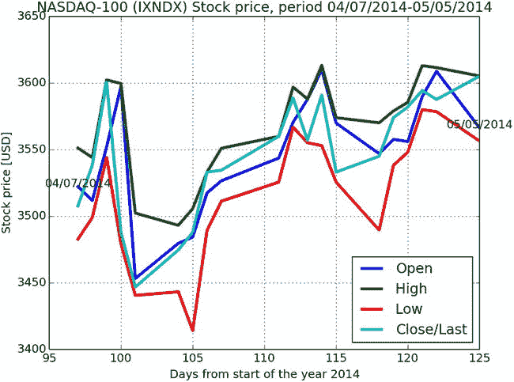
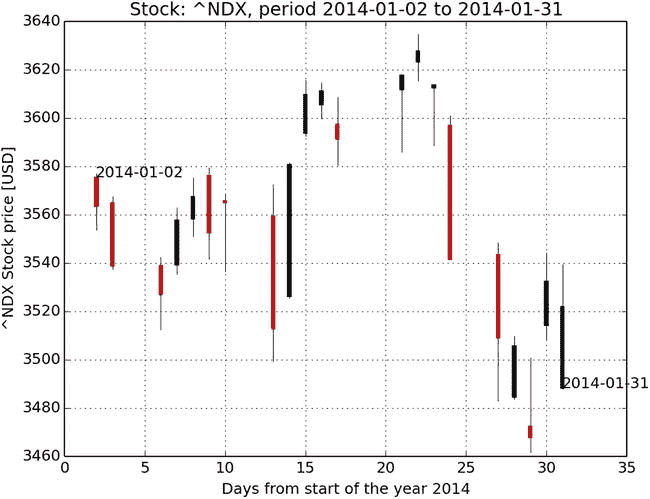

# 第 4 章

## 数据组织

## 整理混乱

设计和编写算法的第一步是收集数据并对其进行分类。当你首次验证一个论点或编写代码分析网络流量时，只有部分信息是现成的；有些数据仍是未知的。你会根据第一批数据文件做出初步估计。随着数据的收集，你会获得新的见解和理解，这可能导致处理脚本和数据收集应用程序的变更，例如添加一个之前未记录的参数并绘制其随时间变化的图表。某些变更可能包括在比最初预期长得多的时段内收集数据。因此，为了管理可处理的数据文件，你会降低采样率，即仅记录每第`n`个值。另一种常见情况是解析日志文件，其中生成应用程序（例如，网络服务器）最近经历了软件升级，从而改变了文件格式和文件名方案。

情况可能变得更加复杂。某些文件可能因记录设备的硬件故障而包含错误；或者文件的某些部分可能因硬盘问题而损坏（记得备份！）；或者存储文件的应用程序可能存在缺陷并生成了错误数据。此时，你会意识到需要修改错误数据或将其从分析中移除，无论是手动还是自动完成。

在某些情况下，你可能会决定将部分数据用作训练集来帮助定义算法，而另一组数据则用作测试集来评估性能。在这种情况下，你可能需要向算法提供关于文件内容的额外信息，以便执行更复杂的测试。

记录文件内容非常重要，这样关于每个文件包含什么信息的知识就不会丢失。几年后，你可能不记得每个文件是什么了；但你可能会被期望重用之前的工作。因此，注释或记笔记很有价值。理想情况下，你希望注释和文档与数据存放在一起，而不是放在无法访问的笔记本中。

到现在为止，你已经有相当多不同类型的文件：不同数量的参数、不同的文件长度、不同的记录周期、各种文件格式、几种文件名方案、干净数据和原始数据、带注释的数据等等。理想情况下，你希望使用所有文件中的数据，即使其中一些文件只有部分信息或遵循不同的文件格式；它们仍然包含有价值的信息。或者，你可能希望使用历史信息来确保与旧版本软件的向后兼容性。

很多工作都包含许多未知因素。数据收集本质上是一个迭代过程；如果你没有妥善管理数据文件，就会失去控制。我并不是建议我们停下来，从一开始就设计一个完整的数据管理基础设施。相反，我认为数据应该按照我描述的方式收集。然而，遵循一些简单的指南和约定可以让生活轻松得多。本章的目的就是解决所有这些问题：文件名、文件格式、数据组织、数据清理以及注释和数据文档。我将逐一探讨每个主题，提出一些指南和约定，帮助程序员和处理应用程序更轻松地管理数据。

## 文件名约定

数据组织的第一步是确定文件名约定。你会惊讶于人们为文件选择的各种奇怪名称。不是因为他们不够有创意，而是因为他们从未认真考虑过。他们应该考虑。当不止一个人访问数据时，文件名约定非常有价值。一个好的约定将帮助所有数据用户定位和管理文件：如果管理员知道文件名模式，他会更容易恢复之前备份的文件。一个好的命名约定还应该考虑到脚本或程序，以便更容易实现自动化。例如，如果文件名包含星期几，请将其限制为三个字母（即`Sun`、`Mon`、`Tue`、`Wed`、`Thu`、`Fri`和`Sat`），而不是使用完整的星期名称。这可以使处理它们的脚本不那么复杂。

### 文件名中的日期和时间

我们根据日期记住很多事情。“还记得我们运行那个测试的时候吗？那是你加入团队的时候，大约一年半以前。”捕获日期和时间信息的最佳方法之一就是用它们来命名文件。遵循这一指南可以轻松进行文件搜索。无需逐个打开文件并查看内容，你可以浏览目录内容并根据日期查找数据。在文件名中使用日期和时间的一些好处是：

-   日期是有用的信息。仅看文件名就能告诉你很多关于文件的信息。
-   文件名几乎可以保证是唯一的。当你的数据记录应用程序创建文件名时，这一点很重要，因为它不会覆盖现有文件。如果你想进一步确保唯一性，可以在日期信息中包含秒数。
-   复制或移动文件时，即使修改了文件内容，文件名也会保留。这与依赖操作系统记录文件创建日期不同，因为你会发现这样做存在问题：使用不同介质和/或通过网络复制文件可能并不总是保留所有日期信息（例如，创建日期）。但是，它们会保留文件名。
-   易于自动化和编写脚本。编写一个显示上个月所有图表的脚本是直接了当的。
-   该约定易于在广泛的系统和编程语言中遵循。记录数据的应用程序可以用 C 编程语言编写，而不一定非要用 Python。

正如你所见，将日期和时间（最好精确到秒）嵌入文件名是一个值得遵循的好方案。话虽如此，表示日期和时间的方式有很多种。就个人而言，我遵循 ISO 8601 中建议的日期和时间格式：`YYYY-MM-DDThh:mm:ss`（参见“最终说明与参考资料”部分），并做了一些修改，因为文件名中不能包含冒号（`:`）。我用短横线（`–`）代替冒号，使格式变为`YYYY-MM-DDThh-mm-ss`。另一种可能的修改是也将 ISO 标准中用于分隔日期和时间部分的字母`T`替换为短横线（`YYYY-MM-DD-hh-mm-ss`）。这两种替换的附带好处是，现在有了一个单一的字段分隔符来分隔年、月、日、时、分、秒。这对于自动化非常有价值，并且在大多数编程语言中很容易实现。有些人更喜欢保留字符`T`，因为它确实有助于提醒你日期在哪里结束，时间从哪里开始，而且在 Python 中实现起来也并不复杂。保留`T`或将其替换为短横线都是不错的选择；使用哪一种主要取决于个人偏好。你很快就会看到，Python 提供了一个专门用于解析日期的函数`strptime()`，它可以很容易地处理`T`。

Python 还提供了`split(substr)`函数，该函数在遇到`substr`时将字符串拆分为子字符串列表。在这种情况下，`split('-')`将拆分日期-时间格式：

```
>>> a_date = "2014-05-05-22-17-14"
>>> a_date.
```


`split('-')` 返回 `['2014', '05', '05', '22', '17', '14']`。

以下示例将月份提取为整数：

```python
>>> int("2014-05-05-22-17-14".split('-')[1])
```

```
5
```

在后面的示例中，我选择直接对字符串进行操作，而不是将其保存在变量中。月份是列表中的第二个元素；要访问它，我使用索引 `[1]`（计数从 0 开始）。函数 `int()` 将字符串值转换为整数。

如果你遵循使用 `T` 代替短横线的方案，可以使用 `strptime()` 函数，该函数是 `time` 模块的一部分。我假设 `strptime()` 是 string-parse-time 的缩写；无论这个假设是否正确，它都有助于记住函数名：

```python
>>> from time import strptime
>>> strptime("2014-04-12T09-29-22", "%Y-%m-%dT%H-%M-%S")
```

```
time.struct_time(tm_year=2014, tm_mon=4, tm_mday=12, tm_hour=9, tm_min=29, tm_sec=22, tm_wday=5, tm_yday=102, tm_isdst=-1)
```

 **注意** 小写字母和大写字母用于区分日期和时间字段，主要是因为字符 `m` 既可以表示月份也可以表示分钟。因此，约定是时间用大写字母表示（`HH`、`MM`、`SS`），日期用小写字母表示（`yy`、`mm`、`dd`）。有一个例外，那就是年份：当使用四位数字表示法（例如 2008）时，字符是大写的：`YYYY`。

如你所见，只要文件名符合约定，在 Python 中从文件名提取日期和时间信息是相当容易的。处理所有文件（例如 2014 年 4 月的文件）可以通过一个 `split()` 命令，后跟一个 `if` 语句来完成。

### 有用的文件名标题

文件名的另一个重要方面是有一个有用的标题。一个简短、描述性的标题可以节省时间。你应该更多地描述系统而不是数据；数据在分析时会说明自身。`SystemY` 或 `MarsTelescopeA` 是不错的选择，但你应该避免使用描述数据的标题，例如 `Logfiles` 或 `TemperatureAndFlow`。如果你确实想描述数据，请在描述系统的基础上进行：`Sys736Logs` 是一个不错的选择。确定标题后，暂停一下并稍加思考。在描述性和易用性之间找到合适的平衡有时需要修改你的想法。考虑以下示例：

- `PumpRawData` 缺少系统描述。如果你有几个泵要测试流量怎么办？一种替代方案是使用泵的序列号：`Pump472RawData`（假设 472 是泵的序列号）。
- `VoltageSys2AMay2008` 可能也不是一个好标题。如果你将日期附加到此标题，最终可能会得到如下标题：`VoltageSys2AMay2008-2009-01-01-01-01-01`。那么它到底是哪一年——2009 年还是 2008 年？
- `VoltageCurrentSystem2A` 还可以；但是，我倾向于将其重命名为更不具体，或者更笼统：`ElectricalDataSystem2A`。重命名的原因是，你可能会决定记录额外的值（例如，除了电压和电流之外，还有功率）；除非你想重命名代码以查找不同的标题，否则一个名为 `VoltageCurrentSystem2A` 但也包含功率值的文件会有点误导。

### 文件扩展名

文件名约定的最后一部分是指示文件格式，通常由文件扩展名表示。文件扩展名通常为三个字符长（有些更短，例如 `.gz`，有些更长，例如 `.html`）。尽量遵循扩展名为三个字符的约定——同样，这会使处理应用程序更容易。我建议考虑三个不同的文件扩展名子类别：

- **已知文件格式**：图像格式遵循非常具体的扩展名：`.jpg`、`.png`、`.bmp`、`.tif` 等。这些文件名具有含义，因此如果你以这些文件格式记录数据，请使用已知的扩展名。压缩文件格式、视频文件格式等也有已知的扩展名，因此请相应使用它们。
- **文本文件格式**：这里我建议使用 `.txt` 或 `.csv` 扩展名。如果文本文件格式不是逗号分隔值（CSV）格式，请使用 `.txt` 扩展名；这表明它可以通过大多数文本编辑器查看。此指南的例外情况包括已有已知扩展名的文件（例如 INI 文件）：尽管它们是文本文件，但你确实希望表明它们是保存初始化值的文件。这同样适用于批处理文件和 shell 脚本，但这些通常不是数据文件。
- **二进制文件格式**：二进制文件格式不像 CSV 文件那样具有自描述性。与 CSV 或纯文本文件不同，如果不事先了解特定的文件格式，很难查看它们。因此，二进制文件格式应附带一个描述二进制文件内容和格式的头文件。然而，即使确切的格式未知，了解有关二进制文件格式的更多信息仍然很有价值。我建议采用以下约定：一个字符表示数据是有符号（`i`）、无符号（`u`）还是浮点（`f`），后跟用于存储数据的位数，如表 4-1 所述。

表 4-1. 建议的二进制文件扩展名

| 描述 | 精度 | 扩展名 |
| --- | --- | --- |
| 有符号整数 | 8, 16, 32, 64 | `.i08`, `.i16`, `.i32`, `.i64`（分别对应） |
| 无符号整数 | 8, 16, 32, 64 | `.u08`, `.u16`, `.u32`, `.u64`（分别对应） |
| 浮点数 | 32（单精度）64（双精度） | `.f32` `.f64` |

- **其他二进制文件格式**：当二进制文件包含多个不同精度的值时，表 4-1 中描述的约定不可行，至少在三个字符的扩展名表示法中不可行。在这种情况下，请使用 `.bin` 或 `.x.bin`，其中 `x` 是一个数字。使用 `x` 的原因是，你可能会有多种不同精度的文件格式，区分它们的一个好方法是添加一个整数前缀。请注意，它们仍然都以 `.bin` 结尾，从而便于区分文件。

### 文件名约定总结

文件命名约定有三个重要方面：文件名中的日期和时间、有用且描述性的文件名标题以及适当的文件扩展名。如果你遵循这些约定，你会发现编写脚本来操作这些文件很简单。

使用这些约定，我们得到的文件名遵循 `Title-YYYY-mm-dd-HH-MM-SS.ext` 方案，占位符详见表 4-2。

表 4-2. 文件名约定方案：`Title-YYYY-mm-dd-HH-MM-SS.ext`

| 占位符 | 描述 |
| --- | --- |
| `Title` | 你选择的描述性标题。 |
| `YYYY` | 文件创建的年份。 |
| `mm` | 文件创建的月份。对于一月，`mm` 为 `01`。 |
| `dd` | 文件创建的日期。对于第 7 天，`dd` 为 `07`。 |
| `HH` | 24 小时制的小时数。晚上 11 点表示为 `23`。值范围从 `00` 到 `23`。 |
| `MM` | 分钟。整点过 5 分钟为 `05`。 |
| `SS` | 秒数。整分过 7 秒为 `07`。 |
| `ext` | 描述文件格式的扩展名，尽可能为三个字符。 |

 **注意** 如果值占用的位数少于分配的位数，则添加零。因此，如果时间是 1 点过 5 分，`hh` 的值将为 `01`，`mm` 的值将为 `05`。

### 示例：自动化文件名创建

一旦你决定了文件名格式，就可以使用 Python 来实现它。


#### 文件命名与格式

我为这个示例选择的文件名称格式是`SysALogs-YYYY-MM-DDThh-mm-ss.csv`。清单 4-1 展示了这种文件名称格式的实现。

***清单 4-1***. 创建唯一文件名，`unique.py`

```python
from time import localtime

#### a script to create unique file names based on title,
#### date and time stamp and an extension
datetime_stamp  = '%4d-%02d-%02dT%02d-%02d-%02d' % localtime()[:6]
title = 'SysALogs'
ext = 'csv'
print('Unique filename: %s-%s.%s' % (title, datetime_stamp, ext))
```

以下是我执行`python unique.py`得到的结果：

```
Unique filename: SysALogs-2014-05-06T07-26-49.csv
```

 **注意**：在示例中，我假设文件生成速率较慢（每秒一个文件），并且只有一个应用程序记录数据；因此，基于秒的文件名是唯一的。此外，如果系统时间发生变化，文件可能不再唯一。在创建文件之前，你可以检查该文件是否已存在；但为了清晰起见，示例脚本中省略了这一步。

函数`localtime()`是`time`模块的一部分，它提供了一个结构体，包含年、月、日、时、分、秒、星期、一年中的第几天以及夏令时标志：

```
>>> localtime()
```

```
time.struct_time(tm_year=2014, tm_mon=5, tm_mday=6, tm_hour=7, tm_min=28, tm_sec=7, tm_wday=1, tm_yday=126, tm_isdst=0)
```

```
>>> localtime()[:6]
```

```
(2014, 5, 6, 7, 28, 46)
```

我们只需要`localtime()`的前六个参数来创建唯一的文件名。为了访问元组的前六个元素，我们使用切片运算符`[:6]`。因此，`localtime()[:6]`返回我们创建唯一文件名所需的六个元素。

接下来，我们使用`%`运算符格式化包含时间戳的字符串：`'%4d-%02d-%02dT%02d-%02d-%02d'`。子字符串`'%4d'`表示最多四位数字，而`'%02d'`表示两位数字——如果少于两位，则用零填充。我们还使用`%`运算符输出最终的唯一文件名，该文件名由变量`title`、`datetime_stamp`和`ext`中存储的字符串组成。这里，我们使用`'%s'`来格式化字符串，而不是整数。

## 其他方案

遗憾的是，自动创建文件名并使用日期和时间主要适用于你编写生成数据文件的应用程序的情况。但情况并非总是如此：你可能正在使用嵌入式系统的输出文件，并且无法控制源代码。只要生成文件的系统具有实时时钟，并且假设你可以更改代码（或稍后更改文件名），遵循上述约定是可行的。

在无法使用实时时钟的情况下，你需要不同的命名方案。在文件名中使用时间戳的一种方法是使用运行索引。这比使用日期稍微复杂一些，因为现在你必须找出上次使用的索引。尽管如此，它仍然是一个不错的选择：它提供了一致性，并且除非文件被随机删除，它还能提供某种时间顺序。顺便提一下，大多数数码相机都使用这种方案。

### 示例：运行索引

清单 4-2 是一个建议的运行索引实现。该脚本将根据标题和扩展名查找文件，并确定一个运行索引（最多 999）。然后，它将相应地创建一个文件。重复运行该脚本将创建索引值递增的文件。

***清单 4-2***. 运行索引实现，`index.py`

```python
#### a script to create unique filenames using a running index
from os.path import exists

index_stamp = 1
max_index   = 999   # maximum number of files
title       = '../data/SysALogs'
ext         = 'txt'

while index_stamp <= max_index:
    unique_filename = '%s-%03d.%s' % (title, index_stamp, ext)
    if exists(unique_filename):
        index_stamp += 1
        continue
    f = open(unique_filename, 'wt')
    f.write("Data")
    f.close()
    break

#### report status
if index_stamp > max_index:
    print("Could not create a unique filename")
else:
    print("Created a unique file: ", unique_filename)
```

该脚本的一般操作如下：首先，我们使用当前索引创建一个文件名字符串。接下来，我们通过调用函数`exists()`（它是`os.path`模块的一部分，更多关于`os.path`的内容请参见第 10 章）来检查文件是否存在。如果文件存在，我们递增索引并重新开始循环；这是通过语句`continue`完成的。如果我们创建的文件名不存在，则继续将数据写入文件并跳出`while`循环。最后，如果无法获得唯一的文件名（我们根据变量`max_index`检查到索引 999），脚本会报告无法创建唯一文件名。

请注意，我们选择用零填充运行索引，如`unique_filename = '%s-%03d.%s' % (title, index_stamp, ext)`这一行中的子字符串`'%03d'`所示。这通常是一个好主意，并且可以更轻松地处理文件名，因为文件名具有相同的长度，并且表示文件名的字符串可以轻松切片。

 **注意**：如果你更改了`max_index`的值，请务必相应地更改格式字符串。例如，如果`max_index`是`99999`，请将`unique_filename`格式规范中的`%03d`替换为`%05d`。这也可以通过使用`int(log10(max_index)+1)`计算位数并将结果用于格式规范来自动完成（参见第 5 章中的“示例：在文本文件中搜索”部分）。函数`log10()`是`math`模块的一部分（参见第 6 章）。

## 文件格式

到目前为止，我们已经讨论了文件名的形式。现在是时候考虑*内容*的格式了，即文件格式。如前所述，你可能无法选择用于存储数据的文件格式。假设你确实对文件格式有影响力，那么问题在于使用哪种格式。一个好的文件格式应该是可移植且易于识别的。同时，根据应用程序的性质，它不应在大小或计算开销方面对性能产生重大影响。

在选择文件格式时，请考虑你将处理的数据量。如果你面对的是大量数据，你希望在存储和访问数据方面尽可能高效。权衡之处在于，你将需要牺牲一点可移植性，或者使用一种不太自描述的文件格式。这意味着选择二进制格式。如果数据量不大，并且你希望数据具有自描述性且尽可能可移植，那么请选择文本文件格式——特别是 CSV。对于大量数据，请考虑以下几点：

- 你有多少存储空间？如果你使用的是台式 PC，合理的数据量应小于 1TB。当然，随着存储空间和处理能力的提升，这个数字也在不断变化。有时你会发现，由于存储空间的限制，你唯一的选择就是使用二进制文件。原因是文本表示不如二进制表示高效。8 位整数（字符）在二进制形式下需要 1 字节存储空间，而在 CSV 使用的文本形式下则需要 1 到 3 字节（不包括空格和逗号）。存储浮点值（通常二进制形式需要 4 字节）现在将需要相当多的字节。例如，值 0.


#### 排版后的内容

`00000095367431640625`（即 2 的 -20 次方）现在需要 22 字节才能在 CSV 文件中正确表示。这还不包括分隔符和定界符。

- 性能对您的应用程序有多关键？数据文件越小，处理速度越快。无需解析数据，只需读取即可。如果性能是您的主要关注点，请选择二进制文件格式。


**注意**：“数据文件越小，处理速度越快”这一说法并不总是正确。例如，压缩文件更小，但处理时需要更多计算；因此，其性能反而更差。然而，假设没有压缩，二进制文件的性能通常更好。

因此，从高级文件格式的角度来看，您需要决定是使用二进制数据还是文本数据。表 4-3 列出了使用两者的优缺点。

表 4-3. 二进制与文本文件格式的优缺点

| | 优点 | 缺点 |
| --- | --- | --- |
| 文本 | 通常自描述；无需了解文件格式的具体知识；任何文本编辑器均可查看 | 存储效率不高；读写访问速度中等；需要“文本”解析器 |
| 二进制 | 存储空间相对较小；读写访问速度快 | 不太自描述；需要了解文件格式；需要特定应用程序查看数据 |

文本和二进制是高级分类。在处理文本文件时，我们主要讨论纯文本文件和 CSV 文件，并简要涉及其他文件格式。在处理二进制文件时，我们主要讨论简单的文件格式，如`u16`和`i32`，而不涉及复杂的文件格式，如`MP3`和`gz`（这些格式可能支持压缩和/或加密）。

### CSV 文件格式

CSV 文件格式是一种文本文件格式，任何文本编辑器均可查看。此外，大多数电子表格应用程序都能读写 CSV 文件，并将值正确解析为行和单元格。在 CSV 文件中，值由逗号分隔。简而言之，值是表示数字、日期、标题或任何其他文本字段的字符串。如果字符串值中包含逗号，则需要使用引号；即，该字符串将带有起始和结束引号。或者，字段中的逗号可以被转义（更多内容请参见第 5 章）。CSV 格式不要求每行（也称为行）有固定数量的字段，这非常有用：它允许轻松添加数据头或数据描述，这些信息随后可以被大多数电子表格和/或编辑器读取，且所有记录的信息仍然完整且易于访问。

以下是一个有效 CSV 文件的内容：

```
System A Data generated by logger1
"Header, 1",Header 2
Value 1,1
Value 2,AA
```

### 示例：股票价格图表

遵循在 CSV 文件开头行中存储数据简短描述的约定，对于注释与文件中数据相关的图表或报告非常有用。

要跟随示例操作，请确保您的目录结构与第 2 章中“示例：本书的目录结构”一节中介绍的类似。使用`Ch4`作为您的基础目录；在`Ch4`中，包含三个子目录，分别命名为`src`、`data`和`images`。如果您希望使用不同的方案，请务必更改脚本中的文件路径变量和对函数`savefig()`的调用（见清单 4-3，稍后在本节中出现）。

***清单 4-3***. `stock_charts.py`，绘制 NASDAQ `charts.xls` 文件

```python
from pylab import *
import csv
from time import gmtime, mktime

#### modify the following to point to your data file
filepath = '../data/charts.xls'

#### read the entire CSV file and store it in an array of lists
#### use tab ('	') as a delimiter
data = []
for row in csv.reader(open(filepath), delimiter='\t'):
    data.append(row)

#### split the data to header and values
header = data[0]
values = array(data[2:])

#### the first column is date information in a string format
#### we transform it to a day of year format
#### notice that this will not work over year boundary (need to add 365)
yearday = zeros(len(values[:, 0]))
for i, day in enumerate(values[:, 0]):
    market_close_time = (int(day[6:]), int(day[:2]), int(day[3:5]), \
        16, 0, 0, 0, 0, 0)
    yearday[i] = gmtime(mktime(market_close_time)).tm_yday

#### plot the data
for i in range(1, 5):
    plot(yearday, values[:, i], label=header[i], linewidth=3)

#### annotate the start and end dates
text(yearday[0], values[0, 1], values[0, 0], ha='center')
text(yearday[-1], values[-1, 1], values[-1 ,0], ha='center')

grid()
legend(loc='best')
ylabel('Stock price [USD]')
xlabel('Days from start of the year '+values[0, 0][6:])
title('NASDAQ-100 (IXNDX) Stock price, period %s-%s' % \
    (values[-1, 0], values[0, 0]))
savefig('../images/stock_price.png', dpi=150)
```

对于此示例，您可以从纳斯达克股票交易所网站（`http://www.nasdaq.com`）下载数据。选择您希望显示的股票，例如 NASDAQ-100 (IXNDX) 或您公司的股票图表。选择“交互式图表”选项，右键单击图表，然后选择“查看底层数据”。这将显示用于创建图表的实际值。您可以选择以 Excel 格式下载文件：下载并将文件保存到`Ch4/data/charts.xls`。

如果您在文本编辑器中打开`Ch4/data/charts.xls`文件，您会注意到其中有头信息描述了每列的含义：

```
Date        Open         High          Low          Close/Last    Volume
10:24       3598.27002   3599.389893   3587.48999   3598.350098   0
05/05/2014  3566.256     3605.263      3556.403     3605.092      0
05/02/2014  3608.841     3611.563      3578.527     3587.644      0
05/01/2014  3589.659     3613.03       3580.019     3594.362      0
04/30/2014  3556.004     3585.502      3548.11      3582.02       0
04/29/2014  3557.768     3579.03       3538.242     3573.99       0
```

实际上，该文件格式是 CSV 的一种形式，分隔符是制表符而不是逗号。我们可以通过 Python 的`csv`模块轻松解决这个问题，指定分隔符为制表符：`'\t'`。清单 4-3 展示了我们的实现`stock_charts.py`，它读取股票图表文件并呈现一个正确显示头信息的图表。请确保将其保存在文件夹`Ch4/src`中。结果将是一个 PNG 图像`stock_price.png`，位于目录`Ch4/images`中。

我们首先读取 CSV 数据文件，并传递制表符作为分隔符。变量`data`中的第一行是头信息，描述了每列的含义：日期、开盘价、最高价、最低价、收盘价/最后价和成交量。第二行是当前股票价格。其余行是要绘制的值。因此，我们将变量`data`相应地拆分为`header`和`values`。我们还使用函数调用`array()`将值转换为`NumPy`数组。使用`NumPy`数组，数据将更容易处理和绘制；您将在第 7 章中了解更多关于`NumPy`的内容。

以下内容并非对 CSV 文件处理的解释，但对于完全理解脚本非常重要。

接下来是所谓的线性化过程。与第 1 章的 GPS 示例类似，`charts.xls`中的数据不是线性的。


信息由每日记录的股票价格组成；然而，股票并非每天都交易，周末是主要例子，节假日也是如此。如果我们按原样绘制这些信息，忽略数据中的这些“空洞”，呈现的图表将会失真。因此，我们需要选择一个不同的时间基准，一个能考虑非交易日的时间基准。我选择使用一年中的第几天值：1 月 1 日为 1，1 月 2 日为 2，……12 月 31 日为 365（闰年为 366）。由于我不想深入确定闰年或累加每月天数的过程，我决定再次使用`time`模块。这里的思路是使用`gmtime()`函数；作为副作用，这将获取一年中的第几天值。`gmtime()`函数接收一个表示自纪元（一个固定的时间点，详见第 5 章）以来经过的秒数的值。虽然这听起来比计算一年中的第几天更复杂，但实际上由于`mktime()`函数的存在，它更简单。`mktime()`函数接收一个包含九个值的元组（之前已详述），并返回自纪元以来的秒数。因此，我们首先构造一个包含这九个值的元组，前三个是已知的年、月、日，并任意将小时设为下午 4 点（与交易日结束时间一致）。我们将剩余字段设为零。然后，我们将这个数字输入`gmtime()`，并接收一个新的元组，该元组现在已正确填充了年份中的第几天（元组的第八个元素），可通过`tm_yday`访问，我们将其保存在向量`yearday`中。

 **注意** 该脚本未考虑超过一年的数据。为了适应这一点，你可以考虑一年中的天数（365 或 366，取决于闰年），并使用最低年份作为基准。

然后，我们绘制数据并注释图表。对于图例，我们使用存储在变量`header`中的 CSV 文件头值。我们还使用变量`values`中的实际值来注释图表上周期开始和结束的位置、标题以及 x 轴标签（参见图 4-1）。



图 4-1. 股票价格图表输出

 **注意** 如果你仔细查看`charts.xls`中的数据，你会发现它是反向的；也就是说，它在时间上是倒退的。使用一年中的第几天值的副作用之一是，数值现在按从低到高的顺序绘制：较旧的时间在左侧，较新的事件在右侧。如果你想反转此行为，请执行命令`gca().axes.invert_xaxis()`。

示例：自动读取雅虎财经数据

有一种替代方法可以手动从纳斯达克保存`charts.xls`文件。其中一种选择是使用`matplotlib.finance`模块。获取数据并解析它的两个核心函数是`fetch_historical_yahoo()`和`parse_yahoo_historical()`（尽管你也可以轻松地自己解析数据）。另一个值得关注的函数是`candlestick()`函数，它绘制股票的 K 线图。

清单 4-4 是前一个示例的修改版，使用了`matplotlib.finance`模块中的函数。请注意，由于数据结构与纳斯达克的`charts.xls`文件略有不同，代码中还有一些其他细微的更改。你可以通过更改`stock_name`、`t_start`和`t_end`的值来控制要查看的股票以及开始和结束日期。

***清单 4-4***. 获取并绘制雅虎数据 `yahoo_charts.py`

```python
from pylab import *
from matplotlib.finance import *

#### stock name and period
stock_name  = '^NDX'
t_start     = datetime.datetime(2014, 1, 1)
t_end       = datetime.datetime(2014, 1, 31)
year_start  = datetime.datetime(2014, 1, 1)

#### retrieve and parse stock data
data    = fetch_historical_yahoo(stock_name, t_start, t_end)
y       = array(parse_yahoo_historical(data))

#### dates might not be trade days, so update values
#### to show actual dates retrieved
t_start = num2date(y[0, 0])
t_end   = num2date(y[-1, -0])

#### normalize the x-axis to show values from the start of year
y[:, 0] = y[:, 0]-date2num(year_start)+1

#### plot a candlestick graph
figure()
candlestick(gca(), y)

#### annotate the graph with additional text
start_str = "%d-%02d-%02d" % (t_start.year, t_start.month, t_start.day)
end_str   = "%d-%02d-%02d" % (t_end.year, t_end.month, t_end.day)
title('Stock: %s, period %s to %s' % (stock_name, start_str, end_str))
xlabel('Days from start of the year %d' % t_start.year)
ylabel('%s Stock price [USD]' % stock_name)
text(y[0, 0], y[0, 1], start_str)
text(y[-1, 0], y[-1, 1], end_str)
grid()
savefig('../images/%s_candlestick_yahoo-%s-%s.png' % \
    (stock_name, start_str, end_str), dpi=150)
```

需要记住的几点：

*   时间基准已归一化；也就是说，日期从 2014 年初开始显示，而不是从纪元开始。这通过代码行`y[:,0] = y[:,0]-date2num(year_start)+1`实现。
*   实际请求的日期可能不是交易日。因此，在获取并解析数据后，开始和结束时间会更新。这通过代码行`t_start = num2date(y[0, 0])`和`t_end = num2date(y[-1, -0])`完成。

图 4-2 显示了清单 4-4 中示例的结果。



图 4-2. 自动生成的 K 线图

示例：创建 CSV 文件

如果你是从头开始创建自己的 CSV 文件，而不是下载数据，你可以轻松地将列表写入 CSV 文件，如下例所示。我将一些任意的混合数据（字符串和数字）分配给一个名为`data`的列表，并将其写入文件。自己尝试一下，然后打开创建的文件`test.csv`查看文件内容：

```python
L = [['Time', 'Value', 'Notes'], [0, 20, 'Start point'],\
    [0.1, 'Middle point'], [2]]
import csv
f = open('../data/test.csv', 'w', newline='')
csv.writer(f).writerows(L)
f.close()
```

以下是测试文件`test.csv`的内容：

```
Time,Value,Notes
0,20,Start point
0.1,Middle point
2
```

尝试更改列表的值，例如在其中一个字符串中添加逗号。现在在电子表格应用程序中打开该文件：应用程序是否正确地读取了逗号？接下来，在文本编辑器中打开该文件，注意包含逗号的字符串现在被引用了。`csv`模块负责根据需要添加引号。你将在第 5 章中了解更多关于`csv`模块的信息。

**使用`CSV`模块代替`SPLIT()`函数**

到目前为止，我们已经大量使用了 Python 的`csv`模块。你可能想知道为什么我们不使用`split(',')`函数来代替`csv.writer`对象。答案是`csv`模块也处理特殊情况，例如包含逗号的字符串。考虑以下行：

`"Surname, Name", 2008, 450`

`csv`模块将正确处理此问题并返回三个元素。然而，`split(',')`将返回四个元素：带引号的字符串将被分成两部分。

CSV 的局限性

CSV 的世界并非完美无缺。以下是一些需要考虑的事项：

*   **大小**：与二进制文件格式相比，CSV 文件通常不是大小高效的。
*   **性能**：CSV 文件也存在性能损失，因为它们需要解析。


#### 排版后的文档

一个应用程序，无论是电子表格应用还是我们使用 Python 编写的代码，都会调用一个函数来将 CSV 文件转换为应用程序更容易使用的值。也就是说，它会解析字段和行，并将文本转换为整数或浮点数（对于数值的情况）。运行解析器读取 CSV 文件需要时间，因此读取大文件会花费相当多的时间。如果性能很重要，并且你的应用程序读取非常大的文件，请考虑使用二进制文件格式。

### 存储什么

作为一般规则，应尽可能多地存储信息。不幸的是，有时这种理想情况根本不可行。考虑一个未压缩的高清电视视频信号的数据速率，分辨率为 1080×720 像素，每秒 30 帧，真彩色（24 位）。这相当于每秒 1080×720×30×3 字节，即大约每秒 70 兆字节的存储量，这相当大。（如果你想同时存储多个频道呢？）这意味着你必须丢弃一些信息或对其进行压缩——或者获得更好的硬件。

决定存储什么和不存储什么将在很大程度上取决于系统。有些人选择对数据进行抽取，这有其影响。其他人则决定丢弃他们认为不太重要的参数。除非有文件大小限制，否则在决定存储什么时，请考虑以下指南：

- 在文件开头写入头文件信息，描述系统和数据，包括测量单位。你可以为此使用自由格式文本。有些人甚至更进一步，在每行开头添加一个特殊字符（例如，`#`），以确保读者理解这些是注释，而不是数据的一部分。
- 为每一列包含一个标题，解释每一列的含义。这对于使用电子表格查看文件以及使用自动化脚本可视化数据都非常有用。
- 始终尝试存储时间和日期。将日期和时间值存储在第一列。你可以遵循 ISO 8601 规范，或者选择使用不同的表示法。ISO 8601 格式的一个有价值的替代表示法是存储自纪元（大多数 Linux 机器上的 1970 年 1 月 1 日）以来经过的秒数。这样，你得到一个非常容易操作的数字，而不是需要解析的日期和时间。还有一个额外的好处：如果你有多个文件，你可以为所有文件使用相同的时间基准。自纪元以来的秒数表示法在二进制格式中非常有用。

以下是一个遵循上述指南的文件内容示例：

```
#Units,Celsius
#Sensor,A1
#System serial number,401
Date and Time,Temperature,Pressure
2005-09-15T01:07:08, 42.0,53.1
2005-09-15T01:07:14, 42.0,53.2
2005-09-15T01:07:19, 39.0,51.8
```

### 何时使用 CSV

尽可能使用 CSV，但以下情况除外：

- 性能是一个问题。
- 文件大小是一个问题。
- 数据已经是不同的格式。

### 二进制文件

二进制文件是一种高效的数据存储方法。术语“二进制文件”指的是不以 ASCII 文本表示的文件；也就是说，如果你在文本编辑器中打开这些文件，数据看起来会是乱码。实际上，除了文件中数据的表示方式之外，二进制文件和文本文件之间没有区别。从计算机的角度来看，它们都只是文件。所以本质上，如果文件不是文本文件，它就是二进制文件，但这是一个松散的定义。

如前所述，使用二进制文件格式有优点，通常是大小和性能。还有另一个原因，那就是数据的性质。数字图片不容易表示为文本文件（尽管可以——例如，每个像素值都是 CSV 文件中的一个整数）。压缩文件也是如此。无论出于何种原因，几乎不可能避免使用二进制文件。

在本书中，当我提到二进制文件时，我通常指的是以下文件格式之一：值数组、结构体数组或其他常用的二进制文件格式。

#### 值数组

我们将使用的最简单的二进制文件格式是值数组，即单一数据类型。文件可以保存有符号值或无符号字节。值数组文件格式非常适合存储简单的二进制数据。

##### 示例：读取和写入二进制值数组

Python 的 `array` 数据类型（不要与 NumPy 的 `array` 数据类型混淆）是处理此类二进制文件的理想选择。`array` 数据类型是 `array` 模块的一部分。要使用它，请发出以下命令：

```python
>>> from array import *
```

要创建一个数组，请调用 `array()` 函数，并传入数据类型和可选的初始化参数，如下所示：

```python
>>> from array import *
>>> a = array('h') # 有符号数字数组，大小为零
>>> a
```

```
array('h')
```

```python
>>> b = array('L', [1000, 2000, 3000]) # 三个无符号数字的数组
>>> b
```

```
array('L', [1000, 2000, 3000])
```

```python
>>> c = array('d', range(10)) # 浮点数数组，从 0 到 9（含）
>>> c
```

```
array('d', [0.0, 1.0, 2.0, 3.0, 4.0, 5.0, 6.0, 7.0, 8.0, 9.0])
```

表 4-4 中列出的数据类型可用于初始化 `array` 对象。

**表 4-4.** 数组数据类型

| 数据类型 | 数据含义和最小字节大小 |
| --- | --- |
| `'b'` | 有符号整数，1 字节 |
| `'B'` | 无符号整数，1 字节 |
| `'u'` | Unicode 字符，2 字节或 4 字节，平台相关 |
| `'h'` | 有符号整数，2 字节 |
| `'H'` | 无符号整数，2 字节 |
| `'i'` | 有符号整数，2 字节 |
| `'I'` | 无符号整数，2 字节 |
| `'l'` | 有符号整数，4 字节 |
| `'L'` | 无符号整数，4 字节 |
| `'q'` | 有符号整数，8 字节 |
| `'Q'` | 无符号整数，8 字节 |
| `'f'` | 浮点值，4 字节 |
| `'d'` | 浮点值，8 字节 |

注意到表头写着“最小字节大小”了吗？这是因为实际的字节数可能不同，并且取决于机器架构；实际大小可以通过 `itemsize` 数组属性访问：

```python
>>> a = array('L')
>>> a.itemsize
```

在我的一些机器上，返回值是 8；在其他机器上，是 4。

将数组值写入文件是通过 `array` 数据类型的 `tofile()` 成员函数完成的：

```python
>>> f = open('b.u32', 'wb')
>>> b.tofile(f)
>>> f.close()
```

读取是通过 `array` 数据类型的 `fromfile()` 成员函数执行的。`fromfile()` 函数还需要指定要读取的值的数量。如果你提供的数字大于文件中的元素数量，则会引发异常；但是，仍然会检索到值：

```python
>>> d = array('L')
>>> f = open('../data/b.u32', 'rb')
>>> d.fromfile(f, 3)
>>> f.close()
>>> d == b
```

```
True
```

#### 结构体数组

我们将要处理的更复杂的二进制数据结构是结构体数组。单词“struct”取自 C 编程语言，描述由多种数据类型组合而成的结构。

假设数据存储如下：`int`、`float`、`float`、`int`、`float`、`float`，依此类推。这个序列可以看作是一个结构体数组，结构体为 `(int, float, float)`。从这个意义上说，前面讨论的值数组也是一个结构体数组，其结构体是单一数据类型。如果你熟悉 C 语言，前面的结构体可能如清单 4-5 所示。

**清单 4-5.**


##### C 语言中的结构体

```c
struct some_binary_file_format {
    long epoch;
    float fTemperature;
    float fPressure;
};
```

请注意，与我们之前的二进制文件格式不同，这种格式并不适合采用诸如 `.u16` 或 `.f32` 这样简洁的扩展名命名约定，因此我们直接选择扩展名 `.bin`，并注明这是一个二进制文件。

##### 示例：读写结构体数组

在本示例中，我们将创建一个包含两种数据类型（`int` 和 `float`）的结构体，将其写入文件，然后通过两种不同的方法读取：一次读取一个结构体，以及一次性读取整个文件。你可以在 Python shell 中交互式输入命令来跟随操作。

首先，我们需要导入 `struct` 模块：

```python
>>> import struct
```

为了说明结构体数组的概念，我们将创建一个行列表。每一行是一个包含三个值的列表：一个整数和两个浮点值，它们代表一个 C 结构体。我们将生成一个相对较短的列表，仅包含两行：

```python
>>> L = [ [ 10, 1.0, 2.0], [20, 0.125, 0.25] ]
```

接下来，我们定义两个变量 `filename` 和 `format`，这样就不必每次都输入它们：

```python
>>> filename = '../data/structs.bin'
>>> format = 'Lff'
```

我假设存在一个名为 `../data` 的目录；如果该目录不存在，请创建它，或者相应地修改变量 `filename` 的值。格式 `'Lff'` 表示一个 4 字节整数，后跟一个 `float` 和一个 `float`（参见表 4-4）。接下来，我们将列表写入文件：

```python
>>> fout = open(filename, 'wb')
>>> for row in L:
...     data = struct.pack(format, row[0], row[1], row[2])
...     num = fout.write(data)
...
>>> fout.close()
```

第一次调用 `open()` 以二进制模式打开一个文件用于写入（`'wb'` 中的字符 `w` 代表写入，而 `b` 代表二进制；更多信息请参见第 5 章的“文件”部分）。然后我们使用 `for` 循环遍历列表 `L` 中的每一行。每一行都使用函数 `struct.pack()` 进行打包。函数 `struct.pack()` 接受一个格式以及要打包的值。返回值是一个可以写入文件的字符串。接着我们将该字符串写入文件，并将读取的字符数存储在变量 `num` 中。最后一行关闭文件。

现在，我们应该有一个名为 `../data/structs.bin` 的文件。该文件包含列表 `L` 中的值。接下来，我们一次读取一个结构体。

我们首先定义一个变量，其值等于结构体格式的大小：

```python
>>> struct_size = struct.calcsize(format)
```

函数 `struct.calcsize()` 计算格式的字节大小。有了结构体大小后，我们开始一次读取一个结构体的数据：

```python
>>> fin = open(filename, 'rb')
>>> data = fin.read(struct_size)
>>> data
```

```
b'\n\x00\x00\x00\x00\x00\x80?\x00\x00\x00@'
```

第一行以二进制模式打开文件用于读取。然后我们使用函数 `read(n)` 读取 `n` 个字节，并将其存储在变量 `data` 中。现在变量 `data` 保存了二进制文件中的第一个结构体，但它还不可读。我们需要使用 `struct.unpack()` 对其进行解包；也就是说，我们需要使用格式说明符 `'Lff'` 将其从字符串转换为值的元组。但由于我们要读取并解包多个值，因此合理的方法是使用 `while` 循环，如下所示：

```python
>>> while data:
...     values = struct.unpack(format, data)
...     print(values)
...     data = fin.read(struct_size)
...
```

```
(10, 1.0, 2.0)
(20, 0.125, 0.25)
```

```python
>>> fin.close()
```

只要变量 `data` 非空，`while` 条件就评估为 `True`；因此，数据将被处理直到文件末尾。每个读取的结构体都使用 `struct.unpack()` 函数解包为一个值的元组。解包一个结构体后，我们读取下一个结构体。

这一过程持续进行，直到从输入文件中读取完所有结构体。最后，我们关闭文件。

我们将在这里讨论的第二种方法是一次性读取整个文件。为此，我们首先使用 `read()` 函数将整个文件读入内存：

```python
>>> data = open(filename, 'rb').read()
>>> len(data)
```

```
24
```

（请注意，在某些系统上，结果可能是 32，但这与底层操作系统有关，不应成为问题）。如果 `read()` 没有提供参数，则整个文件会被读入内存，直到遇到文件结束符（EOF）。对于小文件来说，这可能不是问题，但对于较大的文件，你应该保持警惕；你的计算机可能无法一次性处理所有数据，因此你需要按照前一种方法分块读取文件。请注意，我选择不为数据文件分配文件句柄；而是让 Python 为我处理文件的关闭。

函数 `struct.unpack()` 接受 `format` 作为参数，并将数据解包为一个元组。然而，我们需要解包整个数组，而不仅仅是第一个结构体。我们可以采用显而易见的方法，即使用 `for` 循环逐段解包二进制数据。另一种方法是将 `unpack()` 的格式值从单个 `'Lff'` 改为重复的 `'LffLffLff...'`。这样可以在一次调用 `struct.unpack()` 中解包整个二进制数据。幸运的是，Python 为我们提供了一个非常有用的字符串乘法工具，即乘法运算符：

```python
>>> 'Lff'*5
```

```
'LffLffLffLffLff'
```

我们可以通过将数据长度除以一个结构体的大小来计算要解包的数组大小。在我们的例子中，即 `len(data)/struct_size`。因此，为了生成解包所用的格式，我们将格式乘以该值，这可以简洁地写成如下形式：

```python
>>> print(struct.unpack(format*int(len(data)/struct_size), data))
```

```
(10, 1.0, 2.0, 20, 0.125, 0.25)
```

 **注意**（高级读者）此实现假设文件符合本地操作系统的字节序。如果你尝试使用 `struct` 的任何字节序、大小和对齐格式字符（如 `@`、`=`、`<`、`>` 和 `!`）以这种方式解包数据，则该函数将失败。

### 其他二进制文件格式

二进制文件可能更复杂，并且可能遵循与重复固定大小结构体不同的方案。有些采用压缩，这通常涉及非固定大小的结构体。其他可能按顺序存储数据；也就是说，使用前面示例中的数据，你可以先写入所有整数值，然后写入浮点值。在这种情况下，应采用不同的方法来读取文件，但如果你知道文件格式，这相当简单。在本书中，我将简要涉及此主题，特别是关于已知文件类型，如图片和压缩文件。由于文件格式的数量几乎是无限的，因此该主题过于庞大，一本书无法涵盖。

### 头文件

二进制文件与 CSV 文件在一个重要方面有所不同：你无法真正判断二进制文件中的信息是整数表示、浮点表示还是完全不同的方案。这意味着你（程序员）需要提前知道你正在处理的是哪种文件格式。起初，这似乎不是一个复杂的任务，但实际上并非易事。即使使用本章前面介绍的相同表示法，例如 `.u16`，你仍然不知道这些值代表什么。它们是采样的电压值吗？是否有时间戳？而且你可能正在处理多种二进制文件格式。

为了解决这个问题，我们使用头文件来描述每种文件类型或目录（如果所有文件都符合相同格式）。头文件是一个描述二进制文件格式的文本文件。但如果我们使用文本文件，那还不如直接用 CSV！


好的，作为一名高级文档工程师和翻译员，我将严格遵循您提供的注意事项和示例，将给定的英文文本翻译成中文。


建议将头文件的基础文件名与二进制文件（不包括扩展名）保持一致。我通常为头文件添加 `.hdr.csv` 扩展名；例如，对于文件 `Lava2001-03-21T08-22-23.f32`，我将头文件命名为 `Lava2001-03-21T08-22-23.f32.hdr.csv`。

以下是一个用于结构体数组文件格式的头文件内容示例：

```
"名称", "字节数", "格式", "单位"
"自纪元以来经过的时间", 4, "整数", "秒"
"温度", 4, "浮点数", "摄氏度"
"压力", 4, "浮点数", "Psi"
```

这种结构的好处在于它相当不言自明，并且易于实现自动化和脚本化。

我还添加了一个名为 `单位` 的列。这一列显而易见；但是，你稍后会发现它非常有用。假设你知道温度是一个整数，但它具体代表什么？是度数吗？如果是，那是开尔文、华氏度还是摄氏度？

如果文件格式不同，并且不遵循重复的固定大小结构格式，你可以设计一个最能描述该文件格式的头文件。对于顺序数据，头文件可能如下所示：

```
"名称", "字节数", "格式", "单位", "数值数量"
"自纪元以来经过的时间", 4, "整数", "秒", 100
"温度", 4, "浮点数", "摄氏度", 100
"过滤后的值", 4, "浮点数", "摄氏度", 100
```

这种格式意味着数据是顺序的，每个参数有 100 个值。这是一种更复杂的文件格式，并且由于实现这种行为的格式所带来的复杂性，它并不常见；你必须记住所有文件信息，然后将其存储到文件中，而不是逐个收集和存储值。同样，有时你只能处理给定的数据文件，而无法控制其文件格式。

### Readme 文件

Readme 文件是放置在目录中的文档文件，用于描述该目录中文件的内容。对于 Readme 文件的内容没有明确的定义，但有一个例外：信息应为纯文本，以便任何文本编辑器都能查看。一些 Readme 文件包含关于应运行什么以及如何使用软件的说明。另一些则添加了作者信息和鸣谢。使用 Readme 文件是记录你所做工作的绝佳方式，而无需编写用户手册的额外负担。以下是我发现 Readme 文件很有价值的一些情况：

*   它们有助于描述目录中数据的内容：文件格式、数据来源、日期和时间、负责人等等。有关描述数据的 Readme 文件示例，请参见第 1 章。
*   当目录同时包含数据和分析脚本时，通常会有大量的脚本。描述入口点，或者用户应该首先运行什么，可以节省时间——尤其是在运行脚本之前需要执行某个过程（例如，解压数据）时。你需要在 Readme 文件中描述这一点。

Readme 文件可以像你希望的那样详细或简洁。只需记住，它们的存在是为了提供帮助；根据用户或开发者的水平在其中包含详细信息，以便他们理解发生了什么。

Readme 文件的常见完整文件名是 `Readme.txt`。

### INI 文件

随着你为脚本添加内容和功能，你会发现需要使用选项来控制脚本的行为。例如，你可能需要运行仅生成文本输出（无图表）的脚本。或者，你可能需要针对不同的数据集运行脚本。随着选项数量的增加，你将需要控制这些选项的方法。有几种实现选项的方法；一些常见的方法如下：

*   来自用户的交互式输入，例如“生成图表 (y/n)？”
*   命令行参数，例如命令 `ls -l` 中的 `-l`。
*   一个保存选项和参数的外部配置文件。要更改脚本的行为，用户更改配置文件中的值。脚本读取配置文件并相应地执行。

后一种选项，即配置文件，也被称为 INI 文件。这样命名的原因是，在 Windows 引入注册表之前，应用程序曾经将参数存储在文件名以 `.INI` 扩展名结尾的文件中。在 Linux 中，这些通常被称为配置文件；配置文件通常位于 `/etc` 目录中，并带有 `.conf` 扩展名。Python 通过 `configparser` 模块原生支持 INI 文件（该模块在 Python 2.x 中名为 `ConfigParser`）。

就像描述数据的 Readme 文件一样，INI 文件描述了用于运行脚本的参数、选项和选择。它们提供了一种清晰的方式来解释选项的含义。INI 文件（配置文件）的一般标记是一个由方括号表示的部分，后跟一系列参数及其赋值和可选注释，如表 4-5 所示。

表 4-5。INI 文件格式

| INI/配置行 | 格式 | 说明 |
| --- | --- | --- |
| 部分 | `[section]` | 用于逻辑地对参数进行分组 |
| 参数 | `param1=value1` *或* `param1:value1` | 用于将参数设置为某个值 |
| 注释 | `; remark` *或* `# remark` | 用于记录部分和参数 |

#### 示例：读写 INI 文件

代码清单 4-6 展示了使用 `configparser` 模块写入 INI 文件的实现。

***代码清单 4-6***。创建一个 INI（配置）文件

```
##### 创建一个 INI（配置）文件
import configparser
options = configparser.ConfigParser()
options['用户选项'] = {}
options['用户选项']['all_data'] = 'Y'
options['用户选项']['graph'] = '1'
options['绘图'] = {}
options['绘图']['grid'] = 'Y'
f = open('../data/options.ini', 'w')
options.write(f)
f.close()
```

首先，我们导入 `configparser` 模块并创建一个 `ConfigParser` 对象。其次，我们将其与变量 `options` 关联。然后，我们使用花括号 `{}` 设置部分，这很像字典；本例中有两个部分：`'用户选项'` 和 `'绘图'`。我们通过使用方括号 `[]` 访问部分来为每个部分设置参数。例如，`options['绘图']['grid'] = 'Y'`；在这一行中，`'绘图'` 是部分，`'grid'` 是参数（选项）。最后，我们创建一个文件并将 `ConfigParser` 对象输出到文件，从而生成一个 INI 文件。以下示例显示了运行代码清单 4-6 中脚本的结果：

```
[用户选项]
all_data = Y
graph = 1

[绘图]
grid = Y
```

读取 INI 文件甚至更简单。假设你已经运行了之前的脚本，那么你现在应该有一个名为 `../data/options.ini` 的 INI 文件。代码清单 4-7 中的脚本将读取该文件并解析其内容。

***代码清单 4-7***。读取 INI（配置）文件

```
##### 读取一个 INI（配置）文件
import configparser
read_opts = configparser.ConfigParser()
read_opts.read('../data/options.ini')

##### 打印参数和值
for section in read_opts.sections():
    print("[%s]" % section)
    for param in read_opts.items(section):
        print(param)
```

函数 `ConfigParser.read()` 接受一个文件名（如果你想使用文件指针，请使用 `read_file()`），并使用 `configparser` 对象解析 INI 文件。`read()` 函数调用之后的代码会打印出部分、选项和值。以下是运行代码清单 4-7 中脚本的结果：


### XML 及其他格式

XML（可扩展标记语言）作为一种数据文件格式日益流行。XML 比 CSV 更具描述性，且绝对比二进制格式更具描述性——因此它备受欢迎。XML 是一种非常适合数据文件的格式，但它也有其开销。主要在于，它需要一个复杂的解析器来读取数据并检查数据有效性。虽然 CSV 也是如此，但 CSV 的复杂度要低得多。

然而，XML 超出了本书的讨论范围。这主要是因为 CSV 已经提供了我们所需的功能。但同样也因为该主题过于庞大，无法在本书中充分阐述。如果你确实需要 XML 支持，请放心，Python 提供了广泛的 XML 支持（参见 `https://docs.python.org/3.3/library/xml.html`）。市面上也有大量关于 XML 的书籍可供参考，如果你需要 XML 支持，我建议你查阅这些书籍或互联网资源。

除了 XML 和此处讨论的其他格式外，你还可能遇到大量其他文件格式，包括 PNG、JPEG、位图和 GIF 等图像格式，以及 ZIP 或 gz 等压缩文件格式。详细讨论所有这些文件格式远远超出了本书的范围。使用 Python 的优势之一在于其流行度以及活跃的开发者社区，他们贡献了大量免费可用的软件包。很可能已经存在一个模块，适合读取不同文件格式并将其转换为对程序员友好的值。例如，我们将在第 9 章中探讨的 Python 图像库（PIL）模块，就支持大多数流行的图像格式。

## 定位数据文件

在收集数据的过程中，你最终会得到各种类型的文件：原始数据文件、清洗后的数据文件、已处理的数据文件、旧格式的文件，等等。问题在于，你如何组织所有这些数据；此外，你之后又如何定位它们以进行分析？本节将介绍几种组织文件的方法，更重要的是，涵盖如何维护组织良好的数据。一种方法是将文件存储在目录和子目录中，我们将讨论使用这种方法定位文件的方式；另一种方法是使用目录文件并为其添加注释。

### 按目录组织

最流行的文件组织方法是使用目录。如果你采用这种方法，请尽量将所有包含数据文件的子目录放在一个名为 `data` 或类似名称的父目录下。如果你打算对数据进行预处理，请将目录拆分为"原始"和"清洗后"数据。这样做的原因是，你之后可能会发现预处理算法存在错误，或者应该采用不同的方法来预处理数据。或者，如果你手动预处理了数据（即清理数据文件、删除错误文件、编辑其他文件等），你之后可能会意识到不小心删除了错误的数据文件或犯了错误。

从这里开始，有几种选择。例如，你可以将所有数据文件放在一个目录中，或者创建子目录并在其中组织文件。就个人而言，出于几个原因，我喜欢进一步拆分目录。一是这让我能更好地控制文档：可以为每个目录生成自述文件。二是这能让我更好地控制要处理的文件。例如，我可以处理来自 `systemA` 目录的所有文件。最后，这有助于提供更美观的视图，而这是任何工程工作的重要组成部分。

实际如何拆分子目录非常依赖于具体问题。可以基于日期、文件类型、内容，或者几乎任何你喜欢的标准。

不过，请务必至少将文件分组到一个顶层父目录中，因为这样遍历数据会容易得多，如下例所示：

```
data
    raw
        systemA
        systemB
        systemC
    clean
        systemA
        systemB
        systemC
```

### 搜索文件

如果数据文件存储在组织良好的目录中，那么搜索它们应该很容易。搜索文件的一种显而易见的方法是递归遍历所有子目录，查找与给定模式匹配的文件。

#### 示例：将目录内容存储在数组中

当你第一次查找文件时，并不总能一次就找到，可能是因为你选择了错误的文件名模式，或者仅仅是因为一个简单的拼写错误。你很可能需要进行额外的搜索。如果你有大量数据文件，那么再次遍历整个目录可能会很繁琐。每次搜索都很费力，查找文件所花费的时间会急剧增加。相反，可以将中间结果存储在一个数据结构中。

请亲自尝试一下。定义函数 `get_all_files()`，如代码清单 4-8 所示，并在 Python 中通过执行 `allfiles = get_all_files('some_path')` 来交互式地调用它。通过在 Python shell 中执行 `print(allfiles)` 来观察结果。

***代码清单 4-8***。一个用于检索目录中所有文件并将其存储在数组中的函数

```
import os

def get_all_files(srchpath):
    """获取目录中所有文件的名称（递归），
    包括路径、名称和大小。"""
    allfiles = []

    for root, dirs, files in os.walk(srchpath):
        for file in files:
            try:
                pathname = os.path.join(root, file)
                filesize = os.path.getsize(pathname)
                allfiles.append([file, pathname, filesize])
            except FileNotFoundError:
                pass
    return allfiles
```

该函数将每个文件的条目存储在一个列表数组中。列表中的每个条目包含文件名、路径名和文件大小。路径名是完整路径加上文件名（例如 `/home/shai/file.txt`）；文件名是不包含路径的文件名（例如 `file.txt`）；文件大小以字节为单位。`os.walk()` 函数已在第 1 章中描述过，此处无需额外说明。我使用了 `os.path.getsize()` 函数来获取文件大小。我还使用了 `try`/`except` 机制来捕获在某些 Linux 机器上会导致问题的异常。

> **注意** 在文件名包含非英文字符的情况下，我曾见过 `getsize()` 函数因无法读取文件而引发异常。如果你处理的是此类文件，要么重命名它们，要么添加一个 `try`/`except` 子句来捕获异常。

### 索引

以有组织的方式遍历目录并记录文件信息的行为称为索引。如果操作得当，索引可以实现快速搜索。

#### 示例：搜索重复文件

继续我们之前的示例，现在我们有了一个包含目录中所有文件的数组，我们可以对该数组执行快速搜索。我们可以根据文件大小对数组进行排序，并找出最大的十个文件；或者，我们可以查找与给定模式匹配的文件。在本例中，我们将探讨一个更复杂的搜索——检查重复文件。这是一个真实的需求，尤其是在处理大量文件时经常出现。

假设你遵循了之前建议的唯一文件名约定，那么应该不会有任何重复的文件名。然而，情况并非总是如此。考虑以下场景：数据是通过从数码相机复制图片生成的。


许多数码相机遵循简单的递增索引方案（参见“其他方案”一节），文件名遵循`Header0001.jpg`、`Header0002.jpg`等模式，每台相机拥有自己的`Header`字符串。将文件复制到计算机后，删除相机中的旧文件以腾出空间拍摄新照片。相机拍摄的新照片将从索引 1 重新开始编号；最终，当这些新照片被复制到计算机时，会产生非唯一的文件名。为避免文件被意外覆盖，您将每批照片复制到独立的目录中，每个目录根据日期和时间唯一命名。于是，您最终会得到多个目录，但其内容可能包含非唯一的文件名。我们能解决这个问题吗？

另一个场景是备份，或使用多个存储位置（如笔记本电脑和家用 PC）。数据副本可能分散在多个位置，问题同样在于是否存在同一数据的多个副本。当然，如果采用中央服务器方案并定期备份该服务器，这种情况会很少发生。尽管如此，能够识别重复文件仍然很有用，这正是本示例的动机。

在本示例中，我们将限定以下条件：假设文件名和文件大小相同的文件即为相同文件。虽然这并非绝对正确，但可以轻松修改示例以比较文件内容。

我们将展示三种不同的实现，并讨论其中最佳方案。在三种方法中，我们都将使用字典对象。

 **注意** 要跟随示例，请确保已定义上一示例中的`get_all_files()`函数。在交互式 Python 中运行该函数，并将结果存储在数组中，如下所示：`allfiles = get_all_files(pathname)`。

**方法 1**：我们使用文件名作为字典`mydict1`的唯一键。值是一个列表，格式如下：`[filepath, filesize]`。初始时`mydict1`为空。对于每个条目，我们检查文件名是否为字典中的键。如果未遇到该键，则将列表`[filepath, filesize]`作为值添加，其中文件名作为键。如果键已存在于字典中，则表示之前遇到过该文件名。然后检索文件大小，并与当前条目的大小进行比较。清单 4-9 展示了实现。

***清单 4-9*** 查找重复文件，方法 1

```
def find_dupes_1(thefiles):
    """Searches for file duplicates, method 1."""
    result1 = []
    mydict1 = {}

    for filename, pathname, filesize in thefiles:
        if filename in mydict1:
            [dup_file, dup_size] = mydict1[filename]
            if dup_size==filesize:
                result1.append(pathname+filename)
        else:
            mydict1[filename] = [pathname,filesize]
    return result1
```

该方法的一个明显缺点是：可能存在多个文件名相同但大小不同的文件，算法可能无法捕获其中一些。例如，如果第一个文件大小为 A，而其他多个文件同名但大小为 B，则算法不会将大小为 B 的文件识别为重复文件。

**方法 2**：此方法使用路径名作为字典`mydict2`的唯一键，列表`[filename, filesize]`作为值。由于使用路径名作为键，因此保证唯一性；不存在两个文件名和路径名完全相同的文件。要检查字典中是否已存在某个文件名，我们使用`items()`方法遍历字典中的所有元素。如果文件名和文件大小相同，则判定为重复文件。

如果不同，则将关联的路径名作为键，`[filename, filesize]`作为新值添加到字典中（参见清单 4-10）。

***清单 4-10*** 查找重复文件，方法 2

```
def find_dupes_2(thefiles):
    """Searches for file duplicates, method 2."""
    result2 = []
    mydict2 = {}

    for filename, pathname, filesize in thefiles:
        for k, v in mydict2.items():
            if v[0]==filename and v[1]==filesize:
                result2.append(pathname+filename)
        else:
            mydict2[pathname] = [filename, filesize]
    return result2
```

此方法解决了方法 1 的缺点，因为如果存在多个同名文件，它们不会被跳过。然而，该实现并不理想。主要问题在于，我们使用字典对象存储值，却未能正确利用字典内置的哈希机制：我们线性遍历所有元素。或许直接使用数组也能达到同样效果。

**方法 3**：此方法使用文件名（不含路径）作为字典对象`mydict3`的键。与方法 1 的区别在于，我们不再存储`[pathname, filesize]`列表，而是为每个键（文件名）存储一个由`[pathname, filesize]`列表组成的*数组*，这类似于真实字典中一个条目（键）可能对应多个释义（值）。第二个改进是，我们不检查文件名（键）是否属于当前键集，而是直接使用`get()`方法通过文件名访问字典对象。如果存在条目，则遍历`[pathname, filesize]`值数组并检查重复文件。如果匹配，则为重复文件。如果没有匹配，则将新的`[pathname, filesize]`追加到当前值数组中。如果文件名没有对应条目，则将其作为新条目添加到字典对象中（参见清单 4-11）。

***清单 4-11*** 查找重复文件，方法 3

```
def find_dupes_3(thefiles):
    """Searches for file duplicates, method 3."""
    result3 = []
    mydict3 = {}

    for filename, pathname, filesize in thefiles:
        if mydict3.get(filename):
            for [dup_file, dup_size] in mydict3[filename]:
                if dup_size==filesize:
                    result3.append(pathname+filename)
            mydict3[filename].append([pathname, filesize])
        else:
            mydict3[filename] = [[pathname, filesize]]
    return result3
```

在这三种方法中，第三种方法最佳，因为它正确使用了索引。

要自行测试性能，请将清单 4-9、4-10 和 4-11 中的函数实现复制到文本编辑器中，保存为`cmp_fd.py`，然后在交互式 Python shell 中执行`exec(open('cmp_fd.py').read())`（或`from cmp_df import *`）。完成后，使用以下简短命令测量性能。请务必将`srchpath`变量更改为包含大量文件（含部分重复文件）的目录：

```
>>> srchpath = 'c:/Python33'
>>> allfiles = get_all_files(srchpath)
>>> t = []
>>> from time import clock as clk
>>> t.append(clk()); res1 = find_dupes_1(allfiles); t.append(clk())
>>> t.append(clk()); res2 = find_dupes_2(allfiles); t.append(clk())
>>> t.append(clk()); res3 = find_dupes_3(allfiles); t.append(clk())
>>> len(allfiles)   # number of data files processed
```

```
8371
```

```
>>> print("method 1: %5.5f; method 2: %5.5f; method 3: %5.5f" % \
... (t[1]-t[0], t[3]-t[2], t[5]-t[4]))
```

```
method 1: 0.02838; method 2: 13.15941; method 3: 0.08488
```

```
>>> len(res1), len(res2), len(res3)
```

```
(48, 3682, 3682)
```

我已导入`clock()`方法并将其重命名为`clk()`（以节省几个字符）。


函数`clock()`是`time`模块的一部分，它返回系统时钟，对于比较性能非常有用。请注意，我在一行中输入了三个函数调用。这一点很重要：如果你将它们拆分成三个独立的句子，那么实际编写命令所花费的时间也会被计入时间差，从而影响结果。

 **注意** 由于方法 2 效率较低，对于大量文件或较慢的机器，计算可能需要相当长的时间。虽然方法 1 看起来最快，但实际上它并不准确，不应使用。

在上述实现中，我们并未检查文件内容以确保它们确实相同。通过修改函数并比较两个文件`file1`和`file2`的内容，完全可以添加此检查：

```
>>> if open(file1,'rb').read() == open(file2,'rb').read():
...     print('identical files')
```

此方法将整个文件读入内存并逐字节进行比较。请注意，如果文件很大，这不是一个好选择；读取数据块或使用其他机制可能更好。

### 目录

我们已经讨论了将数据文件拆分为目录和子目录，并提到以这种方式对文件进行分组是一个好习惯。虽然这是维护文件分类的绝佳方法，但它仅限于单一划分。也就是说，如果你想根据多个标准将文件拆分到目录中，那么对于符合多个标准的数据文件该怎么办？这时目录就派上用场了。

目录是保存数据的文本文件，数据以列的形式组织：第一列包含文件名，后续列包含子类别（其他标准）。理想情况下，你应该使用 CSV 格式，因为你很可能需要在电子表格应用程序中手动编辑目录文件，或使用 Python 自动编辑；CSV 非常适合这一角色。

一旦有了目录文件，就可以轻松地仅选择符合特定条件的文件，然后对这些选定的文件运行脚本。

#### 示例：创建一个干净的目录文件

第一步是生成一个基本的目录文件，即干净的目录文件。这个干净的目录文件是使用 Python 自动生成的。对于遇到的每个文件，都会检索其完整路径和文件大小。清单 4-12 展示了创建扩展名为`.py`的文件的干净目录的示例：

***清单 4-12***. 创建干净目录

```
import os, csv

##### 将以下内容重命名为你选择的目录
srchpath = '../src'

##### CSV 表头
catalog = [['Filename', 'pathname', 'size']]

##### 遍历目录树
for root, dirs, files in os.walk(srchpath):
    for file in files:
        # 仅处理 .py 文件
        if file.lower().endswith('py'):
            pathname = os.path.join(root, file)
            filesize = os.path.getsize(pathname)
            catalog.append([ file, pathname, filesize])

##### 创建干净目录
f = open('../data/clean_catalog.csv', 'w', newline='')
csv.writer(f).writerows(catalog)
f.close()
```

要跟随操作，请将`srchpath`变量更改为指向包含 Python 文件的目录，例如 Python 根目录（`c:\Python33`）。我选择列出我的`../src`目录的内容。

该脚本遍历搜索目录，查找 Python 文件（即扩展名为`.py`的文件，不区分大小写）。对于遇到的每个文件，我们检索其文件大小。然后，我们将所有信息存储在一个 CSV 文件中，如之前的示例所示：

```
Filename,pathname,size
get_all_files.py,../src/get_all_files.py,385
read_ini.py,../src/read_ini.py,282
write_ini.py,../src/write_ini.py,330
cmp_fd.py,../src/cmp_fd.py,2285
unique.py,../src/unique.py,273
tips.py,../src/tips.py,151
create_catalog.py,../src/create_catalog.py,595
stock_charts.py,../src/stock_charts.py,1290
yahoo_data.py,../src/yahoo_data.py,1218
read_write_structs.py,../src/read_write_structs.py,795
running_index.py,../src/running_index.py,613
```

接下来，你需要做笔记。例如，如果一个脚本是草稿，你可以将其标记为草稿。你可以通过编辑器编辑 CSV 文件，或使用电子表格来完成此操作。现在你多了一列：“草稿？” 目录文件的内容将如下所示：

```
Filename,pathname,size,Draft?
get_all_files.py,../src/get_all_files.py,385,
read_ini.py,../src/read_ini.py,282,
write_ini.py,../src/write_ini.py,330,
cmp_fd.py,../src/cmp_fd.py,2285,Yes
unique.py,../src/unique.py,273,
tips.py,../src/tips.py,151,Yes
create_catalog.py,../src/create_catalog.py,595,
stock_charts.py,../src/stock_charts.py,1290,
yahoo_data.py,../src/yahoo_data.py,1218,
read_write_structs.py,../src/read_write_structs.py,795,
running_index.py,../src/running_index.py,613,
```

为了本练习的目的，我选择使用`.py`文件，但你也可以将其用于数据文件。通过这种方式，仅对带注释目录中的干净数据运行脚本是可控且可重复的。

 **注意** 维护目录文件是一项精细的工作。确保你的目录文件始终处于版本控制之下，或者更好的是，使用软件配置管理系统（例如 CVS、Subversion 或 Mercurial——参见第 2 章）。如果添加了数据，你将需要不断重新创建干净（未注释）的目录。请考虑投入时间维护你的目录，使其保持干净和最新。如果你发现目录文件中的列数增加且难以管理，请考虑使用数据库而不是 CSV 文件。

## 文件与数据库

使用数据库管理文件相比在目录中管理文件有很多优点。如果你的数据变得过于复杂而难以管理，重新思考和设计你的数据基础设施并不是一个坏主意。话虽如此，我个人发现数据库并没有提高我的生产力。在我看来，原因如下：

*   **工作性质**：在设计数据库时，预先了解大量信息非常重要。一个好的数据库依赖于良好的数据库设计。而良好的数据库设计依赖于事先了解信息和结构。这里描述的工作并不遵循这一路径。正如本章开头所述，这是一个迭代过程；你在开始之前并不了解所有信息。而且你的应用程序主要是供你自己使用，而不是给最终用户（至少最初是这样）。它还不是“生产级”代码。当它达到生产级别时，即当你创建一个供最终用户使用的应用程序时，重新考虑数据组织是一个好主意，此时你也应该考虑使用数据库。
*   **数据性质**：这里描述的数据性质有些扁平。没有太多的连接、互连、层次结构和逻辑。只是有大量的数据。需要快速分析它。有些文件相当大，虽然可以将大文件存储在数据库中，但这可能不是最有效的方式。
*   **开销**：数据库会引入开销。有些人可能会争辩说这并不显著，他们可能是对的。然而，你需要与另一段代码（数据库引擎）进行交互。是的，Python 提供了良好的数据库支持，但这与在你的操作系统中本地打开文件不同。开销存在于多个层面：备份更复杂，编写代码需要额外的库，设计数据库需要一些经验（你可能没有），将工作转移到另一台计算机并不容易，而且还需要维护。


#### 排版后的内容

**注意** 值得一提的是，Python 标准库中的 SQLite 数据库模块 `sqlite3` 开销非常小，如果你需要处理数据库，它是一个出色的包。

- **即时交互**：假设你想浏览数据和查看文件。使用数据库时，你必须编写一个应用程序来提取数据，然后才能查看。在我看来，这种交互不够直接。

我知道我的分析并不公平；我主要是在展示数据库的缺点。为了平衡这一点，我要说数据库确实有其作用。如果你觉得想把数据存储在数据库中，你至少应该知道 Python 提供了大量工具供你选择。即使如此，Python 仍然是适合你的编程语言。

## 最终说明与参考

数据组织是任何严肃的数据分析和可视化项目的重要组成部分。如果你遵循本章建议的指导原则，我相信你会发现维护数据一致性的开销很小，而且编写脚本来处理大型数据集也很容易。

在决定日志文件中的文件名格式或日期时间格式时，我发现以下资源非常有价值：

- “日期和时间的数字表示，ISO 对长期混淆问题的解决方案”，`http://www.iso.org/iso/support/faqs/faqs_widely_used_standards/widely_used_standards_other/date_and_time_format.htm`。

