# 图形与图表

## 数据可视化

图形和图表是呈现数据的有效方法。如果做得好，一张图传达的信息可能比整篇文章还要好。

图形应该传达的内容取决于你的目标受众。因此，在绘制图形时，请牢记这一点。如果你的目标受众是技术人员，他们可能需要额外的技术信息。

如果你的目标受众是投资者，则需要另一种方法。在本章中，我不会讨论该呈现什么和不该呈现什么；相反，我将向你展示如何呈现。示例包括如何绘制条形图和饼图，如何添加标记和控制线条刻度，如何使用文本和箭头注释图形等等。

无论你的目标受众是谁，有些想法和方法始终是正确的。数据来源应准确且经过验证。图形应能通过运行生成它们的代码轻松重现。（你的老板有多少次要求你修改上一份报告？如果图形是用有文档记录的脚本生成的，那么这样做会很容易。）最后，你的图形应该美观。咨询同事也可能有益：他们从图形中理解了什么？关键思想是否被捕捉到了？输出是否专业？

在本章中，我们将讨论创建和注释图形的基础知识。我们将从探索 `plot()` 函数开始，继续讲解文本和网格注释，探索其他一些类型的图形，最后介绍补丁（patches），这是一种将图形对象附加到图形上的方法。

## `matplotlib` 包

`matplotlib` 包，可在 `http://matplotlib.org/` 获取，是本书中使用的主要图形和图表绘制工具。该包功能多样且高度可配置，支持多种图形界面。`matplotlib` 与 `NumPy` 和 `SciPy`（参见第 7 章和第 8 章）一起，提供了类似 MATLAB 的绘图功能。

在数据分析和可视化背景下使用 `matplotlib` 的好处如下：

*   绘制数据简单直观。
*   性能出色；输出专业。
*   与 `NumPy` 和 `SciPy`（用于信号处理和数值分析）无缝集成。
*   该包高度可定制和可配置，能满足大多数人的需求。

该包功能非常广泛，例如，允许将图形嵌入到图形用户界面中。目前，该包支持多种图形界面，包括 wxPython (`http://www.wxpython.org/`) 和 PyGTK (`http://www.pygtk.org/`) 等。然而，GUI 主题超出了本书的范围。我们将专注于绘制图形，而不是讨论 GUI 引擎本身。有关 `matplotlib` 的完整说明，请尝试在线文档，该文档以 PDF 格式提供，网址为 `http://matplotlib.sourceforge.net/Matplotlib.pdf`。

接下来，你应该确保已安装 `matplotlib` 并能正常工作。如果需要有关安装该包的更多信息，请参阅第 2 章或访问该包的网站。

## 交互式图形与图像文件

有几种方法可以使用 `matplotlib`：

*   创建要在 Web 服务器上提供的动态内容。例如，你可以动态生成股票价格图像，或在地图上显示交通信息。
*   将其嵌入到图形用户界面中，允许用户与应用程序交互以可视化数据。
*   自动处理数据并以多种文件格式生成输出，包括 JPEG、PNG（便携式网络图形——参见 `http://www.libpng.org/pub/png/`）、PDF 和 PostScript (PS)。此选项最适合批量处理大量文件。
*   在 X 或 Windows 中，使用 Python shell 交互式运行。此选项在代码开发阶段非常有用。

在上述选项中，考虑到本书的主题，我们将探讨两种：生成不同文件格式的图形以及交互式使用 `matplotlib`。我通常根据代码所处的阶段使用这两种选项。在开发的早期阶段，我会使用一小部分数据样本进行交互式工作：绘图、放大、更改图形参数、注释，然后重复此过程。

一旦我的代码准备就绪，我就让它（可以这么说）处理完整的数据文件集。由于这可能意味着数十甚至上百个图形窗口，我更喜欢将它们写入文件，然后使用图像查看器逐个查看结果。那么，让我们开始吧。首先也是最重要的，按如下方式导入 `PyLab`：

```python
>>> from pylab import *
```

如前所述，这会导入 `matplotlib`、`NumPy` 和 `SciPy`。虽然一般来说，你不应该如此随意地导入所有内容，但在 `PyLab` 的情况下应该例外：将整个包加载到内存中工作起来要方便得多；除非内存是限制因素，否则其可用性非常出色。接下来，我将假设你已经按上述方式导入了 `PyLab`。

**这个函数来自哪里？**

对一些人（尤其是经验丰富的 Python 开发者）来说，一个令人沮丧的问题是，执行 `from pylab import *` 命令会导入多个包。你如何知道某个特定函数是属于 `NumPy` 还是 `matplotlib`？解决方案很简单——使用 `help`！例如，以下是 `help(diff)` 的输出：

```
>>> help(diff)
Help on function diff in module numpy.lib.function_base:
diff(a, n=1, axis=-1)
    Calculate the nth order discrete difference along given axis.
```

正如你在第一行所见，`diff()` 是来自 `NumPy` 包的一个函数，更具体地说，来自 `numpy.lib.function_base`。

我们的下一步是绘制一个图形。我们将绘制列表 `[0, 1, 2]`：

```python
>>> plot(range(3))
```

```
[<matplotlib.lines.Line2D object at 0x00000000058800F0>]
```

目前还没有可见的输出（除了 `matplotlib` 的响应），原因是我们尚未指定希望如何绘制图形：是交互式图形还是硬拷贝文件。

### 交互式图形

交互式图形，如图 6-1 所示，会在一个单独的窗口中绘制图形。如果你希望使用此选项，请在 Python shell 中输入 `show()`，或在脚本中调用函数 `show()`。

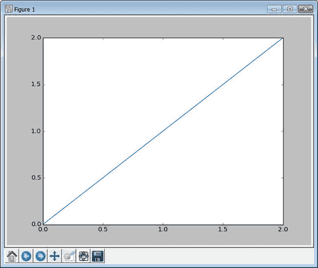

**图 6-1.** 一个交互式图形

函数 `show()` 会打开一个交互式窗口。以下是关于此窗口的几点说明：

- 窗口是有编号的，正如你看到的标签“Figure 1”。如果你有多个窗口，并希望后续的图形覆盖或显示在特定图形上，这一点非常有用。要在图形之间切换，请使用 `figure(n)` 函数，其中 `n` 代表图形索引。如果你想要一个新图形，并且不特别关心图形索引，请执行命令 `figure()`，它会创建一个具有下一个可用索引的空图形。
- x 轴和 y 轴是自动创建的，以适应数据。在很多情况下，`matplotlib` 能出色地自动选择合适的坐标轴（如本例所示）。但是，如果你希望显示不同的数值范围，可以使用 `axis()` 命令来实现；你将在本章后面的“坐标轴”部分了解更多信息。
- 鼠标的位置会显示在图形的右下角。如果你试图放大数据并找到特定的数据点，这非常有用。当你将图形绘制到文件（即非交互模式）时，此功能不可用。
- 在图形的左下角有几个按钮，允许你与图形进行交互。最左边的五个按钮用于缩放和缩放历史记录。从左数第一个按钮（带有房子图标）用于将坐标轴更改回原始绘图坐标轴。左右箭头按钮用于在之前的坐标轴更改之间向后和向前循环。第四个按钮允许你更改坐标轴的原点，从左数第五个按钮启用缩放功能。从左数第六个按钮控制绘图相对于包含窗口的边距。

最后，第七个按钮允许你将图像保存到磁盘。

 **注意** 如果你没有在 Python 中交互式地使用 `matplotlib`，请确保在所有图形生成*之后*再调用函数 `show()`，因为它会进入一个用户界面主循环，从而停止其余代码的执行。这种行为背后的原因是 `matplotlib` 也被设计为嵌入到 GUI 中。如果你在交互式 Python 中工作，请执行命令 `ion()`（代表“interactive on”）；这将自动生成图形，无需调用 `show()`。要恢复此行为，请执行 `ioff()`（代表“interactive off”）。

### 将图形保存到文件

函数 `savefig()` 允许你将不同格式的图像写入文件。开箱即用，`matplotlib` 支持多种文件格式，包括 PDF、PNG 和 PS。生成包含图形的文件的最简单方法是执行 `savefig(filename)`，其中 `filename` 包含与你选择的图像格式关联的扩展名：

```python
>>> figure()
```

```
<matplotlib.figure.Figure object at 0x0000000002CAE160>
```

```python
>>> plot(arange(3))
```

```
[<matplotlib.lines.Line2D object at 0x000000000826FEF0>]
```

```python
>>> savefig('../images/line.png')
>>> from glob import glob
>>> glob('../images/*.png')
```

```
['../images/line.png']
```

我假设你遵循本书的目录结构（见第 2 章），并且可以通过相对路径 `../images` 访问 `images` 目录。我还介绍了 `glob` 模块，它用于执行文件的通配符搜索；你将在第 10 章中了解更多关于 `glob` 的信息。

你应该能够在大多数图像查看器或 Web 浏览器中查看该图形。

 **注意** `Matplotlib` 会在创建对象时返回它们。在前面的示例中，返回的绘图对象由行 `[<matplotlib.lines.Line2D object at 0x000000000826FEF0>]` 表示。接下来，我将省略这些响应，以使交互式代码更易于理解。

我调用了函数 `savefig()`，并将文件扩展名作为包含文件名的字符串的一部分，指示 `savefig()` 创建一个 PNG 文件。类似地，我可以通过执行 `savefig('line.ps')` 来创建一个 PostScript 文件。

字典对象 `FigureCanvasBase.filetypes` 保存了系统中支持的文件类型列表：

```python
>>> from pprint import pprint
>>> pprint(FigureCanvasBase.filetypes)
```

```
{'eps': 'Encapsulated Postscript',
 'jpeg': 'Joint Photographic Experts Group',
 'jpg': 'Joint Photographic Experts Group',
 'pdf': 'Portable Document Format',
 'pgf': 'LaTeX PGF Figure',
 'png': 'Portable Network Graphics',
 'ps': 'Postscript',
 'raw': 'Raw RGBA bitmap',
 'rgba': 'Raw RGBA bitmap',
 'svg': 'Scalable Vector Graphics',
 'svgz': 'Scalable Vector Graphics',
 'tif': 'Tagged Image File Format',
 'tiff': 'Tagged Image File Format'}
```

**在复杂模块中找到你需要的内容**

那么，我是如何发现 `FigureCanvasBase.filetypes` 保存了支持的文件类型的呢？我通读了整个手册吗？几乎没有。我们使用的一些包非常大，掌握控制其行为的变量和对象的所有细节并非易事。所以我使用了一些快速而粗糙的技巧。虽然它们可能不是“正确”的做法，但它们能帮助我完成任务，这才是真正重要的。那么，让我向你展示我是如何找出可用文件类型的。

为了找出基础文件类型，我使用一个虚假的文件格式调用了 `savefig()`：`savefig('a.ext')`。结果当然是一个异常（`ValueError`）；然而，我也收到了一些有用的信息：`"Supported formats: eps, jpeg, jpg, pdf, pgf, png, ps, raw, rgba, svg, svgz, tif, tiff."`

但这不是我想要的；我想要的是文件格式的枚举，这样我就可以对它们进行索引，而不是解析异常返回的字符串。因此，我从异常输出中追溯了错误的来源：错误源自文件 `C:\Python33\lib\site-packages\matplotlib\backend_bases.py` 的第 2070 行。接着，我打开了 `backend_bases.py` 文件，跳转到第 2070 行，并开始阅读代码。Python 是一种非常易读的语言，我没花多长时间就发现这些格式可以通过 `self.get_supported_filetypes()` 获得，它基本上只是返回属性 `filetypes`。由于 `self` 指向容器对象，我向上滚动了一些，发现函数 `get_supported_filetypes()` 是类 `FigureCanvasBase` 的一部分——因此，也就是 `FigureCanvasBase.filetypes`。

阅读 `matplotlib` 生成的异常，以及探索模块及其名称，也帮助我找到了对象 `matplotlib.colors.cnames` 和 `matplotlib.colors.ColorConverter.colors`，两者都列出了可能的颜色（参见本章后面的“颜色”部分）。话虽如此，阅读手册也是一个非常可行的选择。

你可以向 `savefig()` 传递一个图像格式参数来控制生成的输出文件，而不是在文件名字符串中指定它。你还可以控制其他参数，例如每英寸点数（dpi）和图形颜色的面颜色。`savefig()` 的更通用形式是 `savefig(fname[, param1=value1][, param2=value2], ...)`。表 6-1 列出了一些参数。在示例中，假设 `fn` 是一个包含文件名的字符串。

表 6-1. `savefig()` 参数

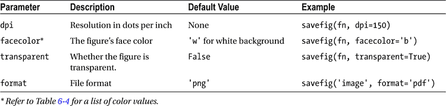

你可以组合多个参数，如下例所示：

```
savefig('file', dpi=150, format='png')
```

函数 `savefig()` 支持其他选项；有关完整说明，请参阅 `help(savefig)`。

 **注意** 并非所有图像格式都支持透明度，尤其是 JPEG。如果你需要透明背景，请选择支持透明度的图像格式，例如 PNG。

### 绘制图形

本节详细介绍绘制图形的基本构建块：`plot()` 函数以及如何控制它以生成我们所需的输出。我们在本书中广泛使用了 `plot()` 命令。现在是时候更仔细地研究它了。

`plot()` 函数高度可定制，可容纳各种选项，包括绘制线条和/或标记、线宽、标记类型和大小、颜色以及用于关联每个绘图的图例。`plot()` 的功能类似于 MATLAB (`http://www.mathworks.com`) 和 GNU-Octave (`http://www.gnu.org/software/octave/`)，但有一些细微差别，这主要是由于 Python 的语法与 MATLAB 和 GNU-Octave 不同。

### 线条和标记

我们将首先使用`NumPy`创建一个要绘制的向量（有关`NumPy`包的完整说明，请参见第 7 章）：

```
>>> figure()
>>> y = array([1, 2, -1, 1])
>>> plot(y)
>>> show()
```

如果你没有安装带有`matplotlib`的 GUI，请将`show()`替换为`savefig('filename')`，然后在图像查看器中打开生成的图像文件。

 **注意** 今后，我将从代码清单中省略`show()`调用。如果你想跟着做，请务必发出`show()`或`savefig()`。

我将向量`y`作为输入传递给`plot()`。结果，`plot()`使用自动递增的整数作为 x 轴绘制了向量`y`的图形。也就是说，如果你不提供 x 轴值，`plot()`会自动为你生成一个：`plot(y)`等价于`plot(range(len(y)), y)`。

因此，让我们提供 x 轴值（由变量`t`表示）：

```
>>> figure()
>>> y = array([1, 2, -1, 1])
>>> t = array([10, 11, 12, 13])
>>> plot(t, y)
>>> show()
```

调用函数`figure()`会生成一个新的图形来绘制，这样我们就不会覆盖之前的图形。

让我们看看更多的选项。接下来，我们想要将`y`绘制为`t`的函数，但只显示标记，不显示线条。这很容易做到：

```
>>> figure()
>>> plot(t, y, 'o')
>>> show()
```

要选择不同的标记，请将字符`'o'`替换为另一个标记符号。表 6-2 列出了一些流行的选择；发出`help(plot)`可提供可用标记的完整说明。

表 6-2. 可用绘图标记示例

| 字符 | 标记符号 |
| --- | --- |
| `'o'` | 圆形 |
| `'^'` | 向上三角形 |
| `'s'` | 正方形 |
| `'+'` | 加号 |
| `'x'` | 叉号（乘法） |
| `'D'` | 菱形 |

正如有不同的标记一样，也有不同的线条样式，表 6-3 列出了其中一些。

表 6-3. 可用绘图线条样式示例

| 字符 | 线条样式 |
| --- | --- |
| `'-'` | 实线 |
| `'--'` | 虚线 |
| `'-.'` | 点划线 |
| `':'` | 点线 |

如果你同时需要标记和线条，请将线条样式和标记的符号连接起来。要绘制点划线线条和菱形符号作为标记，请发出以下命令：

```
>>> plot(t, y, 'D-.')
>>> show()
```

图 6-2 显示了本节示例的输出。

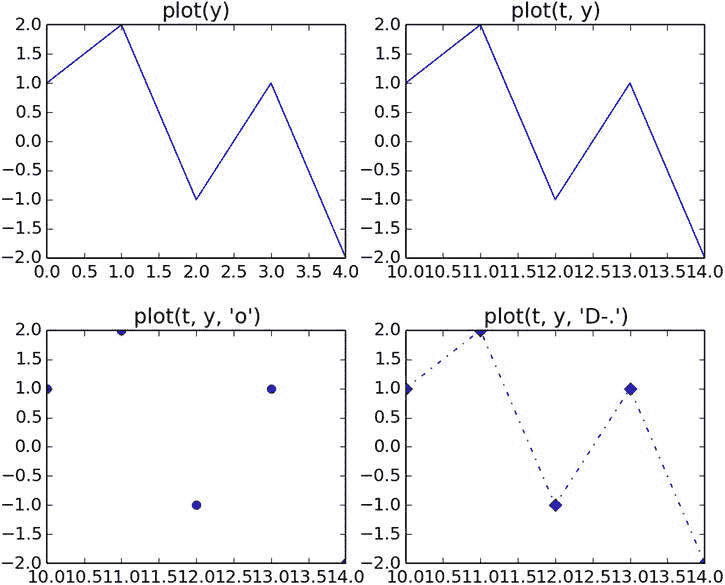

图 6-2. 前面示例的输出：无 x 值的线图（左上）、有 x 值的线图（右上）、标记图（左下）以及标记和线图（右下）

### 在一个图形上绘制多个图形

我们使用图形来可视化数据并进行比较。还有什么比在一个图中显示多个图形更自然的呢，这样我们就可以比较结果？在`matplotlib`中有两种方法可以做到这一点。第一种方法是在`plot()`函数中添加更多向量：

```
>>> plot(t, y, t, 2*y)
```

你也可以这样做：

```
>>> plot(t, y, '+', t, 2*y, 's-')
```

第二种方法是重复调用`plot()`。有时你可能只有部分数据要绘制。假设你有向量`y`，但随后你修改了它，并希望同时打印原始向量和新修改的向量。你该怎么办？一种选择是存储中间值，但如果你有 20 个这样的值呢？那将意味着用 20 多个参数调用`plot()`。

当你对已存在的图形调用`plot()`时，有两种可能的结果。一种是图形被擦除，并绘制新图。另一种是图形不被擦除，新图被添加到图形中。此行为由图形的保持状态决定。你可以使用`hold()`函数控制保持状态：调用`hold(True)`将确保新图不会擦除图形，而`hold(False)`则相反。不带参数发出`hold()`命令将切换保持状态。作为一般规则，最好指定你需要的保持行为，而不是依赖默认行为；即`hold(True)`或`hold(False)`。

### 线宽和标记大小

接下来，我们将研究控制线宽和标记大小。我们通过向`plot()`传递`linewidth`（或简写为`lw`）和`markersize`（或简写为`ms`）参数来实现，如清单 6-1 所示。两个参数都接受浮点值；默认值为 1。

***清单 6-1***.

#### 在同一张图中绘制多条不同线型和标记的曲线

```
I = arange(6)
plot(I, sin(I), 'o', I, cos(I), '-', lw=3, ms=8)
title("plot(I, sin(I), 'o', I, cos(I), '-', lw=3, ms=8)")
show()
```

图 6-3 展示了该示例的结果。

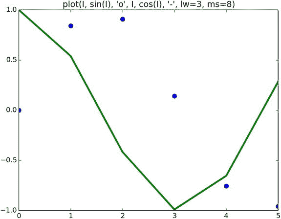

图 6-3. 在同一张图中绘制多条曲线

当你在一个 `plot()` 函数调用中绘制多条线时，参数 `linewidth` 和 `markersize` 会控制同一个 `plot()` 命令中的*所有*线条。如果你希望在同一张图中使用不同的线型或不同的标记大小，可以分别调用 `plot()` 函数绘制每条线，并使用 `hold()` 函数，如代码清单 6-2 所示。

***代码清单 6-2***. 同一张图中的不同线宽

```
figure(); hold(True)
I = arange(6)
plot(I, sin(I), lw=4)
plot(I, cos(I), lw=2)
show()
```

### 颜色

绘图基础列表中的最后一项是控制颜色。与标记样式和线型一样，你可以根据表 6-4 中的列表，使用一个字符来控制颜色。

表 6-4. 颜色字符查找表

| 字符 | 颜色 |
| --- | --- |
| `'b'` | 蓝色 |
| `'c'` | 青色 |
| `'g'` | 绿色 |
| `'k'` | 黑色 |
| `'m'` | 品红色 |
| `'r'` | 红色 |
| `'w'` | 白色 |
| `'y'` | 黄色 |

你可能已经注意到，如果未指定颜色，`matplotlib` 会自动为后续的线条图选择不同的颜色。你可以通过提供颜色字符来选择偏好的颜色：

```
>>> figure()
>>> I = arange(6)
>>> plot(I, sin(I), 'k+-', I, cos(I), 'm:')
>>> show()
```

这将绘制两条线：第一条是带有加号标记和实线的黑色线条，第二条是品红色的虚线。

如果你想要表 6-4 中没有的颜色，可以从字典对象 `matplotlib.colors.cnames` 中选择。该字典提供了更丰富的颜色选择，包含一百多种颜色值。最后，如果该字典仍不够用，你可以提供显式的红绿蓝（RGB）值。如果你使用字典值或显式的 RGB 值，则必须将 `color` 参数作为参数传递给 `plot()` 调用：

```
>>> plot(randn(5), 'y', lw=5) # 来自颜色表的 'y'
>>> plot(randn(5), color='yellowgreen', lw=5) # 使用 matplotlib.colors.cname
>>> plot(randn(5), color='#ffff00', lw=5) # 显式的黄色 RGB
```

有关颜色的更多信息，请参阅 `help(matplotlib.colors)`。

在前面的示例中，我使用了函数 `randn(n)` 来生成一个大小为 5 的随机向量。

## 控制图形

为了使图形美观地传达思想，数据虽然非常重要，但并非全部。网格和网格线，结合适当的坐标轴和标签选择，提供了额外的信息层，增加了清晰度，并有助于图形的整体呈现。

现在我们已经掌握了绘制线条和标记的基础知识，接下来让我们通过控制 x 轴和 y 轴的行为以及设置网格线来控制图形。

### 坐标轴

`axis()` 函数控制 x 轴和 y 轴范围的行为。如果你不向 `axis()` 提供参数，返回值将是一个形式为 `(xmin, xmax, ymin, ymax)` 的元组。你可以通过指定新值来使用 `axis()` 设置新的坐标轴范围：`axis([xmin, xmax, ymin, ymax])`。如果你只想设置或获取 x 轴值或 y 轴值，可以分别使用函数 `xlim(xmin, xmax)` 或 `ylim(ymin, ymax)`。

除了范围限制外，`axis()` 函数还接受以下值：`'auto'`、`'equal'`、`'tight'`、`'scaled'` 和 `'off'`。

值 `'auto'`（默认行为）允许 `plot()` 选择它认为的最佳值。值 `'equal'` 强制每个 x 值与每个 y 值具有相同的*长度*，这在试图传达物理距离（例如 GPS 绘图）时非常重要。值 `'tight'` 会导致坐标轴发生变化，使得 x 和 y 的最大值和最小值都触及图形的边缘。值 `'scaled'` 会改变 x 轴和 y 轴的范围，使得 x 和 y 具有相同的长度（即宽高比为 1）。最后，调用 `axis('off')` 会移除坐标轴和标签。

为了说明这些坐标轴行为，我将绘制一个圆（参见代码清单 6-3）。

***代码清单 6-3***. 绘制一个圆

```
R = 1.2
I = arange(0, 2*pi, 0.01)
plot(sin(I)*R, cos(I)*R)
show()
```

我选择半径为 1.2 的圆的原因是，对于“更规整”的半径数值（例如 1.0 或 2.0），自动坐标轴解决方案效果非常好，很难展示不同坐标轴选项的效果。

图 6-4 展示了对该圆应用不同坐标轴值的结果。

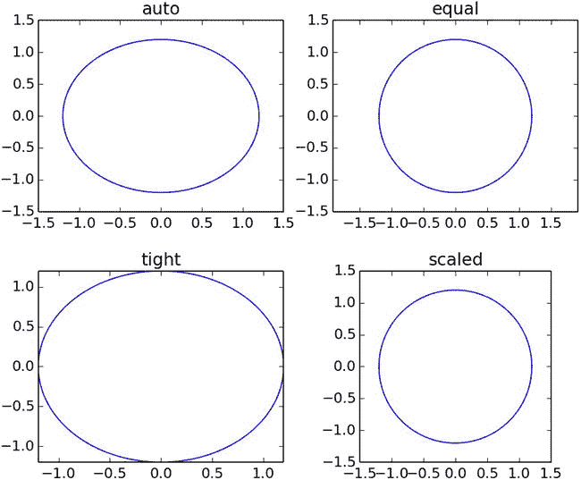

图 6-4. 控制坐标轴行为

### 网格和刻度

函数 `grid()` 在当前图形中绘制网格。网格由一组与 x 刻度和 y 刻度重合的水平虚线和垂直虚线组成。你可以通过调用 `grid()` 来切换网格，或者分别使用 `grid(True)` 或 `grid(False)` 将其设置为可见或隐藏。

要控制刻度（并同时有效地更改网格线），请使用函数 `xticks()` 和 `yticks()`（参见代码清单 6-4 和图 6-5）。这些函数的行为与 `axis()` 类似：如果不传递参数，它们会返回当前刻度；你也可以在提供参数后使用这些函数来设置刻度。这些函数接受一个包含刻度数值的数组，以及一个可选的包含文本标签的元组。如果未提供标签元组，则使用刻度数值作为标签。

***代码清单 6-4***. 网格和刻度示例

```
R = 1.2
I = arange(0, 4*pi, 0.01)
plot(sin(I)*R, cos(0.5*I)*R)
axhline(color='gray')
axvline(color='gray')
grid()
xticks([-1, 0, 1], ('Negative', 'Neutral', 'Positive'))
yticks(arange(-1.5, 2.0, 1))
show()
```

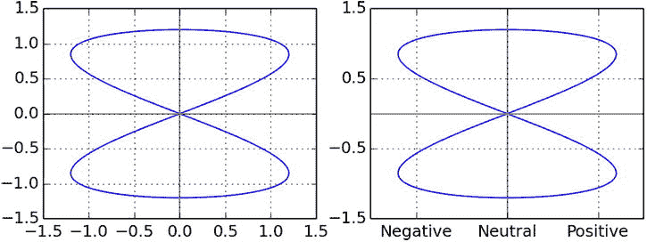

图 6-5. 控制网格和坐标轴：左侧图形显示默认的 `xticks()`，而右侧图形显示标签

图 6-5 展示了代码清单 6-4 生成的输出：未执行最后两次 `xticks()` 和 `yticks()` 调用（左侧图形）以及执行了 `xticks()` 和 `yticks()` 调用（右侧图形）。请注意 x 轴上的标签。

我还使用了函数 `axvline()` 和 `axhline()`，它们分别绘制一条穿过 x 轴和 y 轴的线。`axhline()` 和 `axvline()` 函数接受许多参数，包括 `color`、`linewidth` 和 `linestyle` 等。

### 子图

在本章前面的一些图中，我在一张图中显示了几个较小的图形；这些被称为子图。`subplot()` 函数将图形分割成子图，并选择当前子图。子图从左到右、从上到下编号，因此左上角的子图是 1，右下角的子图等于子图的数量。请注意，这与 Python 中使用的默认计数方式不同：编号从 1 开始，而不是从 0 开始。

要将图形分割成 2×2 的子图并选择左上角的子图进行绘制，请执行 `subplot(2, 2, 1)`。

或者，你可以传入字符串 `'221'`，其效果相同：`subplot('221')`。还可以在一个图形中组合不同大小的子图。这有点复杂，需要使用不同尺寸的子图进行绘制。清单 6-5 展示了一个示例，该示例在图形的上半部分生成一个子图，在下半部分生成两个子图，其结果见图 6-6。

**清单 6-5**。不同尺寸的子图

```python
figure()
subplot(2, 1, 1)
title('上半部分')
subplot(2, 2, 3)
title('下半部分，左侧')
subplot(2, 2, 4)
title('下半部分，右侧')
show()
```

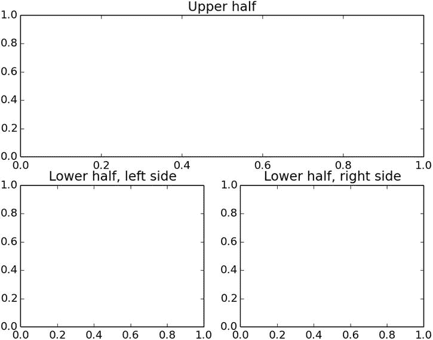

图 6-6。不同尺寸的子图

 **提示** 子图在可视化同一数据的多个方面时特别有用。例如，第 1 章 GPS 示例中的图 1-5 在一个子图中显示 x 和 y 坐标，在另一个子图中显示速度。事件（例如超速）在两个子图中都被标记出来，从而在两个子图之间建立了视觉联系。

### 擦除图形

函数 `cla()` 和 `clf()` 分别用于清除坐标轴和图形。当你在交互式环境中工作，并希望清除当前坐标轴（即将坐标轴设置为默认值并清除绘制的线条）时，这些函数非常有用。也可以使用 `clf()` 函数完全清除图形，同时擦除坐标轴和子图。

最后，你可以选择完全关闭图形窗口；这可以通过调用函数 `close()` 来实现。如果你向 `close()` 提供一个数字，则会关闭与该数字关联的图形。因此，`close(1)` 将关闭图 1，而保持其他图形打开。如果你想关闭所有图形，请执行 `close('all')`。

## 添加文本

有几种选项可以用文本注释你的图形。你已经看到了一些，例如使用 `xticks()` 和 `yticks()` 函数。以下函数将让你对图形中的文本有更多控制。

### 标题

函数 `title(str)` 将 `str` 设置为图形的标题，并显示在绘图区域上方。该函数接受表 6-5 中列出的参数。

表 6-5。文本参数

| 参数 | 描述 | 值 |
| --- | --- | --- |
| `fontsize` | 控制字体大小 | `'large'`、`'medium'`、`'small'` 或实际大小（例如 `50`） |
| `verticalalignment` 或 `va` | 控制垂直对齐方式 | `'top'`、`'baseline'`、`'bottom'`、`'center'` |
| `horizontalalignment` 或 `ha` | 控制水平对齐方式 | `'center'`、`'left'`、`'right'` |

所有对齐方式都基于默认位置，即图形上方居中。因此，设置 `ha='left'` 将从中间（水平方向）开始打印标题，并向右侧延伸。类似地，设置 `ha='right'` 将使标题在图形中间（水平方向）结束。垂直对齐方式同理。以下是使用 `title()` 函数的示例：

```python
>>> title('左对齐，大标题', fontsize=24, va='baseline')
```

### 轴标签和图例

函数 `xlabel()` 和 `ylabel()` 与 `title()` 类似，只是它们分别用于设置 x 轴和 y 轴的标签。这两个函数都接受表 6-5 中的文本参数：

```python
>>> xlabel('时间 [秒]')
```

接下来要介绍的文本函数是 `legend()`。`legend()` 函数添加一个图例框，并将绘图与文本关联起来：

```python
>>> I = arange(0, 2*pi, 0.1)
>>> plot(I, sin(I), '+-', I, cos(I), 'o-')
>>> legend(['sin(I)', 'cos(I)'])
>>> show()
```

图例的顺序将文本与绘图关联起来。如果我使用反转的列表调用 `legend()`，结果将是错误的图例。

另一种方法是在调用 `plot()` 函数时指定 `label` 参数，然后不带参数调用 `legend()`：

```python
>>> I = arange(0, 2*pi, 0.1)
>>> plot(I, sin(I), '+-', label='sin(I)')
>>> plot(I, cos(I), 'o-', label='cos(I)')
>>> legend()
>>> show()
```

图 6-7 展示了添加 x 轴标签和图例的效果。

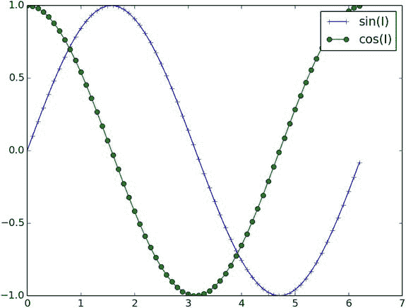

图 6-7。添加 x 轴标签和图例

你还可以通过 `loc` 参数控制图例框的位置。如果你不希望图例文本遮挡图形线条，这一点很重要。`loc` 可以取以下值之一：`'best'`、`'upper right'`、`'upper left'`、`'lower left'`、`'lower right'`、`'right'`、`'center left'`、`'center right'`、`'lower center'`、`'upper center'` 和 `'center'`。除了使用字符串，你还可以使用数字：`'best'` 对应 `0`，`'upper left'` 对应 `1`，`'center'` 对应 `10`。使用值 `'best'` 会将图例移动到不太可能隐藏数据的位置；但是，在性能方面可能会有一些影响。

函数 `legend()` 还有其他选项，例如可以添加投影阴影、控制图例内文本之间的间距等。更多信息请查阅交互式帮助。

### 文本渲染

函数 `text(x, y, str)` 接受图形单位中的坐标 `x`、`y` 和要打印的字符串 `str`。它还会在图形上渲染该字符串。你可以使用表 6-5 中的参数修改文本对齐方式。以下代码将在位置 (0, 0) 处打印文本：

```python
>>> figure()
>>> plot([-1, 1], [-1, 1])
>>> text(0, 0, '原点', va='center', ha='center')
>>> show()
```

函数 `text()` 还有许多其他参数，例如 `rotation`（已在第 1 章中使用）和 `fontsize`。有关参数的完整列表，请参阅 `help(text)`。

### 数学符号和表达式

我们列表中的最后一个文本相关函数是用于渲染数学符号和表达式的。使用 *matplotlib* 提供的数学符号的语法类似于 TEX。要渲染数学表达式，请使用原始字符串，并用 `$` 符号将数学表达式括起来。对于希腊字母，以斜杠开头，后跟字母名称。因此，要打印 Alpha (α)，你的字符串应为 `r'$\alpha$'`。分数可以使用 `\frac{分子}{分母}` 表示法创建；例如，`r'$\frac{\pi}{4}$'` 表示符号 π 除以四。下标用下划线表示，因此要渲染文本 a[i]，请写为 `r'$a_i$'`。

本书无法涵盖 *matplotlib* 支持的全部 TEX 语法。有关更多信息，请参考 *matplotlib* 在线网站（在本书编写时，以下链接可用：`http://matplotlib.sourceforge.net/users/mathtext.html`）。也就是说，当你在本书中遇到数学表达式时，你很可能能够通过本节介绍的少量命令来理解其工作原理。

### 示例：汇总图

清单 6-6 中的示例脚本总结了到目前为止我们讨论过的函数：用于绘图的 `plot()`；用于文本注释的 `title()`、`xlabel()`、`ylabel()` 和 `text()`；以及用于网格控制的 `xticks()`、`ylim()` 和 `grid()`。

**清单 6-6**。绘图汇总示例

```python
I = arange(0, 2*pi+0.1, 0.1)
plot(I, sin(I), label='sin(I)')
title('Function f(x)=sin(x)')
xlabel('x [rad]', va='bottom')
ylabel('sin(x)')
text(pi/2, 1, 'Max value', ha='center', va='bottom')
text(3*pi/2, -1, 'Min value', ha='center', va='top')
xticks(linspace(pi/2, 2*pi, 4), (r'$\frac{\pi}{2}$', r'$\pi$', r'$\frac{3\pi}{2}$', r'$2 \pi$'), fontsize=20)
xlim([0, 2*pi])
ylim([-1.2, 1.2])
grid()
show()
```

此示例的结果显示在图 6-8 中。

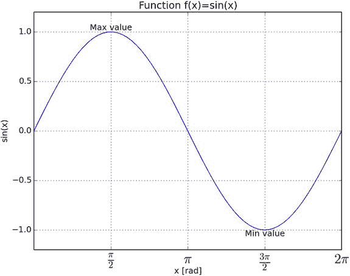

图 6-8。绘图汇总示例

## 更多图形类型

虽然常规的折线图和标记图是出色的可视化工具，但它们并非唯一的工具。本节将快速概述其他一些二维图形选项。

### 条形图

条形图是许多人的最爱，它允许对多个数值进行定量比较。要使用条形图，请调用函数 `bar(left, height)`，其中 `left` 是条形的 x 坐标，`height` 是条形的高度。函数 `bar()` 允许进行大量自定义；输入 `help(bar)` 将提供大部分详细信息。

#### 示例：GDP，排名前 N 的国家

对于这个绘制各国购买力平价（GDP）的示例，你需要 CIA 的 GDP 排名文件，该文件可从 CIA 世界概况（`https://www.cia.gov/library/publications/the-world-factbook/rankorder/rawdata_2001.txt`）获取；这是一个制表符分隔的文件，非常适合轻松进行数据处理。我假设你已经下载了该文件并将其保存在文件夹 `Ch6/data` 中；源代码位于 `Ch6/src`，输出文件位于 `Ch6/images`。

首先，我们将定义一个函数来读取数据（我们将在本章的几个示例中使用它）。代码清单 6-7 中的代码应保存为文件 `src/read_world_data.py`。

**代码清单 6-7**。函数 `read_world_data.py`

```python
import csv, re

def read_world_data(N=10, fn='../data/rawdata_2001.txt'):
    """一个用于读取 CIA 世界概况文件的函数。N 是要处理的国家数量。"""

    # 初始化返回列表
    gdp, labels= [], []

    # 读取并处理数据
    for i, row in enumerate(csv.reader(open(fn), delimiter='\t')):
        # 移除美元符号、逗号和空格字符
        gdp_value = re.sub(r'[\$, ]', '', row[2])

        # 以十亿美元为单位存储数据
        gdp.append(float(gdp_value)/1e9)
        labels.append(row[1].strip())

        # 处理完 N 个国家后停止分析数据
        if i == N-1:
            break
    return (gdp, labels)
```

该函数读取前 N 个国家的数据，并返回它们的 GDP 以及国家名称。我使用了两个模块。第一个是 `csv` 模块，用于读取制表符分隔的数据。第二个是 `re` 模块，用于去除 GDP 值字段中的美元符号、逗号和空格字符。

有了 `read_world_data()` 函数，我们开始绘制条形图（参见代码清单 6-8）。

**代码清单 6-8**。绘制 GDP 条形图

```python
##### 一个绘制 GDP 条形图的脚本
from pylab import *
from read_world_data import read_world_data

##### 初始化变量，N 是国家数量
N = 5

gdp, labels = read_world_data(N)

##### 绘制条形图
bar(arange(N), gdp, align='center')

##### 添加文本注释
xticks(arange(N), labels, rotation=-10)
for i, val in enumerate(gdp):
    text(i, val/2, str(val), va='center', ha='center', color='yellow')
ylabel('$ (十亿)')
title('GDP 排名，数据来自 CIA 世界概况')
show()
```

这个脚本现在应该很容易读懂。请注意，我从一个单独的文件 `read_world_data.py` 中导入了函数 `read_world_data()`，该函数已在代码清单 6-7 中定义。

我还选择在调用 `xticks()` 时将水平轴上的文本标签旋转了 10 度。这种旋转确保了 `'United States'` 和 `'European Union'` 的标签不会重叠。

图 6-9 展示了我们目前的条形图。

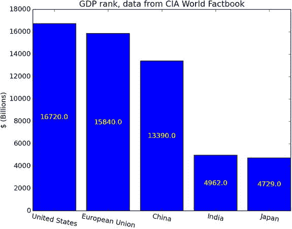

图 6-9。显示世界 GDP 排名的条形图

也可以添加误差线。要添加相当于 ±10000 亿美元的误差线（误差够大吧？），请在代码清单 6-8 所示的脚本中，在 `bar()` 函数调用之后添加以下代码行：

```python
errorbar(arange(N), gdp, 1000*ones(N), color='k')
```

最后，如果你需要水平条形图而不是垂直条形图，可以使用函数 `barh()` 来绘制（但在这种情况下，请记得交换 x 轴和 y 轴的标签及刻度）。

### 直方图

直方图是显示数值频率或出现次数的图表。在 *matplotlib* 中，函数 `hist()` 用于计算和绘制直方图。至少，你必须提供一个数值数组。你可以通过如下方式指定直方图的单元格数量：`hist(values, numcells)`。或者，你也可以指定直方图的区间：`hist(values, bins)`，其中 `bins` 是一个包含直方图区间值的列表。`hist()` 的返回值是一个包含概率、区间和补丁（patches）的元组。补丁用于创建条形；我将在本章后面的“补丁”部分详细介绍。

函数 `hist()` 还有其他自定义选项，包括直方图的方向（垂直或水平）、条形的对齐方式等。同样，请参考交互式帮助：`help(hist)`。

#### 示例：GDP 直方图

我们再次使用 CIA 世界概况中的 GDP 排名；这次我们想绘制 N 个最大经济体的直方图。同样，我们使用前一个示例中实现的 `read_world_data()` 函数（参见代码清单 6-9）。

**代码清单 6-9**。绘制 GDP 直方图

```python
##### 一个绘制 GDP 直方图的脚本
from pylab import *
from read_world_data import read_world_data

##### 初始化变量；N 是国家数量，B 是区间大小
N, B = 20, 1000

gdp, labels = read_world_data(N)

##### 绘制直方图
prob, bins, patches = hist(gdp, arange(0, max(gdp)+B,B), align='left')

##### 添加文本注释
for i, p in enumerate(prob):
    percent = '%d%%' % (p/N*100)
    # 仅注释非零值
    if percent != '0%':
        text(bins[i], p, percent,
            rotation=45, va='bottom', ha='center')
ylabel('国家数量')
xlabel('收入，十亿美元')
title('GDP 直方图，%d 个最大经济体' % N)
show()
```

# 一些坐标轴操作

```
xlim(-B/2, bins[-1]-B/2)
show()
```

图 6-10 显示了生成的图形。

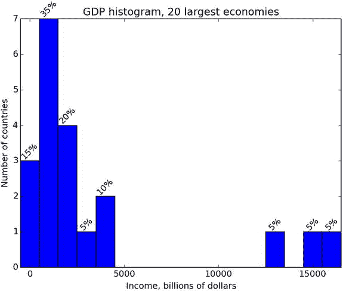

图 6-10. N 个最大经济体的 GDP 直方图

同样，这个脚本应该很容易读懂。我想请你注意一下，我通过调用函数 `xlim()` 对 x 轴进行的一个看似奇怪的修改。这样做的目的是修改 x 轴范围的默认行为。进行此修改的原因是，由于我为直方图区间选择了 `'center'` 对齐方式，自动的 x 轴范围包含了负值。这是因为最左边的区间以零为中心，但它有一定的宽度，其中一部分位于负 x 轴上。我不喜欢这种行为，因此选择通过手动设置坐标轴来覆盖它。我没有设置一个固定的数值，而是通过从坐标轴中减去半个区间宽度 `B/2` 来修改 x 轴。

### 作为一般规则，当你像这样修改默认行为时，请尽量使用参数（在前面的示例中，你应该使用参数 `B`，而不是数值 `1000`，并通过 `xlim()` 获取当前值）；这将使脚本更灵活，能够适应更广泛的输入值。

## 饼图

饼图的使用与条形图一样简单。实现饼图的函数是 `pie(x)`，其中 `x` 包含要绘制的值。

### 示例：GDP 饼图

清单 6-10 展示了一个生成饼图的脚本，结果如图 6-11 所示；同样，此示例使用了函数 `read_world_data()`。

***清单 6-10***。绘制 GDP 饼图

```
##### a script to plot GDP pie chart
from pylab import *
from read_world_data import read_world_data

##### initialize variables, N is the number of countries
N = 10

gdp, tags = read_world_data(N)
```

##### plot the bar chart
`pie(gdp, labels=tags)`
`axis('equal')`
`title('GDP rank, data from CIA World Factbook')`
`show()`

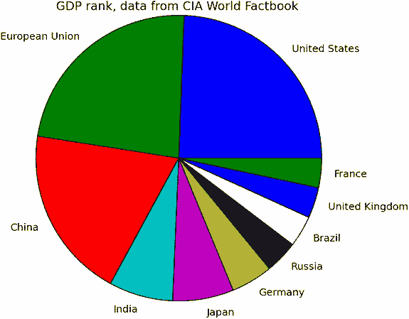

图 6-11。GDP 饼图，显示 N 个最大经济体

我决定使用变量`tags`而不是`labels`，这样对`pie()`的调用就不会那么令人困惑。如果我坚持使用原始名称`labels`，那么对`pie()`的调用将是`pie(gdp, labels=labels)`。这仍然可以工作，但在我看来，会显得有些混乱。

### 对数图

函数`semilogx()`和`semilogy()`分别用于以对数刻度绘制 x 轴和 y 轴。`semilogy()`类型的对数图在绘制功率或强度值时很常见，例如测量地震能量的里氏震级标度。同样，例如，与频率一起使用的量的测量值通常绘制在对数 x 刻度上，表示倍频程和十倍频程。还可以选择使用`loglog()`图，这意味着 x 轴和 y 轴都是对数的。这在工程领域常见的伯德图中就是这种情况。

所有这三个函数`semilogx()`、`semilogy()`和`loglog()`都可以使用与`plot()`函数类似的参数进行修改。

函数`logspace(start, stop, numpoints=50, endpoint=True, base=10.0)`可用于创建要与上述函数一起绘制的值范围。`start`和`stop`值是指数值。函数`logspace()`在`10^(start)`和`10^(stop)`之间生成对数间隔的值。你可以通过指定`endpoint = True`来决定是否返回结束值`10^(stop)`。如果你想要 10 以外的底数，请将`base`设置为你需要的值：

```python
>>> figure()
>>> I = 2*logspace(1, 5, 5)
>>> I
```

```
array([  2.00000000e+01,   2.00000000e+02,   2.00000000e+03,
         2.00000000e+04,   2.00000000e+05])
```

```python
>>> semilogx(I, [20, 19, 8, 2, 2], '+-', lw=2)
>>> title('Logarithmic plot, semilogx()')
>>> xlabel('Frequency [Hz]')
>>> ylabel('Amplitude [dB]')
>>> grid()
>>> show()
```

图 6-12 显示了前面示例的结果。

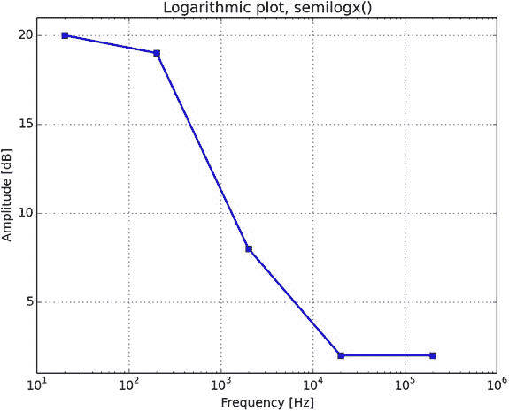

图 6-12。一个对数图

请注意，当使用`semilogx()`、`semilogy()`和`loglog()`绘图时，标签是原始值，而不是值的对数。如果你想打印对数值，你可能应该使用常规的`plot()`函数，并传入值的`log()`或`log10()`。例如，这在估算以分贝 (dB) 为单位的能量时很有用：

```python
>>> def db(x):
...     """Returns the value of x, in decibels."""
...     return 20*log10(abs(x))
...
>>> plot(db(array([1000, 980, 970, 400, 30, 2, 1, 1])))
>>> title('Logarithmic plot, dB)')
>>> xlabel('Frequency [Hz]')
>>> ylabel('Amplitude [dB]')
>>> xticks(arange(8), 10**arange(8))
>>> grid()
>>> show()
```

### 极坐标图

极坐标图绘制极坐标值：给定角度处的半径。极坐标图通常用于绘制天线辐射方向图，因为它们描绘了天线在任何给定角度发射的能量。极坐标图使用`polar(theta, r)`函数实现。

要沿半径设置标签，请使用`rgrids(radii, labels)`函数，其工作方式类似于`xticks()`和`yticks()`。如果你不提供`labels`值，则使用`radii`值作为标签。你还可以设置绘制标签的`angle`（默认值为 22.5 度）。类似地，函数`thetagrids()`绘制角度刻度和标签，如清单 6-11 所示。

***清单 6-11***。一个极坐标图

```python
theta = arange(0, 2*pi, 0.01)
polar(theta, cos(theta), theta, -cos(theta))
rgrids([0.5, 1.0], ['Half', 'Full'])
theta_labels = ['0', r'$\frac{\pi}{2}$', r'$\pi$', r'$\frac{3\pi}{2}$']
thetagrids(arange(0, 360, 90), theta_labels, fontsize=20)
title(r'A polar plot of $\pm cos(\theta)$', va='bottom')
show()
```

图 6-13 显示了生成的极坐标图。

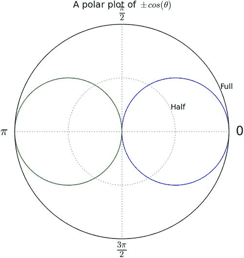

图 6-13。一个极坐标图

在标题中，我使用了由`'$\pm$'`表示的 ± 符号。

### 茎叶图

茎叶图为每个`(x, y)`值绘制一条从`(x, 0)`到`(x, y)`的垂直线，并在`(x, y)`处绘制一个标记。茎叶图用于表示离散数据，在绘制滤波窗口时很流行（参见清单 6-12）。

***清单 6-12***。滤波窗口的茎叶图

```python
from pylab import *
N = [4, 8, 16, 64]
for i, n in enumerate(N):
    subplot(2, 2, i+1)
    stem(arange(n), hamming(n))
    xticks(arange(0, n+1, n/4))
    yticks([0, 0.5, 1])
    xlim(-0.5, n+0.5)
    title('N=%d' % n)
show()
```

图 6-14 显示了此清单的结果。

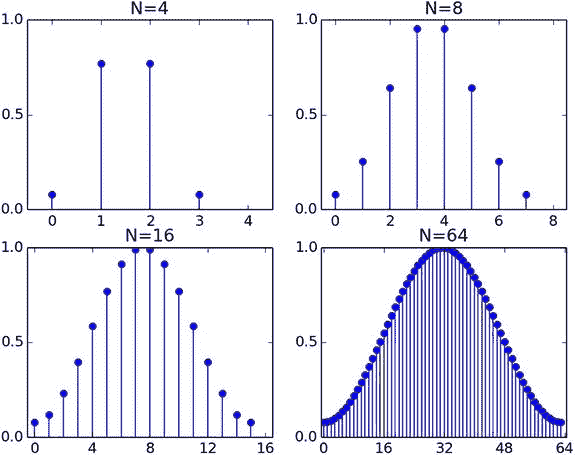

图 6-14。不同 N 值的汉明窗的茎叶图

在前面的示例中，我使用了`hamming()`函数来创建一个汉明窗，该窗口常用于滤波值。

### 其他图形

`Matplotlib`还支持大量用于描绘更复杂数据的图形。以下是可用的一些图形的简短列表：

*   函数`contour()`和`contourf()`用于等高线图。等高线图绘制连接相等`(x, y)`值对的线。它们用于天气图，详细描述等压线或等温线。在地形图中，它们详细描述地形；等等。
*   函数`specgram()`显示数据随时间变化的频率内容。例如，`specgram()`可用于绘制声波频率随时间变化的函数。
*   `contour()`和`specgram()`函数都依赖于颜色映射来描绘数据。颜色映射是值与颜色之间的关系。`Matplotlib`提供了一组颜色映射，包括诸如`autumn()`和`hot()`之类的名称，以方便选择颜色映射。
*   函数`quiver()`实现箭头图，通常用于描述物理学中的场。箭头图是一组箭头，描绘每个点的力（方向和大小）。

#### 示例：绘制信号的频率内容

有时，绘制信号随时间变化的频率成分是有价值的。

例如，在音频信号中，不同的频率代表不同的音符，因此将频率绘制为时间的函数是一种可能的“音乐可视化”。在本示例中，如清单 6-13 所示，我们创建了一个由多个离散频率组成的信号，并使用`specgram()`将这些频率显示为时间的函数。

***清单 6-13***. 信号的频谱图

```python
from pylab import *

Fs = 256
times = [3, 7, 5]
frequencies = [100, 20, 80]

y = array([])
for t, f in zip(times, frequencies):
    x = cos(2*pi*arange(t*Fs)/Fs*f)
    y = append(y, x)

specgram(y, 256, Fs)
xlabel('Time [sec]')
ylabel('Frequency [Hz]')
axis([0, 14.5, 0, 128])
show()
```

我将采样频率设置为每秒 256 个样本，并创建了一个由 100 赫兹（持续 3 秒）、20 赫兹（持续 7 秒）和 80 赫兹（持续 5 秒）组成的信号。然后使用`specgram()`绘制信号，结果如图 6-15 所示。

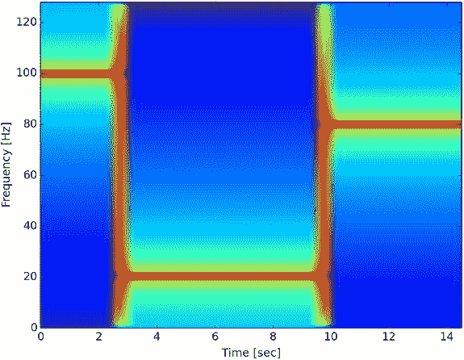

图 6-15. 频谱图

图 6-15 清晰地显示，在前 2 秒内，频率为 100 赫兹；接下来的 8 秒内，频率为 20 赫兹；最后 5 秒内，信号频率为 80 赫兹。

 **注意** 如果仔细观察该图，您会注意到频谱图中存在半秒的偏移。这是由于使用了大小为 128 个样本的重叠窗口。有关重叠窗口的信息，请参阅`help(specgram)`。

您可以使用颜色映射函数更改用于显示频谱图的颜色。只需在脚本末尾调用`hot()`或`autumn()`，然后观察结果。有关可用颜色映射的完整说明，请参阅`help(colormaps)`。

### 示例：斥力场

以下示例说明了如何使用`quiver()`描绘力场。在图形中的每个点，箭头指向作用力的方向及其大小，大小由箭头的尺寸表示：

```python
from pylab import *

x = arange(-5, 6, 1)
y = arange(-5, 6, 1)

u, v = meshgrid(x, y)
quiver(u, v)

xticks(range(len(x)), x)
yticks(range(len(y)), y)

axis([-1, 11, -1, 11])
axis('scaled')
title('A repelling force field!')
show()
```

我使用了函数`meshgrid(x, y)`，该函数生成两个矩阵：第一个是`x`值的重复矩阵，第二个是`y`值的重复矩阵。输出用于绘制箭袋图，如图 6-16 所示。然后我更新了坐标轴以反映正确的范围。

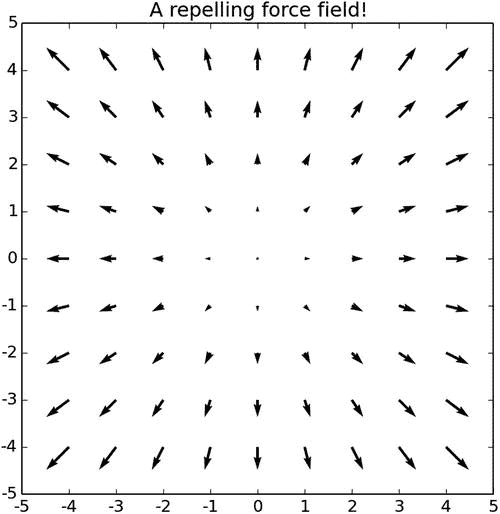

图 6-16. 描绘力场的箭袋图

### 示例：等高线图

等高线图（也称为等高线地图）是由等高线组成的图形。每条等高线连接等值的点。等高线图的示例包括描述山谷和丘陵的地形图，以及显示等压线（等压线）的气象图。

要生成等高线图，您需要一个对应于函数`z = f(x, y)`的矩阵，其中`x`和`y`是自变量（例如，地形图上的纬度和经度），`z`是函数值（例如，地形图上的高度）。

在以下示例中，我通过调用`x = arange(-5, 5, 0.1)`生成从 -5 到 5 的`x`值。我对`y`值也做了同样的操作。然而，函数`z = f(x, y)`需要一个矩阵，而`x`和`y`是向量。因此，下一步涉及从`x`和`y`创建一个网格。这是通过调用`u, v = meshgrid(x, y)`完成的；`u`对应于`x`值，而`v`对应于`y`值。使用网格的好处是，现在我可以像通常的数学表达式一样编写函数。

例如，单位球面的方程是`x² + y² + z² = 1`，上半单位球面是`z = sqrt(1 - x² - y²)`。这在 Python 中转换为`z = sqrt(1 - u**2 - v**2)`，但您需要处理负值的平方根（请参阅本章后面的“示例：非矩形等高线图”部分）。在等高线示例中，我选择了一个有趣的函数：`z = 2*u**2 + v**2 - u*v + 10*u`。清单 6-14 显示了代码和生成的等高线图。

***清单 6-14***. 等高线图

```python
from pylab import *

x = arange(-5, 5, 0.1)
y = arange(-5, 5, 0.1)
u, v = meshgrid(x, y)

z = 2*u**2 + v**2 - u*v + 10*u
contour(x, y, z, 10)
title('A contour map')
show()
```

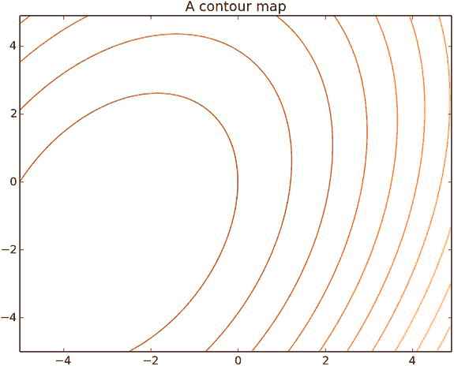

图 6-17. 函数`z = 2x² + y² - xy + 10x`的等高线图

### 示例：非矩形等高线图

如果前面示例中的网格数据不是矩形怎么办？假设它是梯形或圆形。在这种情况下，您如何生成等高线图？技巧是生成一个包围的矩形网格，并将感兴趣区域之外的值设置为`None`。

清单 6-15 中的代码使用函数`contourf()`生成了一个填充等高线图。该清单显示了球体等高线的矩形网格和非矩形网格。`z² = 1 - x² - y²`的负值位于球体外部，它们要么被设置为零，要么不被绘制。

***清单 6-15***. 使用矩形网格和非矩形网格的球体填充等高线图

```python
from pylab import *

x = linspace(-1.5, 1.5, 1000)
y = linspace(-1.5, 1.5, 1000)
u, v = meshgrid(x, y)

subplot(2, 2, 1)
z = 1 - u**2 - v**2
z[nonzero(z < 0)] = 0
contourf(x, y, sqrt(z), 10)
title('A contour map')
axis('equal')
axis('off')

subplot(2, 2, 2)
z = 1 - u**2 - v**2
z[nonzero(z < 0)] = None
contourf(x, y, sqrt(z), 10)
title('Non-rectangular contour map')
axis('equal')
axis('off')
show()
```

请注意，我如何使用函数`nonzero()`根据所需的网格将`z`的值设置为`0`或`None`。

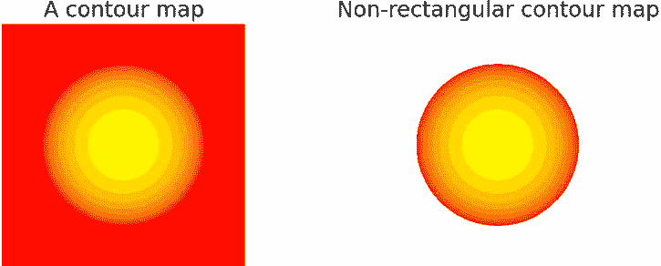

图 6-18. 使用矩形网格（左）和非矩形网格（右）的球体填充等高线图

## 获取和设置值

当您开始绘图并生成可视化输出时，您会发现您越来越多地使用“辅助”函数，这些函数不一定绘制数据，而是控制图形行为并按您想要的方式排列标签。

到目前为止，我们使用了两种方法来修改绘图行为。一种使用专用函数，如`axis()`、`xlim()`和`ylim()`来控制绘图范围。另一种方法是将参数传递给函数，例如`text()`函数中的`rotation`参数。

还有第三种方法可用，它利用了`matplotlib`的面向对象设计。它涉及两个函数，`setp()`和`getp()`，用于检索和设置`matplotlib`对象的参数。使用`setp()`和`getp()`的好处是易于实现自动化。

到目前为止，我们抑制了`matplotlib`的输出，以便交互式脚本更容易理解。但现在让我们看看这些输出。每当您发出`plot()`命令时，`matplotlib`会返回一个`matplotlib`对象的`list`。这一点很重要；调用`plot()`的返回值是一个对象列表，而不是`matplotlib`对象本身，即使您只绘制一条线：

```python
>>> from pylab import *
>>> p = plot(arange(5))
>>> type(p)
```

```
<class 'list'>
```

```python
>>> type(p[0])
```

```
<class 'matplotlib.lines.Line2D'>
```

函数`setp(matobj)`打印出您可以为`matobj`设置的属性列表，其中`matobj`是一个`matplotlib`对象。

### `setp()` 和 `getp()` 函数

该函数接受一个`matplotlib`对象列表或仅接受一个对象：

```python
>>> setp(p[0])
```

```
agg_filter: unknown
alpha: float (0.0 transparent through 1.0 opaque)
animated: [True | False]
antialiased or aa: [True | False]
axes: an :class:`~matplotlib.axes.Axes` instance
clip_box: a :class:`matplotlib.transforms.Bbox` instance
clip_on: [True | False]
```

（请注意，`setp()`的额外输出已被抑制。）

如果你不确定某个参数可以取哪些值，可以执行`setp(p, 'param')`：

```python
>>> setp(p[0], 'visible')
```

```
visible: [True | False]
```

要隐藏绘图，你可以执行以下命令：

```python
>>> setp(p[0], visible=False)
```

或者，你可以通过执行以下命令来设置与线条关联的标签：

```python
>>> setp(p[0], label='Line1')
>>> legend()
```

函数`setp()`也接受`matplotlib`对象列表，在这种情况下，列表中的所有`matplotlib`对象都将被设置。

 **注意**  要查询可接受的参数，请将要查询的参数用引号括起来：`setp(p, 'linewidth')`。要设置参数值，不要包含引号，但要使用赋值语句：`setp(p, linewidth=4)`。

类似地，要检索值，请使用`getp()`函数。`getp()`函数要求提供一个`matplotlib`对象，而不是对象列表，因此它稍微不那么宽容。我们到目前为止一直使用的变量`p`实际上是一个包含一个`matplotlib`对象的列表，所以我们需要对其进行索引：

```python
>>> getp(p[0], 'linewidth')
```

```
1.0
```

### 设置图形和轴参数

在前面的示例中，我们存储了调用`plot()`函数的返回值，该返回值是一个线条的`matplotlib`对象。具体来说，我们存储了我们绘制的线条——嗯，是一个包含一条线的列表。但是我们如何修改图形或轴的行为呢？

函数`gcf()`返回当前图形的句柄。函数`gca()`返回当前轴的句柄。有了这些，我们现在可以修改轴和图形参数。

要设置 y 轴标签，除了调用`ylabel('Y value')`，我们还可以发出以下命令：

```python
>>> setp(gca(), ylabel='Y value')
```

但是，以这种方式使用`setp()`比简单地调用`ylabel()`有什么好处呢？答案是自动化。让我们看一个例子。

### 示例：修改子图参数

假设你想编写一个函数，该函数接收一个图形编号，然后修改该图形中所有子图的标题（如果存在的话），使其成为编号标题。例如，对于一个包含 2x2 子图的图形，你希望子图标题为 1 到 4（如果它们都存在的话）。在这种情况下，你事先不知道一个图形中有多少个子图。

这是使用`setp()`和`getp()`的理想情况，如清单 6-16 所示。

***清单 6-16***. 子图编号

```python
from pylab import *

def number_subplots(fignum):
    """为图形中的子图编号。"""
    # 切换到请求的图形
    figure(fignum)
    fig = gcf()
    for i, fig_axe in enumerate(getp(fig, 'axes')):
        fig_axe.set_title(str(i+1))
    axis()
show()
```

关于`number_subplots()`函数，有几点需要牢记。首先，我们通过调用`figure(fignum)`将焦点设置到我们想要处理的图形上。接下来，我们使用`gcf()`获取该图形的句柄。下一步假设你对`matplotlib`对象结构有一定的了解。但即使你不熟悉这个结构，通过探索对象来弄清楚发生了什么也是相当简单的。为了说明这一点，创建一个包含两个空子图的简单图形：

```python
>>> figure()
>>> ax1 = subplot(2, 1, 1)
>>> ax2 = subplot(2, 1, 2)
```

现在使用`getp(gcf())`检索当前图形的属性：

```python
>>> getp(gcf())
```

```
agg_filter = None
alpha = None
animated = False
axes = [<matplotlib.axes.AxesSubplot object at 0x00000000...
children = [<matplotlib.patches.Rectangle object at 0x0000000...
```

（我已经删除了额外的输出行，因为它们对讨论不重要。）

现在仔细查看两个属性：`axes`和`children`。参数`axes`保存一个值列表，参数`children`保存另一个值列表。进一步检查表明，`axes`对象都包含在`children`值中。实际上，这两个轴就是两个子图的轴。因此，要获取这些轴的列表，我们可以像代码中那样简单地调用`getp(gcf(), 'axes')`。然后我们设置标题并调用`axis()`函数来强制重绘。

`number_subplots()`函数的实现有一个注意事项：编号是按照子图的创建顺序进行的。也就是说，如果左下角的子图是在左上角的子图之前创建的，那么它将具有较小的标题值，而不是常规的子图编号（从左到右，从上到下）。如果你想改变这一点，你必须查看子图的位置并相应地分配编号。这有点复杂，而且教育意义不大，所以我选择将其排除在讨论之外。

许多可以通过`setp()`和`getp()`访问的参数也可以通过专用函数访问。除了使用`setp()`设置 y 轴标签参数外，你还可以调用`ylabel()`函数。在可能的情况下，我更喜欢使用函数版本而不是`setp()`和`getp()`，因为我认为它更容易理解。

通过内置的`dir()`函数探索`matplotlib`对象也是探查`matplotlib`对象功能的非常好的方法。大多数函数都是不言自明的，它们允许你设置和检索与`matplotlib`对象关联的值。如果你不确定，请在交互式 Python 会话中使用`help()`函数。基于部分比较，我确定`matplotlib`对象方法等同于`getp()`和`setp()`可用的属性。这意味着你可以使用以下任何一种：

```python
>>> matobj = gcf()
>>> [func for func in dir(matobj) if func.startswith('get')]
```

```
['get_agg_filter', 'get_alpha', 'get_animated', 'get_axes', 'get_children', 'get_clip_box', 'get_clip_on', 'get_clip_path', 'get_contains', 'get_default_bbox_extra_artists', 'get_dpi', 'get_edgecolor', 'get_facecolor', 'get_figheight', 'get_figure', 'get_figwidth', 'get_frameon', 'get_gid', 'get_label', 'get_path_effects', 'get_picker', 'get_rasterized', 'get_size_inches', 'get_sketch_params', 'get_snap', 'get_tight_layout', 'get_tightbbox', 'get_transform', 'get_transformed_clip_path_and_affine', 'get_url', 'get_visible', 'get_window_extent', 'get_zorder']
```

最后一点：使用`setp()`和`getp()`或`matplotlib`对象的 set 和 get 方法是一个高级主题。这些函数允许更精确地控制绘图和图形的行为，但它们不容易掌握。此外，它们需要对`matplotlib`对象层次结构有很好的理解。无论复杂性如何，我相信这是一个重要的概念。随着你绘制更多的图形并处理更多的数据，你会发现默认功能虽然很棒，但并非*完全*是你想要的。在这些情况下，求助于`setp()`和`getp()`是一个不错的选择。至此，我希望你已经看到了它们足够多的好处以及如何使用它们，以至于你会感到可以舒适地自己进行实验。

## 补丁

到目前为止，我们处理了文本和线条，它们都是作为`matplotlib`对象实现的。但有时这两个对象是不够的。第三个对象，补丁，允许我们绘制其他不一定属于线条或文本类别的形状。

要使用补丁，你需要将它们分配到一个已经存在的图形上，因为从某种意义上说，补丁是“修补”在图形之上的。表 6-6 提供了可用补丁类型的概述。

表 6-6 列出了部分可用的图形块。在该表中，符号`xy`表示一个由`(x, y)`值组成的列表或元组。

| 图形块 | 描述 |
| --- | --- |
| `Arrow(x, y, dx, dy)` | 一个箭头，起始于位置`(x, y)`，终止于位置`(x+dx, y+dy)` |
| `Circle(xy, r)` | 一个以`xy`为圆心、`r`为半径的圆 |
| `Ellipse(xy, w, h, angle)` | 一个以`xy`为中心，宽度为`w`，高度为`h`，并旋转了`angle`度的椭圆 |
| `Polygon([xy1, xy2, xy3,...])` | 一个由`xy`点指定的顶点构成的多边形 |
| `Wedge(xy, r, theta1, theta2)` | 一个以`xy`为中心，半径为`r`，起始角度为`theta1`，终止角度为`theta2`的扇形（圆的一部分） |
| `Rectangle(xy, w, h)` | 一个起始于`xy`，宽度为`w`，高度为`h`的矩形 |

要使用图形块，请遵循以下步骤：

1.  绘制一个图形。
2.  创建一个图形块对象。
3.  使用`add_patch()`函数将图形块对象附加到图形上。

 **注意** 例如，添加一个箭头图形块可能看起来需要相当多的步骤；然而，这三个步骤可以简洁地合并到一行代码中。要绘制一个从`(0, 0)`到`(1, 1)`的箭头，执行`gca().add_patch(Arrow(0, 0, 1, 1))`。

### 示例：向图形添加箭头

在这个示例中，我们将绘制一个图形，并用箭头连接图形上的每两个点。

首先绘制一个简单的图形：

```python
>>> x = arange(10)
>>> y = x**2
>>> plot(x, y)
```

现在创建一个包含所有箭头的列表：

```python
>>> arrows = [(x0, y0, dx, dy) for (x0, y0, dx, dy) in \
... zip(x, y, diff(x), diff(y))]
```

下一部分有点技巧性。首先，函数`diff()`计算向量中每两个元素之间的差值。例如，`diff([1, 2, 3, 30])`的结果是`[1, 1, 27]`。这正是我们为`Arrow()`函数所需的`dx`和`dy`值。其次，我们使用`zip()`函数组合`x`、`y`、`dx`和`dy`，并通过列表推导式返回一个元组列表。幸运的是，`zip()`使用最短的向量，因此即使`diff()`生成的向量长度少 1，这也不是问题。

现在剩下的就是遍历这个列表推导式，并将箭头附加到图形上：

```python
>>> cur_axes = gca()
>>> for x0, y0, dx, dy in arrows:
...    cur_axes.add_patch(Arrow(x0, y0, dx, dy))
>>> title('Arrows!')
>>> show()
```

图 6-19 展示了添加箭头后的效果。

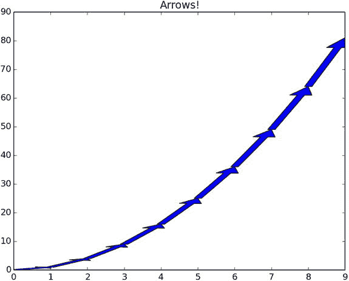

图 6-19. 添加箭头图形块

毋庸置疑，`Arrow()`（以及其他图形块）可以进行大量自定义；你可以调整颜色、长度、宽度等。

### 示例：其他图形块

代码清单 6-17 中的代码生成一个图形块对象列表，并将它们附加到一个图形上。该图形最初是空的。

***代码清单 6-17***. 一些图形块

```python
from pylab import *
```

## 将图形块导入当前命名空间

`from matplotlib.patches import Ellipse, Wedge`

## 一些图形块的列表

`my_patches = [Arrow(0, 4, 0, -4, facecolor='g'), Circle([-2, 2], 1.5, linewidth=4, fc='orange'), Ellipse([2, 3], 4, 1, 45.0, edgecolor='r'), Polygon([[4, 2], [3, 3], [1, -1], [3, -1]], ls='dashed', fill=False), Wedge([-1, 0], 3, 200, 300, fc='m', ec='m'), Rectangle([1, -2], 3, -2, fill=False, lw=5, ec='r')]`

## 绘制一个图形

`figure()`
`axis([-5, 5, -5, 5])`

## 添加图形块

```python
cur_ax = gca()
for p in my_patches:
    cur_ax.add_patch(p)

title('Patches')
show()
```

图 6-20 展示了代码清单 6-17 中代码的运行结果。

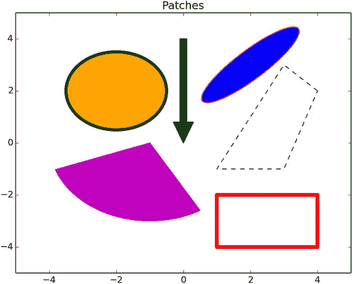

图 6-20. 一些图形块

当你执行`from pylab import *`时，图形块对象`Ellipse`和`Wedge`不会自动导入到当前命名空间（这与`Arrow`、`Circle`、`Polygon`和`Rectangle`不同）。因此，我通过语句`from matplotlib.patches import Ellipse, Wedge`手动将它们导入到命名空间中。

我还向这些图形块传递了参数，以展示如何使用它们：`facecolor`（或`fc`）、`edgecolor`（或`ec`）、`linestyle`（或`ls`）、`linewidth`（或`lw`）和`fill`。

## 3D 绘图

在本书的第一版中，`matplotlib`不支持 3D 绘图。随着`matplotlib`新版本的出现，通过`mplot3d`工具包（参见`http://matplotlib.org/mpl_toolkits/mplot3d/tutorial.html`）也提供了 3D 绘图功能，该工具包是`matplotlib`的一部分。

延续“示例：等高线图”一节中的球体，我们现在转向绘制球体的实际 3D 图。函数`plot_surface()`用于绘制 3D 曲面（参见代码清单 6-18）。

***代码清单 6-18***. 球体的 3D 曲面图

```python
from pylab import *
from mpl_toolkits.mplot3d import Axes3D

x = linspace(-1, 1, 100)
y = linspace(-1, 1, 100)
u, v = meshgrid(x, y)

fig = figure()
z = 1-u**2-v**2
z[nonzero(z<0)] = 0
ax = fig.gca(projection='3d')
ax.plot_surface(u, v, z)
title('A sphere on a plane')
show()
```

在导入`PyLab`之后，我导入了`mplot3d`工具包。

要生成 3D 图，你首先需要做的是使用参数`projection='3d'`创建一个`Axes3D`对象。这通过代码行`ax = fig.gca(projection='3d')`完成。变量`ax`是一个`Axes3D`对象；要访问 3D 函数，你必须使用`Axes3D`的成员函数（例如，代码清单 6-18 中的`ax.plot_surface()`）。

生成的 3D 图如图 6-21 所示。

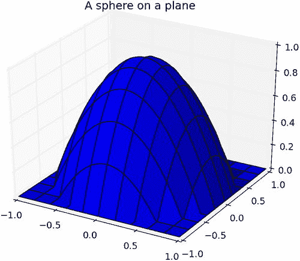

图 6-21. 平面上球体的 3D 图

其他 3D 绘图包括`contour()`和`contourf()`（只需在代码清单 6-18 中将`ax.plot_surface()`替换为`ax.contour()`或`ax.contourf()`即可）。图 6-22 展示了 3D 等高线图。

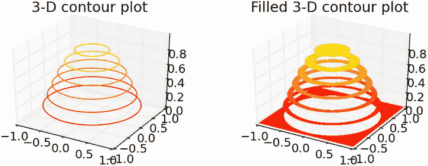

图 6-22. 3D 等高线图

`mplot3d`工具包还支持绘制 3D 线图（函数`plot()`）和散点图（函数`scatter()`），如代码清单 6-19 所示。

***代码清单 6-19***. 3D 线图

```python
from pylab import *
from mpl_toolkits.mplot3d import Axes3D

N = 50
theta = linspace(0, 2*pi, N)
x = cos(theta)
y = sin(theta)
z = linspace(0, 1, N)

fig = figure()

### 第一个 3D 子图
ax1 = fig.add_subplot(2, 2, 1, projection='3d')
ax1.plot(x, y, z)
title('3D line plot')

### 第二个 3D 子图
ax2 = fig.add_subplot(2, 2, 2, projection='3d')
x = cos(theta) + randn(N)/10
y = sin(theta) + randn(N)/10
z = linspace(0, 1, N)
ax2.scatter(x, y, z)
title('3D scatter plot')
show()
```

在这个示例中，我还介绍了 3D 子图。通过调用`fig.add_subplot(..., projection='3d')`来添加 3D 子图。请注意，要创建 3D 子图，你必须在创建子图时传递参数`projection='3d'`。代码清单 6-19 的运行结果如图 6-23 所示。

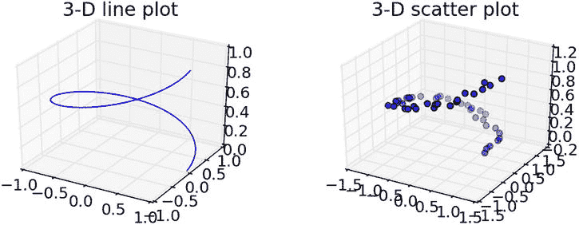

图 6-23. 3D 线图

## Basemap 工具包

`Basemap`工具包（参见`http://matplotlib.org/basemap/`）基于`matplotlib`，支持在 Python 中绘制 2D 数据地图。

### 示例：法国机场

以下“示例：法国机场”一节使用了`basemap`的许多功能，应能提供足够的信息帮助您上手使用该包。如需完整说明，请参阅`basemap`的文档。

在本示例中，我将法国机场的位置绘制在法国地图上。为此，我使用了 METAR 气象报告中的信息。飞行员在飞行准备阶段会使用 METAR 气象报告，其中包含能见度和风速等信息。每个气象站都有一个指定的四字符代码，前两个字符代表国家，后两个字符与机场相关联。法国的 METAR 站代码以 LF 开头。例如，`LFPB`是巴黎勒布尔热机场的站代码。这些站的完整列表可在国家大气研究中心获取（直接链接：`http://weather.rap.ucar.edu/surface/stations.txt`）。首先下载此文件并将其保存到目录`../data/stations.txt`中。代码清单 6-20 中展示的代码假定该文件位于该目录位置。您还需要下载并安装`basemap`工具包（`http://matplotlib.org/basemap/users/download.html`）。如需手动安装，请参阅第 2 章。

***代码清单 6-20***. 法国机场

```python
from pylab import *
from mpl_toolkits.basemap import Basemap

#### 读取 METAR 机场代码，获取经纬度值
airports = {}
metar_codes = open('../data/stations.txt').readlines()
for row in metar_codes:
    code = row[20:24] # METAR 代码
    if(code.startswith('LF')):
        lat = float(row[39:41])+float(row[42:44])/60
        lon = float(row[47:50])+float(row[51:53])/60
        if(row[53]=='W'): lon = -lon
        if(row[44]=='S'): lat = -lat
        name = row[:20].split('/')[0].strip().title()
        airports[code] = [lon, lat, name]

#### 绘制地图
m = Basemap(llcrnrlon=-5.0, llcrnrlat=41.0, urcrnrlon=10.0, urcrnrlat=51.5,
    projection='merc', resolution='h', suppress_ticks=False)
m.drawcoastlines()
m.bluemarble(scale=0.5)
m.drawmapboundary(fill_color='lightblue')
m.drawcountries(linewidth=1)
m.drawmapscale(-2.0, 41.5, -2.0, 41.5, 500, units='km')
axis('off')
```

#### 绘制机场

```python
for site, [lon, lat, name] in airports.items():
    xpt, ypt = m(lon, lat)
    text(xpt, ypt, ' '+name, va='center', ha='left', fontsize=9,
        color='white')
    plot(xpt, ypt, 'wo')
title('法国的 METAR 站点')
show()
```

首先，我们导入`PyLab`和`basemap`工具包。接着，初始化一个名为`airports`的字典对象。字典对象`airports`以 METAR 代码为键，以包含经度、纬度和机场名称的列表为值。然后，我们读取整个`stations.txt`文件，并将其存储为字符串列表的`metar_codes`变量；每个字符串对应文件中的一行。接下来，我们检索站点的 METAR 代码。我们通过切片`metar_codes`中每个字符串的第 20-24 个字符来实现；该值存储在变量`code`中。由于法国的 METAR 代码以 LF 开头（您可以通过读取`stations.txt`文件并滚动到 FRANCE 部分来验证），我们检查`code`是否以`'LF'`开头。如果是，则开始处理机场数据。我们再次使用字符串切片，并将字符串转换为浮点值以存储经纬度信息。注意除以 60 的操作；这是将度转换为度的小数部分所必需的。此外，在西半球，经度值为负；在南半球，纬度值为负。

到目前为止，我使用了基本的 Python 功能，但现在我将转向`basemap`工具包。首先，我创建一个名为`m`的`basemap`对象，并初始化该对象以显示法国区域。

初始化参数`llcrnrlon`代表左下角经度；类似地，初始化参数`urcrnrlat`代表右上角纬度。我选择了`'merc'`（墨卡托）投影，该投影决定了如何将球体（地球）投影到平面（我们的绘图）上。完整的投影列表可在`http://matplotlib.org/basemap/api/basemap_api.html`获取。接下来，我绘制海岸线（`m.coastlines()`），添加蓝色大理石着色（`m.bluemarble()`），绘制国家边界（`m.drawmapboundary()`），然后将地图比例尺设置为公里（`m.drawmapscale()`）。

最后一部分绘制了字典对象`airports`中的机场。我们通过使用`basemap`对象`m`转换经纬度值来实现，如下所示：`xpt, ypt = m(lon, lat)`。

结果如图图 6-24 所示。

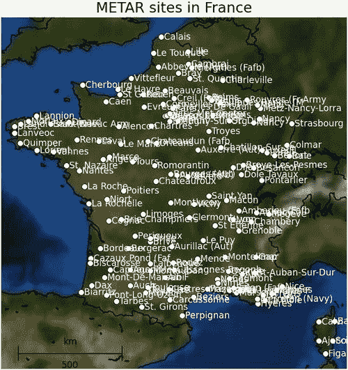

图 6-24。法国的 METAR 站点

## 最后说明与参考

我们已经探索了`matplotlib`包，这是一个支持在 Python 中绘图的丰富包。`matplotlib`的强项在于，它能够轻松绘制简单和复杂的图形，并提供大量自定义选项。如果您不熟悉该包，请尝试使用 IPython 的 Tab 补全功能，辅以`help()`、反复试验和手册来探索它。综合运用这些技巧，您很快就能获得出色的结果。

本章的示例涵盖了与图形和绘图相关的广泛主题和情况。虽然您的需求可能有所不同，但您现在应该拥有独立探索`matplotlib`包所需的工具。

`matplotlib`网站是一个极好的信息来源，我鼓励您探索它并了解更多关于该包的信息：

*   `matplotlib`网站，`http://matplotlib.org/`
*   `Mplot3d`工具包，`http://matplotlib.org/mpl_toolkits/mplot3d/tutorial.html`
*   `basemap`工具包，`http://matplotlib.org/basemap/`

# 第 7 章


## 数学游戏

### 可视化前的数据预处理

数学是数据可视化的基本工具。Python 提供了出色的数学支持，使其成为在可视化之前执行分析的理想开发环境。Python 的交互性使得操作数据和观察中间结果变得容易。Python 还使得修改结果并快速绘图变得简单。我喜欢使用 Python 进行数据可视化的另一个原因是：有大量流行、免费、成熟的数值包可用。最后，Python 结构清晰，允许开发生产级代码来生成高质量报告。

在本章中，我们将探索 Python 的数学能力，包括其内置模块`math`、`cmath`、`random`、`decimal`和`fractions`。我们还将介绍`NumPy`，这是一个我们将在后续章节中广泛使用的优秀包（我们在前面的章节中也使用过）。`NumPy`提供了强大的 n 维数组、向量和矩阵运算、线性代数以及更多功能。

### 模块`math`和`cmath`

Python 提供了两种数学模块：`math`和`cmath`。`math`模块包含大多数编程语言通用的函数，本质上使用了 C 语言的数学函数调用。`math`模块中的函数返回浮点数。如果参数不合适，将引发错误：

```python
>>> import math
>>> math.sqrt(-1)
```

```
Traceback (most recent call last):
  File "<stdin>", line 1, in <module>
ValueError: math domain error
```

模块`cmath`返回复数结果：

```python
>>> import cmath
>>> cmath.sqrt(-1)
```

```
1j
```

Python 通过内置的`complex`数据类型原生支持复数。这可能是 Python 作为数值计算平台受欢迎的一个促成因素。

复数虚部的表示有一个尾随的“j”，如前面的示例所示。大多数算术运算和函数调用都可以对复数执行。如果你不需要复数支持，建议使用`math`而不是`cmath`。首先，如果函数的参数超出定义域，它会提供有价值的异常信息，如前所示。其次，`cmath`总是返回复数结果，即使结果可以表示为非复数，在这种情况下虚部值为零。最后，有些函数仅在`math`模块中可用，如表 7-1 所列。

表 7-1. 仅在`math`模块中可用的函数

| 函数 | 描述 | 示例 |
| --- | --- | --- |
| `atan2(y, x)` | 返回`y/x`的反正切，考虑符号和除以零的情况。 | `atan2(2, 0)`返回 1.5707963267948966 (π/2)。`atan2(-1, -1)`返回−2.356194490192345 (−3π/4)。 |
| `ceil(x)` | 返回大于或等于`x`的最小整数。 | `ceil(2.5)`返回 3。`ceil(-2.5)`返回-2。 |
| `degrees(x)` | 从弧度转换为度。 | `degrees(1)`返回 57.29577951308232。 |
| `erf(x)` | 返回`x`处的误差函数。 | `erf(2)`返回 0.9953222650189527。 |
| `erfc(x)` | 返回`x`处的互补误差函数。 | `erfc(2)`返回 0.004677734981047268。 |
| `expm1(x)` | 返回`ex-1`；避免`x`值较小时精度损失。 | `expm1(0.01)`返回 0.010050167084168057。 |
| `factorial(x)` | 返回`x`! | `factorial(5)`返回 120。 |
| `floor(x)` | 返回小于或等于`x`的最大整数。 | `floor(2.5)`返回 2。`floor(-2.5)`返回-3。 |
| `fabs(x)` | 返回`x`的绝对值。 | `fabs(-2.5)`返回 2.5。 |
| `fmod(x, y)` | 返回`x`除以`y`的余数。 | `fmod(2.5, 2)`返回 0.5。`fmod(-2.5, 2)`返回-0.5。`fmod(2.5, -2)`返回 0.5。`fmod(-2.5, -2)`返回-0.5。 |
| `frexp(x)` | 返回指数`e`和尾数`m`，使得`x=m·2`^(`e`)。 | `frexp(2.5)`返回(0.625, 2)。`frexp(-2.5)`返回(-0.625, 2)。 |
| `fsum(iterable)` | 返回可迭代对象中各项的和。 | `fsum([0.1, 1.2, -0.6])`返回 0.7。 |
| `gamma(x)` | 返回`x`处的伽马函数。 | `gamma(6)`返回 120。 |
| `hypot(x, y)` | 返回`√(x`^(`2`)`+y`^(`2`)`)`。 | `hypot(3, 4)`返回 5.0。 |
| `ldexp(m, e)` | 返回 m·`2`^(`e`)。 | `ldexp(0.625, 2)`返回 2.5。`ldexp(-0.625, 2)`返回-2.5。 |
| `lgamma(x)` | 返回`x`处伽马函数绝对值的自然对数。 | `lgamma(6)`返回 4.787491742782047。 |
| `log1p(x)` | 返回`1+x`的自然对数；避免`x`值较小时精度损失。 | `log1p(0.01)`返回 0.009950330853168083。 |
| `log2(x)` | 返回`x`的以 2 为底的对数。 | `log2(10)`返回 3.321928094887362。 |
| `modf(x)` | 返回`x`的整数部分和小数部分。 | `modf(2.5)`返回(0.5, 2.0)。`modf(-2.5)`返回(-0.5, -2.0)。 |
| `pow(x, y)` | 返回`x`^y。 | `pow(2, 3)`返回 8。 |
| `radians(x)` | 从度转换为弧度。 | `radians(1)`返回 0.017453292519943295。 |
| `trunc(x)` | 截断小数点后的数字；返回值为整数。 | `trunc(2.5)`返回 2。`trunc(-2.5)`返回-2。 |

表 7-1 中列出的一些函数在 Python 3.x 和 Python 2.x 中的行为不同。在 Python 2.x 中，返回类型通常是`float`（即使实际值是整数，也表示为浮点数）。在 Python 3.x 中，如果可能返回整数，则返回值为`int`类型。

例如，在 Python 2.7.6 中，`ceil()`的返回类型是`float`：

```python
>>> from math import ceil
>>> ceil(2.5)
```

```
3.0
```

```python
>>> type(ceil(2.5))
```

```
<type 'float'>
```

而在 Python 3.3.5 中，`ceil()`的返回值是`int`：

```python
>>> from math import ceil
>>> ceil(2.5)
```

```
3
```

```python
>>> type(ceil(2.5))
```

```
<class 'int'>
```

大多数幂、对数、三角和双曲函数在`math`和`cmath`模块中都可用（参见表 7-2）。例外情况是函数`atan2(x, y)`、`hypot(x, y)`、`expm1(x)`、`log1p(x)`、`log2(x)`和`pow(x, y)`。这些函数仅在`math`中可用，因为它们在复数数学中用途有限。

表 7-2. `math`和`cmath`模块中的幂、对数、三角和双曲函数

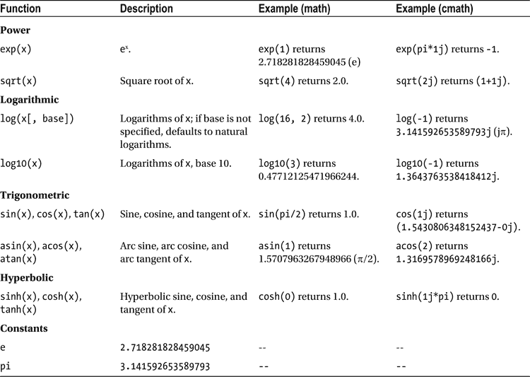

**函数`atan2`**

函数`atan2(y, x)`非常有用，因为它能保持平面中点的角度值，如第 1 章所示。也就是说，如果`x`和`y`表示平面中的坐标，`atan2(y, x)`返回从原点(0,0)出发的角度。考虑位于(1, 1)的点：其角度为 45 度（π/4），而点(–1,–1)的角度为-135 度（或 225 度）。如果使用`atan(y/x)`，点(1, 1)和(–1,–1)都会得到 45 度，从而丢失象限信息。然而，如果使用`atan2()`，则会返回正确的值。

`atan2(y, x)`的一个附带好处是，当`x`为零时，它能正确计算角度，而`atan(y/x)`会引发异常。函数`atan2()`在复数数学中不是特别有用，因为值已经代表了笛卡尔点。

### 示例：曼德勃罗集

分形可能是最著名的数学可视化形式，科学家用它来研究混沌系统：其状态随时间变化高度依赖于初始条件的系统。在下面的示例中，我们将使用复数数学来创建描绘曼德勃罗集的分形。在此过程中，我们将看到 Python 复数数学的能力，并探索一些除了常规绘图之外的数据可视化方法；分形和 Python 是完美的组合。

为了生成这个分形，我们询问对于某个复数`c`，重复执行操作`z=z**2+c`是否会产生一个有界序列。有界序列包含的值低于一个固定值，在本例中为`2`。如果序列是无界的，我们在复平面上的点`c`处记录下我们确定序列无界所经历的迭代次数。最后，我们展示生成的图像。

让我们手动运行一次：

```python
>>> c=0.4+1j*0.5
>>> z=0
>>> z=z**2+c; print(z, abs(z))
```

```
(0.4+0.5j) 0.6403124237432849
```

```python
>>> z=z**2+c; print(z, abs(z))
```

```
(0.31000000000000005+0.9j) 0.9518928511129812
```

```python
>>> z=z**2+c; print(z, abs(z))
```

```
(-0.31389999999999996+1.0580000000000003j) 1.1035838028894773
```

```python
>>> z=z**2+c; print(z, abs(z))
```

```
(-0.6208307900000004-0.16421240000000004j) 0.64218111318053
```

```python
>>> z=z**2+c; print(z, abs(z))
```

```
(0.7584651574982646+0.7038962280395922j) 1.0347653332940918
```

```python
>>> z=z**2+c; print(z, abs(z))
```

```
(0.4797994952905018+1.5677615269249674j) 1.6395376668399924
```

```python
>>> z=z**2+c; print(z, abs(z))
```

```
(-1.827668649625085+2.0044223787089317j) 2.7125784348275634
```

我首先选取了一个任意点`c=0.4+1j*0.5`，然后将`z`的初始值设为零。接着，我重复执行命令`z=z**2+c`并打印`z`的绝对值`abs(z)`。如你所见，`abs(z)`的值逐渐增大；在第七次迭代后，该值大于 2。这意味着在点(0.4, 0.5)处，我将记录`7`作为该值。如果你继续映射出点`c`，最终会得到曼德勃罗集分形（参见图 7-1）。该示例需要`Pillow`模块（关于安装，请参见第 2 章）。

以下是完整代码清单：清单 7-1. `mandelbrot.py`

```python
from PIL import Image, ImageOps  # 创建曼德勃罗集合图像
res = 400
iters = 200

img = Image.new("L", (res, res), 255)
for im in range(res):
    for re in range(res):
        z = 0
        # 缩放比例，用于显示曼德勃罗分形中“有趣”的部分
        c = (re*2/res-1.5)+1j*(im*2/res-1)
        for k in range(iters):
            z = z**2+c
            if abs(z)>2:
                img.putpixel((re, im), 255-k*255/iters)
                break

### 创建灰度级的均匀分布
img = ImageOps.equalize(img)
```

### 保存到文件
```python
img.save('../images/mandelbrot_%d_%d.png' % (iters, res), dpi=(150,150))
```

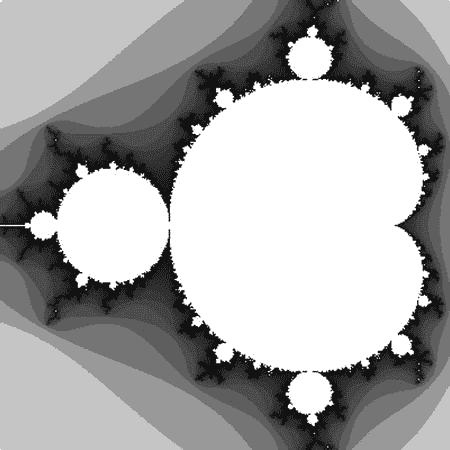

图 7-1。曼德勃罗集合，1000 次迭代

我们使用 Python 图像处理库 `Pillow`（原名 PIL）来绘制分形。首先从该包中导入两个模块：`Image` 和 `ImageOps`。从 `Image` 模块中，我们使用 `Image.new()` 创建新图像，并使用 `Image.putpixel()` 在指定位置向图像写入单个像素。最后，使用 `Image.save()` 将图像写入文件。从 `ImageOps` 模块中，我们使用 `ImageOps.equalize()` 创建灰度级的均匀分布，从而使分形图像更加突出（有关 `Pillow` 包的详细讨论，请参见第 9 章）。

我们首先创建一个大小为 `res` 的灰度图像，指定分形的分辨率。然后使用 `for` 循环和 `if` 语句编写曼德勃罗集合的代码，以检查收敛性。接下来，我们绘制一个矩形区域，x 轴从 -1.5 到 0.5，y 轴从 -1 到 1。你可以在这一行中看到这一点：`c = (re*2/res-1.5)+1j*(im*2/res-1)`。当你放大不同区域时，会出现有趣的分形，所以不妨尝试查找一下。

接着，我们将迭代次数映射到特定的灰度级别。其思路是：`k=0` 次迭代映射到 255（白色），而 `k=iters` 次迭代映射到值 0（黑色）。我们通过将值 `255-k*255/iters` 写入像素来实现这一点。不同的迭代次数值会产生有趣的结果（参见图 7-2）。

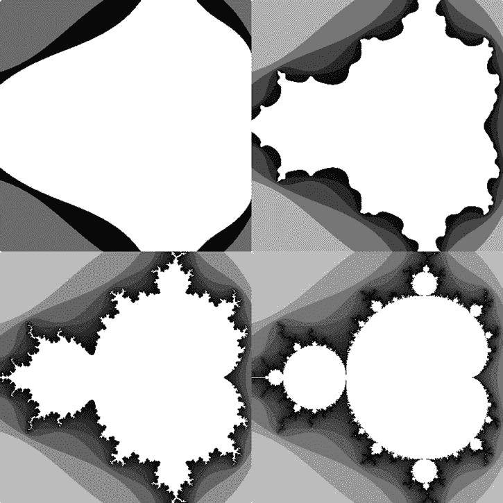

图 7-2。使用多个迭代次数值生成的曼德勃罗集合分形拼贴图

## 示例：牛顿分形

使用 Python 和稍微复杂的数学知识，你还可以使用牛顿-拉夫逊方法（也称为牛顿法）创建分形。牛顿法是一种迭代过程，用于通过初始猜测找到形如 `f(z) = 0` 的方程的数值解（即根）。该方法的一个特点是，在存在多个解的情况下，通常无法根据初始猜测预先知道收敛到哪个解。如果你根据解来映射初始猜测，你会发现它们收敛到的结果会形成一幅称为牛顿分形的图像，这在几何上非常有趣。


**注意** 如果你想了解更多关于牛顿法的信息，请查看 `http://en.wikipedia.org/wiki/Newton%27s_method`；互联网上还有大量其他相关信息。

我们将要映射的函数是 `f(z) = z**4 + 1`。该函数有四个根：

```python
>>> from cmath import pi, cos, sin
>>> solutions = [ cos((2*n+1)*pi/4) + \
... 1j*sin((2*n+1)*pi/4) for n in range(4)]
```

我们可以使用以下语句验证这些确实是方程的解：

```python
>>> from pprint import pprint
>>> pprint([ z**4 for z in solutions])
```

```
[(-1+4.440892098500626e-16j),
 (-1+4.440892098500626e-16j),
 (-1.0000000000000004+6.661338147750941e-16j),
 (-1+8.881784197001252e-16j)]
```

虚部数量级约为 10⁻¹⁶，这是由于三角函数、π 和浮点数表示的不精确性造成的；实际上虚部为零。

牛顿法采用一个初始猜测，并通过应用方程 `z(n+1) = z(n) – f(z(n)) / f'(z(n))` 计算下一个猜测，其中 `f'(z)` 是 `f(z)` 的导数。在我们的例子中，`f(z)/f'(z)` 是 `z-(z**4+1)/(4*z**3)`。为了检查新值是否是一个“好的”解，我们将其重新代入原始方程，并检查它离零有多近。我们通过检查绝对值是否小于 `delta`（一个预定义的小值）来实现这一点。迭代次数表示解收敛的速度。我们将使用它来选择每个解的颜色深度；收敛快的解会更亮。一旦我们的猜测收敛，我们就检查它收敛到了哪个解，并相应地着色。由于有四个解，分形中会有四种颜色（具有不同的颜色深度）。清单 7-2 在区域 (0, 0)–(1, 1) 中生成了示例牛顿分形。

`清单 7-2`。`newton.py`

```python
from PIL import Image
from cmath import *

### 使用牛顿-拉夫逊方法创建 z**4+1 = 0 的分形

### 根查找方法
delta       = 0.000001  # 收敛标准
res         = 800       # 图像大小
iters       = 30        # 迭代次数

### 创建一个用于绘制的图像，将其涂黑
img = Image.new("RGB", (res, res), (0, 0, 0))
```

### 这些是方程`z**4+1 = 0`的解（欧拉公式）

`solutions = [cos((2*n+1)*pi/4)+1j*sin((2*n+1)*pi/4) for n in range(4)]`
`colors = [(1, 0, 0), (0, 1, 0), (0, 0, 1), (1, 1, 0)]`

```python
for re in range(res):
    for im in range(res):
        z = (re+1j*im)/res
        for i in range(iters):
            try:
                z -= (z**4+1)/(4*z**3)
            except ZeroDivisionError:
                # 可能发生除零异常
                continue
            if(abs(z**4+1)<delta):
                break

        # 颜色深度是迭代次数的函数
        color_depth = int((iters-i)*255.0/iters)

        # 找到该猜测收敛到了哪个解
        err = [ abs(z-root) for root in solutions ]
        distances = zip(err, range(len(colors)))

        # 选择与该解关联的颜色
        color = [i*color_depth for i in colors[min(distances)[1]]]
        img.putpixel((re, im), tuple(color))

img.save('../images/newton_z4s_%03d_%03d_%03d.png' % \
    (iters, res, abs(log10(delta))), dpi=(150,150))
```

虽然迭代过程很直接，但确定特定猜测收敛到四个解中的哪一个，然后映射到正确的颜色和颜色深度，需要一些说明。

`colors`列表由红色、绿色、蓝色和黄色组成。每种颜色由一个红-绿-蓝（RGB）值元组表示：

```python
colors = [(1, 0, 0), (0, 1, 0), (0, 0, 1), (1, 1, 0)]
```

变量`color_depth`直接负责显示颜色的深度（或明暗度）。对于较少的迭代次数，`color_depth`更接近255；而对于较多的迭代次数，该数字更接近0，从而使收敛较快的点（迭代次数较少）呈现更亮的颜色。

一旦计算出`color_depth`，我们就找到最接近我们收敛值的解。由于我们使用的是复数，最接近的值是距离最小的值——在复数数学中，即`err = abs(guess-solution)`值最小的那个。

为了实现这一点，我们使用列表推导式生成一个与距离对应的值列表。以下是一个使用任意根的示例：

```python
>>> from cmath import sqrt
>>> z=sqrt(2)/2*(1+1j)
>>> z
```

```
(0.7071067811865476+0.7071067811865476j)
```

```python
>>> err = [abs(z-root) for root in solutions]
>>> err
[1.1102230246251565e-16, 1.414213562373095, 2.0, 1.4142135623730954]
```

接下来，我们将这些值与代表`colors`列表索引的数字0-3组合起来，使用`zip()`函数：

```python
>>> zip(err, range(len(colors)))
<zip object at 0x0000000002BFAC08>
>>> list(_)
[(1.1102230246251565e-16, 0), (1.414213562373095, 1), (2.0, 2), (1.4142135623730954, 3)]
```

然后，我们通过调用`min()`函数来找到最小误差。为了找到正确的颜色，我们索引与`min(distances)[1]`关联的颜色，这是压缩后的可迭代对象中的第二个元素。也许通过交互式演示比解释更容易理解：

```python
>>> distances = list(zip(err, range(len(colors))))
>>> min(distances)
(1.1102230246251565e-16, 0)
>>> min(distances)[1]
0
>>> colors[min(distances)[1]]
(1, 0, 0)
```

 **注意** 为了显示，我从压缩后的值创建了一个列表。在代码清单中，这不是必需的。

最后，我们使用列表推导式将RGB值乘以颜色深度。这是因为`putpixel()`方法需要一个包含RGB值的元组：

```python
color = [i*color_depth for i in colors[min(distances)[1]]]
img.putpixel((re, im), tuple(color))
```

 **提示** 在试验参数时，你可能希望保存一些输出结果。这些运行可能需要相当长的时间才能完成，因此最好为输出使用不同的文件名，而不是单一的文件名。这可以确保文件不会被意外覆盖。这些运行的输出结果取决于输入参数和生成它们的代码（例如，脚本的版本）。因此，我使用的命名约定是在文件名中详细说明用于创建输出的所有参数：

```python
'../images/newton_z4s_%03d_%03d_%03d.png' % (iters, res, abs(log10(delta)))
```

 **注意** 一个更好的方法（尽管在这种情况下会稍微影响美观的输出）是在图像上添加描述所用参数的文本注释。最后，如果你使用版本控制系统（参见第2章），生成输出的脚本版本号无论是放在文件名中还是图像注释中，都是一个非常受欢迎的补充。

图7-3展示了脚本生成的输出拼贴图，其中`resolution=200`，`iters`的值从1到9（左上角是`i = 1`；右下角是`i = 9`）。我们将在第9章中讨论拼贴图。

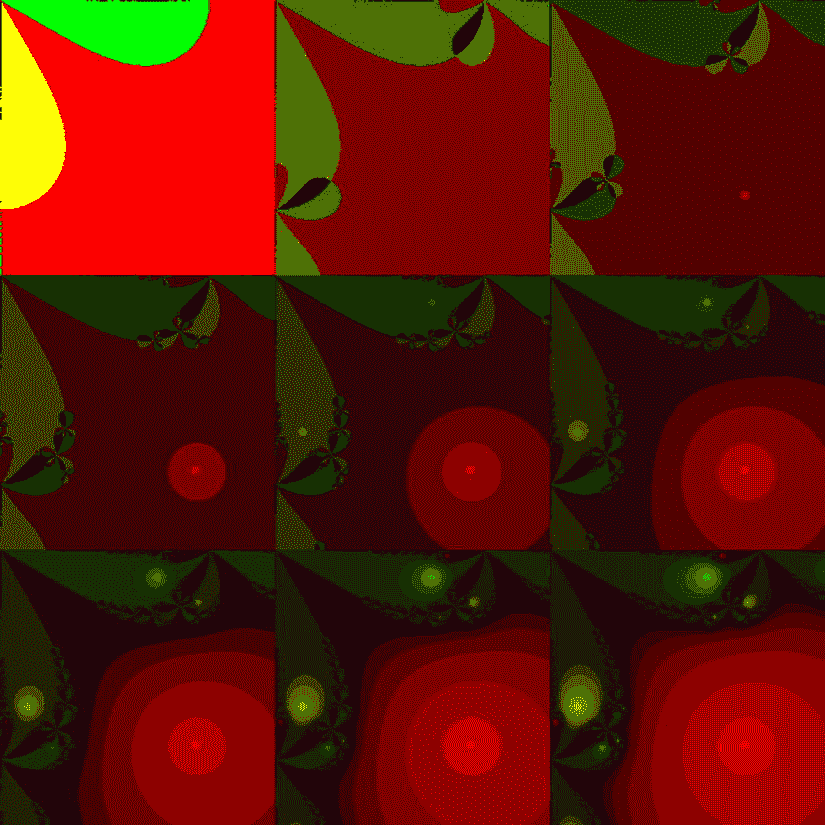

图7-3. 牛顿分形的拼贴图，迭代次数从1（左上）到9（右下）

图7-4展示了`resolution=800`和`iters=30`的较长运行结果。

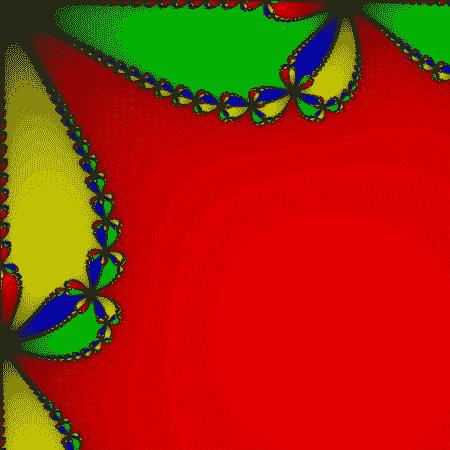

图7-4. 最大迭代次数为30的牛顿分形

 **提示** 前面的示例探索了区域(0, 0) – (1, 1)。如果你想探索原点附近，即(0, 0)周围，请将行`z = (re+1j*im)/res`更改为`z = ((re-res/2)+1j*(im-res/2))/res`。

## 模块`decimal`

Python标准库中一个有趣的模块是`decimal`模块。该模块支持定点数和浮点数十进制数，并允许任意精度（与精度有限的浮点数不同）。

使用`decimal`模块不如Python中的常规数字直观；但是，如果你需要更高的精度并且愿意接受一些性能损失，它是一个不错的选择。

通过调用`Decimal()`生成十进制数，如下所示：

```python
>>> from decimal import *
>>> Decimal('3.3')
Decimal('3.3')
>>> Decimal(3.3)
Decimal('3.29999999999999982236431605997495353221893310546875')
```

第一行创建了一个精确值为3.3的十进制数。这是因为使用了字符串`'3.3'`。第二行将数字的浮点表示转换为其十进制表示法。通常，你会希望使用字符串而不是浮点数，除非你是从浮点数转换为十进制数。

你可以像使用Python中的任何其他数字一样使用十进制数：

```python
>>> a = Decimal('3.3')
>>> a*a
Decimal('10.89')
>>> a-13
Decimal('-9.7')
```

十进制数也可以使用多种数学函数：

```python
>>> a = Decimal('3.3')
>>> sqrt(a)
Decimal('1.816590212458494999253519686')
>>> exp(Decimal('1'))
Decimal('2.718281828459045235360287471')
```

有关可用函数的列表，请执行`import decimal`，然后执行`dir(decimal)`。有关`Decimal`成员函数和属性的列表，请执行`dir(decimal.Decimal)`。你可以使用`help()`系统或访问`https://docs.python.org/3.3/library/decimal.html`的在线帮助来探索这些函数。

## 模块`fractions`

另一个有趣的模块是`fractions`模块，它支持有理数算术。基本对象是`Fraction`对象，它由分子和分母组成。该对象接受多种表示形式，如下所示：

```python
>>> from fractions import *
>>> Fraction(2, 7)
Fraction(2, 7)
>>> Fraction('2/7')
Fraction(2, 7)
>>> Fraction(_)
Fraction(2, 7)
>>> Fraction(1.22)
Fraction(5494391545392005, 4503599627370496)
```

第一行`Fraction(2, 7)`生成一个分子为2、分母为7的分数。第二行使用字符串生成一个分数；第三行使用另一个分数（由`_`引用）；最后一行使用浮点数生成一个分数。

你可以使用该模块对分数进行算术运算，如下所示：

```python
>>> Fraction(3, 4)**2
Fraction(9, 16)
>>> Fraction('3.14')
Fraction(157, 50)
>>> Fraction(22, 7) - Fraction('3.14')
Fraction(1, 350)
```

有关可用函数的列表，请执行`import fractions`，然后执行`dir(fractions)`。有关`Fraction`成员函数和属性的列表，请执行`dir(fractions.Fraction)`。你可以使用`help()`系统或访问`https://docs.python.org/3.3/library/fractions.html`的在线帮助来探索这些函数。

## 模块`random`

除了数学函数之外，Python还提供了丰富的随机数库。随机数在各种软件应用中都很重要。在游戏编程中，随机数用于改变游戏中元素的行为，使其更有趣或不可预测。在编写模拟程序时，随机数用于生成模拟现实世界的数据。随机数也可以用来回答概率问题，你很快就会看到。

`random`模块基于多种分布函数提供随机值，包括均匀分布、高斯分布等。`random`模块也自然地支持Python的列表，其随机函数可以对序列进行操作。

表7-3给出了一些有用的随机函数的部分列表。

表7-3. `random`模块的功能

| 函数 | 描述 | 示例/备注 |
| --- | --- | --- |
| **整数** |  |  |
| `randint(a, b)` | 返回`a`和`b`之间的随机整数（包含`a`和`b`）。 | `randint(0, 1)`返回`0`或`1`（随机）。 |
| `randrange([start, ]stop[, step])` | 从`range(start, stop[, step])`中随机选择一个数；不包含终点`stop`。 | `randrange(3, 7, 2)`返回`3`或`5`；不包含`7`。 |
| **浮点数** |  |  |
| `random()` | 返回0.0到1.0之间的实数（不包含1.0）。 | `random()`可能返回`0.11446412321713018`。 |
| `uniform(a, b)` | 返回`a`到`b`之间的实数（不包含`b`）。 | `uniform(120, 220)`返回120到220之间的随机数（不包含220，不考虑舍入）。 |
| `gauss(u, sigma)` | 返回以`u`为均值、`sigma`为标准差的高斯分布值。 | `gauss(1, 2)`可能返回`2.839406209732811`。 |

`random`模块还提供了其他几种随机数分布，例如对数正态分布和威布尔分布等。完整说明请参考Python标准库文档。

### 使用`random`模块解决概率问题

以下示例通过数值计算的方式，使用`random`模块解决基于概率的问题。

#### 示例：硬盘磁头

在本节的第一个示例中，我们使用`random`模块来确定硬盘读取文件时磁头移动的平均距离。我们通过两种变体来解答这个问题。在第一种变体中，我们假设每次读取后磁头都回到硬盘起始位置。在第二种变体中，我们假设磁头不移动；也就是说，它读取数据后停留在原地。

考虑以下（第一种变体）：硬盘磁头通常停留在位置0，代表磁盘的起始位置。文件（大小为零）均匀分布在位置0和1之间，其中1代表磁盘的末端。磁头需要随机访问文件。每次读取后，磁头返回位置0。问题是：磁头移动的平均距离是多少？

答案并不难：平均而言，磁头移动的距离相当于1。这是因为在最低端，磁头从位置0开始，请求的文件也在位置0，因此移动距离为0。在最顶端，磁头从位置0开始，移动到位置1，然后再返回，因此移动距离为2。平均值为1。你可以使用一个简单的脚本来轻松验证这一点：

```python
>>> from random import random
>>> N = 1000 # 磁头寻道的文件数量
>>> tot_dist = 0
>>> for i in range(N):
...      tot_dist += random()*2
...
>>> tot_dist/N
```

```
1.026458180335224
```

`N`的值越大，结果越精确。

现在考虑磁头不返回位置0，而是停留在原地直到被调用去寻道更多数据的情况（第二种变体）。从分析角度计算磁头移动的平均距离稍微困难一些；但通过数值计算，使用一个简单的脚本，解决方案很快就出现了：

```python
>>> from random import random
>>> N = 1000 # 磁头寻道的文件数量
>>> tot_dist, cur_loc = 0, 0
>>> for i in range(N):
...      new_loc = random()
...      tot_dist += abs(cur_loc-new_loc)
...      cur_loc = new_loc
...
>>> tot_dist/N
```

```
0.336151105404132
```

这个数字结果是1/3。

#### 示例：朋友见面

`random`模块对于需要可视化输出的概率问题也很有帮助。在这个示例中，我们模拟两个时间表的时机。尽管示例的主题是两个朋友的到达时间，但你可以轻松地将相同的方法应用于飞机时刻、赶公交或其他会合时间表。

假设两个朋友决定在晚上8点到9点之间见面。

一旦其中一个朋友到达指定会面地点，他会等待他的朋友10分钟。因此，如果朋友1在8:40到达，他会等到8:50等待朋友2出现。朋友1不知道朋友2是否已经提前到达（朋友2也是如此，他不知道朋友1是否已经到达）。然而，两个朋友都足够聪明，知道如果他们例如在8:55到达，他们只需要等到9:00，而不是9:05。问题是：这两个朋友见面的概率是多少？

我们再次求助于`random`模块来帮助我们解决这个问题（参见清单7-3）。只不过这次，我们还对结果进行了可视化，希望能对如何从分析角度解决这个问题有所启发。

***清单7-3***. 朋友见面

```python
from random import random
from pylab import *

N = 40000 # 事件数量

#### 生成 N 个朋友到达时间的事件
friend1, friend2 = [], []
for i in range(N):
    friend1.append(random())
    friend2.append(random())

#### 找出所有朋友见面的情况
met = array([ (x, y) for (x, y) in zip(friend1, friend2) \
    if abs(y-x) < 1.0/6 ])
not_met = array([ (x, y) for (x, y) in zip(friend1, friend2) \
    if abs(y-x) >= 1.0/6 ])
```

# 概率模拟示例

plot(`met`[:, 0], `met`[:,1 ], 'y+', mec='y')
plot(`not_met`[:, 0], `not_met`[:, 1], 'bo', mec='b')
title("见面的概率: %1.3f" % (float(len(`met`))/N))
xlabel('朋友 1 的到达时间 [分钟]')
ylabel('朋友 2 的到达时间 [分钟]')
xticks([n/6 for n in range(7)], [n*10 for n in range(7)])
yticks([n/6 for n in range(7)], [n*10 for n in range(7)])
axis('scaled')
show()

第一步是生成大量事件——本例中为 40,000 个。一个事件由两个数字组成：一个与朋友 1 的到达时间相关，另一个与朋友 2 的到达时间相关。我们将他们的时间都存储在列表中。生成事件的过程在第一个 `for` 循环中执行。函数 `random()` 返回一个介于 0 和 1 之间的值，该值映射到到达时间：0 代表晚上 8 点，1 代表晚上 9 点。

现在我们有了大量的事件，我们需要判断朋友在哪些时间会见面。如果他们的到达时间之差小于 10 分钟，即 10 分钟 / 60 分钟 * 1.0 = 1/6（1.0 是随机值的范围），则朋友会见面。但也有可能是朋友 1 在朋友 2 之后到达，而不是相反。因此，我们应该判断 `friend1-friend2` 是否小于 `1/6`，以及 `friend2-friend1` 是否小于 `1/6`。这可以优雅地编码为 `abs(friend1-friend2) < 1/6`。

实际实现使用列表推导式，返回满足条件 `abs(x-y) < 1/6` 的 `(x, y)` 值元组，这意味着朋友们见面了。然后我们构建这些值的数组（一个 `NumPy` 数组；稍后会详细介绍），这样我们就可以轻松访问 x 和 y 向量，而无需任何 `for` 循环。我们还构建了一个朋友没有见面的时间列表，因为我们希望用不同的颜色和标记绘制两者。

接下来，我们绘制结果并数值计算朋友见面的概率，如图 7-5 所示。

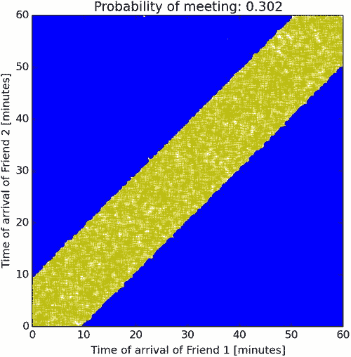

图 7-5. 朋友见面可视化

这种可视化确实很有帮助。中间的带状区域描述了两位朋友见面对应的事件。见面的概率就是这个带状区域的面积，可以通过整个正方形的面积减去左上角三角形和右下角三角形的面积来计算。每个三角形的面积为 `0.5·(5/6)²`，见面的总概率为 `1–(5/6)²=11/36=0.3055`。这与估计的数值（显示在图标题中）非常接近。

## 随机序列

`random` 模块还提供了一组用于操作序列的函数。这些函数包括表 7-4 中列出的函数。

表 7-4. `random` 模块中用于操作序列的函数

| 函数 | 描述 |
| --- | --- |
| `choice(s)` | 从序列 `s` 中返回一个随机元素。 |
| `shuffle(s)` | 打乱序列 `s`。 |
| `sample(s, n)` | 从 `s` 中返回一个大小为 `n` 的子序列。 |

为了演示这些函数的实际应用，我们使用 `zip()` 和 `range()` 可迭代对象创建一副扑克牌列表。每张牌表示为一个元组，包含一个介于 `1` 到 `13` 之间的数字和一个字符 `'S'`、`'H'`、`'D'` 和 `'C'`。这些字母分别对应黑桃、红心、方块和梅花：

```python
>>> from random import choice, shuffle, sample
>>> cards = list(zip(list(range(1, 14))*4, 'S'*13+'H'*13+'D'*13+'C'*13))
>>> cards[:5]
```

```
[(1, 'S'), (2, 'S'), (3, 'S'), (4, 'S'), (5, 'S')]
```

```python
>>> choice(cards)
```

```
(7, 'C')
```

```python
>>> shuffle(cards)
>>> cards[:5]
```

```
[(4, 'C'), (10, 'D'), (1, 'C'), (7, 'C'), (12, 'D')]
```

```python
>>> sample(cards, 5)
```

```
[(12, 'S'), (12, 'H'), (8, 'C'), (8, 'D'), (5, 'S')]
```

## 一副扑克牌

除了上述略显巧妙的方法之外，你还可以通过多种方式实现一副扑克牌。另一种方法是使用双重 `for` 循环。`for` 循环不仅更易于实现和阅读，而且你可以使用花色的完整名称（例如，使用 `'Spade'` 而不是 `'S'`）。或者，你也可以使用 `NumPy` 的 `ndarray` 对象（将在下一节讨论），例如：`zip(arange(52)//4+1, 'SHDC'*13)`。

哪种方法最好？在决定时，你最应该关心的是代码的可读性。别忘了，你也很可能是维护这段代码的人。如果你对双重 `for` 循环更熟悉，那就使用 `for` 循环方法。如果你更习惯压缩扁平数组，那么前面和后面章节中展示的选项都是可行的方法。这属于个人偏好问题，因为性能几乎不成问题。

也就是说，如果可能的话，你应该优先考虑可读性而非性能。毕竟，Python 是一种高级编程语言：如果你真的需要代码性能，其他编程语言可能更合适。甚至，你可以用其他编程语言来扩展 Python。

## NumPy 模块

`NumPy` 的 `ndarray` 对象是本书中许多数据处理和可视化脚本的基本构建块。正如你在前几章中学到的，`from pylab import *` 命令会导入 `NumPy` 包（以及其他包），使我们无需显式调用 `NumPy` 即可使用其 `ndarray` 对象。`NumPy` 包的功能远不止于此，还包括我们将在本章后面介绍的几个函数：财务函数、数学函数、线性代数等。

`NumPy` 的 `ndarray` 对象为 Python 的 `array` 对象提供了大量附加功能，并且与 Matlab 的矩阵数据结构有很多共同之处，包括矩阵运算、线性代数、信号处理等。它还为未来章节中将探讨的更复杂的数值方法提供了基本构建块。“ndarray”代表 N 维数组；顾名思义，该对象支持 N 维数组。在本章的剩余部分，我将互换使用术语“数组”和“ndarray”。在这两种情况下，我指的都是 `NumPy` 的 `ndarray` 对象——一旦导入了 `NumPy`，Python 的 `array` 对象就几乎没什么用了。

 **注意** `NumPy` 是一个功能全面且丰富的包。我只会涵盖对本书讨论的思想重要的主题；因此，本章应被视为对该包的快速介绍。

如果你想了解更多关于 `NumPy` 的信息，请查阅本章末尾的参考资料。

## 数组创建

第 3 章 介绍了 Python 的内置数据结构，包括元组、列表和字典。如果你还记得，创建这些数据结构有几种方法：我们使用方括号创建列表，也使用 `list()` 函数；我们使用花括号创建字典，也使用 `dict()` 函数，等等。与使用符号 `[]` 表示列表、使用符号 `{}` 表示字典不同，`NumPy` 数组没有为其预留特定的符号集。我们的选择是使用 `array()` 函数，或者在创建新数组时使用返回 `ndarray` 的函数。

创建并初始化数组最直接的方法是从列表创建：

```python
>>> from numpy import *
>>> v = array([1, 2])
>>> v
```

```
array([1, 2])
```

```python
>>> type(v)
```

```
<class 'numpy.ndarray'>
```

```python
>>> m = array([[1, 0],[0, 4]])
>>> m
```

```
array([[1, 0],
       [0, 4]])
```

```python
>>> type(m)
```

```
<class 'numpy.ndarray'>
```

表 7-5 列出了几种额外的数组创建方法，这些方法在处理大量数据点时更为有用。

表 7-5. `NumPy` 的数组创建函数

| 函数 | 描述 | 示例 |
| --- | --- | --- |
| **N 维数组** |  |  |
| `array(s)` | 基于序列 `s` 创建一个数组。 | `array(((1, 2),(3, 4)))` 返回 `array([[1, 2], [3, 4]])`。 |
| `ones(t)` | 基于元组 `t` 创建一个用 `1` 初始化的 N 维数组。 | `ones(2)` 返回 `array([ 1., 1.])` `ones((3,3)))` 返回 `array([[ 1., 1., 1.], [ 1., 1., 1.], [ 1., 1., 1.]])`。 |
| `arange([start,] stop[, step])` | 创建一个从 `start` 开始，到 `stop` 结束（但不包括 `stop`），步长为 `step` 的数组。函数 `arange()` 也可以返回非整数值。 | `arange(1, 2, 0.5)` 返回 `array([ 1., 1.5])`。 |
| `linspace(start, stop, num=50)` | 创建一个从 `start` 到 `stop`（包括）的线性间隔向量，大小为 `num`；更多选项请参考交互式帮助。 | `linspace(1, 10, 3)` 返回 `array([ 1., 5.5, 10.])`。 |
| `logspace(start, stop, num=50)` | 类似于 `linspace()`，只是值在对数尺度上从 10^(start) 到 10^(stop) 均匀分布；更多选项请参考在线帮助。 | `logspace(0, 1, 3)` 返回 `array([ 1., 3.16227766, 10.])`。 |

还有一些其他的数组创建函数（`fromfile()`、`empty()`）；但在大多数情况下，你会发现表 7-5 中的函数已经足够。列出的函数中也有一些冗余：`ones(10)` 的结果与 `zeros(10)+1` 相同。

## 切片、索引和重塑

可以使用 `reshape()` 和 `resize()` 函数调整数组的大小，并且可以使用 Python 的切片和索引运算符 `[]` 和 `[:]` 对数组进行索引和切片。这两个函数的区别在于：`resize()` 会调整现有数组的大小，而 `reshape()` 会基于原始数组中的数据返回一个新数组：

```python
>>> a = arange(12).reshape(4, 3)
>>> a
```

```
array([[ 0,  1,  2],
       [ 3,  4,  5],
       [ 6,  7,  8],
       [ 9, 10, 11]])
```

```python
>>> a[1]
```

```
array([3, 4, 5])
```

```python
>>> a[-1]
```

```
array([ 9, 10, 11])
```

```python
>>> a[1, 1]
```

```
4
```

```python
>>> a[:, 1]
```

```
array([ 1,  4,  7, 10])
```

```python
>>> a[1, :2]
```

```
array([3, 4])
```

## N 维数组

`NumPy` 数组是 N 维数组，其创建方式与一维和二维数组相同：

```python
>>> ones((2, 3, 4))
```

```
array([[[ 1.,  1.,  1.,  1.],
        [ 1.,  1.,  1.,  1.],
        [ 1.,  1.,  1.,  1.]],

       [[ 1.,  1.,  1.,  1.],
        [ 1.,  1.,  1.,  1.],
        [ 1.,  1.,  1.,  1.]]])
```

```python
>>> a = ones((2, 3, 4))
>>> a
```

```
array([[[ 1.,  1.,  1.,  1.],
        [ 1.,  1.,  1.,  1.],
        [ 1.,  1.,  1.,  1.]],

       [[ 1.,  1.,  1.,  1.],
        [ 1.,  1.,  1.,  1.],
        [ 1.,  1.,  1.,  1.]]])
```

```python
>>> a[0,...]
```

```
array([[ 1.,  1.,  1.,  1.],
       [ 1.,  1.,  1.,  1.],
       [ 1.,  1.,  1.,  1.]])
```

```python
>>> a[0, 1, ...]
```

```
array([ 1.,  1.,  1.,  1.])
```

对于 N 维数组，有一个有用的运算符 `...`，它表示“所有剩余维度”，类似于运算符 `:`（冒号）。

N 维数组有多大用处？有些人很少用到 N 维，觉得一维或二维就足够用了。根据我的经验，在处理多个参数组合时，N 维数组提供了极佳的数据存储方式。假设有一个包含四个参数的模拟，每个参数都有一系列取值。你想对整个模拟进行映射，即针对每个参数组合计算结果，并存储结果（因为运行时间很长）。你会如何存储这些结果？一种方法是将其写入列表，将数据扁平化。另一种方法是使用 N 维数组。下面的示例将讨论如何使用 N 维数组和扁平化数据结构，将数据存储为多个参数（通常超过两个）的函数。

## 示例：比较抵押贷款

自从我撰写本书第一版以来，次贷危机已经冲击了全球市场，因此我认为在本版中提供一个比较不同抵押贷款的示例是合适的。（我并非金融专家，所以请千万不要将此作为选择抵押贷款的建议！）。让我们从定义问题开始。

固定抵押贷款的还款额是三个参数的函数：贷款金额（也称为现值）、利率和还款期数。银行通常会根据还款期数、个人信用记录，可能还有贷款金额，提供不同的利率。基于这三个参数（现值、利率和还款期数），我们希望绘制出月还款额——即参数范围内每个取值对应的预期月还款额。

在本示例中，假设我们考虑的贷款金额范围是 10 万到 14 万美元，以 2 万美元为增量；抵押贷款利率范围是 3% 到 5%，以 0.5% 为增量；还款期数范围是 60 到 300 期，以 60 期为增量（代表 5 到 25 年，以 5 年为增量）。我们将使用 `pmt()` 函数，该函数是 `NumPy` 包的一部分。该函数返回固定利率抵押贷款的固定月还款额（参见 `http://en.wikipedia.org/wiki/Fixed-rate_mortgage`）。

然后，我们构建代表要映射的值范围的列表。我们使用本章前面描述的 `arange()` 函数来实现这些列表。

### 使用 `ARANGE()` 和 `LINSPACE()` 的便利性

这是另一个说明 `NumPy` 为何比非数学导向的数据结构更便利的例子。要实现一个包含非整数增量的值列表，我们可以使用列表推导式，如下例所示：

`>>> interest_rates = [x/2.0+3 for x in range(5)]`

虽然这完全没问题，但可读性不如下面这种方式：

`>>> interest_rates = arange(3.0, 5.5, 0.5)`

在第一种方法（使用列表推导式）中，你需要做一些数学计算才能确切知道使用了哪些值。在第二种方法中，这些值一目了然：从 3 到 5.5（不包括 5.5），增量为 0.5。

我猜测模块开发者决定在 `arange()` 函数中排除边界值（即上例中的 5.5），是为了使其行为与 `range()` 类似。

我个人更倾向于包含边界值。

或者，你也可以使用 `linspace()` 函数：

`>>> interests = linspace(3.0, 5.0, 5)`

在这个特定示例中，这有点别扭：必须预先计算出值 5（最后一个参数）才能达到 0.5 的增量。

最后一点说明：此抵押贷款示例中的值是年值；要正确使用它们，必须将它们除以 12（月数）和 100（百分比值）。无论如何，这在列表推导式实现和 `arange()` 实现中都是必需的。我将其省略了，以便说明更清晰（请参见代码中变量 `interests` 的赋值）。数组与数值相乘（或相除）的能力将在下一节中展示。

接下来，我们遍历贷款金额、还款期数和利率的范围，然后构建一个数据结构来保存结果：月还款额。当我们检查这两种数据结构时，会看到以下情况：

*   一个扁平化的行列表（`res1`），每一行都是一个包含贷款金额、还款期数、利率和月还款额的列表。这是一个原生的 Python 列表。
*   一个 N 维数组（`res2`），其中每个维度对应一个不同的参数：贷款金额、还款期数、利率、月还款额和贷款成本。这是一个 3 维的 `NumPy` 数组。

清单 7-4 比较了这两种结构。

***清单 7-4***。扁平化数据与 N 维数据，ndflat.py

```python
from numpy import *
loans           = arange(100000, 160000, 20000)
num_payments    = arange(5, 30, 5)*12
interests       = arange(3, 5.5, 0.5)/100.0/12.0

#### 方法 1，将结果存储在列表中
res1 = []
```

#### 方法 2，将结果存储在数组中
```python
res2 = zeros([len(loans), len(num_payments), len(interests)])

for i, loan in enumerate(loans):
    for j, num_pay in enumerate(num_payments):
        for k, interest in enumerate(interests):
            res1.append([loan, num_pay, interest, \
                -pmt(interest, num_pay, loan)])
            res2[i][j][k]=-pmt(interest, num_pay, loan)
```
使用 N 维数组的好处是索引更加简单快捷。例如，假设 `loan` 固定并设置为 `0`，则 `res2` 数组中的结果可以通过 `res2[0, ...]` 访问。要在列表中实现同样的效果，可能需要遍历整个 `res1` 列表并比较第一个参数的值。这在代码和实际性能上都有开销：
```python
>>> exec(open('ndflat.py').read())
>>> for row in res1:
...     if(row[0] == 120000 and row[1] == 120):
...         print(row)
...
```
```
[120000, 120, 0.0025000000000000001, 1158.7289363806954]
[120000, 120, 0.0029166666666666668, 1186.6304095428363]
[120000, 120, 0.0033333333333333335, 1214.941657978555]
[120000, 120, 0.0037499999999999999, 1243.6609050842044]
[120000, 120, 0.0041666666666666666, 1272.7861828689065]
```
```python
>>> res2[1, 1, ...]
```
```
array([ 1158.72893638,  1186.63040954,  1214.94165798,  1243.66090508,
        1272.78618287])
```
然而，列表的结果可读性更强：它们以人类可读的形式显示了所有参数组合。你也可以用 `res2` 实现同样的效果，但这需要一个 `for` 循环：
```python
>>> values = res2[1, 1, :]
>>> for i, v in enumerate(values):
...     row = [loans[1], num_payments[1], interests[i], v]
...     print(row)
...
```
```
[120000, 120, 0.0025000000000000001, 1158.7289363806954]
[120000, 120, 0.0029166666666666668, 1186.6304095428363]
[120000, 120, 0.0033333333333333335, 1214.941657978555]
[120000, 120, 0.0037499999999999999, 1243.6609050842044]
[120000, 120, 0.0041666666666666666, 1272.7861828689065]
```
请注意，`for` 循环在遍历的值列表上使用了 `enumerate()`。

#### 排版后的文档

之所以如此，是因为 `NumPy` 数组需要索引（且索引必须是整数），而 Python 列表则不需要。因此从某种意义上说，列表在代码层面可能更优雅（无需使用 `enumerate()`）。最后，列表实现非常适合存储到 CSV 文件中，而 CSV 本身是一种扁平化的数据结构。话虽如此，你也可以将数组扁平化后做同样的事情。数组扁平化可以通过 N 维循环或嵌套列表推导式实现。以我们的示例为例，以下代码使用列表推导式将三维数组 `res2` 扁平化：
```python
>>> exec(open('ndflat.py').read())
>>> res2.shape
```
```
(3, 5, 5)
```
```python
>>> [n1, n2, n3] = [range(i) for i in res2.shape]
>>> n1, n2, n3
```
```
(range(0, 3), range(0, 5), range(0, 5))
```
```python
>>> flat_res2 = [res2[a, b, c] for a in n1 for b in n2 for c in n3]
```
`res2` 的维度可通过 `res2.shape` 访问。然后我们通过 `[n1, n2, n3] = [range(i) for i in res2.shape]` 这一行创建了三个 `range()` 可迭代对象。最后，我们使用列表推导式生成一个扁平化的数据结构，即列表形式的 `flat_res2`。

尽管 N 维数组是很有趣的数据结构，但本书中的大多数示例都基于一维数组（向量）和二维数组（矩阵），因为它们涵盖了大多数我们可能需要的操作。即使是三维图，实际上也是由二维矩阵表示的：索引代表 x 和 y，单元格的值代表 z。

选择 N 维数组还是扁平化数据结构，取决于你试图解决的具体问题。

## 数学函数

数组支持简单的算术运算，包括加法、减法、除法、乘法和幂运算。你还可以使用 `math` 和 `cmath` 模块中的大多数数学函数（尽管现在它们已作为 `NumPy` 的一部分实现）。

## 示例：可视化矩形波的傅里叶展开

以下示例展示了使用正弦波之和进行矩形波的傅里叶展开。傅里叶展开广泛应用于从求解微分方程到信号处理的众多应用中。此示例将展示如何将 `NumPy` 数组视为值的向量，并像操作函数一样操作该向量。该示例使用正弦波（`NumPy` 数组）的傅里叶展开来生成矩形波（另一个 `NumPy` 数组）。具体来说，清单 7-5 实现了函数 `4 / (π·n)·sin(2π·n·t·N)`，这是矩形波的傅里叶级数展开。参数 `N` 决定要展开的周期数，在示例中设置为 2，以便我们查看两个周期。参数 `n` 决定正弦波的频率；我们探索 `n=1`、`3`、`5` 和 `7` 的值。

***清单 7-5***。可视化傅里叶展开
```python
### 绘制矩形波的傅里叶展开
from pylab import *

### 准备绘图
figure()
hold(True)

### 显示波形的点数
N = 2**8
t = linspace(0, 1, N)
y = zeros(N)

for n in range(1, 8, 2):
    # 正弦波，累加
    y += 4/(pi*n)*sin(2*pi*n*t*2)

    # 绘制图形
    plot(t, y)
```

# 数值分析与信号处理

## NumPy 基础回顾

在进入正题之前，让我们快速回顾一些 NumPy 的基础概念，这些在后续章节中会频繁用到。

### FFT 和绘图

首先，我们通过一个快速傅里叶变换（FFT）的例子来说明如何对信号进行分析和可视化。

#### 标注图形
```python
axis([0, 1, -1.4, 1.4])
grid()
xlabel('时间 [秒]')
ylabel('数值 []')
title('矩形波的傅里叶展开')
show()
```

让我们逐行分析代码。首先，我们导入整个 `PyLab` 包，其中也包含了 `NumPy` 和绘图命令。本例中两者都需要。然后我们准备一个空图：每次新的展开计算都将绘制在前一个之上，因此我们发出 `hold(True)` 命令以确保后续绘图不会擦除现有图形。

命令 `t = linspace(0, 1, N)` 创建了第一个数组对象，但我们也可以使用 `arange()` 函数调用来替代。数组对象 `t` 是一个一维数组，即向量。

我们所有的后续操作和数学函数都将在这个向量上执行。然后我们使用 `zeros()` 函数初始化级数展开变量 `y`。计算的核心在于 `for` 循环。每个正弦波都累加到前一个上，结果存储在 `y` 中。简单的 `y += 4/(pi*n)*sin(2*pi*n*t*2)` 这一行实际上是在操作整个数组，这充分体现了数组对象的强大之处。

然后我们在计算 `y` 的同时绘制它，并在展开完成后标注图形，如图 7-6 所示。

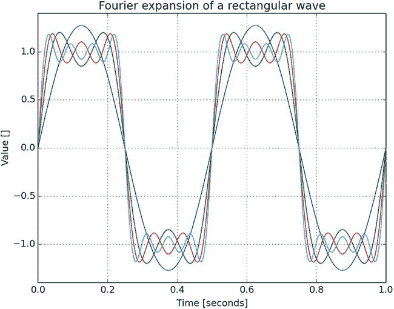

**图 7-6.** 矩形波的傅里叶展开

### 数组方法和属性

数组是对象；因此，它们拥有称为*方法*的函数和称为*属性*的变量。使用 IPython（参见第 2 章），你可以通过按 **Tab** 键触发的字符补全功能列出对象的方法和属性。或者，你也可以执行以下命令：

```python
>>> import numpy
>>> [m for m in dir(numpy.ndarray) if not(m.startswith('__'))]
```

```
['T', 'all', 'any', 'argmax', 'argmin', 'argpartition', 'argsort', 'astype', 'base', 'byteswap', 'choose', 'clip', 'compress', 'conj', 'conjugate', 'copy', 'ctypes', 'cumprod', 'cumsum', 'data', 'diagonal', 'dot', 'dtype', 'dump', 'dumps', 'fill', 'flags', 'flat', 'flatten', 'getfield', 'imag', 'item', 'itemset', 'itemsize', 'max', 'mean', 'min', 'nbytes', 'ndim', 'newbyteorder', 'nonzero', 'partition', 'prod', 'ptp', 'put', 'ravel', 'real', 'repeat', 'reshape', 'resize', 'round', 'searchsorted', 'setfield', 'setflags', 'shape', 'size', 'sort', 'squeeze', 'std', 'strides', 'sum', 'swapaxes', 'take', 'tofile', 'tolist', 'tostring', 'trace', 'transpose', 'var', 'view']
```

我使用上述列表创建了表 7-6。虽然该表只展示了方法和属性的一个子集，但它包含了那些我认为对数据处理和可视化最有用的部分。我还将方法按类别划分，以便于查看。方法用 `()` 表示，而属性则没有尾随括号。在此表中，`a` 指代一个数组变量。

**表 7-6.** 数组方法和属性（部分）

| 函数 | 描述 | 示例 |
| --- | --- | --- |
| **逻辑运算** |  |  |
| `all()` | 如果 `a` 的所有元素都为真（非零），则返回 True。 | `arange(10).all()` 返回 `False`（第一个元素为零）。`arange(-5, -2).all()` 返回 `True`。 |
| `any()` | 如果 `a` 中至少有一个元素为真（非零），则返回 True。 | `arange(10).any()` 返回 `True`。 |
| `nonzero()` | 返回 `a` 中非零元素索引的元组。 | `arange(3).nonzero()` 返回 `(array([1, 2], dtype=int64),)`。 |
| **索引** |  |  |
| `sort()` | 对 `a` 中的元素进行排序。 | `a = arange(3, 0, -1)` 将 `a` 设置为 `array([3, 2, 1])`。`a.sort()` 将 `a` 更改为 `array([1, 2, 3])`。 |
| `searchsorted(x)` | 返回插入 `x` 以保持数组顺序的索引。假定 `a` 已排序。 | `arange(4).searchsorted(1.5)` 返回 `2`。 |
| **修改** |  |  |
| `clip(min, max)` | 如果 `a` 的元素小于 `min`，则返回 `min`；如果 `a` 的元素大于 `max`，则返回 `max`；否则返回该元素。 | `arange(5).clip(1, 3)` 返回 `array([1, 1, 2, 3, 3])`。 |
| `compress(cond)` | 返回一个数组，其元素满足 `cond` 中指定的条件；等价于 `a[cond]`。 | `a = arange(10)` `a.compress(a > 5)` 返回 `array([6, 7, 8, 9])`。`a[a > 5]` 返回 `array([6, 7, 8, 9])`。 |
| `fill(x)` | 将数组的所有值设置为 `x`；等价于 `a[:] = x`。 | `a = zeros([2, 2])`。`a[:] = -1` 将 `a` 设置为 `array([[-1., -1.], [-1., -1.]])`。 |

### NumPy 数组方法

#### 数学运算

数学示例中，假设 `a = array([1, 1j, -1])`，也可表示为 `a = exp(1j*pi*arange(3)/2)`。

| 方法 | 描述 | 示例 |
|------|------|------|
| `cumprod()` | 累积乘积。每个元素是数组中之前元素的乘积。 | `a.cumprod()` 返回 `array([ 1.+0.j,  0.+1.j,  0.-1.j])`。 |
| `cumsum()` | 累积和。每个元素是数组中之前元素的和。 | `a.cumsum()` 返回 `array([ 1.+0.j,  1.+1.j,  0.+1.j])`。 |
| `real` 和 `imag` | `a` 中元素的实部和虚部。 | `a.imag` 返回 `array([ 0.,  1.,  0.])`。`a.real` 返回 `array([ 1.,  0., -1.])`。 |
| `conj()` | `a` 的共轭复数（虚部取反；行列转置）。 | `a[1].conj()` 返回 `-1j`。 |
| `max()`、`min()` | `a` 的最大值和最小值（仅对实部进行计算）。 | `a.max()` 返回 `(1+0j)`。`a.min()` 返回 `(-1+0j)`。 |
| `mean()` | `a` 的平均值。 | `a.mean()` 返回 `0.33333333333333331j` (1j/3)。 |
| `prod()` | `a` 中所有值的乘积。 | `a.prod()` 返回 `-1j`。注意 `a.prod()` 等于 `a.cumprod()[-1]`。 |
| `ptp()` | `a` 的峰峰值；等价于 `a.max()-a.min()`。 | `a.ptp()` 返回 `(2+0j)`。 |
| `round()` | `a` 的舍入值。 | `exp(a).round()` 返回 `array([ 3.+0.j,  1.+1.j,  0.+0.j])`。 |
| `std()` | `a` 中元素的标准差。 | `arange(2).std()` 返回 `0.5`。 |
| `sum()` | `a` 中所有值的总和。 | `a.sum()` 返回 `1j`。注意 `a.sum()` 等于 `a.cumsum()[-1]`。 |
| `trace([n])` | 二维数组对角线的和。如果提供了 `n`，则计算偏移对角线的和。 | `eye(10).trace()` 返回 `10`。 |
| `var()` | `a` 中元素的方差。 | `arange(2).var()` 返回 `0.25`。 |

#### 形状相关

| 方法 | 描述 | 示例 |
|------|------|------|
| `flatten()` | 将 `a` 中的值展平为一维数组。 | `eye(2).flatten()` 返回 `array([ 1.,  0.,  0.,  1.])` |
| `ndim` | `a` 的维度数量。 | `eye(4, 5).ndim` 返回 `2`。 |
| `repeat(n)` | 将 `a` 复制 `n` 次，并展平。 | `eye(2).repeat(2)` 返回 `array([ 1.,  1.,  0.,  0.,  0.,  0.,  1.,  1.])`。 |
| `reshape(d1, d2, ...)` | 生成一个大小为 (d1, d2, ...) 的新数组。 | `arange(4).reshape(2, 2)` 返回 `array([[0, 1], [2, 3]])`。 |
| `resize(d1, d2,...)` | 将当前数组的大小调整为 (d1, d2, ...)。 | `a = arange(4)` `a.resize(2, 2)` 将 `a` 设置为 `array([[0, 1], [2, 3]])` |
| `shape` | 表示 `a` 形状的元组。 | `eye(3, 4).shape` 返回 `(3, 4)`。 |
| `transpose()` | 矩阵转置。这等价于共轭，但不对虚部取反。 | `eye(2, 3).transpose()` 返回 `array([[ 1.,  0.], [ 0.,  1.], [ 0.,  0.]])`。 |

#### 转换

| 方法 | 描述 | 示例 |
|------|------|------|
| `tofile(fname)` | 将数组写入文件（二进制）。 | `eye(2).tofile('eye2.bin')` |
| `fromfile(fid)` | 从文件读取数组（二进制）。 | `a = fromfile(open('eye2.bin'))` |
| `tolist()` | 将数组转换为列表。 | `eye(2).tolist()` 返回 `[[1.0, 0.0], [0.0, 1.0]]` |

### 示例：幻方

幻方是一个正方形，其中每行和每列的总和相等且相同。通常，幻方不允许数字重复。在本例中，我们将生成幻方，在一个 N×N 大小的正方形中填充从 1 到 N² 的值。幻方概念的一个现代变体是数独益智游戏。事实上，你可以修改本例中提出的思路，为数独谜题提供解决方案（有关可能的策略，请参见 `http://en.wikipedia.org/wiki/Sudoku`）。

我们将创建一个实现 De la Loubère 方法（也称为暹罗方法）的幻方，该方法仅适用于 N 为奇数的正方形。构造幻方的方法是将第一个值 1 放在顶行的中间列。递增的值沿对角线向右上方放置。如果右上方的位置超出正方形，则将其环绕到底行（如果超出顶部）或第一列（如果超出右侧），或两者都环绕。

如果某个单元格已被占用，则该值向下移动一行（同样，如果需要则进行环绕）。图 7-7 以大小为 3 和 5 的幻方为例说明了该算法。

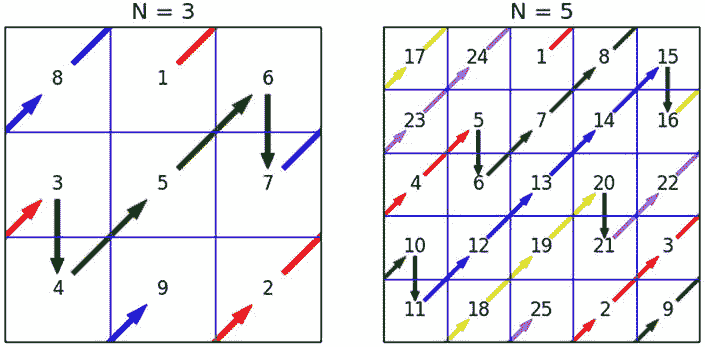

**图 7-7.** De la Loubère 方法

使用数组实现的算法如清单 7-6 所示。

**清单 7-6.** 创建幻方

```python
from pylab import *

def magicsq(n=3):
    """返回一个大小为 n 的幻方；n 必须为奇数"""
    if n % 2 != 1:
        raise ValueError("Magic(n) requires n to be odd")
    m, row, col = zeros([n, n]), 0, n//2
    for num in range(1, n**2+1):
        m[row, col] = num      # 填充单元格
        col = (col+1) % n
        row = (row-1) % n
        if m[row, col]:
            col = (col-1) % n
            row = (row+2) % n
    return m

def testmagicsq(m):
    """如果 m 是幻方，则返回 True。"""
    msum = sum(m[0, :])
    return all(m.sum(0) == msum) and all(m.sum(1) == msum)
```

主 `for` 循环非常直接，严格遵循算法。然而，使用取模（`%`）运算符计算列和行值的方法比较巧妙，需要一些解释。考虑算法的指定方式：递增列值并检查新值是否在矩阵大小范围内。如果不在，则将其环绕回开头。对行也采用类似的方法：递减并在需要时环绕。我们可以使用取模运算来优雅地实现这一思路，而不是实现这两个步骤（递增/递减后跟一个 `if` 语句）：`col = (col+1) % n`。

我选择使用多重赋值来初始化变量 `m`、`row` 和 `col`。在 `for` 循环内部也可以使用多重赋值：`col, row = (col + 1) % n, (row - 1) % n`；但是，这没有性能提升或其他明显优势。出于这些原因，我个人倾向于在初始化中使用多重赋值，而不是在计算中。

我在这里定义了另一个函数 `testmagicsq()`，用于检查一个正方形是否确实是幻方。该函数也适用于偶数值（这是一个优点），并使用数组对象的 `sum()` 成员函数。这个检查是*朴素*的；也就是说，函数 `testmagicsq()` 测试每一行的和与每一列的和是否相同；它不检查元素是否只出现一次。


**提示：** Python 支持通过几个内置包进行测试，包括 *doctest* 和 *unittest*。但是，对于本例，我选择编写一个专用的测试函数，这将进一步说明 *NumPy* 数组的属性。

函数 `sum(0)` 返回列的和的数组（即沿轴 0）；`sum(1)` 返回行的和的数组（沿轴 1）。以下清单演示了沿 0 轴和 1 轴的求和：

```python
>>> exec(open('magic_square.py').read())
>>> a = eye(2, 3)
>>> a
```

```
array([[ 1.,  0.,  0.],
       [ 0.,  1.,  0.]])
```

```python
>>> a.sum(0)
```

```
array([ 1.,  1.,  0.])
```

```python
>>> a.sum(1)
```

```
array([ 1.,  1.])
```

```python
>>> m = magicsq(5)
>>> m.sum(0)
```

```
array([ 65.,  65.,  65.,  65.,  65.])
```

```python
>>> m.sum(1)
```

```
array([ 65.,  65.,  65.,  65.,  65.])
```

```python
>>> testmagicsq(m)
```

```
True
```

如你所见，矩阵 `eye(2, 3)` 有两行三列。通过 `sum(0)` 沿轴 0 求和会返回一个一维数组（向量），其中包含所有三列的和。相应地，`sum(1)` 返回一个包含行和的向量。

以下代码展示了如何利用该函数检查方阵是否满足“幻方”要求：两个向量 `sum(0)` 和 `sum(1)` 在逐元素比较时，应与沿任意轴求和的结果相等。在 `testmagicsq()` 函数中，我选择将列和与行和分别与第一列的和 `sum(m[0, :])` 进行比较。当你将一个向量（一维数组）与一个标量（单个值）进行比较时，结果会是一个向量，其中每个元素都与该标量进行了比较。为了确保所有元素确实等于所需的和，你可以使用 `all()` 成员函数。我倾向于使用 `all(m.sum(0) == msum)` 这种写法，而不是 `(m.sum(0) == msum).all()`，因为我认为前者可读性更强，但这同样属于个人偏好；两种写法都能实现功能。


**注意** 在 `testmagicsq()` 函数中，仅检查 `m.sum(0)` 是否等于 `m.sum(1)` 是不够的，因为这只能判断行和是否等于列和。然而，这并非充分条件。考虑数组 `[[0, 1], [0, 2]]`：它满足条件 `m.sum(0) == m.sum(1)`，但它并不是一个幻方。你可能会质疑数组 `eye(N)` 是否是一个幻方——`testmagicsq()` 函数会返回 `True`，但这或许只是一个幻方的平凡特例。

暹罗法的另一个有趣之处在于，对角线上的和也与每行及每列的和相等；两条对角线均满足此性质。函数 `trace()` 用于计算沿主对角线（左上到右下）的和。要计算副对角线（左下到右上）的和，你可以使用 `fliplr()` 函数：

```python
>>> m = magicsq(5)
>>> m.trace()
```

```
65.0
```

```python
>>> fliplr(m).trace()
```

```
65.0
```

## 其他有用的数组函数

除了 `ndarray` 的属性和方法外，*NumPy* 包还提供了许多作用于数组但不属于 `ndarray` 对象类的函数。如需完整了解这些函数，请执行以下命令：

```python
>>> import numpy
>>> dir(numpy)
```

如你所见，许多函数来自不同的应用领域：

*   向量运算：`convolve()`、`cross()`、`correlate()` 和 `vdot()`。
*   矩阵运算：`diag()` 和 `trace()`。
*   统计函数：`cov()`、`var()`、`std()`、`mean()` 和 `histogram()`。
*   财务函数：`fv()`、`pv()` 和 `pmt()`。
*   多项式运算：`polyadd()`、`polymul()`、`polydiv()`、`polyfit()`、`polyder()`、`polyint()` 和 `roots()`。
*   改变向量和矩阵大小及方向的运算：`flipud()`、`fliplr()` 和 `rot90()`。
*   生成滤波窗口的函数：`hamming()`、`hanning()`、`bartlett()`、`blackman()` 和 `kaiser()`。

我们将在第 8 章中探讨其中一些函数。如果你想了解更多关于这些函数的信息，可以执行 `help(numpy.function)`。例如，下面是我特别喜欢使用的一个函数：

```python
>>> help(numpy.diff)
```

```
Help on function diff in module numpy.lib.function_base:

diff(a, n=1, axis=-1)
    Calculate the n-th order discrete difference along given axis.

    The first order difference is given by ``out[n] = a[n+1] - a[n]`` along
    the given axis, higher order differences are calculated by using 'diff'
    recursively.

    Parameters
    ----------
    a : array_like
        Input array
    n : int, optional
        The number of times values are differenced.
    axis : int, optional
        The axis along which the difference is taken, default is the last
        axis.
    Returns
    -------
    diff : ndarray
        The 'n' order differences. The shape of the output is the same as 'a'
        except along 'axis' where the dimension is smaller by 'n'.
```

我使用 `diff()` 来计算数组中两个连续元素之间的差值。

在本书中，我已经多次使用过它，包括第 6 章中的示例：“为图形添加箭头”。你也可以修改本章中的朋友见面示例，使用 `diff()` 代替列表推导式。

## 最后说明与参考文献

*NumPy* 在广泛的应用领域中都非常有用。一个证据是，你会发现大量依赖 *NumPy* 的包。这并非偶然：*NumPy* 为数学数组提供了坚实的基础。

如果你需要关于 *NumPy* 或本章讨论的其他主题的更多信息，希望以下参考资料对你有用：

*   *NumPy* 主页，`http://www.numpy.org/`
*   Python 标准库，`https://docs.python.org/3.3/library/index.html`
*   “曼德勃罗集”，维基百科，`http://en.wikipedia.org/wiki/Mandelbrot_set`
*   “牛顿法”，维基百科，`http://en.wikipedia.org/wiki/Newton%27s_method`
*   “德拉卢贝尔法”，维基百科，`http://en.wikipedia.org/wiki/Siamese_method`
*   “傅里叶级数”，维基百科，`http://en.wikipedia.org/wiki/Fourier_series`

# 第 8 章


## 科学与可视化

### 数值分析与信号处理

我已经涵盖了许多与数据分析和可视化相关的主题：读写文件、文本处理及将文本转换为数值数据、绘图与制图、编写脚本以及实现算法。现在是时候深入探讨并分析数值数据了。

本章涉及两个重要主题：数值分析和信号处理。这两个主题出现在许多科学领域中：数学、计算、工程学等等。从简化的角度来看，*数值分析*关注的是产生数值结果的算法：非线性方程的解、π的十进制表示等。*信号处理*则涉及处理信号——即随时间变化的值。信号处理包括检测和滤波等主题。

大多数大学和学院都开设了教授这些主题的本科课程。但你并不需要成为工程师或计算机科学家才能使用本章讨论的方法和思想；大多数主题都易于理解。如果你有扎实的数值分析和信号处理背景，本章将为你学习这些主题在 Python 中的应用提供一个良好的起点。如果你对数值分析和信号处理的概念尚不熟悉，我希望本章能为你阐明一些要点，以便你能够从这里出发，结合相关的科学文献继续深入学习。特别地，我想推荐一本对我（以及许多其他人）产生巨大影响的书：《数值方法：科学计算的艺术》，剑桥大学出版社，2007 年（参见本章末尾的“最后说明与参考文献”部分）。尽管该书使用 C/C++ 实现算法（我最初拥有的版本使用的是 Pascal 编程语言），但它提供了关于数值算法的丰富信息，并且应该很容易移植到 Python。

在我看来，数值分析领域就像一本算法食谱，用于数值求解数学问题。因此，从某种意义上说，本章也是以类似的方式组织的：作为一系列问题及其解决方案的列表。每个主题都将通过示例进行探讨，希望你能修改这些示例以满足自己的需求。这也是我建议你参考本章的方式：将其视为一本算法食谱。虽然通读并逐一学习算法是完全可行的，但更简单的方法可能是，当你在实际生活中遇到与特定主题相关的问题时，再去阅读相应的章节。因此，我的建议是：先浏览目录以熟悉可用的内容，然后通过阅读相关章节来尝试解决具体问题。

在本章中，我大量使用了 *SciPy*、*matplotlib* 和 *NumPy*。这三个软件包内容丰富且复杂；因此，我只能介绍它们的一部分功能，而非全部。我选择涵盖的主题和展示的示例，都是我个人在实际工作中遇到的问题。希望这些示例对您有价值。

### 入门指南：变量与函数

*NumPy* 包为我们提供了两个有用的辅助函数。我称它们为辅助函数，是因为它们不属于任何特定的数值分析或信号处理类别。

在交互式环境中工作时，我们会不断地定义变量。很难记住定义了哪些变量以及它们的含义。函数 `who()` 会打印出当前 *NumPy* 数组的列表：

```python
>>> from pylab import *
>>> who()
```

```
Upper bound on total bytes  =       0
```

```python
>>> up, down = arange(10), arange(10, 0, -1)
>>> who()
```

```
Name            Shape            Bytes            Type
===========================================================
up              10               40               int32
down            10               40               int32
Upper bound on total bytes  =       80
```

函数 `lookfor()` 非常适合在文档字符串中进行搜索。因此，要查找执行数值积分的函数，可以执行以下命令：

```python
>>> lookfor('integrate')
```

```
Search results for 'integrate'

numpy.trapz     Integrate along the given axis using the composite trapezoidal rule.
```

（我省略了部分输出，但有几个函数的文档字符串中包含 `'integrate'`。）

## *SciPy*

*SciPy* (`http://www.scipy.org/`) 是一个用于 Python 的开源科学库。*SciPy* 的理念类似于 Octave-Forge (`http://octave.sourceforge.net/`)，后者为 GNU-Octave (`http://www.octave.org`) 提供额外的软件包，并为 MATLAB (`http://www.mathworks.com`) 提供增强工具箱。*SciPy* 构建在 *NumPy* 之上，因此它需要 *NumPy* 才能正常运行。

*SciPy* 被组织成多个模块，其中一些模块在表 8-1 中有详细说明。

**表 8-1.** SciPy 软件包

| 软件包 | 描述 |
| --- | --- |
| Fftpack | 快速傅里叶变换 |
| Integrate | 积分函数，包括常微分方程 |
| Interpolate | 函数插值 |
| Linalg | 线性代数 |
| Optimize | 优化函数，包括求根算法 |
| Signal | 信号处理 |
| Special | 特殊函数（艾里函数、贝塞尔函数等） |

我们将探讨处理数值分析和信号处理的 *SciPy* 模块。其他 *SciPy* 模块包括稀疏矩阵（`scipy.sparse` 模块）、统计（`scipy.stats` 模块）等。这个列表还在不断增长；然而，本书将不涉及这些内容。要了解所有可用模块的完整信息，请执行 `import scipy`，然后执行 `help(scipy)`。

要导入特定的 *SciPy* 模块，请执行 `import scipy.modulename`。例如，要导入 `scipy.linalg`，请执行：

```python
>>> import scipy.linalg
```

你也可以通过以下方式完成此任务：

```python
>>> from scipy import linalg
```

就个人而言，我更喜欢后一种方式：`linalg.eig()` 的编码比 `scipy.linalg.eig()` 更短（而且我认为它更易读）。

## 线性代数

线性代数是数学的一个分支，涉及矩阵、向量以及求解线性方程组。*SciPy* 和 *NumPy* 为我们提供了许多处理这些主题的函数：求解线性方程组、矩阵和向量运算以及矩阵分解。

### 求解线性方程组

为了求解线性方程组，我们首先用矩阵符号表示问题。

```
2 * x + 3 * y = 10
3 * x –     y = -1.5
```

我们首先定义一个矩阵 `M` 和一个向量 `V`。

该矩阵由 `x` 和 `y` 的系数组成，第一行是 2 和 3，即 `[2, 3]`。第二行是 3 和 -1，即 `[3, -1]`：

```python
>>> from pylab import *
>>> M = array([[ 2, 3], [3, -1]])
```

接下来，我们定义结果向量 `[10, -1.5]`：

```python
>>> V = array([10, -1.5])
```

现在只需要使用函数 `solve()`：

```python
>>> solve(M, V)
```

```
array([ 0.5,  3. ])
```

结果转化为：`x` 等于 0.5，`y` 等于 3。

也可以通过计算矩阵 `M` 的逆矩阵并将其乘以向量 `V` 来得到解：

```python
>>> dot(inv(M), V)
```

```
array([ 0.5,  3. ])
```

这里我介绍了两个函数：`inv()` 和 `dot()`。函数 `inv()` 计算矩阵的逆，函数 `dot()` 执行点积。如果我将 `inv(M)` 与 `V` 相乘，则会得到*逐元素*相乘的结果：

```python
>>> inv(M)*V
```

```
array([[ 0.90909091, -0.40909091],
       [ 2.72727273,  0.27272727]])
```

一般来说，你应该使用 `solve()` 而不是 `inv()`。函数 `solve()` 可以处理数学家所说的“病态”矩阵——即行列式非常接近零的矩阵。对这些矩阵使用 `inv()` 可能会产生不准确的结果（即，除以一个接近零的数）。

### 向量与矩阵运算

与 `dot()` 非常相似，函数 `vdot()` 返回两个向量的点积。因此，如果你只对前面示例中 `x` 的值感兴趣，可以这样写：

```python
>>> dot(inv(M)[0], V)
```

```
0.50000000000000022
```

函数 `inner(v1, v2)` 将执行内积；也就是说，它将 `v1` 中的每个元素与 `v2` 中对应的元素相乘，然后将它们相加：

```python
>>> V1 = array([10, -1.5])
>>> V2 = array([1, 2])
>>> sum = 0
>>> for i in range(len(V1)):
...     sum += V1[i]*V2[i]
...
>>> sum
```

```
7.0
```

```python
>>> inner(V1, V2)
```

```
7.0
```

我使用 `for` 循环实现了一个内积运算，并将结果与函数 `inner()` 的结果进行了比较。正如你所料，结果是相同的。请注意，函数 `inner()` 不会将元素与其共轭（负虚部）相乘。

函数 `inner()` 也适用于矩阵：

```python
>>> M = array([[2, 3], [3, -1]])
>>> M
```

```
array([[ 2,  3],
       [ 3, -1]])
```

```python
>>> inner(M, inv(M))
```

```
array([[  1.00000000e+00,   1.11022302e-16],
       [  5.55111512e-17,   1.00000000e+00]])
```

类似地，`outer()` 执行两个向量或矩阵的外积：

```python
>>> V1 = array([10, -1.5])
>>> V2 = array([1, 2])
>>> outer(V1, V2)
```

```
array([[ 10. ,  20. ],
       [ -1.5,  -3. ]])
```

函数 `transpose()` 将置换轴，而 `conjugate()` 将置换轴并取矩阵或向量虚部的相反数：

```python
>>> V1 = array([10, -1.5])
>>> V2 = array([1, 2])
>>> outer(V1, V2)
```

```
array([[ 10. ,  20. ],
       [ -1.5,  -3. ]])
```

```python
>>> outer(V2, V1)
```

```
array([[ 10. ,  -1.5],
       [ 20. ,  -3. ]])
```

```python
>>> all(outer(V1, V2) == transpose(outer(V2, V1)))
```

```
True
```

```python
>>> conjugate(V1+1j*V2)
```

```
array([ 10.0-1.j,  -1.5-2.j])
```

函数 `det(M)` 将返回矩阵 `M` 的行列式：

```python
>>> det(array([[2, 3], [3, -1]]))
```

```
-11.000000000000002
```

### 矩阵分解

矩阵分解是将矩阵重写为特定形式。有许多分解方法，包括 LU 分解、奇异值分解和 QR 分解。*NumPy* 的线性代数模块通过表 8-2 中所示的函数支持一些矩阵分解。

**表 8-2.** 矩阵分解函数

| 函数 | 描述 |
| --- | --- |
| `cholesky(m)` | 乔列斯基分解 |
| `eig(m)` | 特征值分解 |
| `qr(m)` | QR 分解 |
| `svd(m)` | 奇异值分解 |

以下代码执行特征值分解并验证结果：

```python
>>> A = array([[1, 2], [0, 1]])
>>> L, v = eig(A)  # 计算特征值和特征向量
>>> det(A - eye(2)*L)   # 验证特征值（应为零）
```

```
0.0
```

```python
>>> dot(A, v[:, 0]) - L[0]*v[:, 0]  # 验证第一个特征向量（应为 0）
```

```
array([ 0.,  0.])
```

```python
>>> dot(A, v[:, 1]) - L[1]*v[:, 1]  # 验证第二个特征向量（应为 0）
```

```
array([  2.22044605e-16,   0.00000000e+00])
```

我创建了一个矩阵（`A`），并计算了其特征值 λ[1,2]（存储在向量`L`中）和特征向量 v[1,2]（存储在矩阵`v`中）；这是在`L, v = eig(A)`这一行中完成的。一旦特征值被计算出来，可以通过计算`det(A - λ·I)`来验证它们，结果应为零；这是在`det(A - eye(2)*L)`这一行中完成的。此外，对于每个特征向量 λ，λ·v 应等于 A·v；这在最后两行中得到了验证：`dot(A, v[:, 0]) - L[0]*v[:, 0]`和`dot(A, v[:, 1]) - L[1]*v[:, 1]`。

我们不会在此讨论其他矩阵分解；如果您需要更多信息，`help()`非常有用。

### 其他线性代数功能

其他线性代数功能可通过`scipy.linalg`模块获得。要访问 SciPy 的线性代数函数，请执行`import scipy.linalg`或`from scipy import linalg`。SciPy 的附加功能包括以下内容：

- 矩阵分解函数：用于 LU 分解的`lu()`和用于 QR 矩阵分解的`qr()`，以及其他分解的函数。
- 矩阵和向量运算符，例如用于计算矩阵或向量范数的`norm()`、用于计算矩阵行列式的`det()`以及用于求逆矩阵的`inv()`。
- 矩阵函数，如`expm()`和`tanm()`。矩阵函数名称与常规函数名称类似，但增加了一个字符`m`。
- 特殊矩阵，例如用于某些纠错码的 Hadamard 矩阵（`hadamard()`）（参见`http://en.wikipedia.org/wiki/Hadamard_matrix`）和 Hilbert 矩阵（`hilbert()`）（参见`http://en.wikipedia.org/wiki/Hilbert_matrix`）。

## 数值积分

数值积分是对定积分进行数值计算的过程。在许多情况下，数值积分非常重要。示例包括计算形状的面积或图形下的面积，以及求解微分方程。

在此讨论中，我们将计算半径为 1 的半圆的面积。我们已经知道这个面积是 π/2。因此，从某种意义上说，计算半圆的面积等同于计算 π 的数值。

首先，我们创建两个向量：`x`和`y`。这两个向量满足圆的方程 x² + y² = 1。我假设您已经导入了 PyLab：

```python
>>> N = 7
>>> x = linspace(-1, 1, N)
>>> y = sqrt(1-x**2)
>>> x**2 + y**2
```

```
array([ 1.,  1.,  1.,  1.,  1.,  1.,  1.])
```

我任意选择了变量`N`；`N`是向量`x`和`y`中的点数。最后一个结果表明，向量`x`和`y`中的所有点都满足圆的方程 x²+y²=1。

为了可视化数值积分，我绘制了近似圆面积的矩形：

```python
>>> figure()
>>> dx = x[1]-x[0]
>>> for i in range(len(x)-1):
...     rect = Rectangle((x[i], 0), dx, 0.5*(y[i]+y[i+1]))
...     gca().add_patch(rect)
...
>>> title('近似半圆的面积')
>>> axis('equal')
>>> show()
```

曲线下的面积——即积分——近似于这些正方形的和。每个正方形的面积为 (y[i] + y[i + 1])·dx/2，因此总和可以写成如下形式：

```python
>>> dx*(sum(y[:-1]+y[1:]))
```

```
2.9175533787759904
```

我将结果乘以 2，以便与 π 而不是 π/2 进行比较。显然，`N`越大，这个数字就越接近 π：

```python
>>> for N in [5, 10, 20, 100]:
...     x = linspace(-1, 1, N)
...     dx = x[1]-x[0]
...     y = sqrt(1-x**2)
...     est_pi = dx*sum(y[:-1]+y[1:])
...     print("N=%d, estimated pi is %f" % (N, est_pi))
...
```

```
N=5, estimated pi is 2.732051
N=10, estimated pi is 3.019232
N=20, estimated pi is 3.101560
N=100, estimated pi is 3.138218
```

如您所见，对于`N` = 100，精度约为 1%。图 8-1 直观地展示了这一点（完整列表见附录 A）。

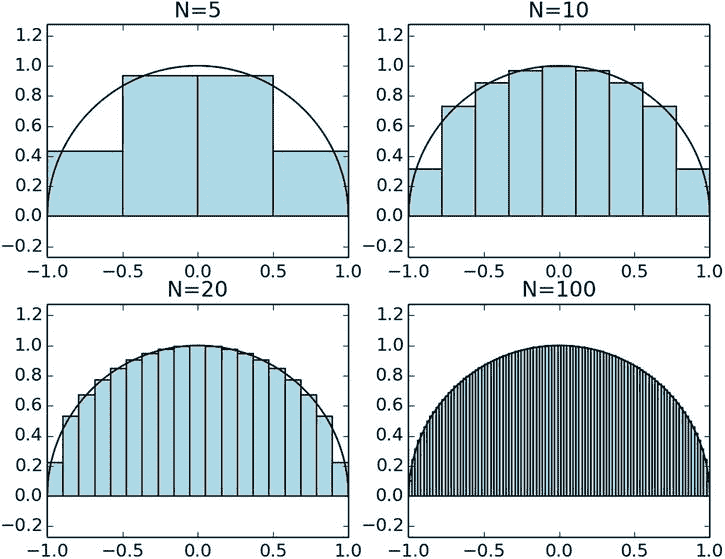

**图 8-1.** 计算圆的面积

在计算圆的面积时，我选择了均匀间隔的值。如果您想使用非均匀间隔的值，实现会更复杂。此外，该方法使用矩形来近似曲线下的面积，但在这个特定示例（以及许多其他示例）中，梯形可能更合适，这引出了函数`trapz(y, x)`。该函数接受向量`y`和`x`，并返回数值积分。以下使用函数`trapz()`对非均匀间隔的`x`值执行数值积分：

```python
>>> x = array([-1, -0.9, -0.4, 0.0, 0.4, 0.9, 1])
>>> y = sqrt(1-x**2)
>>> trapz(y, x)*2
```

```
2.9727951234089831
```

图 8-2 展示了梯形积分的可视化表示（完整列表见附录 A）。

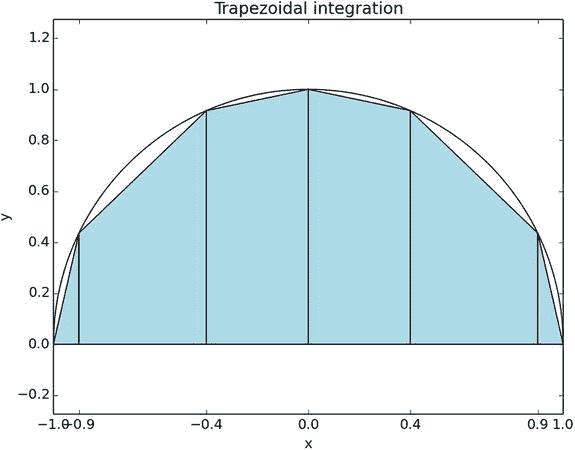

**图 8-2.** 使用梯形法和非均匀间隔值计算圆的面积

### 更多积分方法

其他积分算法可通过`scipy.integrate`模块获得。要使用此模块，请执行`from scipy import integrate`。

我们将讨论限制在算法`quad()`上，该算法使用高斯求积法对*数学函数*进行数值积分。与之前的方法（如`trapz()`）不同，使用`quad()`需要提供一个数学函数，而不是`x`和`y`向量。

 **注意** 我使用了术语“数学函数”来区分这种函数与通用的 Python 函数。数学函数是给定输入数值后返回一个数值的函数，例如 y = f(x)。实际上，我们将数学函数实现为 Python 函数。

```python
>>> from scipy.integrate import quad
>>> def half_circle(x):
...     return sqrt(1-x**2)
...
>>> pi_half, err = quad(half_circle, -1, 1)
>>>  (pi_half*2, err)
```

```
(3.1415926535897967, 1.0002354500215915e-009)
```

我定义了一个数学函数`half_circle()`，给定一个 x 坐标值，它返回半径为 1 的上半圆的 y 坐标值。然后我调用了`quad()`，参数为`half_circle()`（要积分的函数）以及`-1`和`1`（要积分的范围）。函数`quad()`返回一个值和一个误差。

`scipy.integrate`模块还支持使用函数`ode()`和`odeint()`求解常微分方程。我们不会讨论这些函数。如果您对求解微分方程感兴趣，请参考 SciPy 主页：`http://www.scipy.org/`。

## 插值与曲线拟合

插值和曲线拟合涉及将函数拟合到离散的已知值。您可能希望将函数拟合到数据点有几个原因，包括以下内容：

- 将已知函数拟合到收集的实验数据。这有助于确定实验的其他参数。
- 在附加点（除了给定点之外）评估函数的数值。

### 插值与多项式

插值允许实现针对特定问题量身定制的高效算法。与其为所有可能的值编写查找表，你可以提出一个更高效的插值多项式，尽管可能会损失一些精度。在其他时候，你可能会选择实现一个已知函数（如`sqrt()`）而不是使用库提供的算法来*提高*性能（可能以牺牲精度为代价）。

### 逆平方根与《雷神之锤 III》

如果你对计算数值函数的高效算法感兴趣，你可能会发现这篇文章很有价值：Chris Lomont 的“Fast Inverse Square Root”，位于`http://www.lomont.org/Math/Papers/2003/InvSqrt.pdf`。这篇文章描述了一种非常高效的算法来实现一个数的逆平方根，该算法出现在电脑游戏《雷神之锤 III》的源代码中。该实现使用了牛顿-拉夫森方法（而不是插值）。文章假设读者具备 C 语言知识。

### 分段线性插值

让我们回到半圆的例子。这次，我们将自己限制在四分之一圆内；即，只考虑`x`和`y`的正值。我们首先计算`x`等于 0, 0.2, ..., 1 时的`y`值。我们将结果存储在向量`xp`和`yp`中：

```python
>>> xp = linspace(0, 1, 6)
>>> xp
```

```
array([ 0. ,  0.2,  0.4,  0.6,  0.8,  1. ])
```

```python
>>> yp = sqrt(1-xp**2)
```

我们想要根据给定的`xp`和`yp`，计算`x`值等于 0.1, 0.3, ..., 0.9 时的`y`值。为此，我们将使用函数`interp(x, xp, yp)`。该函数返回由`xp`、`yp`定义的分段线性函数在请求点`x`处的值。这意味着`interp()`返回连接两个相邻`(xp, yp)`点的线段上某点的值。这被称为分段线性插值：

```python
>>> xi = arange(0.1, 1.0, 0.2)
>>> yi = interp(xi, xp, yp)
```

向量`yi`保存了在点 0.1, 0.3, ..., 0.9 处的插值结果。

以下可视化展示了四分之一圆的分段线性插值：

```python
>>> from pylab import *
>>> figure()
>>> hold(True)
>>> x = linspace(0, 1, 500)
>>> y = sqrt(1-x**2)
>>> xp = linspace(0, 1, 6)
>>> yp = sqrt(1-xp**2)
>>> xi = arange(0.1, 1.0, 0.2)
>>> yi = interp(xi, xp, yp)
>>> plot(x, y, 'b', label='ideal')
>>> plot(xp, yp, 'or', label='interpolation points')
>>> plot(xp, yp, '--r', label='piecewise linear function')
>>> plot(xi, yi, 'sg', label='interpolated values')
>>> legend(loc='best')
>>> grid()
>>> axis('scaled')
>>> axis([0, 1.1, 0, 1.1])
>>> title('Piecewise linear interpolation')
>>> show()
```

图 8-3 展示了该可视化的结果。

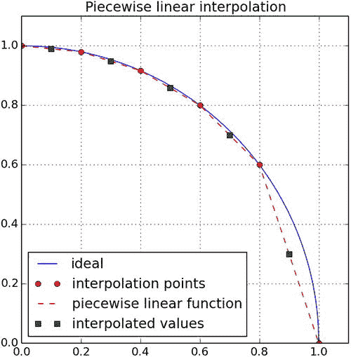

**图 8-3.** 分段线性插值

在这个例子中，`xp`和`yp`的值是计算出来的；但在实际中，这些值可能来自采样数据。从图中可以看出，在 0.9 处的插值精度远低于其他插值点。通常，你添加的点越多，结果就越精确。

### 多项式

多项式是数学表达式，涉及一个变量的整数次幂乘以系数的和。例子包括`2x² + x – 1`，以及`x`。然而，`sin(x)`不是多项式。多项式之所以如此重要，是因为它们只涉及基本运算：加法、减法和乘法（整数次幂可以通过多次乘法实现）。这一特性使得它们在计算中非常容易实现。泰勒级数展开（`http://en.wikipedia.org/wiki/Taylor_series`）是将函数转换为易于计算的多项式的一个典型例子。

为了能够使用*NumPy*和*SciPy*对多项式进行操作，我们将多项式表示为一个向量。向量中的第一个元素是最高次幂的系数，数组中的最后一个元素是最低次幂（0 次）的系数。因此，要表示多项式`x² + 3x + 2`，执行以下命令：

```python
>>> p = array([1, 3, 2])
```

要解方程`x² + 3x + 2 = 0`，使用函数`roots(p)`：

```python
>>> roots(p)
```

```
array([-2., -1.])
```

如果你想根据根而不是系数来构造多项式，使用函数`poly()`：

```python
>>> p = poly([-2, -1])
>>> p
```

```
array([1, 3, 2])
```

你可以使用`polyadd()`和`polysub()`对多项式进行加法和减法：

```python
>>> p1 = poly([-2, -1])
>>> p2 = array([1, 0, 0, 0])
>>> polyadd(p1, p2)
```

```
array([1, 1, 3, 2])
```

我将`x² + 3x + 2`与`x³`相加，得到了`x³ + x² + 3x + 2`。

多项式的乘法和除法使用`polymul()`和`polydiv()`完成。`polydiv()`的返回值是商和余数：

```python
>>> p = polymul(array([1, 2]), array([1, 3]))
>>> p
```

```
array([1, 5, 6])
```

```python
>>> polydiv(p, array([1, 3]))
```

```
(array([ 1.,  2.]), array([0]))
```

你可以分别使用函数`polyint()`和`polyder()`对多项式进行积分和微分：

```python
>>> p = poly([-1j, 1j])
>>> p
```

```
array([ 1.,  0.,  1.])
```

```python
>>> polyder(p)
```

```
array([ 2.,  0.])
```

```python
>>> polyint(p)
```

```
array([ 0.33333333,  0. ,  1.  ,  0.  ])
```

在第一行中，我从复数创建了一个多项式；创建的多项式存储在`p`中，即`x² + 1`。使用`polyder()`，我计算了`p`的导数，得到了`2x`。使用`polyint()`，我计算了`p`的积分，得到了`⅓x³ + x`。

### 多项式的用途

那么为什么所有这些多项式操作如此重要呢？主要原因是你可以使用多项式来逼近函数，无论是来自收集的数据还是来自解析函数。而且由于多项式只需要乘法和加法，例如在嵌入式系统中实现多项式是非常直接的。

你可以使用函数`polyfit(x, y, n)`将多项式拟合到数据。给定一个`x`点向量和一个`y`点向量，`polyfit()`将返回一个`n`次多项式（`x`的最高次幂），该多项式最佳地拟合这组数据点。另一个有用的函数是`polyval(p, x)`；该函数返回多项式在`x`处的值（`x`可以是一个向量）。

#### 示例：线性回归

一种已知的曲线拟合算法是线性回归。其思想是画一条直线，使得所有点到该直线的总距离最小。

在这个例子中，我们将创建一条直线，然后向这些值添加“测量噪声”。面对新的“带噪声”的数据，我们将尝试评估拟合该数据的一阶多项式。我们将结果与已知的真实值进行比较（参见清单 8-1）。

**清单 8-1.** 使用`polyfit()`进行线性回归

```python
from pylab import *
```

#### 数据点数量
N = 100
start = 0
end = 1

A = `rand()`+1
B = `rand()`

#### 我们的线性方程将是 y = A*x + B

x = `linspace`(start, end, N)
y = A*x + B
y += `randn`(N)/10

#### 线性回归
p = `polyfit`(x, y, 1)

`figure()`
`title('Linear regression with polyfit()')`
`plot`(x, y, 'o',
    label='Measured data; A=%.2f, B=%.2f' % (A, B))
`plot`(x, `polyval`(p, x), '-',
    label='Linear regression; A=%.2f, B=%.2f' % tuple(p))
`legend`(loc='best')
`show()`
```

我随机选择了`A`（从 1 到 2）和`B`（从 0 到 1）的值，然后使用`randn()`构建了一条带有噪声的直线。接着，我使用`polyfit()`将数据拟合到一个一次多项式，即一条直线。最后，我将数据与新建的直线一起绘制出来。图 8-4 展示了该线性回归的结果。

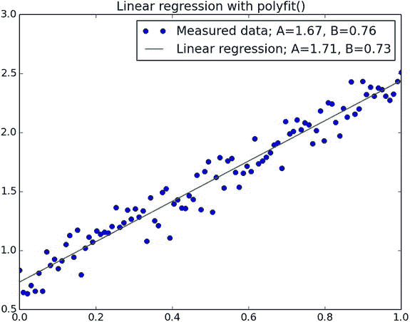

. 使用`polyfit()`进行线性回归

#### 示例：非线性函数的线性回归

当你试图拟合的函数不是线性时，有时仍然可以进行线性回归，如代码清单 8-2 所示。

**代码清单 8-2**. 拟合指数数据

```python
from pylab import *

##### 数据点数量
N     = 100
start = 0
end   = 2

A = `rand()`+0.5
B = `rand()`

##### 我们的线性方程将是：

##### y = B*exp(A*x) = exp(A*x + log(B))

x = `linspace`(start, end, N)
y = `exp`(A*x+B)
y += `randn`(N)/5
```

# 线性回归
`p = polyfit(x, log(y), 1)`

```
figure()
title(r'使用 polyfit() 进行线性回归，$y=Be^{Ax}$')
plot(x, y, 'o',
    label='测量数据；A=%.2f, B=%.2f' % (A, exp(B)))
plot(x, exp(polyval(p, x)), '-',
    label='线性回归；A=%.2f, B=%.2f' % (p[0], exp(p[1])))
legend(loc='best')
show()
```

回归操作在调用函数`polyfit()`时执行。这次，我传入了`x`和`log(y)`作为参数，从而实现对`log(y)`的线性回归，或对`y`的指数回归。你可以在图 8-5 中看到此回归的结果。

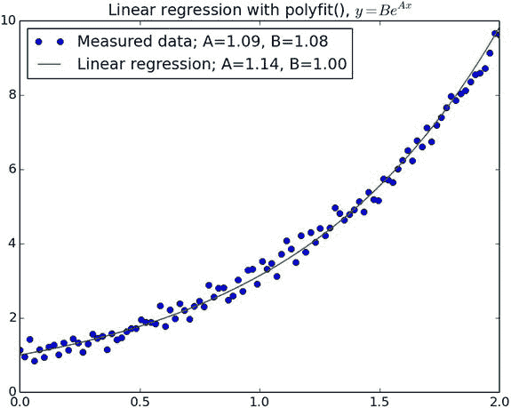

图 8-5. 拟合指数数据

## 示例：用多项式逼近函数

另一类可用`polyfit()`解决的问题是使用插值法逼近函数。其动机在于简单实现已知函数。在本例中，我们将逼近函数`sin(x)`。

其思路是创建一个经过已知插值点的多项式——即，计算已知`n`个`x`值对应的`sin(x)`值，然后创建一个`n–1`次多项式，使其经过所有这些点。

我们首先从 0 到`π/2`之间选择一组点；这些点将作为我们的插值点。此范围之外的值可以通过三角恒等式和插值函数计算得出。我们选择五个点进行插值，因此插值多项式的次数确定为 4。选定点后，我们计算这些点的正弦值。

在本例中，我选择了可以使用`sqrt()`函数轻松计算的正弦值。你可能会认为我在这里作弊，因为我使用了非线性函数（平方根）来计算`sin(x)`，而不是纯粹的多项式。不过，你已经在第 7 章中看到了如何使用牛顿法计算一个数的平方根。

 **注意** 插值点的选择是一个有趣的话题，数学家帕夫努季·切比雪夫的工作对此贡献良多。请参见`http://en.wikipedia.org/wiki/Pafnuty_Chebyshev`和`http://en.wikipedia.org/wiki/Chebyshev_nodes`。

我将选择的插值点是 0、30、45、60 和 90 度。我选择这些值的原因是我知道它们精确的正弦值：分别为 0、½、√2/2、√3/2 和 1。用向量形式表示如下：

```python
>>> values = [0, pi/6, pi/4, pi/3, pi/2]
>>> sines = sqrt(arange(5))/2
>>> sines
```

```python
array([ 0. , 0.5, 0.70710678, 0.8660254, 1. ])
```

有了这些，插值就很简单了：

```python
>>> p = polyfit(values, sines, len(values)-1)
>>> p
```

```python
array([  2.87971125e-02,  -2.04340696e-01,   2.13730075e-02,
         9.95626184e-01,   1.52055217e-16])
```

因此，如果你要实现`sin(x)`，你只需要存储上面给出的`p`值，然后编写一个简单的例程，使用该多项式计算`sin(x)`的值。如果你使用`NumPy`，只需调用`polyval()`。

让我们绘制我们的`sin(x)`实现与 Python 内置`sin(x)`函数之间的差异：

```python
>>> figure()
>>> x = linspace(0, pi/2, 100)
>>> plot(x, polyval(p, x)-sin(x), label='误差', lw=3)
>>> grid()
>>> ylabel('polyval(p, x)-sin(x)')
>>> xlabel('x')
>>> title('使用 polyfit() 逼近 sin(x) 的误差')
>>> xlim(0, pi/2)
>>> show()
```

图 8-6 展示了这一差异。

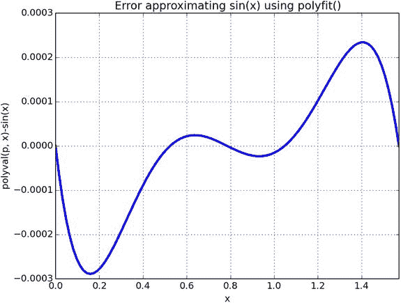

图 8-6. 插值精度

结果相当精确；绝对误差小于 0.003。

### 样条插值

`scipy.interpolate`模块提供了额外的插值函数。其中之一是`spline(xp, yp, x)`插值函数。请注意，函数`spline()`的参数顺序与函数`interp()`不同。样条插值是一种分段多项式插值，它遵循特定规则以产生平滑的结果。

让我们回到之前的圆示例：

```python
from scipy.interpolate import spline
from pylab import *

xp = linspace(0, 1, 6)
yp = sqrt(1-xp**2)
xi = linspace(0, 1, 100)
yi = interp(xi, xp, yp)
ys = spline(xp, yp, xi)

figure()
hold(True)
plot(xi, yi, '--', label='分段线性', lw=2)
plot(xi, ys, '-', label='样条', lw=2)
legend(loc='best')
grid()
title(r'$y=\sqrt{1-x²}$ 的样条插值')
xlabel('x')
ylabel('y')
axis('scaled')
axis([0, 1.2, 0, 1.2])
show()
```

在图 8-7 中，我比较了分段线性插值和样条插值。样条插值看起来“更平滑”。

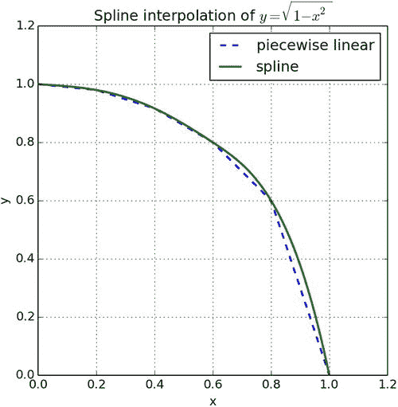

图 8-7. 样条插值

### 求解非线性方程

在第 7 章中，我们讨论了牛顿法并用它来绘制分形。牛顿法用于求解非线性方程。

`scipy.optimize`模块为我们提供了额外的工具来求解非线性方程，以及其他此处不讨论的优化例程。在这些例程中，我想重点介绍三个：`fsolve(f, x0)`、`bisect(f, a, b)`和`newton(f, x0)`。所有这些函数都试图求解方程`f = 0`，其中`f`是用 Python 实现的数学函数。

假设我们想计算前面例子中的√3。思路是构造一个函数，使其解为√3。这很容易通过设置`f = x² – 3`来实现：

```python
>>> def f(x):
...     """返回 x**2-3"""
...     return x**2-3
...
>>> f(10)
```

```python
97
```

让我们使用函数`fsolve()`、`bisect()`和`newton()`来计算根。对于`fsolve()`和`newton()`，我们将使用`x0 = 1`，这被称为初始猜测值。初始猜测值是接近期望结果的值。对于`bisect()`，我们需要提供一个搜索区间。我们将区间设置为 (1, 2)，因为我们知道 3 的平方根小于 2 但大于 1：

```python
>>> from scipy import optimize
>>> optimize.fsolve(f, 1)
```

```python
array([ 1.73205081])
```

```python
>>> optimize.newton(f, 1)
```

```python
1.7320508075688772
```

```python
>>> optimize.bisect(f, 1, 2)
```

```python
1.7320508075690668
```

```python
>>> _**2
```

```python
3.0000000000006564
```

尽管在计算 3 的平方根这个简单例子中，所有这些函数都提供了精确的结果，但这些算法的计算量很大。在大多数这些函数中，你可以通过传递适当的参数来控制结果的精度。当然，对于像这里提出的这么简单的问题，最好使用`sqrt(3)`。

### 特殊函数

`scipy.special`模块提供了大量在高等数学和物理学中出现的特殊函数。

这些函数包括（但不限于）：

- 贝塞尔函数、积分、导数及贝塞尔函数的零点
- 艾里函数
- 伽马函数和误差函数
- 特殊多项式：勒让德多项式、切比雪夫多项式

要使用这些函数，请执行以下命令：

```
>>> from scipy import special
>>> special.chebyt(2)
```

```
poly1d([  2.00000000e+00,  -4.44089210e-16,  -1.00000000e+00])
```

如需完整说明，请执行`help(special)`。

## 信号处理

在本章中，到目前为止我们一直在讨论数值分析。接下来，我们将探讨与信号处理相关的主题。信号处理是一个涉及信号的广阔领域：信号是指随时间变化的值。常见的信号处理算法包括声音处理（如均衡器）；其他算法则用于雷达、CAT 扫描等众多领域。

本章的这一部分将介绍`scipy.signal`模块提供的一些功能，并通过示例进行补充说明。你将学习一些用于在噪声中检测信号的基本算法，以及一些用于设计滤波器的函数。不过，本节内容只是对该主题的初步介绍，我建议你参考本章末尾的参考文献以及专业文献，以了解高效的信号处理算法。

### 函数 `find`、`nonzero`、`where` 和 `select`

我们将介绍的第一组函数是`find()`、`nonzero()`、`where()`和`select()`。

函数`find(cond)`用于查找数组中满足条件的元素的索引：

```
>>> from pylab import *
>>> squares = arange(10)**2
>>> squares
```

```
array([ 0,  1,  4,  9, 16, 25, 36, 49, 64, 81])
```

```
>>> I = find(squares<50)
>>> I
```

```
array([0, 1, 2, 3, 4, 5, 6, 7])
```

```
>>> squares[I]
```

```
array([ 0,  1,  4,  9, 16, 25, 36, 49])
```

我们创建了一个包含数字 0-9 平方值的向量，然后找到了该向量中所有满足值小于 50 条件的索引。注意，返回值是一个索引向量；如果你需要的是值而不是索引，则必须访问原始数组，即上述示例中的`squares[I]`。

函数`nonzero(seq)`返回`seq`中的非零元素。这类似于`find(seq!=0)`。然而，`nonzero()`返回一个二维矩阵，而`find()`返回展平序列`seq`的索引。这使得`find()`在用于图像处理中的二维矩阵时不太方便；在这种情况下，`nonzero()`是更好的选择：

```
>>> A = eye(3)
>>> A
```

```
array([[ 1.,  0.,  0.],
       [ 0.,  1.,  0.],
       [ 0.,  0.,  1.]])
```

```
>>> I1 = find(A!=0)
>>> I1
```

```
array([0, 4, 8])
```

```
>>> A[I1]
```

```
Traceback (most recent call last):
  File "<stdin>", line 1, in <module>
IndexError: index 4 is out of bounds for axis 0 with size 3
```

```
>>> A.ravel()[I1]
```

```
array([ 1.,  1.,  1.])
```

```
>>> I2 = nonzero(A)
>>> A[I2] = 3
>>> A
```

```
array([[ 3.,  0.,  0.],
       [ 0.,  3.,  0.],
       [ 0.,  0.,  3.]])
```

我创建了一个二维矩阵`A`，并使用`find(A!=0)`来查找`A`中的非零元素。注意，返回值`I1`是一个一维数组；这意味着它是对二维数组进行索引。因此，执行`A[I1]`会引发异常。要访问`A`的值，我必须先通过调用`ravel()`将矩阵`A`展平。然而，如果使用`nonzero()`函数，我可以无缝地访问二维元素，如代码行`A[I2]=3`所示。

函数`where(cond, x, y)`接受三个大小相同的数组：`cond`、`x`和`y`，然后对`cond`中的每个元素进行评估。如果该元素评估为`True`，则返回值是`x`中对应的元素。如果该元素评估为`False`，则返回值是`y`中对应的元素：

```
>>> up = arange(10)
>>> up
```

```
array([0, 1, 2, 3, 4, 5, 6, 7, 8, 9])
```

```
>>> down = arange(10, 0, -1)
>>> down
```

```
array([10,  9,  8,  7,  6,  5,  4,  3,  2,  1])
```

```
>>> highest = where(up > down, up, down)
>>> highest
```

```
array([10,  9,  8,  7,  6,  5,  6,  7,  8,  9])
```

函数`select(cond, vals, default=0)`通过允许多个条件，扩展了`where()`函数的功能。该函数接受`cond`中指定的条件列表，如果满足某个条件，则返回与`vals`中对应的元素；如果没有满足任何条件，则选择`default`值：

```
>>> up = arange(10)
>>> ramp = select([up < 4, up > 7], [4, 7], up)
>>> ramp
```

```
array([4, 4, 4, 4, 4, 5, 6, 7, 7, 7])
```

`up`的前三个元素小于 4，因此满足条件`up < 4`，导致选择值`4`。最后三个元素大于 7，导致选择值`7`。大于等于 4 且小于 7 的值保持不变，因为默认值设置为等于`up`。实际上，这个功能被称为*裁剪*，它既可以作为 NumPy ndarray 对象的方法使用，也可以作为独立函数`clip()`使用。

那么，既然你已经了解了`find()`、`nonzero()`、`where()`和`select()`这些函数，你能用它们做什么呢？答案很简单：它们非常适合用于选取值，也就是我们在信号处理中所说的*检测*。

### 示例：噪声中信号的简单检测，第一部分

在噪声中检测信号在许多应用中扮演着不可或缺的角色。例如，在通信系统中，它用于检测无线电或电视广播等信号，并帮助将其与噪声区分开来。它还在医学中用于检测心电图信号，以及许多其他领域。

在这个示例中，我们将首先构建一个干净的信号。所谓信号，我指的是一个一维数组（向量），其中的值作为时间的函数存储。我们的目标是检测“事件”，这些事件将由随机放置在时间轴上的窄三角形表示。一个信号中可以有多个事件。

为了生成三角形脉冲，我将使用`signal.triang()`函数。这实际上是一个窗口函数（你将在本章的“窗口函数”部分了解更多关于此类函数的信息）。该函数生成一个指定大小的三角形窗口。我们将三角形脉冲随机放置在信号向量中，如清单 8-3 所示。

***清单 8-3***。随机放置三角形尖峰

```python
from pylab import *
from scipy import signal

### 控制信号的参数
n = 100
t = arange(n)
y = zeros(n)
num_pulses = 3
pw = 11
amp = 20

for i in range(num_pulses):
    loc = floor(rand()*(n-pw+1))
    y[loc:loc+pw] = signal.triang(pw)*amp
```

### 添加一些噪声
```python
y += randn(n)

figure()
title('信号与噪声')
xlabel('t')
ylabel('y')
plot(t, y)
show()
```

首先，我定义了一些将要使用的参数。信号中的点数为 `n`，等于 100。我将放置的三角形脉冲数量为 3，用 `num_pulses` 表示。每个三角形脉冲将使用 `pw=11` 个点生成。三角形尖峰的最大值为 `amp`，表示振幅。

定义好所有参数后，我创建了两个向量：时间向量 `t` 和数值向量 `y`。向量 `t` 是一些任意的时间戳；在这个示例中，它从 0 开始递增，到 `n-1` 结束。向量 `y` 初始设置为零。

接下来，我随机放置三角形尖峰。

三角尖峰将被放置的位置 `loc` 是随机生成的，通过调用函数 `rand()` 生成一个介于 0 和 1 之间的值。因此，我随机选择一个介于 0 和 `n – pw + 1` 之间的值，以确保尖峰不会被放置在向量 `y` 之外。一旦所有尖峰放置完毕，我使用函数 `randn()` 添加噪声，该函数生成正态分布的噪声。这也被称为高斯分布或“白噪声”。我选择使用方差为 1、均值为 0 的正态分布。请注意，`randn()` 与 `rand()` 不同。图 8-8 显示了生成的信号。

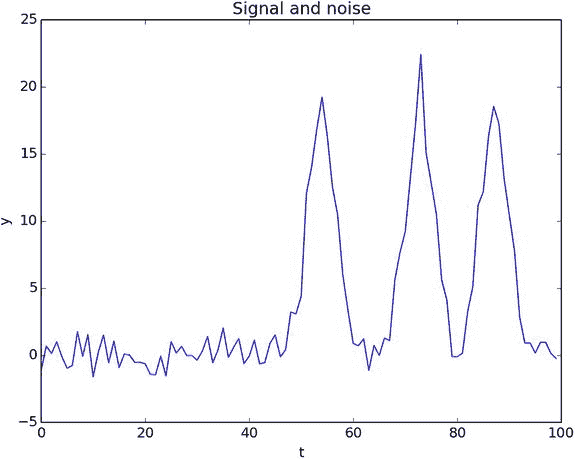

**图 8-8. 三个带有噪声的三角尖峰**

我没有检查尖峰是否重叠。因此，当你运行脚本时，有时会看到一两个尖峰而不是三个。这没问题，因为我们想为示例增加一些随机性。

到目前为止，我们只是创建了信号。现在让我们检测它。对于检测，我们将使用一个简单的算法：每当一个值高于设定的阈值时，我们就将其声明为一个事件或检测。我们将阈值设置为 `amp/2`，并使用函数 `find()`，如清单 8-4 所示。

**清单 8-4.** 检测信号（清单 8-3 的延续）

```python
### detect signals
thr = amp/2
I = find(y > thr)

### plot signal with noise plus detection
figure()
hold(True)
plot(t, y, 'b', label='signal with noise')
plot(t[I], y[I], 'ro', label='detections')
plot([0, n], [thr, thr], 'g--')

### annotate the threshold
text(2, thr+.2, 'Threshold', va='bottom')

title('Simple signal detection in noise')
legend(loc='best')
show()
```

图 8-9 显示了结果。

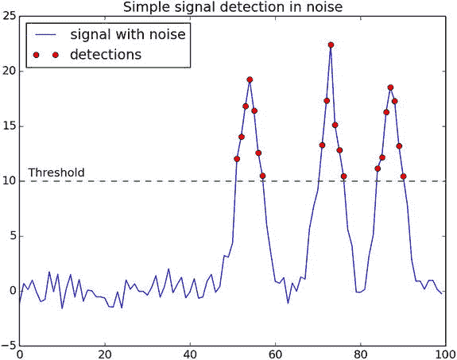

**图 8-9. 存在噪声时的简单信号检测**

## 函数 `diff` 和 `split`

另一组在信号检测中有用的函数是 `diff()` 和 `split()`。函数 `diff(v)` （在前几章中介绍过）返回一个由 `v` 中元素差值组成的向量。函数 `split(v, indices)` 根据 `indices` 分割向量：

```python
>>> v = arange(10)
>>> split(v, [4, 8])
```

```python
[array([0, 1, 2, 3]), array([4, 5, 6, 7]), array([8, 9])]
```

## 示例：噪声中信号的简单检测，第二部分

在前一个示例中，你看到了如何使用 `find()` 执行简单检测。我们显示了所有高于特定阈值的点。在许多情况下，我们对高于阈值的点不太感兴趣，因为阈值是任意选择的；我们更关心高于阈值的最高点。

这里我们接着上一个示例。这次，我们想要找出每个检测中的峰值。清单 8-5 展示了实现此功能的代码。

**清单 8-5.** 峰值检测

```python
### peak detections
J = find(diff(I) > 1)
for K in split(I, J+1):
    ytag = y[K]
    peak = find(ytag==max(ytag))
    plot(peak+K[0], ytag[peak], 'sg', ms=7)
```

这个实现有点棘手，所以让我们逐步分析。思路是这样的：我们将检测结果分割成不同的组；在每个组中，我们找到峰值并绘制它。

 **注意** 由于噪声和信号都是随机选择的，你实际得到的数值可能与本节中呈现的不同。尽管如此，概念和思想仍然是有效的。

分割检测的第一个问题是使用检测值的索引。如果索引是连续的，则一组被认为是一个检测。

每当索引出现跳跃时，就意味着一个新组：

```python
>>> I = find(y > thr)
>>> I
```

```python
array([51, 52, 53, 54, 55, 56, 57, 71, 72, 73, 74, 75, 76, 84,
       85, 86, 87, 88, 89, 90])
```

因此，组 `[51, 52, 53, 54, 55, 56, 57]` 是第一组，组 `[71, 72, 73, 74, 75, 76]` 是第二组，组 `[84, 85, 86, 87, 88, 89, 90]` 是最后一组。

每当有新组时，函数 `diff(I)` 会返回除 `1` 之外的值。当差值大于 1 时，意味着新组的开始：

```python
>>> diff(I)
```

```python
array([ 1,  1,  1,  1,  1,  1, 14,  1,  1,  1,  1,  1,  8,  1,
        1,  1,  1,  1,  1])
```

```python
>>> J = find(diff(I)>1)
>>> J
```

```python
array([ 6, 12])
```

因此，我们希望在第六个元素（由 `6` 表示）和第十二个元素（由 `12` 表示）处进行分割。我们使用 `split()` 函数来实现：

```python
>>> split(I, J+1)
```

```python
[array([51, 52, 53, 54, 55, 56, 57]),
 array([71, 72, 73, 74, 75, 76]),
 array([84, 85, 86, 87, 88, 89, 90])]
```

我们现在需要做的就是找到峰值，编码为 `find(ytag == max(ytag))`。在图 8-10 中，峰值检测由方块标记。

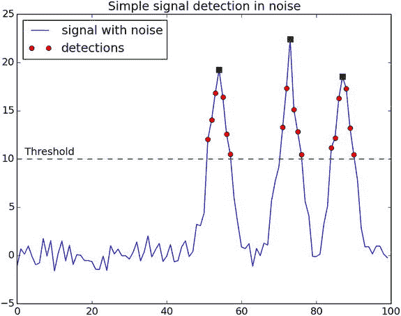

**图 8-10. 峰值检测**

## 波形

额外的 *SciPy* 功能包括几种波形，可用于设计或测试信号处理算法。这些包括 `sawtooth()`、`square()`、`gausspulse()` 和 `chirp()`：

```python
from pylab import *
from scipy import signal

cycles = 10
t = arange(0, 2*pi*cycles, pi/10)

waveforms = ['sawtooth', 'square']

figure()
for i, waveform in enumerate(waveforms):
    subplot(2, 2, i+1)
    exec('y = signal.' + waveform + '(t)')
    plot(t, y)
    title(waveform)
    axis([0, 2*pi*cycles, -1.1, 1.1])
show()
```

图 8-11 显示了生成的波形。

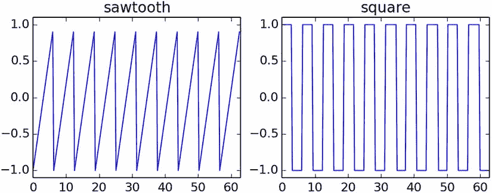

**图 8-11. 一些波形**

波形与之前使用的三角窗之间的区别在于它们是重复的，而 `triang()` 生成单个窗口。

函数 `gausspulse()` 和 `chirp()` 更专业一些；有关使用它们的信息，请参考交互式帮助。

## 傅里叶变换

傅里叶变换是一种线性运算，它将函数从时域变换到频域。就像你听到的声音可以被视为随时间变化的幅度一样，它也可以通过其频率分量来观察：例如，低音是音频的低频部分。

傅里叶变换的主题相当庞大，需要一些数学严谨性。我不会在这里深入探讨这个主题；相反，我将展示如何使用 *PyLab* 对采样数据执行傅里叶变换。

要将信号从时域转换到频域，请使用 `fft(x)`。FFT 代表快速傅里叶变换，是变换的一种高效实现。一般来说，如果 `x` 中的元素数量是 2 的幂，结果会非常快：

```python
>>> from time import time as t
>>> t1 = t(); dummy = sum(fft(arange(2**21))); print(t()-t1)
```

```python
0.20280003547668457
```

```python
>>> t1 = t(); dummy = sum(fft(arange(2**21-1))); print(t()-t1)
```

```python
1.0452020168304443
```

（你的实际结果可能因 CPU 的处理能力而异）。第一个 `fft()` 是在大小为 `2²¹` （是 2 的幂）的向量上执行的；第二个是在一个*更短*的向量上执行的，但计算时间更长（实际上超过两倍），因为它不是 2 的幂。在示例中，我使用了模块 `time` 中的函数 `time()` 来测量计算所需的时间。

要将数据从频域变换到时域，请使用 `ifft(x)`。

### 示例：采样余弦波的 FFT

余弦波由单一频率构成（实际上，如果包含负频率，则是两个频率）。让我们生成一个余弦波，并使用 `fft()` 计算其频率，如代码清单 8-6 所示。

**代码清单 8-6.** 余弦波的傅里叶变换

```python
from pylab import *
from scipy import signal

N = 2**9   # 我们偏好 2 的幂次
F = 25     # 频率为 25 Hz 的波
t = arange(N)/float(N)  # 在 1 秒内采样
x = cos(2*pi*t*F)   # 信号
figure()
p = subplot(2, 1, 1)
plot(t, x)
ylabel('x []')
xlabel('t [秒]')
title('余弦波')
grid()

p = subplot(2, 1, 2)
f = t*N
xf = fft(x)
plot(f, abs(xf))
title('余弦波的傅里叶变换')
xlabel('f [Hz]')
ylabel('xf []')
xlim([0, N])
grid()
show()
```

我首先定义了几个参数：`N` 是信号中的点数，`f` 是余弦波的频率。然后创建了一个时间向量 `t`，它由 0 到 1 之间均匀分布的样本组成，代表 1 秒。接着计算了采样后的余弦波并绘制了它及其傅里叶变换。我选择绘制变换后信号的绝对值，因为傅里叶变换返回的是复数值（尽管在本例中这些复数值为零）。图 8-12 展示了结果。

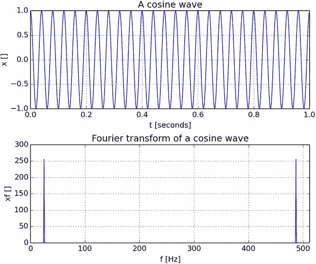

**图 8-12. 信号的 FFT**

 **注意** 在 25 Hz 处有一个频率分量（左侧尖峰），但在 487 Hz 处还有另一个。这实际上对应于(-25) Hz 的值，即(512 – 25) Hz。如果你想查看以 0 Hz 为中心的频域，请使用 `fftshift()` 函数。

## 窗函数

在 FFT 示例中，我特意选择了一个在 1 秒内具有完整周期数的余弦波，这基本上对应频率值的任何整数。如果我选择了一个非整数值，最终得到的信号将不具有完整的波周期。这种信号的问题在于，当你对信号执行 FFT 时，会开始看到其他频率——而不仅仅是原始信号的频率。其原因本质上是，FFT 假设信号是重复的；也就是说，它不仅仅是从 0 到 1 秒，而是从负无穷到正无穷。因此，它把信号当作被无限次向左和向右复制。如果信号具有整数个周期，那么在左右复制时就能完美衔接。但在现实中，你无法保证采样信号中具有整数个波，因此会开始看到这些采样效应。为了最小化这种影响，我们可以使用窗函数。

诸如 `hamming()`、`hanning()`、`bartlett()` 和 `kaiser()` 等几种窗函数有助于最小化这种影响，但代价是信号本身也会失真。要使用窗函数，将其与时域向量相乘，如代码清单 8-7 所示。

**代码清单 8-7.** 汉明窗

```python
N = 2**9   # 我们偏好 2 的幂次
F = 25.5   # 波频率
t = arange(N)/float(N)  # 在 1 秒内采样
f = t*N
x = cos(2*pi*t*F)   # 信号
xh = x*hamming(512) # 与汉明窗相乘
figure()
plot(f, abs(fft(x)), 's-', label='原始')
plot(f, abs(fft(xh)), 'o-', label='加汉明窗')
xlim([0, 50])
xticks(arange(0, 55, 5))
legend()
grid()
title('加汉明窗的信号')
xlabel('频率 [Hz]')
ylabel('幅度 []')
show()
```

我绘制了两个向量的 FFT：原始向量和加汉明窗后的向量。在图 8-13 中，你可以看到我放大了 25.5 Hz 频率附近，以展示窗函数的效果。

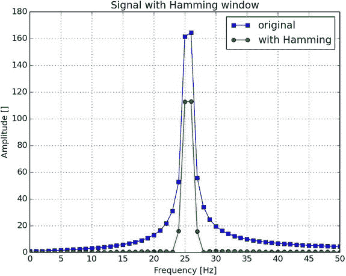

**图 8-13. 加汉明窗后的信号视图**

`scipy.signal` 模块提供了额外的窗函数。要访问这些函数，请执行以下命令：

```python
>>> from scipy import signal
>>> help(signal)
```

现在向下滚动到窗函数部分。

## 滤波

将时域信号变换到频域信号的原因之一是，频域中的滤波有时要简单得多。滤波器是一种改变信号的操作。就像厨房水槽中的过滤器一样，滤波器允许某些频率通过（水），同时阻止其他频率（大的食物残渣）。滤波器广泛应用于从音频到雷达系统的各种应用中。

滤波器根据其行为进行分类。允许低频通过并阻止高频的滤波器称为低通滤波器（LPF）。类似地，高通滤波器（HPF）只允许高频通过。还有其他分类，例如带通滤波器（只允许特定频带通过）、带阻滤波器（允许除特定频带外的所有频率通过）和陷波滤波器（抑制极少数频率）。

滤波器还根据其对脉冲输入的响应进一步分类；换句话说，根据假设向滤波器输入一个短脉冲时，滤波器输出随时间变化的函数来分类。最终会“遗忘”脉冲的滤波器称为有限脉冲响应（FIR）滤波器，而永远不会“遗忘”的滤波器称为无限脉冲响应（IIR）滤波器。从非常简化的角度来看，如果滤波器不依赖之前的输出（无反馈），则视为 FIR 滤波器；否则为 IIR 滤波器。

### 滤波器设计

假设你知道想要设计什么样的滤波器，本节将帮助你实现。滤波器设计是一个高级主题（参见 `http://en.wikipedia.org/wiki/Filter_design`）；因此，本节旨在为那些需要一些关于在 Python 中使用 *SciPy* 设计滤波器的指导的人提供帮助。

`scipy.signal` 模块包含几个有助于设计滤波器的函数。函数 `iirdesign()` 用于设计 IIR 滤波器。它功能相当完整，最好阅读在线帮助并按照其指导操作。其他有用的 IIR 滤波器设计函数包括 `butter()`、`cheby1()`、`cheby2()` 和 `ellip()`。FIR 滤波器设计功能由函数 `remez()` 和 `firwin()` 提供。我不会涵盖这些内容，但如果你需要使用它们，*SciPy* 的在线帮助信息量很大。最后，如果你想查看滤波器的频率响应，请使用函数 `freqz()` 和 `freqs()`。

代码清单 8-8 中的代码创建了一个低通巴特沃斯滤波器（一种 IIR 滤波器）并绘制了其频率响应。

**代码清单 8-8.** 滤波器的频率响应

```python
N = 256     # freqz 的点数
Wc = 0.2    # 3dB 点
Order = 3   # 滤波器阶数

#### 设计一个巴特沃斯滤波器
[b, a] = signal.butter(Order, Wc)

#### 计算频率响应
[w, h] = signal.freqz(b, a, N)
```

#### 绘制结果
`figure()`
`subplot(2, 1, 1)`
`plot(arange(N)/float(N), 20*log10(abs(h)), lw=2)`
`title('频率响应')`
`xlabel('频率（归一化）')`
`ylabel('dB')`
`ylim(ylim()[0], ylim()[1]+5)`
`grid()`
`subplot(2, 1, 2)`
`plot(arange(N)/float(N), 20*log10(abs(h)), lw=2)`
`title('频率响应（3dB 点）')`
`xlabel('频率（归一化）')`
`ylabel('dB')`
`text(Wc+.02, -3, '3dB 点', va='bottom')`
`ylim([-3, 0.1])`
`grid()`
`show()`

我使用了两个函数：`butter()`和`freqz()`。函数`butter()`使用指定参数（阶数和截止频率）设计一个 IIR 滤波器，函数`freqz()`返回频率响应。请注意，频率响应是一个复数，因此我绘制了其绝对值的幅度（以 dB 为单位）：`20*log10(abs(h))`，如图 8-14 所示。

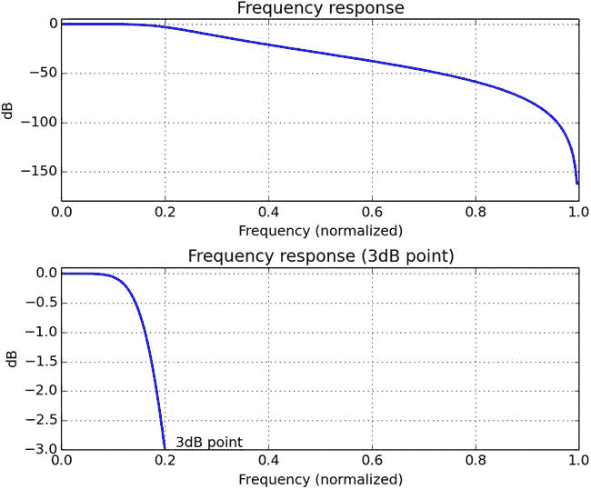 图 8-14. 低通滤波器的频率响应

要使用已知滤波器对数据进行滤波，请使用函数`scipy.lfilter(b, a, x)`。让我们来看一个例子。

## 示例：心率监测器

在这个例子中，我将生成一个信号，模拟连接到患者的心率监测器所产生的数据。请不要在任何生产系统中使用此代码；它仅用于教学目的。

患者四处走动，因此会拾取到两个信号：心脏信号和与患者运动相关的信号，通常称为运动伪影。代码清单 8-9 展示了我在模拟中的这些信号。

***代码清单 8-9***. 心率模拟

```
### 心脏信号模拟
N = 256     # 每秒样本数
T = 2       # 总秒数
hr = 1.67   # 每分钟 100 次心跳
F1 = 0.5    # 运动频率

t = arange(T*N)/float(N)
y1 = 5*sin(2*pi*t*F1)     # 运动伪影

### 添加心脏信号
y2 = zeros(size(y1))
for i in range(int(T*hr)):
    y2[i*N/hr:i*N/hr+10] = signal.triang(10)

### 合并运动信号与心跳信号
y = y1+y2

### 创建一个高通滤波器
[b, a] = signal.butter(3, 0.05, 'high')

### 对信号进行滤波
yn = signal.lfilter(b, a, y)

### 绘制图形
figure()

subplot(2, 1, 1)
title('带有运动伪影的心脏信号（模拟）')
plot(t, y, lw=2)
xlabel('t [秒]')
ylabel('幅度 []')

subplot(2, 1, 2)
title('滤波后的信号')
plot(t, yn, lw=2)
xlabel('t [秒]')
ylabel('幅度 []')
show()
```

我定义了几个控制脚本的参数。值`N`等于每秒的样本数（有些人将此值命名为`Fs`，代表采样频率）。值`T`是总秒数；在本例中为 2 秒。值`hr`是患者的心率，每分钟 100 次：100 / 60 = 1.67 Hz。最后，我将运动伪影的频率定义为 0.5 Hz。然后，我构建了一个时间向量`t`和一个运动伪影向量`v1`，并使用`signal.triang()`函数添加了具有三角波形的“心跳”。

现在，我有了一个带有运动伪影的心脏信号，接下来要滤除运动伪影。我设计了一个二阶巴特沃斯高通滤波器来实现这一点，通过调用`signal.butter()`，然后使用滤波器参数通过`signal.lfilter()`对信号进行滤波。图 8-15 显示了生成的图形。

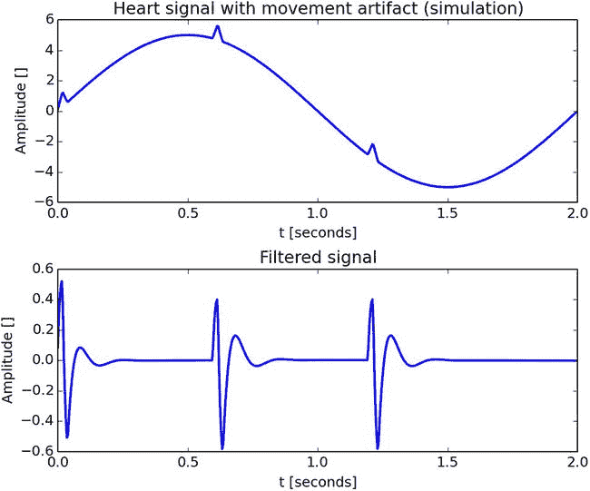 图 8-15. 信号滤波

## 示例：移动平均

在许多情况下，滤波用于“平滑”信号。一个简单的算法是移动平均。对于每两个连续的点，我们计算平均值并使用该值代替。这些点是重叠的，因此对向量`[1, 2, 0, 2]`使用该算法的结果将是`[1.5, 1, 1]`。但为什么只停留在两个样本呢？移动平均可以对多个点执行，返回这些点的平均值。代码清单 8-10 展示了如何使用 Python 的 *SciPy* 编写此代码。

***代码清单 8-10***. 移动平均

```
from pylab import *
N = 512
t = linspace(0, 10, N)
x = 1-exp(-t) +randn(N)/10
W = 32  # 移动平均中的点数
xf = zeros(len(x)-W+1)
for i in range(len(x)-W+1):
    xf[i] = mean(x[i:i+W])

plot(t, x)
hold(True)
plot(t[W-1:], xf, lw=3)
title('移动平均')
legend(['含噪声的信号', '滤波后的信号'])
xlabel('t [秒]')
ylabel('x []')
show()
```

这是一个使用`for`循环的直接实现。滤波器的输入被任意选择为`1-e^(-t)`加上噪声。

有一种更简单的方法。移动平均是一种 FIR 滤波器，其所有元素都等于`1/W`；其中`W`是移动平均窗口的长度。在这种情况下，实现移动平均滤波器的一种快速简便的方法（而不是使用`for`循环）是调用`signal.lfilter()`函数并将`ones(W)/W`作为滤波器值传递：

```
>>> from scipy import signal
>>> xf = signal.lfilter(ones(W)/W, 1, x)
```

图 8-16 显示了绘制移动平均的结果。

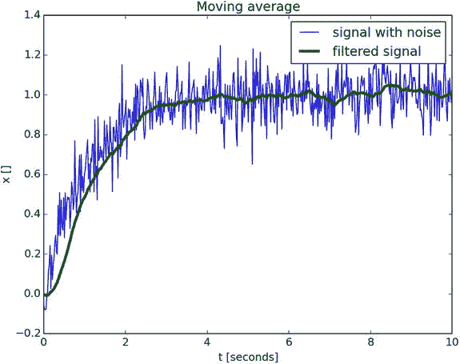 图 8-16. 移动平均

## 最后说明与参考资料

本章的目的是作为数值分析和信号处理算法的实用手册。我尽力限制了示例中使用的数学量，同时仍保持其信息量。

即便如此，本章涵盖的主题也太多，无法在一本书中深入探讨，更不用说一章了。如果你对这些主题感兴趣，以下资料可能提供更多信息：

*   《数值方法：科学计算的艺术，第三版》，作者：William H. Press、Saul A. Teukolsky、William T. Vetterling 和 Brian P. Flannery（剑桥大学出版社，2007 年；更多信息请参见 `http://www.nr.com`）
*   *SciPy*，`http://www.scipy.org/`

# 第 9 章


## 图像处理

## 二维数据

到目前为止，我们主要处理一维数据。也就是说，我们涵盖了本质上由一系列值组成的图形和数据。我们绘制了数据，对其进行了分析，并创建了随后保存到文件或显示在屏幕上的图像。

然而，图像数据文件或屏幕上的图像是二维的。它由像素（picture elements 的缩写）组成。每个像素在二维空间（x 和 y）中都有一个位置，以及一个对应于颜色的值。在本章中，我们将转向在像素级别上操作图像；也就是说，我们将对像素的二维矩阵进行操作。

对图像的操作类似于对一维数据执行的操作。对一维值数组进行切片并将这些值添加到另一个数组，相当于复制和粘贴图像。将数组保存到文件相当于以 TIFF 或 JPEG 格式写入图像。依此类推。

复制粘贴、调整大小和裁剪都是大多数基于 GUI 的图形应用程序支持的简单操作。但是，使用 GUI 应用程序，以系统和自动化的方式执行这些操作更加困难。例如，您可能需要调整多个图像的大小，然后将它们组合在一起形成图像拼贴。这在 GUI 应用程序中是可行的，但通常不那么容易，并且需要一些用户技能。其他简单的图像操作包括转换文件格式、旋转图像和裁剪图像。我将介绍这些图像操作，以及如何自动化它们，以便结果保持一致。

我将向您展示如何在数值层面上处理数据，包括读取图像、将其转换为 *NumPy* 二维数组，然后对数组本身进行操作。我还将向您展示如何实现一些涉及图像处理的有趣算法。最后，我将触及一些更复杂的主题，例如滤波，即修改图片以增强视觉输出的行为。

我们用于所有这些操作的基本包是 Python 图像库（PIL）的一个分支，名为 *Pillow*。请务必按照第 2 章中的指南安装 *Pillow*。我们还将依赖 *NumPy* 和 *matplotlib*。

在继续本章之前，请确保您已阅读第 6 章和第 7 章；理解本章内容需要这些章节中教授的概念。

### 读取、写入与显示图像

Python 图像处理库为我们提供了多个用于图像处理的类。基础类`Image`支持从文件读取图像、将图像写入文件、复制粘贴、调整大小和旋转等图像操作。要使用*Pillow*，我们需要执行导入语句：`import PIL`（注意是`PIL`而非`Pillow`）。

### 从文件读取图像

让我们开始吧。要使用`Image`类，请按如下方式导入：

```python
>>> from PIL import Image
```

 **注意** 后续内容中，我将假设您已执行`from PIL import Image`，不再赘述`import`语句。

我们的第一个操作是读取图像文件。由于目前还没有任何图像，我们先生成一个图像并从文件中读取。我们将使用*matplotlib*的补丁功能来实现，如代码清单 9-1 所示。（如果您不熟悉*matplotlib*补丁，请参考第 6 章。）

**代码清单 9-1. 创建图像**

```python
>>> from pylab import *
>>> figure()
>>> gca().add_patch(Circle((0, 0), 1))
>>> axis('off')
>>> axis('scaled')
>>> savefig('../images/circle.png')
```

我使用*matplotlib*创建了一个可操作的图像文件，但您同样可以使用任何图像文件，例如用数码相机拍摄的 JPEG 图片。代码清单 9-1 中的代码绘制了一个实心圆，并将其保存到文件`../images/circle.png`。

 **注意** 根据第 2 章介绍的目录结构，我假设您当前在`Ch9/src`目录下运行，且`Ch9/images`目录存放图像文件。如果不是这种情况，请务必修改本章示例中的图像路径。

我们的第一个操作是读取文件并将其关联到`Image`对象：

```python
>>> im = Image.open('../images/circle.png')
```

### 图像属性

现在我们已经有了一个与图像文件关联的`Image`对象，可以查询该对象的属性：

```python
>>> im.size
```

```
(800, 600)
```

```python
>>> im.info
```

```
{'dpi': (100, 100)}
```

```python
>>> im.mode
```

```
'RGBA'
```

```python
>>> im.format
```

```
'PNG'
```

```python
>>> im.filename
```

```
'../images/circle.png'
```

这些信息相当丰富。我们得知图像尺寸为 800×600 像素，分辨率为 100 dpi，模式为 RGBA（我们将在本章稍后的“创建新图像”部分介绍模式），图像格式为 PNG，与所创建对象关联的文件是`../images/circle.png`。

### 示例：图像目录

根据我分析图像数据的经验，图像并非总是以一致的方式获取。这意味着作为程序员，您需要手动裁剪、调整大小、增强甚至删除图像。这也意味着需要维护某种形式的目录文件。我发现一个有用的方法是创建一个自动化的目录文件，然后在处理数据时标注信息（关于目录文件的讨论请参见第 4 章）。

本示例的目的是创建一个基本的图像目录文件（见代码清单 9-2）。该脚本使用上一节介绍的 `Image` 属性，在搜索目录的父目录中创建一个 CSV 格式的目录文件。目录文件的扩展名为 `.cat.csv`。也就是说，如果您搜索 `/home/user`，将创建并命名为 `/home/user.cat.csv` 的目录文件。目录文件包含每个图像的名称、大小、格式和分辨率。

代码清单 9-2. 创建图像目录

```python
from PIL import Image
import os, csv

def image_catalog(srchpath):
    """创建名为 srchpath.cat.csv 的目录文件。"""
    # CSV 表头
    catalog = [['Filename', 'Pathname', 'Format', 'Size', 'Resolution']]

# 遍历目录树
    for root, dirs, files in os.walk(srchpath):
        for file in files:
            pathname = os.path.join(root, file)
            try:
                img = Image.open(pathname)
                filesize = os.path.getsize(pathname)
                catalog.append([file, pathname, img.format,
                    img.size, img.info])
            except IOError:     # 不是图像文件
                pass

# 创建干净的目录文件
    f = open(srchpath.rstrip('/')+'.cat.csv', 'w', newline='')
    csv.writer(f).writerows(catalog)
    f.close()
```

该脚本定义了一个名为 `image_catalog()` 的函数，该函数接受要搜索的目录，并生成 CSV 格式的图像目录文件。变量 `catalog` 是一个包含图像信息行的列表。我们遍历目录，采用“请求原谅比请求许可更容易”（EAFP）的方法查找图像：尝试将文件作为图像文件打开。如果成功，则更新目录。如果文件不是图像，则抛出 `IOError` 异常，我们 `pass` 跳过该文件。

 **注意** 如果您的目录应该只包含图像，您可能希望在 `pass` 之前添加一个 `print` 语句，通知用户遇到了非图像文件。

以下是我在 `images` 目录中运行脚本得到的结果（文件 `images.cat.csv` 的内容）：

```
Filename,Pathname,Format,Size,Resolution
nightsky1.png,../images/nightsky1.png,PNG,"(800, 600)","{'dpi': (100, 100)}"
nightsky2.png,../images/nightsky2.png,PNG,"(800, 600)","{'dpi': (100, 100)}"
circle.png,../images/circle.png,PNG,"(800, 600)","{'dpi': (100, 100)}"
nightsky.png,../images/nightsky.png,PNG,"(800, 600)","{'dpi': (100, 100)}"
collage.png,../images/collage.png,PNG,"(600, 600)",{}
```

## 显示图像

您可以通过调用 `Image` 的 `show()` 方法或 `Image.show()` 来查看图像。该方法会调用操作系统的默认图像查看器，通常由操作系统提供。要使用不同于操作系统提供的查看器，请将图像与您想要的图像查看器关联。以下将显示之前创建的图像 `../images/circle.png`：

```python
>>> Image.open('../images/circle.png').show()
```

## 转换文件格式

对图像执行的常见操作之一是转换图像文件格式。也许您想使用压缩将图像存储为更高效的格式，或者您使用的应用程序需要与接收时不同格式的图像。无论出于何种原因，`Image` 的 `save()` 方法都可以将图像保存为指定的图像格式。指定格式有两种方法：使用文件扩展名或显式指定 `format` 参数。

假设您已根据前面的代码清单创建了图像文件 `../images/circle.png`，您可以读取图像并将文件格式转换为 JPEG 格式，如下所示：

```python
>>> im = Image.open('../images/circle.png')
>>> im.save('../images/circle.jpg')
>>> import os
>>> os.listdir('../images')
```

```
['circle.jpg', 'circle.png']
```

在这个特定示例中，您实际上并没有转换文件，而是创建了另一个具有不同图像格式的文件（转换意味着您还要删除原始文件）。

或者，您可以创建一个函数将图像转换为 JPEG 格式，如代码清单 9-3 所示。

代码清单 9-3. 将图像转换为 JPEG 格式的函数

```python
from PIL import Image
from os.path import splitext

def ConvertToJpeg(filename):
    """将图像文件转换为 JPEG 文件。"""
    jpegname = splitext(filename)[0]+'.jpg'
    Image.open(filename).
```

`save(jpegname)`

在前面的示例中，我使用了 `os` 模块中的 `splitext()` 函数，将原始扩展名替换为 `.jpg` 扩展名。`.jpg` 扩展名指示 `save()` 函数创建一个 JPEG 文件。

如前所述，你也可以显式指定格式：

```
>>> im = Image.open('../images/circle.png')
>>> im.save('../images/circle', format='Jpeg')
>>> import os
>>> [fn for fn in os.listdir('../images') if fn.startswith('circle')]
```

```
['circle.png', 'circle', 'circle.jpg']
```

在这种情况下，`save()` 不会为文件名添加扩展名（即创建的文件是 `circle`，而不是 `circle.jpg`），因为传递给它的文件名就是 `circle`。

PIL 支持大量文件格式，`Image` 类可以读取大多数流行的图像格式。此外，大多数图像都可以使用已知的文件格式保存，包括 JPEG、TIFF 和 PNG。然而，某些图像格式只能读取。其他格式（如 MPEG（视频文件））仅在识别模式下支持。有关完整说明，请参阅 *Pillow* 参考文档：`http://pillow.readthedocs.org/en/latest/reference/index.html`。

### 示例：将目录中所有图像转换为 JPEG 格式的函数

转换图像文件格式这一思路的直接延续是编写一个函数，该函数遍历目录并将所有图像转换为 JPEG 格式，如代码清单 9-4 所示。我们还将保留原始图像，因为 JPEG 使用有损压缩算法，可能会降低原始图像质量。不过，你可以轻松修改示例以删除原始图像。

代码清单 9-4. 将目录中所有图像转换为 JPEG

```python
import os, csv
from PIL import Image

def ConvertDirToJpeg(srchdir):
    """将目录中的所有图像转换为 JPEG 文件。"""

# 遍历目录树
    for root, dirs, files in os.walk(srchdir):
        for file in files:
            # pathname 保存图像文件名
            pathname = os.path.join(root, file)
            try:
                # 将文件转换为 JPEG 文件
                img = Image.open(pathname)
                jpegname = os.path.splitext(pathname)[0]+'.jpg'
                if os.path.exists(jpegname):
                    print("未创建 %s；文件已存在。" % jpegname)
                else:
                    img.save(jpegname)
                    print("已创建文件 ", jpegname)
            except IOError:     # 哎呀，不是图像
                pass
```

同样，上述脚本使用了 EAFP 方法：尝试将文件作为图像打开，如果一切顺利，则将其转换为 JPEG 图像。要运行该函数，请输入 `ConvertDirToJpeg(dirname)`。

 **注意** 如果使用不存在的目录调用函数 `ConvertDirToJpeg()`，则不会产生任何输出，甚至不会产生警告消息。如果你需要此类功能，请务必修改函数并将其包含在内。

## 图像处理

现在我们可以读取图像、显示图像并转换文件格式。但在转换文件格式时（前提是我们不使用有损压缩算法），我们实际上并没有改变图像；我们只是以不同的格式保存了它们。

在本节中，我们将转向执行基本的图像处理。换句话说，我们将通过剪切和粘贴、裁剪以及旋转来修改图像的内容。

### 创建新图像

*Pillow* 为我们提供了创建图像的能力，而不仅仅是从文件中读取图像。当你想要从其他来源复制和粘贴图像到新图像时，这尤其有用。创建新图像的语法是 `Image.new(mode, size, color=0)`。`mode` 参数可以取表 9-1 中列出的值之一。

表 9-1。图像模式

| 模式 | 描述 |
| --- | --- |
| `'1'` | 每像素 1 位；适用于黑白图像。 |
| `'L'` | 每像素 1 字节（值从 0 到 255），黑白；适用于处理单色带（请参阅本章后面关于颜色的讨论）。 |
| `'RGB'` | 红、绿、蓝，每种颜色 1 字节，也称为真彩色。当图像背景为黑色时（例如在屏幕显示器上），RGB 很常见。 |
| `'RGBA'` | 红、绿、蓝和透明度遮罩，每种颜色 1 字节；在包括 PNG 在内的几种文件格式中很常见。 |
| `'CMYK'` | 青、品红、黄、黑，每种颜色 1 字节。CMYK 在印刷中很常见。 |

还有其他图像模式，但本章不会涉及。要查看可用模式列表，请执行以下命令：

```
>>> from PIL import Image
>>> Image.MODES
```

```
['1', 'CMYK', 'F', 'I', 'L', 'LAB', 'P', 'RGB', 'RGBA', 'RGBX', 'YCbCr']
```

有关更多信息，请参阅 *Pillow* 网站：`http://pillow.readthedocs.org/en/latest/handbook/concepts.html`。

`Image.new()` 函数中的 `size` 参数是一个描述图像宽度和高度的二元组。`color` 参数是模式的函数。例如，对于 RGB 图像，颜色是一个形式为 `(red, green, blue)` 的元组；对于 CMYK，颜色形式为 `(cyan, magenta, yellow, black)`：

```
>>> im1 = Image.new('L', (800, 600)) # 黑色，单带图像
>>> im2 = Image.new('CMYK', (800, 600), (0, 255, 0, 0)) # 品红色图像
>>> im3 = Image.new('RGB', (800, 600), (255, 0, 0)) # 红色图像
```

你可以通过调用 `show()` 方法来查看图像，例如 `im1.show()`。

### 复制和粘贴

方法 `copy()` 和 `paste()` 分别允许我们复制图像和将图像粘贴到其他图像中。方法 `copy()` 不需要参数，并创建当前图像的副本。方法 `paste(im, xy)` 将图像 `im` 粘贴到当前图像中；`xy` 参数是一个指示粘贴位置（左上角）`(x, y)` 的元组。让我们看一个使用 `paste()` 方法的示例。

### 示例：分形拼贴画

在此示例中，我们将使用函数 `new()`、`open()`、`paste()` 和 `save()` 来创建图像拼贴画。要跟着操作，你需要修改第 7 章中介绍的分形脚本，使其成为一个函数而不是脚本（请参阅代码清单 9-5）。创建函数后，将其保存在 `Ch9/src/fractal.py` 下。

代码清单 9-5. 创建分形的函数

```python
from PIL import Image
from cmath import *

def fractal(delta=0.000001, res=800, iters=30):
    """使用牛顿-拉夫逊方法创建一个 z**4+1=0 的分形。"""

# 创建一个用于绘制的图像，将其涂成黑色
    img = Image.new("RGB", (res, res), (0, 0, 0))

# 这些是方程 z**4+1=0 的解（欧拉公式）
    solutions = [cos((2*n+1)*pi/4)+1j*sin((2*n+1)*pi/4) for n in range(4)]
    colors = [(1, 0, 0), (0, 1, 0), (0, 0, 1), (1, 1, 0)]

for re in range(0, res):
        for im in range(0, res):
            z = (re+1j*im)/res
            for i in range(iters):
                try:
                    z -= (z**4+1)/(4*z**3)
                except ZeroDivisionError:
                    # 可能除以零异常
                    continue
                if(abs(z**4+1) < delta):
                    break

# 颜色深度是迭代次数的函数
            color_depth = int((iters-i)*255.0/iters)

# 找出该猜测收敛到哪个解
            err = [abs(z-root) for root in solutions]
            distances = zip(err, range(len(colors)))

# 选择与该解关联的颜色
            color = [i*color_depth for i in colors[min(distances)[1]]]
            img.
```

`putpixel((re, im), tuple(color))`      `return img`

```
```

借助函数 `fractal(delta, res, iter)`，我们创建了一个分形拼贴图，如代码清单 9-6 所示。

代码清单 9-6. 分形拼贴图

```python
from PIL import Image, ImageOps
```

## 图像处理

### 基本操作

从 `fractal.py` 文件导入分形函数。

```python
from fractal import fractal
```

```python
fsize = 200      # 小分形图像的宽度和高度
nx = 3           # 图像数量，宽度方向
ny = 3           # 图像数量，高度方向

collage = Image.new("RGB", (fsize*nx, fsize*ny))
for i in range(ny):
    for j in range(nx):
        im = fractal(0.000001, fsize, i*nx+j+1)
        print("正在处理第 %d 张图像，共 %d 张" % (i*nx+j+1, nx*ny))
        collage.paste(im, (fsize*j, fsize*i))

collage.save('../images/collage.png')
```

该脚本生成迭代次数递增的分形，并将它们粘贴到一张图像中，作为图像拼贴图。`paste()` 方法的参数经过选择，使得图像从左上角到右下角依次粘贴。我已将图像保存到文件 `../images/collage.png`。

运行此脚本的结果显示在第 7 章的图 7-3 中。

#### 裁剪与调整大小

裁剪和调整大小会修改现有图像。函数 `crop()` 选择原始图像的一部分，而函数 `resize()` 则调整现有图像的大小；也就是说，它会缩放图像以适配新尺寸。

假设你已经运行了前面的拼贴图示例，那么你现在应该有一个名为 `collage.png` 的文件。函数 `crop()` 接受一个包含四个值的元组，详细说明要裁剪的矩形区域：`(x0, y0, x1, y1)`。让我们读取 `collage.png` 文件，并将其裁剪为仅显示分形拼贴图中的 2x2 图像：

```
>>> img = Image.open('../images/collage.png')
>>> img.size
```

```
(600, 600)
```

```
>>> cropped_img = img.crop((0, 0, 400, 400))
>>> cropped_img.size
```

```
(400, 400)
```

```
>>> cropped_img.show()
```

假设你想显示整张图像，但将其缩放至 `(400, 400)` 尺寸；在这种情况下，你可以使用 `resize(xy)` 函数，其中 `xy` 是一个包含两个元素的元组，详细说明调整大小后图像的宽度和高度：

```
>>> img = Image.open('../images/collage.png')
>>> img.size
```

```
(600, 600)
```

```
>>> resized_img = img.resize((400, 400))
>>> resized_img.show()
>>> resized_img.size
```

```
(400, 400)
```

你也可以使用 `thumbnail()` 方法，它与 `resize()` 类似。区别在于 `resize()` 返回一个修改后的图像副本，而 `thumbnail()` 则直接修改图像本身。

```
>>> img.thumbnail((400, 400))
>>> img.size
```

```
(400, 400)
```

在 `resize()` 和 `thumbnail()` 方法中，你都可以提供一个 `filter` 参数，用于确定重采样的方法。可接受的值有 `Image.NEAREST`（默认）、`Image.BILINEAR`、`Image.BICUBIC` 和 `Image.ANTIALIAS`（最佳质量）；详情请参见 `http://pillow.readthedocs.org/en/latest/handbook/concepts.html`。抗锯齿效果最佳，但计算时间可能更长：

```
>>> img.thumbnail((400, 400), Image.ANTIALIAS)
```

#### 旋转

我们基本操作列表中的最后一个是 `rotate()` 函数。函数 `rotate(theta)` 将图像旋转 `theta` 度。

从用户的角度来看，旋转是一项基本操作，例如将扫描的文档旋转几度以便正确显示。但实际上，旋转并非如此简单的操作；它需要改变图像的宽度和高度。在旋转角度为 90 度的倍数的情况下，`rotate()` 函数知道要交换 x 轴和 y 轴；然而，对于其他旋转角度，两个轴都会改变，因此图像的总面积也会发生变化。

你可以通过分别传递 `expand=True` 或 `expand=False` 来控制是否希望 `rotate()` 扩展图像以包含整个旋转后的图像：

```
>>> img = Image.new('RGB', (200, 300), (0, 255, 255))
>>> img30 = img.rotate(30)
>>> img30.show()
>>> img30.size
```

```
(200, 300)
```

```
>>> img30e = img.rotate(30, expand=True)
>>> img30e.show()
>>> img30e.size
```

```
(324, 360)
```

在第一行中，我创建了一个简单的蓝色图像，宽 200 像素，高 300 像素。然后，我将图像旋转了 30 度，分别使用了扩展和不扩展两种方式。结果显示在图 9-1 中。

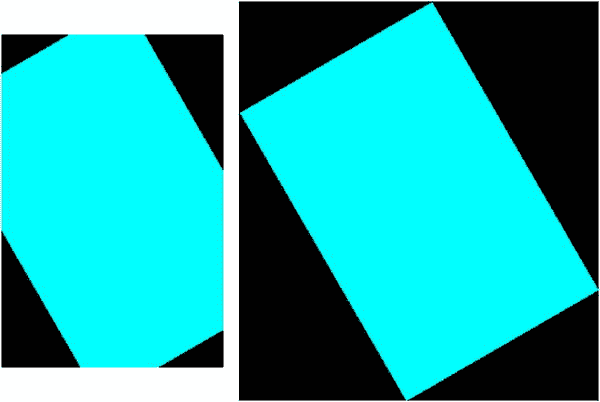

图 9-1. 旋转后的图像：左侧未扩展，右侧已扩展

### 图像注释

图像注释与图形注释同样重要。它能提供额外的、重要的信息。这张照片是什么时候拍的？使用了什么相机？等等。然而，在某些情况下，用文本注释图像会破坏令人愉悦的视觉效果。这可能是它在图片中不太常见的原因。此外，还存在选择什么颜色的问题。在图片大部分为白色的情况下，你可能希望选择非白色的注释。

在本节中，我们将介绍文本注释，以及用于突出显示特定图像特征的几何形状。

#### 使用几何形状进行注释

*Pillow* 为我们提供了 `ImageDraw` 对象，它允许我们对现有图像进行注释。要导入 `ImageDraw` 对象，请执行 `from PIL import ImageDraw`。要使用 `ImageDraw` 对象，请将其附加到现有图像上：

```
>>> from PIL import Image, ImageDraw
>>> img = Image.new('RGB', (200, 300), (0, 0, 255))
>>> draw = ImageDraw.Draw(img)
```

我创建了一个名为 `draw` 的 `ImageDraw` 对象，并将其附加到图像 `img` 上。接下来，使用 `ImageDraw` 对象执行的操作将在 `Image` 对象上执行：

```
>>> draw.line((100, 100, 200, 200))
>>> img.show()
```

这将绘制一条从 `(100, 100)` 到 `(200, 200)` 的直线。

你可以使用表 9-2 中的函数来注释图像。在表中，假设 `draw = ImageDraw.Draw(Image)`。

表 9-2. 部分 `ImageDraw` 函数

| 函数 | 描述 | 示例 |
| --- | --- | --- |
| `arc(xybox, start, end)` | 绘制一条弧线，即由矩形 `xybox`（一个包含四个元素的元组）界定的圆的一部分，从角度 `start` 开始，到角度 `end` 结束。 | `draw.arc((100, 100, 200, 200), 90, 180)` 将绘制四分之一个圆。 |
| `chord(xybox, start, end)` | 与 `arc()` 类似，只是它会绘制一条连接弧线边缘的直线。 | `draw.chord((0, 0, 100, 100), 90, 180)` |
| `ellipse(xybox)` | 绘制一个由四元素元组 `xybox` 界定的椭圆。如果你想要一个圆，请为 `xybox` 值使用一个正方形。 | `draw.ellipse((50, 50, 150, 100))` |
| `line(xyseq)` | 绘制连接序列 `xyseq` 中元素的直线。 | `draw.line([0, 0, 10, 10, 20, 10, 20, 20])` |
| `point(xy)` | 在位置 `xy` 处绘制一个点。 | `draw.point((40, 40))` |
| `polygon(xyseq)` | 绘制一个连接序列 `xyseq` 中元素的多边形。与 `line()` 函数的区别在于，多边形始终是封闭形状，允许使用 `fill` 参数。 | `draw.polygon([10, 20, 40, 40, 50, 30, 70, 80])` |
| `rectangle(xybox)` | 绘制一个由四元素元组 `xybox` 指定的矩形。 | `draw.rectangle((20, 60, 80, 140), fill=128)` |

`ImageDraw` 注释函数接受以下可选参数：`fill`，用于确定注释或填充对象的颜色（类似于 *matplotlib* 中的 `facecolor` 参数）；`outline`，用于确定绘制对象的线条（类似于 *matplotlib* 的 `edgecolor` 参数）；以及用于文本注释的 `font`。

#### 文本注释

除了几何形状外，`ImageDraw` 还通过 `text((x,y), string)` 函数提供文本注释功能：

```
>>> from PIL import Image, ImageDraw
>>> img = Image.new('L', (160, 160), 255)
>>> draw = ImageDraw.Draw(img)
>>> draw.ellipse((0, 0, 160, 160), fill=128)
>>> draw.text((80, 80), 'A long string')
>>> img.show()
```

最初，我打算让文本水平居中。然而，文本字符串是有宽度的，所以我需要一种方法来计算文本的像素宽度和高度。一旦获得了宽度和高度，我就可以在 `(80 – width/2, 80 – height/2)` 位置绘制文本。这可以通过 `textsize()` 函数实现：

```
>>> from PIL import Image, ImageDraw
>>> img = Image.new('L', (160, 160), 255)
>>> draw = ImageDraw.Draw(img)
>>> draw.ellipse((0, 0, 160, 160), fill=128)
>>> s = 'A long string'
>>> width, height = draw.textsize(s)
>>> width, height
```

```
(78, 11)
```

```
>>> draw.text((80–width/2, 80–height/2), s)
>>> img.show()
```

图 9-2 展示了不考虑字符串宽度和高度与考虑后的结果对比。


图 9-2. 使用 `text()` 和 `textsize()` 进行文本注释

#### 字体

也可以将其他字体与 `text()` 函数一起使用。为此，首先需要创建一个 `ImageFont` 对象。`ImageFont` 对象是 *Pillow* 的一部分；要导入它，请执行 `from PIL import ImageFont`。导入 `ImageFont` 后，可以通过调用 `ImageFont.truetype(fontname, size)` 来使用字体。返回的 `ImageFont` 对象可以通过 `font` 参数作为参数传递给 `text()` 函数。

当然，在使用字体之前，必须先将它们安装到系统中。Windows 和 MacOS 通常自带内置字体；而在 Linux 上，字体通常随 X（以及其他应用程序）一起安装。你也可以使用 GNU FreeFont 项目（`http://www.gnu.org/software/freefont/`）中的字体。

然而，字体和字体名称在不同系统上是不同的，而且不仅仅是不同的操作系统：我的 Windows 系统可能拥有与你不同的 Windows 系统不同的字体。这意味着调用 `ImageFont.truetype(fontname, size)` 可能在一个系统上有效，而在另一个系统上无效。为了解决这个问题，我使用了 `findfont()` 函数，它是 *matplotlib.font_manager* 模块的一部分。`findfont()` 函数返回一个字符串，其中包含与请求字体最匹配的字体位置。

以下脚本使用 `findfont()` 函数以 Vera 字体注释文本：

```
>>> from matplotlib import font_manager
>>> from PIL import Image, ImageDraw, ImageFont
>>> img = Image.new('L', (250, 100), 255)
>>> draw = ImageDraw.Draw(img)
>>> font_str = font_manager.findfont('Vera')
>>> font_str
```

```
'C:\\Python33\\lib\\site-packages\\matplotlib\\mpl-data\\fonts\\ttf\\Vera.ttf'
```

```
>>> ttf = ImageFont.truetype(font_str, 54)
>>> s = 'ABCabc'
>>> (w, h) = draw.textsize(s, font=ttf)
>>> draw.text(((250-w)/2, (100-h)/2), s, font=ttf)
>>> img.show()
```

前两条语句从 *Pillow* 以及 *matplotlib* 的字体管理器中导入相应的对象。然后我创建了一个大小为 `(250, 100)` 的单波段图像，接着实例化一个附加到该图像上的 `ImageDraw` 对象。

接下来，我使用 *matplotlib* 的 `findfont()` 函数来查找最接近名为 Vera 的字体。字体的路径存储在字符串 `font_str` 中。之后，我创建了一个名为 `ttf` 的 `ImageFont` 对象，并使用该字体对象来渲染文本。然后我计算文本的大小，并将其渲染在白色背景的中央，如 图 9-3 所示。


图 9-3. 字体渲染

> **注意** 要使用字体，你必须在调用 `text()` 和 `textsize()` 这两个函数时提供 `font` 参数。

### 示例：缩略图索引图像

在之前的示例（清单 9-2）中，我们创建了一个图像目录。虽然该目录非常有用，但它没有显示这些图像的内容。也许一个更有用的目录是一个由图像拼贴而成的图集，并附有显示每个图像文件名的文本注释（参见 清单 9-7）。

***清单 9-7***. 一个缩略图索引图像

```


# thumbnail index

`import os`  
`from PIL import Image, ImageDraw`

```python
def thumbnail_index(dirpath):
    """从 dirpath 中的图像创建缩略图索引。"""

    num_images = 5
    thumb_size = (128, 96)
    cat_size = (num_images*thumb_size[0], num_images*thumb_size[1])

    fn_index = 0            # 文件名索引
    img_index = 0           # 图像索引

    # 遍历目录中的所有图片
    for file in os.listdir(dirpath):
        # 获取文件的路径名
        pathname = os.path.join(dirpath, file)

        try:    # 这是一个图像文件吗？

            # 打开图像文件
            img = Image.open(pathname)

        except IOError:
            print(file, "不是一个图像文件")
            continue

        # 创建缩略图
        img.thumbnail((thumb_size), Image.ANTIALIAS)
        draw = ImageDraw.Draw(img)
        draw.text((2, 2), file)

        # 是否需要创建新的目录图像？
        if img_index == 0:
            thumbs_img = Image.new('RGB', cat_size)

        # 计算此图像的位置
        x = img_index % num_images
        y = img_index // num_images

        # 粘贴缩略图
        thumbs_img.paste(img, (x*thumb_size[0], y*thumb_size[1]))

        # 递增图像索引
        img_index += 1

        # 是否已达到目录图像的末尾？
        if img_index==num_images**2:
            img_index = 0
            thumbs_img.save('%s-%03d.cat.jpg' % (dirpath, fn_index))
            fn_index += 1

    # 保存最后一个目录文件
    if img_index:
        thumbs_img.save('%s-%03d.cat.jpg' % (dirpath, fn_index))
```

函数 `thumbnail_index()` 接受一个目录并生成一个缩略图索引图像。图 9-4 展示了在我女儿特别喜欢的一组图像上运行该函数的结果。


图 9-4. 一个缩略图索引图像

出于本示例的目的，我决定不使用 `os.walk()` 来遍历目录列表。相反，我使用了 `os.listdir()`。我定义了两个参数：`num_images`，它保存 x 轴或 y 轴上的图像数量；以及 `thumb_size`，它保存缩略图的宽度和高度。接下来，我组成了请求目录中所有文件的列表。对于每个文件，脚本尝试将其作为图像文件打开。如果文件确实是图像文件，则创建该图像的缩略图并将其粘贴到索引图像上。此外，缩略图会在左上角用文件名进行注释。使用了一些索引来确定图像在缩略图索引图像中的确切位置，以及在当前索引图像填满后创建新的缩略图索引图像。

 **提示** 另一种替代方法是将文本直接显示在缩略图图像下方。你可以通过在图像行之间添加一条黑色（或白色）条纹来实现这一点。

## 图像处理

到目前为止，我们执行的任务也可以通过大多数基于 GUI 的图像编辑应用程序（包括 GIMP，GNU 图像处理程序（`http://www.gimp.org/`））来执行。然而，基于 GUI 的应用程序是为 GUI 用户设计的，不易于自动化。

### 图像处理与 Python 实现

我们现在开始探索编写脚本来自动执行图像操作的可能性。此外，当你开始思考更高级的图像处理算法时，你可能会意识到需要访问实际数据，即表示图像的数字。在本节中，我们还将展示如何实现这一点。

需要提醒的是：图像处理是一个广阔的领域。我在这里甚至不会涵盖基础知识；相反，我将展示，如果你确实有一个图像处理算法，那么你很可能可以用`Python`实现它。

### 矩阵表示与颜色

图像可以用矩阵表示，每个`(x, y)`点对应矩阵中的一列和一行，而值对应颜色。

颜色值是模式（`mode`）的函数（详见前面的表 9-1）。例如，对于`RGB`图像，矩阵的每个值是一个由 3 个字节组成的元组，每个字节代表一种不同的颜色。从某种意义上说，你可以将整个图像视为三个矩阵，每个矩阵对应红色、绿色和蓝色，这些颜色也称为颜色带或通道。

此外，每个图像都可以分割成这些颜色（当然，取决于模式——1 位图像无法分割成单独的颜色）。你可以使用`Image`方法`split()`来实现：

```python
>>> from PIL import Image
>>> im = Image.open('../images/circle.png')
>>> im.mode
```

```
'RGBA'
```

```python
>>> R, G, B, A = im.split()
>>> R.mode, G.mode, B.mode, A.mode
```

```
('L', 'L', 'L', 'L')
```

 **注意**：我假设你已经按照本章内容创建了一个名为`../images/circle.png`的文件；如果没有，请按照清单 9-1 创建一个`circle.png`图像。

每个分割后的图像本身就是一个图像，但它现在只包含一种颜色信息——因此，它的模式是`'L'`，而不是`'RGBA'`。

要检索与颜色相关的*数据*（即实际值），请调用函数`getdata()`。然后，我们可以将这些值转换为*NumPy*数组，以进行一些有趣的数值处理。以下内容延续了前面的清单：

```python
>>> from pylab import *
>>> data = array(R.getdata())
>>> type(data)
```

```
<class 'numpy.ndarray'>
```

```python
>>> data.size
```

```
480000
```

```python
>>> data.shape
```

```
(480000,)
```

图像数据存储为图像中所有值的列表，而不是图像的矩阵表示。要将其转换为矩阵，我们使用*NumPy*方法`reshape()`：

```python
>>> im.size
```

```
(800, 600)
```

```python
>>> data = data.reshape(im.size)
>>> data.size   # 大小应该相同
```

```
480000
```

```python
>>> data.shape   # 重塑为矩阵
```

```
(800, 600)
```

现在，我们将数据作为矩阵，可以对矩阵进行操作，而不是对图像进行操作。这给了我们很大的灵活性。假设我们想在圆的中间任意绘制一条洋红色条纹；我们只需要修改与红色通道关联的矩阵，然后合并它，形成一个新的、修改后的图像。

 **提示**：为什么改变红色通道会产生洋红色输出？我修改矩阵的方式是将红色通道设置为`255`。这意味着我之前的蓝色圆现在将变成蓝色和红色的组合，即洋红色，而背景的其余部分（白色）将保持白色。

让我们一步一步地来做，从头开始：

```python
>>> from pylab import *
>>> from PIL import Image
>>> im = Image.open('../images/circle.png')
>>> im.mode
```

```
'RGBA'
```

```python
>>> im.size
```

```
(800, 600)
```

```python
>>> R, G, B, A = im.split()
>>> data = array(R.getdata()).reshape(im.size)
>>> (w, h) = data.shape
>>> data[w/2-100:w/2+100, :] = 255*ones((200, h))
>>> R.putdata(data.reshape(h*w))
>>> new_img = Image.merge('RGB', (R, G, B))
>>> new_img.show()
```

第一行从文件读取图像并显示一些图像信息。然后我将图像分割成四个通道：红色、绿色、蓝色和透明度蒙版。从这里开始，我将只处理红色通道。首先，我检索与红色通道关联的实际数值。这是通过调用`getdata()`完成的。在同一行中，我还将数据转换为*NumPy*数组，并将列表重塑为矩阵形式。

接下来，我更改中间 200 行关联的数据值，并将其设置为`255`。这有效地创建了洋红色条纹。然后，我通过调用函数`putdata()`，用修改后的数据更新红色通道。函数`putdata()`与`getdata()`互补，它期望一个列表，而不是矩阵，因此我将数据重塑回一维数组。

最后，我通过组合原始的绿色和蓝色通道与修改后的红色通道，创建一个新图像，这次使用`RGB`模式（我不需要透明度）。这是通过调用`merge()`函数完成的，该函数与`split()`函数相反。图 9-5 显示了结果。


图 9-5. 带有条纹的圆

 **注意**：也可以使用`ImageDraw`对象执行此任务。

到目前为止，我们已经介绍了一些有趣的函数，这些函数能够使用数值处理图像：`split()`、`merge()`、`getdata()`和`putdata()`。接下来，我们将在更复杂的示例中使用其中的一些函数。

### 将图像读取到NumPy数组

另一种替代使用*Pillow*的`Image`对象并将其转换为*NumPy*数组的方法是直接将图像读取为*NumPy*数组。你可以通过使用*NumPy*的`imread()`函数来实现这一点。要将*NumPy*数组保存为图像，请使用`imsave()`。最后，要查看由*NumPy*数组表示的图像，请使用*matplotlib*的`imshow()`。请注意，*matplotlib*将显示一个 2D 图像，以及图像的轴和标题；如果你不想显示轴，可以通过发出`axis('off')`来移除它。

以下展示了如何使用*NumPy*读取图像`../images/circle.png`，并使用*matplotlib*显示它：

```python
>>> from pylab import *
>>> data = imread('../images/circle.png')
>>> data.shape
```

```
(600, 800, 4)
```

```python
>>> data.size
```

```
1920000
```

```python
>>> data.max()
```

```
1.0
```

```python
>>> data.min()
```

```
0.0
```

```python
>>> imshow(data)
>>> axis('off')
```

```
(-0.5, 799.5, 599.5, -0.5)
```

请注意，变量`data`的形状，如`data.shape`所示，是`(600, 800, 4)`；这表明*NumPy*数组是一个 3D 数组，像素为 800×600，并且有 4 个通道：R、G、B 和 A。

接下来要注意的是，`imread()`将像素值缩放到 0 到 1 之间。这可以从`data.max()`和`data.min()`打印的结果中看出。

现在，让我们通过对`data`数组进行操作来修改图像。在以下示例中，我反转了通道 R、G 和 B 的值，然后将结果写入文件：`../images/inverted_circle.png`：

```python
>>> data[..., :3] = 1 - data[..., :3]
>>> imshow(data)
>>> imsave('../images/inverted_circle.png', data)
```

如果你正在处理一个算法，并且需要*NumPy*和*SciPy*的功能（即对*NumPy*数组进行操作），那么我建议你使用本节中展示的函数，将图像直接读取到*NumPy*数组。如果你需要实际的图像操作（例如，图像滤波、图像旋转等），我建议你改用*Pillow*。

### 示例：计数对象（五部分）

以下示例相当长，涉及图像处理的一个有趣方面：计算图像中的对象数量。其想法是编写一个脚本来统计图片中元素的数量。

#### 统计图像中的元素数量

统计元素是一项复杂的任务，即使对人类思维而言也是如此：我应该统计哪些物体？什么构成一个物体？等等。统计物体的任务在各种应用中都非常有用，仅举几例：

- *生物学*：估算显微镜图像中的细菌数量
- *医学*：统计组织切片中的轴突数量
- *电路板制造*：统计印刷电路板上的瑕疵数量或电阻数量
- *天文学*：统计恒星数量

为了本示例的目的，我们将创建一张夜空图像，其中随机分布着星星。然后，我们将编写一个脚本来统计星星的数量。我们将生成一张非常纯净的图像，背景非常干净（黑色的夜空），且大部分信息集中在一个通道中。不过，我们会通过改变星星的形状和大小来增加一点复杂性。

一旦我们有了夜空图像，我将稍微谈谈递归，这是我迄今为止一直回避的话题。递归将用于实现一个填充图像的算法。最后，我将讨论一些你可以用来扩展此示例并为算法增加更多功能的思路和方法。

#### 第一部分：一闪一闪小星星

首先，我们为夜空图像创建星星。夜空将由白色星星和黑色背景组成。由于我们希望星星具有不同的大小和形状，我们将创建一个名为 `star()` 的函数，用于创建一个 *matplotlib* 补丁对象（参见清单 9-8）。

***清单 9-8***. 星星补丁，`star_patch.py` 的源码

```python
# create a star patch object
from pylab import *

def star(R, x0, y0, color='w', N=5, thin=0.5):
    """Returns an N-pointed star of size R at (x0, y0) (matplotlib patch)."""

    polystar = zeros((2*N, 2))
    for i in range(2*N):
        angle = i * pi/N
        r = R*(1-thin * (i%2))
        polystar[i] = [r*cos(angle)+x0, r*sin(angle)+y0]
    return Polygon(polystar, fc=color, ec=color)
```

控制星星补丁的值有：`R`，决定星星的半径；`x0` 和 `y0`，控制星星的位置；`color`，决定填充色和边框色；`N`，控制星星的尖角数量；`thin`，控制星星的粗细（范围从 0 到 1，1 表示非常细）。

 **提示** 默认的星星补丁是白色的，因为我们将用它来制作夜空。如果你使用白色背景，请务必将其更改为其他颜色。

我使用 `Polygon` 对象并借助一些数学技巧创建了星星补丁。思路是这样的：我将 N 个尖角点放置在一个半径为 R、圆心在 (x0, y0) 的圆上，角度增量固定。然后，我将另一组点放置在半径较小的圆上，作为星星的内角点，同样以固定的角度增量放置，但进行了偏移，使得每个内点正好位于两个外角点的中间。`thin` 参数决定了内圆的半径：值越大，半径越小，星星就越“细”。最后，我使用 `Polygon` 补丁对象绘制一条连接所有这些点的线。

 **注意** 请务必将星星补丁代码保存为文件 `star_patch.py`；我们将在后续脚本中使用它。

##### 使用列表推导式

也可以使用列表推导式来实现星星补丁。思路是将多边形列表中的元素压缩在一起：

```python
def another_star(R, x0, y0, color='w', N=5, thin = 0.5):
    """Returns an N-pointed star of size R at (x0, y0)."""

    a = arange(0, 2*pi, 2*pi/N)
    r = (1-thin)*R
    polystar = array(list(zip(R*cos(a)+x0, R*sin(a)+y0, \
        r*cos(a+pi/N)+x0, r*sin(a+pi/N)+y0)))
    return Polygon(polystar.reshape(N*2, 2), fc=color, ec=color)
```

有些人更喜欢这种实现方式，而不是 for 循环的实现。就我个人而言，我认为两者都可以；选择你觉得更容易理解的那种。

也可以将整个函数编写为单个 `return` 语句，但我强烈建议不要这样做，因为代码会难以理解。

清单 9-9 中的脚本生成了一些有趣的星星。

***清单 9-9***. 生成一些有趣的星星

```python
```

### show some star examples
```python
from pylab import *
from star_patch import star

examples=[
    "star(10, 0, 0, 'k')",
    "star(10, 0, 0, 'k', 10)",
    "star(10, 0, 0, 'k', 5, 0.2)",
    "star(10, 0, 0, 'k', 3, 0.9)"
]

for i, example in enumerate(examples):
    subplot(2, 2, i+1)
    exec("new_star="+example)
    gca().add_patch(new_star)
    title(example)
    axis('scaled')
    axis([-10, 10, -10, 10])

show()
```

在这个脚本中，我决定遍历一个字符串列表并使用 `exec()` 函数。用于 `exec()` 函数的同一个字符串也被用来创建子图的标题（参见图 9-6）。


图 9-6. 一些星星补丁

`star()` 补丁对象还有进一步改进的空间；例如，你可以添加一个 `rotation` 参数，将整个星星旋转 `rotation` 度。这可以通过更改 `star()` 函数中 `sin()` 和 `cos()` 函数的参数来实现。另一个修改可以包括空心星星，通过拆分 `edgecolor` 和 `facecolor` 功能来实现。

有了星星补丁，让我们进入本示例的第二部分：创建一张夜空图像。

## 第二部分：夜空

为了创建模拟的夜空图像，我们使用清单 9-10 中的脚本。该脚本将 25 颗随机形状的星星放置在随机位置，然后将结果存储到图像文件 `nightsky.png` 中。

***清单 9-10***. 创建夜空图像，`nightsky.py`

```python
##### create a fictitious night sky
from pylab import *
from random import randrange as rr
from star_patch import star

##### parameters for the simulated night sky image
img_size  = 800
num_stars = 25

##### star parameters: number of pointy edges and radius
min_num_points  = 5
max_num_points  = 11
min_star_radius = 2
max_star_radius = 10

##### star parameter 'thinness' is on a scale of 1 to 10
min_thin = 5
max_thin = 9

##### draw the night sky
figure(facecolor='k')
cur_axes = gca()

##### patch stars
for i in range(num_stars):
    new_star = star(rr(min_star_radius, max_star_radius),
        rr(0, img_size) , rr(0, img_size), 'w', \
        rr(min_num_points, max_num_points), \
        rr(min_thin, max_thin)/10.0)
    cur_axes.add_patch(new_star)

##### modify axis behaviour
axis([0, img_size, 0, img_size])
axis('scaled')
axis('off')

##### save the figure without the extra margins
savefig('../images/nightsky', facecolor='k', edgecolor='k')
```

我从模块 `random` 中导入了函数 `randrange()` 并将其重命名为 `rr()`，我认为这样读起来更清晰。然后我定义了一组你可以调整并观察结果的值。这些值不言自明，包括图像大小和图像中的星星数量等。

星星的补丁操作在 `for` 循环中完成，该循环创建一个具有随机值的新星星并将其添加到当前图形中。然后，我通过更新图像大小并移除坐标轴来收尾。最后，我将图像保存到文件 `../images/nightsky.png`。图 9-7 显示了模拟夜空的随机输出。


图 9-7. 模拟（随机）夜空

## 第三部分：泛洪填充与递归

我们现在转向一个完全不同的话题：递归。*递归*描述了一个函数调用自身的场景。一些已知的递归算法实现了阶乘运算和斐波那契数列。我们将使用递归进行图像处理，具体来说，是使用泛洪填充算法填充图像。

*泛洪填充*，有时也称为*桶填充*，是一种将特定颜色的封闭区域填充为另一种颜色的算法。这是大多数图像处理应用中相当常见的操作。孩子们喜欢用它来给数字涂色书着色。

为了实现泛洪填充，我们将使用递归。在此实现中，我们假设要填充的图像以 `NumPy` 数组的形式提供，更具体地说，是一个二维数组（即矩阵）。也可以操作 `Pillow` 的 `Image` 对象，但我更喜欢使用矩阵，原因有二：

- 它更通用。只要我能将对象转换为 `NumPy` 数组（矩阵），就可以将泛洪填充算法移植到其他对象。
- 通过索引矩阵元素来查看代码，比使用 `Image` 对象提供的 `getpixel()` 和 `setpixel()` 方法更容易。

那么泛洪填充是如何工作的呢？泛洪填充首先接收一个起始填充点。如果该点的颜色是要转换的颜色，泛洪填充会将其更改为目标颜色。然后它移动到相邻的点——例如，向右移动——并调用自身。随着过程的继续，右侧的点将开始填充新颜色。如果右侧的点不是目标颜色（即不应该被涂色），则检查上方的点，并继续该过程。对每个点周围的左侧和下方点重复此过程。最终结果是一个填充好的封闭对象。

### 泛洪填充与扫雷

泛洪填充算法也可用于编写扫雷游戏（随 Windows 系统提供）。你可以使用该算法来展开区域并揭示地雷相邻的点。该算法将遵循类似的路径，一种选择是创建一个值矩阵，对应方格是否为空（值为 0）或与地雷相邻（值等于相邻地雷的数量），用不同的值表示地雷（例如，值为-1）。当用户点击一个方格时，泛洪填充算法启动并决定揭示多少个方格。如果你不熟悉扫雷，我建议你*不要*尝试它；这个游戏很容易上瘾！

清单 9-11 展示了一个简单的泛洪填充实现。

***清单 9-11***. 使用递归的泛洪填充实现，`flood_fill.py`

```python
from numpy import *
from sys import getrecursionlimit

def flood_fill(x, y, m, total):
    """A function to flood fill an image (matrix)."""

    if total > getrecursionlimit():
        return total

    # nothing to fill
    if m[x, y] != 1.0:
        return total

    m[x, y] = 0.5

    if(x-1 >=0):
        total = flood_fill(x-1, y, m, total+1)
    if(x+1 <= m.shape[0]-1):
        total = flood_fill(x+1, y, m, total+1)
    if(y-1 >=0):
        total = flood_fill(x, y-1, m, total+1)
    if(y+1 <= m.shape[1]-1):
        total = flood_fill(x, y+1, m, total+1)

    return total+1
```

函数 `flood_fill()` 是前面描述的泛洪填充算法的实现。我用粗体标出了递归实际发生的地方（函数调用自身）。

该函数接受参数 `x` 和 `y`，表示要填充的点；`m`，即 `NumPy` 矩阵；以及 `total`，这是一个用于跟踪递归深度（即函数重复调用自身的次数）的变量。

我选择将所有值为 `1.0` 的点填充为 `0.5`。本质上，这意味着如果对象是完全红色（或绿色或蓝色，取决于所选的通道），它将被更改为“半”红色。你可以修改 `flood_fill()` 函数，使其接受原始颜色和新颜色作为参数；我选择不这样做，因为我认为这样代码看起来更清晰。

每次在递归中调用函数时，都会消耗额外的内存。Python 通过 `sys.getrecursionlimit()` 限制递归深度。如果运行的代码超过此限制，将引发递归异常。可以通过调用 `sys.setrecursionlimit()` 来增加这个数字，但这只是一个小修复；最终，你会达到内存限制，这可能导致系统崩溃。

因此，最好让你的代码能提前检测到这些事件，并在发生此类事件时提醒用户。我选择通过返回 `total` 值来实现这一点。如果 `total` 大于最大递归深度，我可以通知用户该事件。

同样重要的是要注意，如果你的夜空图像变大，或者星星的尺寸变大（例如，更大的半径），或者如果你以更高的分辨率保存图像（每个星星更多的点），你最终会达到递归限制，因为要填充的区域会越来越大。因此，虽然这是填充对象的一个可行选项，但对于生产级代码，应该采用不同的算法，以避免递归限制（你不会希望在生产级代码中出现这种情况）。例如，你可以改用 `ImageDraw` 的 `floodfill()` 方法。

### 使用 ImageDraw 进行泛洪填充

`ImageDraw` 对象也提供了一个 `floodfill()` 函数，可用于此处介绍的算法。我选择实现 `flood_fill()` 而不是使用 `ImageDraw` 函数有几个原因：

- 我想讨论递归。
- `ImageDraw` 的 `floodfill()` 不返回诸如填充区域大小之类的信息，而这些信息可用于增强算法。也就是说，完全可以使用其他方法来补充这一点，例如比较泛洪填充前后的图像。
- 我想向你展示如何调整泛洪填充，例如，将对角线单元格也视为相邻单元格（而不仅仅是上、下、左、右）。

那么，现在我们有了 `flood_fill()` 函数，它如何帮助我们计算夜空中的星星数量呢？

## 第四部分：计数对象

一旦你实现了 `flood_fill()`（见清单 9-12），计数对象就很容易了。思路很简单：遍历图像中的每个点并填充它。`flood_fill()` 的返回值是实际填充的点数。如果没有要填充的内容，该值将为零；但如果 `flood_fill()` 填充了一个对象，返回值将非零，这表明 `flood_fill()` 找到并填充了一个对象。后续对该像素调用 `flood_fill()` 将不会填充该对象，因为它已经被填充了。现在，只需计算 `flood_fill()` 返回非零值的次数，你就得到了对象的数量！

***清单 9-12***. 计算图片中的对象

```python
from pylab import *
from PIL import Image
from sys import getrecursionlimit
from flood_fill import flood_fill

##### read the image, and retrieve the Red band
data = imread('../images/nightsky.png')[..., 0]
rows, cols = data.shape

##### set all values that are nonzero to 1.0
##### (could be values due to antialiasing)
data[nonzero(data)] = 1.0

##### count the stars
count, recursion_limit_reached = 0, 0
for i in range(rows):
    for j in range(cols):
        tot = flood_fill(i, j, data, 0)
        if tot > getrecursionlimit():
            recursion_limit_reached += 1
        elif tot > 0:
            count+=1

if recursion_limit_reached:
    print("Recursion limit reached %d times" % recursion_limit_reached)
print("I counted %d stars!")
```

`% count)` `imshow(data)`

该脚本是前述算法的一个实现。

我们首先导入必要的模块，以及包含 `flood_fill()` 函数实现的 `flood_fill.py` 模块。接着，我们使用 `NumPy` 的 `imread()` 打开夜晚天空的图像，并通过索引 `[..., 0]` 选择红色波段。我决定严格在红色波段上工作；然而，由于我们处理的是黑白图像，我也可以选择任何其他通道（透明度通道除外）。

接下来，我实现了一个简单的阈值处理。我所做的是将所有非黑色值改为白色，即通过 `nonzero()` 函数调用将所有非零（即非黑色）值设置为 `1.0`（即黑色），具体代码如下：`data[nonzero(data)] = 1.0`。其他算法采用不同的方法，例如将所有大于等于 0.5 的值设置为 `1.0`，将所有小于 0.5 的值设置为 `0`。在这个特定案例中，结果会非常相似。

现在，我专注于使用 `flood_fill()` 函数。我遍历矩阵中的每个像素，并调用 `flood_fill()` 函数。如果返回值大于递归限制，我就增加达到递归限制的次数。如果返回值未达到递归限制且非零，我就增加对象计数。

最后，我报告结果：超过最大允许值的递归次数（主要用于调试）以及计数的星星数量。以下是在之前展示的夜空图像上运行脚本的结果：

```
I counted 23 stars!
```

（我们将在下一节讨论为什么这个数字不是 25；你的结果可能会有所不同。）

为了确保我数出了夜空图像中的所有星星——同时也确保我没有意外地数出非星星的物体——我决定对结果提供某种视觉反馈。我在代码的最后两行通过调用 `imshow()` 来实现这一点。

## 第五部分：优化算法

那么，为什么算法返回 23 颗星星而不是 25 颗？（参见列表 9-10 中的 `num_stars` 值。）一个可能的原因是几颗星星重叠了。这会导致算法将多个物体合并为一个。在真实图像中（不像示例中那样理想），可能还有其他原因，这就是你可以开始调整图像处理算法的地方。

但是，当你开始处理“真实”数据时，你会发现有时会发生相反的情况；也就是说，算法计数出的物体比实际存在的更多。原因可能是图像不理想，即使是微小的斑点或噪声也可能影响计数。在这种情况下，一个可能的解决方案是只计数尺寸大于固定值的元素。也就是说，在读取 `flood_fill()` 返回的值时，你会丢弃尺寸过小的物体。另一种选择是使用滤波器对图像进行预处理（参见本章后面的“图像滤波”部分）。

对算法的另一个改进是赋予它找到最大物体的能力。同样，这可以通过读取 `flood_fill()` 函数返回的值，然后对结果进行排序或找到最大值来实现。

你也可以尝试通过计算所有星星的面积来评估夜空的亮度。你可以用这个来估计天空的清晰度。或者，在显微镜图像的情况下，你可以使用这种方法来帮助确定细菌菌落的大小是否发生了变化。

一些真实图像中的物体可能非常小，以至于你还需要考虑对角线方向的泛洪填充。例如，考虑在 3×3 像素网格上绘制的字符“x”：除非你考虑对角线，否则没有像素是相邻的。修改泛洪填充以包含对角线，会将构成这个“x”的像素合并为一个物体。

关键在于，既然数据可以作为 `NumPy` 矩阵访问，你就可以实现任何你想到的算法或图像处理思路。在许多情况下，你甚至不需要深入到矩阵层面；`Pillow` 提供了大量支持函数。

## 图像算术

`Pillow` 通过 `ImageChops` 模块（Chops 是通道操作的缩写）提供了一组算术运算。在夜空示例中，有些人更喜欢在白色背景上工作；如果你要打印图像，这可以节省不少墨水（参见图 9-8）。根据上一节，你可以将图像转换为 `NumPy` 数组，然后再进行转换；但在这种简单情况下，使用 `ImageChops` 的 `invert()` 函数更有意义：

### 显示图像及其反转图像

```python
from PIL import Image, ImageChops
im = Image.open('../images/nightsky.png')
new_img = Image.new('RGB', (im.size[0]*2, im.size[1]))
new_img.paste(im, (0, 0))
new_img.paste(ImageChops.invert(im), (im.size[0], 0))
new_img.show()
```


图 9-8. 反转图像：左侧为原始图像，右侧为反转后的图像

在图 9-8 中，我使用了`nightsky.py`脚本（参见列表 9-10）生成的图像，参数为`num_stars=10`、`min_star_radius=10`和`max_star_radius=30`，以展示图像反转的更明显效果。

表 9-3 列出了一些额外的`ImageChops`操作。请注意，`ImageChops`操作仅适用于单通道（L）或 RGB 图像。

表 9-3. 一些 `ImageChops` 操作

| 函数 | 描述 |
| --- | --- |
| `add(img1, img2, scale=1.0, offset=0)` | 按如下方式添加两个图像：`(img1+img2)/scale+offset`。`scale`和`offset`的默认值意味着简单的加法。 |
| `constant(img1, value)` | 返回一个大小为`img1`、填充颜色为`value`的图像。 |
| `darker(img1, img2)` | 返回一个包含两个图像中较暗像素的图像。这是两个图像在逐像素级别上的最小值。 |
| `difference(img1, img2)` | 返回两个图像的绝对差值。这是`abs(img1-img2)`，在逐像素级别上。 |
| `lighter(img1, img2)` | 返回一个包含两个图像中较亮像素的图像。这是两个图像在逐像素级别上的最大值。 |
| `subtract(img1, img2, scale=1.0, offset=0)` | 按如下方式减去两个图像：`(img1-img2)/scale+offset`。`scale`和`offset`的默认值意味着简单的减法。 |

`ImageChops`中还有更多可用的函数；要了解更多，请查看`help(ImageChops)`或*Pillow*网站（`http://pillow.readthedocs.org/en/latest/reference/ImageChops.html`）。

你可以使用这些简单的操作创建一些有趣的效果。而这些效果反过来又可用于一些快速的图像处理算法。列表 9-13 展示了一个脚本，该脚本对两张夜空图像使用了`lighter()`方法。要跟着操作，请运行`nightsky.py`脚本，并将生成的文件`images/nightsky.png`重命名为`images/nightsky1.png`。然后再次运行，这次将生成的图像重命名为`images/nightsky2.png`。

***列表 9-13***. 对两张图像使用`lighter()`

```python
from PIL import Image, ImageDraw, ImageFont, ImageChops
from matplotlib import font_manager

# 读取图像
img1 = Image.open('../images/nightsky1.png')
img2 = Image.open('../images/nightsky2.png')

# 创建一个新图像，由两张图像中较亮的像素组成
img3 = ImageChops.lighter(img1, img2)

# 创建三张图像的拼贴画
width, height = img1.size
delta = 10
img = Image.new('RGB', (width*2+delta, height*2+delta), (255, 255, 255))
img.paste(img1, (0, 0))
img.paste(img2, (width+delta, 0))
img.paste(img3, ((width+delta)//2, height+delta))

# 为图像添加文字注释
font_str = font_manager.findfont('Vera')
ttf = ImageFont.truetype(font_str, 54)

draw = ImageDraw.Draw(img)
draw.text((delta, delta), '夜空 (1)', fill='white', font=ttf)
draw.text((delta*2+width, delta), '夜空 (2)', fill='white', font=ttf)
draw.text(((width+delta)//2+delta, height+delta*2), \
    '合成图像', fill='white', font=ttf)

# 显示最终图像
img.show()
```

我制作了一张拼贴画，并用白色的 `delta` 带将图像分隔开。图 9-9 展示了结果。


图 9-9. 使用 `lighter()` 函数

有趣的是，在这个特定案例中，使用 `add()` 函数会得到相似的图像。

## 图像滤波

大多数基于 GUI 的图像处理应用都自带一系列图像滤镜。可用的滤镜种类繁多，不同的应用将它们归入不同的类别。一些常见的滤镜类别包括模糊、增强、边缘检测等。

从图像处理的角度来看，*图像滤镜*是帮助我们实现特定效果的已知操作。例如，我曾使用物体计数算法（见代码清单 9-12）来统计浸泡在水中的印刷电路板上的气泡数量。你可能已经意识到，从现实图像中获取的图片并不像夜空示例中呈现的那样“纯净”。因此，在使用该算法之前，我必须先清理图像。所谓“清理”，是指使用已知滤镜对图像进行滤波。我最终采用了阈值处理结合中值滤波，然后在运行算法之前将图像转换为 1 位（黑白）版本。

以下内容假设你具备一定的图像滤波背景知识。如果没有，我建议你先用 GIMP 这类 GUI 应用进行实验，感受一下可以使用哪些滤镜，以及它们如何帮助你完成基本的图像处理。一旦你理清了预处理步骤，即确定了在最终算法之前要对图像应用哪些滤镜，就可以使用基于 *Pillow* 滤镜的 Python 脚本来实现这些滤镜（见图 9-10）。（如果选择了合适的滤镜，你甚至可能不需要最终的算法。）


图 9-10. 图像滤波：左侧为原图，右侧为应用了 `MinFilter` 且参数设为 `15` 后的滤波图像

*Pillow* 为我们提供了 `ImageFilter` 类，它支持大量滤镜。要使用 `ImageFilter`，请按如下方式导入：`from PIL import ImageFilter`。导入 `ImageFilter` 后，调用 `Image` 对象（而非 `ImageFilter` 对象）中的 `filter()` 方法来对图像进行滤波：

```python
>>> from PIL import Image, ImageChops, ImageFilter
>>> img = Image.open('../images/nightsky.png')
>>> inv_img = ImageChops.invert(img)
>>> filt_img = inv_img.filter(ImageFilter.MinFilter(15))
>>> filt_img.show()
```

在上面的示例中，我使用了之前见过的夜空图像，并对输出进行了反色处理，以便在白色背景上处理黑色星星。然后，我使用 `MinFilter` 滤镜对图像进行了滤波（见图 9-10）。`MinFilter` 在像素级别上工作。对于每个像素，它返回以该像素为中心、边长为 `n`（本例中为 15）的正方形区域内的最小像素值。正如你所见，即使从这个简单的例子中，也能看出使用图像滤镜能带来不少好处。

`ImageFilter` 提供了*固定*的图像增强滤镜，这些滤镜通过其大写名称即可轻松区分：

```python
>>> from PIL import ImageFilter
>>> [filt for filt in dir(ImageFilter) if filt.isupper()]
```

```
['BLUR', 'CONTOUR', 'DETAIL', 'EDGE_ENHANCE', 'EDGE_ENHANCE_MORE', 'EMBOSS', 'FIND_EDGES', 'SHARPEN', 'SMOOTH', 'SMOOTH_MORE']
```

所谓“固定”，是指这些滤镜不接受任何参数。要使用这些滤镜，请按如下方式调用 `filter()` 方法并传入固定滤镜：

```python
>>> new_img = img.filter(ImageFilter.CONTOUR)
```

这些滤镜的名称应能指示它们执行的操作。

`ImageFilter` 还提供了非固定滤镜（即接受参数的滤镜）。表 9-4 列出了 `ImageFilter` 对象支持的一些其他滤镜。

表 9-4. 部分图像滤镜

| 函数 | 描述 |
| --- | --- |
| `MaxFilter(size=3)` | 对于原始图像中的每个像素，返回以该像素为中心、宽度为 `size` 的正方形区域内的最大像素值。`size` 必须为奇数（3, 5, 7, ...）。 |
| `MedianFilter(size=3)` | 对于原始图像中的每个像素，返回以该像素为中心、宽度为 `size` 的正方形区域内的中值像素。`size` 必须为奇数（3, 5, 7, ...）。 |
| `MinFilter(size=3)` | 对于原始图像中的每个像素，返回以该像素为中心、宽度为 `size` 的正方形区域内的最小像素值。`size` 必须为奇数（3, 5, 7, ...）。 |
| `ModeFilter(size=3)` | 对于原始图像中的每个像素，返回以该像素为中心、宽度为 `size` 的正方形区域内出现频率最高的像素。`size` 必须为奇数（3, 5, 7, ...）。 |

## 制作视频

制作视频是一个相对高级的话题，这里我假设你具备一些视频格式的基础知识。

视频是图像的序列。一旦你知道如何对图像进行操作，就可以轻松地将这些知识应用于视频操作。

### 拆分视频

我将介绍的方法包括：将给定的视频拆分为单独的图像，对这些图像进行操作，然后再将这些图像组合起来创建视频。当然，如果你希望从一系列图像创建视频，则不需要第一步（拆分给定视频）。还应注意，视频也包含音轨；在本讨论中，音轨（音频）将被丢弃。

为了能够继续学习，你需要下载并安装一个能够将视频拆分为单独帧的应用程序。它还应能够执行相反的操作：从一系列图像创建视频。我选择使用 `MPlayer` 应用程序（电影播放器），可从 `http://mplayerhq.hu` 获取。

 **注意** 请务必从官方网站 (`http://mplayerhq.hu`) 下载 `MPlayer` 应用程序，以避免任何恶意软件问题。如果可能，请使用操作系统包管理器（Linux）来安装合适的应用程序。

如果你使用 Linux 或 Mac，安装 `MPlayer` 后，可以通过终端轻松访问它，因为它将对所有用户可用。然而，在 Windows 中，`MPlayer` 的位置很重要，你应该记住 `MPlayer` 的安装位置。在本节中，我假设其位置为 `c:\mplayer`。

要将名为 `movie.avi` 的视频拆分为单独的图像，请在 Linux/Mac 终端中使用以下命令行。请注意，这将丢弃所有音频信息：

```bash
$ mplayer –vo png movie.avi
```

在 Windows 中，命令略有不同：

```bash
C:\mplayer> mplayer –vo png movie.avi
```

在 Windows 中，如果你在 `c:\mplayer` 目录之外运行脚本，则需要提供 `mplayer.exe` 的完整路径，或将其添加到路径中，如下所示：

```bash
C:\> path=%PATH%;c:\mplayer
```

结果是在工作目录中生成一系列带索引的 PNG 图像，如下所示：`00000001.png`、`00000002.png`、...

## 从图像创建影片

将图像合成为影片与将影片拆分为图像类似，只是过程相反。要从图像生成视频，我们使用 `MEncoder` 工具。该工具是 `MPlayer` 应用程序的一部分，因此无需安装额外软件。

要从一系列图像生成 Mpeg4 格式的影片，请执行以下命令：

```bash
mencoder mf://*.png –mf type=png fps=25 -ovc lavc -o new.avi
```

在此示例中，我选择了一些命令行选项。首先，我选择了帧率 `fps`（即每秒帧数），并将其设置为 25。我还选择使用 Mpeg-4 视频编解码器，如选项 `vcodec=mpeg4` 所示。有关这些选项的完整说明，请参考 `MPlayer` 网站（直接链接：`http://www.mplayerhq.hu/DOCS/HTML/en/menc-feat-enc-images.html`）或查阅在线帮助。

### 示例：分形影片

在此示例中，我们从第 7 章中介绍的曼德勃罗分形创建一系列图像。

这个示例很直接。我们生成迭代次数不断增加的分形图像。我们将图像存储到文件 `mandelbrot0001.png`、`mandelbrot0002.png` 等中。完成后，我们使用 `os` 模块执行一些 shell 命令。我们通过调用 `os.system()` 并将要执行的命令（调用 `MEncoder`；调用 `MPlayer`）作为字符串传递来实现。首先，我们切换到存储图像的目录。接下来，我们调用 `MEncoder` 来编码文件。编码完成后，我们使用 `MPlayer` 查看文件。我们也可以通过手动打开生成的文件 `Mandelbrot.avi` 来查看。最后，我们切换回之前的工作目录。代码清单 9-14 显示了生成曼德勃罗分形影片的完整脚本。

***代码清单 9-14***。曼德勃罗分形影片

```python
from PIL import Image, ImageOps
import os

# 创建曼德勃罗集的图像
res = 400

for iters in range(50):
    img = Image.new("L", (res, res), 255)
    for im in range(res):
        for re in range(res):
            z = 0
            # 缩放以显示曼德勃罗分形的“有趣”部分
            c = (re*2/res-1.5)+1j*(im*2/res-1)
            for k in range(iters):
                z = z**2+c
                if abs(z)>2:
                    img.putpixel((re, im), 255-k*255/iters)
                    break

    # 创建均匀分布的灰度级
    img = ImageOps.equalize(img)

    # 保存到文件
    img.save('../images/mandelbrot_%04d.png' % iters, dpi=(150,150))

last_path = os.getcwd()

# 正确处理 Linux/Mac 和 Windows
os.chdir('../images')
if os.sys.platform.startswith('win'):
    mee = 'c:/mplayer/mencoder '
    mep = 'c:/mplayer/mplayer '
else:
    mee = 'mplayer '
    mep = 'c:/mplayer '

# 编码影片
os.system(mee+'mf://mandelbrot*.png -mf type=png -ovc lavc -o mandelbrot.avi')

# 播放影片
os.system(mep+'mandelbrot.avi')
os.chdir(last_path)
```

将这两种能力（拆分影片和从图像序列生成影片）与本章前面介绍的图像处理方法相结合，您将能够快速上手影片处理。

## 最后说明与参考资料

图像处理是一个广阔的领域，随着计算机性能的提升，它正变得越来越流行。而且图像处理仅仅是二维的；如今，我们也看到越来越多的三维数据处理，包括视频。

有了 Python、Python 图像库和 `NumPy`，您甚至可以原型化复杂的图像处理任务。然而，图像处理需要大量的内存和处理能力；在处理图像时，您可能会意识到需要更快的工具，甚至可能需要将部分代码移植到诸如 C 之类的低级编程语言以提高性能。

尽管如此，Python 是一个出色的原型开发环境；它在交互式环境中提供快速响应，并且可以帮助您定义图像处理算法。

更多信息可以在以下网站找到：

- Python 图像库，`http://www.pythonware.com/library/pil/handbook/`
- GIMP，`http://www.gimp.org/docs/`
- `MPlayer`，影片播放器，`http://www.mplayerhq.hu`