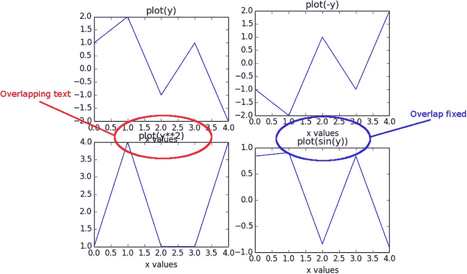
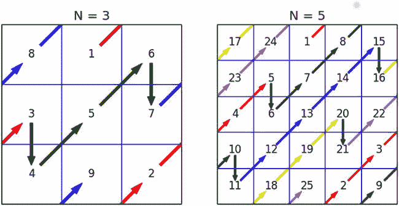

# 高级文件处理

## 更多关于文件的内容

程序员的一项常见任务是处理文件。程序员不仅要读写文件，还要组织文件、移动文件、删除文件、压缩文件、归档文件等等。为了完成这些任务，我经常发现自己会从之前的项目中借用代码，特别是那些处理读取和解析文件的代码，通常是通过复制粘贴的方式。但这似乎是一种浪费——为什么不创建一个函数库来满足这些常见需求呢？

其他程序员肯定也有同感，因此他们开始编写模块，即执行这些任务的函数库。其中许多库现在已包含在 Python 标准库中；并且定期会添加更多库。

本章将探讨与文件相关的主题。在第 4 章和第 5 章讨论的思想基础上，本章还将基于之前的一些示例创建更可重用的代码。示例包括直接读写 `NumPy` 数组到文件、读写 MATLAB 文件、从多个文件读取数据、读取命令行参数、操作目录、比较文件等。

## 二进制文件和随机访问

术语“二进制文件”描述的是非文本文件，无论是可执行文件、图像文件还是简单的数据文件。在本节中，我将向您展示一些处理二进制数据文件的方法，包括随机二进制文件访问、使用 `struct` 模块读写二进制文件中的数值数据，以及读写 MATLAB 二进制文件。

之前在处理文本文件时，我们使用 `readline()` 或 `read(n)` 从文件中读取数据块。从某种意义上说，函数 `readline()` 将文件分割成更小的数据块（即文本行）。

对于二进制文件，更常见的是随机访问；也就是说，从文件中的任意位置随机读取数据块。对于文本文件，这有点困难，因为您无法预先知道一行中有多少个字符和单词，因此随机选择第 n 行并非易事。对于由固定长度记录组成的二进制文件，随机访问允许您访问任意字段。

方法 `seek(offset[, whence])` 和 `tell()` 是随机访问文件函数。为了更好地理解这些函数的作用，您需要理解文件指针的概念。文件指针指向文件中的一个位置：后续的读取或写入操作将在该特定位置发生（假设文件是以允许随机访问读取和/或写入的模式打开的）。每当我们从文件中读取或写入数据时，文件指针都会相应地递增。

 **注意** 与之前的章节一样，我假设您正在目录 `Ch10/src` 中运行交互式 Python 会话，并且目录 `Ch10/data` 存在。

函数 `seek()` 将文件指针设置为我们选择的值；后续对 `read()` 的调用将从新“定位”的位置开始读取。函数 `tell()` 以字节为单位返回当前文件指针的值。以下是一个简短的交互式 Python 会话，描述了 `seek()` 和 `tell()` 的工作原理：

```python
>>> f = open('../data/example.bin', 'wb')
>>> f.tell()
0
>>> f.write(b'0123456789')
>>> f.tell()
10
```

通过上述代码，我创建了一个二进制文件。

当你第一次这样做时，与文件关联的文件指针被设置为`0`，正如`f.tell()`的结果所示。写入十个值后，文件指针位于`10`。注意字符串前面的前导`b`字符，`b'0123456789'`；这是为了将字符串编码为字节（即每个字符被编码为其 ASCII 值）：

```python
>>> f.seek(5)
>>> f.write(b'0123456789')
>>> f.tell()
15
>>> f.close()
```

我已将文件指针更改为指向位置 5，然后重新写入相同的十个值。结果，文件指针已变为 15。让我们打印文件的内容：

```python
>>> open('../data/example.bin', 'rb').read()
b'012340123456789'
```

正如预期，结果是字符串`b'0123456789'`，在位置 5 处被同一字符串的另一个副本重叠，从而得到字符串`b'012340123456789'`。

函数`seek(offset[, whence])`中的参数`whence`指示应如何计算偏移量。如果`whence`是`0`（默认值），`seek()`将相对于文件开头移动`offset`字节。如果`whence`是`2`，`seek()`将相对于文件末尾移动文件指针`offset`字节。请注意，为了将文件指针更改为文件末尾之前的 n 个字节，必须传递一个负值作为偏移量。在许多系统上，可以寻址到文件末尾之后（这是一个特性，而不是错误，您很快就会看到）。如果`whence`等于`1`，`seek()`将相对于当前位置移动。同样，允许使用负值和正值。如果`whence`是`0`，则不允许`seek()`使用负值。让我们继续之前的示例：

```python
>>> f = open('../data/example.bin', 'rb')
>>> f.seek(-2, 2)
14
>>> print(f.read())
b'89'
>>> f.close()
```

我已将文件指针设置为文件末尾之前的 2 个字节（负 2），并从该点向前打印文件的内容。正如预期，结果是两个字节长，对应于`b'89'`。

### 示例：读取第 N 个字段

函数`seek()`和`tell()`对于访问包含固定长度记录的大型二进制文件特别有用。与文本文件不同，对于固定长度记录的二进制文件，您可以预先计算文件中字段的位置。结合`seek()`，可以读取单个字段。这在大型文件中尤其重要，因为读取整个文件，甚至一次读取一个值（而不直接寻址到所需字段）可能会花费大量时间。

在清单 10-1 所示的示例中，我们将`seek()`和`tell()`与`struct`模块（参见第 4 章）结合使用。

**清单 10-1**. 读取第 N 个字段

```python
import struct
from math import sqrt
from random import randrange

### binary filename
bin_fn = '../data/large_file.bin'

Nfields = 1000      # number of fields
N = 766             # field to retrieve
fmt = 'cdL'         # format: byte, float, 4-bytes

fmt_size = struct.calcsize(fmt)

### create a random binary file
fout = open(bin_fn, 'wb')
for i in range(Nfields):
    data = struct.pack(fmt, bytes([randrange(32, 128)]), sqrt(float(i)), i)
    fout.write(data)
fout.close()

### read the nth value
fin = open(bin_fn, 'rb')
fin.seek((N-1)*fmt_size)
data = fin.read(fmt_size)
(c, d, l) = struct.unpack(fmt, data)
print("At location %d, I read:" % (fin.tell()/fmt_size), (c, d, l))
```

脚本的第一部分创建一个包含一些虚构数据的二进制文件。注意这一行：`data = struct.pack(fmt, bytes([randrange(32, 128)]), sqrt(float(i)), i)`，因为它需要一些解释。函数`struct.pack()`接受一个格式说明符，在我们的例子中是`'cdL'`，它代表一个单字节整数、一个双精度浮点值和一个 4 字节整数，然后是实际值：一个字节、一个双精度浮点数和一个 4 字节整数。虽然在 Python 中生成双精度浮点数和 4 字节整数很简单（浮点值的默认大小和整数的默认大小），但生成单字节整数稍微复杂一些。为了生成单字节值，我使用了函数`bytes()`。函数`bytes()`返回一个不可变的字节序列，并有多种形式。我选择使用的那种接受一个可迭代对象，并从该可迭代对象生成一个字节数组。在这种情况下，可迭代对象只是一个包含一个值的列表，该值由函数`randrange()`生成。因此，语句`bytes([randrange(32, 128)])`将一个 4 字节整数转换为一个 1 字节整数。

代码的下一部分读取位置 766 处的单个字段，而无需读取整个文件。这是通过将文件指针更改为指向位置`(N-1)*fmt_size`并仅读取一个字段来完成的。

以下是运行脚本的结果：

```
At location 766, I read: (b'', 27.65863337187866, 765)
```

### 示例：高效的 tail 实现

在[第 5 章中，您看到了 head 和 tail 功能的一种可能实现。对于非常大的文件，tail 功能更难实现。要实现 tail 功能，您必须预先知道文件中的行数。这迫使您要么读取整个文件，执行两次遍历，或者保留最后几行的缓冲区（更多细节，请参见第 5 章，“示例：head 和 tail”）。在本示例中，我们转而使用`seek()`和`tell()`为大型文件实现 tail 功能，如清单 10-2 所示。

**清单 10-2**. 一个用于大型文件的`tail()`函数

```python
from os.path import getsize

def tail_large(filename, n=10):
    """Returns the last n lines of a very large file."""

    N, data = 1024, b''

    # open the file and retrieve its size
    f = open(filename, 'rb')
    fsize = getsize(filename)

    # seek to the end of file
    f.seek(0, 2)

    for i in range(fsize-N, -N, -N):
        # read the next chunk of data
        f.seek(max(i, 0))

        # store read data, reversed order
        data = f.read(N)+data

        # do we have enough lines?
        if data.count(b'\n') > n:
            break

    # print the last n lines
    lines = data.splitlines()
    for line in lines[-n:]:
        print(line)
```

思路是这样的：从末尾读取`N`个字节，并将结果存储在`data`中。参数`N`是一个任意数字，描述一次读取的字节数。我将其设置为`1024`。如果`data`包含超过`n`行（只需计算遇到`'\n'`的次数），则跳出`for`循环并打印最后`n`行数据。如果`data`不包含`n`行，则读取下一个`N`字节块（即向后），并将读取的字节添加到`data`中。从某种意义上说，我们从文件末尾向后移动，读取大小为`N=1024`字节的块，然后计算是否遇到了足够的换行符。如果遇到了，我们就打印这些行；如果没有，我们继续读取更多数据，直到读取了所需数量的行或到达文件开头。

这个实现不如第 5 章中介绍的那样直接。然而，对于大型文件，它具有显著的性能提升。原因在于您不需要读取整个文件，这对于大型文件来说可能非常耗时；相反，代码从文件末尾开始，向后移动，只读取请求的行。

### 示例：创建固定大小的文件

在处理二进制文件时，有时需要创建一个大型文件（包含未初始化的值），例如为将来要写入的数据预留存储空间。我创建文件时使用的一个技巧是，将文件指针寻址到超出文件末尾、相当于所需长度减一的位置，然后写入`0`并关闭文件。这会在许多系统中创建一个所需大小的文件。

以下创建一个大小为 1GB（2³⁰ 字节）的未初始化文件：

```python
>>> f = open('../data/1gb_file.bin', 'wb')
>>> f.seek(2**30-1)
1073741823
>>> f.write(bytes([0]))
1
>>> f.close()
```

现在你需要确保文件确实已创建：

```python
>>> from os.path import getsize
>>> getsize('../data/1gb_file.bin')
1073741824
```

 **注意** 将文件指针寻址到文件末尾之外的能力依赖于系统，并非所有系统都支持。

### 示例：记录基于时间的二进制数据

在记录基于时间的二进制数据时，我特别喜欢使用纪元时间表示法（参见第 5 章）。在本例中，我将使用`time`模块和 Python 的`array`模块中的函数（不要与NumPy的数组对象混淆）。

如果你只是将变量作为时间的函数进行记录，那么将记录变量设为浮点表示法会更简单，因为这样时间和值都使用相同的数据类型。这使得`array`模块的使用变得简单，如代码清单 10-3 所示。

**代码清单 10-3**。以二进制形式写入基于纪元时间的数据

```python
import random, time, array

N = 10
fname = '../data/binary_data.f64'
data = array.array('d')

##### 创建数据
for value in range(N):
    time.sleep(random.random())
    data.append(time.time())
    data.append(value)

##### 将数据存储到文件
f = open(fname, 'wb')
data.tofile(f)
f.close()
```

该脚本平均运行五秒钟，生成时间戳和值。我使用了`array`的`tofile()`方法将二进制值存储到文件中。

从二进制文件中检索数据也很简单，如代码清单 10-4 所示。

**代码清单 10-4**。读取以纪元时间表示法存储的二进制数据

```python
import random, time, array

N = 10
fname = '../data/binary_data.f64'
data = array.array('d')

##### 读取数据
f = open(fname, 'rb')
data.fromfile(f, N*2)
f.close()
```

##### 显示数据
`L = data.tolist()`
`for t, val in zip(L[::2], L[1::2]):`
`    print(time.ctime(t), val)`

大部分工作由`data.fromfile(f, N*2)`这一行完成，它读取值并将其存储到 Python 数组中。然后我重新排列数据并显示结果：

```
Sun Jun 22 23:25:58 2014 0.0
Sun Jun 22 23:25:59 2014 1.0
Sun Jun 22 23:25:59 2014 2.0
Sun Jun 22 23:26:00 2014 3.0
Sun Jun 22 23:26:00 2014 4.0
Sun Jun 22 23:26:01 2014 5.0
Sun Jun 22 23:26:02 2014 6.0
Sun Jun 22 23:26:02 2014 7.0
Sun Jun 22 23:26:02 2014 8.0
Sun Jun 22 23:26:03 2014 9.0
```

我使用了一个技巧来重新排列数据。当将数据从数组转换为列表`L`时，值是交错排列的：时间、值、时间、值，依此类推。要打印这些值，我可以遍历`L`，将每个奇数索引的值转换为时间格式。这里我选择对偶数和奇数索引的切片进行 `zip` 操作。以下代码说明了这一点：

```
>>> L = [1, 'Value', 2, 'Another value', 3, 'Last value']
>>> L[::2]    # 这些是奇数索引的值
```

```
[1, 2, 3]
```

```
>>> L[1::2]   # 这些是偶数索引的值
```

```
['Value', 'Another value', 'Last value']
```

```
>>> list(zip(L[::2], L[1::2]))
```

```
[(1, 'Value'), (2, 'Another value'), (3, 'Last value')]
```

```
>>> for i, s in zip(L[::2], L[1::2]):
...     print(i, s)
...
```

```
1 Value
2 Another value
3 Last value
```

#### 将 MATLAB 文件读取为 `NumPy` 数组

许多 `PyLab` 用户会发现读写 MATLAB 风格的 `.mat` 文件是一项重要功能。这可以方便地在 MATLAB 和 Python 之间传输数据。MATLAB 是一种流行的数学编程语言和环境；更多信息请参见`http://www.mathworks.com`。如果你不使用 MATLAB 文件，可以跳过本节。

MATLAB 风格的 `.mat` 文件是具有特定二进制格式的二进制文件。要读写 mat 文件，我们使用 `scipy.io` 模块。要读取文件，我们使用 `loadmat(filename)`；要写入文件，我们使用 `savemat(filename, dict)`，如下所示：

```
>>> from pylab import *
>>> from scipy.io import savemat, loadmat
>>> a = arange(10)
>>> savemat('data.mat', {'a': a})
>>> del a
>>> a
```

```
Traceback (most recent call last):
  File "<stdin>", line 1, in <module>
NameError: name 'a' is not defined
```

```
>>> loadmat('data.mat')
```

```
{'__header__': b'MATLAB 5.0 MAT-file Platform: nt, Created on: Sun Jun 22 23:43:58 2014', '__globals__': [], '__version__': '1.0', 'a': array([[0, 1, 2, 3, 4, 5, 6, 7, 8, 9]])}
```

```
>>> data = loadmat('data.mat')
>>> data['a']
```

```
array([[0, 1, 2, 3, 4, 5, 6, 7, 8, 9]])
```

首先，我创建了一个 `NumPy` 数组 `a`。然后使用 `savemat()` 将数组写入 mat 文件。注意 `savemat()` 需要一个文件名和一个由变量名及其实际值组成的字典。在本例中，变量名是 `a`；因此，字典对象是 `{'a': a}`。

读取 mat 文件类似。结果是一个 Python 字典 `data`，可以使用变量名 `a` 作为键来访问：`data['a']`。

 **注意** 并非所有版本的 MATLAB 文件都受支持，请查阅 SciPy 网站：`http://www.scipy.org/`。

#### 将文本文件直接读取为 `NumPy` 数组

也可以分别使用函数 `loadtxt()` 和 `savetxt()` 将 `NumPy` 数组直接读写为文本文件。这些函数功能非常强大，特别适合读写包含数值数据的文本文件。

函数 `loadtxt(fname)` 接受表 10-1 中列出的参数。

表 10-1。`loadtxt()` 的可选参数

| 参数 | 描述 |
| --- | --- |
| `Comments` | 用于指示注释开始的字符。注释行将被忽略。 |
| `Converters` | 一个字典，详细说明用于转换每一列的函数（例如，`converters='{0: datestr2num}'`）。它将使用函数 `datestr2num()` 转换第 0 列（第一列）。 |
| `Delimiter` | 用于分隔值的字符。默认是任何空白字符。 |
| `Dtype` | 数据类型。默认是 `float`。 |
| `Ndmin` | 强制返回的数组为 `n` 维；`n` 可以是 `0`、`1` 或 `2`。 |
| `Skiprows` | 要跳过的行数；默认是 0。 |
| `Usecols` | 一个包含要读取的列的序列。例如，`usecols=(2, 3)` 将读取第 3 列和第 4 列（从 0 开始计数）。 |
| `Unpack` | 一个布尔标志，指示是否应对读取的数组进行转置。 |

#### 示例：将文本文件读写为 `NumPy` 数组

在本例中，我们使用第 4 章“示例：股票价格图表”中的文件 `charts.xls`。我假设你遵循了本书使用的目录结构（参见第 2 章），并且该文件位于目录 `../data/charts.xls` 中。

文件 `charts.xls` 内容如下：

```
Date             Open            High             Low             Close/Last       Volume
10:24            3598.27002      3599.389893      3587.48999      3598.350098      0
05/05/2014       3566.256        3605.263         3556.403        3605.092         0
05/02/2014       3608.841        3611.563         3578.527        3587.644         0
05/01/2014       3589.659        3613.03          3580.019        3594.362         0
```

（此处列表已截断。）

由于 `charts.xls` 的第一行是标题行，第二行是另一种格式的标题行，我们希望跳过这两行，因此设置 `skiprows=2`。此外，第一列包含日期。日期不是数字，因此无法放入 `NumPy` 数组。为了解决这个问题，如果我们对日期信息不感兴趣，可以通过指定 `usecols=(1, 2, 3, 4, 5)`（注意缺少了 `0` 列）来简单地忽略第一列。或者，我们可以使用转换器将日期转换为数字，如下所示：

```
>>> from pylab import *
>>> def c0(x):
...     return datestr2num(x.decode('utf-8'))
...
>>> data = loadtxt('../data/charts.xls', skiprows=2, converters={0:c0})
>>> data
```

```
array([[ 735358.   ,     3566.256,    3605.263,    3556.403,    3605.092,
              0.   ],
       [ 735355.   ,     3608.841,    3611.563,    3578.527,    3587.644,
              0.   ],
       [ 735354.   ,     3589.659,    3613.03 ,    3580.019,    3594.362,
              0.   ],
       [ 735353.   ,     3556.004,    3585.502,    3548.11 ,    3582.02 ,
              0.   ],
```

（输出已截断。）

我定义了一个名为 `c0()` 的函数，它是第 0 列的转换器函数；默认情况下，所有其他列的类型都是 `float`。函数 `c0()` 使用了 `datestr2num()` 函数，这是一个 `NumPy` 函数，用于将字符串转换为数字。由于 `datestr2num()` 期望接收一个字符串而不是字节数组，我使用了 `decode('utf-8')` 将字节数组转换为字符串。

 **提示** `genfromtxt()` 函数与 `loadtxt()` 类似，并且它可以处理缺失数据。如需完整说明，请执行 `help(genfromtxt)`。

要将 `NumPy` 数组写入文本文件，我们使用 `savetxt()` 函数：

```
>>> savetxt('../data/charts_mod.txt', data)
```

## 对象序列化

在 Python 的交互式会话中工作时，有时能够将变量保存到文件中会非常有用。在将变量写入文件之前，应该先对它们进行序列化；也就是说，它们应该被转换成一个字节流。然后可以将这个字节流写入文件，并在之后检索出来。

### `Pickle` 模块

Python 并没有为处理各种变量类型（列表、字符串、`NumPy` 数组等）创建专用的文件格式，而是为我们提供了一个内置的对象序列化模块，非常适合此目的：`Pickle`。

要使用 `Pickle`，首先执行 `import pickle`。函数 `pickle.dump(obj, file[, protocol])` 会序列化一个对象并将其写入文件。`protocol` 参数可以取值 `0`（表示 ASCII，默认值）、`1`（表示二进制）和 `2`（表示支持新的 Python 对象）。协议 1 和 2 都会创建二进制文件。如果你为 `dump()` 提供一个负值，将使用最高版本的协议。这是为了适应 `Pickle` 未来的协议版本。函数 `pickle.load(file)` 会从文件中读取一个对象。

函数 `pickle.dumps(obj[, protocol])` 会序列化对象并返回其字符串表示形式，而不将其写入文件。类似地，`pickle.loads(str)` 会从一个字符串创建对象。

### 示例：保存和检索 Python 会话变量

清单 10-5 使用 `Pickle` 模块将不同数据类型的变量写入文件。

***清单 10-5***. 将多个对象 Pickle 到文件

```python
import pickle
from numpy import *

fname = '../data/mysession.pickle'
a = 3
b = "A string"
c = {'dict': 10}
d = eye(3)

fout = open(fname, 'wb')
for var in [a, b, c, d]:
    pickle.dump(var, fout)
fout.close()
```

为了“pickle”对象（即序列化它们）并将它们写入文件，我使用了函数 `pickle.dump(var, file)`。

你可以连续调用 `pickle.dump()` 来将更多的值存储到文件中。

要从文件中读取对象，请使用清单 10-6。

***清单 10-6***. 从文件读取对象

```python
import pickle

fname = '../data/mysession.pickle'
fin = open(fname, 'rb')
var_index = 0

while True:
    try:
        var_index += 1
        exec("v_%d = pickle.load(fin)" % var_index)
        exec("var_type = type(v_%d)" % var_index)
        print("Read v_%d, type is: %s" % (var_index, var_type))
        except EOFError:
        break
```

每当你调用 `pickle.load()` 时，返回值都是一个 Python 对象（除非到达文件末尾）。但是，对象的名称不会被存储。因此，我使用了内置函数 `exec()` 来创建名为 `v_1`、`v_2` 等的变量来存储这些对象。

以下是运行脚本的结果：

```
Read v_1, type is: <class 'int'>
Read v_2, type is: <class 'str'>
Read v_3, type is: <class 'dict'>
Read v_4, type is: <class 'numpy.ndarray'>
```

```
>>> v_4
```

```
array([[ 1.,  0.,  0.],
       [ 0.,  1.,  0.],
       [ 0.,  0.,  1.]])
```

如果你使用的是 `NumPy` 数组，可以使用 `matplotlib` 提供的 `save()` 和 `load()` 函数。这些函数接受一个文件名，并分别将 `NumPy` 数组对象写入文件和从文件读取：

```
>>> from pylab import *
>>> fname = '../data/session.npy'
>>> save(fname, eye(3))
>>> load(fname)
```

```
array([[ 1.,  0.,  0.],
       [ 0.,  1.,  0.],
       [ 0.,  0.,  1.]])
```

如果 `save()` 和 `load()` 中使用的文件名以 `.gz` 结尾，则会自动使用 gzip 压缩（请参阅本章后面的“文件压缩”部分）。

## 命令行参数

本节介绍命令行参数，这看起来可能有点偏离主题。然而，在我们深入探讨 `FileInput` 模块的细节之前，你需要先理解命令行参数。你很快就会看到，`FileInput` 模块在命令行参数的上下文中更有意义。本质上，命令行参数使我们能够通过命令行直接将参数传递给应用程序，以控制其行为。

从交互式 Python 会话的一个可能演进是创建一个独立的实用程序或应用程序——即创建一个可以从 shell（无论是 Windows 的命令提示符还是 Linux 的命令行 shell）调用的 Python 脚本。与此类脚本交互的选项之一就是传递命令行参数。例如，在 `tail` 命令行实用程序中，一个命令行参数可以是 `tail` 将要显示的行数。因此，要列出一个文件的最后 20 行，你可以编写以下命令：

```
$ python tail.py -n 20 filename
```

### `sys.argv`

`sys` 模块通过 `sys.argv` 变量支持命令行处理，如清单 10-7 所示。`sys.argv` 是一个包含输入的分割 shell 命令的字符串列表。`sys.argv[0]` 的值是 Python 脚本的名称。

***清单 10-7***. 命令行参数

```python
import sys
for i, cmd in enumerate(sys.argv):
    print("argv[%d] = '%s'" % (i, cmd))
```

将文件保存为 `parse_args.py`，然后在 shell 或命令提示符下运行 `python parse_args.py 20 myfile`（确保 Python 可执行文件在你的路径中）。以下是结果：

```
argv[0] = 'parse_args.py'
argv[1] = '20'
argv[2] = 'myfile'
```

### 示例：创建固定大小的文件（独立脚本）

现在我们修改“示例：创建固定大小的文件”部分中的代码。目标是创建一个可以从 CLI（shell 或命令窗口）调用的独立脚本。该脚本如清单 10-8（`empty_file.py`），接受字节数和文件名，然后创建一个指定名称和大小的文件。

***清单 10-8***. 创建固定大小文件（独立脚本），`empty_file.py`

```python
from sys import argv, exit

usage = "Usage: python empty_file.py nbytes filename"
```

## 脚本示例与参数检查

```python
# we expect three arguments: script name, size and file name
if len(argv) != 3:
    print("Improper number of arguments.")
    print(usage)
    exit()

# is size an integer?
try:
    nbytes = int(argv[1])
except ValueError:
    print("First argument is not an integer number.")
    print(usage)
    exit()

# retrieve the requested file name
filename = argv[2]

# can we create the file?

# here a failure could be due to a non-existing path
try:
    f = open(filename, 'wb')
except IOError:
    print("Unable to create file", filename)
    print(usage)
    exit()

# finally! create the file
f.seek(nbytes-1)
f.write(b'0')
f.close()
print("Successfully created file %s of size %d." % (filename, nbytes))
```

我仔细检查了用户传递的参数，以确定参数数量是否足够以及这些值是否有效。我特别小心地确保文件确实可以被创建。最后，生成空文件的代码很简单。

我还介绍了`sys`模块提供的`exit()`函数。该函数在编写独立脚本时特别有用，因为它会立即退出脚本。

## `optparse`模块

对命令行参数强制执行严格的语法会使脚本对用户不太友好。例如，在前面的示例中，您可能希望脚本在没有提供长度的情况下自动创建一个默认大小（例如 1KB）的文件。或者您可能想添加具有默认值的额外参数，进一步控制脚本的行为，以便在文件名路径不存在时创建该路径。

容纳额外的选项以及默认选项会导致前面列表中的代码变得更大且更难以维护。当选项数量增加时，请考虑使用`optparse`模块；`optparse`模块旨在通过一组简单的库函数来处理命令行参数。

 **提示** `getopt`模块（`http://docs.python.org/library/getopt.html`）是一个较旧的模块，它也提供了解析命令行选项的函数。

要使用`optparse`模块，请遵循以下步骤：

1.  导入`optparse`模块：`import optparse`。
2.  创建一个`OptionParser`对象。
3.  使用`add_option()`方法向解析器添加选项。
4.  使用`parse_args()`方法解析命令行参数。

第一步很明显：导入模块。第二步要求您通过设置`parser = OptionParser()`来实例化一个`OptionParser`对象。添加选项稍微复杂一些，因为有很多可能性可供选择（您很快就会看到）。最后一步是调用`parse_args()`函数，该函数返回一个命令行选项列表。

`parse_args()`的返回值是一个包含选项和参数的元组。选项和参数之间的区别在于，选项当然是可选的，而参数（根据`optparse`文档，是位置参数）是必需的。

### 示例：处理命令行参数

我们将修改前面的示例，现在每个文件的字节数是一个选项，后面跟着请求的字节数（即`-n 1000`），如清单 10-9（`empty_opt.py`）所示。此外，我们将添加一个选项开关，也称为选项标志，指示是否应将`.bin`扩展名添加到文件名。选项标志`-x`的存在指示脚本是否创建扩展名；此标志后面没有附加值。

**清单 10-9**. 使用`optparse`处理命令行参数，`empty_opt.py`

```python
from optparse import OptionParser
from sys import exit

usage = "Usage: python empty_opt.py [options] filename"

# create an OptionParser instance
parser = OptionParser(usage)

# these are the options
parser.add_option("-n", "--numbytes", dest="nbytes",
    type = "int", default=1000, help="number of bytes in file")
parser.add_option("-x", "--ext", dest="ext",
    action="store_true", default=False,
    help="adds 'bin' extension to filename")
(opt, args) = parser.parse_args()

# must have a filename
if len(args) != 1:
    print("Improper number of arguments.")
    exit()

# append extension if switch is on
filename = args[0]+'.bin' if opt.ext else args[0]

# create the file
try:
    f = open(filename, 'wb')
except IOError:
    print("Unable to create file", filename)
    exit()

f.seek(opt.nbytes-1)
f.write(b'0')
f.close()

print("Successfully created file %s of size %d." %
    (filename, opt.nbytes))
```

前面的列表首先导入`optparse`模块。然后我实例化一个`OptionParser`对象，并为其提供默认的`usage`字符串。每当用户发出命令行开关`-h`或`--help`时，`usage`字符串将作为第一行显示，如下所示：`python empty_opt.py -h`。

然后我使用`add_option()`方法添加选项。`add_option()`方法有许多参数来控制应如何解析选项。在我的第一个`add_option()`调用中，我设置了用户如何调用此选项：通过输入`-n NBYTES`或`--numbytes NBYTES`。我将此选项的目标名称设置为`nbytes`。这意味着，在解析选项后，我可以通过变量`opt.nbytes`访问选项值。变量的类型是`int`，如`type`参数所指定，默认值为`1000`，以防用户未提供`nbytes`。最后，与此选项关联的帮助字符串是：`help="number of bytes in file"`。

类似地，我设置了另一个名为`ext`的选项。此选项是一个开关，用户只需输入`-x`或`--ext`即可调用该开关；开关后面没有附加值（相比之下，`-n`选项附带一个`NBYTES`值）。`action`参数指示`optparse`将其视为一个正向作用的开关：如果提供了`-x`，则将标志设置为`True`。最后，我将默认值设置为`False`并添加了一个帮助字符串：`help="adds 'bin' extension to filename"`。

通过调用`parse_args()`来解析命令行选项。然后检索选项和参数。选项通过类参数访问，参数以列表形式提供。之后是实际创建文件。

以下是在 bash shell 中使用各种选项运行脚本的结果：

```bash
$ python empty_opt.py
```

```
Improper number of arguments.
```

```bash
$ python empty_opt.py -h
```

```
Usage: python empty_opt.py [options] filename

Options:
  -h, --help            show this help message and exit
  -n NBYTES, --numbytes=NBYTES
                        number of bytes in file
  -x, --ext             adds 'bin' extension to filename
```

```bash
$ python empty_opt.py file1
```

```
Successfully created file file1 of size 1000.
```

```bash
$ python empty_opt.py -x file1
```

```
Successfully created file file1.bin of size 1000.
```

```bash
$ python empty_opt.py -n 2000 --ext file1
```

```
Successfully created file file1.bin of size 2000.
```

```bash
$ python empty_opt.py -n 2000 --ext file1 file2
```

```
Improper number of arguments.
```

```bash
$ python empty_opt.py -n 2a --ext file1
```

```
Usage: python empty_opt.py [options] filename

empty_opt.py: error: option -n: invalid integer value: '2a'
```

该脚本期望的输入格式如下：`[options] filename`。

使用命令行参数`-h`或`--help`调用脚本会打印出使用帮助信息。当您使用`optparse`模块时，这会自动实现。接下来，我发出了一些有效的命令行参数和一些无效的参数。例如，`optparse`处理值的解析，而我的代码处理参数的数量（只有一个：`filename`）。我还使用了完整选项名称（`--ext`）和缩写选项名称（`-x`）调用了脚本。

`optparse`模块是一个功能丰富的模块，具有许多特性。请参阅`https://docs.python.org/3.3/library/optparse.html`上的在线帮助，以获取该模块的详细描述。

 **提示** 随着选项数量的增加，请考虑使用`configparser`模块。有关`configparser`的介绍，请参阅第 4 章和在线帮助（`https://docs.python.org/3.3/library/configparser.html`）。

## `FileInput`模块

我们将以`FileInput`模块结束命令行参数的讨论。该模块提供了一种简便的方法来访问通过命令行传递的多个文件（或流）（例如，`python somescript.py file1 file2 file3`）。要使用该模块，请执行`import fileinput`。

使用该模块很简单：迭代`fileinput.input()`。迭代的结果是当前文件中的下一行。一旦到达文件末尾，下一个文件会自动打开，并且该过程会继续，直到所有文件的所有行都被迭代完毕。

表 10-2 列出了一些有用的`FileInput`方法，可用于进一步增强使用该模块的脚本。

**表 10-2**. 一些有用的 `FileInput` 方法

| 方法 | 描述 |
| --- | --- |
| `fileinput.close()` | 结束处理，关闭所有打开的文件。 |
| `fileinput.filelineno()` | 返回当前文件中的行号。 |
| `fileinput.filename()` | 返回当前正在读取的文件名。 |
| `fileinput.fileno()` | 返回当前文件的索引。 |
| `fileinput.isfirstline()` | 如果这是文件中的第一行，则返回`True`。 |
| `fileinput.lineno()` | 返回从所有文件中读取的所有行的累计行号。 |
| `fileinput.nextfile()` | 停止处理当前文件并跳转到下一个文件。 |

让我们看一个例子。

### 示例：基于纪元合并多个数据源

接下来，我们将从第 5 章中一个与本节标题相同的章节中先前展示的例子继续。这次，清单 10-10 允许基于纪元合并两个以上的文件。

**清单 10-10**. 基于纪元合并多个文件，`combine_epoch.py`

```python
import fileinput
from time import mktime, strptime

data = []
fmt = '%b %d %H:%M:%S %Y'

for line in fileinput.input():
    data.append([mktime(strptime(line[4:24], fmt)), line])

for line in sorted(data):
    print(line[1], end='')
```

文件的内容在第 5 章中有详细说明。按如下方式使用脚本：`python combine_epoch.py file1 file2 ...`。此代码从所有输入文件中逐行读取（使用`fileinput`模块），将读取的每一行追加到一个列表`data`中。最后几行代码打印按纪元排序的行数组，然后生成一个组合的、时间同步的输出。

### 示例：在多个文件中搜索文本

同样，清单 10-11 建立在第 5 章中先前展示的例子“示例：在文本文件内部搜索”之上。与上一个例子一样，我们希望在多个文件中搜索文本。要使用脚本`srchfile.py`，请执行命令`python srchfile.py search_string file1 file2 ...`。

**清单 10-11**. 在多个文件中搜索文本，`srchfile.py`

```python
import fileinput, sys
```

#### string to search is the first argument

```python
for line in fileinput.input(sys.argv[2:]):
    if line.find(sys.argv[1]) != -1:
        print("File %s, #%d: %s" % (fileinput.filename(),
            fileinput.filelineno(), line.rstrip()))
```

此示例与第 5 章中示例的主要区别在于，现在第一个参数是要搜索的字符串，而不是文件。因此，我访问命令行参数，并将从第三个参数开始的值（`sys.argv[2:]`）传递给 `fileinput.input()`。这样做会跳过脚本名称（`argv[0]`）和搜索字符串（`argv[1]`）。

该模块还通过 `inplace` 参数支持在处理行时修改文件。有关更多信息，请参阅在线帮助：`https://docs.python.org/3.3/library/fileinput.html`。

### `glob`模块

`glob`模块允许在给定文件名模式时搜索文件。函数 `glob(pattern)` 将返回所有匹配 `pattern` 的文件的列表；函数 `iglob(pattern)` 返回一个迭代器（而不是 `glob()` 中的列表），包含所有匹配 `pattern` 的文件。我通常只使用列表版本 `glob(pattern)`：

```python
>>> from glob import glob
>>> glob('*.py')
```

```python
['combine_epoch.py', 'empty_file.py', 'empty_opt.py', 'import sys.py', 'parse_args.py', 'srchfile.py']
```

`glob()` 接受类似 shell 的通配符，例如 `*`（匹配任意字符串）、`?`（匹配一个字符）、`[chars]`（匹配字符列表中的任意一个字符）和 `[!chars]`（匹配除列出的字符之外的任何字符）。以下内容将匹配以 `py` 结尾且包含数字的文件名：

```python
>>> glob('*[0-9]*py')
```

```python
['extract3.py']
```

此代码片段将匹配以 `py` 结尾且不以 `c` 开头的文件名：

```python
>>> glob('[!c]*py')
```

```python
['extract3.py', 'tail_large.py']
```

请注意，`glob` 表达式包含 shell 通配符，因此它们不是正则表达式。

 `提示` 您还应该查看 `fnmatch` 模块（`https://docs.python.org/3.3/library/fnmatch.html`）。

### 额外的`os`模块功能

您已经看到了 `os` 和 `os.path` 模块中的大量函数（请参阅第 3 章中的“移动”部分）。表 10-3 列出了之前未提及的、对于操作文件和目录特别有用的几个函数。在表中，假设当前工作目录是 `/home/user`，并且目录中的文件是 `file.ext`。

**表 10-3. 用于操作文件和目录的 `os` 模块函数**

| 函数 | 描述 | 示例 |
| --- | --- | --- |
| `os.chmod(path, mode)` | 更改文件权限（在 Windows 中，仅更改读取和写入权限；其他所有权限被忽略）。 | `os.chmod('file.ext', 0777)` 将文件权限更改为所有用户可读、写、执行。 |
| `os.remove(pathname)` 或 `os.unlink(pathname)` | 删除 `pathname` 指定的文件。 | `os.unlink('file.ext')` 删除文件 `file.ext`。 |
| `os.rmdir()` | 如果目录为空，则删除该目录。 | `os.rmdir('/home/user')` 如果目录为空，则删除目录 `/home/user`。 |
| `os.mkdir(path)` | 创建一个目录。 | `os.mkdir('another')` 创建目录 `/home/user/another`。 |
| `os.makedirs(path)` | 创建一个目录及其所有中间子目录。 | `os.makedirs('dir1/dir2')` 会创建目录 `/home/user/dir1` 和 `/home/user/dir1/dir2`。 |
| `os.rename(old, new)` | 重命名一个路径或文件。 | `os.rename('file.ext', 'file2.ext')` 将文件 `file.ext` 重命名为 `file2.ext`。 |
| `os.renames(old, new)` | 重命名一个路径或文件，包括创建中间目录和删除空目录。 | `os.renames('/home/user', '/home/user2/dir1/dir2')` 将目录 `/home/user` 重命名为 `/home/user2/dir1/dir2`。它还会创建不存在的子目录，并在 `/home/user` 为空时将其删除。 |

### 附加的 `os.path` 模块功能

`os.path` 模块提供了帮助管理文件名和文件路径的函数。表 10-4 列出了一些有用的 `os.path` 函数。在表中，假设当前工作目录是 `/home/user`，并且该目录中的文件是 `file.ext`。

**表 10-4. 一些有用的 `os.path` 函数**

| 函数 | 描述 | 示例 |
| --- | --- | --- |
| `os.path.abspath(s)` | 返回文件的绝对路径。 | `os.path.abspath('file.ext')` 返回 `'/home/user/file.ext'`。 |
| `os.path.basename(s)` | 返回文件名，不包括路径。 | `os.path.basename('/home/user/file.ext')` 返回 `'file.ext'`。 |
| `os.path.dirname(s)` | 返回路径的目录名。 | `os.path.dirname('/home/user/file.ext')` 返回 `'/home/user'`。 |
| `os.path.exists(s)` | 如果 `s` 指定的路径或文件存在，则返回 `True`。 | `os.path.exists('/home/user')` 返回 `True`。 |
| `os.path.getatime(s)` | 返回文件的最后访问时间。 | `time.ctime(os.path.getatime('/home/user/file.ext'))` 打印访问时间（`ctime()` 是 `time` 模块的一部分）。 |
| `os.path.getctime(s)` | 返回文件的创建时间。 | 类似于 `os.path.getatime()` 的示例。 |
| `os.path.getmtime(s)` | 返回文件的最后修改时间。 | 类似于 `os.path.getatime()` 的示例。 |
| `os.path.getsize(s)` | 返回文件大小（以字节为单位）。 | `os.path.getsize('file.ext')` 返回文件 `file.txt` 的大小（以字节为单位）。 |
| `os.path.isabs(s)` | 如果 `s` 指定的路径是绝对路径，则返回 `True`。 | `os.path.isabs('file.ext')` 返回 `False`。`os.path.isabs('/home/user/file.ext')` 返回 `True`。 |
| `os.path.isdir(s)` | 如果 `s` 是一个目录，则返回 `True`。 | `os.path.isdir('/home')` 返回 `True`。 |
| `os.path.isfile(s)` | 如果 `s` 是一个文件，则返回 `True`。 | `os.path.isfile('file.ext')` 返回 `True`。 |
| `os.path.join(base, seq)` | 连接两个或多个路径，根据需要添加斜杠。 | `os.path.join('/home/user', 'file.ext')` 返回 `'/home/user/file.ext'`。`os.path.join('/home', 'user', 'file.ext')` 返回 `'/home/user/file.ext'`。 |
| `os.path.split(s)` | 分割路径名，返回路径和文件名。 | `os.path.split('/home/user/file.ext')` 返回 `('/home/user', 'file.ext')`。 |
| `os.path.splitext(s)` | 分割路径名，返回扩展名（包括点号）。 | `os.path.splitext('/home/user/file.ext')` 返回 `('/home/user/file', '.ext')`。 |

### `shutil` 模块

`shutil` 模块提供了用于复制、移动和重命名文件的高级函数。其中，我们将探讨以下函数：`copy(src, dest)`、`copytree(src, dest)`、`rmtree(path)` 和 `move(src, dst)`。有关该模块的完整说明，请参阅 `https://docs.python.org/3.3/library/shutil.html`。

我假设当前目录中存在一个名为 `file1.txt` 的文件。如果你的目录中没有这个文件，如果你想跟着操作，可以创建一个。

首先，让我们创建一个包含子目录的目录，并将 `file1.txt` 复制到新创建的目录中：

```python
>>> import shutil
>>> from os import makedirs
>>> from glob import glob
>>> makedirs('dir1/dir2/dir3/dir4')
>>> shutil.copy('file1.txt', 'dir1/dir2/dir3/dir4')
```

```python
'dir1/dir2/dir3/dir4/file1.txt'
```

```python
>>> shutil.copy('file1.txt', 'dir1/dir2/dir3/dir4/file2.txt')
```

```python
'dir1/dir2/dir3/dir4/file2.txt'
```

```python
>>> glob('dir1/dir2/dir3/dir4/*')
```

```python
['dir1/dir2/dir3/dir4/file2.txt', 'dir1/dir2/dir3/dir4/file1.txt']
```

首先，我导入了一些模块和函数：`shutil`、`os` 和 `glob`。然后我创建了一个目录（及其父目录）：`dir1/dir2/dir3/dir4`。我以两种方式使用了 `copy()` 函数：首先，将文件 `file1.txt` 复制到新创建的目录；其次，将文件 `file1.txt` 以不同的名称 `file2.txt` 复制到同一个目录：

```python
>>> shutil.move('dir1/dir2/dir3/dir4/file2.txt', 'dir1/dir2')
```

```python
'dir1/dir2/file2.txt'
```

```python
>>> glob('dir1/dir2/*')
```

```python
['dir1/dir2/dir3', 'dir1/dir2/file2.txt']
```

```python
>>> glob('dir1/dir2/dir3/dir4/*')
```

```python
['dir1/dir2/dir3/dir4/file1.txt']
```

我已将文件 `file2.txt` 移动到目录 `dir1/dir2`。`glob()` 的结果确认了这次移动。

接下来，我将 `dir1` 下的整个目录分支复制到一个名为 `Dir_1` 的新目录中：

```python
>>> shutil.copytree('dir1', 'Dir_1')
```

```python
'Dir_1'
```

```python
>>> glob('Dir_1/dir2/dir3/dir4/*')
```

```python
['Dir_1/dir2/dir3/dir4/file1.txt']
```

最后，是时候进行清理了——我删除了这两个目录及其子目录：

```python
>>> shutil.rmtree('dir1')
>>> shutil.rmtree('Dir_1')
>>> glob('dir1')
```

```python
[]
```

### 文件压缩

文件压缩是用更少的字节来表示文件的过程。压缩通常分为两类：有损压缩和无损压缩。在有损压缩中，压缩后的数据与原始数据不完全相同；在减小文件大小的过程中会丢失数据（希望丢失的是不重要的信息）。无损压缩使用巧妙的方案以更高效的方式表示数据。例如，与其将一百个相同的值写入文件，无损压缩方案可能是写入值 100（表示计数），然后写入重复的值。

Python 为我们提供了几个压缩和归档模块（参见表 10-5）。我们使用归档模块来创建压缩文件，但使用压缩模块来处理压缩本身。我们可以对文件以及字符串进行压缩。归档和压缩之间的区别有些模糊，因为某些模块同时执行压缩和归档。包的名称也是导入名称；因此，要使用 `gzip`，请执行 `import gzip`。

**表 10-5. Python 标准库压缩和归档模块**

| 模块名称 | 功能 | 文档链接 |
| --- | --- | --- |
| `bz2` | 无损压缩 | `https://docs.python.org/3.3/library/bz2.html` |
| `gzip` | 无损压缩 | `https://docs.python.org/3.3/library/gzip.html` |
| `zlib` | 无损压缩 | `https://docs.python.org/3.3/library/zlib.html` `http://www.zlib.net/` |
| `tarfile` | 归档 | `https://docs.python.org/3.3/library/tarfile.html` |
| `zipfile` | 归档和压缩 | `https://docs.python.org/3.3/library/zipfile.html` |

不同模块在压缩率、性能和流行度方面存在一些差异。但是，它们都易于使用并能提供出色的结果。在本节中，我们将探讨 `tarfile` 模块。

### 示例：一个压缩的 tar 文件

在开源社区中，经常可以看到以 `.tar.gz` 或 `.tar.bz2` 扩展名分发的文件。这些是压缩的 `tar` 文件；tar 代表磁带归档（tape archive），但实际上并不需要磁带。清单 10-12 中的示例创建了几个文件，将它们归档，然后从归档中检索它们。

清单 10-12.

#### 创建归档文件

```python
import tarfile, glob, os.path

# 创建一些文件
for i in range(5):
    f = open('../data/file%d.txt' % i, 'w')
    # 写入一些数据
    for j in range(100):
        f.write('Some data: %d\n' % j)
    f.close()
```

# 使用 bz2 压缩方式归档文件

```python
tf = tarfile.open('../data/files.tar.bz2', 'w:bz2')
for filename in glob.glob('../data/file*'):
    tf.add(filename, os.path.basename(filename))
tf.close()
```

脚本的第一部分生成了五个包含模拟数据的文件。文件创建完成后，我创建了一个用于归档的 tar 文件。文件模式指定为 `'w:bz2'`，表示写入（创建）一个使用 bz2 压缩算法压缩的 tar 文件。其他模式包括用于 gzip 压缩的 `'w:gz'` 和用于无压缩的 `'w'`。类似地，打开归档文件可以通过指定 `'r'`、`'r:gz'` 或 `'r:bz2'` 来完成。

一旦创建了 `tarfile` 对象，我们就可以使用 `add(path, arcname)` 方法将文件添加到归档中。如果你向 `add()` 提供一个目录，则整个目录都会被添加到归档中。

我决定逐个添加文件，以防目录中存在其他我不想包含的文件。我还通过调用 `os.path.basename()` 函数将文件名从相对路径中分离出来，从而设置了归档名称；这样，将来调用 `extract()` 时，会在当前工作目录中创建文件，而不是在相对路径 `../data` 中。最后，我关闭了 tar 文件，从而实际创建了 `files.tar.bz2` 文件。

从归档中检索文件也同样简单，如清单 10-13 所示。`extractall()` 方法从归档中提取所有文件。`extract(member, path)` 方法将归档中的某个成员文件提取到 `path` 指定的位置。`getmembers()` 方法列出归档中的成员（文件）。

**清单 10-13.** 从归档中提取所有文件

```python
import tarfile, os

tf = tarfile.open('../data/files.tar.bz2', 'r:bz2')
tf.extractall('../data/new/')
tf.close()
```

清单 10-14 展示了如何仅提取归档中的前三个文件。

**清单 10-14.** 从归档中提取前三个文件

```python
import tarfile, os

if not os.path.exists('../data/new'):
    os.mkdir('../data/new')

tf = tarfile.open('../data/files.tar.bz2', 'r:bz2')
for member in tf.getmembers()[:3]:
    tf.extract(member, '../data/new')
tf.close()
```

我使用了 `getmembers()` 方法来获取归档中的文件列表，然后仅索引了前三个文件。

# 比较文件

确保两个文件完全相同是一项常见任务。对于输入数据文件而言，这意味着我们可以删除副本，这样脚本运行速度会更快，并且能提供更好的统计数据，因为数据不会被重复使用。如第 4 章所述，产生重复文件的原因可能有很多。

一种简单的文件比较机制是打开两个文件，将整个文件读入内存，然后比较其值：

```python
>>> data1 = open('../data/file1.txt', 'rb').read()
>>> data2 = open('../data/file2.txt', 'rb').read()
>>> data1 == data2
```

```
True
```

这种方法的主要优点是简单。然而，它也存在几个缺点：
*   *效率低下*：假设一个文件大小为 10GB，而另一个文件只有 1 字节长。通过查看文件大小，就可以判断出这两个文件不相同。另一方面，将 10GB 的文件读入内存可能会导致系统运行缓慢。
*   *信息不足*：如果两个文件不相同，它们之间的具体差异是什么？

Python 标准库中的 `filecmp` 和 `difflib` 模块为我们提供了比较文件并找出差异的功能。

## `filecmp` 模块

`filecmp` 模块提供了用于文件和目录比较的函数。`cmp(file1, file2[, shallow])` 方法用于比较 `file1` 和 `file2`。如果未提供 `shallow` 参数（或其为 `True`），则具有相同 *stat* 签名的文件被视为相等。换句话说，具有相同系统信息（如大小、创建日期等，有关 stat 的说明请参见 `https://docs.python.org/3.3/library/os.html`）的文件被视为相等。如果 `shallow` 为 `False`，则还会比较文件的内容：

```python
>>> filenames = ['../data/file1.bin', '../data/file2.bin']
>>> for fn in filenames:
...     f = open(fn, 'w')
...     f.write('some data')
...     f.close()
```

```python
>>> import filecmp
>>> filecmp.cmp(filenames[0], filenames[1])
```

```
True
```

`dircmp(dir1, dir2)` 类用于比较目录 `dir1` 和 `dir2`。该比较也包括所有子目录。`report()` 方法将打印比较两个目录的结果。

对于以下示例，假设您已经在之前的压缩示例中创建了文件 `files.tar.bz2`。这里，我们创建两个目录：`new1` 和 `new2`。目录 `new1` 包含从归档中提取的文件；目录 `new2` 包含从归档中提取的文件，以及另一个子目录 `new3`，该子目录也包含归档的内容。让我们比较一下目录内容（参见清单 10-15）。

**清单 10-15.** 比较目录

```python
import tarfile, os, filecmp

if not os.path.exists('new1'):
    os.mkdir('new1')

if not os.path.exists('new2/new3'):
    os.makedirs('new2/new3')

tf = tarfile.open('files.tar.bz2', 'r:bz2')
tf.extractall('new1')
tf.extractall('new2')
tf.extractall('new2/new3')
tf.close()

cmp = filecmp.dircmp('new1', 'new2')
cmp.report()
```

结果如下：

```
diff new1 new2
Only in new2 : ['new3']
Identical files : ['file0.txt', 'file1.txt', 'file2.txt', 'file3.txt', 'file4.txt']
```

如您所见，使用 `filecmp` 模块比较目录内容既简单又方便。

## `difflib` 模块

`difflib` 模块提供了多个对象和函数，用于帮助比较字符串列表（例如文本文件）。有几个函数可以以不同格式提供 `diff` 结果。这些函数包括 `context_diff()`、`ndiff()` 和 `unified_diff()`。在本节中，我们将研究 `context_diff(f1, f2[, fromfile][, tofile])`；其他函数具有类似的行为。

首先，我们创建两个文件：`../data/file1.txt` 和 `../data/file2.txt`。这些文件的内容相似但不完全相同，如清单 10-16 所示。

**清单 10-16.** 创建用于比较的文件

```python
import difflib

content = """A string
123, 456

some text\n"""
fname1 = '../data/file1.txt'
fname2 = '../data/file2.txt'

f1 = open(fname1, 'w')
f1.write('before\n')
f1.write(content)
f1.close()

f2 = open(fname2, 'w')
f2.write(content)
f2.write('after\n')
f2.close()
```

这两个文件的不同之处在于：第一个文件在开头多了一行，而第二个文件在结尾多了一行。我们调用 `context_diff()` 来显示这些差异（参见清单 10-17）。

**清单 10-17.** 比较文件内容

```python
import difflib

fname1 = '../data/file1.txt'
fname2 = '../data/file2.txt'

lines1 = open(fname1).readlines()
lines2 = open(fname2).readlines()
for line in difflib.context_diff(lines1, lines2, fname1, fname2):
    print(line, end='')
```

我将文件名作为参数传递给了 `context_diff()`；这将生成一个报告，在头部信息中显示文件名。结果如下：

```
*** ../data/file1.txt
--- ../data/file2.txt
```

一个以`***`开头的部分表示报告涉及文件`../data/file1.txt`；以`---`开头的部分表示报告涉及文件`../data/file2.txt`。以`-`符号开头的行表示该行在当前文件中缺失；以`+`符号开头的行表示该行包含在此文件中，但不在另一个文件中。输出类似于 UNIX `diff`命令行工具生成的输出。

额外的`difflib`功能可以在`https://docs.python.org/3.3/library/difflib.html`在线找到。

# 最终说明与参考

Python 提供了丰富的库来处理常见编程任务：文件处理、命令行参数、文件和目录操作、文件压缩与归档等。Python 标准库中还有大量其他模块可用：
*   Python 标准库：`https://docs.python.org/3.3/library/index.html`

# 附录


## 附加源代码清单

本附录收集了一些不适合放在各章节中，但您可能感兴趣的源代码。

## 微调子图

在为本节生成 2x2 大小的子图时，我注意到顶部子图的 x 轴文本与下部子图的标题重叠。为了解决这个问题，我定义了 `nudge_subplot()`，这是一个用于修改图中子图位置的函数（参见清单 A-1）。

**清单 A-1.** `nudge_subplot()` 的源代码

```python
def nudge_subplot(sp, dy):
    """A helper function to move subplots."""
    sp_ax = sp.get_position()
    sp.set_position([sp_ax.x0, sp_ax.y0+dy,
        sp_ax.x1-sp_ax.x0, sp_ax.y1-sp_ax.y0])
```

要使用该函数，请存储 `subplot()` 的返回值，然后通过调用 `nudge_subplot(sp, dy)` 来“微调”它，如清单 A-2 所示，其中 `sp` 是子图，`dy` 是微调量（`dy` 的值通常为 0.02 效果良好）。

**清单 A-2.** 使用 `nudge_subplot()`

```python
from pylab import *
```

#### values to plot

`t` = `arange(5)`
`y` = `array([1,  2, -1,  1, -2])`

`plot_cmds` = [
    "plot(y)",
    "plot(-y)",
    "plot(y**2)",
    "plot(sin(y))"
    ]

`figure()`
for `i`, `plot_cmd` in `enumerate(plot_cmds)`:
    `sp` = `subplot(2, 2, i+1)`
    if `i` == 1: `nudge_subplot(sp, 0.02)`
    if `i` == 3: `nudge_subplot(sp, -0.02)`
    `exec(plot_cmd)`
    `title(plot_cmd, fontsize='large')`
    `xlabel('x values')`
`show()`

```python
# （此处为示例中的代码块，已添加反引号）
```

在这段代码中，我微调了右侧的子图，而左侧的子图保持不变，如图 A-1 所示。



图 A-1. 左侧子图未移动（默认状态），右侧子图被微调

### 幻方箭头

在第 7 章中，我展示了一个描述幻方算法的图。我使用了嵌入在算法中的`matplotlib`补丁箭头来绘制该图。清单 A-3 是用于生成该图的源代码。

清单 A-3. 幻方图创建

```python
from pylab import *

def magicsq(n=3):
    """Returns a magic square of size n; n must be odd"""

    if n % 2 != 1:
        raise ValueError("Magic(n) requires n to be odd")
    m, row, col = zeros([n, n]), 0, n//2
    for num in range(1, n**2+1):
        m[row, col] = num      # fill the cell
        col = (col+1) % n
        row = (row-1) % n
        if m[row, col]:
            col = (col-1) % n
            row = (row+2) % n
    return m

def testmagicsq(m):
    """Returns True if m is a magic square."""
    msum = sum(m[0, :])
    return all(m.sum(0) == msum) and all(m.sum(1) == msum)

def magic_arrow(x,y,str, n,c, d=0.15):
    my_colors='rgbym'
    mc='k' if c == 'k' else my_colors[c%len(my_colors)]
    if mc == 'y':
        mc = '#dfdf00'
    if str == 'top-right':
        gca().add_patch(Arrow(x+0.5+d,n-y-0.5+d,1-2*d,1-2*d, width=0.2,
            fc=mc, ec=mc))
    elif str == 'down':
        gca().add_patch(Arrow(x+0.5,n-y-0.5-d, 0, 2*d-1, width=0.2,
            fc=mc, ec=mc))
    else:
        raise ValueError("Unsupported arrow direction: "+str)

def show_alg(n=3):
    """Draws a magic square, n must be odd"""
    if n % 2 != 1:
        raise ValueError("Magic(n) requires n to be odd")
    if n<1:
        raise ValueError("Magic(n) requires n to be positive")
    axis('scaled')
    axis([0, n, 0, n])
    altc=0
    m, row, col = zeros([n,n]), 0, n//2
    for num in range(1, n**2+1):
        m[row,col] = num
        text(col+0.5,n-row-0.5, '%d' % num, va='center',ha='center')
        pcol,prow = col,row
        col = (col+1) % n
        row = (row-1) % n
        if m[row,col]:
            col = (col-1) % n
            row = (row+2) % n
        if col-pcol == 1 and prow-row == 1:
            magic_arrow(pcol,prow, 'top-right', n,altc)
        elif pcol == col and num != n**2:
            magic_arrow(pcol,prow, 'down', n,'k')
            altc += 1
        elif col-pcol == 1 and prow-row != 1:
            magic_arrow(pcol,prow,'top-right',n,altc)
            magic_arrow(pcol, n,'top-right',n,altc)
        elif col-pcol != 1 and prow-row == 1:
            magic_arrow(pcol, prow, 'top-right', n, altc)
            magic_arrow(-1, prow, 'top-right', n, altc)
        elif num == n**2:
            pass
        else:
            raise ValueError("Woah")

    for i in range(n):
        plot([0, n], [i, i], 'b')
        plot([i, i], [0, n], 'b')
    xticks([])
    yticks([])
    title('N=%d' % n)

def show_some():
    figure()
    for i in range(2):
        subplot(1, 2, i+1); show_alg(2*i+3); title('N = '+str(2*i+3))

show_some()
show()
```

在这里，我定义了函数`magic_arrow()`，它使用`matplotlib`箭头补丁在给定位置绘制箭头。箭头的方向通过比较当前位置与先前位置来确定。除此之外，代码与第 7 章中讨论的代码类似。结果如图 A-2 所示。



图 A-2. 幻方生成算法的可视化

### 数值积分可视化源代码

在第 8 章中，我使用图形来说明数值积分。清单 A-4 展示了图 8-1 中图形的源代码；清单 A-5 生成了图 8-2。

清单 A-4. 第 8 章中的数值积分，图 8-1

```python
from pylab import *
N=1000
x1 = linspace(-1, 1, N)
y1 = sqrt(1-x1**2)
for i, N in enumerate([5, 10, 20, 100]):
    subplot(2, 2, i+1)
    x = linspace(-1, 1, N)
    y = sqrt(1-x**2)
    dx = x[1]-x[0]
    for i in range(len(x)-1):
        gca().add_patch(Rectangle((x[i], 0), dx, 0.5*(y[i]+y[i+1]), fc='lightblue'))
    axis('equal')
    title('N=%d' % N)
    plot(x1, y1, 'k', lw=1)
    show()
```

清单 A-5. 第 8 章 图 8-2 中的数值积分

```python
from pylab import *

figure()
title('Trapezoidal integration')
xlabel('x')
ylabel('y')

#### plot the "ideal" circle
N = 1000
x_circle = linspace(-1, 1, N)
y_circle = sqrt(1-x_circle**2)
plot(x_circle, y_circle, 'k', lw=1)

#### non-evenly spaced values
x = array([-1, -0.9, -0.4, 0.0, 0.4, 0.9, 1])
y = sqrt(1-x**2)
for i in range(len(x)-1):
    # add trapezoids
    gca().add_patch(Polygon([[x[i], 0], [x[i], y[i]], [x[i+1],y[i+1]], \
        [x[i+1], 0]], fc='lightblue'))
xticks(x)
axis('equal')

show()
```

### 分形函数源代码

在第 9 章中，我使用了第 7 章分形脚本的一个变体，通过将其封装在一个函数中来创建拼贴画。列表 A-6 展示了用于在第 9 章中创建分形拼贴画的函数。

列表 A-6. 分形拼贴画函数

```python
from PIL import Image
from cmath import *

#### creates a z**4+1=0 fractal using the Newton-Raphson

#### root finding method
delta       = 0.000001    # convergence criteria
res         = 200       # image size
iterations  = range(1,10)  # number of iterations

for iters in iterations:
    # create an image to draw on, paint it black
    img = Image.new("RGB", (res,res), (0,0,0))

# these are the solutions to the equation z**4+1=0 (Euler's formula)
    solutions = [cos((2*n+1)*pi/4)+1j*sin((2*n+1)*pi/4) for n in range(4)]
    colors = [ (1,0,0), (0,1,0), (0,0,1), (1,1,0) ]

for re in range(0, res):
        for im in range(0,res):
            z = (re+1j*im)/res
            for i in range(iters):
                try:
                    z = z-(z**4+1)/(4*z**3)
                    if(abs(z**4+1)<delta):
                        break
                except ZeroDivisionError:
                    # possibly divide by zero exception
                    continue

# color depth is a function of the number of iterations
            color_depth = int((iters-i)*255.0/iters)

# find to which solution this guess converged to
            err = [ abs(z-root) for root in solutions ]
            distances=zip(err, range(len(colors)))

# select the color associated with the solution
            color=[ i*color_depth for i in colors[min(distances)[1]]]
            img.putpixel((re,im), tuple(color))

img.save('../images/fractal_z4s_%03d_%03d_%03d.png' % \
        (iters, res, abs(log10(delta))))
    print('wrote ../images/fractal_z4s_%03d_%03d_%03d.png' % \
        (iters, res, abs(log10(delta))))

collage = Image.new("RGB", (res*3,res*3))
for x in range(3):
    for y in range(3):
        im = Image.open('../images/fractal_z4s_%03d_%d_005.png' \
               % (x*3+y+1, res))
        collage.paste(im, (res*y, res*x))
collage.show()
```

### 索引

  A

- 美国信息交换标准代码 (ASCII)
- Anaconda
- `append()` 方法
- `array` 模块
- `axis()` 函数

  B

- 二进制文件和随机访问
- 文件指针
- 首尾功能
- 读取第 N 个字段
- `readline()` 函数
- `seek()` 函数
- 固定大小文件
- `struct` 模块
- 基于时间的二进制数据记录
- `whence` 参数
- `bool()` 函数
- 桶填充算法。参见 泛洪填充算法

  C

- `candlestick()` 函数
- `cmath`
- 复数结果
- 曼德勃罗集
- 有界序列
- 拼贴画
- 灰度图像
- `Image` 和 `ImageOps` 模块
- `Pillow` 模块
- 牛顿分形
- 拼贴画
- `color_depth`
- 颜色列表
- 图像注释
- 迭代次数
- 列表推导式
- 使用最大迭代次数
- `min()` 函数
- 根
- 幂、对数、三角和双曲函数
- 分形拼贴画
- 命令行界面 (CLI)
- 帮助命令
- 交互式帮助系统
- 调用 Python
- 命名变量 `_variable`
- `os` 模块
- `sqrt()` 函数
- 命令行参数
- `argv` 变量
- `FileInput` 模块
- 纪元
- `fileinput.input()` 函数
- 文本搜索
- 实用方法
- `optparse` 模块 (参见 optparse 模块)
- 独立脚本
- `count()` 方法
- CSV 文件格式
- 自动生成的 K 线图
- 二进制和文本文件格式
- 创建
- 局限性
- `matplotlib.finance` 模块
- `split()` 函数
- 电子表格应用程序
- 股票价格图表 (参见 股票价格图表)
- 存储
- 曲线拟合算法
- Cygwin

  D

- 数据分析
- 级联函数
- 字典
- 文档字符串
- `endswith()` 函数
- `$GPRMC` 行
- `list_gps_commands()`
- `os.walk()` 函数
- `process_gps_data()` 函数
- 读取 CSV 文件
- [字符串切片](#9781484200537_Ch01.xhtml#cXXX.)

## 数据收集
- `comports()` 函数
- GPS 数据
- `record_gps.py`
- 串口参数
- `time` 模块

## 数据组织
- 二进制文件
- 数组值文件格式
- `read()` 函数
- `struct.calcsize()` 函数
- `struct.pack()` 函数
- `struct.unpack()` 函数
- CSV 文件格式
- 自动生成的 K 线图
- 二进制与文本文件格式
  - 创建
  - 局限性
- `matplotlib.finance` 模块
- `split()` 函数
- 电子表格应用程序
- 股票价格图表（参见股票价格图表）
- 存储

## 数据文件
- 目录文件/清理后的目录文件
- `clock()` 方法
- 文件路径与文件大小列表
- 文件 vs. 数据库
- `get()` 方法
- `items()` 方法
- 原始数据与清洗后数据
- 搜索文件

## 数据定位

## 文件格式

## 文件名
- 二进制文件格式
- 命名约定
- 日期与时间
- 描述性标题
- 已知文件格式
- 运行索引实现
- 文本文件格式
- `unique_filename` 创建

## 头文件

## INI 文件

## 自述文件

## XML

## 数据结构
### 字典函数
- `get()` 方法
- 哈希算法
- 键与值
- `list_gps_commands()`
- `update()` 方法

### `list()` 函数
- `append()` 方法
- 连接列表
- `count()` 方法
- `extend()` 方法
- `len()` 语句
- `L` 语句
- 负索引
- 运算符

### `set()` 函数

### `tuple()` 函数

## 数据可视化
- 附加速度信息
- 笛卡尔坐标
- GPS 图形
- 航向计算
- 绘制 GPS 数据
- 预处理
- 快速粗糙方法
- 统计文本
- `subplot()` 函数
- 速度图

## Debian

## `difflib` 模块

## E
- 请求原谅比请求许可更容易（EAFP）方法
- Enthought Canopy
- 纪元记法
- `extend()` 方法

## F
### 快速傅里叶变换（FFT）
- 余弦波
- 频率分量
- 窗函数

### Fedora 项目

### 文件和目录操作
- `glob` 模块
- `os` 模块函数
- `os.path` 模块函数
- `shutil` 模块
- `filecmp` 模块

### 文件压缩
- 与归档模块
- 有损与无损压缩
- tar 文件

### `float()` 函数

### 泛洪填充算法

### `fromfile()` 函数

## G
- Gentoo
- `get_all_files()` 函数
- GNU/Linux
- 图形用户界面（GUI）方法

### 图形与图表
- `axis()` 函数
- 坐标轴标签与图例
- 坐标轴参数
- `axis()`、`xlim()` 和 `ylim()` 函数

#### 条形图
- `barh()` 函数
- `read_world_data.py` 函数
- `read_world_data()` 函数
- 世界 GDP 排名

#### 底图工具包
- 优势
- `cla()` 函数
- `clf()` 函数
- `contour()` 和 `contourf()` 函数
- `getp()` 函数
- `grid()` 函数
- 直方图
- 交互式图形
- 对数图
- 数学符号与表达式

#### 补丁
- 箭头
- 描述
- 补丁对象

#### 饼图

### `plot()` 函数
- 颜色控制
- `figure()` 函数
- `hold()` 函数
- 线条样式
- 线宽与标记大小
- `NumPy` 包
- 输出
- 绘图标记
- `show()` 函数
- 向量

#### 极坐标图
- `PyLab`
- `quiver()` 函数
- 旋转参数
- `savefig()` 函数
- 颜色值
- `FigureCanvasBase.filetypes`
- `glob` 模块
- 参数
- `setp(matobj)` 函数
- `specgram()` 函数
- 茎叶图
- 子图
- 文本渲染
- 3D 图
- 等高线图
- 线图
- `plot_surface()` 函数
- `ticks` 函数
- `title` 函数

## H
- 希伯来字母表

## I
### `IDLE`

### `ImageDraw` 函数

### 图像处理
- 算术运算
- `ImageChops.invert()` 函数
- `ImageChops` 操作
- `lighter()` 方法
- 属性
- 目录文件
- 查询对象
- 对象计数
- 应用
- `exec()` 函数
- 泛洪填充算法
- `flood_fill()` 函数
- 图像模拟，夜空
- `matplotlib` 补丁对象
- `nonzero()` 函数
- 优化，算法
- 图片
- 递归方法
- 星体生成
- 星体补丁
- 文件格式转换
- 压缩
- JPEG 格式（参见 JPEG 格式）
- 滤波方法
- 图形注释
- `findfont()` 函数
- 几何形状
- `ImageFont` 对象创建
- 文本注释
- 缩略图索引图像
- 图像文件创建
- 图像操作
  - 复制与粘贴方法
  - 裁剪与调整大小方法
  - 模式参数
  - `rotate()` 函数
  - 制作电影（参见图像序列）
  - 矩阵表示
  - 颜色波段/通道
  - 颜色值
  - 信息检索
  - `merge()` 函数
  - `NumPy` 方法
  - `putdata()` 函数
  - `NumPy` 数组
  - `imread()` 函数
  - `matplotlib`
  - 3 维数组
  - `show()`/`Image.show()` 方法
  - 二维数据
  - GUI 应用程序
  - 像素
- 图像序列
- 图像存储
- 曼德勃罗分形电影
- `Mpeg4` 格式
- 分割，电影

### `IPython`
- 字符补全
- 特性
- GNU Readline
- `IPython` Notebook
- 附加包
- 命令与语句
- 仪表盘
- 默认行为
- 基于网页的交互式脚本环境

## J, K
### JPEG 格式
- 图像转换，目录
- `save()` 函数
- `splitext()` 函数

## L
### 线性回归
- 非线性函数
- `polyfit()`
- `localtime()` 函数
- 对数图
- 日志文件/温度与流量数据

## M
### *Matplotlib。另请参见* 图形与图表
- 矩阵分解函数
- 模块
  - `cmath`（参见 cmath）
  - decimal
  - 浮点数
  - fractions
  - math
  - `atan2` 函数
  - 函数
  - 幂、对数、三角与双曲函数
  - `NumPy`（参见`NumPy`包）
  - random
  - 朋友聚会
  - 函数
  - 硬盘磁头
  - 序列

## N
### 国家海洋电子协会（NMEA）
- N 维数组
- 抵押贷款比较
- 优势
- `arange()` 函数
- `enumerate()` 函数
- 固定抵押贷款还款额
- 扁平化数据 vs. N 维数据
- `linspace()` 函数
- 列表推导式
- 运算符 (. . .)

### 数值分析
- 插值与曲线拟合
- 线性回归
- 分段线性插值
- 多项式（参见多项式）
- `spline()` 函数

#### 线性代数
- `inv()` 和 `dot()` 函数
- 矩阵分解
- 矩阵表示法
- `scipy.linalg` 模块
- `solve()` 函数
- 向量与矩阵运算

- 非线性方程

#### 数值积分
- 圆的面积
- `scipy.integrate` 模块
- 正方形的面积
- `trapz()` 函数
- 向量

- NumPy 包
- SciPy 包
- `scipy.special` 模块

### NumPy 数组
- 创建
- MATLAB 文件
- 方法与属性
- 属性
- 字符补全
- 幻方
- 文本文件
  - `c0()` 函数
  - 数据到数字的转换
  - 目录结构
  - `loadtxt()` 函数

### NumPy 包
- 数组（参见 NumPy 数组）
- `diff` 函数
- 过滤
- 财务函数
- 索引
- 数学函数
- 矩阵运算
- `ndarray` 对象
- N 维数组（参见 N 维数组）
- 数值分析
- 多项式运算
- 重塑
- 大小与方向
- 切片
- 统计函数
- 向量运算

## O
- 对象序列化
- `Pickle` 模块
- 读取对象

### 操作系统 (OS)
- GNU/Linux
- Linux
- 选择
- Windows
  - Cygwin
  - 独立运行（原生）
  - 虚拟机 (VM)

### `optparse` 模块
- 动作参数
- `add_option()` 方法
- 代码处理
- `empty_opt.py`
- 库函数
- `OptionParser` 对象
- 选项开关/标志

### `os.path.getsize()` 函数

## P, Q, R
- 排列
- 分段线性插值
- 饼图

### `plot()` 函数
- 颜色控制
- `figure()` 函数
- `hold()` 函数
- 线型
- 线宽与标记大小
- NumPy 包
- 输出
- 绘图标记
- `show()` 函数
- 向量

- 极坐标图

### 多项式
- NumPy 与 SciPy
- 运算
- `polyadd()` 和 `polysub()`
- `polyint()` 和 `polyder()`
- `polymul()` 和 `polydiv()`
- `sin(x)` 函数
- 用途

### 处理文本文件
#### CSV 文件
- CSV 功能
- `csv` 模块
- `csv.reader` 对象
- `csv.writer` 对象
- `DictReader` 和 `DictWriter` 对象

#### 日期与时间
- 收盘报告
- 基于纪元的函数
- 文件内容
- 日志文件
- `mktime()` 和 `gmtime()`
- `strftime()` 和 `strptime()`
- `struct_time` 表示
- `struct_time` 元组
- `SystemBLogs.txt`
- `SystemsCLogs.txt`
- `time` 模块

- 希伯来字母表
- `locale` 模块

#### 正则表达式
- 范围
- 常规字符
- 移除多余空格
- 特殊字符
- 特殊序列
- 字符串操作
- 仅出现一次的单词

#### 文本与字符串
- 查找与替换
- 连接字符串
- 分割文本
- 字符串条件判断
- 字符串格式化

# xhtml#cXXX.242 字符串转数字（参见字符串转数字）
# xhtml#cXXX.241 剥离字符串
# xhtml#cXXX.05h 文本文件
## xhtml#cXXX.251 字符、单词和行数统计
## xhtml#cXXX.246 `close()` 函数
## xhtml#cXXX.256 提取数字
## xhtml#cXXX.250 平面国 电子书
## xhtml#cXXX.252 头部和尾部
## xhtml#cXXX.245 打开模式
## xhtml#cXXX.254 内部搜索
## xhtml#cXXX.253 拆分与合并文件
## xhtml#cXXX.248 文本读取
## xhtml#cXXX.247 文本写入
## xhtml#cXXX.255 处理注释
# xhtml#cXXX.281 Unicode 字符串
# xhtml#cXXX.78 PySerial
# xhtml#cXXX.03g Python
## xhtml#cXXX.95 特性
## xhtml#cXXX.46 “内置电池”理念
## xhtml#cXXX.160 内置函数
## xhtml#cXXX.03e 命令行界面 (CLI)
### xhtml#cXXX.98 帮助命令
### xhtml#cXXX.104 交互式帮助系统
### xhtml#cXXX.96 调用 Python
### xhtml#cXXX.102 `named_` 变量
### xhtml#cXXX.106 `os` 模块
### xhtml#cXXX.100 `sqrt()` 函数
## xhtml#cXXX.124 数据结构（参见数据结构）
## xhtml#cXXX.03h 数据类型
### xhtml#cXXX.116 增强赋值
### xhtml#cXXX.115 位运算
### xhtml#cXXX.122 布尔值
### xhtml#cXXX.119 复数数据类型
### xhtml#cXXX.117 浮点值
### xhtml#cXXX.112 十六进制值
### xhtml#cXXX.111 整数
### xhtml#cXXX.113 八进制值
### xhtml#cXXX.114 运算符
### xhtml#cXXX.121 字符串操作
### xhtml#cXXX.120 三重双引号
## xhtml#cXXX.03i 定义函数
### xhtml#cXXX.162 文档字符串
### xhtml#cXXX.165 生成器表达式
### xhtml#cXXX.161 返回语句
## xhtml#cXXX.51 包含科学计算包的发行版
## xhtml#cXXX.02g 编辑器
### xhtml#cXXX.84 二进制编辑器
### xhtml#cXXX.83 列表
### xhtml#cXXX.82 宏录制器
### xhtml#cXXX.81 选择
## xhtml#cXXX.77 图像处理
## xhtml#cXXX.87 图像查看器
## xhtml#cXXX.80 安装总结
## xhtml#cXXX.02h 集成开发环境 (IDE)
### xhtml#cXXX.57 IDLE
### xhtml#cXXX.58 IPython
### xhtml#cXXX.62 IPython Notebook
### xhtml#cXXX.70 Spyder
## xhtml#cXXX.94 许可协议
## xhtml#cXXX.79 手动安装
## xhtml#cXXX.03m 模块与包
### xhtml#cXXX.169 `dir` 语句
### xhtml#cXXX.167 `import` 语句
### xhtml#cXXX.168 模块安装
## xhtml#cXXX.166 面向对象编程语言
## xhtml#cXXX.02i 操作系统（参见操作系统 (OS)）
## xhtml#cXXX.49 Python 二进制文件
## xhtml#cXXX.02j 科学计算
### xhtml#cXXX.76 Matplotlib
### xhtml#cXXX.72 NumPy
### xhtml#cXXX.74 SciPy
## xhtml#cXXX.03n 脚本
### xhtml#cXXX.110 反斜杠字符 (`\`)
### xhtml#cXXX.108 优势
### xhtml#cXXX.109 `PATH` 变量
## xhtml#cXXX.50 源代码
## xhtml#cXXX.02k 电子表格
## xhtml#cXXX.144 语句（参见语句函数）
## xhtml#cXXX.143 变量
## xhtml#cXXX.02l 版本控制系统 (VCS)
### xhtml#cXXX.93 目录结构
### xhtml#cXXX.91 指针
### xhtml#cXXX.88 工作流程
## xhtml#cXXX.48 版本
## xhtml#cXXX.86 文字处理器
## xhtml#cXXX.53 Python(x,y)
# xhtml#cXXX.411 SciPy 包
# xhtml#cXXX.30 脚本 gps.py
# xhtml#cXXX.08o 信号处理
## xhtml#cXXX.08p 检测
### xhtml#cXXX.453 `diff()` 和 `split()` 函数
### xhtml#cXXX.451 `find()` 函数
### xhtml#cXXX.452 输出
### xhtml#cXXX.454 峰值检测
### xhtml#cXXX.450 `signal.triang()` 函数
### xhtml#cXXX.455 `split()` 函数
### xhtml#cXXX.449 三角尖峰
## xhtml#cXXX.08q 滤波
### xhtml#cXXX.464 设计
### xhtml#cXXX.465 心率监测器
### xhtml#cXXX.463 低频与高频
### xhtml#cXXX.466 移动平均
## xhtml#cXXX.08r `find()` 函数
## xhtml#cXXX.08s 傅里叶变换
### xhtml#cXXX.460 余弦波
### xhtml#cXXX.457 频率分量
### xhtml#cXXX.462 窗函数
## xhtml#cXXX.445 `nonzero()` 函数
## xhtml#cXXX.447 `select()` 函数
## xhtml#cXXX.456 波形
## xhtml#cXXX.446 `where()` 函数
## xhtml#cXXX.448 `signal.triang()` 函数
## xhtml#cXXX.439 `sin(x)` 函数
## xhtml#cXXX.441 `spline()` 函数
# xhtml#cXXX.69 Spyder
# xhtml#cXXX.03p 语句函数
## xhtml#cXXX.148 注释
## xhtml#cXXX.03q 流程控制语句
### xhtml#cXXX.151 `ExceptionType1`
### xhtml#cXXX.153 `finally` 块
### xhtml#cXXX.156 `for` 语句
### xhtml#cXXX.149 `if`、`elif` 和 `else`
### xhtml#cXXX.155 迭代器
### xhtml#cXXX.157 列表推导式
### xhtml#cXXX.150 `pass` 语句
### xhtml#cXXX.159 `break` 和 `continue` 语句
### xhtml#cXXX.152 `TypeError` 异常
### xhtml#cXXX.154 `ValueError`
### xhtml#cXXX.158 `while` 语句
## xhtml#cXXX.03r `print` 函数
### xhtml#cXXX.145 换行
### xhtml#cXXX.146 打印格式规范
### xhtml#cXXX.147 用户输入
# xhtml#cXXX.336 茎叶图
# xhtml#cXXX.04k 股票价格图表
## xhtml#cXXX.189 `gmtime()` 函数
## xhtml#cXXX.` 线性化过程
- `mktime()` 函数
- `NASDAQ charts.xls` 文件
- `NumPy` 数组
- 输出
- `savefig()` 函数
- `String` 条件判断
- `Strings` 转数字
- `base` 进制转换
- `assert` 断言语句
- `exec()` 函数
- `helper` 辅助函数
- 实现
- `perms` 排列
- `string` 字符串操作
- `float()`/`int()` 函数
- `split()` 分割函数
- `Stripping` 去除字符串空格
- `3D` 三维图
- `line` 折线图
- `plot_surface()` 函数
- `trapz()` 函数
- `Ubuntu` 系统
- `Version-control system (VCS)` 版本控制系统
- `directory` 目录结构
- `pointers` 指针
- `working` 工作流程
- `Virtual Machine (VM)` 虚拟机
- `while` 循环
- `WinPython` 环境