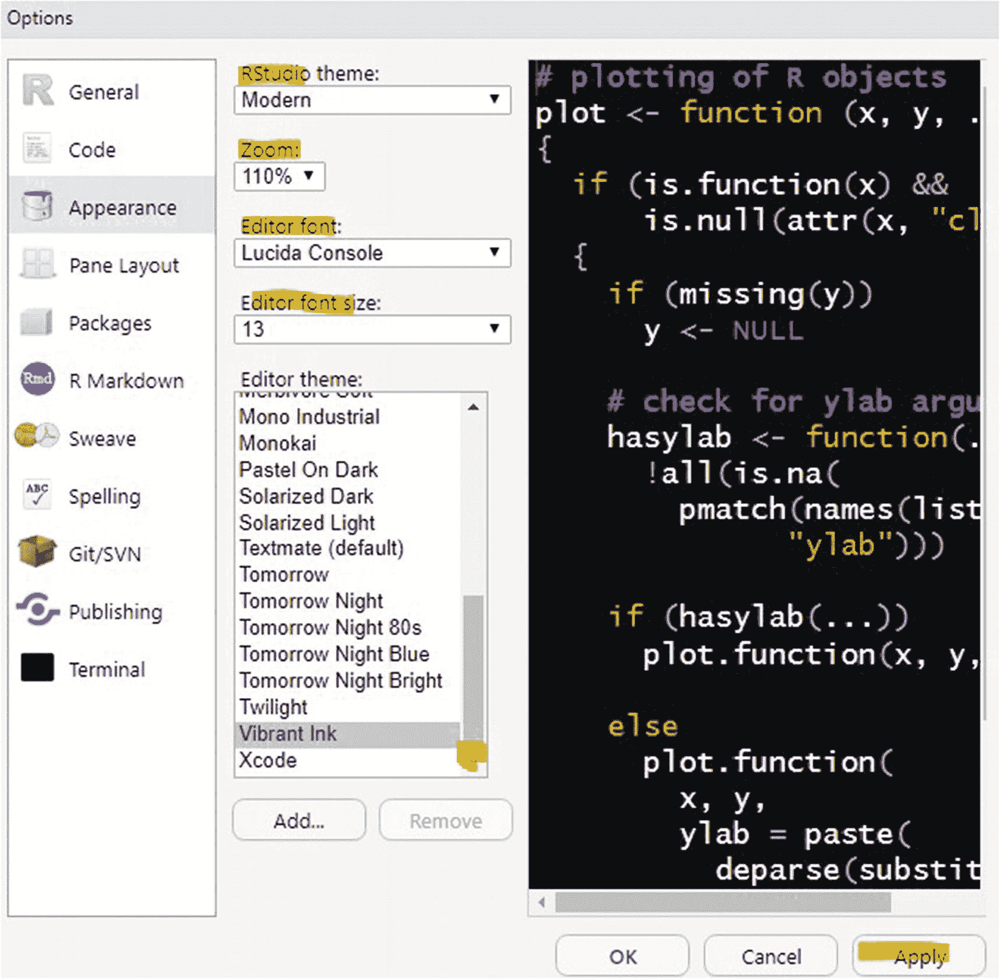
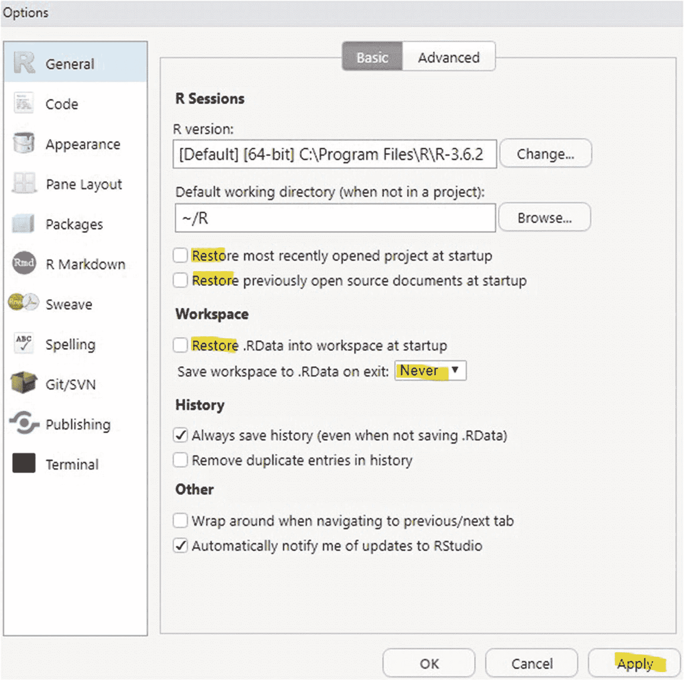
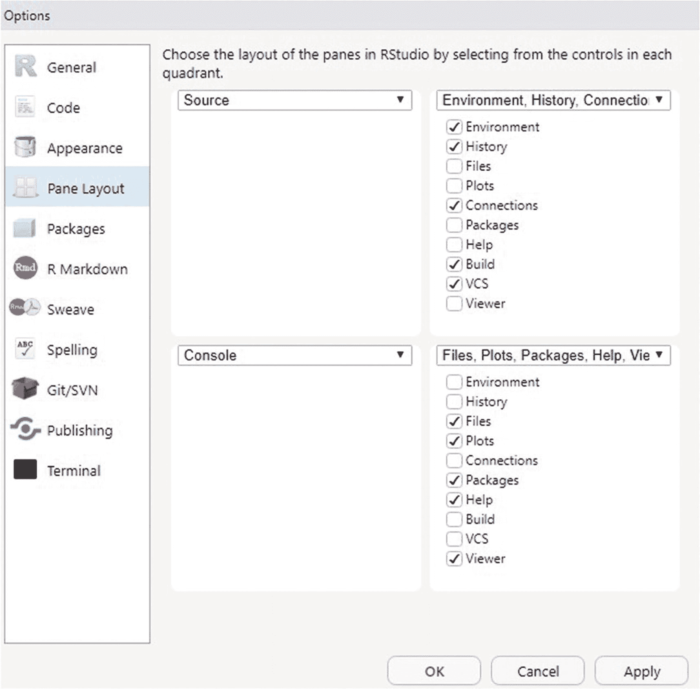
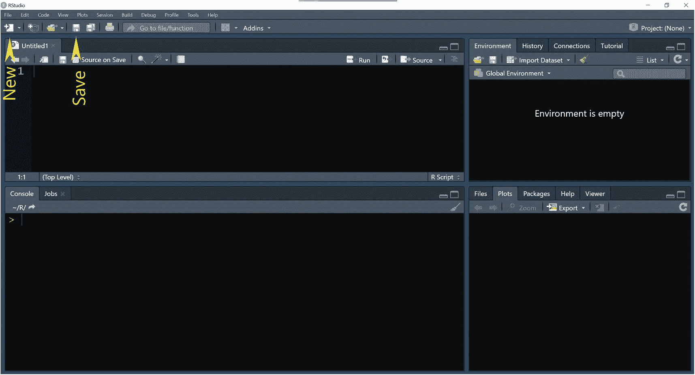
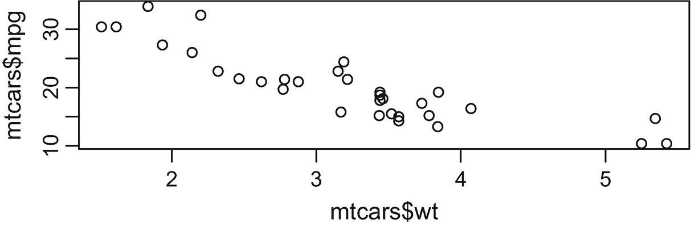

# 1. 安装 R

您来此是为了学习统计学，第一步是安装某个程序。这感觉有点像魔术师的把戏。您需要了解一些应用统计学，却不知何故需要学习如何编程。虽然这看起来可能令人望而生畏，但不要害怕！本章将逐步引导您完成所需的操作，以实现轻松安装。无论您是在个人电脑（PC 或 Mac）上学习，还是在公司/机构的联网机器上学习，本指南都将用日常语言告知您该做什么，并且内容足够完整，以便在需要时提供给您的 IT 部门（适用于企业/机构学习者）。

值得一提的是，通过使用`R`[16]语言学习如何以统计方式思考，您不仅可以在免费的开源软件上学习，还可以从第一天开始就使用“现实”生活中使用统计的方式。除了统计知识，您还将获得一些非常有用的应用技能。

本章帮助您学会：

*   从 CRAN [2] 下载最新版本的`R`，并在 Windows 或 Mac 计算机上安装。

*   在 Windows 或 Mac 计算机上下载并安装 RStudio。

*   理解 RStudio 项目环境。

*   通过应用一些基本的`R`代码原则，评估您的安装和理解是否有效。

如果您已经对`R`有所了解，并且渴望开始学习统计学，我们从表 1-1 中列出了本书所需的软件。另一方面，如果您希望与我们一起逐步学习，请继续阅读本章。

表 1-1 入门 R 技术栈

| 软件 | 网址 |
| --- | --- |
| R 4.0.2 | [`https://cran.r-project.org/`](https://cran.r-project.org/) |
| RStudio 1.2.x | [`https://rstudio.com/products/rstudio/download/`](https://rstudio.com/products/rstudio/download/) |
| Windows 10 | [`www.microsoft.com/`](http://www.microsoft.com/) |
| MacOS | [`www.apple.com/macos`](http://www.apple.com/macos) |

## 1.1 您的技术栈

由于表 1-1 中的软件通常需要以特定顺序相互依赖，并且属于技术范畴，因此项目运行所需的一系列软件有时被称为技术栈。如果您在安装`R`时遇到困难，您首先要与任何帮助您的人分享的信息之一就是您的技术栈。特别是，您计算机的操作系统以及您运行的`R`版本都会产生影响。虽然本书是为`R.Version()[["version.string"]]`编写的，但未来版本很可能不会发生太大变化，以至于导致本书无法使用。


## 1.2 更新你的操作系统

虽然这不是绝对必要的要求，但你的电脑操作系统（如 Windows 或 macOS）应保持最新。保持操作系统更新有几个好处。首先，我们将逐步指导你安装最新版本的 `R` 和 RStudio。这些软件肯定会在当前操作系统版本上进行过测试。其次，大多数“技术”人士都倾向于保持软件更新；因此，如果你遇到问题，拥有一个与他们当前熟悉的环境相似的系统会有所帮助。

### Windows

确保 Windows 10 保持最新一点也不难。在操作系统搜索栏（通常是 Windows 徽标右侧的放大镜图标）中，输入 `检查更新`，然后用鼠标光标选择标题为 *检查更新系统设置* 的选项。这应该会打开 Windows 更新窗口，其中有一个可以点击的 `检查更新` 按钮。如果成功，*上次检查：今天* 文本将包含当前时间。

在继续实际安装 `R` 之前，现在是检查你的电脑是否为 `64 位` 机器的好时机。虽然可能性不大，但你的电脑也有可能是 `32 位` 的。在同样的 Windows 搜索框（*在此键入以搜索*）中，输入 `关于你的电脑`。这应该会显示一个名为 *关于你的电脑系统设置* 的选项。选择它将会打开一个包含系统信息的屏幕。具体来说，在设备规格下，你需要查看 *系统类型* 是 `64 位` 还是 `32 位`。无论哪种情况，请记住这一点，稍后安装 `R` 时会用到。

### MacOS

在 macOS 上运行 `R` 需要确保你拥有最新版本的 macOS。这一点很重要，因为不同版本的安装过程有所不同。在撰写本文时，最新版本是 macOS Catalina，而当你阅读本文时，macOS Big Sur 或更高版本可能已经发布。你可以从 Apple 获得升级帮助：[`www.apple.com/au/macos/how-to-upgrade/`](http://www.apple.com/au/macos/how-to-upgrade/)。

## 1.3 从 CRAN 下载并安装 R

更新完操作系统后，就可以下载最新版本的 `R` 了。在撰写本文时，最新版本是 `R version 4.0.2 (2020-06-22)`，可以在 [`https://cran.r-project.org/`](https://cran.r-project.org/) 找到。根据你的操作系统，你将安装略有不同版本的 `R`。因此，我们请你根据自己的情况选择。

### Windows

要在 Windows 10 上安装 `R`，请使用你喜欢的网页浏览器（例如 Chrome、Firefox 或 Edge）访问 [`https://cran.r-project.org/`](https://cran.r-project.org/)。该网页上应该有一个标题为 *Download and Install R* 的方框，你需要选择 *Download R for Windows* 链接 [`https://cran.r-project.org/bin/windows/`](https://cran.r-project.org/bin/windows/)。接下来，你的目标是安装 `base R`，请选择 *base* 链接 [`https://cran.r-project.org/bin/windows/base/`](https://cran.r-project.org/bin/windows/base/)。顶部的第一个链接应该是 *Download R 4.0.2 for Windows (XX 兆字节, 32/64 bit)*。

当你阅读本书时，版本号很可能大于 4.0.2。兆字节数也可能略有不同。请直接下载那个最新版本。只要主版本号仍然是 4.x.x，本书中的所有内容很可能完全或几乎完全正确。

下载后，请导航到你的“下载”文件夹，其中保存着 `R-4.0.2-win.exe` 文件。大多数情况下，你的浏览器会弹窗提醒你文件的位置。否则，你可以按住键盘上的 Windows 键，然后按 E 键（有时称为 Win + e 快捷键）。不是按大写 E，而是在按住 Windows 键的同时按小写 e 键。这将打开 Windows 资源管理器，左侧通常有一个名为 *Downloads*（下载）的文件夹。

一旦找到你的 `R-4.0.2-win.exe` 文件，请双击它以启动安装过程。现在，请接受所有默认选项，在需要时点击“下一步”和“确定”。

### MacOS

为了在 macOS 上最灵活地运行 `R`，建议安装几个额外的工具。

在安装 `R` 之前，你需要从 App Store 安装 `Xcode`。安装后，打开它以接受条款；否则它可能无法正常工作。

安装好 `Xcode` 后，你还需要安装命令行工具。打开 `终端`（如果找不到，请尝试使用 Spotlight 搜索），输入 `xcode-select --install`，然后按回车键运行。如果遇到任何访问权限问题，你可能需要启用 root 用户。你可以通过在终端中输入以下命令来执行此操作：`dsenableroot`，然后按回车键启用 root 用户。

> **注意**：在终端中，如果要求你输入密码，请键入你用来登录 Mac 的密码，然后按回车键。在终端中键入密码时，不会显示任何字符，但密码确实已被输入。

安装 `XQuartz/X11`。访问 [`www.xquartz.org/`](http://www.xquartz.org/)，下载并运行该文件，然后按照屏幕上的说明进行操作。

前往 [`https://mac.r-project.org/tools/`](https://mac.r-project.org/tools/) 并按照他们的说明获取必备的工具和库。说明示例包括：前往 [`https://github.com/fxcoudert/gfortran-for-macOS/releases`](https://github.com/fxcoudert/gfortran-for-macOS/releases) 安装 `gfortran`，并下载 gfortran 8.2。按照说明下载并安装。

虽然 `R` 本身不需要，但为了许多扩展 `R` 功能的附加包，你可能还需要一些其他工具。

在 [`https://brew.sh/`](https://brew.sh/) 为 macOS 安装 `homebrew`，并按照“Install Homebrew”步骤操作。如果遇到任何访问权限问题，你可能需要启用 root 用户。你可以通过在终端中输入以下命令来执行此操作：`dsenableroot`，然后按回车键启用 root 用户。

> **注意**：在终端中，如果要求你输入密码，请键入你用来登录 Mac 的密码，然后按回车键。在终端中键入密码时，不会显示任何字符，但密码确实已被输入。

安装 `openssl`，它允许 `R` 安全地从互联网下载文件和包。为此，请打开终端（你可以搜索“终端”或在启动台中查找），终端打开后输入以下代码并按回车键：
```
brew install openssl
```

安装 `libgit2`，这是我们一个绘图包所需要的。为此，请打开终端（你可以搜索“终端”或在启动台中查找），终端打开后输入以下代码并按回车键：
```
brew install libgit2
```

最后，通过访问 [`https://cloud.r-project.org/`](https://cloud.r-project.org/) 并点击 *Download R for (Mac) OS X* 来下载 `R`。然后下载版本 4.0.2。下载完 `R` 后，请务必将它安装到你的应用程序中。

## 1.4 下载并安装 RStudio

恭喜！你现在已经安装了 `R`。不过，还有一样东西需要安装。虽然 `R` 本身很强大，但它不是一个便捷的工作环境。在编程中，我们经常使用一种称为 IDE（集成开发环境）的工具。在本例中，我们希望安装 RStudio Desktop，它将添加许多易于使用的可视化界面，帮助我们更好地“看到”`R`。RStudio 将使你更容易专注于学习统计学。

请访问 [`https://rstudio.com/products/rstudio/download/`](https://rstudio.com/products/rstudio/download/) 并选择 *RStudio Desktop Free*（免费版）选项。和之前一样，请在与你操作系统匹配的章节处与我们汇合。


### Windows

访问[`https://rstudio.com/products/rstudio/download/`](https://rstudio.com/products/rstudio/download/)并选择*RStudio Desktop Free*选项后，即可安装适用于 Windows 的 RStudio Desktop。在撰写本文时，最新版本是`1.3.1056.exe`。与之前一样，您只需下载最新版本，该版本应位于此网站的第 2 步：[`https://rstudio.com/products/rstudio/download/#download`](https://rstudio.com/products/rstudio/download/%2523download)。

同样，只需单击下载按钮，并注意浏览器保存文件的位置。要安装，请双击`RStudio-1.3.1056.exe`文件。同时，与`R`本身一样，您应按照默认选项进行安装，并根据需要点击*Next*和*OK*。

请注意，我们假设您使用的是`64-bit`操作系统。如果不是，您需要获取较旧版本的 RStudio，可在此链接找到：[`https://rstudio.com/products/rstudio/older-versions/`](https://rstudio.com/products/rstudio/older-versions/)。

### MacOS

访问[`https://rstudio.com/products/rstudio/download/#download`](https://rstudio.com/products/rstudio/download/%2523download)并选择*RStudio Desktop Free*选项后，即可安装适用于 macOS 的 RStudio Desktop。在撰写本文时，最新版本是`1.3.1056.dmg`。请确保`R.app`和`RStudio.app`能够访问所需的磁盘资源。

请遵循本指南：[`www.r-bloggers.com/escaping-the-macos-10-14-mojave-filesystem-sandbox-with-r-rstudio`](http://www.r-bloggers.com/escaping-the-macos-10-14-mojave-filesystem-sandbox-with-r-rstudio)，为它们授予必要的权限。

## 1.5 使用 RStudio

现在您已安装`R`和 RStudio，是时候首次打开并运行 RStudio 了。继续单击 RStudio 图标以打开它。您会看到顶部有一小排图标，以及构成程序屏幕主体的三个大窗格或框。左侧的一个大窗格应称为*Console*，在该窗格内，应有一段文字显示*R version 4.0.2*（或您刚刚下载安装的`R`版本）。

右侧应有两个较小的窗格。顶部是*Environment*（环境），应为空。右下侧是*Files/Plots/Packages/Help/Viewer*（文件/绘图/包/帮助/查看器）窗格。它应显示一个文件目录。

您的第一个任务（只需执行一次）是设置一些默认选项，以确保我们拥有相同的设置。

在最顶部的菜单栏中，找到并点击*Tools*（工具）链接，然后从下拉菜单中选择*Global Options*（全局选项）。选项菜单应打开，您应已位于*General*（常规）选项卡中，如图 1-1 所示。您需要确保在*General*选项卡 ➤ *Basic*中，以下选项**未**被选中：

*   **Restore most recently opened project at startup（启动时恢复最近打开的项目）**：**未勾选**
*   **Restore previously open source documents at startup（启动时恢复之前打开的源文档）**：**未勾选**
*   **Restore .RData into workspace at startup（启动时恢复.RData 到工作空间）**：**未勾选**
*   **Save workspace to .RData on exit（退出时保存工作空间为.RData）**：**Never（从不）**

点击*Apply*（应用）。

在离开此选项菜单之前，为了让学习过程更有趣，请点击*Appearance*（外观），如图 1-2 所示。现在，选择以下选项：



图 1-2 RStudio 外观



图 1-1 RStudio 常规选项

*   **RStudio theme（RStudio 主题）**：**Modern（现代）**
*   **Zoom（缩放）**：**按您的喜好设置**
*   **Editor font（编辑器字体）**：**选择您喜欢的字体**
*   **Editor font size（编辑器字号）**：**足够大以便阅读，足够小以优化屏幕空间**
*   **Editor theme（编辑器主题）**：**Vibrant Ink（活力墨水）**（我们对此有不同看法——请真正选择您喜欢的主题）

最后，请点击*Pane Layout*（窗格布局），并确保您的选项与我们的匹配，如图 1-3 所示。



图 1-3 RStudio 窗格布局

现在，您终于完成了设置。请点击*OK*（确定），欢迎来到我们将花费大量时间的世界。

最后，如果您想了解更多关于使用 RStudio 作为界面的信息，以下两页的“速查表”是一个很好的参考。它图解了 RStudio 的各个部分以及它们如何帮助您完成工作：[`https://github.com/rstudio/cheatsheets/raw/master/rstudio-ide.pdf`](https://github.com/rstudio/cheatsheets/raw/master/rstudio-ide.pdf)。


### 新建项目

既然 RStudio 已经具备了一些不错的默认设置，是时候启动你的第一个`**项目**`了。创建项目会构建一个用于存放你工作的文件夹，其中包含一些 RStudio 特有的文件，方便你轻松处理一系列相关的想法。一个项目中应该有多少个 R 文件并没有对错之分。如果你是在课堂上学习这本书，那么为每一章创建一个项目可能比较合理。在这种情况下，一个好的项目名称可以是该章节的标题。另一方面，整本书是在一个名为`"BeginningR_2020"`的单一项目中编写的。

现在，我们就为每一章构建一个项目。至少，你会熟悉如何启动、关闭和打开项目。

要启动一个新项目，在左上角的菜单栏中，选择`文件`，然后点击`新建项目`。接着，你需要使用新建项目向导，选择`新目录` ➤ `新建项目`，然后选择一个`目录名称`。目前，我们建议使用`01Installing`。在`目录名称`字段中输入后，选择`创建项目`。

现在，你已身处你的第一个项目之中！

你的第一个任务是创建一个新的空白`R`文件。为此，在顶部工具栏上，紧挨着`文件`字样的下方，有一个小图标，上面是一个加号，下面是一张空白纸。点击该图标，然后从新建文件菜单中，选择第一个名为`R 脚本`的选项。这个空白文件现在应该可见，因为左上角的面板中会出现一个标题为`无标题 1`的标签页。接着，点击软盘形状的`保存`图标。将此文件命名为`MyFirstRScript.R`并点击`保存`。图 1-4 展示了一个新增脚本和保存操作的截图。



图 1-4

RStudio 新建与保存示例

如果一切顺利，你现在应该拥有四个面板，正如我们之前在设置中描述的那样。你的左上角面板标题为`MyFirstRScript.R`，是一个脚本或代码面板。这将是我们完成大部分工作的区域。按顺时针方向，右上角面板是“环境”面板，它目前还是空的。右下角面板是你的`文件/图形/包/帮助/查看器`面板。现在`文件`标签页中应该有三个文件位于你的`项目目录`中。这三个文件应该是`.Rhistory`、`01Installing.Rproj`和`MyFirstRScript.R`。最后，左下角是你的`控制台`面板，目前它应该还在显示你当前的`R`版本信息。这一切即将改变。让我们简要地依次讨论每个面板的用途。

脚本面板，当前包含你的`MyFirstRScript.R`文件，是你输入`R`代码的地方。你可以把它想象成一个 Word 文件或 PowerPoint 幻灯片。它会保存你在此处编写的任何代码，但除非你激活或`运行`代码，否则什么都不会发生。如果你愿意，这个脚本区域就是你的程序。目前，你的程序是空白的。我们会很快改变这一点。你将在`R`中编写你的第一个程序，并成为一名程序员。

`环境`面板显示你的程序存储在内存中的数据、`对象`或`变量`。目前，那里什么都没有。在这本书中，最常见的情况是你会在那个位置找到一些数据。

`文件`标签页显示你项目的`工作目录`。你为此项目使用的任何文件都需要位于此目录中。这很重要！`R`需要知道去哪里寻找你用于获取统计分析信息的任何 Excel 文件或数据文件。这些文件都必须放在该目录文件夹中。然而，这个面板不仅仅显示文件。注意还有`图形`、`包`、`帮助`和`查看器`这些标签页。你可以依次点击每个标签页浏览一下。目前，`图形`、`文件`和`帮助`将是你最常用的标签页。现在，请回到`文件`标签页。

最后一个面板是`控制台`。这是你的代码运行的地方。在 RStudio 中，代码存在于两个地方。一个在脚本区域——那是代码保存的地方。然而，要运行代码，它总是在控制台中运行。

至此，你已经认识了在学习统计学时将会用到的四个区域。在我们准备结束本章之前，要确保一切运行正常。现在是时候编写你的第一个程序了。


### 1.6 我的第一个 R 脚本

作为第一个程序，我们想确认`R`能正常工作，并期待看到一些有趣的结果。本书将逐行展示代码及其输出。当你跟着操作时，需要在脚本区域输入代码，用鼠标拖拽选中文本（或按住*Shift*键并用键盘方向键高亮代码），然后按*Ctrl+Enter*（Windows 系统）或*Cmd+Enter*（macOS 系统）运行代码。

请注意，当我们使用`*Ctrl+Enter*`这种写法时，意思是按住`Ctrl`键不放，再按`Enter`键，然后同时松开两个键。在 macOS 中，则是按住`Cmd`键不放，再按`Enter/Return`键，然后同时松开。这是从脚本区域运行代码最简单的方式。长远来看，比起每次用鼠标点击`Run`按钮，这能为你节省大量时间。

在统计学中，我们经常需要寻找同类对象两个部分之间的关联或关系。例如，我们可以设想，随着车辆*重量*增加，其*每加仑英里数*（燃油效率指标）会降低。为了解如何用`R`探索这样的物理概念，让我们先简单看看第一个数据集。

数据集`mtcars`是一个来自较早时期的汽车杂志数据集。请在脚本区域输入`mtcars`，高亮该词，然后按*Ctrl+Enter*。你会在屏幕上看到以下 32 行 11 列的数据（与我们的屏幕和本书此处显示一致）。

```
mtcars
##                     mpg cyl disp  hp drat  wt qsec vs am gear carb
## Mazda RX4            21   6  160 110  3.9 2.6   16  0  1    4    4
## Mazda RX4 Wag        21   6  160 110  3.9 2.9   17  0  1    4    4
## Datsun 710           23   4  108  93  3.8 2.3   19  1  1    4    1
## Hornet 4 Drive       21   6  258 110  3.1 3.2   19  1  0    3    1
## Hornet Sportabout    19   8  360 175  3.1 3.4   17  0  0    3    2
## Valiant              18   6  225 105  2.8 3.5   20  1  0    3    1
## Duster 360           14   8  360 245  3.2 3.6   16  0  0    3    4
## Merc 240D            24   4  147  62  3.7 3.2   20  1  0    4    2
## Merc 230             23   4  141  95  3.9 3.1   23  1  0    4    2
## Merc 280             19   6  168 123  3.9 3.4   18  1  0    4    4
## Merc 280C            18   6  168 123  3.9 3.4   19  1  0    4    4
## Merc 450SE           16   8  276 180  3.1 4.1   17  0  0    3    3
## Merc 450SL           17   8  276 180  3.1 3.7   18  0  0    3    3
## Merc 450SLC          15   8  276 180  3.1 3.8   18  0  0    3    3
## Cadillac Fleetwood   10   8  472 205  2.9 5.2   18  0  0    3    4
## Lincoln Continental  10   8  460 215  3.0 5.4   18  0  0    3    4
## Chrysler Imperial    15   8  440 230  3.2 5.3   17  0  0    3    4
## Fiat 128             32   4   79  66  4.1 2.2   19  1  1    4    1
## Honda Civic          30   4   76  52  4.9 1.6   19  1  1    4    2
## Toyota Corolla       34   4   71  65  4.2 1.8   20  1  1    4    1
## Toyota Corona        22   4  120  97  3.7 2.5   20  1  0    3    1
## Dodge Challenger     16   8  318 150  2.8 3.5   17  0  0    3    2
## AMC Javelin          15   8  304 150  3.1 3.4   17  0  0    3    2
## Camaro Z28           13   8  350 245  3.7 3.8   15  0  0    3    4
## Pontiac Firebird     19   8  400 175  3.1 3.8   17  0  0    3    2
## Fiat X1-9            27   4   79  66  4.1 1.9   19  1  1    4    1
## Porsche 914-2        26   4  120  91  4.4 2.1   17  0  1    5    2
## Lotus Europa         30   4   95 113  3.8 1.5   17  1  1    5    2
## Ford Pantera L       16   8  351 264  4.2 3.2   14  0  1    5    4
## Ferrari Dino         20   6  145 175  3.6 2.8   16  0  1    5    6
## Maserati Bora        15   8  301 335  3.5 3.6   15  0  1    5    8
## Volvo 142E           21   4  121 109  4.1 2.8   19  1  1    4    2
```

这是所谓*原始*数据的一个典型例子。每辆车包含大量信息，每个信息都为一列。现在正是你感受计算机强大功能的好时机。虽然我们要求你花本章大部分时间（事实上是本书整个第一部分）来练习`R`而非立即学习统计学，但回报就在这里。你能想象把所有这些数字输进计算器吗？！

我们并不需要所有这些列。实际上，我们只关心重量（`wt`）和每加仑英里数（`mpg`）之间的关系。为了每次只查看一组数据，在`R`中，我们可以使用`$`运算符进入数据列。请在一行输入`mtcars$wt`，按`Enter`键换行，再输入`mtcars$mpg`，高亮这两行，然后按*Ctrl+Enter*（macOS 为*Cmd+Enter*）运行。你的结果应与这里打印的结果一致：

```
mtcars$wt
##  [1] 2.6 2.9 2.3 3.2 3.4 3.5 3.6 3.2 3.1 3.4 3.4 4.1 3.7 3.8 5.2 5.4
## [17] 5.3 2.2 1.6 1.8 2.5 3.5 3.4 3.8 3.8 1.9 2.1 1.5 3.2 2.8 3.6 2.8
mtcars$mpg
##  [1] 21 21 23 21 19 18 14 24 23 19 18 16 17 15 10 10 15 32 30 34 22 16
## [23] 15 13 19 27 26 30 16 20 15 21
```

从现在起，我们将不再赘述输入脚本、高亮、按*Ctrl+Enter*（macOS 为*Cmd+Enter*）的操作，而是直接讨论思路，讲解如何将思路转化为代码，并向你展示代码和输出。如果你遇到困难，感觉卡在运行`R`代码的步骤上，网上有一些有用的视频可供参考。如果你是课堂上的学生（我们多年来教过数千名自己的学生），我们鼓励你联系教授或讲师。如果你运气不好正好遇到我们中的某位做你的老师，那更要主动联系！如果这不太可能，也可以直接联系我们。我们完全不介意，会尽力回复，乐于倾听读者的声音，并且很容易找到我们。请翻看本书前面的作者简介，需要帮助时不必害羞。

继续往下，看过重量和每加仑英里数后，我们准备用可视化方式观察这两个数据点。如果这一步成功，你将写出第一个程序，用`plot()`绘制并可视化这两个数据集，同时也印证了 RStudio 和`R`一切就绪。

要告诉`R`我们想绘制图形，可以使用名为`plot(x, y)`的函数。函数接收一个或多个*输入*（此处为重量和每加仑英里数），并给出输出（此处为这两个数字对的散点图）。如果你从代数中熟悉 x 轴和 y 轴，你应该能预见到如图 1-5 所示的图形。请精确复制代码到脚本窗口，高亮并运行代码！图形将显示在*Plots*窗格（之前是*Files*窗格）。注意，你可以随时点击返回 Files 窗格，也可以*导出*你的图形。现在正是与世界分享你的第一个散点图的好时机。在编程中，这类第一步有时被称为"Hello World"（因为在我们最初学习编程时，图形和可视化很罕见，所以第一个程序往往只是在控制台打印"hello world"——那些艰苦的岁月！）。更重要的是，这不再是一个 1970 年代的旧数据集——你现在可以视觉化任何能导入`R`的数据集。相当强大的功能。



**图 1-5** mtcars 重量与每加仑英里数散点图

```
plot(x = mtcars$wt, y = mtcars$mpg)
```


