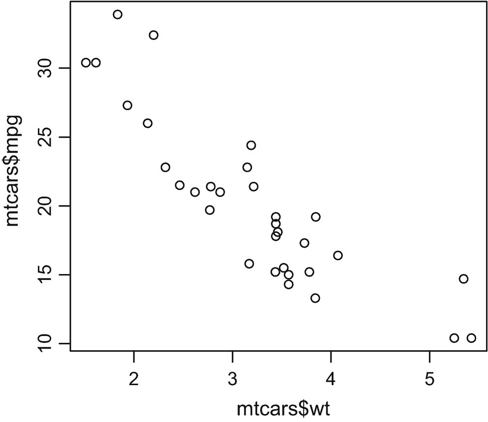

# 观察图形特征

当你查看图形时，请注意其一些特征。随着 `mtcars$wt` 的 x 轴值增加，`mtcars$mpg` 的 y 轴值减小。这是我们预期会看到的现象；汽车的重量应该会降低燃油效率。如果你在自己的系统上运行这段代码，可能会注意到图形看起来略有不同。例如，图 1-5 的宽度大于高度，但我们可以调整宽高比（图形高度与宽度的比例）；虽然数据相同，但看起来却有所不同。为了说明这一点，我们在图 1-6 中制作了同样的图形，但这次高度和宽度大致相等。



**图 1-6** 不同宽高比的 mtcars 重量与每加仑英里数关系图，该图高度与宽度大致相等，而非远宽于高

```
plot(x = mtcars$wt, y = mtcars$mpg)
```

在 RStudio 中，你可以将鼠标光标移动到面板之间的边缘，看到多向箭头后，点击并拖拽以调整 RStudio 面板的大小和形状。图形将自动更新为你所设定的形状。

进入第 2 章后，我们将探索一些更高级的图形。尽管如此，这是一个良好的开端。继续点击保存图标。然后选择 *File*，再选择接近文件菜单末尾的 *Close Project*。关闭项目后，你可以点击屏幕右上角的 *X* 关闭 RStudio。

下次打开 RStudio 时，如果需要重新进入第 1 章的项目，可以选择 *File*，然后 *Recent Projects* 中会有指向你的 `01Installing` 项目的链接，或者你也可以使用 *Open Project...* 导航到你的项目文件。

## 1.7 小结

在本书中，每章结尾都会有一个小结，如表 1-2 所示，按介绍顺序详细列出了可能对快速参考有用的具体事实。特别是，这些事实可以作为帮助你解决问题的工具的有用指南。

**表 1-2 章节小结**

| 概念 | 含义 |
| --- | --- |
| `R` | 一种统计编程语言。 |
| `RStudio` | `R` 的集成开发环境（IDE）。 |
| `CRAN` | Comprehensive R Archive Network（R 综合档案网络）。 |
| `mtcars` | 我们将经常使用的关于汽车的数据集。 |
| `$` | 一种用于按名称访问列的 `R` 命令。 |
| `plot(x = , y = )` | 用于绘制 x 轴和 y 轴图形的函数名。 |

## 1.8 精进练习

通过完成一些练习来检查进度并在实践中成长。理解题提出批判性思维问题，最好通过书面或口头回答。统计学的艺术之一在于能成功地向利益相关者或受众传达结果。有时受众技术性很强，有时则不然。习题则是对本章所学概念的更直接应用。

### 理解题

1.  我们在 RStudio 的脚本面板中使用了数据集 `mtcars`。如果你前往 RStudio 的 *Console* 面板，在提示符 `>` 处输入 `mtcars` 并按下 *Enter*，会发生什么？请将此行为与你保存的 `MyFirstRScript.R` 中高亮并运行 `mtcars` 的行为进行比较/对比。

2.  在 `MyFirstRScript.R` 中，你运行了 `plot(x = mtcars$wt, y = mtcars$mpg)` 以获取图 1-6 中的图形。如果你运行 `plot(mtcars$wt, mtcars$mpg)` 会发生什么？你能在 Console 面板中运行 `plot(mtcars$wt, mtcars$mpg)` 吗？这说明了什么？

### 练习题

1.  你已经了解了 `mtcars` 数据并绘制了重量与每加仑英里数的关系图。使用相同的 `plot()` 函数，更改输入以创建一张图形，其中每加仑英里数在水平 x 轴上，重量在垂直 y 轴上。

2.  还有一个名为 `iris` 的 `R` 内置数据集。使用本章中处理 `mtcars` 的方法，探索 `iris`，查看 `Sepal.Length` 和 `Petal.Length` 列中的数据，并创建一张以 `Sepal.Length` 为水平 x 轴、`Petal.Length` 为垂直 y 轴的图形。

