# 6. 描述性统计

统计学是理解样本数据的数学。其更宏大的目标是利用我们对样本的理解来更好地理解总体。其更具体、更直接的目标是开发一套常规的工具和工作流程，帮助我们理解样本数据。由于理解通常需要*探索*数据集，探索性数据分析（EDA）便是对此阶段给出的一个现代术语。在你探索样本的过程中，你将充分理解样本数据，从而能够*描述*这些数据。因此，这个过程也被称为**描述性**统计。

学完本章后，你应该能够做到：
-   评估一个数据集，判断其定性/定量数据的类型。
-   创建图表和其他可视化辅助工具，以便快速理解大量数据。
-   应用集中趋势、位置和波动性计算来概括数据。
-   记住你的短期目标是理解样本，长期目标则是将结论推广到总体。

## 6.1 R 环境设置

与往常一样，为了继续练习创建和使用项目，我们为本章节新建一个项目。

如有必要，请回顾第 1 章中创建新项目的步骤。启动 `RStudio` 后，在左上角的菜单栏中，选择*文件*并点击*新建项目*。选择*新建目录* ➤ *新建项目*，在*目录名称*中输入 `ThisChapterTitle`，然后选择*创建项目*。要创建 `R` 脚本文件，请在顶部功能区“文件”字样正下方，点击带有加号的白纸小图标，然后选择*R 脚本*菜单选项。点击软盘形状的*保存*图标，将此文件命名为 `PracticingToLearn_XX.R`（其中 `XX` 为本章节编号），然后点击*保存*。

在右下方面板中，您应该能看到项目中的两个文件。在*文件*选项卡正下方，点击*新建文件夹*按钮。在弹出的*新建文件夹*对话框中，输入 `data` 并点击*确定*。在右下方面板中，点击您新建的 `data` 文件夹。重复文件夹创建过程，新建一个名为 `ch06` 的文件夹。

请记住，本章使用的所有包都已在第 2 章中安装在您的本地计算机上。无需重新安装。但是，由于这是一个新项目，并且我们是第一次运行这组代码，因此您需要运行以下 `library()` 调用：

```r
library(data.table)
## data.table 1.13.0 using 6 threads (see ?getDTthreads). Latest news: r-datatable.com
library(ggplot2)
library(palmerpenguins)
library(JWileymisc)
library(extraoperators)
```

此外，继续将我们常用的三个数据集设置为熟悉的变量和 `data.table` 格式。从统计学和 `R` 的实际应用角度来看，值得思考的是您的“常用”数据集。拥有一个良好的结构和流程来让这些数据发挥作用（就像我们在下面的代码行中所做的那样），可以让日常工作流程更容易启动：

```r
acesData <- as.data.table(aces_daily)
penguinsData <- as.data.table(penguins)
mtcarsData <- as.data.table(mtcars, keep.rownames = TRUE)
```

现在，您可以自由地了解更多统计知识了！

## 6.2 可视化

`R` 的一个惊人特性是能够快速生成图片和图表来可视化整个数据集。与频数表非常相似，图表提供了一种简单的方法来理解数据集的特性。还记得我们学过的定性数据和定量数据的类型吗？不同的图表适用于不同类型的数据。

通常，在进行探索性绘图时，您会发现数据中隐藏的误解或问题会暴露出来。在这种情况下，答案通常是执行某种类型的数据操作，以*清理*数据或将其转换为可用的格式（这有时被称为数据*洗濯*）。

### 直方图

直方图与频数表非常相似。它们被设计用于处理定量数据、定距数据或定比数据。数据的设置方式应使数据的每个副本代表单个项目（无重复数据）。这与我们的 `acesData` 中的 `Age` 列形成对比，后者有许多副本（因为每位参与者连续多天参加了多次调查）。

在探索直方图示例时，请注意输入数据的类型，并思考数据是否重复。

### 示例

回想一下，在第 5 章中，我们将 `penguinData` 数据框中的 `flipper_length_mm` 变量进行了分组，然后计数得到频率表。你可能还记得，我们将频率表中的数据分成了五个组。尽管有些直方图可以让我们精确控制组数，但 `hist()` 函数默认使用一种*算法*来确定合理的组数。算法是指通过某种过程进行选择的逻辑程序。虽然仅仅针对如何确定频率表或直方图的组数就可以单独开展研究，但就本书而言，我们只采用默认设置。

由于我们的 `flipper_length_mm` 数据是长度，属于定量比率数据，因此使用直方图是合理的。同时，因为 `penguin` 数据集没有重复值——每一行都是对某只特定企鹅的唯一观测记录——所以使用直方图也同样合理：

```r
hist(x = penguinsData$flipper_length_mm)
```

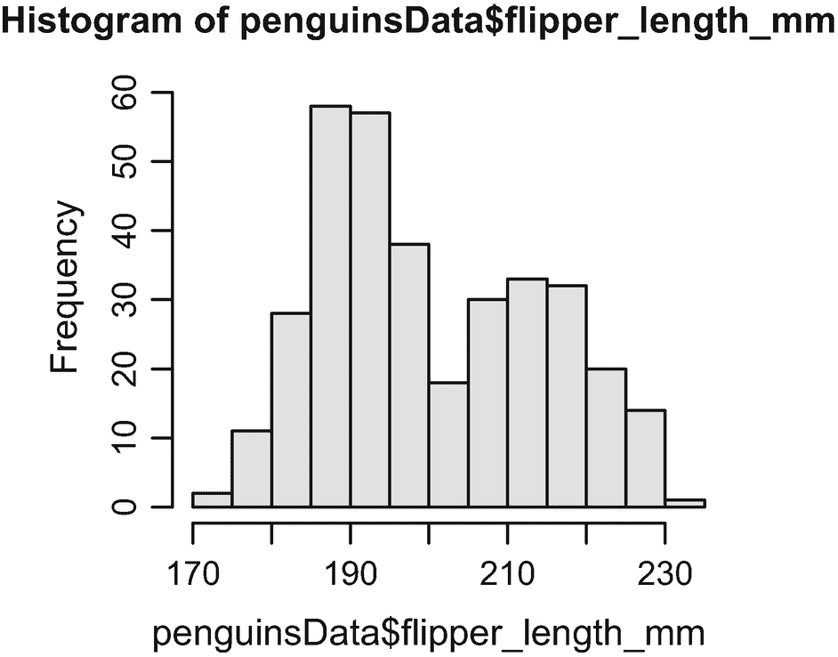

**图 6-1** `penguinsData` 直方图

在图 6-1 中，水平 x 轴标注的是鳍肢的大致长度。换句话说，最左边的第一个组包含长度为 170–175 毫米的鳍肢。垂直 y 轴显示的是频数——某个特定鳍肢长度组出现的频率。以最左边这组为例，你可以看到鳍肢长度在 170 到 175 毫米之间的企鹅数量并不多。

我们看到的是，鳍肢的长度并不是*均匀分布*的。相反，有些组的鳍肢数量比其他组更多。在某种程度上我们已经意识到了这一点——我们在第 5 章中使用的一些抽样方法得到的范围过于狭窄。

花点时间看看这个直方图。假设直方图挂在墙上，你手里拿着一个飞镖。闭上眼睛，随机将飞镖投向直方图。你可能很容易发现，飞镖不太可能击中 230 毫米及以上的那个组。那个组的确非常小——可击中的面积也不大。另一方面，你很可能击中 180 到 200 毫米之间的区域——虽然窄，但很高。或者你可能击中 205 到 220 毫米之间的区域。这些都是随机命中的可能性较大的位置。

为什么我们要讨论随机呢？其实，`R` 语言中的随机抽样方法就像是将飞镖投向直方图。当我们说随机抽样方法是*无偏的*时，意思是随机选择数据进入样本应该会得到一个与我们的实际数据较为接近的样本。

花点时间，回到第 5 章，你在那里通过一个示例构建了 `randomFlippers` 变量。那次随机抽取的结果是否大多介于 180 到 200 毫米或 205 到 220 毫米之间？如果是的话，我们可能就会开始相信，总体而言，随机样本在帮助我们避免样本偏差方面做得相当不错。

### 示例

我们在探索 `aces_daily` 数据集中的 `Age` 变量上花了相当多的时间。请记住，直方图是设计用来处理无重复的区间或比率数据的。那么，直接使用我们现有的年龄数据有什么问题呢？毕竟，`Age` 显然是定性比率数据，对吗？

我们首先在 `hist()` 函数中直接使用 `Age` 列中的原始数据。关于图 6-2，首先要注意的是频数相当高。这个数据集只有 191 名不同的参与者，但每个参与者多次填写调查问卷。回想一下，在第 5 章中，我们曾在频率表中遇到过类似的问题。其次要注意的是，`hist()` 完全忽略并丢弃了 `NA` 条目。在这个图中看不到这些数据点的任何迹象：

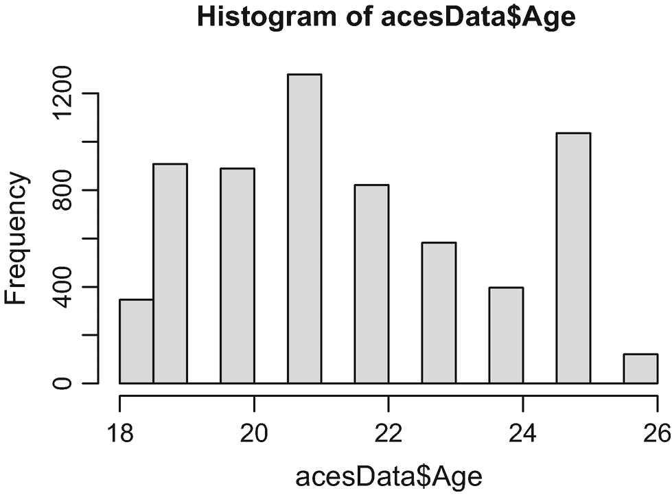

**图 6-2** 有重复的 `aces Age` 直方图

```r
hist(x = acesData$Age)
```

现在，我们看到了单纯依赖 `hist()` 来理解数据所面临的一些挑战。虽然年龄通常是定性比率数据，但我们的 `Age` 列并非完全是比率级别的数据。`NA`（代表*缺失值*）的存在是存在一个*类别*的标志。直方图知道它无法处理这种类型的数据，因此干脆将其丢弃了。

我们在图 6-2 中看到的另一个挑战是，填写调查问卷是可选的。因此，看起来 21 岁的参与者比 18 岁的参与者多很多（看看第一个和第四个条形的高度）。也许 21 岁的参与者仅仅因为某种原因在填写调查问卷时更加认真？

我们只是想了解参与者的年龄分布。因此，我们需要做一些数据清理工作。请记住，`unique()` 函数可以去除重复值。此外，使用 `data.table` 中的 `.()` 列选择函数，我们可以只选择特定的列。现在，我们当然需要 `Age` 列。但是，我们希望年龄的频数与每个用户/参与者对应。如果我们盲目地对 `Age` 列单独使用 `unique()`，那么每个年龄只会保留一个副本（最终得到一张非常单调的直方图）。

带着这个需要做什么的思维框架，我们可以考虑一下 `data.table` 的处理过程。首先，我们知道直方图只适用于数值型数据；因此，我们无需选择包含缺失值的行。这是一个行选择问题。`is.na()` 函数会给出特定列中所有是 `NA` 的行。我们需要的是*不是* NA 的行。因此，你需要使用逻辑否定符号 `!`。至于列，通过同时包含 `userID` 和 `Age` 列，你可以确保每个用户每个年龄只出现一次。

研究下面的代码，看看每个目标是如何实现的，然后思考图 6-3 中生成的直方图。

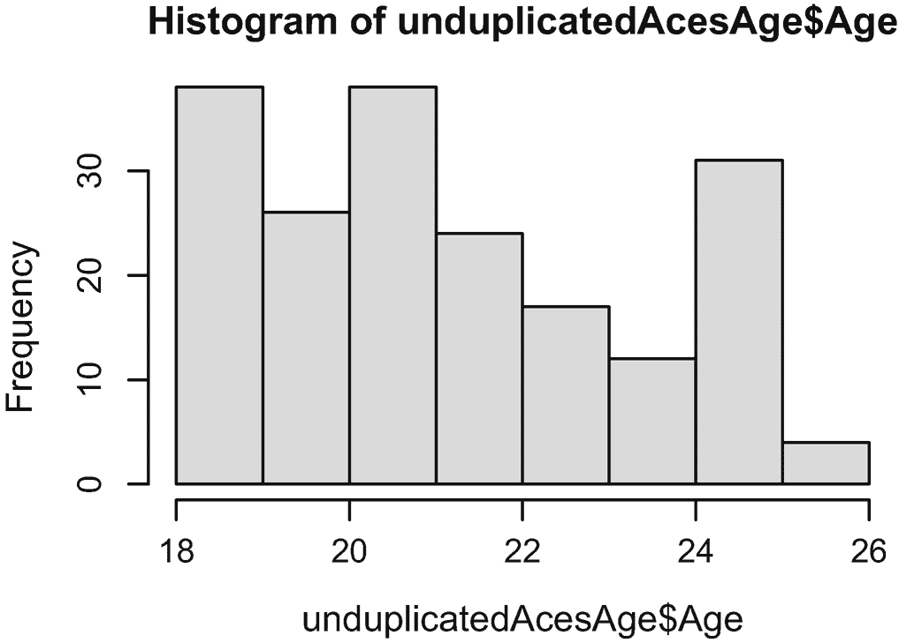

**图 6-3** 无重复的 `aces Age` 直方图

```r
unduplicatedAcesAge <- acesData[! is.na(Age),.(UserID, Age)]
unduplicatedAcesAge <- unique(unduplicatedAcesAge)
hist(x = unduplicatedAcesAge$Age)
```

我们立刻就能看到一些视觉上的差异。频数的数值低了很多。注意，18 岁和 21 岁出现的频数相同。在完成调查问卷方面，不同年龄组之间确实存在差异！附带说一句，这可能与年龄本身没有直接关系——可能存在一个*混杂*变量，促使 21 岁的参与者完成更多调查问卷。事实上，在那项研究中的确存在这样一个变量。参与者每完成一份调查问卷，就会在本地一家杂货店的礼品卡上累积一小笔金额。可能 21 岁的人更看重杂货购物券。

当我们删除了所有的 `NA` 后，是否损失了某些参与者？基于频数（以及 `unduplicatedAcesAge` 中的行数），答案似乎是“不多”。与其手动检查 `UserID` 中缺失的值，不如让 `R` 使用 `setdiff()` 函数为我们找到它。

该函数接收一个输入 `x`，并将其与第二组数据 `y` 进行比较。如果 `y` 中缺少 `x` 的任何元素，它将返回这些数据点。尽管频数表中存在大量 `NA`，但参与者似乎只是厌倦了每天重复三次自己的年龄。实际上，只有一位参与者完全拒绝报告年龄，该参与者的 `UserID = 107`：

```r
setdiff(x = 1:191,
y = unduplicatedAcesAge$UserID)
## [1] 107
```

请注意，这段代码中包含了不少信息。虽然立即看到结果很好，但在看到实际应用后再深入探索某个想法有时会更有帮助。让我们花点时间一起看看前面这段代码的所有组成部分和逻辑。

首先，`setdiff()` 只是找出两组数据之间的差异。具体来说，它只返回存在于 `x` 集合但不在 `y` 集合中的项目。请注意，在下面的两个示例中，都只返回了数字 107。即使 `y` 中的 500 不在第一组中，`setdiff()` 也**只会**返回“存在于 x 但不在 y 中的项目”：

```r
setdiff(x = c(107, 108),
y = c(108))
## [1] 107
setdiff(x = c(107, 108),
y = c(108, 500))
## [1] 107
```

由于 `setdiff()` 是按此方式工作的，要找到任何缺失的用户（即当我们执行 `!is.na(Age)` 时可能被删除的用户），我们必须将 `x` 设置为所有可能的用户。`R` 乐意为您提供一整套数字（或字母）。要获取两个数值之间的所有整数，只需在中间加一个冒号（例如，`1:191`）。要获取小写或大写字母，请使用 `letters` 或 `LETTERS`：

```r
1:191
##   [1]   1   2   3   4   5   6   7   8   9  10  11  12  13  14  15  16
##  [17]  17  18  19  20  21  22  23  24  25  26  27  28  29  30  31  32
##  [33]  33  34  35  36  37  38  39  40  41  42  43  44  45  46  47  48
##  [49]  49  50  51  52  53  54  55  56  57  58  59  60  61  62  63  64
##  [65]  65  66  67  68  69  70  71  72  73  74  75  76  77  78  79  80
##  [81]  81  82  83  84  85  86  87  88  89  90  91  92  93  94  95  96
##  [97]  97  98  99 100 101 102 103 104 105 106 107 108 109 110 111 112
## [113] 113 114 115 116 117 118 119 120 121 122 123 124 125 126 127 128
## [129] 129 130 131 132 133 134 135 136 137 138 139 140 141 142 143 144
## [145] 145 146 147 148 149 150 151 152 153 154 155 156 157 158 159 160
## [161] 161 162 163 164 165 166 167 168 169 170 171 172 173 174 175 176
## [177] 177 178 179 180 181 182 183 184 185 186 187 188 189 190 191
letters
##  [1] "a" "b" "c" "d" "e" "f" "g" "h" "i" "j" "k" "l" "m" "n" "o" "p"
## [17] "q" "r" "s" "t" "u" "v" "w" "x" "y" "z"
LETTERS
##  [1] "A" "B" "C" "D" "E" "F" "G" "H" "I" "J" "K" "L" "M" "N" "O" "P"
## [17] "Q" "R" "S" "T" "U" "V" "W" "X" "Y" "Z"
```

至此，我们拥有了快速找出任何缺失用户所需的所有部件：

```r
setdiff(x = 1:191,
y = unduplicatedAcesAge$UserID)
## [1] 107
```

### 点图/点状图

频数表和直方图在提供数据的快速摘要方面非常出色。通过将数据拟合到类别或分箱中并提供计数，信息消费者和像您这样的数据分析师可以快速阅读大量数据。因此，它们是探索性数据分析中的有用工具。然而，分箱的选择有时可能会隐藏重要信息——有时查看所有数据能帮助揭示趋势或偏差。

**点图**或**点状图**是查看数据的一种方式。图 6-4 中的图表显示了每个企鹅鳍状肢长度的圆点。水平 x 轴表示长度。请注意，在这种情况下，垂直高度不是一种度量。相反，每个鳍状肢都有自己的垂直位置——这使我们能够看到所有的点（有轻微重叠）。比较并对比图 6-4 和图 6-1。两者都完全展示了相同的基础数据。直方图是一个易于快速理解的摘要，而点图则显示了更多的细节（并且仍然比原始数据更容易浏览）：

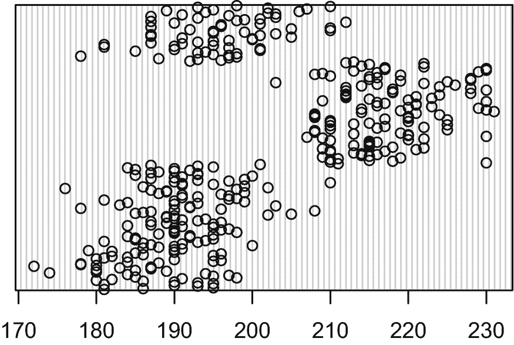

**图 6-4**：企鹅点图

```r
dotchart(x = penguinsData$flipper_length_mm)
```

描述性统计——探索我们的数据——通常涉及使用几种不同的方法或工具来帮助我们了解我们拥有哪种类型的数据。解析图 6-4 背后的代码，会为您“通常的流程”增添一项新技能，以理解数据并进行统计思维。

### 示例

创建点图的 `R` 代码非常简单。函数是 `dotchart()`，我们关心它所接受的两个变量（虽然它还有更多变量，我们稍后会探索更高级的可视化）。第一个变量 `x` 接受原始的数值数据，这些数据将创建水平 x 轴。因此，与直方图类似，点图假设我们的数据是定量的，并且是间隔或比率尺度。第二个变量 `groups` 是可选的。该变量接受名义或序数数据。

在图 6-4 中，我们只使用了第一个变量 `x = penguinsData$flipper_length_mm`。在图 6-5 中，我们保留了第一个变量，并添加了 `group = penguinsData$species`：

```r
dotchart(x = penguinsData$flipper_length_mm,
groups = penguinsData$species)
```

这个分组特性很能说明问题，因为它表明某些企鹅物种似乎可以根据其鳍状肢长度进行区分。

关于基于物种聚类或便利样本的抽样方法，这告诉了我们什么？如果我们只有一种物种，我们对企鹅鳍状肢长度的理解会如何变化，这容易看出来吗？虽然我们在第 5 章讨论了偏差和混杂变量，但图 6-5 是我们第一次直观地看到样本偏差可能如何产生。

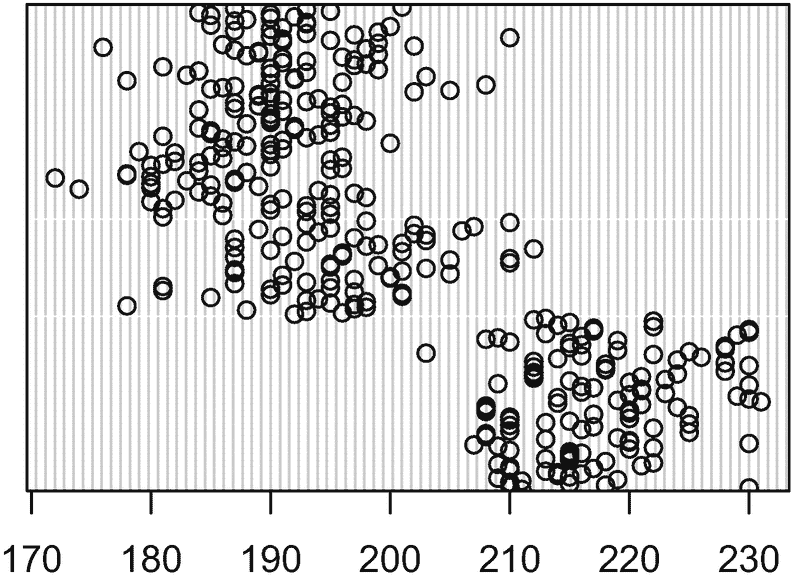

**图 6-5**：按物种分类的企鹅点图

### `ggplot2`

`hist()` 和 `dotchart()` 都是对探索性数据分析非常有用的函数。话虽如此，这两个图表的可定制性并不高。这可能会使得改变观察视角变得困难。如果你想按多个类别分组（例如，同时按社会经济地位和教育程度查看年龄）该怎么办？通常，早期的探索会引发进一步的问题和想法。现在，请不要误解——我们（以及许多其他数据科学家）在早期使用 `hist()` 和 `dotchart()` *正是因为*它们不可定制。它们能非常快速地提供数据的初步视图！只是在第二轮分析时，才可能需要更详细的细节。

`ggplot2` 包 [17] 开发了一个更全面的可视化流程。事实上，*gg* 代表 *grammar of graphics*（图形语法）。目前，我们只需浅尝辄止地了解这个框架。它有助于我们更清晰地观察，并为你提供一些扎实的、市场需要的技能，你可以加以利用。能够在 `RStudio` 中使用 `ggplot2` 进行可视化，可能会成为你在求职面试中可以提及的亮点。

这个包的强大之处在于你已经了解的一些东西。图 6-1 和图 6-4 都是基于完全相同的数据构建的。然而，我们必须以两种不同的方式来审视它们。但从概念上讲，它们是同一坐标系上的同一组数据——只是组织图表的方式不同而已。

其核心是 `ggplot()` 函数，它接收两个变量。第一个变量 `data =` 保存着我们的 `data.table` 元素。这使我们不必在从每一列调用数据时不断地重复自己。第二个变量是 `mapping =`，它连接或者说将数据集中的列*映射*到我们的视觉元素或*美学属性*上。美学属性是视觉上的选择，例如选择 x 轴为 `flipper_length_mm`，或者用某种颜色填充某个分组。

这个基础函数的示例如图 6-6 所示。通过设置 `data = penguinsData`，就无需像之前那样使用 `penguinsData$flipper_length_mm` 来引用列了。相反，我们直接设置 `x = flipper_length_mm`。

在这种语法中，`flipper_length_mm` 列中的数据被映射到 x 轴的*美学属性*（或视觉元素）。虽然下面的代码创建了图表的基础，但我们还没有指定*几何对象*。在 `ggplot()` 中，*几何对象*是用户看到的视觉形状（例如，直方图就是一种几何对象）。因此，虽然你看到 x 轴具有正确的数值范围（从 1 到 7）并且标签正确，但图表目前完全是空白的：

```
ggplot(data = penguinsData,
mapping = aes(x = flipper_length_mm))
```

这种情况即将改变。基于这个构建模块，可以通过直接使用 `+` 运算符向 `ggplot()` 添加内容。这些添加内容通常是特定的几何规范。我们可以使用这种语法来重新创建之前的图表。

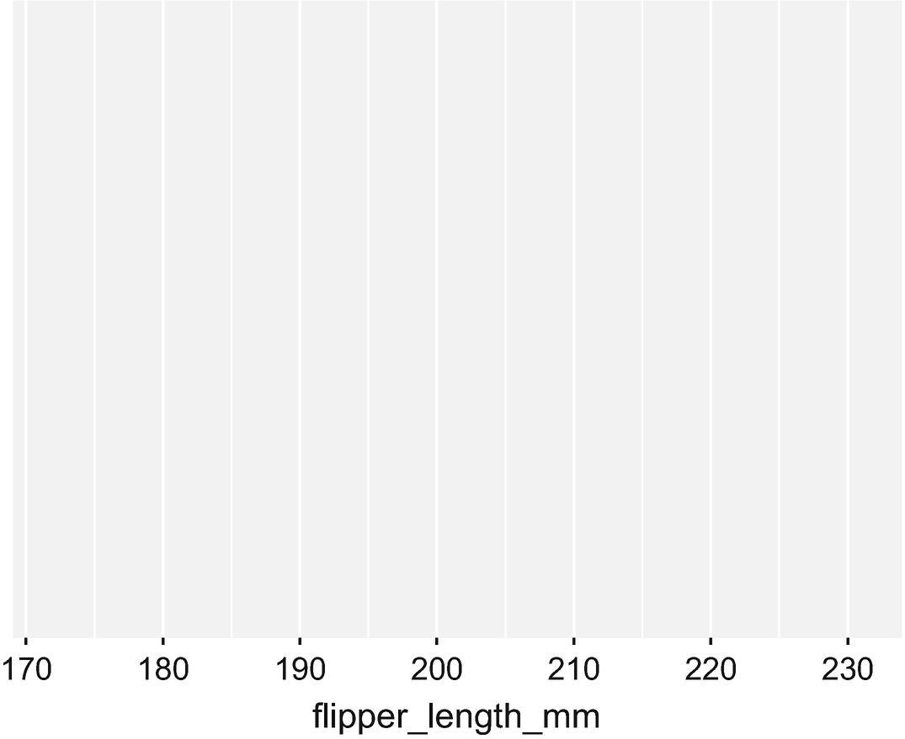

图 6-6

`ggplot()` 基础设置，无几何对象

要创建直方图，我们只需在基础图表上添加直方图的几何对象。这可以通过 `geom_histogram()` 函数实现。生成的可视化结果如图所示：

```
ggplot(data = penguinsData,
mapping = aes(x = flipper_length_mm))+
geom_histogram()
## 'stat_bin()' using 'bins = 30'. Pick better value with 'binwidth'.
## Warning: Removed 2 rows containing non-finite values (stat_bin).
```

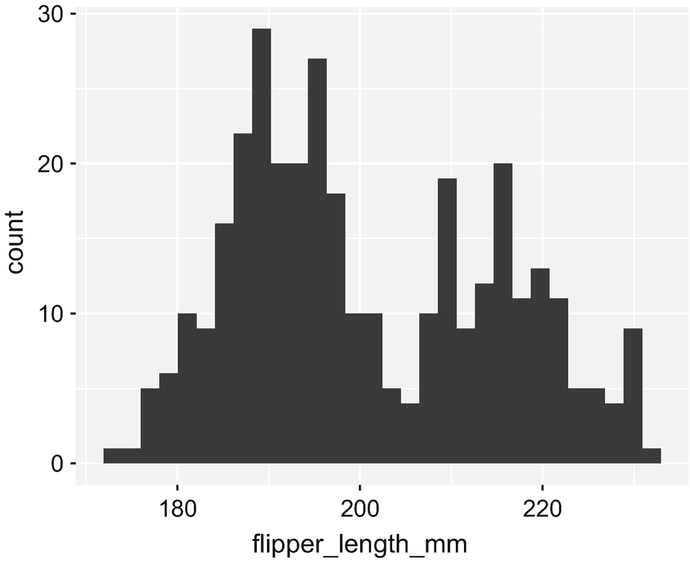

图 6-7

`ggplot()` 基础设置，直方图

另一方面，如果我们希望点图能向我们展示不同的数据点，也可以通过使用不同的几何对象来实现类似的效果。请记住，在这种语法中，只要我们使用相同的数据并且希望得到相同的 x 轴美学属性，我们的基础就是相同的。变化的只是布局或几何对象；因此，唯一的改变是使用 `geom_dotplot()` 作为添加内容来实现图 6-8。

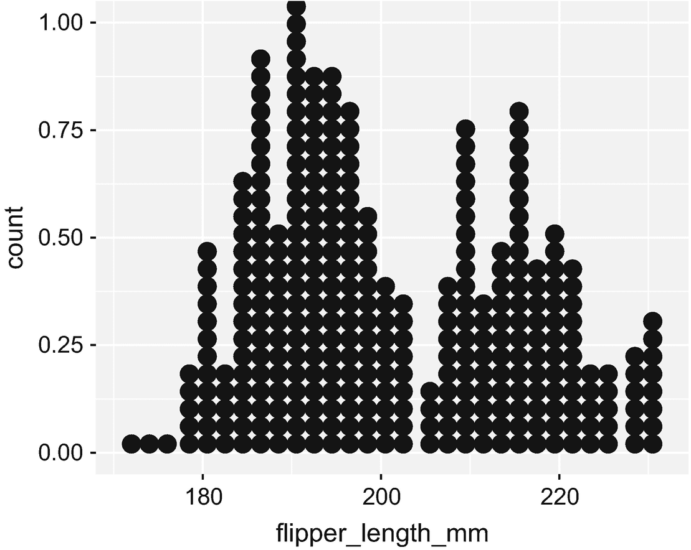

图 6-8

`ggplot()` 基础设置，点图

```
ggplot(data = penguinsData,
mapping = aes(x = flipper_length_mm))+
geom_dotplot()
## 'stat_bindot()' using 'bins = 30'. Pick better value with 'binwidth'.
## Warning: Removed 2 rows containing non-finite values (stat_bindot).
```

现在，先忽略 y 轴上古怪的数值。因为每个点代表数据中的一个真实数据点，你可以直观地看到实际的计数。y 值实际上代表每个点的物理位置（我们稍后会学习如何在需要时隐藏它们）。我们忽略 `ggplot()` 的许多花哨功能，专注于这些图形语句的语法，并考虑三个非常有启发性的示例。这些示例将引导我们更深入地探索数据。

### 示例

回想一下，我们的企鹅数据包含三个不同的物种。之前在图 6-5 中，我们试图对该特征进行可视化。那次尝试并不成功。我们甚至没有为物种添加标签！

我们的数据集列是 `species`，在使用它之前，必须将该列映射到一个美学选择上。为每个点添加标签可能会变得混乱。解决方案是用映射到每个物种的颜色来`填充`每个点。这通过*填充*美学属性实现：

```
ggplot(data = penguinsData,
mapping = aes(x = flipper_length_mm,
fill = species))+
geom_dotplot()
## 'stat_bindot()' using 'bins = 30'. Pick better value with 'binwidth'.
## Warning: Removed 2 rows containing non-finite values (stat_bindot).
```

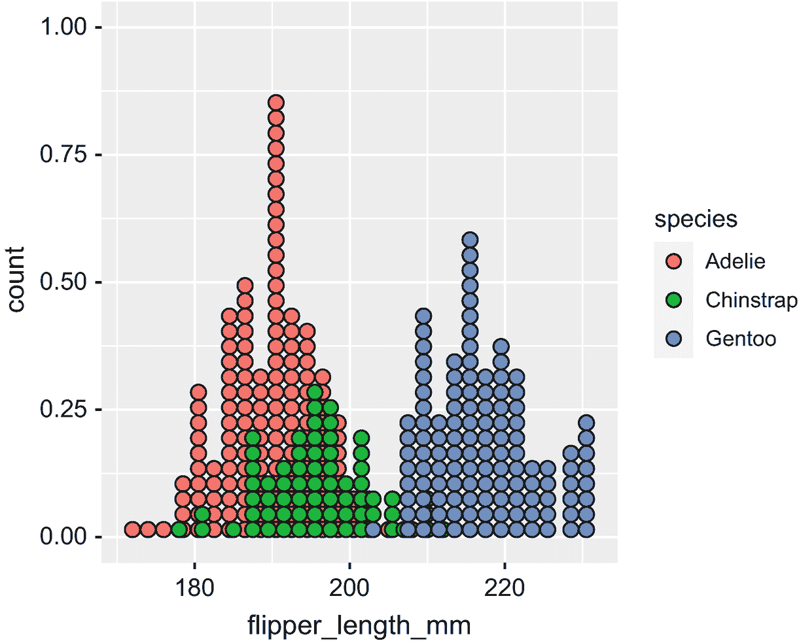

图 6-9

使用 `fill = species` 的企鹅点图

在图 6-9 中，你第一次在企鹅数据中看到了非常有趣的现象。注意，每个物种的企鹅往往拥有相似长度的鳍状肢。事实上，对于每个单一物种，只有少数企鹅拥有该物种最短或最长的鳍状肢长度。这些点在每个物种的鳍状肢长度*中间*堆积得最高。

在图 6-10 中更仔细地观察这个现象，暂时忘记 `R` 代码。对于每个物种，最常见的鳍状肢长度位于中间：

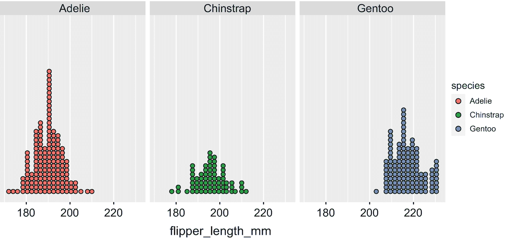

图 6-10

按物种分组的企鹅点图

```
## 'stat_bindot()' using 'bins = 30'. Pick better value with 'binwidth'.
## Warning: Removed 2 rows containing non-finite values (stat_bindot).
```

这对于 Chinstrap 企鹅来说几乎是完美的对称分布（这被称为**正态**分布）。然而，Adelie 企鹅和 Gentoo 企鹅都有一点右尾（这被称为**右偏**）。如果数据朝另一个方向拖尾，则称为**左偏**。

### 示例

为了理解样本的形态，对比一下会很有帮助。请观察图 6-11。在前一个示例中，你学到了用 `normal` （正态）来描述一组数据：大部分数值集中在中间，少数分布在边缘。这正是图 6-11 左侧呈现的形状。而右侧展示的是所谓的 `uniform` （均匀）数据，形状类似一个矩形。

两组数据的取值大多在 0 到 5 之间（上下略有浮动）。实际上，这两个图形的阴影 `面积` 是相同的！它们都代表了 10,000 个数据点（通过计算机模拟生成，以展示近乎完美的正态分布和均匀分布）。

当你查看样本数据的直方图时，可以将其与正态或均匀分布进行对比。它更接近哪一种形状？请记住，即使数据是`接近`正态分布也是可以接受的。数据拖尾的方向不同，就构成了左偏或右偏的正态分布。

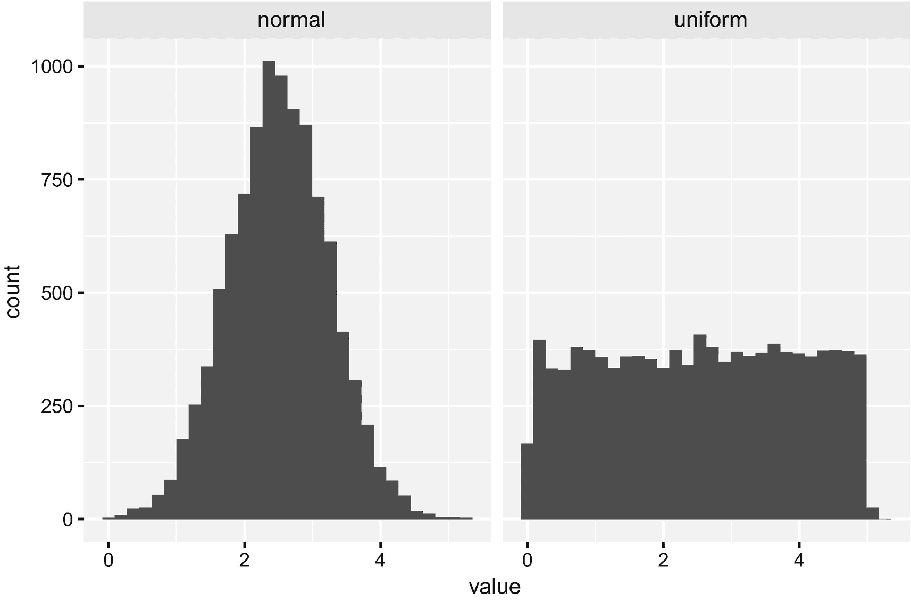

图 6-11

近乎完美的正态分布与均匀分布直方图

之前看到的企鹅数据其实非常接近正态分布（只有轻微偏斜——其中巴布亚企鹅的偏斜程度最大）。那么，来自“aces 每日调查”的部分参与者数据又是怎样的呢？现在你已经掌握了正态分布和均匀分布的概念，并且知道了如何使用`ggplot()`。因此，可以安全地进一步探索 `acesData` 数据集了。或许我们可以研究一下 `COPEExp`，这是一个衡量情绪表达应对方式的指标，采用 1-4 分的评分标准，数据采集自晚间调查问卷。

在该数据集中，晚间问卷是一天中的第三次调查；因此，我们最好将绘图数据限制为数据表中属于第三次调查的那些行。这是对 `data.table` 进行行操作，所以通过 `SurveyInteger == 3` 来设置行的筛选条件。

这些数据会频繁重复记录；与年龄这种一次性数据不同，参与者需要在研究的每个晚上记录他们的情绪表达应对情况。因此，无需对这些变量执行任何 `unique()` 操作。

这只是一次探索性数据分析，所以使用直方图就很合适。将数据集放入 `ggplot()` 后，就可以将列名映射到美学属性上，比如 x 轴或 y 轴。对于直方图，只需设置 x 轴即可。当然，还必须将显示几何对象设置为 `geom_histogram()`：

```
ggplot(data = acesData[SurveyInteger == 3],
mapping = aes(x = COPEExp))+
geom_histogram()
## 'stat_bin()' using 'bins = 30'. Pick better value with 'binwidth'.
## Warning: Removed 264 rows containing non-finite values (stat_bin).
```

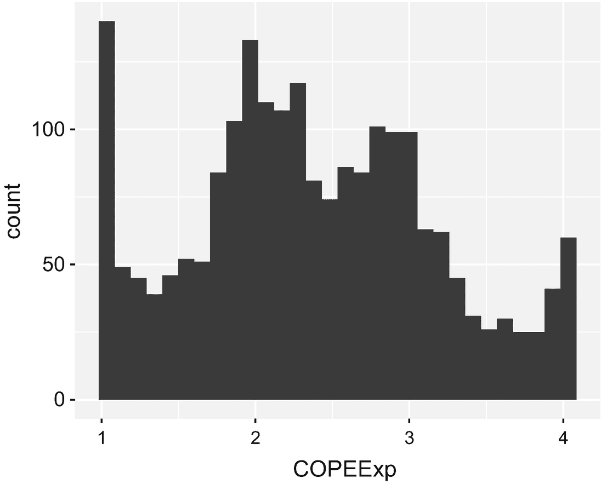

图 6-12

`COPEExp` 的直方图

观察图 6-12，这些数据是正态分布吗？还是偏态的正态分布？是均匀分布？或者都不是？

回想一下你最近填写的问卷。如果你对问卷感到厌烦，你的回答会不会变得更极端？有时候，数据集的端点会让人感到困惑。一种技巧是`裁剪`数据集，看看中间部分的数据是否符合某种模式。不过，这必须谨慎进行，并且要有充分的理由。仅仅为了让样本呈现正态或均匀特征而随意裁剪数据是愚蠢的（并且会导致错误的结论）。

尽管如此，为了演示裁剪的效果，我们可以尝试移除极端值 1 和 4。这同样是一种行选择操作。我们只需要 `COPEExp` 值大于 1 且小于 4 的数据。回想一下实现这一功能的逻辑运算符——`%gl%`。除了这一改动，其他代码保持不变：

```
ggplot(data = acesData[SurveyInteger == 3 &
COPEExp %gl% c(1,4)],
mapping = aes(x = COPEExp))+
geom_histogram()
## 'stat_bin()' using 'bins = 30'. Pick better value with 'binwidth'.
```

经过这一修改，图 6-13 看起来几乎就是正态分布了。实际上，它和我们之前看到的企鹅物种数据很像——数据中有两个常见的高频区域。这些裁剪后的数据接近正态分布，可能带有轻微的右偏。

本节最后想提醒你的是，尽管本书将带你了解许多不同的模式和模型，但大多数真实世界的数据看起来并不像图 6-11 那样。因此，在处理数据时，必须保持一定的灵活性。尽管如此，你在本书中学习和实践的技术将为你带来两项有用的技能。

第一项是对统计学和数据科学基础有更深入的理解。处理凌乱的现实数据可能需要比正态分布或均匀分布更复杂的模型。但这并不意味着你不能使用这两种分布来获得非常接近（甚至足够接近）的结果。另一项技能仅仅是经验。你已经看到将 `ggplot()` 从直方图切换到点图是多么容易。凭借在此获得的经验，当你遇到需要额外处理的复杂数据时，再前进一或两步也不会耗费太多功夫。

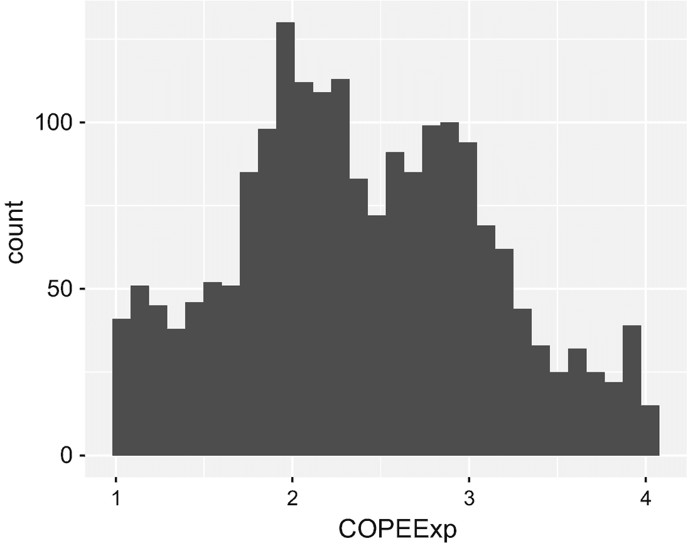

图 6-13

裁剪后的 `COPEExp` 直方图

## 6.3 集中趋势

在前面的章节中，“中间”这个词反复出现。然而，尽管这些是大多数人已经熟悉的统计学概念，我们却刻意避免使用一些“中间”的同义词。我们一直没有使用“均值”或“中位数”这类词。现在是时候纠正这一点，来讨论用一个单一数值将整列数据归纳为一个集中趋势的方法。

记住故事往往比记忆大量看似无关的事实更容易。你的目标是通过更容易获取、规模可控的样本来理解总体。即便如此，样本的量往往也很大。你已经掌握了一些很好的可视化方法来总结样本的数值行为。而集中趋势的目的，就是找到一些常见的、居中的或常规的数值，来描述样本中“最可能”出现的值。

在日常生活中，人们经常使用“平均值”这个词来描述这些概念。由于这里我们要追求数学上的精确，我们将尽量避免使用这个词。相反，我们将介绍三种计算“平均值”的方法，它们通常会得出不同的结果。通过比较和对比这些差异，你不仅能学到一些总结样本的好方法，还能更深入地了解样本本身。

## 算术平均值

通常，当人们在数学意义上说“平均值”（例如，维多利亚州的平均收入）时，他们指的是**算术平均值**。假设有两个人，一个人收入为 0 美元，另一个人收入为 10 万美元。将这两个数字相加，然后除以人数，得到平均工资为 5 万美元。

虽然我们可以手动计算，但正如你所见，这信息量不大。对于一些随机的读者来说，要理解我们在做什么也更困难：

```
(0 + 100000)/ 2
## [1] 50000
```

更好的方法是使用 `R` 语言中计算算术平均值的函数 `mean()`，作用于我们创建的、包含这两个工资数据的变量上：

```
salaries <- c(0, 100000)
mean(salaries)
## [1] 50000
```

如果我们的样本中有三个人呢？假设我们在其中再加入一个人，其工资为 57,364 美元。那么，你现在需要将三个收入相加，然后除以 3，而不是 2：

```
(0 + 100000 + 57364)/3
## [1] 52455
salaries <- c(0, 100000, 57364)
mean(salaries)
## [1] 52455
```

在数学和统计学中，我们经常使用符号来表示概念。虽然符号有时会显得有些晦涩，但它们能让研究人员快速交流思想。有两种方式来表述算术平均值的等式。了解这一点很有用，这样你就能理解其他文献中的内容；在本书中，我们使用 `mean()`。

第一种方式使用省略号（...）来表示“依此类推”。算术平均值（用 `x̄` 或“x bar”符号表示）是所有变量之和除以变量的*个数*；公式为 `x̄ = (x₁ + ... + xₙ) / n`。你刚才在 `n = 2` 和 `n = 3` 的例子中已经看到了。

表达完全相同意思的更传统或更正式的方式是使用大写的希腊字母 *sigma*（可以把 sigma 理解为表示***求和***）。在这种情况下，*i* 表示我们从集合的开头到结尾遍历所有值。
`x̄ = (x₁ + ... + xₙ) / n = Σxᵢ / n`

注意，我们对样本变量使用了小写的*拉丁*字母（例如 `x`、`n` 和 `x̄`）。当然，我们确实用大写的*希腊*字母代替了省略号。

总体是庞大的，它们的数据值和摘要被称为*参数*，并且对于总体，我们最常使用小写的*希腊*字母或大写的*拉丁*字母。这些是我们想要研究的对象。

样本是总体的较小子集，它们的数据值和摘要被称为*统计量*，并且对于样本，我们最常使用小写的*拉丁*字母。因为研究整个总体通常很困难，我们“退而求其次”使用统计量，并利用它们来*估计*或*推断*关于总体和总体参数的信息。

如果你好奇的话，尽管数学计算方式相同，但存在一个正式的总体参数方程。如果一个人有幸知道整个总体中每个人的工资值，那么最恰当的方式是用希腊字母 `μ`（大致发音为“mu”）和表示总人口数的拉丁大写字母 `N` 来标记。希腊字母 `μ` 对应着*平均值*（参见粗略发音）：
`μ = Σxᵢ / N`

现在，我们再次强调，所有这些符号都是为了让你具备与全球研究人员和数据交互的良好能力。无论是使用 `R`（`mean()`）、省略号、大写的 sigma（`Σ`）还是小写的 mu（`μ`），对于算术平均值而言，最终计算结果并无差异。

### 示例

计算算术平均值（之所以这样称呼，是因为在除以计数之前，你需要使用算术方法对每个值求和）使用 `mean()` 函数。默认情况下，它有两个参数。第一个是定量数据，例如可以在一个列中找到的数据。第二个参数是可选的，仅当数据包含 `NA` 时才需要；它就是 `na.rm = TRUE`。

在这里，你会看到在 `penguinsData$flipper_length_mm` 上运行 `mean()` 的结果，分别是在不删除和删除缺失数据的情况下。无论哪种方式，你都能获得一些有用的信息：

```
mean(penguinsData$flipper_length_mm)
## [1] NA
mean(penguinsData$flipper_length_mm, na.rm = TRUE)
## [1] 200.9
```

在视觉上，我们可以使用函数 `geom_vline()` 在图表中添加一条垂直线。但是，我们没有将任何数据映射到垂直线的外观上。由于垂直线由 `x` 轴截距上的一个点决定，因此我们必须在 `mapping` 参数的二次调用中提供该信息。在这里不必过于担心代码。你要关注的是图 6-14 中的算术平均值，虽然它明显位于所有点的中间，但实际上并未穿过直方图最高的部分：

```
ggplot(data = penguinsData,
mapping = aes(x = flipper_length_mm))+
geom_histogram()+
geom_vline(mapping = aes(xintercept = mean(flipper_length_mm, na.rm = TRUE)))
## 'stat_bin()' using 'bins = 30'. Pick better value with 'binwidth'.
## Warning: Removed 2 rows containing non-finite values (stat_bin).
```

因此，虽然当被问及企鹅鳍状肢的长度时，201 可能是一个很好的“平均”数字，但你可以看到，我们可能需要其他方式来讨论集中趋势。稍后会有更多相关内容！

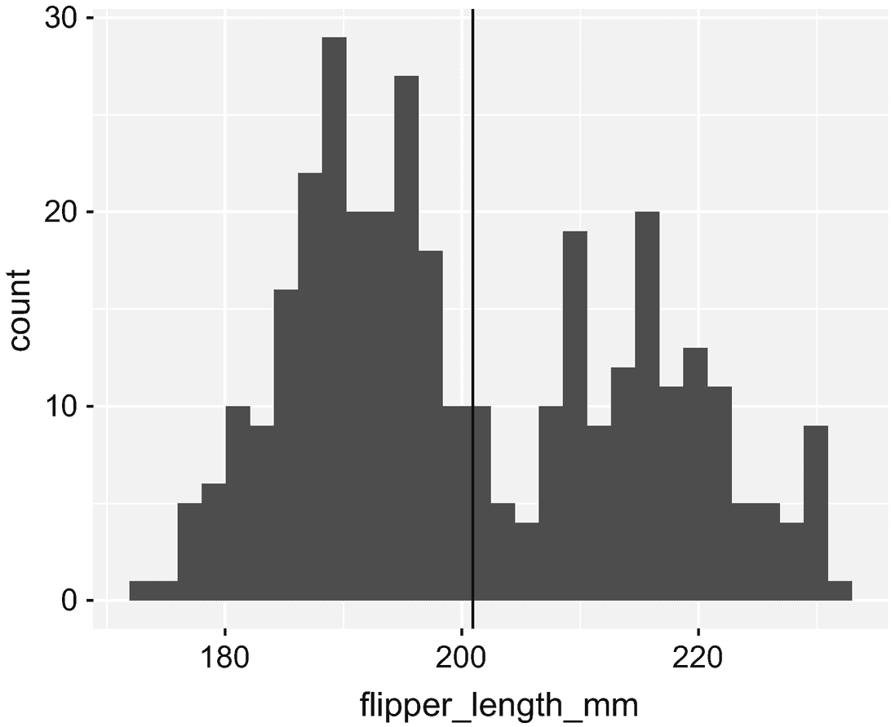

图 6-14 带有算术平均值的企鹅直方图

### 示例

类似地，可以为我们的 `acesData` 计算 `mean()`：

```
mean(acesData[SurveyInteger == 3]$COPEExp)
## [1] NA
mean(acesData[SurveyInteger == 3]$COPEExp, na.rm = TRUE)
## [1] 2.37
```

这一次，图 6-15 中的垂直线似乎不仅位于数据中间：它还处于数据的“密集”区域：


图 6-15 带有算术平均值的 `COPEExp` 直方图

```
ggplot(data = acesData[SurveyInteger == 3],
mapping = aes(x = COPEExp))+
geom_histogram()+
geom_vline(mapping = aes(xintercept = mean(COPEExp, na.rm = TRUE)))
## 'stat_bin()' using 'bins = 30'. Pick better value with 'binwidth'.
## Warning: Removed 264 rows containing non-finite values (stat_bin).
```

比较并对比图 6-14 和图 6-15。算术平均值一定能告诉你“平均”数据是什么样的吗？

## 中位数

由于算术平均数并不总能完美概括数据，因此引入其他度量指标是有益的。一种可行方案是找出数据点列表中处于正中心位置的那个数据点。

回顾我们之前三个薪资的小示例：

```
salaries
## [1]      0 100000   57364
```

在该示例的三个人中，有*两人*的收入*高于*算术平均数。位于中间的薪资 57364 美元即为 `median()` 中位数。在这种情况下，中位数或许能更好地代表“普通人”的收入水平。它是一个真实的薪资值，且位于这三人的中间位置。与之前相同，`R` 函数可以接受两个参数：一个数据项和可选的第二个参数 `na.rm = TRUE`：

```
mean(salaries)
## [1] 52455
median(salaries)
## [1] 57364
```

需要注意的重要一点是，该薪资数据集的个数为奇数。因此，能精确找到中间值。当数据个数为*偶数*时，则会取*中间两个*值的平均值。请看下面这个扩展示例，`R` 的 `median()` 函数会自动识别中间两个值并计算它们的 `mean()` 平均值：

```
salariesEven <- c(0, 100000, 57364, 20000)
sort(salariesEven)
## [1]       0 20000 57364 100000
median(salariesEven)
## [1] 38682
mean(c(57364, 20000))
## [1] 38682
```

### 示例

针对企鹅数据，对比分析平均值与中位数。当平均值更大时，你能从中发现什么？

```
mean(penguinsData$flipper_length_mm, na.rm = TRUE)
## [1] 200.9
median(penguinsData$flipper_length_mm, na.rm = TRUE)
## [1] 197
```

观察直方图（同样，无需在 `ggplot()` 代码上花费过多时间）。在图 6-16 中，中位数以虚线形式添加。如图所示，在这种情况下，中位数或许能更好地衡量这些数据的集中趋势——它穿过了图形中数据更密集的部分：

```
ggplot(data = penguinsData,
mapping = aes(x = flipper_length_mm))+
geom_histogram()+
geom_vline(mapping = aes(xintercept = mean(flipper_length_mm, na.rm = TRUE)))+
geom_vline(mapping = aes(xintercept = median(flipper_length_mm, na.rm = TRUE)),
linetype = "dashed")
## 'stat_bin()' using 'bins = 30'. Pick better value with 'binwidth'.
## Warning: Removed 2 rows containing non-finite values (stat_bin).
```

### 示例

对于 `COPEExp` 数据，中位数和平均值非常接近。回顾之前图 6-13 的修剪示例，这些数据非常接近*正态分布*。正态分布数据的一个特征就是中位数和平均值相等。当然，这些数据并非完美正态——我们不应期望这两者完全相等！

```
mean(acesData[SurveyInteger == 3]$COPEExp,
na.rm = TRUE)
## [1] 2.37
median(acesData[SurveyInteger == 3]$COPEExp,
na.rm = TRUE)
## [1] 2.312
```

在图 6-17 中，这两个数值也非常接近。注意，中位数*小于*平均值。观察图形，你是否注意到在 1 这个位置有很多数据点？这是直方图上最高的计数柱。虽然值为 1 很低，但它并不会过度“拉低”平均值。另一方面，该处的计数很高，而中位数完全取决于*计数*，因此将那条虚线中位数线稍稍向左拉动：

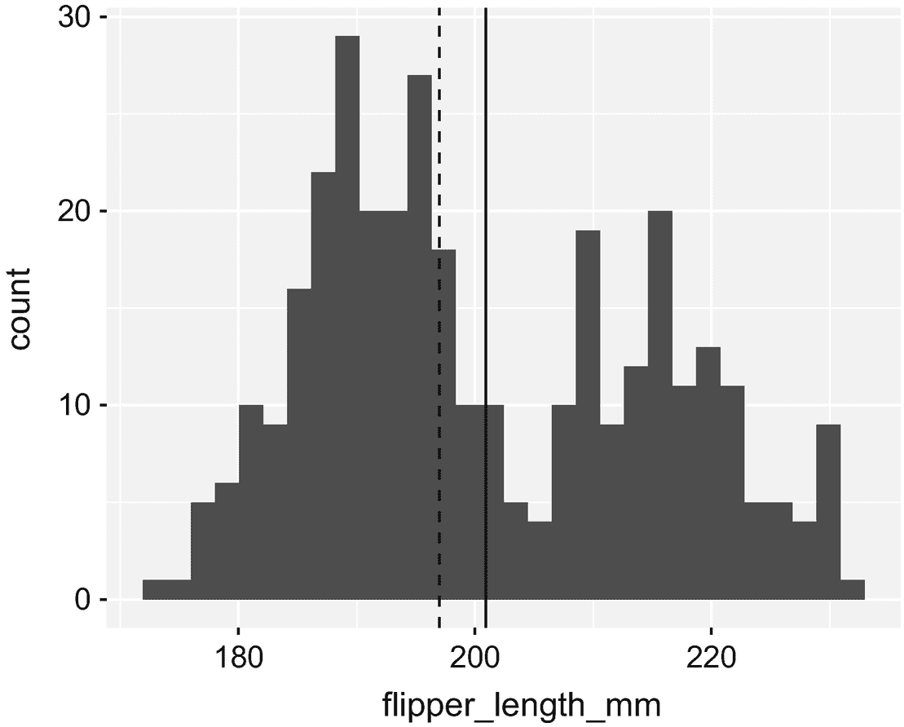

图 6-16 企鹅直方图（含算术平均值与虚线中位数）

```
ggplot(data = acesData[SurveyInteger == 3],
mapping = aes(x = COPEExp))+
geom_histogram()+
geom_vline(mapping = aes(xintercept = mean(COPEExp, na.rm = TRUE)))+
geom_vline(mapping = aes(xintercept = median(COPEExp, na.rm = TRUE)),
linetype = "dashed")
```

```
## 'stat_bin()' using 'bins = 30'. Pick better value with 'binwidth'.
## Warning: Removed 264 rows containing non-finite values (stat_bin).
```

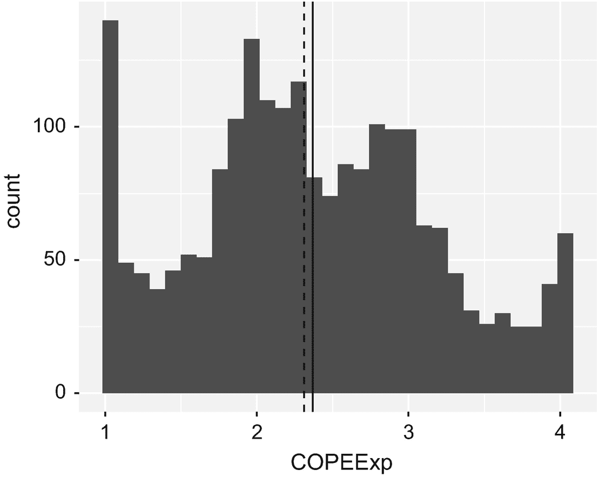

图 6-17 `COPEExp` 直方图（含算术平均值）

你对数据的探索越深入，就越能通过对比集中趋势指标来获得更多洞见。

## 位置

在探讨了数据中心之后，让我们来考虑数据的整体位置。你已经知道中位数正好位于数据的正中间。换句话说，50% 的数据点小于或等于中位数，另外 50% 的数据点大于或等于中位数。

有时，了解除正中间以外的其他位置的分界点也很有用。这些分界点被称为**分位数**。你可能熟悉常见的分位数有*四分位数*（在 25%、50%、75% 和 100% 位置将数据四等分）和*百分位数*（按百分比将数据从 1% 到 100% 进行切片）。

分位数的常见用途包括人均收入或家庭收入（正如我们在 `salaries` “数据”中简要探讨的那样）。事实上，这类分位数可以对数据进行分类（例如 `acesData$SES_1` 就部分基于财富指标）。

计算分位数的函数恰如其名，称为 `quantile()`，它接受两个参数。第一个参数是数据，第二个参数是一个数值列表，用于指示分界点或概率。

使用第 5 章介绍的 `seq()` 函数，你可以为一些常见分位数创建分界点：

```
quartiles <- seq(0, 1, 0.25)
deciles <- seq(0, 1, 0.10)
grades <- seq(0.6, 1, 0.10)
percentiles <- seq(0, 1, 0.01)
```

此处，我们通过 `quartiles`（四分位数）来考察薪资数据。如你所见，`median()` 函数是第 50 百分位数的一个特例：

```
quantile(salaries, quartiles)
##     0%    25%    50%    75%    100%
##      0  28682  57364  78682  100000
median(salaries)
## [1] 57364
quantile(salariesEven, quartiles)
##     0%    25%    50%    75%    100%
##      0  15000  38682  68023  100000
median(salariesEven)
## [1] 38682
```

现在，让我们用更大的数据集来探索这种基于分位数的分类思想。

### 示例

回想图 6-8 中的点图。与其将数据排列成直方图形状，我们不如直接查看原始数据并自行做出判断。

为此，我们使用几乎和平时一样的 `ggplot()` 代码。但首次，我们不仅将 `flipper_length_mm` 映射到水平 x 值上，还设置了 `y = 0`。然后，用 `geom_jitter()` 代替 `geom_dotplot()`。图 6-18 的结果显示了所有 344 个企鹅鳍肢长度（实际上是 344 减去缺失值后的数量）：

```
ggplot(data = penguinsData,
mapping = aes(x = flipper_length_mm, y = 0))+
geom_jitter()
## Warning: Removed 2 rows containing missing values (geom_point).
```

注意图表右侧是较长的巴布亚企鹅鳍肢（回顾图 6-9），中间有一小段间隔将它们分开，形成自己的集群。

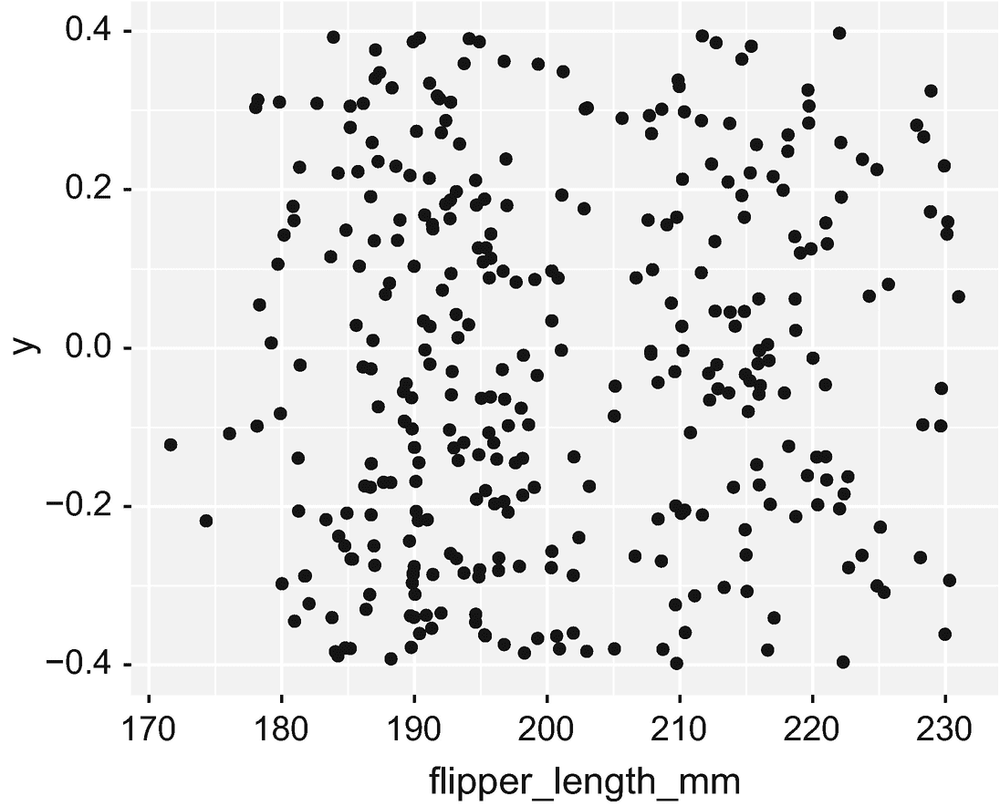

图 6-18

企鹅抖动图

这与分位数有什么关系？图 6-18 中的点可以按分位数区间来思考。仔细观察这些点，思考`四分位数`，看看你是否能将不同长度分组为最短的 25%、最长的 50% 等。你可能已经猜到，由于鳍肢长度存在一些缺失值，我们必须使用万无一失的代码短语 `na.rm = TRUE`。注意我们一开始并没有使用它。虽然 `R` 中并非所有错误信息都有帮助，但它们通常是有用的。此外，即使是很晦涩的错误代码，通过将确切的短语复制粘贴到互联网搜索引擎中，也常常能提供有用的线索：

```
quantile(penguinsData$flipper_length_mm, quartiles)
## Error in quantile.default(penguinsData$flipper_length_mm, quartiles): missing values and NaN's not allowed if 'na.rm' is FALSE
quantile(penguinsData$flipper_length_mm, quartiles, na.rm = TRUE)
##   0%  25%  50%  75% 100%
##  172  190  197  213  231
```

这是一种对数据集进行分段的常见方法，因其常见，所以有专门的图表帮助我们可视化。这种图表就是 `箱线图`（或`盒须图`）。在图 6-19 中，你可以看到半透明的箱线图覆盖在企鹅鳍肢长度的点上。

箱线图的两侧是须线。它们显示了数据底部的 25% 和顶部的 25% 所在的位置。*箱子内部*是数据的*中间* 50%（范围从 25% 分位数到 75% 分位数）。一条粗实的垂直竖线表示*中位数*。

注意，就鳍肢长度而言，要将四分之一的数据点放入 25%–50% 的区间，会导致箱线图的这一部分相当狭窄。另一方面，从 50% 到 75% 的数据点分布则宽得多。将这些信息与图 6-1 的直方图进行比较和对比。直方图和箱线图不仅展示了数据的完整*范围*，还展示了*频数*。

记住，到目前为止，我们的目标只是理解、探索和描述数据。我们还未对这些数据进行评估。拥有几个常用图表（如直方图、点图、抖动图和箱线图）对于从稍微不同的视角观察事物非常有用（请原谅我们玩了个文字游戏）。

一如既往，`ggplot()` 使得添加 `geom_boxplot()` 变得简单。但在实际应用中，人们不会总是同时包含抖动点和箱线图。这是因为抖动图中的点可能会分散注意力。如果目标是总结数据，那么在传达信息方面往往“少即是多”。然而，箱线图是本书中较难理解的图表之一。因此我们倾向于同时展示两者。因为我们要同时展示两者，在接下来的代码中你会看到一个新的参数。为了让箱线图足够透明以显示背后的点，我们将 `alpha` 从 1 降低到 0.5：

```
ggplot(data = penguinsData,
mapping = aes(x = flipper_length_mm, y = 0))+
geom_jitter()+
geom_boxplot(alpha = 0.5)
## Warning: Removed 2 rows containing non-finite values (stat_boxplot).
## Warning: Removed 2 rows containing missing values (geom_point).
```

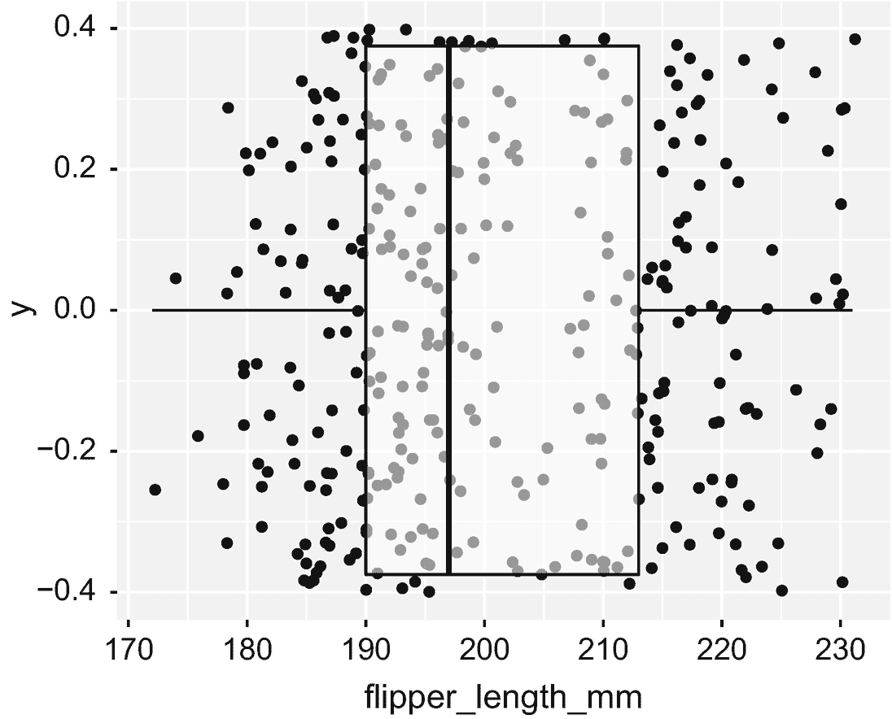

图 6-19

企鹅箱线图

### 示例

假设你需要更好地理解不同年龄段的人在`acesData`中的调查回应情况。或许值得先查看整个调查数据集的年龄分布（这有助于在进行分析前发现规律）。

但请记住，参与者通常不会重新输入他们的年龄——许多调查都存在年龄缺失的情况。因此，在探索数据之前，我们必须先清洗或*整理*数据。

这在真实世界的数据中很*常见*。事实上，在任何数据集上，超过一半的工作通常都花在数据整理上。当你将所学的技巧应用于真实场景时，这一点非常重要。同样重要的是，要向利益相关者（例如经理、主管、客户等）说明：尽管实际分析看起来很简单，但数据质量往往是限制因素。

要清理`Ages`这一列，我们只需用每个参与者的惯用年龄来填充缺失值即可。尽管前面介绍得有些吓人，但用`data.table`来实现这个操作其实很快！

回顾第 5 章的频数表：

```
acesData[order(Age), .N, by = Age]
##     Age    N
##  1:  18  347
##  2:  19  908
##  3:  20  889
##  4:  21 1278
##  5:  22  821
##  6:  23  583
##  7:  24  396
##  8:  25 1036
##  9:  26  121
## 10:  NA  220
```

我们有 220 个缺失的年龄需要修正。一种方法是使用我们刚学过的`mean()`函数。如果我们把每个`UserID`的`Age`设为其平均年龄（并设置`rm.na=TRUE`），问题就迎刃而解了！

我们需要对所有行执行此操作，因此`i`位置的行操作为空。我们正在给`Age`赋新值，所以这里包含了新的赋值。

现在来到了数据整理的关键时刻：我们是否要添加一个新列来占用内存？如果在`j`位置添加一个新列，我们就可以保留原始的`Age`列。这可能对未来的其他分析有帮助。另一方面，添加一个新列会增加 6599 个新数据位，而这些数据大多是从原始列复制过来的（除了那 220 个缺失值）。此外，我们还得记住分析时*要使用哪一列*年龄数据。大多数这样的决策都需要权衡利弊。在本例中，我们创建一个名为`meanAge`的新年龄列。

最后，我们需要的是*每位参与者*的平均年龄。因此，在数据表的最后一个位置使用`by = UserID`可以确保我们不会得到整体的平均年龄：

```
acesData[, meanAge := mean(Age, na.rm = TRUE), by = UserID]
```

再看一下更新后的频数表，现在使用`meanAge`，我们只剩下 26 行缺失数据。如果你进一步（自行）探索这些数据，你会发现它们全部来自一个从未报告过年龄的参与者：

```
acesData[order(meanAge), .N, by = meanAge]
##     meanAge    N
##  1:      18  359
##  2:      19  932
##  3:      20  919
##  4:      21 1310
##  5:      22  844
##  6:      23  606
##  7:      24  413
##  8:      25 1064
##  9:      26  126
## 10:     NaN   26
```

清理完数据集后，你现在就可以着手将参与者进入调查数据的情况进行可视化呈现了。图 6-20 上现在有超过 6500 个点。看着这些点，很难看出规律。不过，你会看到箱线图很好地总结了数据分布情况：一半的调查回复来自较年轻的参与者。

生成这张图的代码与前面示例中的代码大致相同。唯一的区别是，通过将透明度（`alpha`）降低到 0.4，为`geom_jitter`添加了透明效果：

```
ggplot(data = acesData,
mapping = aes(x = meanAge, y = 0))+
geom_jitter(alpha = 0.4)+
geom_boxplot(alpha = 0.85)
## Warning: Removed 26 rows containing non-finite values (stat_boxplot).
## Warning: Removed 26 rows containing missing values (geom_point).
```

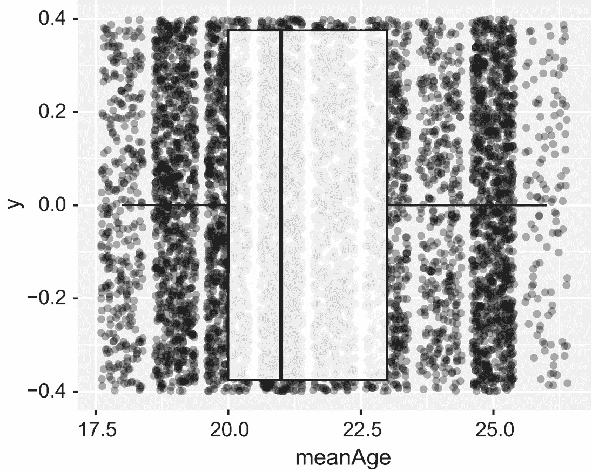

图 6-20

`meanAge`箱线图

### 示例

对于最后一个箱线图示例，我们来探讨**异常值**的概念。回想一下图 6-11 中的“完美”数据集。看看该图左侧的正常数据。现在，再看看图 6-21 的左侧（正常数据）。请注意箱线图的中间 50%部分非常狭窄。这很好理解，因为那里正是直方图最高的区域。接着，两边的须线相对较长；这也说得通。那些较长的区域就是直方图两边的长尾区域。

现在，看看图 6-21 中那些放大的点。这些点在箱线图上的位置，对应着抖动散点图中最稀疏的那些点。这些稀疏的点（既包括作为箱线图总结一部分的大点，也包括代表该数据集实际原始数据值的小点）就是**异常值**。

在太阳系中，外围的小行星距离中心非常遥远。同样地，数据中的异常值也是距离中心非常远的点。

从图 6-21 中的这两个箱线图还能注意到其他一些现象：正态分布的箱线图中间部分非常紧凑，须线更长，并且存在异常值（大点）。而均匀分布的箱线图，其四个部分间隔均匀，并且没有异常值。尽管如此，这两组数据的中位数，乃至均值，都是相同的。

这两组数据共享中位数和众数。它们的范围大致都在 0 到 5 之间（略有增减）。然而它们的箱线图看起来却不同。我们该如何对比这两组数据呢？这种对比有什么用处吗？