# 6.5 湍流

答案是肯定的。我们用来描述图 6-21 中差异的语言，正是数据*湍流*或*方差*的语言。正态数据围绕均值聚集，而均匀数据则不然。

一般而言，在其他条件相同的情况下，正态数据由于其“围绕均值聚集”的特性，其**方差**或**标准差**会比其它数据*更小*。

记住我们在图 6-22 中的“近乎完美”数据集，请考虑以下输出（再次提醒，对于这个“完美”示例，我们隐藏了代码，只显示输出结果）。请注意正态数据和均匀数据之间标准差的差异：

```
##      variable Variance StandardDeviation ArithmeticMean Median
##  1:    normal   0.5486            0.7406          2.505  2.503
##  2:   uniform   2.0830            1.4433          2.522  2.545
```

你之前很可能已经接触过标准差。你有没有在新闻中看到过民调显示“……±3%”？样本估计中的这种波动或涨落或湍流，就与方差和标准差相关。

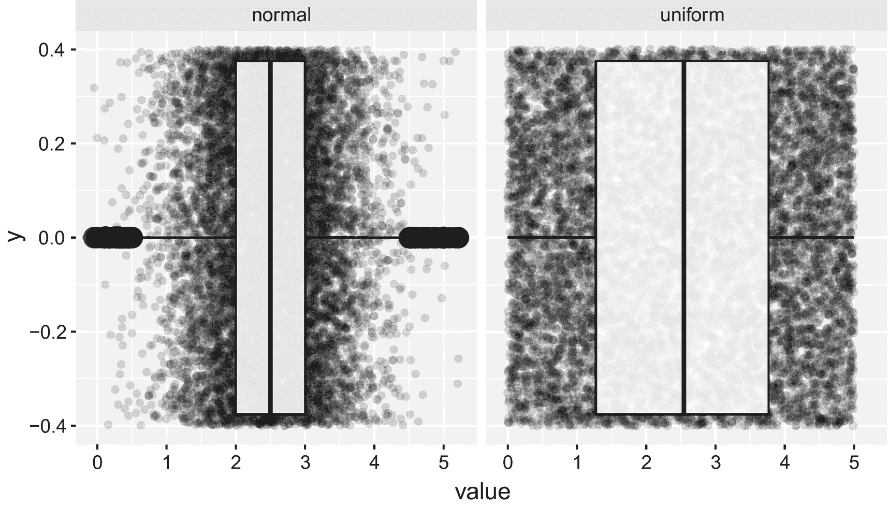

**图 6-21** 箱线图中的异常值

正式地说，方差是标准差的平方。另一种说法是，方差开平方根就是标准差。

回想一下我们之前的讨论：大写拉丁字母和小写希腊字母用于表示总体，而小写拉丁字母用于表示样本。当然，我们使用 `R` 来进行计算。不过，我们仍有必要聊聊这些正式的公式。这有助于你将来选择更深入地探索统计学，尽管本书是一本方法书。

对于所有四个公式（总体方差、总体标准差、样本方差和样本标准差），其整体思想是相同的。目标是*将每一个*单独的行元素（例如，*x*[*i*]）与算术均值进行比较。在数学中，差异是通过减法来求得的。因此，这四个公式的核心都是 *x*[*i*] − *MEAN*。

不要让这些符号迷惑了你！它们实际上只是一个公式，而不是四个。记住，总体均值是 *μ*，而样本均值是 。当然，我们还有用于总体数量的 *N* 和用于样本数量的 *n*。这些公式唯一的真正区别在于，计算总体时是除以总数；而计算样本时，则是除以 *n* − 1。

请记住，样本比总体要小。在现实生活中，我们几乎从未拥有过总体层面的参数数据。相反，我们通过抽取样本，然后将从较小子样本中学到的东西推广到更大的总体。*n* − 1 是对公式的一个调整，目的是使样本方差和样本标准差比没有这个调整时更大。我们将在后续章节中看到，这如何让我们能够从样本中对总体做出更保守的估计。

可以这样理解：在正态数据中，由于数据聚集在中心附近，你可以相当确定，如果你从图中随机抽取一个点，那么你很可能抽到一个靠近中间的点。相比之下，均匀数据则分布在一个更宽的区域内。在某种程度上，标准差告诉你在随机抽取中最可能获得的、围绕中位数的范围。因此，通过使样本的标准差变宽，统计学家确保我们向人们报告“大多数”结果时，能给出一个更宽泛的可能范围。同样，我们稍后将再次深入探讨这个概念。

关于方差和标准差，我们要指出的最后一点是：`R` 专注于利用样本来推断总体。因此，`R` 中常用的方差函数（`var()`）和标准差函数（`sd()`）会自动使用这些公式的样本版本。

**总体方差公式：**

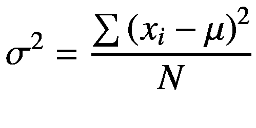

**总体标准差公式：**

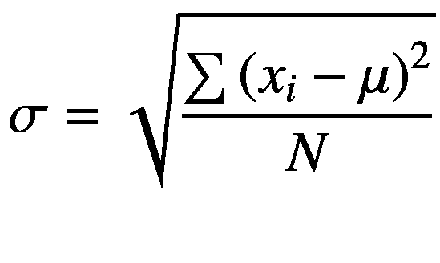

**样本方差公式 – `var()`：**

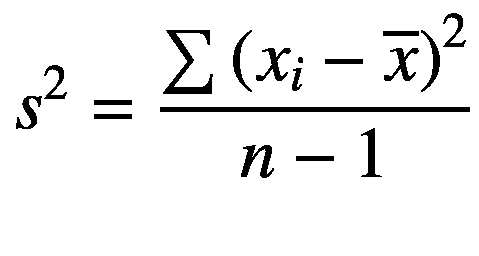

**样本标准差公式 – `sd()`：**

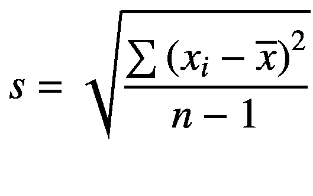

手动计算样本标准差公式是有价值的。有一道练习会让你这样做。然而，绝大多数这类手动计算都是在非常小的、玩具数据集上进行的。当然，我们不会在较大的数据集上这样做（即使像 344 只企鹅这样相对较小的“较大数据”也不行）。现代数据量太大，无法手动计算。

在当今更大的数据集中，我们更常关注的是如何使用标准差来帮助概括和描述数据。一种方法是用标准差来描述数据的“通常范围”。就像你在民意调查中可能看到的“60% 支持率 ±3%”一样，我们可以将数据视为*均值*加上或减去标准差。

为了直观地展示样本标准差 *s* 的这种用法，请看图 6-22，我们“完美”的正态曲线周围有标记着均值附近箱体的线段。请注意，被 `1s`（代表*一个标准差*）相交的直方图条柱代表了大部分计数（记住直方图的高度意味着该处有更多数据）。然后，如果我们将距离扩展到 `2s`，我们就能覆盖几乎所有的条柱。

事实上，在统计学中，有一条规则叫做**经验法则**，它指出约 68% 的数据将落在第一个标准差的区域内。该规则进一步说明，约 95% 的数据落在两个标准差的区域内，约 99.7% 的数据落在三个标准差的区域内。事实上，这条规则有时也被称为 *68-95-99.7* 法则。虽然你会在本书中学到如何使用代码来计算你需要的任何精确比率，但了解这条经验法则有助于理解，仅通过知道标准差和均值，就能很好地判断特定数据集可能的行为模式。

如果你在商业领域待过，你可能听说过“六西格玛”。这种管理哲学的名称来源于一个理念：工作的精确度——即使在质量上存在通常程度的*方差*——也应当高到，即使在距离均值*六个*标准差处，产品仍然具有可用的质量。

正如你可能想象到的，要保持在标准差如此极端的范围内还能让产品可用，就需要标准差非常小，这样 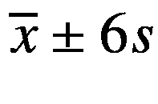 才能停留在一个非常狭窄的范围内。

图 6-23 [6] 展示了看待同一概念的另一种方式。这个正态分布图用 σ 符号表示标准差，并且它们向外延伸到了 ±4σ。现在，不要让图 6-23 中的信息让你不知所措；我们将在第 9 章更详细地讨论这张图。目前，请关注曲线底部附近写有“与均值的标准差个数”的那条线。看到在 0 的两侧分别有 −1σ 和 +1σ 吗？注意到这两点之间的区域被标记为 0.3413 吗？当然，如果我们把这两个区域加起来，0.3413 + 0.3413 = 0.6826。这约等于 68%，这就是经验法则中 68% 这个数字的由来。类似地，如果我们把 −3σ 到 +3σ 之间的区域都算上，我们得到 0.0214 + 0.1359 + 0.3413 + 0.3413 + 0.1359 + 0.0214 = 0.9972。这就是经验法则中 99.7% 这个数字的由来。


图 6-22 来自一个用`R`生成的*样本*，而图 6-23 则来自一个（理论上的）*总体*。这两张图有助于我们理解，思考样本（以及数据点的概率）如何帮助我们认识总体。

当我们把注意力转向一些使用熟悉数据集的**标准差**示例时，请记住，你已经在本章中学习和思考了很多内容。目前，标准差或许看起来还不能简洁地概括成千上万的数据点。你需要时间充分运用这些新学的描述方式，直到它们对你真正有用。在探索数据的过程中，请专注于实践这些理念和视角。随着时间推移，通过比较和对照更多的数据集，你将逐渐培养出对各类描述符所探索内容的感知力。

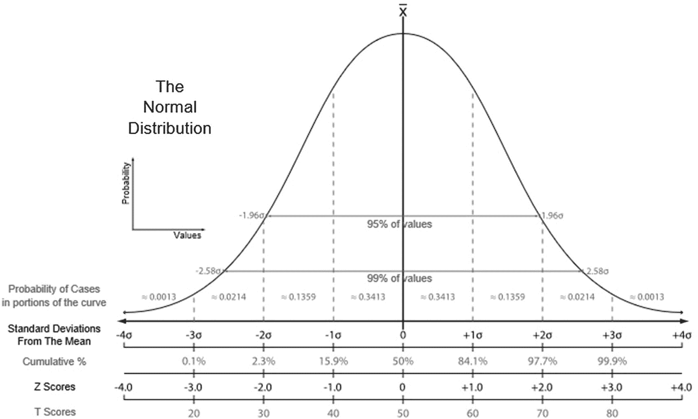

图 6-23

正态分布 [6]

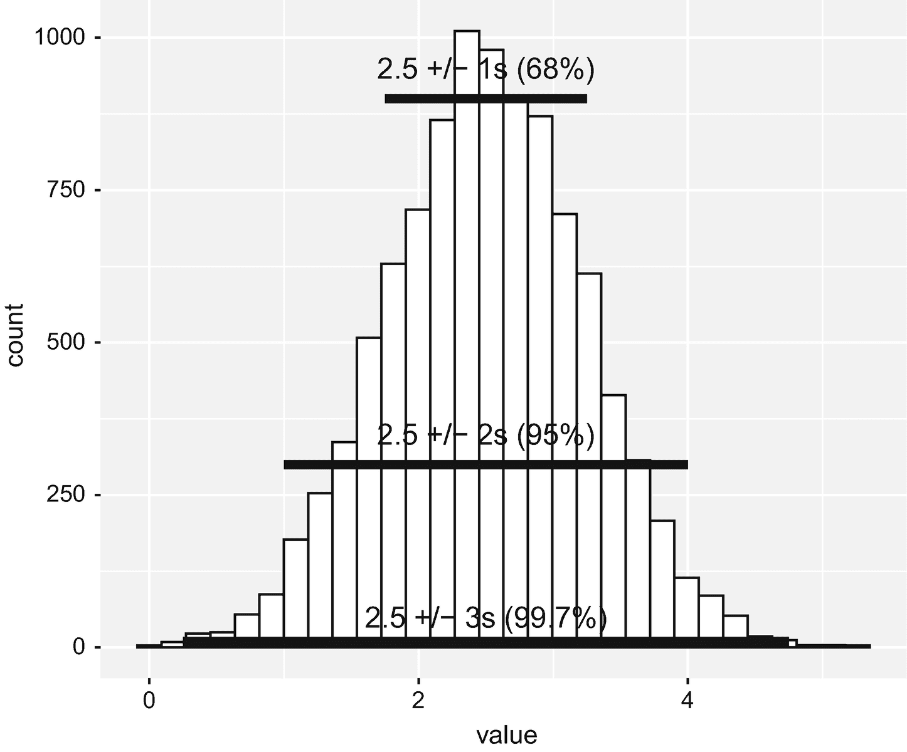

图 6-22

标准差区间覆盖的柱状条带

### 示例

在本示例中，我们使用三个不同但独立的函数。第一个函数是 `summary()`，它汇总了前几节讨论的几个指标。具体来说，它给出了**均值**、**极差**和**四分位数**。如果忽略均值，其余部分有时被描述为*五数汇总*。注意，五数汇总正是箱线图上的五个关键点。箱线图的设计初衷就是为了帮助我们一次性直观地理解多个五数汇总。`summary()` 函数的输入是一个单独的数据列，并且要求该列是定距或定比类型的定量数据：

```
summary(penguinsData$flipper_length_mm)
##    Min. 1st Qu.  Median    Mean 3rd Qu.   Max.   NA's
##     172     190     197     201     213    231      2
```

从汇总结果中，我们看到了许多关于鳍状肢长度的已知信息。其极差范围从最小值 172 毫米到最大值 231 毫米。由于中位数 197 小于均值 201，可知数据集中有一个较大的簇更靠近最大值而非最小值（可查看图 6-9 确认这是**巴布亚企鹅**物种）。最后，我们知道所有鳍状肢长度中，有一半介于第一四分位数 190 和第三四分位数 213 之间。

我们之前提到过 `var()` 和 `sd()`，分别用于计算样本方差和样本标准差。它们同样接受定距或定比类型的定量数据。它们还可以将 `rm.na = TRUE` 作为第二个参数传入（仅当数据包含缺失值时需要）：

```
var(penguinsData$flipper_length_mm, na.rm = TRUE)
## [1] 197.7
sd(penguinsData$flipper_length_mm, na.rm = TRUE)
## [1] 14.06
```

根据我们对*经验法则*的讨论，可以猜想 68% 的数据应该落在均值 201 ± 14 的范围内。实际情况果真如此吗？通过加减计算，我们得到的一个标准差区间是从 187 到 215。根据四分位数数据来看，这个区间*大约*比中间 50% 的数据范围略大一点。

如果想更精确地验证，快速计数会有所帮助。虽然可以做些复杂的操作，但这是探索性数据分析。记住企鹅数据集有 344 个观测值，而实际计数结果为 227/344 = 0.66，这表明这些数据并不完全符合经验法则。当然，你对此并不会感到惊讶。经验法则适用于*正态*数据；正如你之前所见，企鹅数据集并不真正符合那种模式。尽管如此，这个估计仍然很接近，实际上非常接近：

```
count <- penguinsData[flipper_length_mm %between% c(187, 215),.N]
count
## [1] 227
count/nrow(penguinsData)
## [1] 0.6599
```

经验法则适用于正态数据。标准差区间与经验法则的匹配度越低，说明你的数据偏离正态分布越远。你将在后续学习其他检验正态性的方法（除了你已经掌握的最简单的目视检查）。不过，这依然是你的技能库中又一个探索性工具。

最后，回顾我们对方差和标准差的形式化探讨，这两个公式是相关的。方差是标准差的平方，因此方差的平方根（`sqrt()`）应当等于标准差。为了增加一点趣味（并确保你对自己的逻辑运算符保持熟练），我们加入了一个验证：

```
sqrt(var(penguinsData$flipper_length_mm, na.rm = TRUE)) ==
sd(penguinsData$flipper_length_mm, na.rm = TRUE)
##  [1] TRUE
```


### 示例

虽然`penguinsData`数据因简短易懂而总是适合探索，但`acesData`数据是基于人类研究模拟的。因此，尝试将这些数据也运用我们所学的内容总是有益的。你能找到并练习这些技术的数据集越多，你训练比较与对比能力的速度就会越快、效果也会越好。反过来，比较与对比也是数据科学中*艺术性*的一部分。它能帮助你发现数字背后的故事，并向利益相关者、消费者、管理者或社区传递重要的事实。

我们首先使用`summary()`函数，并注意到这些数据中存在`NA`值：

```
summary(acesData$meanAge)
##    Min. 1st Qu.  Median    Mean 3rd Qu.   Max.   NA's
##    18.0    20.0    21.0    21.7    23.0   26.0     26
```

由于存在缺失数据，我们在`var()`和`sd()`函数中加入了第二个参数选项`na.rm = TRUE`。现在是提及研究中一个关键点的好时机。即使是在完美的随机样本中，参与者也有权不回应（这是道德要求，也是知情同意的一部分）。如果参与者随机选择不回应，那么一切还好。然而，如果参与者按照某种模式不回应，那么尽管你做了所有努力，偏差仍会重新出现在你的数据中。传统上，统计方程别无选择，只能删除`NA`值并接受偏差的回归。虽然这超出了本书的范围，但你可能希望查阅我们的一本统计编程与数据模型书籍 [22]，以了解更多关于“解决”*缺失数据*（并减少偏差）的内容。

不过目前，我们只需简单地移除缺失变量：

```
var(acesData$meanAge, na.rm = TRUE)
## [1] 4.899
sd(acesData$meanAge, na.rm = TRUE)
## [1] 2.213
```

根据我们对*经验法则*的讨论，我们可能仍然会想象 68%的数据应该落在 21.7 岁±2.2 岁之间。这是否成立？相减和相加得到的一个标准差范围是 19.5 到 23.9。基于我们的四分位数数据，这个范围看起来*大致*是合理的，比中间 50%的数据范围稍宽一些。

然而，从之前企鹅数据的例子出发，我们暂停片刻，快速查看一下直方图。正如你所见，图 6-24 看起来并不太符合正态分布。因此，我们怀疑经验法则可能并不完全适用于这些数据。不过，它看起来接近正态，所以我们或许可以预期某些接近经验法则的结果：

```
ggplot(data = acesData,
mapping = aes(x = meanAge))+
geom_histogram()
## 'stat_bin()' using 'bins = 30'. Pick better value with 'binwidth'.
## Warning: Removed 26 rows containing non-finite values (stat_bin).
```

和以前一样，为了更仔细地检查，快速计数会有所帮助。`acesData`中存在一些缺失的年龄数据，所以记得要对`meanAge`数据使用`is.na()`逻辑检查。这个检查会找到缺失值，因此必须用感叹号进行取反。这些数据在直方图上看起来比企鹅数据更接近正态，而最终结果 0.56 也更接近经验法则：

```
count <- acesData[meanAge %between% c(19.5, 23.9) &
!is.na(meanAge),
.N]
count
## [1] 3679
count/nrow(acesData[!is.na(meanAge)])
## [1] 0.5597
```

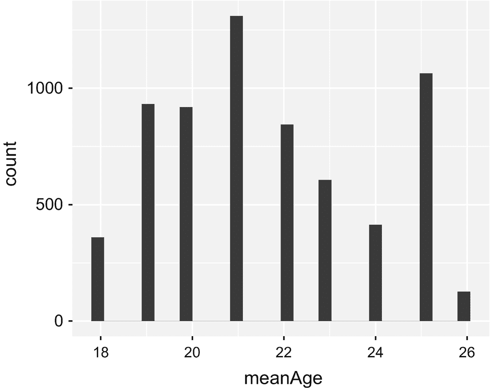

**图 6-24** meanAge 直方图

## 6.6 本章小结

本章介绍了可用于理解任何数据集的探索性数据分析工具。具体来说，你学会了如何使用`ggplot()`快速将数据绘制成直方图、点图和箱线图。你应用了`median()`、`mean()`、`summary()`和`sd()`来创建摘要，并从集中趋势、位置和波动性方面加深对数据集的理解。在此过程中，你将数据集与两个“完美”模型（一个“正态”和一个“均匀”）进行了比较。总而言之，你现在拥有了比较和对比任意两个数据集并理解其异同的知识、技能和能力。你付出了大量努力来学习这些概念，在练习中磨练技能时，可以随时参考表 6-1。

**表 6-1** 本章小结

| 概念 | 含义 |
| --- | --- |
| `hist()` | 基础`R`绘图包中的直方图函数。 |
| `setdiff()` | 比较集合 x 与集合 y，并返回 x 中不在 y 中的元素。 |
| `dotchart()` | 基础`R`绘图包中的点图。 |
| `ggplot()` | 图形语法包的主函数，接收数据和映射参数。 |
| `aes()` | 从数据列中接收`x =`、`y =`、`fill =`参数。 |
| `geom_histogram()` | 将 ggplot 对象转换为直方图。 |
| `geom_dotplot()` | 将 ggplot 对象转换为点图。 |
| `geom_jitter()` | 将 ggplot 对象转换为一组散点。 |
| `geom_boxplot()` | 将 ggplot 对象转换为箱线图。 |
| 正态数据 | 均值和众数是最常见的数据点。 |
| 均匀数据 | 矩形数据，其中每个点出现的概率与其他点相同。 |
| `mean()` | 计算算术平均值。 |
| `median()` | 返回数据精确中间位置的数据点。 |
| `quantile()` | 计算数据元素的相对位置。 |
| 异常值 | 远离均值及大部分数据的数据点。 |
| 标准差 | 衡量数据波动性的指标。 |
| `sd()` | 计算标准差的函数调用。 |
| 经验法则 | 也称为 68-95-99.7 规则。 |
| `summary()` | 箱线图的数值版本。 |

## 6.7 掌握练习

通过完成一些练习题来检查你的进度并在实践中成长。理解检查题提出批判性思维问题，最好以书面或口头形式回答。统计的艺术之一在于成功地将结果传达给你的利益相关者或受众。有时受众技术水平很高，有时则非技术性很强。练习题则是本章所探讨概念的更直接应用。

### 理解检查题

1.  用你自己的话来说，平均值和中位数之间的区别是什么？它们各自的计算过程是怎样的？如果你想要用一个数字来描述一个国家“普通”公民的收入，哪个指标可能更好？为什么？

2.  在研究 A 国和 B 国之间的年龄差异时，你发现两国的年龄中位数都是 36 岁，平均年龄都是 40 岁。然而，A 国的标准差为 4.5 年，而 B 国的标准差为 10.2 年。你知道年龄通常大致遵循正态分布（中位数和平均数接近支持了这一点）。关于这两个国家的总体直方图，你可能预期到什么？哪个国家更有可能有一位 104 岁的公民？


### 练习

1.  最好的学习方式是动手实践。复制本章中每个生成图形的示例代码。然后，将数据集中同一列的 `x =` 替换为另一列（例如，将 `x = flipper_length_mm` 替换为 `x = body_mass_g`）。你从其他数据列中学到了什么？它们中有任何*正态分布*或*均匀分布*的数据吗？

2.  在完成上一练习中对图形的列替换后，继续对你探索的每个新列使用 `summary()` 和 `sd()` 函数。将新的均值和标准差与你已见过的值进行比较和对比。同时比较和对比图形。你是否开始对标准差较大和较小时的视觉差异有所感觉？

3.  回忆一下样本标准差——`sd()`——遵循公式 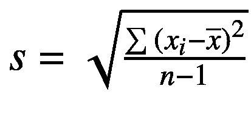。如何用手工传统方式计算标准差？嗯，对于 344 行数据，完全手工计算可能要求过高。相反，按照以下代码逐步操作，看看标准差究竟在做什么：

```
#首先，你获取一个只包含长度的数据表
standardDeviationpenguin <- penguinsData[,.(flipper_length_mm)]
#你需要知道平均长度
standardDeviationpenguin[, Mean := mean(flipper_length_mm, na.rm = TRUE)]
#到目前为止，我们每只企鹅的鳍状肢长度都有一个条目，以及总体平均值。
head(standardDeviationpenguin)
##    flipper_length_mm  Mean
## 1:               181 200.9
## 2:               186 200.9
## 3:               195 200.9
## 4:                NA 200.9
## 5:               193 200.9
## 6:               190 200.9
#这是每个长度与平均值之间的残差
standardDeviationpenguin[ , x_iMinusMean := (flipper_length_mm - Mean)]
#这让我们看到三只企鹅（通过目测，它们恰好来自不同物种）
standardDeviationpenguin[c(1, 153, 277)]
##    flipper_length_mm  Mean x_iMinusMean
## 1:               181 200.9      -19.915
## 2:               211 200.9       10.085
## 3:               192 200.9       -8.915
```

请注意，到目前为止，我们在 `x_iMinusMean` 中看到的是每个鳍状肢长度与平均长度之间的*差值*或**残差**。 -19.9 告诉我们第一个鳍状肢比平均值小很多。第二个物种的 10.1 告诉我们这个鳍状肢比平均值长。

正态分布数据的标准差较小。这说明在这些数据集中，残差总是很小。均匀分布数据的标准差较大，这说明残差不总是很小。

现在，按目前情况来看，如果你将 `x_iMinusMean` 的值求和，负数会在某种程度上被正数“抵消”（反之亦然）。这并不完全公平，因为请注意第一只企鹅与平均值 201 的整体距离最大。

因此，在数学中，为了消除负数，我们对它们进行平方：

```
standardDeviationpenguin[ , x_iMinusMeanSquared := (x_iMinusMeanˆ2)]
#这让我们看到三只企鹅（通过目测，它们恰好来自不同物种）
standardDeviationpenguin[c(1, 153, 277)]
##    flipper_length_mm  Mean x_iMinusMean x_iMinusMeanSquared
## 1:               181 200.9      -19.915              396.62
## 2:               211 200.9       10.085              101.70
## 3:               192 200.9       -8.915               79.48
```

回头再看*均值*公式，回忆一下 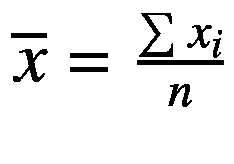。请注意，计算算术平均值的方法是将所有值求和并除以项目数量。

现在，我们的 `x_iMinusMeanSquared` 列可以在没有任何抵消的情况下求和；这正是我们对方差所做的！方差就是残差平方的算术平均值。它告诉我们通常的平方残差：

```
variance <- sum(standardDeviationpenguin$x_iMinusMeanSquared, na.rm = TRUE) / (nrow(standardDeviationpenguin) - 1)
```

通常，平方值对人类来说没有意义，因此我们取平方根，回到鳍状肢长度而不是鳍状肢长度的平方。因此，方差的平方根就是标准差。你可以使用 `sd()` 函数检查你的工作：

```
sqrt(variance)
## [1] 14.02
sd(standardDeviationpenguin$flipper_length_mm, na.rm = TRUE)
## [1] 14.06
```

看过这段代码后，请自行对 `mtcarsData` 数据集的 `mpg` 列重复此过程。记得使用 `sd()` 检查你的工作！

