# 7. 理解概率与分布

既然你已经能够描述样本数据集，现在是时候转向分析数据了。从描述性统计向*推断性*统计的推进需要一些思考和时间的投入。回顾一下，你已经学到了很多关于使用 `R` 的知识。然后，你学会了如何操作数据，甚至通过各种摘要（数值和图形）来描述数据。**推断性**统计是使用样本来理解和预测总体行为的科学与艺术。为了成功进行这些推断，你需要一些数学基础。

数据分析建立在数学基础之上。该基础的一部分是分数运算（例如加、减、乘、除）。虽然本章假设你已经理解分数，但没必要深入讨论极其晦涩的分数。你在代数课程中可能遇到的通常整数类型就足够了。如果分数让你有点害怕，请振作起来！像往常一样，我们将使用 `R` 来完成繁重的工作。当然，你自己理解得越多，某些计算就会显得越有意义。现在是复习分数代数的好时机。

那么，如果我们假设你已经熟练掌握了分数，本章的目的是什么呢？为了继续增长你像统计学家一样思考的经验，你需要利用分数来理解概率。理解了概率，你就能理解分布。事实上，你已经遇到过两种分布。我们称其中一种为*正态分布*，另一种为*均匀分布*。

因此，虽然本章开始时，我们会从与我们熟悉的数据集完全不同的内容入手，可能会感到有点奇怪，但你的目标始终坚定不移：增加你在数学和 `R` 方面的经验和理解，以便从统计学角度理解数据。

在本章结束时，你应该能够

*   理解概率的基本特征。

*   应用概率来理解各种事件的可能性。

*   记住某些常见分布。

*   使用已知分布评估各种数据样本。


## 7.1 R 环境设置

与往常一样，为了继续练习创建和使用项目，我们为本章启动一个新项目。

如有必要，请回顾第 1 章中创建新项目的步骤。启动 RStudio 后，在左上角的菜单栏中，选择 *File* 并点击 *New Project*。选择 *New Directory* ➤ *New Project*，在 *Directory name* 中输入 `ThisChapterTitle`，然后选择 *Create Project*。若要创建一个 `R` 脚本文件，在顶部菜单栏中，在 *File* 字样正下方，点击那个带有加号图标的空白纸张小图标，然后选择 *R Script* 菜单选项。点击软盘形状的 *save* 图标，将此文件命名为 `PracticingToLearn_XX.R`（其中 `XX` 是本章的编号），然后点击 *Save*。

在右下角的面板中，你应该能看到你项目的两个文件。紧接着在 *Files* 选项卡下方，点击名为 *New Folder* 的按钮。在弹出的 *New Folder* 对话框中，输入 `data` 并选择 *OK*。在右下角面板中，点击你新建的 *data* 文件夹。重复创建文件夹的过程，新建一个名为 `ch07` 的文件夹。

请记住，本章使用的所有包已经在第 2 章中安装到了你的本地计算机上。无需重新安装。然而，这是一个新项目，并且我们是第一次运行这组代码。因此，你需要运行以下 `library()` 调用：

```
library(data.table)
## data.table 1.13.0 using 6 threads (see ?getDTthreads). Latest news: r-datatable.com
library(ggplot2)
## Need help getting started? Try the R Graphics Cookbook:
## https://r-graphics.org
library(palmerpenguins)
library(JWileymisc)
library(extraoperators)
```

此外，请继续将我们通常使用的三个数据集设置为我们熟悉的变量和 `data.table` 格式。关于在实际使用统计和 `R` 的过程中，值得思考的一点是你的“常用”数据集。拥有一个良好的结构和流程来让这些数据投入使用（就像我们在下面几行代码中所做的那样）可以让日常工作流程更容易启动：

```
acesData <- as.data.table(aces_daily)
penguinsData <- as.data.table(penguins)
mtcarsData <- as.data.table(mtcars, keep.rownames = TRUE)
```

现在，你可以自由地学习更多统计学知识了！

## 7.2 概率

想象一下，向空中抛一枚均匀的硬币，接住它，然后看看它是正面朝上还是反面朝上。你已经知道这两种结果的机会是相等的。最终达到特定、可测量状态的现实事件被称为具有**结果**。**概率**研究的核心是*特定*结果与*总可能*结果的比率。以抛硬币为例，总可能结果是两种（正面或反面）。因此，抛硬币的整体概率可以用两个比率来描述，即 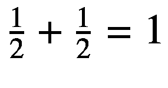

花点时间思考一下 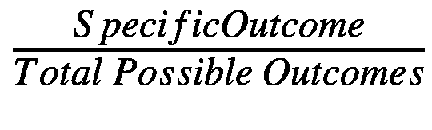 这个概念。如果我们想知道抛硬币得到正面的机会，特定结果就是正面。只有一种方式能发生这种情况。总可能结果是正面或反面。因此有两种可能的结果。抛硬币得到正面的概率在数学上由比率  来描述。这个比率可以写成小数 0.50。当然，这个小数也可以写成一个百分比——50%。这些都是表达同一事物的等价方式。

有时，在数学中，我们用公式来表达概念（例如，第 6 章中的算术平均值公式）。表达这个公式的一种方式可能是 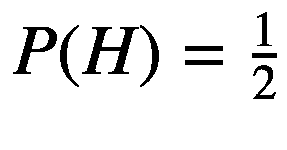，这在中文中可以理解为“抛硬币得到正面的概率是二分之一”。

如果我们将每个特定结果的概率相加，总数应该等于 1。在抛硬币的世界里，我们可以写为 `P(H) + P(T) = 1`。

这就引出了概率的一些术语。对于单次抛硬币，你不可能同时得到正面和反面。我们说这些结果是**互斥的**，因为它们不能同时发生。另一种说法是，正面和反面是彼此的*互补*。回顾第 6 章，我们简单探讨了一些常用公式。那时和现在一样，我们接触这些公式的目的，与其说是要自己手动计算，不如说是为了确保你熟悉研究中使用的术语。当讨论两个不同的结果时，数学上常用大写拉丁字母表示（例如，`A` 和 `B`）。然而，由于互补结果具有互相对立的特性，它们通常用 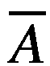（读作“A 拔”）或 `A´`（读作“A 撇”）表示。更正式的说法是，你可能会看到以下公式：

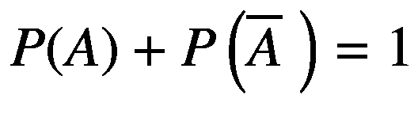

就像“蝙蝠”这个词根据上下文有两种不同的定义（例如，木制的球棒或飞行的哺乳动物）一样， 也不同于 （这也是有时会看到 `A´` 的原因）。从字母表开头到结尾的变化（以及字母的大小写）提供了关于其含义的上下文线索。

换个角度来说，任意*两次*抛硬币的事件是**独立的**，因为第一次抛硬币的结果不影响第二次抛硬币的结果。与互补事件类似，独立事件也有一个公式。在抛硬币的情况下，我们可能第一次得到正面，*并且*第二次也得到正面。诚然，这里的数学符号再次体现了上下文的重要性。如果我们想描述得到正面且再得正面的概率，我们写为 `P(H&H)`。和之前一样，在数学中，我们通常以一种*通用*的方式写出公式，然后代入具体值。因此，我们的老朋友 `A` 和 `B` 再次出现，代表事件 A 和事件 B（在我们的例子中，它们都是正面）。这为我们提供了独立概率的公式：

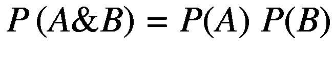

如果这个公式成立，那么这些概率确实是独立的。另一方面，如果我们知道这些概率是独立的，我们当然可以自由地使用这个公式。

抛硬币之所以是独立的，是因为我们每次**放回**了全部可能的结果供选择（例如，两次抛掷都有正面和反面的可能）。在第二次抛硬币时，你的可能结果完全相同（即，已经*放回*到初始的纯净状态）。另一方面，有些类型的概率是**不放回**的。例如，如果你从一个混合糖果盘中吃巧克力，那么你下次选择糖果时的选择就会不同。

请注意，互斥和独立在数学定义上并不相同；它们是不同的概念。独立事件仅仅是彼此之间没有影响。相比之下，互斥事件不能同时发生。带着这些术语，让我们一起探讨一些例子。

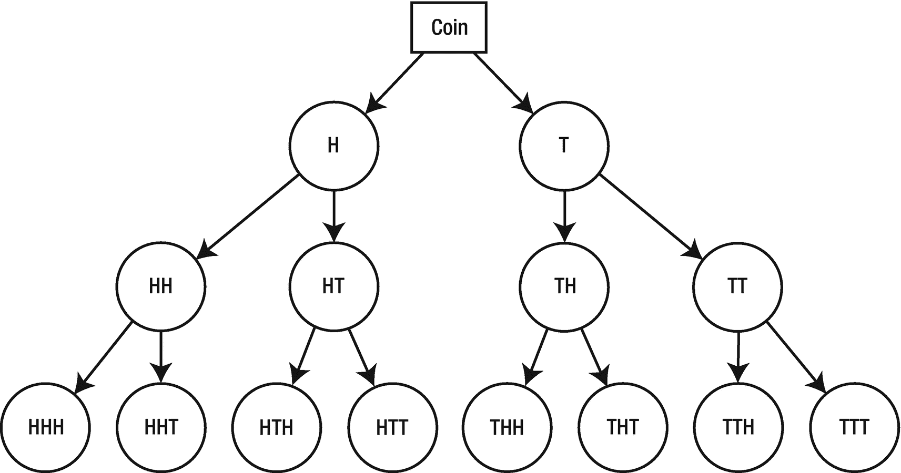

图 7-1

一枚均匀硬币抛掷三次的样本空间


### 示例：独立性

回到多次抛掷公平硬币的想法，让我们考虑抛掷*三*次硬币会发生什么。在图 7-1 中，你会看到一个*树状图*（使用 `DiagrammeR` 包 [10] 制作）。在第一次抛掷后，硬币结果的第一行，你会看到两种可能的情况：正面或反面。在第二次抛掷后，硬币结果的第二行，你会看到四种可能的情况。最后，在第三次抛掷后，你会看到八种可能的情况。

每次抛掷硬币都是*独立*的。这在逻辑层面上是合理的——第一次抛掷硬币的结果**不会**影响第二次抛掷硬币的结果。这实际上非常重要。人类（总的来说）天生并不擅长概率（包括我们）。相反，我们必须训练自己理解随机性背后的数学原理。看看第二次抛掷后最左边的那条分支，那里的人得到的是 HH。第三次抛掷得到正面或反面的概率仍然是 0.5 对 0.5。那枚硬币并“不欠”一个反面结果。你听过有人说“我们该遭遇飓风了”吗？概率不是那样运作的。也许你听过“坏事成三”——这同样在统计上不成立。

那么，我们从独立事件中学到了什么？好吧，考虑一下在第三行得到 P(HTH) 的概率。我们想要的具体结果是 HTH，它是第三行从左数第三个选项。还记得我们的一般概率比吗？特定结果除以所有可能结果得到 `1/8`，大约是 12%：

```
1/8
## [1] 0.125
```

然而，要知道总共有八种可能结果，就需要我们构建出这个树状图。抛掷次数稍多一点，这个图就会迅速变得庞大！

相反，我们可以利用硬币抛掷是独立的事实，并使用我们的公式 `P(A 与 B) = P(A) * P(B)` 来计算独立事件。特别是，我们将该公式*扩展*以应对三次抛掷——它使用了相同的逻辑：

```
(1/2)*(1/2)*(1/2)
## [1] 0.125
```

使用独立结果公式使我们能够快速计算一连串的独立事件（而无需事先画出图来）。

那么，为什么要学习概率与统计学呢？因为它有助于我们理解通常可能期望什么。假设我们告诉你，我们给了八位读者一枚硬币，让他们每人抛三次。如果我们告诉你“我们的一位读者刚刚抛出了 TTT！”，你会感到震惊吗？现在可能不会了——这并不太令人震惊，因为有八个人在抛硬币。

这一切都是为了说明，图 7-1 中想象中的*总体*抛硬币结果可以通过实际抛硬币来*抽样*。如果你知道你的总体足够大，可以容纳八位抛硬币者，那么 TTT 作为样本成员并不会太出人意料。另一方面，如果你只有一个人在抛硬币，你可能不会期望有人抛出 TTT。

### 示例：补集

事实上，让我们看看我们可能会期望什么。在前面的例子中，你刚刚计算了抛出 `P(TTT) = 1/8` 的概率。某人在前三次尝试中**没有**抛出 TTT 的概率是多少？这是一个**补集**的例子。采用之前的补集公式，你可以修改它以展示这个确切场景：`P(TTT) + P(not TTT) = 1`。记住 `P(not TTT)` 是抛出 TTT 的补集——换句话说，就是**没有**抛出全是反面的概率。通过一点代数运算我们得到：

`P(TTT) + P(not TTT) = 1`  
`P(not TTT) = 1 - P(TTT)`  
`P(not TTT) = 1 - 1/8`  
`P(not TTT) = 7/8`

以防你的分数运算有点生疏，`R` 也可以为你做这个计算：

```
1 - (1/8)
## [1] 0.875
7/8 == 1 - (1/8)
## [1] TRUE
```

无论如何，一个人不会抛出全是反面的概率是 88%！

就像独立公式一样，补集公式帮助我们更轻松地理解（无需画出完整图表）我们可能期望什么。

再次回想总体和样本。假设你进入我们在当地集市的一个摊位。我们提供一个机会，如果你能抛出 HHH，就能赢得一个大玩具动物。结果你抛出了 TTT。你起疑心，派你的朋友去调查。你的朋友*也*抛出了 TTT。现在起了疑心，你和朋友叫来第三个朋友进入摊位，结果，又一次，他也得到了 TTT。在这种情况下，你期望的总体（而且我们确实卖给了你门票）假设它看起来像图 7-1。现在，你有一个包含 TTT、TTT 和 TTT 的随机样本。你的样本看起来是来自那枚硬币正反面等概率的世界吗？

还是你现在怀疑是一枚做了手脚的硬币？

基于 88% 不会得到 TTT 的概率，你很可能怀疑那枚硬币有问题！更重要的是，你刚刚利用概率和一个样本对一个总体做出了判断。换句话说，你刚刚做了统计学分析！

### 概率的最终思考

如你所见，概率总是特定结果与所有可能结果的比值。因此，概率总是（以小数形式）介于 0 和 1 之间的数字（我们有时将其写成百分比）。因为物理上画出整个树状图或类似方法并不总是确定所有可能结果的实用方法，所以你学到了一些有助于计算概率的公式。关于概率研究的整本书都充满了越来越巧妙的方法来计算越来越复杂总体的所有可能结果。对于我们，此时此刻，你所学的应该足以模拟较简单的总体并了解更多统计学知识。掌握一套技能的关键在于乐于终身学习额外的技术和思考主题的新方法。

也就是说，对于许多情况，你现在拥有了一种语言和工具集来理解总体可能是什么样的。如果有一种方法可以将该总体的所有可能结果设置为概率比值，这些比值之和将为 1。这使你能够构建总体模型（这对于将任何样本与我们对这个总体的期望进行比较至关重要）。就像集市摊位的例子一样，建立一个总体的心理模型，然后将样本数据与该总体模型进行比较，可以帮助我们理解我们的总体模型有多准确。

要做到这一点，你必须学习分布，这不过是将我们第 6 章中的直方图与你新获得的概率知识相结合的方法。


## 7.3 正态分布

`R` 语言中的函数接收输入并产生输出。在数学中，**函数**接收一个或多个输入（通常称为 `x`）并将其映射到一个输出（通常称为 `y`）。概率**分布**是一个将值映射到特定发生概率的函数。我们处理的大多数概率分布（例如正态分布）并非单一分布，而是一个分布族。这是因为我们得到的特定正态分布取决于一些参数。

具体来说，正态分布有*两个*参数：

-   均值（*μ*），有时也称为“位置参数”，因为它控制分布中心的位置。
-   标准差（*σ*），有时也称为“尺度参数”，因为它控制分布的尺度或离散程度。

正式地，正态分布可以写作：

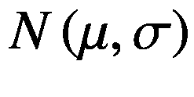

当我们谈论正态分布时，可能会想到标准正态分布，其均值为零，方差/标准差为 1（或单位值）：

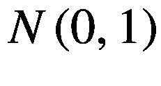

然而，正态分布有很多种。图 7-2 展示了几种不同的正态分布，有些具有相同的均值和不同的标准差，有些则均值不同。这表明，要计算概率，仅说明假设为正态分布是不够的；还必须通过指定参数（算术均值和标准差）来指明具体的正态分布。

你能在图 7-2 中找出哪个正态形状是标准正态分布吗？提示：钟形曲线的最高点需要在零上方。回想一下*经验法则*；±1（标准正态分布的标准差）应覆盖该曲线下 68%的面积。

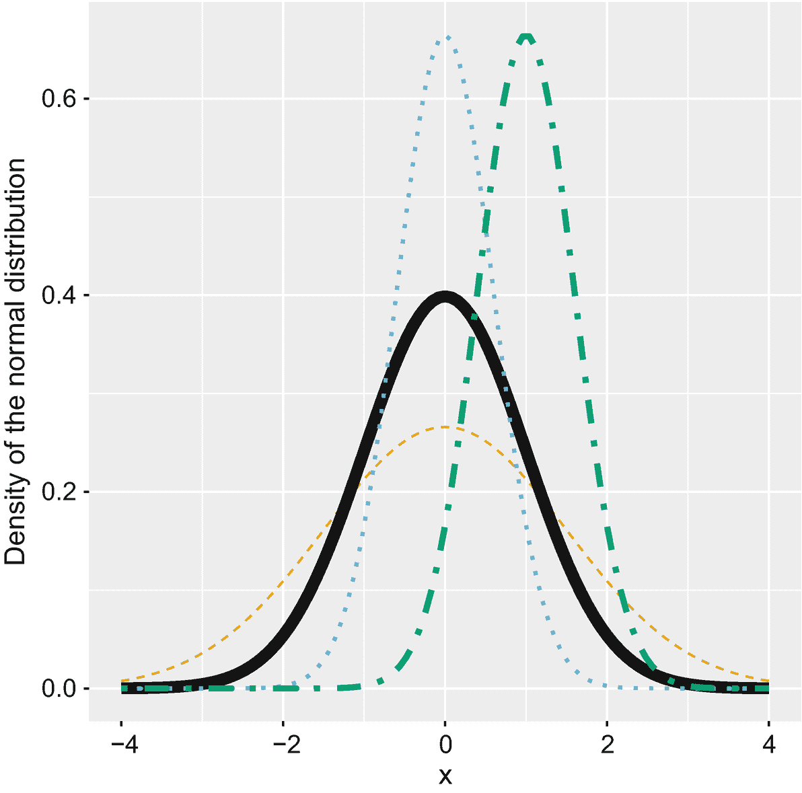

**图 7-2** 不同均值和标准差的正态分布

答案是那条最宽的实线。

事实上，你已经在第 6 章中见过另一个正态分布，即图 7-3。当时，我们称其为“完美”的例子（而且它确实不错）。标准正态分布是 `N(0, 1)`（均值和标准差），而我们之前的完美例子是 `N(2.5, 0.75)`。之前我们只看直方图时，曾说过不必太关注 y 轴。但现在，请看看这些正态分布的垂直 y 轴。

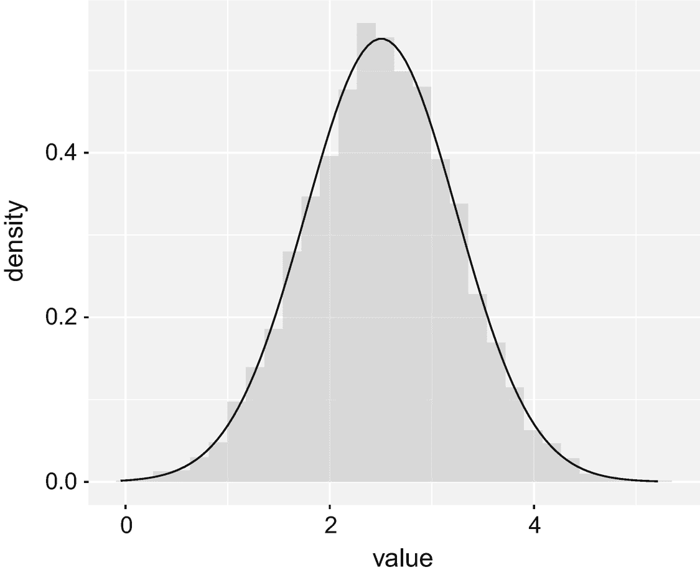

**图 7-3** 叠加了正态曲线的近乎完美的正态直方图

请记住，我们是在*概率之后*才介绍分布的，而且数学中的混乱背后总有方法。y 轴上的*密度*数值所告诉你的，与概率密切相关。概率**分布**的定义是：一个将值映射到*特定发生概率*的函数。回顾一下，概率必须在 0 到 1 之间。

分布的巧妙之处在于，曲线下的总面积为 1。因此，我们的数据与抽样概率之间的关系被巧妙地连接在一个图表中。这实际上是一个非常聪明的想法（在某种程度上，这也是将某些随机数学转变为统计学的大想法）。为分布找到合适的函数，其核心就在于接收均值和标准差作为输入，并将其转化为显示概率的输出。然后，如果我们绘制分布函数，就会得到你所看到的曲线。总概率必须为 1（因此事件发生的概率为 100%）。

直方图默认的 y 轴是原始的“人数”，而不是密度/概率/权重。因此，直方图算是一种雏形分布，尚未成熟。你可能还记得，在讨论直方图时，我们曾让你假装向直方图扔飞镖。好吧，现在有一个更好的方法——将直方图背后的数据映射到分布上。要了解这是如何工作的，请随我们一起探讨第一个例子。

### 示例

暂时考虑一下企鹅鳍状肢长度的数据，并回忆一下该*样本*的均值和标准差。该样本有 344 个观测值（尽管有几个 `NA` 值）。如果你不熟悉人类调查，344 实际上是一个相当不错的样本量。人数（这里指鳍状肢数）很重要：

```
mean(penguinsData$flipper_length_mm, na.rm = TRUE)
## [1] 200.9
sd(penguinsData$flipper_length_mm, na.rm = TRUE)
## [1] 14.06
```

现在，请仔细查看图 7-4。左侧是正态曲线的密度 y 轴。该正态曲线基于*样本*算术均值和*样本*标准差。换句话说，它是 `N(201, 14)`。

然而，当我们像这样绘制正态曲线时，实际上是在问这样一个问题：“看起来这个样本（如直方图所示）是否可能来自一个与那条正态曲线有些相似的总体？”

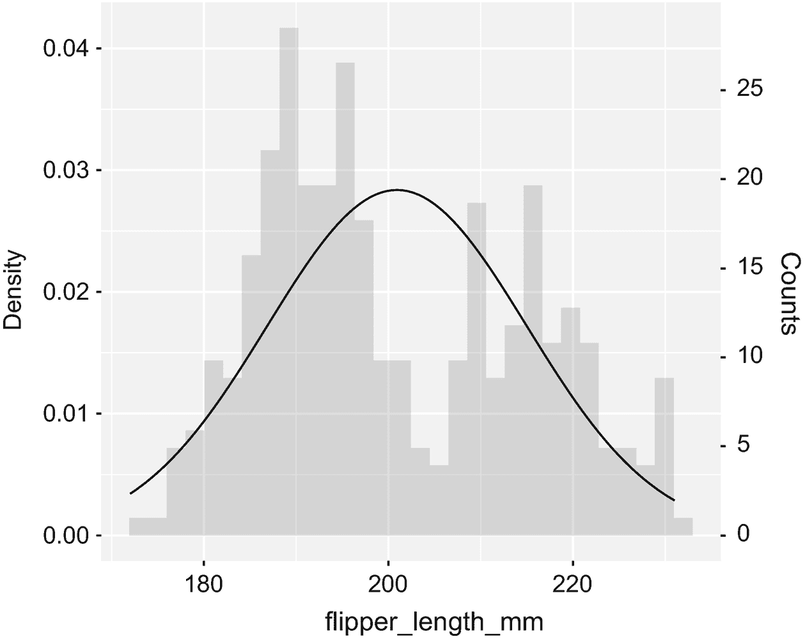

**图 7-4** 带有正态曲线的企鹅鳍状肢直方图

这里，答案似乎是“否”。直方图和正态曲线匹配得不好。恰好在我们最期望看到企鹅鳍状肢长度的位置，有一个相当大的空白区域。随机样本会不会偶然让我们得到这个结果？当然有可能。但这似乎不太可能，就像你和你的两个朋友在游乐场摊位用“公平”硬币连续抛出三个反面（TTT）一样罕见。

请记住，企鹅数据实际上包含了三种不同的企鹅种类。如果只看阿德利企鹅，情况就不同了。就像图 7-2 一样，正态曲线也有族。注意，阿德利企鹅的鳍状肢平均长度似乎最短：

```
penguinsData[, mean(flipper_length_mm, na.rm = TRUE),
by = species]
##      species    V1
## 1:    Adelie 190.0
## 2:    Gentoo 217.2
## 3: Chinstrap 195.8
penguinsData[, sd(flipper_length_mm, na.rm = TRUE), by = species]
##      species    V1
## 1:    Adelie 6.539
## 2:    Gentoo 6.485
## 3: Chinstrap 7.132
```

如果我们修改直方图和正态曲线，只考虑阿德利企鹅的数据会怎样？如图 7-5 所示，这些数据现在看起来更具正态性。

这个例子有意地减少了代码量。你的注意力应该放在图像上，并建立对正态分布的直觉和理解。虽然我们在下一个例子中会继续采用这种方法，但很快就要重新引入 `R` 语言了。

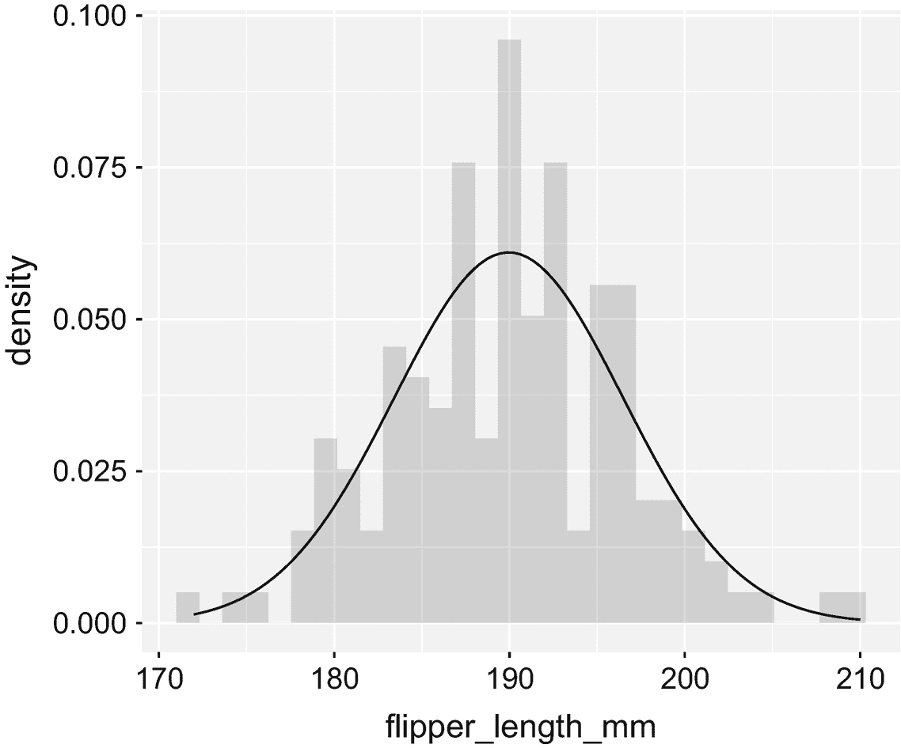

**图 7-5** 带有正态曲线的阿德利企鹅鳍状肢直方图


### 示例

我们曾多次提到，通过肉眼观察直方图可以判断样本是否近似正态分布。要更深入地理解这一原理，我们需稍作回溯，重温统计学的一些基本事实。

统计学的目标是：确定一个总体，针对该总体提出研究问题，选择一种极有可能成功获取无偏样本的抽样方法，对样本进行一定深度的描述，然后利用该样本去理解总体。

诸如正态分布这类分布的价值在于，许多测量指标都符合正态分布。因此，我们可以基于正态分布对总体进行建模。然而，如果我们的样本看起来并不正态，这可能意味着这种哲学方法面临两个挑战之一：要么我们的样本意外地存在偏差，要么我们的总体实际上并非正态分布。

回想一下，在图 7-3 中，我们使用了模拟为正态分布的数据。在图 7-3 中，我们利用直方图绘制了真实数据，并*同时*叠加了一条基于样本均值和标准差的正态曲线。虽然曲线边缘略显粗糙（字面意思），但这显然是正态数据。

现在，请使用相同的数据，查看图 7-6。第一张（上方）图表实际上包含了两个几乎重叠的图形。实心形状是近乎完美正态数据的平滑密度图，它类似于直方图但边缘更为平滑（这有助于我们更好地进行比较）。虚线则再次是基于样本均值和标准差的正态曲线。不出所料，两者拟合得很好。

请注意 x 轴。与直方图显示大量 x 轴数值不同，此图将我们的注意力集中在五数概括上（显示最小值、第一四分位数、均值、第三四分位数和最大值）。注意，x 轴本身进行了分段，以显示一种扁平的箱线图。你可以直观地看到每个四分位数的起始和结束位置。

到目前为止，虽然图 7-6 在极小的空间内提供了大量信息，但它并没有比我们之前使用的直方图观察法更具优势。

正是第二张（下方）图表让此图变得极为有用。这里不过度拘泥于技术细节，它基于所谓的分位数-分位数图（通常称为“Q-Q 图”）。如果我们的样本数据接近预期分布，那么这些点应大部分落在直线上。在本例中，情况确实如此。因此，由于我们是在对照正态分布进行检验，我们可以相当确信这就是一个正态分布。

事实上，请注意这组数据点的 y 轴标度。这些数值被称为*离差*，这是一个表示*差异*的数学术语。因此，你可以从离差的标度看出，任何数据点与正态曲线之间的差异实际上并不大。这些数字都是非常小的十进制数。

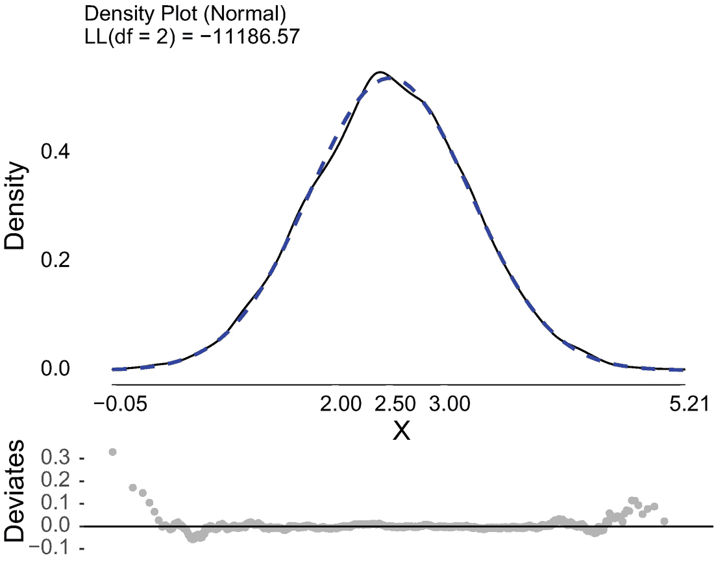

图 7-6

`testDistribution()` 图中近乎完美的正态数据

将此与我们在第 6 章中也介绍过的近乎完美的均匀分布进行对比，如图 7-7 所示。同样，在上方图中，你可以看到作为实线的密度函数，与基于相同均值和标准差的正态分布（虚线）之间的对比。由于数据是均匀分布，你可以在 x 轴上看到均匀分布的四分位数。

而在下方显示偏差或差异的图表中，可以清晰地看出与正态分布存在显著差异。不仅存在多个点大量偏离该直线的区域，而且再看 y 轴的标度。这些不再是小数——而是整数。综合来看，这是一个明确的信号，表明均匀数据并非正态数据（当然，这一点我们已知）。

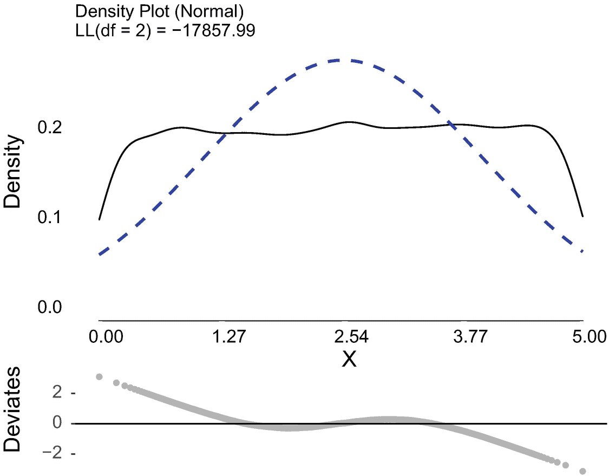

图 7-7

`testDistribution()` 图中近乎完美的均匀数据

现在，我们已经从理论角度了解了这种检测正态性的方法，那么你在自己的学习中该如何使用它呢？

### 示例

我们使用的函数来自`JWileymisc`包，名为`testDistribution`。虽然它可以接受多个参数，但目前我们只需要两个。第一个参数接收一个数据集，第二个参数接收一个文本字符串，告知函数你期望的分布类型。

你已经知道正态分布实际上是一个函数族。并非所有分布都是正态分布。你也已经了解了*均匀*分布。除了这两种分布之外，还有许多其他分布。因此，第二个参数可以有几种选择（尽管该函数尚未能处理所有已知的分布）。

`testDistribution()` 函数实际上相当高级，其某些输出超出了我们当前的需求。因此，我们将函数的结果赋值给变量。这样，我们就可以访问当前所需的信息。尽管如此，如前所述，你看到第一个参数被设置为数据，第二个形式参数设置为 `distr = "normal"`。一旦将此输出赋值给一个变量（我们选择了 `testF`，代表*测试*分布*的企鹅完整数据集），`plot()` 函数就会生成图 7-8。不出所料，企鹅数据并非完全正态。离差图显示，大部分数据点都明显偏离直线：

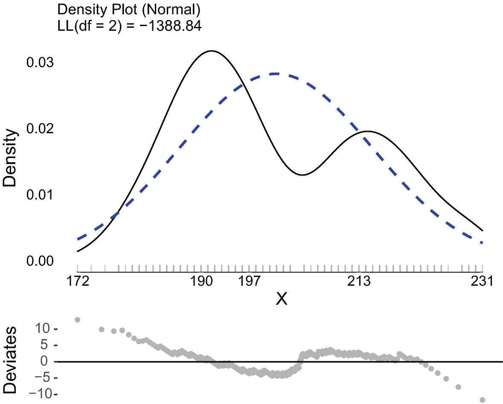

图 7-8

所有企鹅数据的 `testDistribution()` 图

```
testF <- testDistribution(penguinsData$flipper_length_mm,
distr = "normal")
plot(testF)
```

观察密度图，你可以看到企鹅鳍状肢密度的实线有两个波峰或*极大值*。此外，在 x 轴上，由于该数据集包含合理数量的数据点（我们的“完美”数据有 10,000 个点），你可以看到一个*地毯图*。在地毯图中，每条线（在 x 轴上可见）代表一个单独的观测值。在某些情况下，多个观测值会相互重叠；这种特定版本并不能很好地显示密度（尽管密度图的峰值告诉我们，某些线条必须具有更高的频率）。仅由地毯图构成的图表可能会使用颜色标度来显示频率。我们查看这个特定地毯图的价值在于直观地看到“原始”数据。特别要注意 x 轴上 172 标记附近，可以看到数据点之间间距相当大。在峰值下方，间距会变窄。

到目前为止，你已经看到了模拟的正态和均匀数据示例，以及一个非正态的真实世界示例。那么，有哪些符合正态分布的真实世界示例呢？请记住，你用来比较和对比的示例越多，你就能越熟练地将这个函数应用于自己的真实世界数据。


### 示例

尽管当把所有三种企鹅的数据合并到同一个直方图中时，数据看起来可能不服从正态分布，但其中两个物种的样本实际上是正态的，如图 7-9 所示。

值得深入讨论一下创建图 7-9 的 `ggplot()` 代码。对于 `ggplot()` 来说，我们首先设置数据参数，此处为`data = penguinsData`。接下来，我们将整个图形的美学映射设置为 x 轴上的鳍状肢长度。和之前一样，`geom_histogram()` 会生成直方图。不过，我们为直方图使用了一个新参数。这是我们首次设置 y 轴（垂直）美学映射。在这里，我们使用 `y = ..density..` 来确保 y 轴（在直方图中默认是计数）显示的是概率或*相对频率*。最后一行代码 `facet_grid()` 根据给定的变量将图形分成列。这里，我们使用 `cols = vars(species)`。

总的来说，可以看出这些图形看起来都相当符合正态分布。因此，我们可能推测这些样本来自正态总体：

```
ggplot(data = penguinsData,
mapping = aes(x = flipper_length_mm)) +
geom_histogram(aes(y = ..density..)) +
facet_grid(cols = vars(species))
## 'stat_bin()' using 'bins = 30'. Pick better value with 'binwidth'.
## Warning: Removed 2 rows containing non-finite values (stat_bin).
```

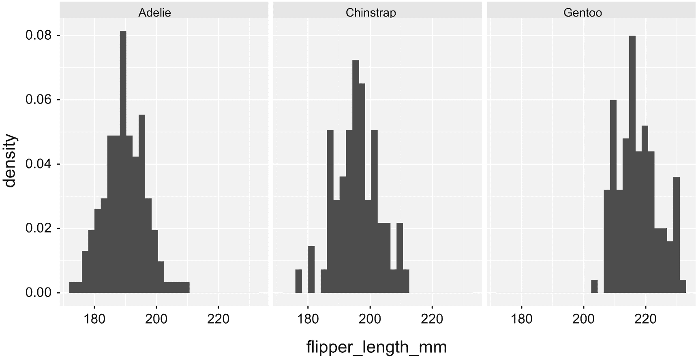

图 7-9 分物种的鳍状肢长度直方图（密度）

更深入地探讨这个问题是值得的。请记住，我们的最终目标是使用样本数据（例如企鹅样本）来了解企鹅总体的特征。如果我们发现证据表明样本不符合正态分布，那么我们需要判断是样本存在偏差，还是需要将我们假设的总体分布从正态分布改为其他分布。由于存在多种可能的分布，大多数入门统计学教科书都侧重于正态分布。所以，一方面，如果我们找不到证据证明企鹅数据服从正态分布，那么本书后面描述的大多数技术就无法派上用场。另一方面，如果它们不服从正态分布，那么至少我们知道了一种要避免的分布模型！

当然，使用像 `R` 这样的编程语言的优点之一是，事实证明正态分布和其他分布之间的许多技术在很大程度上是相同的。这很有帮助，因为它允许像这样一本入门教材只关注最常见的分布——正态分布——同时让你掌握几乎所有你想用于其他分布的相同技能（实际上还有函数名称）。

我们逐一探索企鹅物种的方法的唯一区别在于，使用 `data.table` 的第 i 行选择功能来控制物种。使用我们之前的命名约定，变量赋值中 `test` 后面的字母代表物种名称：

```
testA <- testDistribution(penguinsData[species == "Adelie"]$flipper_length_mm,
distr = "normal")
testC <- testDistribution(penguinsData[species == "Chinstrap"]$flipper_length_mm,
distr = "normal")
testG <- testDistribution(penguinsData[species == "Gentoo"]$flipper_length_mm,
distr = "normal")
```

首先看图 7-10，我们看到阿德利企鹅的鳍状肢长度*密度*与预期的正态密度非常吻合。这一点从直方图中也能看出。另一方面，偏离图中落在直线上点的数量很少。然而，总的来说，它们都包含在直线周围 +/- 1 的带状区域内。对于大致正态的分布来说，这种对称性通常是可以接受的。特别要注意的是，这些点呈现出倾斜带状的模式，其中每个带状区域至少有一个点接触到实线。

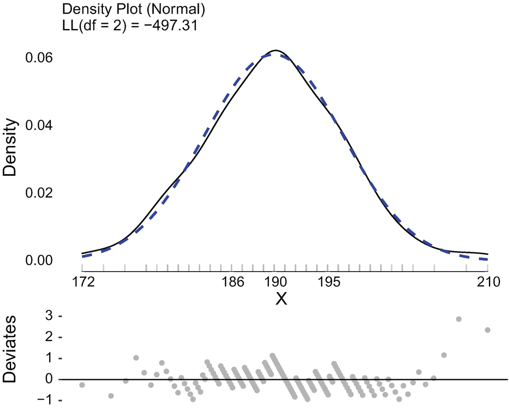

图 7-10 阿德利企鹅 `testDistribution()` 图

```
plot(testA)
```

接下来看图 7-11 中的帽带企鹅，我们看到了非常相似的情况。特别值得注意的是，在偏离图的中部，有许多点确实接触到了正态线。虽然这在图 7-10 中也存在，但我们在此注意到，密度图（实线）的远端*高于*正态曲线（虚线）。这表明在鳍状肢长度范围的两端有超出正态的观测值。如果密度曲线在两端变得过高，就会呈现均匀分布。另一方面，较小的样本量也可能导致这种情况（即使只选取一个极端鳍状肢长度的实例——很短或很长——也可能导致偏差）。这也是为什么较大的样本量总是更理想的原因之一（除了较大的样本量有更好的机会捕捉到总体的更多特征）。

```
plot(testC)
```

我们最后查看的企鹅图是图 7-12，关于巴布亚企鹅的。我们立刻就能从密度图中看出这看起来不太符合正态分布。它的直方图在图 7-9 中也是最不符合正态分布的。再看偏离图，这里有一些关键的区别。在图 7-12 中，有几个点连续地落在正态线的一侧。它们并非均匀分布在两侧；而是全部位于上方（在该图的左侧）。接下来，在偏离图中间附近的倾斜带状区域中，你再次看到有几个带状区域完全落在正态线下方。这些带状区域连续地同时落在下方这一点很重要；如果一个带状区域全部在下方，而下一个带状区域全部在上方，情况就会不同。相比之下，在图 7-11 中，请注意几乎每个倾斜带状区域都接触到了正态线，并且每当有一个带状区域没有接触时，下一个带状区域就接触了。这是帽带企鹅鳍状肢长度服从正态分布的一个迹象。

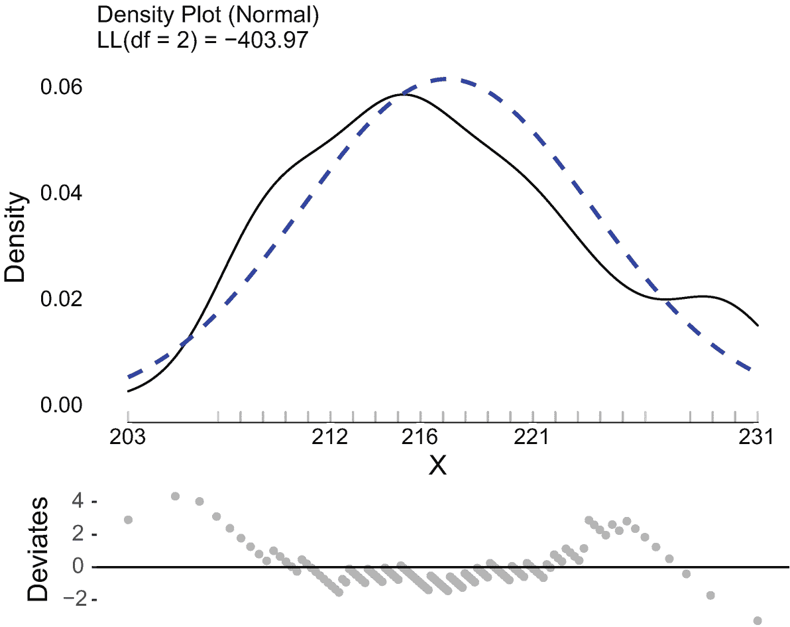

图 7-12 巴布亚企鹅 `testDistribution()` 图

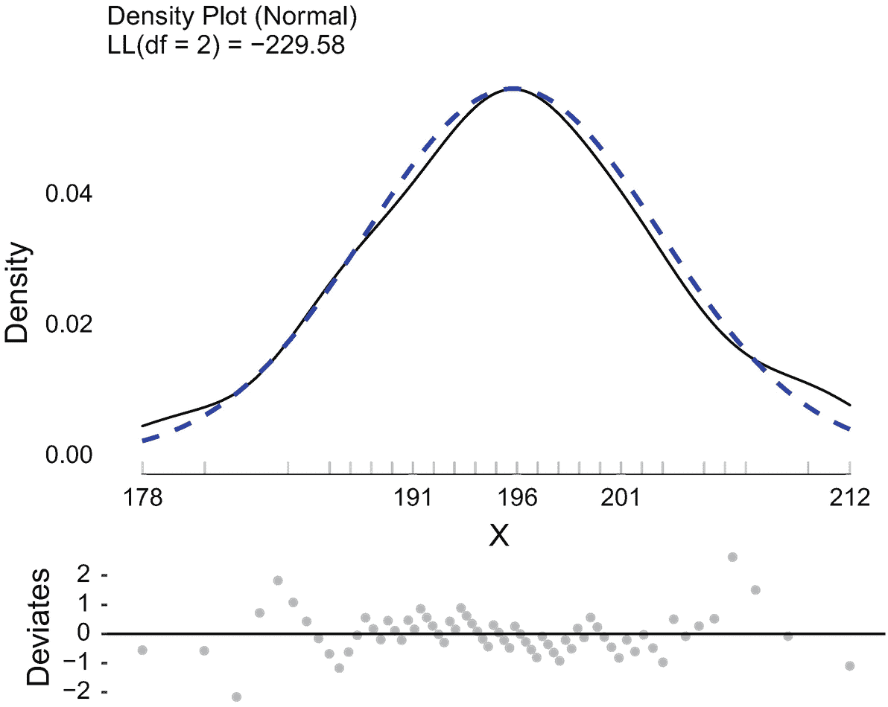

图 7-11 帽带企鹅 `testDistribution()` 图

```
plot(testG)
```

如你所见，通过将企鹅数据按物种划分，我们发现了在完整数据集中未曾显现的正态性。巴布亚企鹅的数据集不服从正态分布是否有原因呢？想到的一点是企鹅的生物学性别；某些物种在这方面存在差异。看起来我们数据集中的巴布亚企鹅在性别上的划分并不那么均匀；这或许可以解释一定程度的偏差：

```
penguinsData[,
.N,
by = .(species, sex)]
##      species    sex  N
## 1:    Adelie   male 73
## 2:    Adelie female 73
## 3:    Adelie     6
## 4:    Gentoo female 58
## 5:    Gentoo   male 61
## 6:    Gentoo     5
## 7: Chinstrap female 34
## 8: Chinstrap   male 34
```

无论如何，现在你已经了解了一些检验正态性的好方法。虽然本书着重于正态分布，但大多数现代统计函数都有几种易于替换的分布。因此，在检查样本的可能分布时，可以采用类似的技术。


好的，作为一名高级文档工程师和翻译员，我将严格遵循您提供的注意事项和示例，将给定的英文文本翻译成中文。


## 7.4 分布概率

假设样本数据来自一个正态总体，我们可以通过数据元素的位置来理解数据。回想一下图 7-13 和*经验法则*，也称为*68-95-99.7*法则。

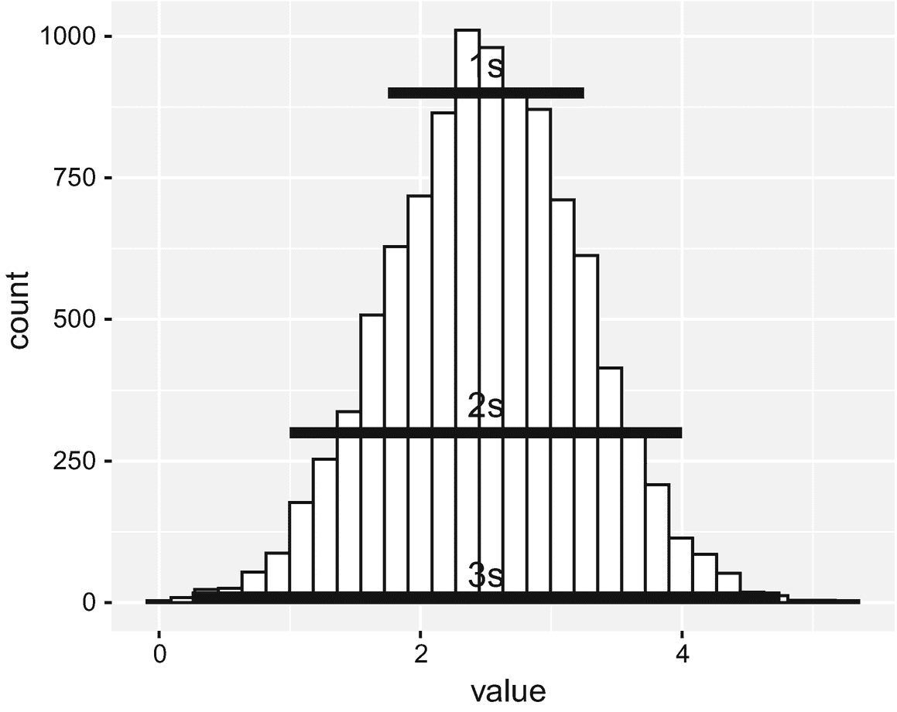

图 7-13

由标准差范围涵盖的条形

数据集中的每个数据点都可以根据其标准分数来理解。换句话说，它是在第一标准差带内？还是在第二标准差带内？这种标准化的分数是单位转换的一个例子——你可能在其他地方遇到过这个概念，用于将一种单位转换为另一种单位（例如，英里到公里，或华氏度到摄氏度）。在这种情况下，转换是将数据的任何单位转换为标准正态分布`N(0, 1)`上的标准单位。这个概念被称为 `z-score`，虽然理想情况下我们使用总体参数，但更多时候我们使用样本统计量作为总体参数的代理。

使用总体参数的 Z 分数公式为

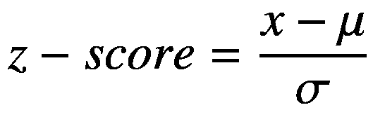

使用样本统计量的 Z 分数公式为

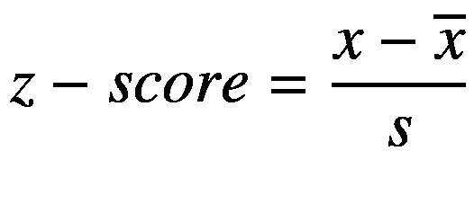

无论哪种方式，你都会看到 `z-score` 给出了数据点 `x` 与算术平均值之间的差值，然后除以标准差。得到的结果数字称为 `z-score`，它告诉我们该数据点距离中心（即标准正态分布 `N(0, 1)` 的 0 点）有多少个标准差单位。

听起来可能令人困惑，让我们仔细看看。我们的完美数据集具有正态分布 `N(2.5, 0.75)`。实际上，这是一个总体度量。牢记图 7-13，考虑样本数据中的数字 2。从视觉上，从图 7-13 中，你可以看到它显然位于第一个标准差条形内部。此外，它显然位于数据中心的左侧（回想一下，数据中心均值为 2.5）。

针对“完美”数据使用总体参数的 Z 分数公式：

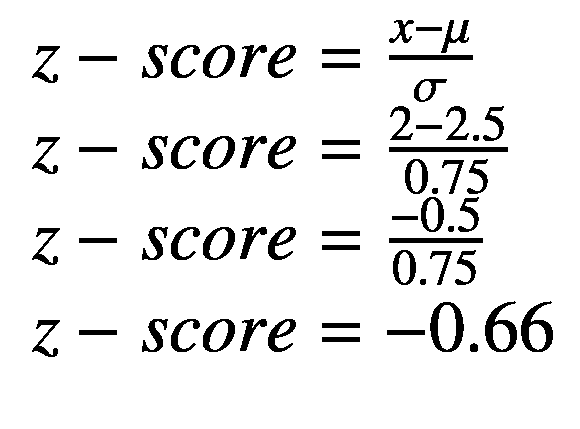

在`R`语言中进行相同的计算会得到相同的答案：

```
perfectZscore <- (2-2.5)/0.75
perfectZscore
## [1] -0.6667
```

这个 `z-score` 是*负的*，这告诉我们样本数据中的数字 2 位于均值的*左侧*。它的*绝对值*小于 1，这表明它位于第一标准差带内。

同样的过程，这次应用于数据点 `x = 4.5`，会得到不同的答案。查看图 7-13，你可以看到 4.5 位于图表的右侧边缘，刚刚超过 `2s` 条形图的边界。它位于右侧，因此我们期望得到一个正的 `z-score`。它超过了 `2s` 条形图，因此我们期望得到一个绝对值大于 2 的数值。

在 `R` 中检查我们的逻辑，证明我们是正确的：

```
perfectZscore <- (4.5-2.5)/0.75
perfectZscore
## [1] 2.667
```

这能带给我们什么？嗯，请记住经验法则。对于正态分布，我们期望在第二标准差之外的数据点是罕见的。就像你和你的朋友在公平的摊位上投掷一枚公平的硬币，连续都投出反面是很奇怪的一样，从标准正态分布 `N(2.5, 0.75)` 中频繁地随机抽样到数字 4.5 也是很奇怪的。

有多奇怪？经验法则指出，95% 的数据位于第二标准差条形图内部。使用概率的*互补*概念，我们知道 `P(不在 2s 条形图内) = 1 – P(在 2s 条形图内) = 1 – 0.95 = 0.05`。然而，那 5% 被平均分配在左侧外部和右侧外部。所以我们可以将这个数字减半。这告诉我们，在 4.5 的*左侧*，较低的一侧，大约有 97.5% 的数据点，而在 4.5 的*右侧*，较大的一侧，大约有 2.5% 的数据点。请注意，这个概率估计基于经验法则，正如我们之前所见，这是一个粗略的估计。同样要注意，这个概率估计假设我们的数据点刚好大于两个标准差线。相反，正如你在图 7-13 中看到的，4.5 位于那条 `2s` 线结束点的更右侧。因此，我们应该认为选取一个小于 4.5 的点的概率甚至大于 97.5%。

我们如何才能得到更准确的估计？自然，你可以使用 `R` 来帮助进行这类计算。因为我们刚刚计算的是一个**正态**分布的概率，所以该函数叫做 `pnorm()`，读音类似于“P, Norm”。它需要四个输入：数据点、均值、标准差以及一个布尔值，默认为 `lower.tail = TRUE`。`lower.tail` 等同于“选取一个*小于*指定值的点的概率”。回想一下，我们对这个概率的估计是大于 97.5%。看看下面的代码，看看我们的经验法则估计有多好：

```
pnorm(4.5,
mean = 2.5,
sd = 0.75,
lower.tail = TRUE)
## [1] 0.9962
```

很接近，但并不完美。这是意料之中的，因为我们的点 4.5 的 `z-score` 约为 2.67，远在 `2s` 区域（该区域在均值右侧的两个标准差处结束）的结束点右侧。

经验法则的价值（在当今快速计算的时代）主要在于能够足够精确地进行估计，以便你发现自己犯了代码错误。从数学的角度来看，从历史上看，只有微积分才能如此精确地计算出 0.9962 的概率。在更近的时期（尽管仍然是过去），人们可能会使用“标准正态分布表”来查找 `z-scores` 并估计概率。今天，我们使用 `pnorm()`。我们当初学习统计学时使用的那些表格现在已经过时了（老实说，使用 `R` 生活更美好）。


好的，作为高级文档工程师和翻译员，我将遵循您的指示，将以下英文文本翻译成中文，并严格保留所有 Markdown 格式、代码块和内联代码。


### 示例

需要注意的是，`pnorm()`（就像经验法则一样）仅在总体分布呈正态时才能给出准确的估计，因此始终检查正态性假设非常重要。根据先前示例中的图 7-11，我们知道在企鹅数据集中，可以假设 Chinstrap 企鹅的鳍状肢长度呈正态分布。

为了更方便地处理 Chinstrap 企鹅数据，我们将其赋值给一个名为 `chinstrapData` 的变量。此外，我们还将 `mean()` 和 `sd()` 赋值给变量：

```
chinstrapData <- penguinsData[species == "Chinstrap"]
chinstrapMean <- mean(chinstrapData$flipper_length_mm)
chinstrapSD <- sd(chinstrapData$flipper_length_mm)
```

虽然你可能已经注意到计算概率并不需要 z 分数，但它有助于理解该概率。与其手动计算 z 分数，不如使用 `scale()` 函数在 `chinstrapData` 中创建一个新列。`scale()` 函数足够智能，可以在数据表中自行计算均值和标准差。作为验证，我们使用公式 `z-score = (x - x̄) / s` 为第一行手动计算 z 分数：

```
chinstrapData[, zScoreFlipper := scale(flipper_length_mm)]
head(chinstrapData)
##      species island bill_length_mm bill_depth_mm flipper_length_mm
## 1: Chinstrap  Dream           46.5          17.9               192
## 2: Chinstrap  Dream           50.0          19.5               196
## 3: Chinstrap  Dream           51.3          19.2               193
## 4: Chinstrap  Dream           45.4          18.7               188
## 5: Chinstrap  Dream           52.7          19.8               197
## 6: Chinstrap  Dream           45.2          17.8               198
##    body_mass_g    sex year zScoreFlipper
## 1:        3500 female 2007      -0.53612
## 2:        3900   male 2007       0.02474
## 3:        3650   male 2007      -0.39590
## 4:        3525 female 2007      -1.09698
## 5:        3725   male 2007       0.16496
## 6:        3950 female 2007       0.30517
(192-chinstrapMean)/chinstrapSD
## [1] -0.5361
```

现在有了 z 分数，让我们思考几个使用它们来更好地理解 Chinstrap 企鹅的例子。回顾图 7-11，第一个四分位数在 *x* = 191 处结束。根据你对四分位数的学习，你知道 25% 的数据应该位于 191 的左侧。现在，需要注意四分位数*不*要求总体呈正态，让我们看看 `pnorm()`（它*确实*要求总体呈正态）对于 `lower.tail = TRUE` 是否匹配该估计值：

```
pnorm(191, chinstrapMean, chinstrapSD, lower.tail = TRUE)
## [1] 0.2494
```

事实上，它确实匹配！这并不令人惊讶；根据图 7-11，数据看起来确实是正态的。此外，你可能还记得，偏差图是基于 Q-Q 图（其中 Q-Q 代表分位数-分位数）。偏差图的工作原理是通过比较 Chinstrap 鳍状肢长度分位数与正态分位数；如果点经常落在直线上，则分位数是匹配的。

那么，找到一只鳍状肢长度大于 191 的 Chinstrap 企鹅的概率是多少？好吧，我们的四分位数数据表明概率应为 75%。或者，我们可以使用刚刚计算的 `pnorm()` 的*互补*概率概念，或者设置 `lower.tail = FALSE`。无论使用哪种方法，答案都是一样的：

```
1 - pnorm(191, chinstrapMean, chinstrapSD, lower.tail = TRUE)
## [1] 0.7506
pnorm(191, chinstrapMean, chinstrapSD, lower.tail = FALSE)
## [1] 0.7506
```

正如抛掷均匀硬币的总体分布可以帮助你理解你和两个朋友连续三次抽到 TTT 的概率一样，类似地，理解（正态）总体分布可以让你理解随机找到许多鳍状肢长度大于 210 的 Chinstrap 企鹅的可能性。这种情况可能发生吗？是的。然而，如果发生了，我们很可能会怀疑有人一直在喂那些企鹅！

```
pnorm(210, chinstrapMean, chinstrapSD, lower.tail = FALSE)
## [1] 0.02342
```

### 示例

基于样本数据，随机找到一只鳍状肢长度大于 202 毫米的 Adelie 企鹅的概率是多少？

在已经确认这些样本数据不排除正态参数（根据图 7-10）之后，我们有了一些证据可以通过正态分布对总体进行建模。基于 `mean()` 和 `sd()`，Adelie 总体的正态分布估计约为 *N*(190, 6.5)：

```
adelieData <- penguinsData[species == "Adelie"]
adelieMean <- mean(adelieData$flipper_length_mm, na.rm = TRUE)
adelieSD <- sd(adelieData$flipper_length_mm, na.rm = TRUE)
```

使用样本统计数据作为假定的正态总体参数的粗略估计，我们使用 `pnorm()` 来估计右尾概率：

```
pnorm(202, # x > 202mm
mean = adelieMean, #样本均值
sd = adelieSD, # 样本标准差
lower.tail = FALSE) #“大于”是上/右尾
## [1] 0.03273
```

随机看到如此大的 Adelie 企鹅的可能性不大！

为了总结这个示例，我们提出一个思考题。仔细审视这个示例中的逻辑过程。我们从对看到一只长鳍状肢的 Adelie 企鹅感到好奇开始。对*样本*数据的检查似乎表明 Adelie *总体*可能是正态的（换句话说，我们在图 7-10 中没有发现任何证据反对我们的样本来自正态总体）。然后，我们使用*样本统计量*（均值 `x̄` 和标准差 *s*）来估计（假设为）正态总体分布的参数 *μ* 和 *σ*。**如果**我们所有的猜想都是正确的，那么我们 `pnorm()` 的概率估计应该是准确的。

然而，这是很多假设，不是吗？我们确定 Adelie 总体是正态的吗？从技术上讲，不能确定（至少在不使用我们关于生物学知识的情况下，这些知识超出了这大约 152 只企鹅的小样本范围）。即使 Adelie 总体是正态的，我们确定我们的样本统计量 `x̄` 和 *s* 是总体参数 *μ* 和 *σ* 的准确或精确度量吗？同样，不能确定（并且同样，如果不参考一些关于 Adelie 企鹅的外部研究）；毕竟，样本可能存在偏差。

有什么方法可以确保总体呈正态吗？如何更好地了解*统计量*在估计*参数*方面的准确性？这些是将在后续章节中回答的重要问题。


## 7.5 中心极限定理

至此，你已经练习了如何识别可能符合正态分布的数据样本。接下来的挑战是，将你学过的关于概率和分布的知识融会贯通，从而更深入地理解样本的实际用途。此外，我们似乎做了一个奇怪的选择，只关注正态分布——既然我们多次强调存在多种分布，为何偏偏选中这一种？而且，正如刚才提到的，我们如何能确定潜在总体是正态分布呢？

为了回答这些问题，我们先来看一个相当奇特的现象。考虑从标准正态分布 `N(2.5, 0.75)`（回想一下，第一个数字是均值，第二个是标准差）中抽取的两个*随机*样本。为了确保你的数字与我们的结果一致，我们再次使用 `set.seed(1234)` 函数。在 `R` 语言中，生成随机数据的函数通常以 `r` 开头，代表 *r*andom（随机）。用于生成*正态*分布数据的特定函数是 `rnorm`，发音大致为“R, Norm”。如果我们将从该分布中抽取的两组随机数分别赋值给两个变量 `sampleA` 和 `sampleB`，从 `summary()` 函数的结果可以看出，这两组数据的*范围*差异相当大。也就是说，它们的最小值和最大值彼此相差很大。这在随机样本中是预料之中的。然而，看看它们的算术平均数。实际上，这两个平均数非常接近：

```
set.seed(1234)
sampleA <- rnorm(n = 5, mean = 2.5, sd = 0.75)
sampleB <- rnorm(n = 5, mean = 2.5, sd = 0.75)
summary(sampleA)
##    Min. 1st Qu.  Median    Mean 3rd Qu.    Max.
##  0.741    1.595   2.708   2.236   2.822   3.313
summary(sampleB)
##    Min. 1st Qu.  Median    Mean 3rd Qu.    Max.
##   1.83    2.07    2.08     2.19   2.09     2.88
```

为什么这些均值如此接近？答案在于随机样本的无偏性。如果一个随机样本只从图形的极左端或极右端抽取，那才奇怪呢。如果真是这样，那将是存在偏倚的信号。回想一下图 7-6 中典型的正态分布形状。实际上，我们一直用于演示的“完美”正态数据集就是使用 `rnorm()` 函数创建的。该密度图上最高的点位于中部。如果从中部之外抽取了太多数据点，那确实很奇怪。因此，虽然单次随机抽取可能得到一个奇怪的数值，但我们预计从总体中抽取的样本均值应该相当接近实际的总体均值。当这些样本均值被“平均”在一起时，样本数据统计量的*共识*会非常接近总体数据参数（回顾我们之前定义中的这些术语）。

样本均值*统计量*接近总体均值*参数 μ* 这一特性并非正态分布所独有。重复我们刚才使用的代码，将 `rnorm()` 改为 `runif()`。这个函数发音大致为“R, Unif”，代表 *r*andom *unif-*orm（随机均匀分布）。回想一下图 7-7 中看到的“完美”均匀分布数据，可以看出这些数据完全不是正态的。并且，从密度图 x 轴上的四分位数可以看出，整个总体的均值是 2.5。

现在来看 `sampleC` 和 `sampleD` 这两个样本，我们发现它们的最大值彼此并不接近——第一四分位数也是如此。然而，样本的算术平均数却相当接近，并且都接近总体均值 2.5：

```
set.seed(1234)
sampleC <- runif(n = 5, min = 0, max = 5)
sampleD <- runif(n = 5, min = 0, max = 5)
summary(sampleC)
##    Min. 1st Qu.   Median   Mean  3rd Qu.    Max.
##  0.569    3.046    3.111  2.830    3.117   4.305
summary(sampleD)
##    Min. 1st Qu.   Median   Mean  3rd Qu.    Max.
##  0.047    1.163    2.571  2.063    3.202   3.330
```

你看到的是，对于两种不同的总体分布，即使是很小的随机样本，其均值也会非常接近总体均值。这当然是有道理的。我们从最初的平均工资例子中就已经看到；平均工资比任何一个单独的工资都更不极端。*样本均值聚集在总体均值周围*。虽然在流行文化中，*定理*一词常用来描述一个*猜想*，但在数学和科学中，这个词有着不同的定义。在数学中，**定理**本质上是一个数学真理——一个可证明的事实。想想一些著名的科学理论，比如*相对论*或*弦理论*。在统计学中，**中心极限定理（CLT）** 指出，从同一总体分布中抽取的随机样本，其算术平均数或样本总和会服从正态分布。此外，样本均值的特定正态分布将符合以下公式（`n` 越大，匹配度越高）：

从任意总体分布（均值为 `μ`，标准差为 `σ`）中抽取的样本均值的正态分布

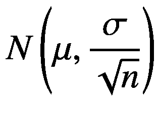

中心极限定理，嗯，到底是什么意思呢？

首先，请记住正态分布的形状。大多数数据点集中在中间。因此，中心极限定理告诉你，对于随机样本，取算术平均数 `x̅` 或平均值，其结果很可能会接近总体均值 `μ`。这个定理令人震惊之处在于，你的总体分布是什么样并不重要；样本算术平均数总会聚集起来形成一个正态形状！这听起来难以置信，所以我们马上来通过一个例子让你亲手验证这个真理。

然而，如果中心极限定理成立，它告诉我们的是，正如我们发现在整个企鹅数据中隐藏着按物种划分的正常企鹅数据一样，我们也可以在任何分布中找到隐藏在其中的正态样本均值数据。

这正好解释了，为什么如果我们必须只选择一种分布来教你，我们会选择这个存在于我们可能抽取的所有样本中的分布。如果你和我们一样，觉得这样一个事实竟然能够成立而着迷，你可能会想探索统计学背后的数学理论（记住，在数学中，定理是*可证明*为真的）。另一方面，如果你只是想利用这个“自然规律”来更好地理解你周围的世界（我们也经常这么做），那你来对地方了。

然而，这还告诉我们更多信息。回想一下，在上一个 z 分数的例子中，我们提到我们的一个基本假设是总体呈正态分布。由于中心极限定理，无论总体分布如何，我们都知道总体的*均值*分布**必须**是正态的。就像调整正态分布一样，z 分数也需要进行一点调整。

用于均值抽样分布的、使用总体参数的 z 分数公式是：


这个公式可能看起来有点令人困惑；我们会在一个例子中一步步地讲解它。需要记住的重点是，通过使用中心极限定理，我们确保了总体是正态分布。这消除了我们关于使用随机样本估计总体时的一个疑问。


### 示例

那么，我们如何展示来自某个任意总体分布（其本身可能不是正态分布）的随机样本均值  可以转化为正态数据呢？这并非一本数学证明书。尽管如此，你一定希望对这个非同寻常的论断找到某种验证！一个很好的证明在于 `R` 模拟数据的能力。你已经掌握了所有必要的工具；我们只需要以稍有不同的方式将它们组合起来。

你刚刚接触了 `runif()` 函数。这一次，我们不使用它来构建一个*样本*，而是设置 `n = 100000` 来创建一个*总体*。你也熟悉 `data.table`；不过，你还没有从头开始创建过自己的数据表。创建新数据表的函数是 `data.table()`。作为输入，它接受你选择的一个名称（这将成为你的列名），然后你可以将该列设置为等于某些数据。在这里，我们选择列名为 `uniform`，并将该列设置为等于一组均匀分布的随机样本数据，这与你之前看到的被称为“完美均匀”数据集的数据非常接近。回想一下，第 5 章中的 `1:191` 列举了数字 1 到 191。这里，我们构建了第二行，命名为 `sample`，其中填充了重复的 `1:1000`（`R` 会循环使用这些数据，因为与第一列的 100,000 行相比，它太短了）。这是 K 次抽样的一个例子，其中每 1000 个均匀分布的随机数被归入一个样本。这个过程一次又一次地重复了 100,000 次。查看一下 `perfectUniform` 数据的前几行以及最后几行：

```
set.seed(1234)
perfectUniform <- data.table(uniform = runif(n = 100000,
min = 0,
max = 5),
sample = 1:1000)
perfectUniform
##         uniform sample
##      1:  0.5685      1
##      2:  3.1115      2
##      3:  3.0464      3
##      4:  3.1169      4
##      5:  4.3046      5
## ---
##  99996:  1.8576    996
##  99997:  0.9441    997
##  99998:  2.3871    998
##  99999:  4.4129    999
## 100000:  4.0344   1000
```

接下来，为了确保我们拥有一个均匀分布的总体，请使用 `hist()` 绘制直方图，如图 7-14 所示：

```
hist(perfectUniform$uniform)
```

请记住，我们的数据存储在一个数据表中，我们需要的是 1000 个样本均值。换句话说，我们需要所有行，因此不需要任何第 i 次选择或排序。我们需要一个新列，它是 `uniform` 列的 `mean()`；这是第 j 个位置上的列操作。最后，我们需要使用 `by = sample`。将此结果赋值给 `sampleMeans`，并检查生成的数据表，该表每行对应一个样本：

```
sampleMeans <- perfectUniform[,
.(SampleMean = mean(uniform)),
by = sample]
sampleMeans
##       sample SampleMean
##   1:       1      2.189
##   2:       2      2.275
##   3:       3      2.528
##   4:       4      2.296
##   5:       5      2.493
## ---
## 996:     996      2.288
```

```
##  997:  997 2.537
##  998:  998 2.453
##  999:  999 2.589
## 1000: 1000 2.570
```

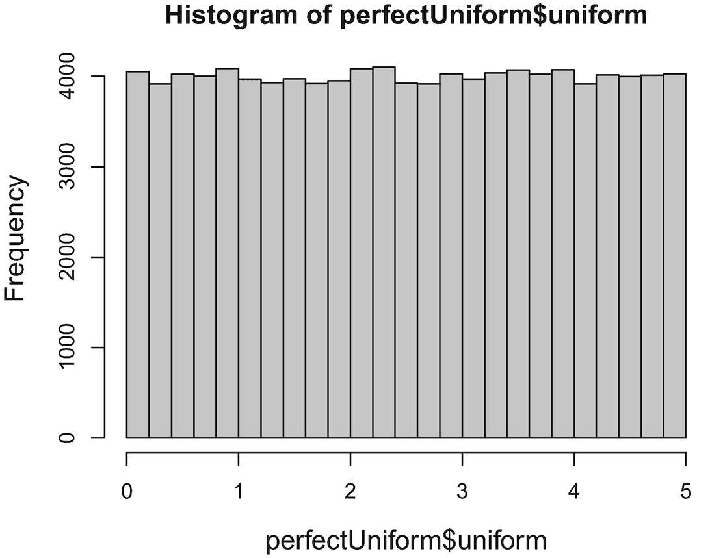

图 7-14：均匀分布总体 N = 100,000

请记住，我们底层的总体是一个均匀分布，而我们拥有的是通过 K 次抽样（我们本可以使用随机抽样，但在这个例子中用 K 次抽样更简单）获取的 1000 个样本。我们再次使用直方图函数 `hist()`，发现图 7-15 看起来相当正态：

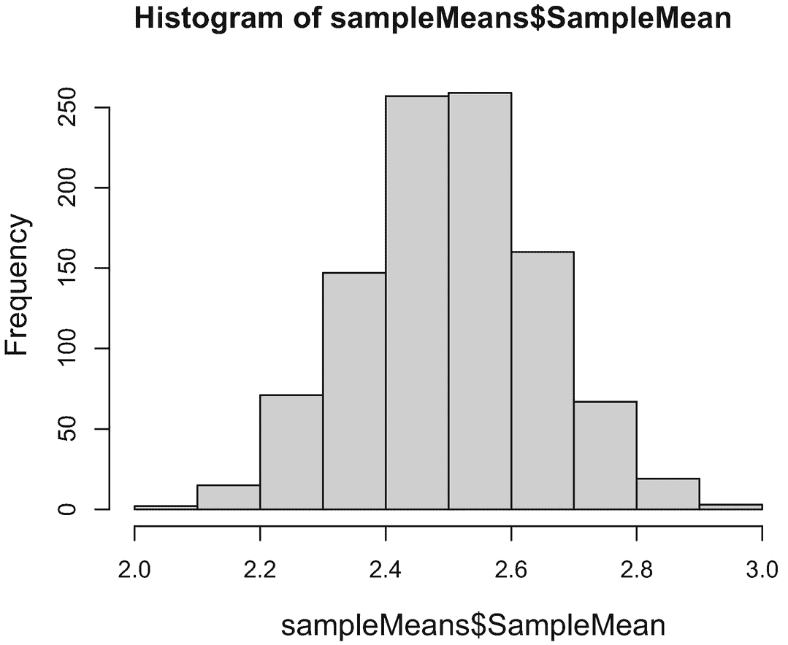

图 7-15：来自均匀分布的 1000 个样本均值

```
hist(sampleMeans$SampleMean)
```

很有意思，不是吗？

这正是中心极限定理向我们保证会成立的情况——样本均值的分布是正态的。

利用这一点的巧妙“诀窍”是：如果你的总体数据不是正态的，而你想使用的统计分析要求数据是正态的，那么你可以通过将个体分组为样本，并仅对样本进行预测，来强制数据表现出正态性。这就解释了为什么在初级的 `R` 教材中，如果我们只有足够的篇幅与你探讨一种分布，那么最好选择正态分布。

那么，对于这个正态分布，我们与中心极限定理的预测匹配得有多接近呢？

请记住，预测是如下的正态分布：


这个预测是基于我们的原始总体，即均匀分布 `perfectUniform`。第二部分 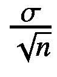 有时被称为**标准误 (SE)**。综合来看，我们得到了关于总体均匀分布的以下信息。这些信息反过来又使我们能够计算出*预测的*样本均值分布。注意，这里的 *n* 是每个样本的元素个数，而不是样本个数：

```
mu <- mean(perfectUniform$uniform)
sigma <- sd(perfectUniform$uniform)
n <- 100000/1000
standardError <- sigma/sqrt(n)
standardError
```

```
## [1] 0.1444
```

这些结果与我们实际的样本均值结果匹配得如何？来看看，由你判断！

```
mean(sampleMeans$SampleMean)
## [1] 2.502
sd(sampleMeans$SampleMean)
## [1] 0.1454
```

均值几乎完美匹配。预期的标准误 0.14 与计算出的样本均值标准差 0.144 并不完全一致。这是完全正常且符合预期的。中心极限定理表明，只有当每个样本中的元素数量足够大时——换句话说，当 *n* 足够大时——这个结论才成立。事实上，严格来说，我们的抽样方式并不完全正确。我们使用了 K 次抽样，而非随机抽样。

不过，结果已经非常接近了。


### 示例

z 分数是怎么回事？除了从个体总体数据转换为均值总体数据（通过将 *σ* 除以*标准误差*来实现）之外，计算 z 分数的过程完全相同。诚然，首先还需要进行一些准备工作才能完成这种转换。

回想一下，图 7-8 显示完整的企鹅数据集在样本中并不完全呈正态分布。虽然这可能是样本偏差导致的结果（在这种情况下，样本统计量可能对总体参数做出较差的估计），但也有可能跨物种来看，企鹅的鳍肢长度本身就非正态分布。无论如何，运用中心极限定理，我们仍能获得正态分布。

与我们的“完美”数据集不同，这里只有 344 只企鹅。这个数量并不足以获得我们所需的大量样本。幸运的是，在“完美”数据集中，我们偷懒使用了 Kth 抽样法。换句话说，我们采用的抽样方式是*无放回*的。这没问题，因为我们的数据实际上已经通过 `runif()` 随机生成了。

在处理真实数据时，当从个体数据转换为样本均值分布时，应采用*有放回*抽样。换言之，我们将让 `R` 使用一种完美的随机抽样方法，同一只企鹅可能会被选中多次。就像公平的硬币抛掷中，每次抛掷正反面都“有机会”一样，每只企鹅的鳍肢长度在每一轮抽样中也都有机会被选中。这样我们就能让样本量足够大（通常 `n >= 30` 就算足够大了）。

为此，你将使用 `R` 创建一个数据表，该表可以存放 1000 个样本均值，每次抽样将*有放回*地抽取 30 只企鹅。首先，你必须创建一个数据表，为 `sampleMean` 设置一个占位值。这里先将其设置为零（一旦抽取样本，这个值就会改变）。你现在拥有的 `sampleMeansF` 中有 1000 行，每行都在 `sampleID` 列中有唯一编号，并且每行都有一个默认的总体均值 `sampleMean = 0`。下面这段代码的作用是，为你即将抽取的样本以及要计算的均值创建一个外壳和一个占位符：

```
sampleMeansF <- data.table(sampleID = 1:1000,
                           sampleMean = 0)
```

为确保你的结果与我们的相符，请在此处使用 `set.seed(1234)`。在实际数据处理中，通常不会这样做：

```
set.seed(1234) # 确保你的结果与我们的相符；实际应用中不使用
```

接下来你将看到一种新的编码技巧。欢迎来到 `for()` 循环的世界！你的目标是进行有放回的随机抽样，计算该样本的均值，并将其存储到 `sampleMeansF` 数据表的正确行中。然而，你需要重复此过程 1000 次。与其复制粘贴赋值代码 1000 次，不如使用 `for()` 循环。

循环是一种让 `R` 知道你希望重复执行同一段代码的方式。为了帮助你理解循环中具体发生了什么，请注意我们逐行*注释*了代码，使每个部分更容易理解。你的循环的一般结构如下（此代码片段无需运行）：

```
for(i in startInteger:endInteger){ #请注意左大括号
  #这里的代码会从 startInteger 重复执行到 endInteger。
} #请注意右大括号！
```

这个循环你需要运行。它从 1 开始，将内部代码重复执行 1000 次。使用你已经熟悉的 `sample()` 函数，从企鹅数据集中有放回地抽取 `size = 30` 的样本。这些样本被赋值给变量 `randomSample`。实际上，运行此代码后，你会在全局环境中看到最后一个 `randomSample` 是一个包含 30 个整数的列表。

抽取随机样本后，接下来使用*迭代器*变量 `i` 来选择正确的 `sampleID`。这是 `sampleMeansF` 数据表中的行选择操作；因此它被放在第一个位置，即第 i 行。接着，需要将该样本的 `mean()` 值存储到 `sampleMean` 列中。注意，此行代码会用实际的样本均值替换 `sampleMean = 0` 这个占位符。至此，一次循环迭代结束，并且对于 `i` 从 1 到 1000 的所有值，此过程会重复进行：

```
for(i in 1:1000){ # for 循环从 1 到 1000 次，每次获取一个随机样本。
   # 每次循环迭代，都会生成一个新的、有放回的鳍肢长度样本
   randomSample <- sample(x = penguinsData$flipper_length_mm,
                          size = 30, # 每个样本包含 30 个鳍肢长度
                          replace = TRUE) # 有放回！
   sampleMeansF[sampleID == i, # 行选择到当前样本 ID
                sampleMean := mean(randomSample, # 分配样本均值
                                   na.rm = TRUE)]
}
```

执行完上述代码后（可能需要一分钟），你会在全局环境中看到一些新的变量。你可能已经注意到了 `randomSample` 变量，它里面还保留着最后一个 `sample()` 的结果。除此之外，还应该有一个值为 `1000` 的 `i` 变量。

现在你有了一个包含 1000 个均值的样本。请记住，每个样本包含 30 个随机企鹅的鳍肢长度，并且你的 `sampleMeansF` 数据表为每个样本分配了唯一的 ID 以及该样本的 `mean()` 值。完成从个体企鹅到企鹅样本组的转换后，接下来自然应该对你的样本均值使用 `testDistribution`，以判断从图 7-8 中的个体企鹅数据转换到图 7-16 中的（样本量为 30 的）均值企鹅数据，是否产生了一个足够正态的数据集。比较这两张图，你怎么看？

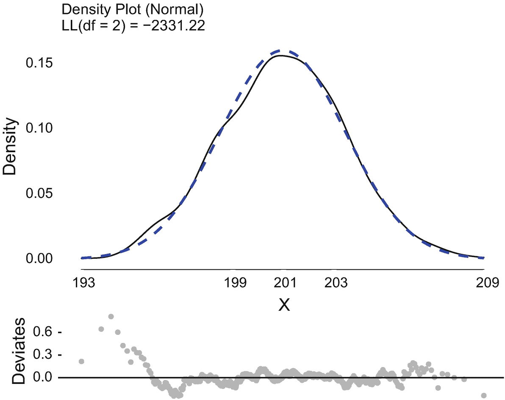

**图 7-16** 所有企鹅样本均值的分布

```
testMF <- testDistribution(x = sampleMeansF$sampleMean,
                           distr = "normal")
plot(testMF)
```

图 7-16 看起来相当正态，是吧？

接下来，你需要检查你的 `sampleMeansF` 数据与中心极限定理 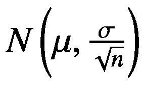 的吻合程度如何。

这次你没有总体级别的数据；所以必须使用统计量来估计这些参数。请记住，标准误差等于标准差除以样本量的平方根：

```
xbar <- mean(penguinsData$flipper_length_mm, na.rm = TRUE)
stdDev <- sd(penguinsData$flipper_length_mm, na.rm = TRUE)
n <- 30
standardError <- stdDev/sqrt(n)
standardError
## [1] 2.567
```

如果有放回抽样代码运行正确，你应该期望它与刚刚计算出的中心极限定理值相匹配。看看这些计算结果与实际 `sampleMeansF` 结果的对比：

```
xbar
## [1] 200.9
mean(sampleMeansF$sampleMean)
## [1] 201
standardError
## [1] 2.567
sd(sampleMeansF$sampleMean)
## [1] 2.491
```

这看起来相当接近了，你觉得呢？

数据与理论非常吻合，样本分布看起来也足够正态，因此可以使用 z 分数来考虑企鹅样本的概率。

这里需要谨慎地确定哪个变量应放在哪个位置。在针对抽样分布的 z 分数公式中，我们不再处理个体企鹅。相反，我们处理的是企鹅的样本。看看下面用英文词汇表述的 z 分数公式，然后比较并对比针对个体分布与抽样分布的 z 分数公式。

**用英文词汇表述的 z 分数：**

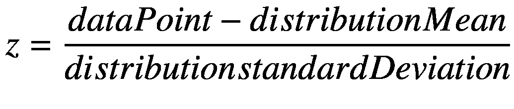

**针对个体分布的 z 分数：**

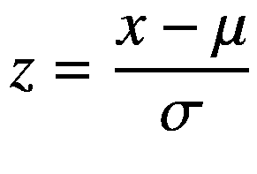

**针对样本分布的 z 分数：**


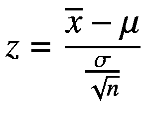

如我们之前所做（尽管并不完全正确），当你不了解参数数据时，可以用统计量替代。代入 z 分数公式可得

*企鹅*样本分布的 Z 分数（数值四舍五入）：

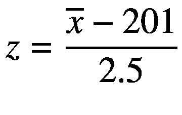

现在你已经设置好 z 分数，就可以（终于）回答一个概率问题了：*抽取 30 只企鹅，得到均值低于 195 的概率是多少？*

和之前一样，你使用相同的 `pnorm()` 函数。只是这一次，你需要将均值和标准差设置为抽样分布的值：

```
pnorm(195,
mean = mean(sampleMeansF$sampleMean),
sd = sd(sampleMeansF$sampleMean),
lower.tail = TRUE)
## [1] 0.008206
```

如你所见，抽样 30 只企鹅并使其“平均”值如此之低的概率并不大。

同样如你所见，抽样分布的标准差*小于*底层个体分布的标准差。中心极限定理令人着迷的实用价值部分就在于这一事实：随着样本量的增加，总体偏差（或标准误差）会减小。

这一原理的应用远不止于强制企鹅数据集呈现正态分布。设想一下，如果你的数据不是企鹅，而是公司股票。从股票总体中随机抽样（可放回）意味着你可能会买入某家公司更多的股票。然而，尽管你的股票投资组合均值可能保持不变，但标准差预计会缩小（幅度相当大）。这当然会降低你的股票投资组合出现暴涨的概率（换句话说，不会落在分布的最右侧尾部）。但同时，它也降低了你的股票投资组合出现暴跌的风险（换句话说，不会落在分布的最左侧尾部）。

### 示例

在最后一个示例中，让我们考虑一下我们的 `acesData`。结合这 191 名参与者的年龄，我们来思考一个问题。假设我们想与 30 名参与者进行面对面的焦点小组讨论。我们随机选择的焦点小组平均年龄超过 24 岁的概率是多少？换句话说，随机选择的 30 名研究参与者中，大部分年龄处于较高区间的概率是多少？

除了更换数据集之外，我们使用与之前完全相同的过程。特别是，大部分代码将重复使用。

使用第 6 章的代码，我们将 `acesData` 缩减为仅包含那些输入了年龄的用户，且每个用户只保留一个副本：

```
unduplicatedAcesAge <- acesData[! is.na(Age),
.(UserID, Age)]
unduplicatedAcesAge <- unique(unduplicatedAcesAge)
```

接下来，使用前一个示例中的代码，我们从该数据集中*自举*（有放回地）抽取 1000 个样本。请注意，我们不仅重复使用代码，而且大部分变量名也保持不变。虽然这会覆盖全局环境中的这些值，但在这种情况下没有风险，因为我们已完成了前面的示例：

```
sampleMeansA <- data.table(sampleID = 1:1000,
sampleMean = 0)
set.seed(1234) #确保你的结果与我们的结果一致；实际应用中不使用
for(i in 1:1000){ #for 循环从 1 到 1000 次，每次获取一个随机样本。
#每次循环迭代，都会生成一个新的、有放回的年龄样本
randomSample <- sample(x = unduplicatedAcesAge$Age,
size = 30, #每个样本包含 30 个年龄值
replace = TRUE) #有放回！
sampleMeansA[sampleID == i, #行选择至当前样本 ID
sampleMean := mean(randomSample, #分配样本均值
na.rm = TRUE)]
}
```

一如既往，检查分布是否正态很重要。虽然该分布在顶部图 7-17 中有一个小凹陷，但从偏差图中可以看出，它与正态线有很好的重合度。这种接近程度足以让我们冒一下险。顺便提一下，关于 1000 个样本并没有硬性规定。你可以轻松地将这个数字提高到 10,000（而且这更有可能确保正态分布）。但是，计算所需时间会更长（你可能已经注意到等待 1000 次计算会有一点延迟）：

```
testAces <- testDistribution(x = sampleMeansA$sampleMean,
distr = "normal")
plot(testAces)
```

接下来，我们检查 `sampleMeansA` 数据与中心极限定理  的拟合程度。

这次你没有总体层面的数据，因此你必须使用统计量来估计参数。记住，标准误差是标准差除以样本量的平方根：

```
xbar <- mean(unduplicatedAcesAge$Age, na.rm = TRUE)
stdDev <- sd(unduplicatedAcesAge$Age, na.rm = TRUE)
n <- 30
standardError <- stdDev/sqrt(n)
standardError
## [1] 0.4086
```

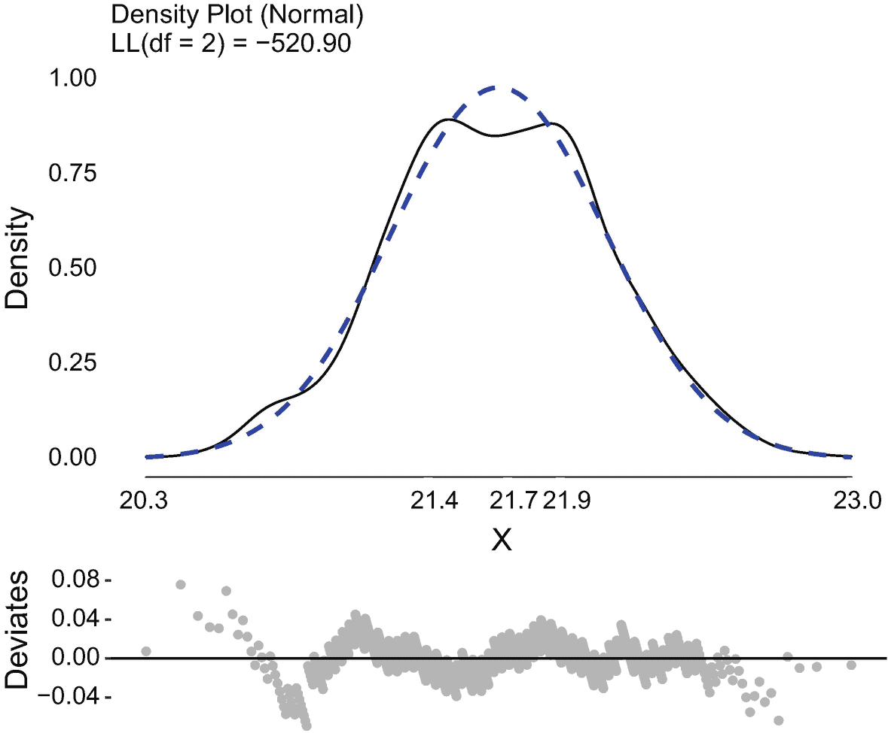

图 7-17

aces 日常数据中年龄样本均值的分布

如果带放回抽样的代码运行正确，你预期它会与刚刚计算的中心极限定理值相匹配。看一下这些计算值与实际的 `sampleMeansA` 结果对比。一切似乎都符合预期——这些数值都非常接近：

```
xbar
## [1] 21.66
mean(sampleMeansA$sampleMean)
## [1] 21.67
standardError
## [1] 0.4086
sd(sampleMeansA$sampleMean)
## [1] 0.4076
```

我们试图回答的问题是：“随机选择的焦点小组的平均年龄大于 24 岁的概率是多少？”

和之前一样，你使用相同的 `pnorm()` 函数。只是这一次，你将均值和标准差设置为抽样分布的值。回顾图 7-17，你不会预期看到样本平均值大于 24。事实上，x 轴在 23 处就停止了。

计算 `pnorm()` 并记得设置 `lower.tail = FALSE`（因为我们关心的是*大于* 24）会得到一个看起来有点奇怪的结果：

```
pnorm(24,
mean = mean(sampleMeansA$sampleMean),
sd = sd(sampleMeansA$sampleMean),
lower.tail = FALSE) #大于 24
## [1] 5.158e-09
```

`5.158e-09` 是科学计数法。看 `e` 后面的数字；这个数字告诉我们小数点要移动多少位。由于是*负* 9，我们将小数点向*左*移动。换句话说，抽取 30 名参与者且他们的平均年龄达到 24 岁及以上的概率是 0.000000005158。可能性极低。

请注意，实际上有 47 名参与者的年龄在 24 岁及以上。因此，随机挑选 30 名平均年龄达到或超过 24 岁的参与者是绝对*可能*的，只不过可能性很小。再次回想公平硬币的例子，你和你的朋友们全部抛出反面的概率是多少？可能吗？当然可能。但更可能的是这枚硬币并不公平，对吧？

```
unduplicatedAcesAge[Age >= 24, .N]
## [1] 47
```

至此，你已经学到了足够的知识。现在是时候动手练习了。


## 7.6 小结

使用样本数据统计量来理解总体参数，需要了解这些统计量是否符合（或不符合）我们对参数的推测（或*假设*）。换句话说，基于我们所推测的总体分布 *N*(*μ*, *σ*)，我们的样本数据是否与该分布相匹配？而分布本身又是概率的巧妙应用，其曲线下的总面积等于 1（这转化为所有可能结果发生概率的总和为 100%）。

此外，你还使用了 `z` 分数来理解从分布中随机抽取单个数据点或样本均值低于或高于某个临界值的概率。这让你能够看到某个极端值出现的可能性（可用于风险评估/降低风险）。正如公平抛硬币例子所暗示的，它也可以用来检验，基于样本数据，总体是否可能如你所相信或被告知的那样。

在你练习并磨练这些技巧的过程中，表 7-1 可以作为本章所学关键概念的良好参考。

**表 7-1** 章节小结

| 概念 | 含义 |
| --- | --- |
| 推断统计 | 统计学的“分析”层面；做出决策。 |
| 结果 | 一个事件可测量的最终状态（例如，抛硬币得到正面）。 |
| 概率 | 所有结果的概率之和为 1； 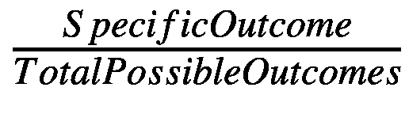。 |
| 互斥 | 两个事件是独立的，且不能同时发生。 |
| 补集公式 | 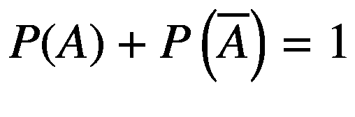。 |
| 独立 | 在概率上互不影响的事件或结果。 |
| 有放回 | 每次随机抽取都基于相同的初始环境。 |
| 概率分布 | 将特定结果映射到概率的函数；曲线下面积为 1。 |
| 正态分布 | 一种特定的概率分布，完全由 `mean()` 和 `sd()` 定义。 |
| `testDistribution()` | 一个用于检验数据是否服从某分布的 `JWileymisc` 函数。 |
| `plot()` | 绘制密度图和偏差图，用于检测数据是否正态。 |
| `..density..` | 一个用于 `geom_histogram()` 的 `aes()` 修饰符，使 y 轴显示密度。 |
| `rnorm()` | 生成随机正态数；需要指定样本量、均值和标准差。 |
| `runif()` | 生成随机均匀分布数；需要指定样本量、最小值和最大值。 |
| `data.table()` | 给定带标题的列数据，从头创建一个 `data.table`。 |
| `pnorm()` | 计算正态分布的概率；需要指定数值、均值、`sd()` 以及下尾或上尾。 |
| `for()` | 循环语句，允许代码重复执行多次。 |
| `pnorm()` |   |

## 7.7 掌握与实践

通过做一些练习来检查你的进度并在实践中成长。理解性测试提出批判性思考问题，最好通过书面或口头回答来解答。统计学的艺术之一在于成功地向利益相关者或受众传达结果。有时受众技术性很强，有时则非常不技术。练习则是对本章所学概念的更直接应用。

### 理解性测试

1.  假设你的朋友正在玩一个基于随机机会的博彩游戏（例如扑克、彩票、轮盘赌）。你的朋友告诉你：“我过去 200 次都输了。我要加倍下注，因为我肯定该赢了。” 根据图 7-1 和独立概率的概念，你会对你的朋友说什么？

2.  假设你住在一个城市，某个网页显示当地人口的平均收入为 50,000 美元，并且 68% 的人口收入在 25,000 美元到 75,000 美元之间。换句话说，平均值为 50K，标准差为 25K。假设你随机抽样了 40 个人，发现平均工资是 34,000 美元。网页关于总体标准差的说法似乎正确吗？换句话说，这个样本是否符合你的预期？

### 练习

1.  重新审视前面的问题，其中总体被声称均值为 50K，标准差为 25K。随机选择一个人，其收入低于或等于 34,000 美元的概率是多少？随机选择 40 个人，其平均收入低于或等于 34,000 美元的概率是多少？

2.  按照示例中所示，使用 `testDistribution()` 和 `plot()` 评估到目前为止所用到的 `acesData` 中的各列是否服从正态分布。

3.  选择一个使用 `for()` 循环进行有放回随机抽样的示例，以创建一个均值的抽样分布，作为中心极限定理的应用。将循环迭代次数从 1,000 更改为 10,000。对两个循环计时直至完成，并讨论差异。继续完成示例的其余部分，比较和对比 `testDistribution()` 的图形。哪个版本看起来更正态？分布均值有区别吗？标准差呢？

4.  使用 `for()` 循环和有放回随机抽样是一种有时被称为*自助法*或*自举法*的技术的一部分。做一些研究（或许通过网络搜索引擎）了解自助法和统计学。

