# 8. 相关与回归

到目前为止，你每次只处理一个变量。从探索性数据分析（EDA）到检测正态性，重点始终放在单个变量上，例如鳍肢长度或年龄。你在预测分析中的第一步——正态概率和 `z` 分数——也仅针对单个变量。虽然对单个变量的计数和汇总非常有用，但预测分析通常旨在理解数据中两个或多个维度之间的关系。最终目标是理解众多变量（或数据列）之间的相互作用。许多现实世界的问题通过更复杂的模型可以得到更好的答案。事实上，许多现实世界的问题需要考虑多个输入才能得到答案。然而，本章仅从两个变量的探索开始。这使事情更容易可视化和理解。后续章节将建立在你在此学到的技术和基础之上。在本章结束时，当你能够做到以下几点时，你就知道自己的方向正确了：
*   理解自变量和因变量。
*   使用相关性分析两个变量之间的关系。
*   在两个变量之间创建线性回归。

本章包含一些大型公式；你不需要记住这些公式。展示它们的目的既是为了让你了解背景信息，也是为了引出公式的结果（这是你在示例中会看到并使用的部分）。背景（或者在数学术语中，`理论`）是个棘手的事情。了解太少可能会导致误用技术。过早了解太多又可能使人失去兴趣。首次阅读时，可以大致浏览这些公式；稍后，在第二次（或第三次）阅读时，深入研究这些想法会更有价值。最后，为了让你在本章中取得成功，请注意一点：考虑回顾第 5 章中的数据类型（定类、定序、定距和定比）。

## 8.1 `R` 环境设置

按照惯例，为了继续练习创建和使用项目，我们为本章节启动一个新项目。

如有需要，可回顾第 1 章创建新项目的步骤。启动 `RStudio` 后，在左上角菜单栏中选择 `File`（文件），点击 `New Project`（新建项目）。选择 `New Directory`（新建目录）➤ `New Project`（新建项目），在 `Directory name`（目录名称）中输入 `ThisChapterTitle`，然后选择 `Create Project`（创建项目）。要创建 `R` 脚本文件，在顶部 `File`（文件）一词正下方的工具栏中，点击带有加号图标的空白纸张小图标，然后选择 `R Script`（R 脚本）菜单选项。点击软盘形状的 `save`（保存）图标，将此文件命名为 `PracticingToLearn_XX.R`（其中 `XX` 为本章节编号），然后点击 `Save`（保存）。

在右下方面板中，您应能看到项目中的两个文件。在 `Files`（文件）选项卡正下方，点击名为 `New Folder`（新建文件夹）的按钮。在弹出的 `New Folder`（新建文件夹）窗口中，输入 `data` 并选择 `OK`（确定）。在右下方面板中，点击新建的 `data` 文件夹。重复文件夹创建过程，再新建一个名为 `ch08` 的文件夹。

请记住，本章节使用的所有包已在第 2 章中安装到您的本地计算机上。无需重新安装。但由于这是一个新项目，且我们首次运行这组代码，因此需要执行以下 `library()` 调用：
```r
library(data.table)
## data.table 1.13.0 using 6 threads (see ?getDTthreads). Latest news: r-datatable.com
library(ggplot2)
library(visreg)
library(palmerpenguins)
library(JWileymisc)
```

本章节中，我们仅使用 ACES 每日数据集中某一天的晚间调查数据，因此每个人只贡献一条观测值。我们随机选择了 2017 年 3 月 3 日的数据：
```r
acesData 
```

当然，我们还会使用熟悉的企鹅数据集和汽车数据集：
```r
penguinsData <- as.data.table(penguins)
mtcarsData <- as.data.table(mtcars, keep.rownames = TRUE)
```

现在，您可以自由学习更多关于统计学的内容了！

## 8.2 相关性

我们通常对两个变量之间的相互关系感兴趣。实现这一目标的方法之一是通过 `散点图`，其中水平 x 轴表示一个变量，垂直 y 轴表示另一个变量。图 8-1 展示了 `mtcars` 数据集中不同汽车的马力（`hp`）和每加仑英里数（`mpg`）的散点图。从视觉上看，我们可以观察到每加仑英里数较高的汽车通常马力较低。

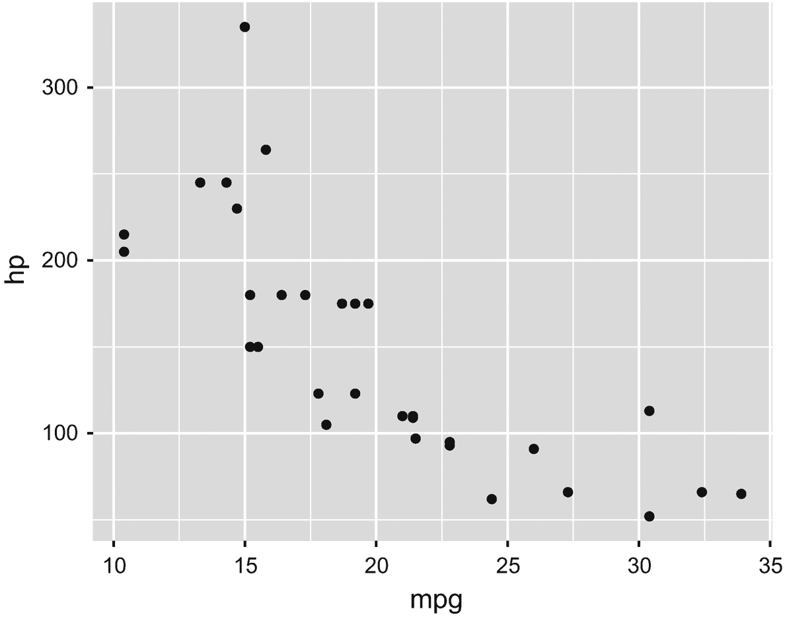

图 8-1：`mtcars` 数据集中每加仑英里数（`mpg`）与马力（`hp`）的散点图

您可能还记得，第 1 章中有一个使用 `mpg` 和 `wt` 绘制的类似图形。这一次，我们使用您已经熟悉的 `ggplot()` 函数。正如您可能猜测的那样，我们需要进一步了解图形构建！由于现在您正在比较数据的两个 `维度`，`mapping`（映射）需要同时包含 x 变量和 y 变量。和往常一样，这在美学（aesthetic）区域中进行设置。

此外，您还需要一种新的视觉几何对象——在本例中为 `geom_point()`——来绘制数据集中每个 `(x, y)` 坐标点的散点图：
```r
ggplot(data = mtcarsData,
mapping = aes(x = mpg,
y = hp)) +
geom_point()
```

我们还可以在图 8-2 中看到 ACES 每日数据集中压力与负面情绪（心境）的散点图。该数据集更大，变量的偏态也更严重：存在大量低值（即低压力和低负面情绪的人群）。在本章中，我们将研究这两个示例，看看它们如何影响结果：
```r
ggplot(data = acesData,
aes(x = STRESS,
y = NegAff)) +
geom_point()
```
```  
## Warning: Removed 2 rows containing missing values (geom_point).  
```

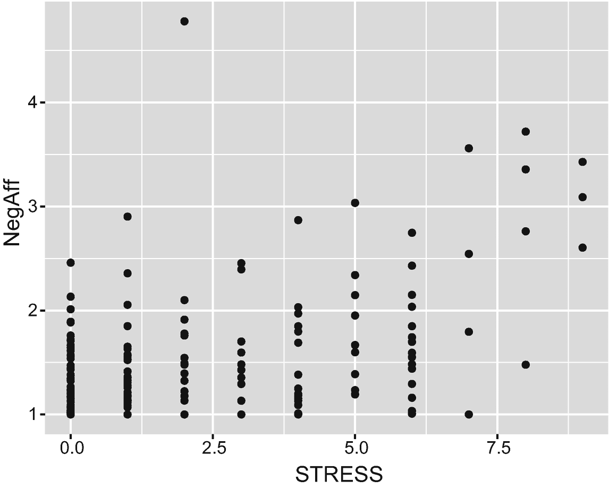

图 8-2：ACES 每日数据集中压力与负面情绪（心境）的散点图

比较并对比这两个探讨两个变量或两个维度之间关系的示例。我们此前已花费时间讨论了如何通过方差和标准差来描述数据的波动性，以及如何通过中位数和算术平均数来描述数据的集中趋势。类似地，我们需要建立一种语言来讨论两个不同变量之间的关系。

`相关性`系数是一种标准化的方法，用于量化或讨论两个变量之间的 `线性`关联或关系。在本章中，我们将探讨几种常见的相关系数。根据我们所拥有的数据类型，可能会使用不同的相关系数公式。

### 参数相关

最常见的相关方法可能是皮尔逊积矩相关系数（PPMCC），记作 `r`。这种方法适用于成对的定量数据，且数据属于间隔尺度或比率尺度（回顾第 5 章的讨论）。此外，我们假设数据本身服从正态分布。事实上，`参数相关`（本小节的标题）一词意味着存在一些参数或标准，决定了该相关方法是否适用。如果数据仅略偏离正态分布，那么皮尔逊相关系数可能仍然足够接近（尽管并非完美）：
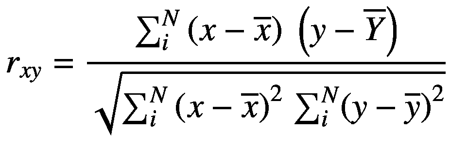

这个略显杂乱的公式衡量的是 `x` 数据和 `y` 数据之间直线或线性关系的强度。特别地，由于该方程的数学性质，相关系数 `r` 的取值范围在 -1 到 1 之间。两个维度之间的相关性越强，结果就越接近 -1 或 1。在这种情况下，强相关性表现为几乎呈一条直线（也称为 `线性`）。正相关告诉我们两个值同步增加或减少。负相关告诉我们两个值朝相反方向变化。

#### 示例

虽然理解公式是件好事（也可以是长期目标），但在大数据集上手工计算过于繁琐。`R` 将该公式实现为相关函数 `cor()`，它接受两个参数——`x` 和 `y` 值。结合图 8-1 来看，我们预期得到一个负数。这是因为随着 `mpg` 增加，`hp` 减少。因此，两个值朝相反方向移动。此外，散点图中的点大多呈散乱的直线分布。因此，我们还预期该数更接近 -1，而不仅仅是在数轴上 0 的左侧。

观察函数输出结果，我们的直觉是正确的：
```r
cor(x = mtcarsData$mpg, y = mtcarsData$hp)
## [1] -0.7762
```
这是一个强负相关。

#### 示例

图 8-2 与前面的示例有所不同。首先，随着 x 轴上的 `STRESS` 值增加，y 轴上的 `NegAff` 开始出现一些更高的数据点。其次，虽然从视觉上看确实如此，但你一定可以指出至少有一个点，其中 `NegAff` 在图表中间区域的值高于最右侧区域的值。这表明（二者的关系）并非完全线性。

因此，我们预期在中间区域的（相关系数）答案会更接近 0。尽管如此，总体来看，从左到右沿 x 轴方向，y 轴上的数据点大多呈升高趋势。因此，你可能会预期得到一个正数的答案。

你可能已经注意到，在创建图 8-2 时，有一条关于删除了两个缺失值的警告。通常，缺失值可能表现为完整的 (`x`, `y`) 对完全缺失，也可能表现为两个部分缺失的对——其中一个缺失 x，另一个缺失 y。面对缺失数据时，处理方式有多种。最简单的方法是要求所有数据对都必须是完整的，这可以通过输入第三个参数 `use = "pair"` 来实现。我们提醒您，这个过程存在风险，阅读我们的统计编程和数据模型 [22] 一书可能会对您有所助益。

尽管如此，多年来，统计学中的默认方法是直接删除包含任何缺失数据的行。在下面的代码中，我们在 `data.table` 方法中使用了 `cor()` 函数。它是一个列运算符，因此应放置在 `j` 参数，即列操作位置：
```r
acesData[,
cor(x = STRESS,
y = NegAff,
use = "pair")]
## [1] 0.5029
```
正如预测，这里的关系不如前一个示例紧密。同时也正如预测，这种关系是正相关的。

#### 示例

让我们再看最后一个示例。假设我们创建了一个 `data.table()`，其 `x` 值范围为 1 到 100，`y` 值是 x 数据的立方：
```r
cubicData <- data.table(x = -100:100)
cubicData[, y :=  xˆ3]
```
查看图 8-3 中的散点图，我们可以看出 x 和 y 之间绝非直线关系：

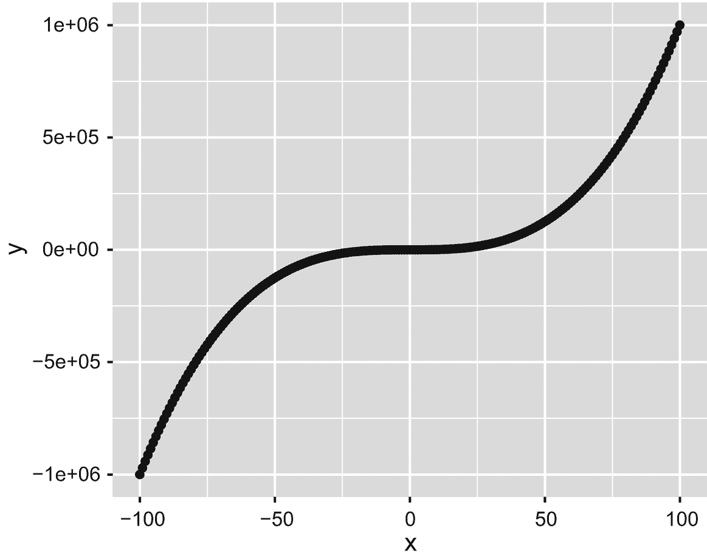

图 8-3

ACES 日常数据集中压力与负面情绪（情绪状态）的散点图
```r
ggplot(data = cubicData,
mapping = aes(x = x,
y = y)) +
geom_point()
```

然而，相关系数却表现出强正相关——事实也确实如此：
```r
cubicData[,
cor(x = x,
y = y)]
## [1] 0.9165
```
因此，为了很好地解读皮尔逊相关系数，我们首先需要满足其假设条件。除了数据必须是等距或等比数据外，散点图还应大致呈线性。此外，每个变量（例如 x 或 y）都应服从正态分布。对于我们的立方数据而言，这些数据既不是联合线性，也不是各自独立的正态分布。因此，虽然我们可以从散点图（并且确实可能从常识中得知）看出 x 和 y 存在某种共同上升的趋势，但皮尔逊相关系数并非检测这种趋势的理想方法。

### 非参数检验：斯皮尔曼

`非参数`检验对数据没有（特定的分布）假设。

在前一节中，皮尔逊相关系数用于衡量 *线性* 关系，需要满足若干假设。换句话说，*x* 值的变化（增加/减少）被认为可以预测 y 值的相应变化。事实上，皮尔逊相关系数假定 x 与 y 的关系中存在一个恒定比率。也就是说，无论我们在 x 轴上的哪个位置，向右移动一个单位（大致）都会导致 y 轴产生相同的变化量（上升或下降）。

有时，尽管 x 和 y 之间存在关系，但这种联系并非如此恒定。当 x 和 y 是顺序变量或等级数据时，就可能出现这种情况。换句话说，取决于我们在 x 轴上的位置，向右移动一个单位（大致）会导致 y 轴产生不同的变化量（但方向仍然相同）。

斯皮尔曼等级相关系数 *ρ*（这是希腊字母，读作“柔”）可以计算为对等级排序数据进行皮尔逊相关，其中 *Rx* 和 *Ry* 分别表示 *x* 的等级和 *y* 的等级。此检验对数据的唯一假设是数据为顺序变量（这算不上什么严格假设）：
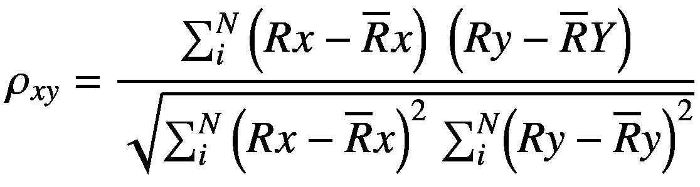

尽管如此，斯皮尔曼相关系数仍会输出通常在 -1 到 1 之间的相关系数值。

#### 示例

在 `R` 语言中，我们可以直接使用 `cor()` 函数的另一个参数 `method = "spearman"` 来获得斯皮尔曼相关系数。实际上，从技术上讲，在之前的小节中，我们使用的是 `method = "pearson"`。但因为这是默认参数，所以我们不需要写出它。在实践中，将方法硬编码到代码中可能会很有帮助——特别是当您需要其他人阅读并理解您的代码和分析选择时。

对于图 8-1 所示情况，请注意在 `mpg`（x 轴）从 15 到 20 的区间，`hp`（y 轴）似乎从 300 大幅下降到略高于 100。相比之下，在 `mpg`（x 轴）从 25 到 30 的区间，`hp`（y 轴）则相当平稳。因此，如果我们转向使用斯皮尔曼相关系数——它关注的是等级而非恒定变化比率——我们预期会得到一个更强的信号：
```r
cor(x = mtcarsData$mpg,
y = mtcarsData$hp,
method = "spearman")
## [1] -0.8947
```
我们确实得到了一个更强的信号。请注意，这仍然是一个负相关——随着 `mpg` 增加，`hp` 减小。在这个例子中，它只是更接近于 -1，因为尽管这些数据相当线性，但它们的关系量级确实发生了变化。

#### 示例

同样地，即使数据存在缺失，我们也可以在数据表内部使用斯皮尔曼方法。虽然这本身似乎只是为我们省去了一些 `$` 符号的输入，但在结合其他汇总方法使用时，它会非常有用。在这里引入它，是为了让后续工作更轻松。同样，由于存在缺失数据，我们包含了 `use = "pair"` 参数。如果我们不包含该参数，输出结果将是 `NA`：
```r
acesData[, cor(x = STRESS,
y = NegAff,
use = "pair",
method = "spearman")]
## [1] 0.4328
```
在这里，皮尔逊相关系数和斯皮尔曼相关系数非常接近。

### 非参数方法：肯德尔相关系数

与斯皮尔曼相关系数类似，肯德尔相关系数也是一种非参数方法——唯一要求是数据必须是定量的且有序的。要理解肯德尔方法的工作原理，我们来看表 8-1 中的一个“玩具”示例。当一对数据中的两个值对某个项目的排名一致时，就构成了一个 **一致对**。具体来说，只要排名的变动方向相同，这对数据就是一致的。想象两位评审员在给毛绒玩具打分。如果两位评审员给同一个玩具的评分相同，那么这个对就是一致的。事实上，只要两位评审员的评分方向一致，这个对就一直保持一致（请看下面的毛绒熊——两位评审员都给熊的排名“低于”兔子）。然而，当评审员的评分方向不同时（请看毛绒狗），就构成了一个 **不一致对**。

表 8-1
玩具示例

| 玩具 | 评审员 A | 评审员 B | 对类型 |
| --- | --- | --- | --- |
| 毛绒兔 | 第 1 名 | 第 1 名 | 一致对 |
| 毛绒熊 | 第 2 名 | 第 3 名 | 一致对 |
| 毛绒狗 | 第 3 名 | 第 2 名 | 不一致对 |

将这一概念转化为数学公式，得到肯德尔秩相关系数 *τ*（希腊字母“tau”），我们使用一致对的数量 *n*[*c*]、不一致对的数量 *n*[*d*]，以及从总对数中选取两个物品的组合数 *n*[0]（其中 *n* 是总对数）：

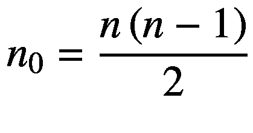

由此得出 *τ* 的定义为：

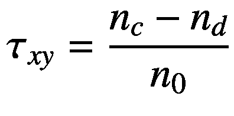

如果一致对更多，例如 (*x*[2], *y*[2]) 的排名相同，那么 *n*[*c*] 会更大，*n*[*d*] 会更小，*τ* 将趋近于 +1；如果所有对排名都一致，则 *τ* 恰好为 +1。反之，如果所有对都完全不和谐，则 *τ* 将为 -1。

如果排名中存在并列情况，`R` 会使用一个稍微复杂的公式 *τ*[*B*]，该公式会根据并列数量进行调整。

回到我们的玩具示例，我们看到有 *n*[*c*] = 2 个一致对和 *n*[*d*] = 1 个不一致对。同样地，三个玩具的总数下，我们有 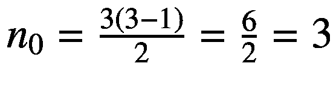。因此，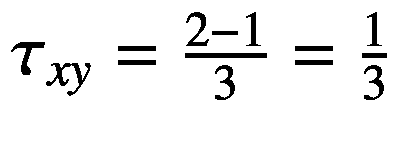。

为了在 `R` 中验证这一结果，我们可以使用 `data.frame()` 函数构建一个名为 `toy` 的数据集：

```
toy <- data.frame(toy = c("rabbit", "bear", "dog"),
ReviewerA = c(1, 2, 3),
ReviewerB = c(1, 3, 2))
Toy
##      toy ReviewerA ReviewerB
## 1 rabbit         1         1
## 2   bear         2         3
## 3    dog         3         2
```

当然，在 `R` 中，无需手动代入公式计算。`cor()` 函数使用 `method = "kendall"` 可以直接给出肯德尔 *τ* 值。请注意 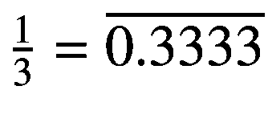：

```
cor(x = toy$ReviewerA,
y = toy$ReviewerB,
method = "kendall")
## [1] 0.3333
```

肯德尔 *τ* 计算中最繁琐的部分是梳理各对数据并判断哪些是不一致对。尤其对于类似毛绒熊这样的例子——两个物品的排名都低于其他物品，但两者的排名却又不同。历史上，对于较大数据集，斯皮尔曼 *ρ* 计算起来更简便。如今，由于对 `R` 来说两者计算难度无差别，肯德尔 *τ* 可能更受青睐。

### 示例：mtcarsData

最后通过肯德尔方法查看 `mtcarsData` 数据集，我们再次看到一个强烈的负相关关系：

```
cor(x = mtcarsData$mpg,
y = mtcarsData$hp,
method = "kendall")
## [1] -0.7428
```

### 示例：acesData

最后通过肯德尔方法查看 `acesData` 数据集，我们再次看到一个较弱的正相关关系：

```
acesData[, cor(x = STRESS,
y = NegAff,
use = "pair",
method = "kendall")]
## [1] 0.3342
```

### 相关性选择

在结束本节之前，有必要了解何时使用各种相关性。

皮尔逊积矩相关系数（有时缩写为 PPMCC，通常简称为相关系数）是较古老的相关性方法之一。它用于检测两个数据维度（例如，两列不同的数据）之间的线性关系。由于线性关系是连续的，因此底层数据也应该是连续的。因此，对数据的假设是：关系应为线性，且底层数据为等距或等比数据。

斯皮尔曼秩相关系数（常称为斯皮尔曼 *ρ*）是一种较新的方法。正如数据科学和统计方法中常见的情况，数据往往是杂乱无章的。因此，理解数据的方法必须将旧结构适应于当前应用。作为一种非参数相关性方法，它无需对数据预设前提即可检测两个变量之间的关系。但存在“定量”（毕竟需要计算）这一假设。因此，数据至少必须是有序的。从计算角度来看，斯皮尔曼比肯德尔计算速度更快。在实践中，由于现代硬件的发展，这已不像十年前那样成为关注点。

肯德尔秩相关系数（常称为肯德尔 *τ*）也相对较新。它也是一种非参数方法。当然，数据也必须适用于公式；因此，定量和有序是最低要求。虽然斯皮尔曼和肯德尔的具体解释不同，但它们都能检测两个变量之间存在正相关还是负相关关系。在本教材中，它们本质上是相同的（两者在具体的实际应用中各有其用途）。

## 8.3 简单线性回归

### 引言

我们在“相关性”一节中提到，皮尔逊相关性假设散点图的数据点之间存在线性或直线关系。如果数据大部分呈线性相关，就像我们在图[8-1]中看到的那样，那么通过那些点构建一条直线可能是有意义的。虽然我们可以绘制多条适合这些点的直线，但目标是找到 *最佳* 直线。最佳直线将尽可能接近每一个点。这比看起来要困难得多（尽管 `R` 会使其变得相当容易）。这样的直线称为 **回归** 线。

现在，有必要说明一下我们在“相关性”一节中没有提到的一点。在数学（和编程）中，函数接收 *输入* 并产生 *输出*。传统上，输入是 `x` 值，输出是 `y` 值。在统计学和回归线的世界里，我们通常从事预测分析。因此，`x` 轴输入被称为 **预测变量**。它有时也被称为 **解释** 变量或 **自变量**。`y` 轴输出被称为 **结果** 变量或 **因变量**。

回归线面临的挑战之一在于，这条线很少能触及图上的所有点（除非相关性是完美的-1 或 1）。再看图[8-1]，没有一条直线能够触及每一个点。因此，即使是最 *佳* 直线也会经常“偏离目标”。现在，请记住通常的直线方程是 `y = b[0] + b[1] * x`。然而，散点图上的许多点要么在直线上方一点，要么在直线下方一点。因此，简单线性回归基于直线方程，但包含一个小的误差项来解释这种偏差。误差（error）一词以字母“e”开头，所以当我们使用希腊字母表示误差时，使用 `E`（读作 epsilon）也就不足为奇了。对于第 `i` 对点，其方程为：


其中：

- `y` 是结果变量或因变量。
- `x` 是预测变量/解释变量/自变量。
- `ε` 是残差/误差项。
- `b[0]` 是截距，即当 `x` = 0 时，`y` 的期望值（模型预测值），写作 `E(Y | x = 0)`。
- `b[1]` 是直线的斜率，表示 `x` 每变化一个单位，`y` 预期会变化多少。
- 该点是 `(x[i], y[i])`。

模型 **参数**，即回归系数 `b[0]` 和 `b[1]`，对所有参与者都是相同的。下标 `i` 表示每个人（或每次观测）都有其自己的 `y` 值和 `x` 值，并且由于模型不太可能是完美的，因此会存在一些无法解释的残差 `ε[i]`（希腊字母 epsilon）。特别地，我们称之为 `ε[i]`，因为对于每个数据点 `(x[i], y[i])`，epsilon/误差会有所不同。换句话说，模型会更接近某些点，而离其他点则更远。因此，一些点的误差会非常小，而另一些点的误差会更大。

如果我们只想讨论基于回归系数（模型参数）预测的结果，而不是 `y[i]` 的“真实值”，我们称预测值为 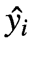。我们用方程表示为：

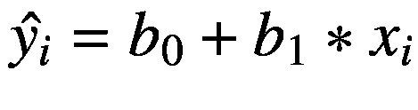

这个公式省略了残差项 `ε[i]`，因为我们谈论的是模型，而不是 `y[i]` 的实际值（实际值是模型加上误差）。

这个残差更正式地写为：

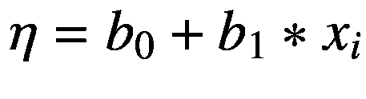

其中希腊字母 `η`（eta）用于表示模型中所有观测值的线性预测值。`η` 的粗体表示它是一个包含所有观测值的向量，而不仅仅是第 `i` 个人的。我们将在“假设”部分进一步讨论这一点。

从视觉上看，截距 `b[0]` 和斜率 `b[1]` 这两个系数/参数如图[8-4]所示。

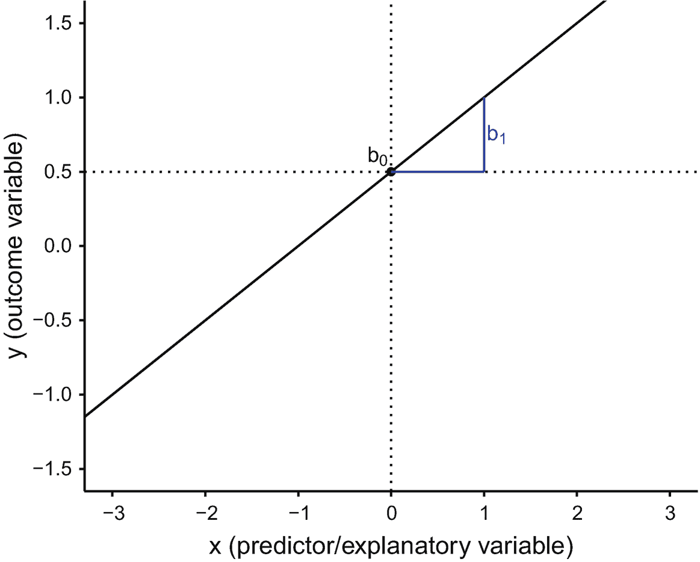

**图 8-4.** 来自简单线性回归模型的直线图。

截距符号的变化表示直线的高度（有时称为 **水平线**）发生了移动。截距为正值，即 `b[0] > 0`，会将直线在 `y = 0` 处向上移动，使其高于 `x` 轴。另一方面，截距为负值，即 `b[0] < 0`，会将直线在 `y = 0` 处向下移动，使其低于 `x` 轴，如图[8-5]所示。截距改变并不意味着斜率改变。

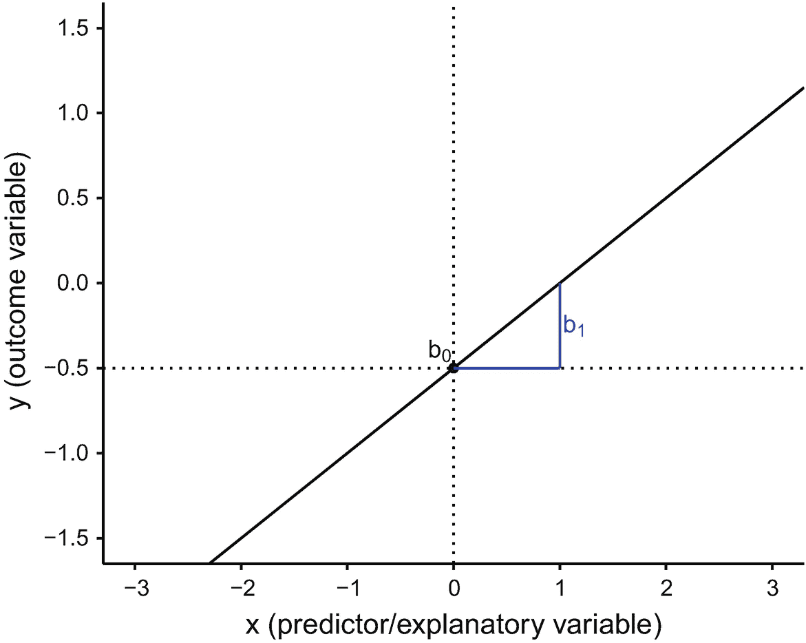

**图 8-5.** 来自具有另一个截距值的简单线性回归模型的直线图。

斜率的变化表示直线的陡峭程度发生了改变。较大的正值表示更陡的正斜率，因此随着 `x` 增加，`y` 也预期会增加。离 0 更远的负值表示更陡的负斜率（也可能是更陡的下降趋势），因此随着 `x` 增加，`y` 预期会减少。图[8-6]中的直线有点接近我们最终可能期望在图[8-1]中看到的直线。

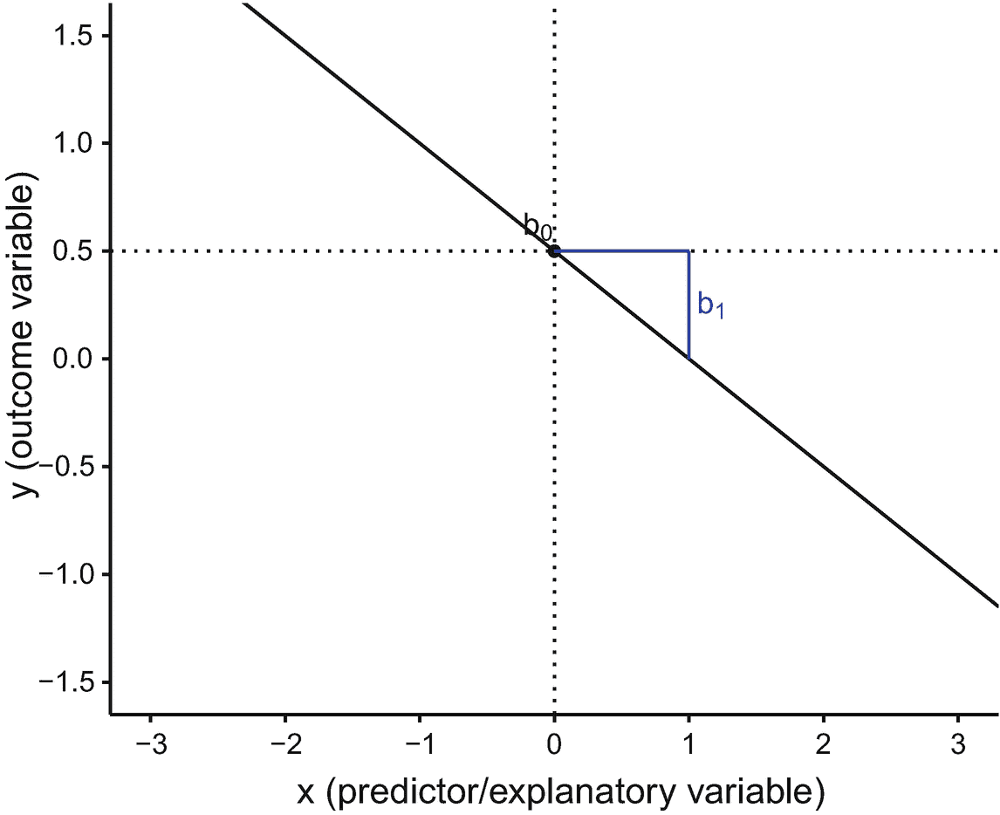

**图 8-6.** 具有不同斜率的简单线性回归模型示例图。

在简单线性回归中，我们并不是在创建一条任意直线；我们是在创建最佳拟合线。在这里，“最佳拟合”意味着使残差平方和最小的那条直线。另一种表述方式是，最佳拟合线将是与 *所有* 点都 *最接近* 的那条直线。如果你将最佳拟合线向某个点移近，它就会不可避免地远离其他一些点（并且不再是那条最佳拟合线）。同样，在你学习这些理论时，请记住 `R` 会完成繁重的工作。我们的目标是让你理解足够多的知识，以便 `R` 的输出对你来说是有意义的，并且你能向合适的听众（例如，你的客户、老板或同事）解释你的结果。

为了更好地理解残差，让我们从视觉上看看简单线性回归中的残差。图[8-7]展示了两个 `mtcars` 变量（马力 `hp` 和每加仑英里数 `mpg`）的散点图。黑色实线是最佳拟合回归线，每个观测值与直线之间的蓝色线条就是残差。残差表示了模型预测值与实际观测值之间的差异。

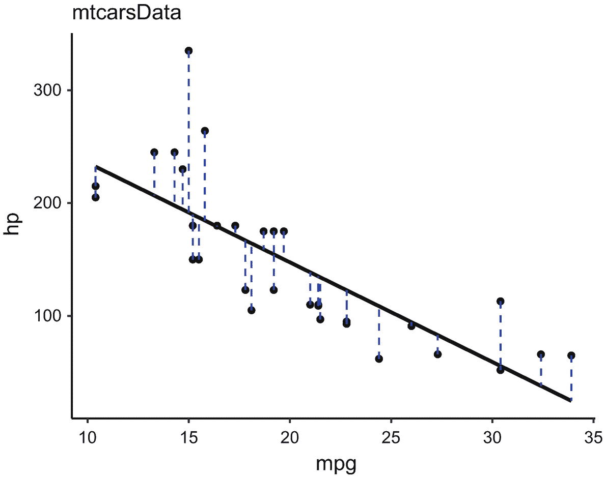

**图 8-7.** 展示数据点（黑点）、线性回归线（黑线）和残差（蓝色虚线）的示例。

这引出了另一种思考和书写残差方程的方式——观测结果值与预测结果值之间的差值：

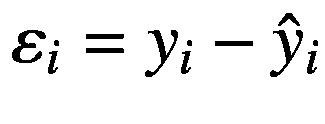

当我们拟合线性回归时，通过求解方程来得到使残差平方和最小的 `b[0]` 和 `b[1]` 的 *估计值*，这些参数估计值（或回归系数）会产生最佳拟合线。在我们讨论 `R` 如何帮助你创建我们得到的结果（并给出 `b[0]` 和 `b[1]` 的实际估计值）之前，我们必须先讨论这些假设。

### 假设

我们已经讨论了关于线性回归的基础知识。与许多统计模型一样，线性回归要求一些 *假设* 成立，结果才有效。以下信息是对理论的更深入背景介绍。如果你正在设计自己的研究，理解并梳理这些内容将很重要。也就是说，你可以多次研读——每次阅读都会让你有更多见解。然而，如果你希望直接跳到编码线性模型，请重点关注假设总结。

我们已经展示了线性回归方程的标准形式，其中包含截距 `b[0]` 和斜率 `b[1]`，它们与预测变量 `x[i]` 的某些数据一起，用于预测特定观测值 `y[i]` 的结果。预测无法解释的部分是残差 `ε[i]`。你在图 8-7 中看到了这些残差的一个例子，即蓝色的垂直线。它们表示线的预测值与实际数据点之间的误差量：

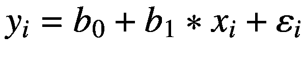

尽管回归系数 `b[0]` 和 `b[1]` 对所有观测值都相同，但预测变量 `x[i]` 的值对于不同的观测值可能不同。因此，根据 `x[i]` 的得分，你可以为每个观测值得到不同的预测值。

我们之前也看到，预测值可以定义为 `η`（读作“eta”）：


利用这一部分，我们可以简化之前的方程如下：

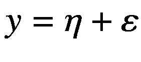

这里我们用粗体表示它们对每个 `(x[i], y[i])` 对都成立；这些对有时称为 **向量**。重写我们的回归方程突出了线性回归的基本构建块。用语言来说，我们可以说“我们的结果 `y` 等于模型预测 `η` 与未解释（残差）部分 `ε` 之和。”

有了所有这些部分，现在我们可以讨论线性回归模型的四个假设。

#### 线性

线性回归中的 **线性** 假设是指预测变量 `x` 与结果 `y` 之间的关系是线性关系。这是必需的，因为我们估计的回归系数 `b[0]` 和 `b[1]` 定义了一条直线。如果 `x` 和 `y` 之间的真实关系是非线性的，我们将无法用一条直线很好地捕捉它。

与统计学中的许多事情一样，在现实世界中，大多数事物既不完全线性，也不完全非线性。在实践中，你通常是在寻找关系是否 *大致* 是线性的。问题就变成了：用一条直线来建模这种关系是否足够准确，以至于这条线 *足够有用*。

评估线性的一种方法是使用散点图。图 8-8 中有两个例子。虽然没有一个例子是完全线性的，但图 8-8 面板 B 已经足够接近，使得线性回归线对于理解预测变量和结果之间的主要关系是有用或有帮助的：

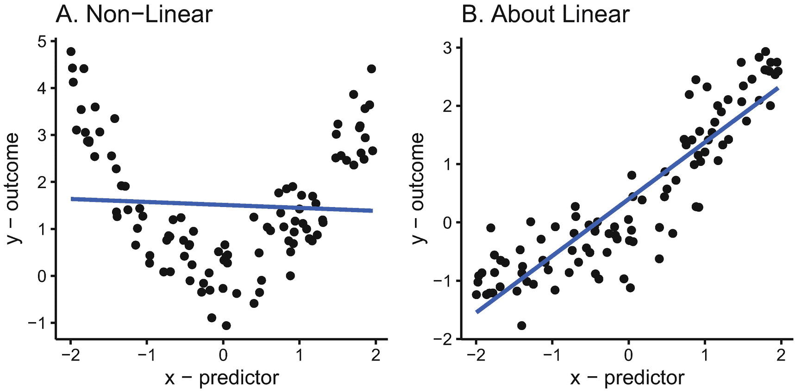

图 8-8

示例显示了一个非常非线性的关联（面板 A）和一个近似线性的关联（面板 B）在预测变量 `x` 和结果 `y` 之间。线性回归线以蓝色线条显示。

```
## Registered S3 methods overwritten by 'car':
##   method                          from
##   influence.merMod                lme4
##   cooks.distance.influence.merMod lme4
##   dfbeta.influence.merMod         lme4
##   dfbetas.influence.merMod        lme4
```

#### 正态性

线性回归还假设一个**正态**分布。但是在线性回归中，当我们说假设正态性时，它真正意味着什么？我们假设的是结果在给定模型条件下是条件正态的。在实践中，这通常以两种方式之一写出，两者是等价的：

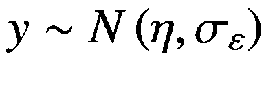

这个读作：“`Y`服从均值为`η`、标准差为`σ[ε]`的正态分布。”这里的想法是，我们不需要`y`本身遵循相同的正态分布。我们假设对于任何给定的预测值`η`，观测到的`y`值围绕该预测值呈正态分布。

在实践中，这更难检验或检查。如果仔细看，我们确实假设`y`遵循正态分布，但对于`η`的每个不同值，均值不同的不同正态分布。这样，为了只用**一个**正态分布来检查假设，我们可以做一个小的变动。如果你通过从一个变量中减去其均值来创建一个新变量，新变量的均值总是 0。我们可以利用这一点来简化假设检查。记住我们简化的高级回归方程：


如果我们通过两边减去`η`来重新排列，得到

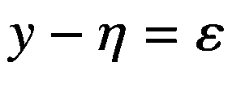

残差`ε`是观测结果与预测值之间的差异（图 8-7 中那些垂直的蓝色虚线）。由于线性预测值是`y`每个值对应正态分布的假设均值，如果我们减去它，结果应该均值为 0。

这使我们能够以另一种方式写出正态性假设：

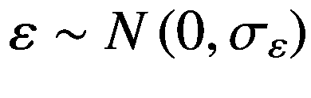

唯一的区别是我们是使用残差并假设均值为 0（因为残差总是被构造为均值为 0），还是使用原始结果变量但假设均值等于`η`。实际上，我们假设结果围绕回归线呈正态分布，标准差基于残差的标准差。

然而，残差更容易检验，因为现在我们只假设一个特定的正态分布，并且可以使用图表和其他方法来评估残差是否确实大致遵循均值为 0、标准差为`σ[ε]`的正态分布。

换句话说，线性回归的正态假设是关于残差的——预测线与实际点之间的误差——应该是一个均值为 0 的正态分布。

#### 同方差性

与正态性假设相关的是**同方差性**假设。*Scedasticity* 指的是误差项或残差项的分布；*homo* 表示相同。因此，该假设是指误差项具有相同的散布程度或变异量。

同方差性假设意味着我们假设对于`η`的每一个值，其周围残差的方差（散布程度）都是相同的。换句话说，图 8-7 中那些垂直的、带虚线的蓝色线段应当保持平衡。这个假设与我们之前为体现正态性所见的同一个方程相关：

```
y ~ N(η, σ_ε)
```

对所有观测值而言，存在一个单一的标准差 `σ[ε]`。在实践中，这意味着观测值围绕预测值的变异性在预测值的所有水平上都是相同的。当方差在`η`的整个范围内不一致时，我们就说存在异方差性，即误差项（残差）的散布程度不同。

评估同方差性的一种方法是使用散点图。图 8-9 给出了两个示例。在这两种情况下，都存在线性关系和正态关联。然而，在图 A 中，方差在高值处增加（异方差性），而在图 B 中，方差是恒定不变的（同方差性）。如果我们为图 8-9 添加垂直的、带虚线的蓝色线段，那么这些线段在图 B 中是平衡的，而在图 A 中则是不平衡的。

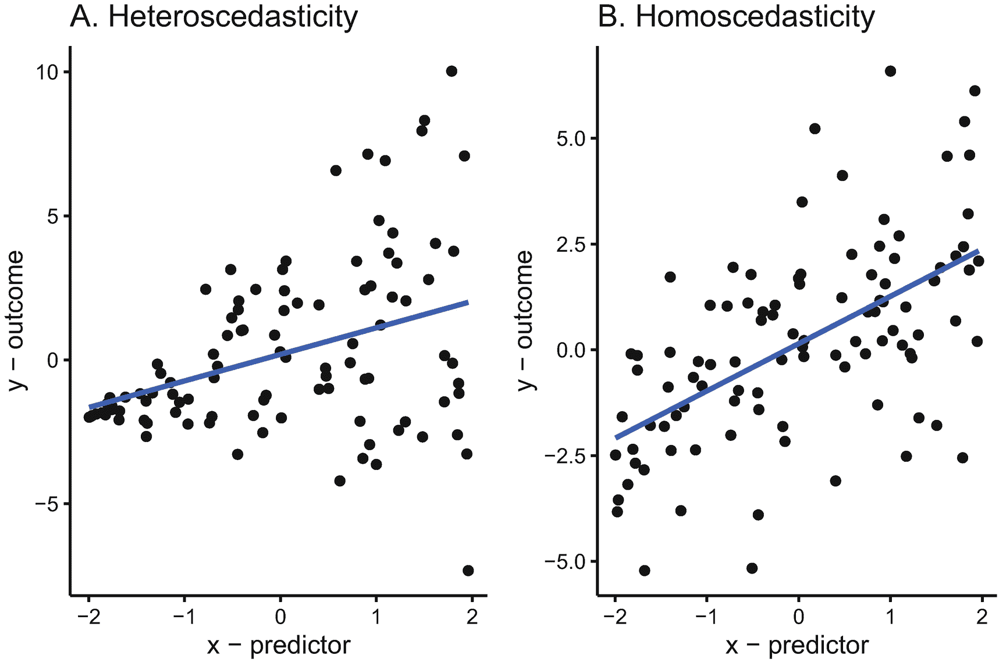

关于同方差性的最后一点说明：当残差方差是同质的（例如，相同）时，它看起来总是差不多，类似于图 8-9 中的图 B。然而，当存在异方差性时，它可以有多种表现形式。方差可能会增加、减少或波动。异方差性并不是某一种单一的模式。相反，它是指缺乏一致、同质的方差。

#### 独立性

线性回归的最后一个假设是观测值彼此之间相互独立，称为**独立性**。这个假设意味着一个观测值的数值与另一个观测值的数值无关，也不会驱动后者的数值。通常，这不是我们通过统计手段“检验”的东西，而是我们根据研究设计或所收集数据的性质而假设的。

例如，假设你随机抽样了不同的人，并要求他们只回答一次问题。在这种情况下，我们会假设观测值是独立的。一个人的回答不应系统地与另一个人的回答相关联或依赖。

相反，假设我们随机抽样了不同的家庭，然后让每个家庭中的每个人都回答一组问题。在这种情况下，我们不能假设观测值是独立的。来自同一家庭的人更可能给出彼此相似的回答。一个极端的例子是，假设其中一个问题是“您的家庭年收入是多少？”。如果我们每次都向同一家庭的二到四人询问，即使我们总共得到了比如说 100 个观测值，但如果这些观测值仅来自 35 个不同的家庭，我们将不会拥有 100 个关于家庭收入的独立度量。观测值不独立的另一个常见情况是当观测值按聚类形式抽样时（例如，抽样不同的教室，然后抽取一个教室中的所有学生）。另一个例子是重复测量或纵向研究；如果你连续多年每年都让同一个人回答问卷。同一个人的多次观测值之间不是独立的。

尽管这是一个重要的假设，但**独立性**假设通常不会被检验，因为要么根据数据收集的方式我们相信观测值是独立的，要么如果你知道数据存在结构（如对同一个人的重复测量、来自同一家庭的多个观测值等），你将需要使用一种能处理非独立性的不同分析方法。

### 线性回归假设总结

线性回归的四个假设可以总结如下：

*   x 预测变量与 y 结果变量之间的*线性*关系。可通过散点图进行视觉检验（见图 8-8）。
*   残差关于均值 0 的*正态性*。可通过 `testDistribution()` 函数进行视觉检验。
*   残差关于回归线的*同方差性*。可通过散点图进行视觉检验（见图 8-9）。
*   每个观测值的*独立性*。可通过无偏的研究设计进行逻辑检验。

### `R²`：解释的方差

回归和皮尔逊相关性都共享线性假设。因此，回归线满足使用此相关性的要求，并且该相关性还有一个额外的用途。回想一下，这种相关性表示为`r`。将其平方得到`r²`，即为**决定系数**。因为`r`的取值范围在-1 到 1 之间，所以`r²`的取值范围在 0 到 1 之间。因此，`r²`可以看作是一个百分比。决定系数告诉我们（对于回归线而言），结果变量`y`的变化（或变异）中有多少百分比来自输入变量`x`。

这样做的结果是，如果`r²`很高，那么我们就可能找到了一个好的预测变量。当`r²`不是很高时，我们可能希望寻找一个更好的预测变量。当然，在许多情况下，任何一个单独的预测变量都不会产生一个很强的`r²`。此时，我们可能需要不止一个预测变量。这个主题将留待第 11 章讨论。

回想我们在第 7 章学习的概率知识，我们知道`r²`的补集是`1 − r²`。这个补集是`y`中不受输入变量`x`决定的那部分变化量。同样，如果这个值很大，你很可能很快就会走上寻找额外预测变量的道路，并且需要参考第 11 章。

### 在 `R` 中进行线性回归

你已经花了一些时间学习了一些新概念，却没有在 `R` 中进行实践。现在是时候将这些理论付诸实践了。你大多已经遇到过这些函数。两个新的函数是用于线性模型的 `lm()` 以及一个名为 `geom_smooth()` 的 `ggplot()` 可视化工具，用于创建平滑曲线。

在此过程中，除了计算截距`b[0]`和系数`b[1]`之外，你的数据还必须通过上述四个假设的检验。当然，看到你的线性回归图形也会有所帮助。

### 示例

考虑你之前见过的 `penguinsData` 和 `flipper_length_mm`，以及一个新变量 `body_mass_g`。牢记我们对企鹅一无所知，假设通过某种巧妙方法（比如使用双筒望远镜和一些已知尺寸的关键地标）可以轻松测量鳍肢长度。另一方面，假设给企鹅称重相对困难（可以设想必须轻轻地捕捉企鹅，然后安全地释放它）。在这种情况下，我们可能希望将 `flipper_length_mm` 作为自变量或预测变量，并将 `body_mass_g` 作为因变量或结果变量。

这就需要我们找到线性回归线和方程。换句话说，我们必须计算企鹅鳍肢和体重的截距 `b[0]` 和系数 `b[1]`。为此，我们首先必须确认数据符合线性回归的四个假设。

线性假设通过目视检查图 8-10 中的散点图来验证。经过检查，数据确实看起来大致呈线性移动。此图是使用相当标准的 `ggplot()` 创建的。使用了新的几何视觉元素 `geom_point()`：

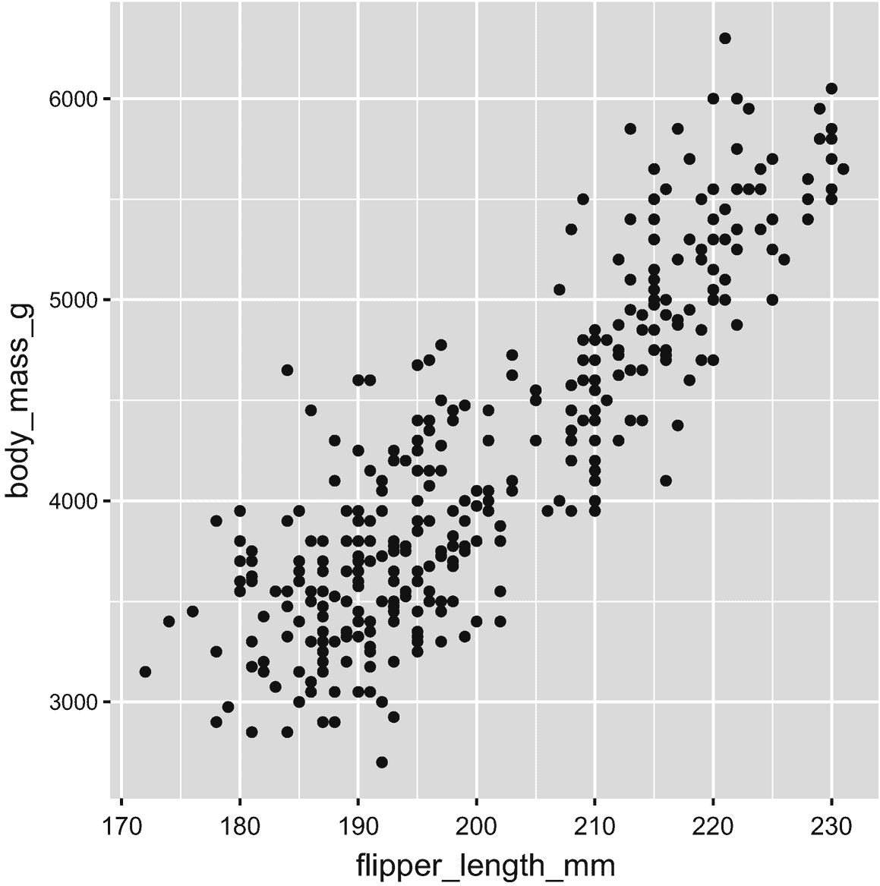

图 8-10

企鹅数据：鳍肢长度与体重

```R
ggplot(data = penguinsData,
mapping = aes(x = flipper_length_mm,
y = body_mass_g)) +
geom_point()
## 警告: 已移除包含缺失值的 2 行 (geom_point)。
```

为了验证残差的正态性假设，我们首先需要计算线性回归线。没有这条线，我们就无法计算残差（回忆一下，图 8-7 用蓝线展示了残差）。因此，在知道你的工作是否有回报之前，你必须先学会如何计算线性回归——并且确实这么做！

线性回归是线性模型。因此，拟合线性模型的函数是 `lm()`。拟合模型通常会产生大量数据（残差只是模型的一部分）。因此，我们不只是简单地拟合模型，而是将其分配给一个变量。通常使用变量 `m` 表示模型。为了与其他模型区分，我们将其命名为 `mPenguin`。

函数 `lm()` 接受两个参数。第一个是 `formula =` 参数。`R` 有一个标准的公式过程，使用 `~` 将因变量 y 与自变量 x 分开。由于我们使用鳍肢长度来预测体重结果，因此我们的公式将是 `body_mass_g ~ flipper_length_mm`：

```R
mPenguin <- lm(formula = body_mass_g ~ flipper_length_mm,
data = penguinsData)
```

为了验证正态性假设，我们可以对残差使用 `testDistribution()`。但是，请记住该函数来自 `JWileymisc` 包。还有另一个辅助函数名为 `modelDiagnostics()`，它将生成第 7 章中的正态性假设检验图和一个新图，帮助我们检查同方差性。

该函数只接受一个参数，即我们在前面代码中分配给 `mPenguin` 的线性模型。一旦诊断结果被分配给新变量 `mPenguinTests`，我们就可以使用 `plot()` 函数。这实际上是买一送一的两个图。因此，我们使用 `plot()` 的第二个参数将列数设置为 2（`ncol = 2`）：

```R
mPenguinTests <- modelDiagnostics(mPenguin)
## 警告 in .local(x, ...): 奇异性问题
## 警告 in rq.fit.sfn(x, y, tau = tau, rhs = rhs, control = control, ...): 调用 blkfct 时将微小的对角线替换为 Inf
## 警告 in .local(x, ...): 奇异性问题
## 警告 in rq.fit.sfn(x, y, tau = tau, rhs = rhs, control = control, ...): 调用 blkfct 时将微小的对角线替换为 Inf
plot(mPenguinTests,
ncol = 2)
## 'geom_smooth()' 使用了公式 'y ~ x'
```

得到的图 8-11 有两列并排的图表。左侧是来自 `testDistribution()` 函数的熟悉图表（只是这次是针对残差而非原始数据）。如你所见，在密度图中，它似乎相当好地拟合了正态曲线。偏差图确实有待改进。然而，请注意偏差变化范围从 -0.1 到 0.4。这不是一个很大的范围；所有这些点都靠近那条正态线。此外，虽然边缘略高于正态线，但中间部分低于它。因此，这些点确实多次触及那条线。它完全正态吗？不。它足够接近以至于可以使用模型吗？嗯，它足以说明模型通过了残差的正态性假设。

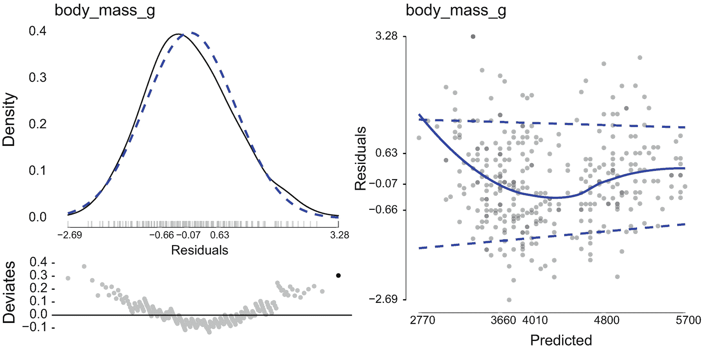

图 8-11

企鹅数据的残差正态性和同方差性检验

右侧的图表对我们来说是新的，它帮助我们检查同方差性假设。右侧的虚线是预测值的第 10 个十分位和第 90 个十分位。请记住，同方差性仅仅意味着我们期望残差相对于回归线是相当均匀的，就像图 8-9 中的图 B 一样。因此，我们希望图 8-11 右侧的预测值与残差看起来更均匀。换句话说，我们期望那些虚线大致相互平行并勾勒出一个矩形形状。虽然它们并非完全平行，但非常接近。因此，该模型通过了残差的同方差性假设。

最后一个假设，独立性，是一个哲学上的检查。该假设是企鹅彼此独立。现在，如果它们都来自同一个家庭、同一个物种或同一个岛屿，我们可能会担心。虽然需要阅读原始研究论文来验证 `palmerpenguins`[11] 使用的是随机样本还是便利样本，但企鹅来自不同地点这一事实本身就足以假设一定程度的独立性：

```R
penguinsData[order(island, species),
.N,
by = .(island, species)]
##       island   species   N
## 1:    Biscoe    Adelie  44
## 2:    Biscoe    Gentoo 124
## 3:     Dream    Adelie  56
## 4:     Dream Chinstrap  68
## 5: Torgersen    Adelie  52
```

四个假设确认后，我们现在可以使用这个线性模型了。通过在模型变量 `mPenguin` 上使用我们熟悉的 `summary()` 函数，屏幕上会打印出大量数据。现在，我们的目标是找到线性公式的系数。在标记为 `Coefficients` 的部分，`Estimate` 列提供了所需的数据。截距是 `b[0] = -5780.83`，而我们的 x 变量 `flipper_length_mm` 是 `b[1] = 49.69`：

```R
summary(mPenguin)
##
## 调用:
## lm(formula = body_mass_g ~ flipper_length_mm, data = penguinsData)
##
## 残差:
##     最小值       1Q  中位数       3Q     最大值
## -1058.8   -259.3   -26.9   247.3  1288.7
##
##  系数:
##                   估计值  标准误差  t 值   Pr(>|t|)
## (Intercept)       -5780.83     305.81   -18.9   <2e-16 ***
## flipper_length_mm    49.69       1.52    32.7   <2e-16 ***
## ---
## 显著性标记:  0 '***' 0.001 '**' 0.01 '*' 0.05 '.' 0.1 ' ' 1
##
## 残差标准误: 394 on 340 degrees of freedom
##   (2 个观测因缺失值被删除)
##  多重 R 方: 0.759, 调整后 R 方: 0.758
##  F 统计量: 1.07e+03 on 1 and 340 DF, p-value: <2e-16
```

由此得到预测公式

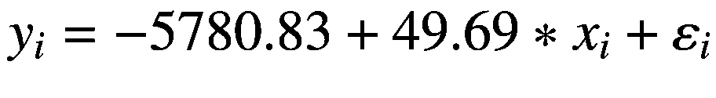

当然，我们不知道误差 `ε[i]`。也就是说，对于线性模型训练数据范围内的鳍状肢长度，我们现在有了一个公式，可以根据任意给定的鳍状肢长度给出预测值。假设我们测量了一只鳍状肢长度为 201 mm 的企鹅。根据我们的模型，我们预计其体重为 4207 g：

```R
range(penguinsData$flipper_length_mm,
na.rm = TRUE)
## [1] 172 231
xiPenguin <- 201
yiPenguin <- -5780.83 + (49.69*xiPenguin)
yiPenguin
## [1] 4207
```

### 示例

之前，在第 2 章中，你已经安装了 `visreg` 包 [7]。现在我们使用该包中的一个函数来可视化由 `lm()` 拟合的企鹅回归模型。因为回归线必须是最佳拟合线，所以有时我们也说“对数据点拟合一条线”（或对数据拟合一个模型）。因此，`visreg()` 接受一个名为 `fit =` 的参数，该参数接收一个模型。在这个例子中，我们使用的是企鹅模型 `mPenguin`。现在，先不要担心显示的第二个参数 `band = FALSE`。我们将在第 9 章中解释那个带状区域：

```
visreg(fit = mPenguin,
band = FALSE)
```

检查一下，在图 8-12 中，鳍状肢长度为 201 的位置在哪里。`y` 值的高度是否大约为 4207？这与实际拥有该鳍状肢长度的企鹅在散点图上的点相比，看起来是否相当接近？

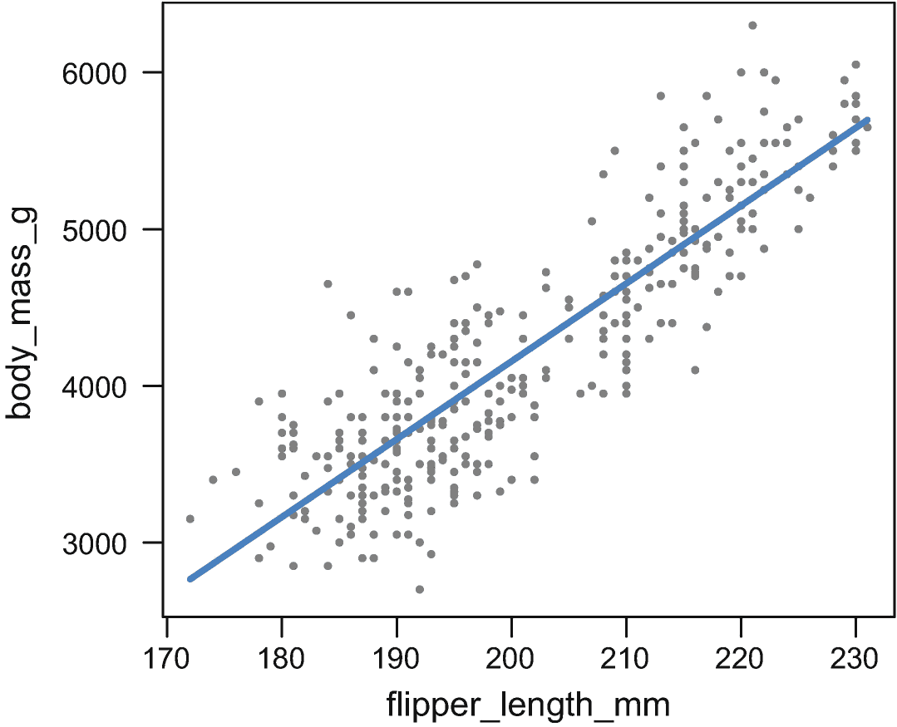

**图 8-12** `penguinData` 的线性回归可视化

我们最后要查看的是 `r²`。请注意，`summary()` 函数给出了两个解释方差的值。一个是 0.759，标题为 `Multiple R-Squared`。另一个是调整后的数值（尽管两者都四舍五入到 0.76）。这个数字——称为决定系数——告诉我们，0.76 或 76% 的体重变化（变异）来自于鳍状肢长度这个预测变量。你可以在图 8-12 中看到这一点。对于任意单一的鳍状肢长度，散点图上的确存在几个不同的质量点。利用概率中的补集概念，1 – 0.76 = 0.24 或 24% 的体重不由我们的预测变量“鳍状肢长度”决定。还有其他因素有助于决定企鹅的体重。

总而言之，我们得到了一个很好的模型。它很好地遵循了我们的四个假设。结果变量“体重”的大部分变化似乎都可以由我们的自变量“鳍状肢长度”预测。这说明测量鳍状肢是称量企鹅体重的一个非常好的替代方法（并且，如果我们最初的思路正确的话，这对研究人员和企鹅来说都更轻松）。虽然在未来的章节中可能对模型进行改进，但现在我们有了一个好的开端。

对于最后一个例子，考虑 `acesData` 以及 `STRESS` 与 `NegAff` 的关系。我们能否缩短参与者的夜间调查，使用 `STRESS` 作为自变量或预测变量，并将 `NegAff` 作为因变量或结果变量？

这需要我们找到线性回归线和方程。换句话说，我们必须为 `STRESS` 和负面情感计算截距 `b[0]` 和系数 `b[1]`。为此，我们必须首先确认数据符合线性回归的四个假设。

线性假设通过对图 8-13 中散点图的视觉检查来验证。这些数据的线性关系不太明显。我们谨慎行事；线性模型可能不是很好的拟合：

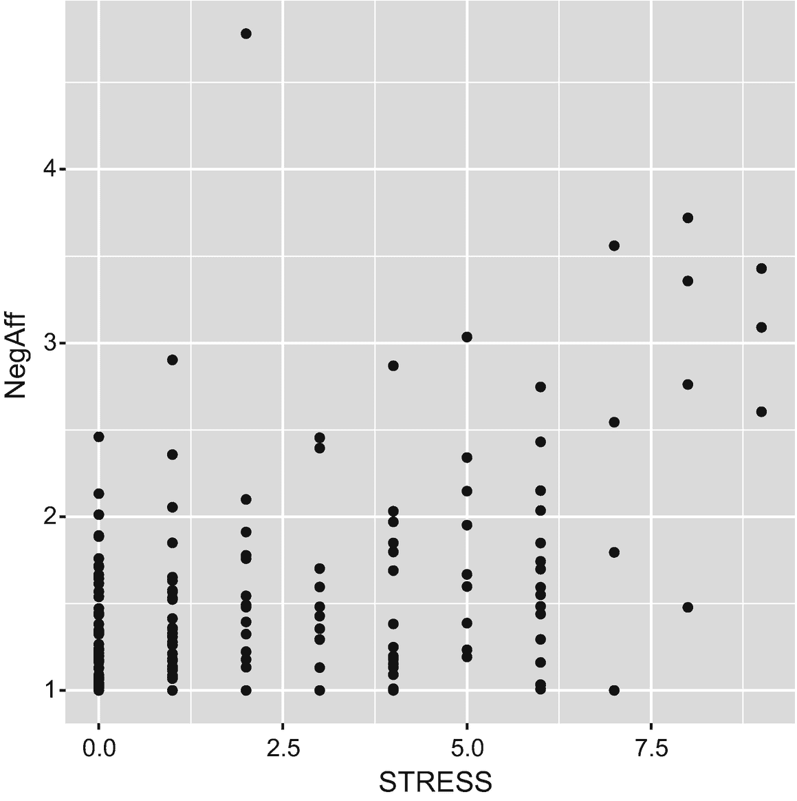

**图 8-13** Aces 数据。`STRESS` 与 `NegAff` 的关系

```
ggplot(data = acesData,
mapping = aes(x = STRESS,
y = NegAff)) +
geom_point()
## Warning: Removed 2 rows containing missing values (geom_point).
```

要验证残差的正态性假设，需要我们先计算线性回归线。比较并对比本例与前例中 `lm()` 的相似之处和变化：

```
mAces <- lm(formula = NegAff ˜ STRESS,
data = acesData)
```

为了同时检验残差的正态性和同方差性假设，我们再次使用 `modelDiagnostics()`：

```
mAcesTests <- modelDiagnostics(mAces)
## Warning in .local(x, ...): singularity problem
## Warning in rq.fit.sfn(x, y, tau = tau, rhs = rhs, control = control, ...): tiny diagonals replaced with Inf when calling blkfct
## Warning in .local(x, ...): singularity problem
## Warning in rq.fit.sfn(x, y, tau = tau, rhs = rhs, control = control, ...): tiny diagonals replaced with Inf when calling blkfct
## Warning in rq.fit.br(x, y, tau = tau, ...): Solution may be nonunique
plot(mAcesTests,
ncol = 2)
## 'geom_smooth()' using formula 'y ˜ x'
```

得到的图 8-14 显示，残差的分布大致呈正态，但不如前一个例子那么清晰。偏差点也常常靠近直线，然而至少有一个点离得相当远。现实生活并不完美；密度图大致呈正态形状。我们再次谨慎行事。这并不意味着我们不能使用线性拟合。它确实意味着我们在解释结果时必须更加谨慎。

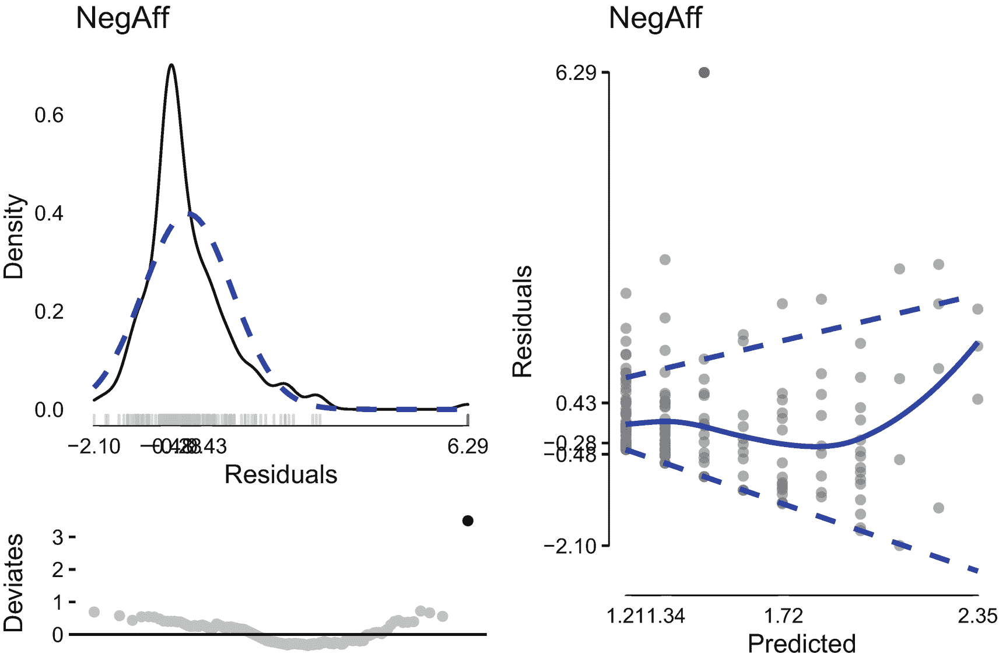

**图 8-14** Aces 单日数据：残差正态性和同方差性检验

图 8-14 右侧图中的虚线非常明显不平行。数据左侧有明显的收缩，向右则变宽。这让人想起图 8-9 面板 A——异方差性。这个假设要么被违反，要么接近被违反。

此时我们面临一个选择。相当多的证据表明，这种情况下的线性拟合不会像企鹅数据的线性拟合那么好。在某些情况下，可能可以继续进行。如果我们真的继续下去，我们需要明确告知最终用户（即使那个最终用户是我们自己），这个模型并不理想。如果我们选择现在停下来，并指出由于违反了包括同方差性在内的假设，不应进行线性拟合，那也是合理的。

为了使你获得更多的代码编写经验，我们继续向前。

最后一个假设——独立性——是一项哲学上的检查。该假设是参与者之间彼此独立。对于这些数据，我们假设研究设计得足够好，以满足这个假设。

尽管一个或多个假设已接近失效，我们仍继续推进，用熟悉的 `summary()` 函数检视线性模型：

```
summary(mAces)
##
## Call:
## lm(formula = NegAff ˜ STRESS, data = acesData)
##
## Residuals:
##    Min     1Q Median     3Q    Max
## -1.095 -0.252 -0.146  0.228  3.318
##
## Coefficients:
##             Estimate Std. Error t value Pr(>|t|)
## (Intercept)   1.2097     0.0515   23.50  < 2e-16 ***
## STRESS        0.1265     0.0160    7.91  2.2e-13 ***
## ---
## Signif. codes: 0 '***' 0.001 '**' 0.01 '*' 0.05 '.' 0.1 ' ' 1
##
## Residual standard error: 0.529 on 185 degrees of freedom
##   (2 observations deleted due to missingness)
## Multiple R-squared:  0.253,  Adjusted R-squared:  0.249
## F-statistic: 62.6 on 1 and 185 DF, p-value: 2.23e-13
```

由此得出预测公式：

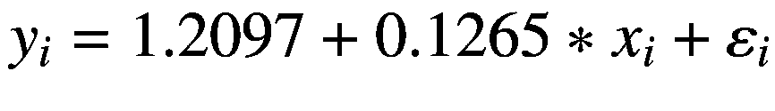

我们不必手动计算示例，直接观察图 8-15 的图形即可。很容易看出为什么这要么不是线性，要么只是勉强线性。当 `STRESS = 2` 时，`NegAff` 的范围相当狭窄，从 1 到略高于 2。另一方面，当 `STRESS = 7` 时，`NegAff` 的范围则很宽，似乎从 1 到大约 3.5。在图形的不同位置，结果变量 `NegAff` 的可能取值具有不同的范围：

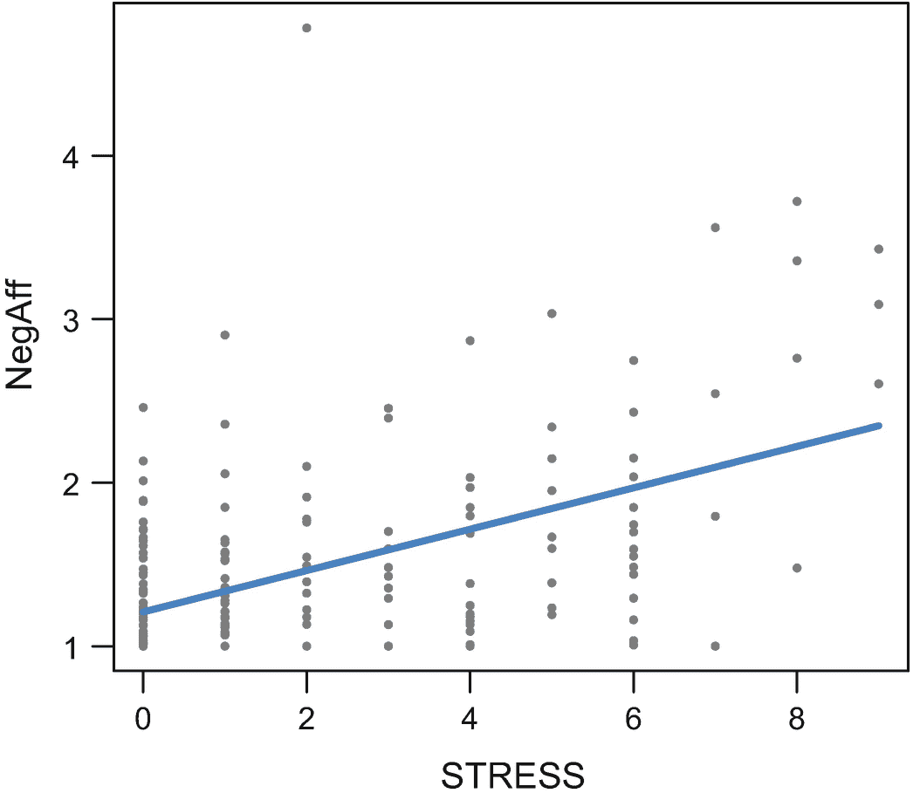

**图 8-15** aces 数据的线性回归可视化

```
visreg(fit = mAces,
band = FALSE)
```

此外，观察 `r²` = 0.25 也让人担忧。即使这是一个很好的线性模型（其实并非如此，其同方差性充其量只是勉强满足），也只有 25% 的 `NegAff` 结果能被 `STRESS` 预测——换句话说，这与企鹅数据的情形恰好相反。在这里，75% 的结果变异*不*来自我们的预测变量。

这个模型充其量也只能算相当薄弱。无论如何，将问卷的两部分都保留在夜间问卷中似乎是明智之举。

## 8.4 小结

本章探讨了两个变量之间的关系。在线性关系的情况下，可以使用参数相关。如果散点图中线性假设不成立，则可以使用非参数相关。在此基础上，只要满足线性、残差正态性、同方差性和独立性这四个假设，你就可以学习如何拟合线性模型。表 8-2 应作为你本章所学关键概念的良好参考。

**表 8-2** 本章小结

| 概念 | 含义 |
| --- | --- |
| `geom_point()` | `ggplot()` 中用于散点图的可视化几何函数。 |
| 参数统计 | 技术方法所需的标准或假设。 |
| 非参数统计 | 不需要假设的统计技术。 |
| 线性 | 看起来形成一条直线。 |
| 正相关 | 当 x 增加/减少时，y 增加/减少（行为一致）。 |
| 负相关 | 当 x 增加/减少时，y 减少/增加（行为相反）。 |
| `cor()` | 接受两个变量和一个 `method` = “ ” 参数（Pearson、Spearman 或 Kendall）。 |
| 残差 | 线性回归与实际数据点之间的差值。 |
| 线性 | 通过散点图进行视觉检验。 |
| 残差正态性 | 通过 `modelDiagnostics()` 进行视觉检验。 |
| 同方差性 | 通过 `modelDiagnostics()` 进行视觉检验。 |
| 独立性 | 每个观测值独立。可通过无偏研究设计进行哲学上的检验。 |
| `R²` | 决定系数；y 的变异有多少能被 x 预测？ |
| `lm()` | 线性模型函数。接受公式和数据参数。 |
| `modelDiagnostics()` | 检验正态性和同方差性。 |
| `visreg()` | 可视化回归结果。 |

## 8.5 掌握度练习

通过完成一些练习来检查你的进度，并在练习中成长。理解性检查提出了一些批判性思维问题，最好以书面或口头回答的形式作答。统计学的艺术之一在于成功地向利益相关者或受众传达结果。有时受众具有高度技术性，有时则完全不具技术性。练习题则是对本章所探讨概念的更直接应用。

### 理解性检查

1.  请用你自己的话，书面重新叙述线性模型的四个假设。如果你是在课堂上学习本章内容，请与同学核对你的表述。如果你是自学，请用搜索引擎查找你的一些表述，看看能否通过群众智慧进行验证。如有疑问，请在推特上 @ 我们中的一位；我们将尽力回复。

2.  思考两个线性回归模型示例以及同方差性图形，你脑中是否对“假设满足”或“假设失败”的“临界点”有清晰的视觉概念？如果没有，请将该代码复制粘贴到 aces 或 penguins 数据中尽可能多的变量上，直到你满意为止。比较并对比你的结果，看看能否找到基本平行的线与根本不平行线的例子。请记住，大多数真实世界的数据并不能完美地满足假设。任何数据集都可以拟合线性模型；区别在于并非所有线性回归都值得拟合。假设有助于我们将有价值的模型与严重受损、已损坏乃至无用的模型区分开来。

### 练习题

1.  参考相关性示例，将 aces 数据限制在单日且仅限晚间调查。观察 `PosAff` 和 `NegAff` 的散点图，是否存在线性模式？如果存在，使用 Pearson 相关。如果不存在，则同时使用 Spearman 和 Kendall 相关。你的相关是正相关还是负相关？是强相关还是弱相关？

2.  参考相关性示例，将 aces 数据限制在单日且仅限晚间调查。观察 `Age` 和 `STRESS` 的散点图，是否存在线性模式？如果存在，使用 Pearson 相关。如果不存在，则同时使用 Spearman 和 Kendall 相关。你的相关是正相关还是负相关？是强相关还是弱相关？

3.  以线性回归示例为模板，使用预测变量 `bill_length_mm` 和结果变量 `bill_depth_mm` 测试 `penguinsData` 的四个假设。如果假设成立，创建线性模型并使用 `visreg()` 绘图。如果假设成立，使用该模型预测当喙长为 41.2 毫米时的喙深。

4.  以线性回归示例为模板，使用预测变量 `bill_length_mm` 和结果变量 `flipper_length_mm` 测试 `penguinsData` 的四个假设。如果假设成立，创建线性模型并使用 `visreg()` 绘图。如果假设成立，使用该模型预测当喙长为 41.2 毫米时的鳍肢长度。