# 9. 置信区间

我们对于第 8 章中的回归模型有多确信？同样地，你有多大把握认为一个*样本*均值统计量是总体均值参数的良好估计？我们如何在这些估计中引入一些“浮动空间”，从而持续传达预期可能达到的准确度？

你很可能见过这样的估计：一个单一数值后紧跟一个正负量。单一数值的估计称为**点估计**，而正负量所构成的区间称为**置信区间**（CI）。例如，我们可以自信地告诉你，这本书受到全球 50% 统计学家的推荐，误差范围为 ±50%。尽管全球好评率达 50% 的点估计可能令人印象深刻，但你很快会意识到置信区间是从 0% 到 100%。这就不那么令人印象深刻了。

注意

置信区间通常缩写为 **CI**。置信区间（即 CI）定义了一个区间，由两部分组成：置信下限和置信上限。例如，在前面的例子中，置信区间是 0%–100%。那么 0% 就是置信下限，100% 就是置信上限。这些通常缩写为 **LL** 表示下限，**UL** 表示上限。有时你也会看到它们被缩写为 **2.5** 和 **97.5**，这是最常见置信区间类型（置信水平**CL**为 95% 的置信区间）的百分位数。我们将在本章中学习更多关于置信区间的知识，但希望这有助于你熟悉一些常用术语。

因此，目标是建立一个统计框架，使你能够创建出可用的置信区间。一个好的置信区间应该能传达不确定性水平。一个好的数据样本应足够稳健，能将置信区间的范围缩小到可用的水平。

学完本章，你应该能够：

*   通过 z 分数理解置信区间的理论。
*   理解 t 分数置信区间的应用。
*   使用 t 分数方法创建置信区间。
*   评估两个样本以判断其总体相似性/相异性。

## 9.1 R 环境设置

与往常一样，为了继续练习创建和使用项目，我们为本章新建一个项目。

如有必要，请复习第 1 章中创建新项目的步骤。启动 RStudio 后，在左上角的菜单栏中，选择 *File* 并点击 *New Project*。选择 *New Directory* ➤ *New Project*，在 *Directory name* 中输入 `ThisChapterTitle`，然后选择 *Create Project*。要创建一个 `R` 脚本文件，在顶部工具栏中，就在 *File* 下方，点击那个白纸上带加号的小图标，并选择 *R Script* 菜单选项。点击软盘形状的 *save* 图标，将此文件命名为 `PracticingToLearn_XX.R`（其中 XX 代表本章编号），然后点击 *Save*。

在右下方面板中，你应该能看到项目的两个文件。在 *Files* 选项卡正下方，点击名为 *New Folder* 的按钮。在弹出的 *New Folder* 对话框中输入 `data` 并选择 *OK*。在右下方面板中，点击你新建的 *data* 文件夹。重复文件夹创建过程，新建一个名为 `ch09` 的文件夹。

请记住，本章使用的所有包都已在第 2 章中安装到你的本地计算机上了。无需重新安装。但是，这是一个新项目，并且我们首次运行这套代码。因此，你需要运行以下 `library()` 调用：

```
library(data.table)
## data.table 1.13.0 using 6 threads (see ?getDTthreads). Latest news: r-datatable.com
library(ggplot2)
library(visreg)
library(palmerpenguins)
library(JWileymisc)
```

在本章中，我们继续使用 ACES 每日数据集中某一天晚上的调查数据，因此每个人只贡献一个观测值。没有特别原因，我们选择了 2017 年 3 月 3 日的数据：

```
acesData <- aces_daily[date == as.Date("2017-03-03")]
```

当然，我们也会使用熟悉的企鹅和汽车数据集：

```
penguinsData <- as.data.table(penguins)
mtcarsData <- as.data.table(mtcars, keep.rownames = TRUE)
```

现在，你可以自由地学习更多统计学知识了！


## 9.2 可视化置信区间

为什么只相信一个样本可能是不明智的？

为了回答这个问题，让我们使用 `R` 生成 10,000 个数据点，用来表示一个熟悉的、正态分布的总体。我们称之为*完美*数据集。使用 `set.seed(1234)` 确保你的“随机”数据与我们的匹配，然后创建一个新的 `data.table()`，包含两列。第一列名为 `Data`，包含通过 `rnorm()` 生成的 10,000 个随机正态数，其均值为 2.5，标准差为 0.75。换句话说，`Data` 服从 *N*(2.5, 0.75)。由于这些数据已经是随机抽取的，我们可以使用 Kth 抽样法将这些数据点分配到 100 个组中，如 `Group` 列所示。由 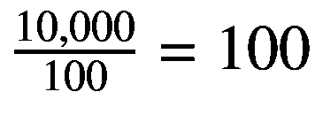 可知，我们在 100 个组中各得到 100 个点。因此，虽然我们为了速度使用了 Kth 抽样，但在本例中，从技术上讲它仍是一个随机样本。注意，我们将总体参数命名为 `muP` 和 `sigmaP`，分别代表*完美*总体的 *μ* 和 *σ*：

```
set.seed(1234)
muP <- 2.5
sigmaP <- 0.75
perfectData <- data.table(Data = rnorm(n = 10000,
mean = muP,
sd = sigmaP),
Group = 1:100)
```

样本量为 100 看起来可能不多，但想象一下需要调查 100 个人，这可要花不少时间！

现在，计算每组数据的算术 `mean()` 。因为我们有 100 个组，结果数据集中应该有 100 行或观测值。计算新值属于列操作，因此在数据表中，它应放在第 j 列操作的位置。我们正在计算 `Data` 元素的算术平均值。由于我们需要每组数据的 `mean(Data)`，这属于 `by` 操作，因此需要 `by = Group`。

注意，虽然下面的代码实现了这些目标，但仍有不足之处。首先，输出结果中存放算术平均值的列名是 `V1`，这个名称不太好，完全没有描述性；未来的研究者（甚至我们自己）将无法知道该列存放的内容是什么。其次，下面的代码*没有*将结果保存到任何地方，平均值只是打印到控制台；中间 90 个组的数据被截断并隐藏在我们的输出中。此外，结果并未存储在 `R` 中的任何位置，因此我们无法将其用于进一步分析。虽然这段代码可能足够用于快速检查，但无法满足我们当前的需求：

```
perfectData[, mean(Data),
by = Group]
##      Group    V1
##   1:     1 2.518
##   2:     2 2.449
##   3:     3 2.460
##   4:     4 2.442
##   5:     5 2.527
## ---
##  96:    96 2.437
##  97:    97 2.626
##  98:    98 2.396
##  99:    99 2.519
## 100:   100 2.554
```

很明显，我们必须给列一个更好的名称，并将结果保存起来以备将来使用。有两种方法可以命名列。你可以使用赋值运算符 `groupMean := mean(Data)` 在 `perfectData` 中创建一个新列。如果这样做，`perfectData` 将增加一个名为 `groupMean` 的第三列。但是，请记住 `perfectData` 包含 10,000 条观测值。*每个*观测值都会得到这个新列；我们现在向表中添加了 10,000 个条目，内存占用增加了 50%。更糟糕的是，每个组只有一个均值，因此每个均值都会有 100 个重复值。这产生了大量额外的信息副本。

另一种命名列的方法是直接给它一个名字；这不会将任何值保存到内存中。我们不使用赋值运算符，而是使用列选择运算符 `.()`。下面的代码实际上与前面的输出结果相同。同样，在全局环境中没有将任何内容保存到内存中；唯一的区别是将含义模糊的 `V1` 替换为更易理解的 `groupMean` 列名：

```
perfectData[,
.(groupMean = mean(Data)),
by = Group]
##      Group groupMean
##   1:     1     2.518
##   2:     2     2.449
##   3:     3     2.460
##   4:     4     2.442
##   5:     5     2.527
## ---
##  96:    96     2.437
##  97:    97     2.626
##  98:    98     2.396
##  99:    99     2.519
## 100:   100     2.554
```

当然，我们实际上确实希望保存并使用我们的值，因此我们使用外部赋值运算符：`<-`。这会创建一个新的 `data.table`，在本例中命名为 `perfectMeans`，它只有 100 行/观测值。由于赋值操作捕获了输出，结果不会再次打印到控制台。不过，如果需要，你可以使用 `head(perfectMeans)` 来检查所需数据是否已保存：

```
perfectMeans <- perfectData[,
.(groupMean = mean(Data)),
by = Group]
```

创建和保存列信息的这两种方法各有用途。如果你的新列对于原始数据的每一行都是唯一的，那么使用*内部*赋值（如 `groupMean := mean(Data)`）是一个好方法。另一方面，当新列将多行原始数据压缩为单个点估计值时（如本例所示），使用 `.(groupMean = mean(Data))` 和外部赋值 `<-` 创建一个新的数据表可能是更好的选择。

无论如何，既然我们已经有了 100 个样本均值，让我们来看看这些均值。为了保持点的清晰可辨，我们将 y 轴设置为样本组标识符的离散变量。此外，我们使用 `geom_vline()` 在 `xintercept = muP` （即总体均值）处绘制一条垂直线：

```
ggplot(data = perfectMeans,
mapping = aes(x = groupMean, y = Group))+
geom_point()+
geom_vline(xintercept = muP)
```

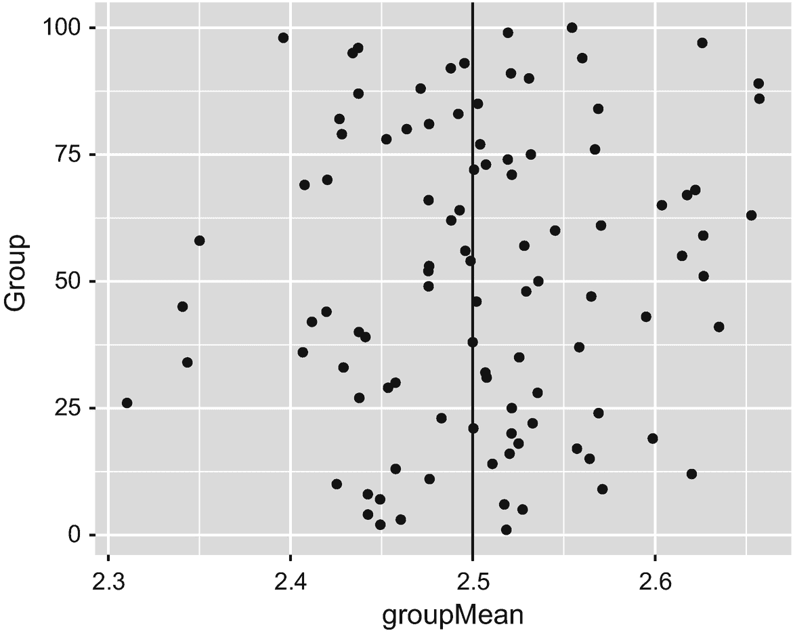

**图 9-1**

样本均值与总体均值的垂直线，mu = 2.5

现在，请记住我们的总体服从分布 *N*(2.5, 0.75)。图 9-1 中的每个点都是来自样本量 *n* = 100 的均值。现在，你了解中心极限定理——很明显这些均值在 2.5 附近看起来相当正态（合乎预期）。当一个样本被压缩成一个数据点（如均值）时，这被称为**点估计**。尽管这些点估计中的大部分都接近参数 2.5，但只有少数几个触及了 2.5 那条线。

与其只用一个点估计，不如为任何一个可能包含总体参数的样本统计量提供一个区间，这或许更好。换句话说，我们需要创建一个**置信区间**。置信区间的形式如下：

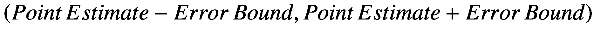

我们如何计算误差界限呢？这需要依赖于一些关于概率的思想。回顾图 9-1，记住你看到的是 100 个点估计。换句话说，我们抽取了 100 个随机样本，其中一些样本在估计接近 *μ* = 2.5 方面表现很好，而另一些则不那么好。想象一下，如果每个点都变成一条长度等于某个置信区间长度的线段。如果我们选择一个大的误差界限，那么即使是我们图表中最左侧和最右侧的那些罕见样本，它们的置信区间线段也可能穿过 2.5 的标记。然而，这种做法的用处有限。

毕竟，请记住本章开头关于本书受欢迎程度的例子，其置信区间为 (0%, 100%)；用小数表示就是 (0.00, 1.00)。这个置信区间当然捕获了我们书的真实受欢迎程度，但它并不是一个有用的置信区间。

我们需要做的是计算出足够长以大概率捕获总体参数，但又不能太长的置信区间。要做到这一点，我们需要思考样本分布的概率。

让我们从完美的例子开始，在这个例子中我们知道一切。由此，我们可以探索一种思考可能的、现实世界情况的方法。


### 示例：已知总体标准差

如果我们已知总体参数，特别是 `sigma`，就可以为误差界限创建一个概率框架。请记住，这在现实生活中几乎从未实现过。毕竟，如果我们已经掌握了总体数据，那就不需要进行抽样了！话虽如此，为了理解正在发生的事情（并探讨概率），从已知量入手会有所帮助。

因此，对于我们的完美数据集，我们通过已知参数 *N*(2.5, 0.75) 自行创建了总体。这样，我们就可以计算标准误差：

```
standardErrorP <- sigmaP / sqrt(100)
```

再次参考第 7 章，抽样分布通常为

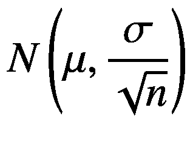

在我们的特定案例中，使用刚刚计算出的 `standardErrorP`，*N*(2.5, 0.075) 就是我们的抽样分布。假设我们想要一个**置信水平** (CL) 为 95% 的*置信区间* (CI)。换句话说，我们能否将误差界限设定得足够大，使得随机样本的置信区间有 95% 的概率捕获到总体参数？

答案是肯定的，**均值误差界限** (EBM) 的公式如下：

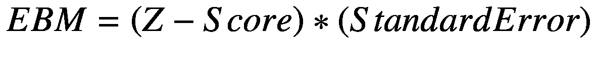

用更正式的符号表示，z 分数分位数写作：

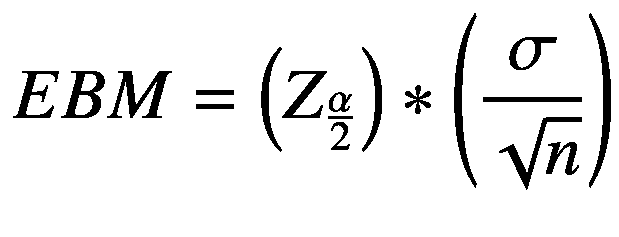

要理解 z 分数分位数，我们需要进一步思考正态曲线和概率。正如概率问题中常见的情况，考虑其补集是一个有趣的想法。如果我们有 95% 的置信水平，那么就称之为有 5% 的 *alpha* 或 *α* = 0.05。**Alpha** 是指我们从总体中抽取一个随机样本，且该样本距离中心太远，以至于我们的置信区间未能捕获到总体参数的概率。

请记住，正态曲线下的面积为 1（这并非魔法；数学家们这样设计是为了方便计算概率）。同时回顾第 6 章的经验法则（也称为 68-95-99.7 法则）。该法则指出，中间 68% 的数据包含在正负一个标准差范围内。中间 95% 的数据（大致上）包含在正负两个标准差范围内。中间 99.7% 的数据则包含在正负三个标准差范围内。这些是将曲线下面积（等于概率）与标准差个数（也称为 z 分数）联系起来的极其接近的近似值。

经验法则的可视化方式如图 9-2 [6] 所示。

注意在图 9-2 中，中间 95% 的值对应最上面的水平线。有两条垂直向下的虚线，左边指向 −2*σ*，右边指向 +2*σ*。再往下看，在 z 分数那一行，它们被简称为 −2 和 +2。然而，如果仔细观察，你会发现那些垂直的虚线并没有完美地与 ±2 相交。请注意，在正态曲线中间表示“95% 的值”的水平线两侧，分别显示的是 −1.96*σ* 和 +1.96*σ*。这些是 sigma 的实际值（因此 ±1.96 就是 z 分数）。

请记住，如果中间包含了 95% 的值，那么正态曲线最左侧和最右侧的尾部就包含了 5% 的值。这 5% 被称为 `alpha`。但是，如果我们想找出最左侧的 z 分数（即距离绝对中心左侧的标准差个数），我们需要将这 5% 分成两半（它被平分到两个尾部）。这就是前述公式中提到的 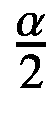。

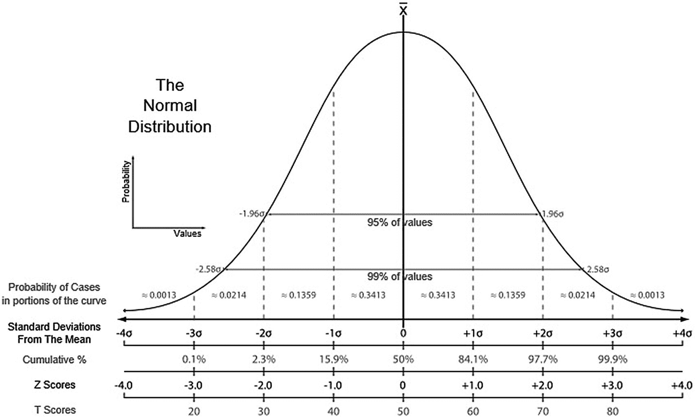

图 9-2

正态分布 [6]

`qnorm()` 函数接收一个面积值（请记住，这与概率相同），并输出对应此面积的正确 z 分数。换句话说，回到图 9-2，`qnorm()` 以累积面积百分比线作为输入，并输出 z 分数：

```
ConfidenceLevel <- 0.95
alpha <- 1 - ConfidenceLevel
qnorm(alpha/2)
## [1] -1.96
```

请注意，如果我们将此结果四舍五入到两位小数，就会得到图 9-2 所示的 −1.96σ：

```
round(qnorm(alpha/2), 2)
## [1] -1.96
```

对于公式 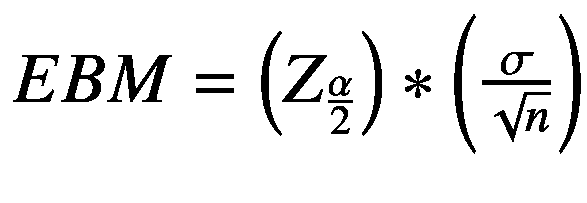，我们需要一个正的 z 分数。为此，我们不希望从正态曲线的左侧（也称为下尾）开始累积百分比。相反，我们希望从右侧（也称为上尾）开始。

通过在 `qnorm()` 函数中设置 `lower.tail = FALSE`，可以得到正侧的值：

```
round(qnorm(alpha/2,
lower.tail = FALSE),
2)
## [1] 1.96
```

如果希望改用 99% 的置信区间，只需做少量更改即可。经验法则近似认为三个标准差约为 99.7%。因此，我们可以预期 99% 的置信区间会大于 1.96 个标准差而小于 3 个标准差。图 9-2 显示该值为 2.58。在以下代码中将置信水平更改为 0.99，表明这是正确的：

```
ConfidenceLevel <- 0.99
alpha <- 1 - ConfidenceLevel
qnorm(alpha/2,
lower.tail = FALSE)
## [1] 2.576
```

如您所见，此方法允许您为所需的任何置信水平计算出精确的 z 分数。在实际应用中，95% 是最常用的选择，我们将继续使用此数字进行示例计算。

将公式代入 `perfectMeans` 的任意值，计算均值误差界限，图 9-1 得出

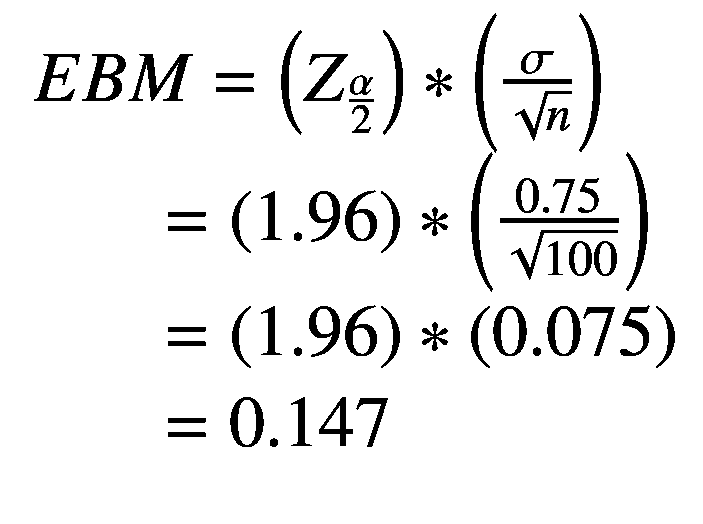

以上最终计算过程在 `R` 中显示如下：

```
ebmP <- 1.96*standardErrorP
ebmP
## [1] 0.147
```

现在我们将误差下界和上界添加到 `perfectMeans` 数据中。这只需要创建一个新列，并且我们希望每一行都有该列（因为每一行都是我们的一个样本）。因此，我们将在第 j 列操作位置使用内部赋值运算符 `:=`：

```
perfectMeans[,
lowerEBM := groupMean - ebmP]
perfectMeans[,
upperEBM := groupMean + ebmP]
```


复用之前的 `ggplot()` 代码，我们添加了一行代码。线段由 `geom_segment()` 创建。这段代码涉及的内容较多；虽然你不需要完全理解它，但我们会为你讲解，因为图表非常有用。每条线段需要以刚刚添加到 `perfectMeans` 中的下界和上界 EBM 作为起点和终点。这些线段需要是水平线，以保证样本组 ID 不变，因此 y 值保持固定。最后，我们使用 `alpha = 0.4` 来控制这些线条的透明度，使其不那么醒目。请注意，这里的 `alpha` 与置信水平（CL；本例中为 95%）的概率补数（通常也命名为 alpha，即我们常设定的 `α = 0.05`）无关，只是名称相同。

```
ggplot(data = perfectMeans,
mapping = aes(x = groupMean, y = Group)) +
geom_point() +
geom_vline(xintercept = muP) +
geom_segment( mapping = aes( x = lowerEBM, xend = upperEBM,
y = Group, yend = Group),
alpha = 0.4)
```

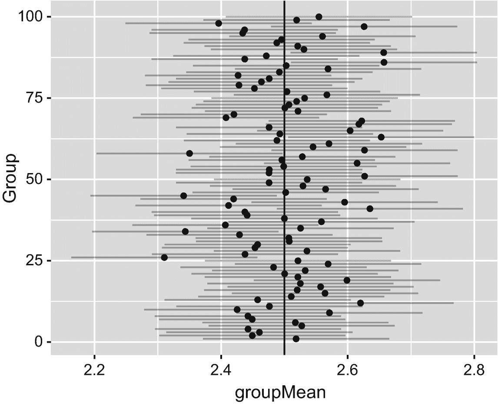

**图 9-3** 带置信区间的样本均值

你能在图 9-3 中找到哪些置信区间线段没有与我们的垂直线相交吗？换句话说，你能找出一些极端样本，其置信区间未能覆盖真实值吗？

记住，我们选择了 95% 的置信水平（CL）。这意味着，在 95% 的情况下，我们预期置信区间（CI）能够捕获总体均值 2.5。更正式的说法是：“95% 的置信区间应该能够捕获总体参数 `μ = 2.5`。”

从视觉上看，理论和实践似乎完美匹配。然而，仅仅因为我们抽取了 100 个随机样本，并不意味着其中只有五个会失败。随机性中总存在噪声，这一轮我们可能运气好，也可能运气不好。

为了快速验证，我们可以使用数据表逻辑规则。如果置信区间（CI）从右侧起始过大，那么 `lowerEBM` 会大于均值。另一方面，如果置信区间从左侧起始过小，那么 `upperEBM` 会小于均值：

```
perfectMeans[muP < lowerEBM | muP > upperEBM]
##    Group groupMean lowerEBM upperEBM
## 1:    26     2.310    2.163    2.457
## 2:    34     2.343    2.196    2.490
## 3:    45     2.341    2.194    2.488
## 4:    58     2.350    2.203    2.497
## 5:    63     2.653    2.506    2.800
## 6:    86     2.657    2.510    2.804
## 7:    89     2.657    2.510    2.804
```

在本例中，有七个样本偏离了目标。这与预测的五个数量相当接近。再次强调，在处理概率问题时，我们期望它们在总体上成立。任何具体案例（如本例）通常都会接近预期，但不会完全精确匹配。检查概率是否随时间成立的一种方法是，将 `set.seed(1234)` 更改为其他数字。这个例子很好地展示了，即使是优秀的模型，有时也可能“错误”地反映现实世界的结果。

## 接下来该做什么？

下一步是避免使用 `σ`。现实世界中的大多数用例都是基于样本统计量，而非总体参数进行计算的。因此，当西格玛未知时，我们需要找到一些理解数据的方法。不知道西格玛会带来什么后果？从逻辑上讲，当信息减少时，不确定性会增加。因此，如果我们必须使用样本标准差来近似分布，可以预期置信区间会变得更宽一些。

诚然，更宽的置信区间是一种退步。区间越窄，做出的决策越具可操作性。再次回想我们那个愚蠢的例子：宣称这本书获得了一半统计学家的认可，误差范围为±一半。这个范围太宽，毫无用处。然而，有一种方法可以让置信区间变窄。实际上，有两种方法。

最简单的方法是降低所需的置信水平。换句话说，在本例中，我们选择了 95% 的置信水平（CL）。这是一个常见的 CL 选择；但它并非魔法。你可以选择任何你想要的置信水平。在社会和行为科学研究中，95% 的 CL 是一个相当普遍的标准。然而，其他领域可能偏好更高的置信度（此时置信区间会变宽），或者不需要如此高的置信度（此时置信区间会变窄）。在我们那个愚蠢的例子中，它采用的是 100% 的 CL。置信水平过高的风险在于，置信区间会变得过大，以至于不再有用。

让置信区间（CI）变窄的更好方法是增加样本中的元素数量。回想一下用于样本均值抽样分布的 z 分数公式，其中包含标准误差（如有需要，请复习第 7 章）。注意，公式分母中是 n 的平方根，其中 n 是样本量。如果 n 增加，那么标准误差就会减小：

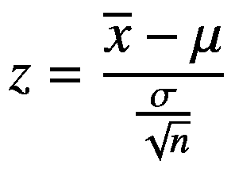

如果标准误差减小，误差界限也会随之减小！注意，均值的误差界限是两个数相乘的结果。如果我们提高置信水平，`Z_{α/2}` 会变大。为了将其缩小到合适的范围，我们必须让公式中的另一项变小。换句话说，我们必须增加 `n`：


这是统计学中永恒的挑战。我们如何找到让 n 尽可能大的方法？调查人员成本高昂，进行测试成本高昂，甚至进行测试还可能存在伦理风险（为了增加样本量而让每个人都服用新药可能不道德）。

因此，即使我们在探索如何将这些公式应用到没有 `σ` 的世界中，也要记住，信息缺失的代价是置信区间变宽，并且我们可能希望（在可能的情况下）增加样本量。


### 示例：总体标准差未知的情况

总结一下，虽然 z 分数在总体标准差已知时适用，但研究者多数情况下面对的是总体标准差未知的场景。为便于对比两种方法，我们沿用上一个示例中的完全相同的数据集。不过，此处我们假设不知道总体标准差，而仅仅拥有 100 个样本。

当总体标准差未知时，我们不再使用 z 分数和正态分布，而是采用**学生 t 分布**。从外观上看，该分布与正态分布高度相似——只是稍微扁平一些。这导致其尾部面积更大，而中间面积更小（换言之，曲线更矮更宽，但总面积仍为 1）。此外，t 分布依赖于样本中的元素数量。随着 `n` 增大，t 分布会变得更高更窄。当 `n` 非常大时，t 分布最终会非常接近正态分布。请记住，随着 `n` 增大，我们期望标准误差变得更窄，这与上述特性非常吻合。相关公式如下：

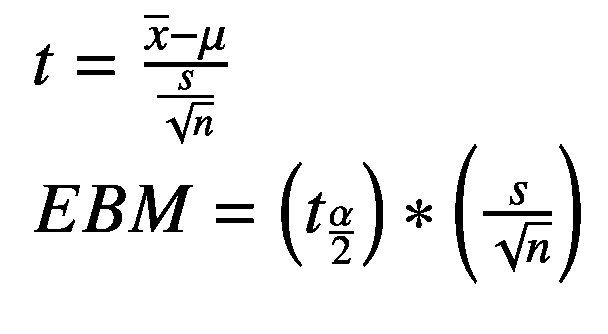

由于当 `n` 增大时，t 分数和 t 分布会趋近或收敛于 z 分数，因此大多数现代软件在分析样本数据时都直接使用 t 分布。`R` 中的函数也不例外。在后台，软件会根据 `n` 的大小自动进行调整。

用于计算 t 分数和置信区间的函数名为 `t.test()`。它接受多个参数，目前我们需要用到其中两个。第一个参数是样本数据，第二个参数是所需的置信水平。在此，我们沿用上一节中使用的 `ConfidenceLevel`。为了解该函数的工作方式，我们仅从 `perfectData` 中提取第一个样本。该第一个样本位于 `Group == 1` 中，这是一个行操作。我们使用 `$` 运算符访问 `Data` 列信息。如前所述，我们将第二个形式参数 `conf.level` 设置为变量 `ConfidenceLevel`，该变量当前值为 0.95：

```
tTestResults <- t.test(perfectData[Group == 1]$Data,
conf.level = ConfidenceLevel)
tTestResults
##
##      One Sample t-test
##
## data:  perfectData[Group == 1]$Data
## t = 33, df = 99, p-value <2e-16
## alternative hypothesis: true mean is not equal to 0
## 99 percent confidence interval:
##  2.317 2.720
## sample estimates:
## mean of x
##     2.518
```

该函数的结果提供了大量信息。t 分数为 33；可以通过前面的 t 分数公式手动计算得出。接下来是 `df = 99`。

有必要讨论一下**自由度**，通常缩写为 **df**。假设你知道样本中有两个人，他们的平均年薪是 10 万美元。同时，假设你已知其中一人年薪为 5 万美元。要使平均年薪达到 10 万美元，另一人的年薪必须是 15 万美元。因此，虽然样本量 `n` = 2，但我们说其自由度为 `n` − 1 = 1，因为一旦你知道第一个人的收入并知道平均值，第二个人的收入就不能自由变化了。

传统上，t 分布是建立在这些自由度之上的（记住，随着 `n` 增大，t 分布会变化得越来越接近正态分布）。对于像此处这样的单个样本，计算公式为 `df` = `n` − 1。

现在暂时忽略 p 值；我们将在下一章讨论它。另一个值得关注的点是存在一个 95% 的置信区间。`R` 直接给出了该范围，无需手动计算 EBM。最后，给出了样本均值 2.518。

无需展示代码（因为会变得不必要的复杂），我们对所有 100 个样本都使用了相同的 `t.test()`。我们将 z 分数置信区间保留为黑色实线，并将 t 分数置信区间叠加为图 9-4 中的蓝色虚线。如您所见，样本均值是相同的；这本就该如此。从 z 分数到 t 分数，唯一变化的部分是从 `σ` 和正态分布切换到 `s` 和 t 分布。正如所承诺的那样，来自 t 分布的蓝色虚线都比 z 分数的实线稍长一些。

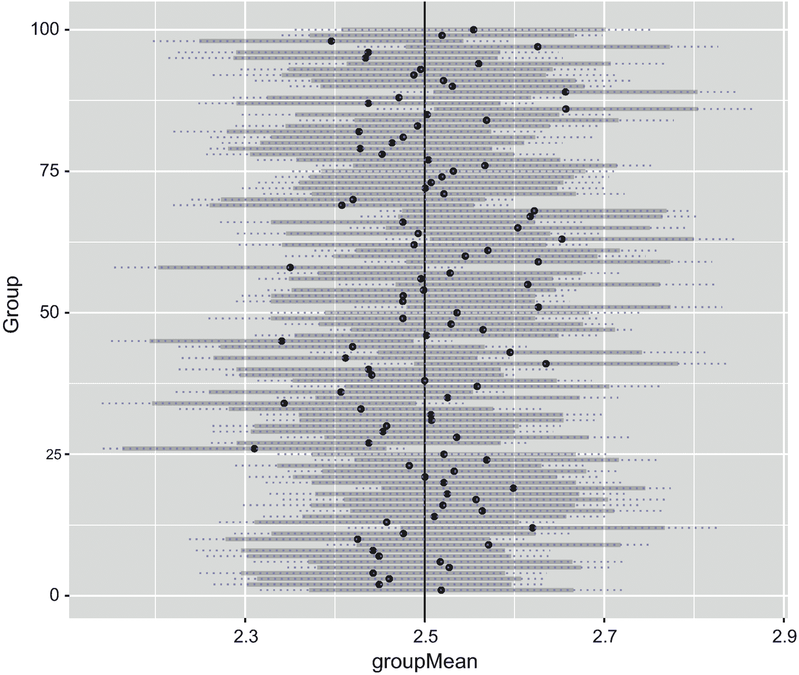

**图 9-4** 带有置信区间的样本均值。实线表示 z 值，蓝色虚线表示 t 值

现在您已经对置信区间有了很好的理解和直观的参考图像，可以准备将它们应用于实际生活中的数据样本了——在这些样本中，我们尚不知道总体标准差。此外，您已经看到软件计算置信区间是多么简单。让我们回到之前章节中的一些示例，并扩展这些分析。

### 示例

考虑企鹅数据集。该数据集是一个样本，并且（目前）没有人测量过地球上的每一只企鹅。因此，总体标准差是未知的。使用 `t.test()`，可以计算一个可能捕获到 `μ` 的置信区间。

我们的研究问题可能是：基于收集到的企鹅样本，在 98% 的置信水平下，为 `μ`（即鳍状肢长度的总体均值）计算一个置信区间。鳍状肢长度的数据作为 `t.test()` 的第一个函数参数传入。这次，我们将 `conf.level = 0.98`。现在是一个绝佳时机来指出：大多数软件包中默认的置信水平是 95%。这种情况如此普遍，以至于人们常常认为 95% 是神圣不可改变的。部分原因是历史上这是为了简化某些教学技巧（通过设置单一的默认设置，减少变异性）。编码使得改变置信水平变得非常容易，通常只需像以下代码一样简单：

```
t.test(penguinsData$flipper_length_mm,
conf.level = 0.98)
##
##      One Sample t-test
##
## data:  penguinsData$flipper_length_mm
## t = 264, df = 341, p-value <2e-16
## alternative hypothesis: true mean is not equal to 0
## 98 percent confidence interval:
##  199.1 202.7
## sample estimates:
## mean of x
##     200.9
```

您可能还记得，我们最初对鳍状肢长度的样本均值是 201；在之前的所有章节中，我们都将该值四舍五入为整数。因此，200.9 确实与之前的结果一致。自由度为 342 只记录有鳍状肢长度的企鹅数量减一。请记住，尽管 `penguinsData` 有 344 行观测数据，但其中有两只企鹅缺失了鳍状肢长度数据。置信区间为 (199.1, 202.7)。

用中文表述，您可以说：我们有 98% 的把握认为，企鹅鳍状肢长度的真实总体均值介于 199.1 和 202.7 之间。由于样本量较大，该置信区间相当窄。

现在，正如您之前在 图 9-3 中看到的，并非每个样本的置信区间都能成功捕获总体参数。即使在完全随机的数据抽取中，这种情况也可能发生。而且，正如在第 5 章中讨论的，样本偏差是可能存在的。也许拥有较长鳍状肢的企鹅更容易被捕捉到，因为它们更容易被发现。或者也可能恰恰相反，因为它们更长的鳍状肢能让它们更快地逃离。尽管如此，只要数据收集工作做得好，我们现在就可以对企鹅鳍状肢长度“平均值”的总体范围相当有信心。


### 示例

置信区间不仅适用于单点估计，也适用于第 8 章中计算的回归线。一条直线上的置信区间看起来像是该直线两侧的带状区域，因此也可以称为置信*带*。你可能还记得，在第 8 章中，我们曾向`visreg()`添加了一个参数`band = FALSE`。这里我们重复之前的分析，但这次重点关注置信水平和置信区间。

首先，我们直接复制并运行以下代码来拟合线性模型，不做任何更改：

```
mPenguin <- lm(body_mass_g ~ flipper_length_mm, data = penguinsData)
summary(mPenguin)
```

`summary()`的输出为：

```
##
## Call:
## lm(formula = body_mass_g ~ flipper_length_mm, data = penguinsData)
##
## Residuals:
##       Min        1Q    Median        3Q       Max
## -1058.44   -259.03    -13.74    243.64   1286.98
##
## Coefficients:
##                    Estimate Std. Error t value Pr(>|t|)
## (Intercept)       -5780.83     305.81   -18.9   <2e-16 ***
## flipper_length_mm    49.69     1.52      32.7   <2e-16 ***
## ---
## Signif. codes:  0 '***' 0.001 '**' 0.01 '*' 0.05 '.' 0.1 ' ' 1
##
## Residual standard error: 394 on 340 degrees of freedom
##   (2 observations deleted due to missingness)
## Multiple R-squared:  0.759,  Adjusted R-squared:   0.758
## F-statistic: 1.07e+03 on 1 and 340 DF,  p-value:  <2e-16
```

在`summary()`的输出中，请注意在线性模型系数区域，有一列标题为`Std. Error`，这显然是标准误差。结合 t 分数均值误差限公式 `EBM = (t_(α/2)) * (s / sqrt(n))`，回想我们之前关于 z 分数过程和代码的讨论。标准误差与你的期望置信水平无关，置信水平仅用于计算公式中第一项的 t 值或 z 值。因此，线性模型在`Std. Error`列中只提供了标准误差，这给了我们计算任何后续选择的置信水平下误差限所需的一切信息。

此外，该模型告诉我们自由度是 340。同样对于企鹅数据，有 342 个观测值没有缺失值。与单样本 t 检验中 `df = n - 1` 不同，在这个线性模型中，我们同时涉及了鳍肢长度和体重。因此，公式为 `df = n - 2 = 342 - 2 = 340`。这一点也在 summary 输出中给出了。

所有这些都表明，`visreg()` 可以从保存到 `mPenguin` 变量中的线性模型获取相当多的信息。利用这些信息，该函数会在线性模型两侧绘制出一个“置信带”阴影区域，如图 9-5 所示。也就是说，对于直线上的每个预测点，其置信区间都通过阴影显示出来。由于这些预测点构成一条直线，置信区间最终形成一条围绕直线的“带”：

```
visreg(fit = mPenguin)
```

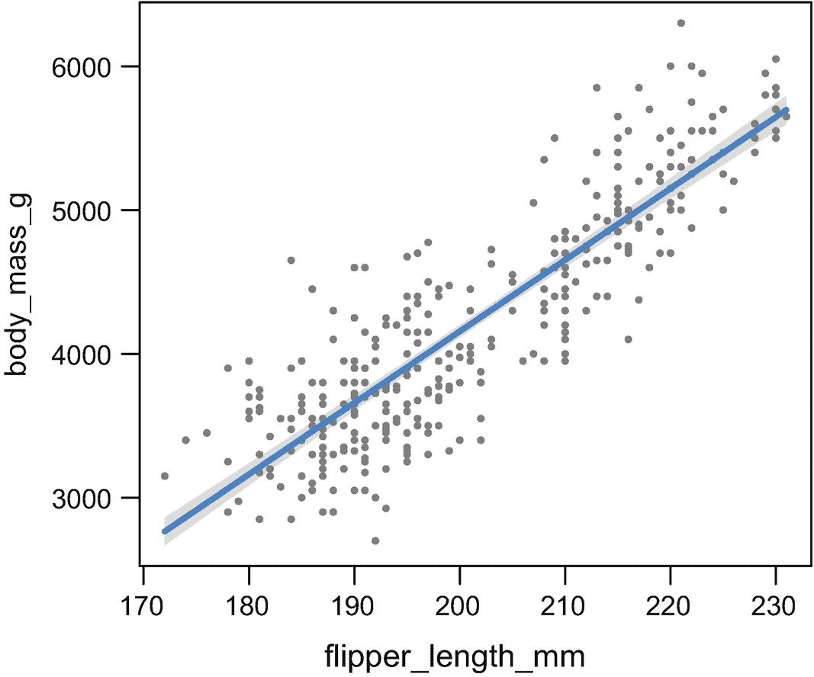

**图 9-5** 含置信区间的 penguinData 线性回归可视化

关于这个置信带，需要注意的一点是，它在模型的边缘附近会变得更宽。回想一下 x 轴数据 `flipper_length_mm`，其范围是从 172 到 231：

```
range(penguinsData$flipper_length_mm,
na.rm = TRUE)
## [1] 172 231
```

在这个范围内，用鳍肢长度来预测体重可能相当准确，这是一个不错的模型拟合。使用模型来预测一个新企鹅的体重，如果其鳍肢长度在已知范围内，这被称为**插值法**。前缀 *inter-* 意为“内部”。一般来说，对于拟合良好的模型，插值法可以相当准确。另一方面，使用模型预测自变量范围之外的值则被称为**外推法**。外推法总是更不确定，因为它超出了模型的范围。许多数据科学的应用都需要用到外推法。实际上，假设一个 300 毫米的鳍肢长度可能会产生一只相当重的企鹅，这并非不合理。尽管如此，当我们接近插值与外推的边界时，误差带会变宽，这相当于一个警告：超出模型范围进行过多外推，其不确定性会固有地增加。

## 9.3 理解相似与相异数据

理解置信区间的另一种方式是观察不同组别的置信区间是否重叠。毕竟，如果它们重叠，那么这两个组有可能共享相同的总体参数。如果它们共享一个总体参数，那么它们很可能来自同一个总体。另一方面，如果置信区间不重叠，它们则很可能不同。

### 示例

假设我们不知道每个企鹅物种组实际上是不同的物种。意识到这些物种之间存在差异的一种方法是，不仅组的平均值不同，而且它们的置信区间也不重叠！因此，我们可以相当确定每个物种的总体均值与其他物种的总体均值存在显著差异。

在这个例子中，我们选择 95% 的置信水平（仅因为它是最典型的）。阿德利企鹅的置信区间 (CI) 为 188.9–191.0，而体型较大的帽带企鹅的置信区间为 194.1–197.5：

```
t.test(penguinsData[species == "Adelie"]$flipper_length_mm,
conf.level = 0.95)
##
##      One Sample t-test
##
## data:  penguinsData[species == "Adelie"]$flipper_length_mm
## t = 357, df = 150, p-value <2e-16
## alternative hypothesis: true mean is not equal to 0
## 95 percent confidence interval:
##  188.9 191.0
## sample estimates:
## mean of x
##       190
t.test(penguinsData[species == "Chinstrap"]$flipper_length_mm,
conf.level = 0.95)
##
##      One Sample t-test
##
## data:  penguinsData[species == "Chinstrap"]$flipper_length_mm
## t = 226, df = 67, p-value <2e-16
## alternative hypothesis: true mean is not equal to 0
## 95 percent confidence interval:
##  194.1 197.5
## sample estimates:
## mean of x
##      195.8
```

注意，这个关于总体均值的置信区间与任何单个阿德利企鹅或帽带企鹅的大小关系不大。阿德利企鹅最长的鳍肢长度是 210 毫米，而帽带企鹅最短的鳍肢长度是 178 毫米。

```
range(penguinsData[species == "Adelie"]$flipper_length_mm,
na.rm = TRUE)
## [1] 172 210
range(penguinsData[species == "Chinstrap"]$flipper_length_mm,
na.rm = TRUE)
## [1] 178 212
```

尽管如此，使用考虑了每个样本中*所有*元素的 `t.test()` 函数，我们以 95% 的置信水平估计，每个物种的总体算术均值是不同的。我们之所以知道它们*不同*，正是因为这两个置信区间不重叠。

### 示例

作为一个对比示例，考虑一下我们 ACES 日常研究参与者的年龄。具体来说，考虑那些非澳大利亚出生者与澳大利亚出生者的年龄：

```
t.test(acesData[BornAUS == 0]$Age)
##
##      One Sample t-test
##
## data:  acesData[BornAUS == 0]$Age
## t = 112, df = 121, p-value <2e-16
## alternative hypothesis: true mean is not equal to 0
## 95 percent confidence interval:
##  21.22 21.98
## sample estimates:
## mean of x
##      21.6
t.test(acesData[BornAUS == 1]$Age)
##
##      One Sample t-test
##
## data:  acesData[BornAUS == 1]$Age
## t = 72, df = 64, p-value <2e-16
## alternative hypothesis: true mean is not equal to 0
## 95 percent confidence interval:
##  21.11 22.31
## sample estimates:
## mean of x
##     21.71
```

在这个案例中，请注意置信区间的范围是重叠的。因此，即使样本均值略有不同，两个组的平均年龄总体参数仍有可能相同。

我们将在第 10 章中为此构建更精确的表述。现在，我们留给你一个观察结论：如果两个样本的置信区间重叠，那么它们所估计的总体度量值有可能相同。而如果两个样本共享一个总体参数，那么这两个样本可能本质上来自同一个总体。


## 9.4 小结

本章探讨了点估计与置信区间之间的细微差别。特别是，通过使用 t 分布，可以围绕样本统计量计算置信区间范围，从而针对总体参数达到任意所需的置信水平。本章的一个重要思想是，即使是随机样本，有时也会“偏离目标”。大样本量有助于降低这种风险。这一思想的结论是，期望统计量在任何*单个*案例中都始终准确是不合理的。事实上，单个数据点很容易具有较高的方差。并且，尽管有中心极限定理，即使是合理的样本量，其预测真实参数的能力也会有所不同。这并不是说统计量不好。而是提醒我们，在将统计量解释为参数估计时必须保持谨慎。

本章的另一个特点是，可以通过观察两个独立样本在某个置信水平下的置信区间来相互比较。如果置信区间不重叠，那么你就有理由怀疑没有证据表明它们来自同一个总体。换句话说，它们来自不同的总体。另一方面，如果它们重叠，那么这两个样本很可能来自同一个总体（至少在该测量指标方面如此）。

表 9-1 应作为你本章所学关键概念的优秀参考。

**表 9-1 章节小结**

| 概念 | 含义 |
| --- | --- |
| 点估计 | 用于估计总体参数的单一样本统计量。 |
| 置信区间 (CI) | 围绕样本统计量的一个范围，很可能捕获总体参数。 |
| `.(colName = Stuff)` | 在 `data.table` 中命名并计算一列，而不进行赋值。 |
| `geom_vline()` | `ggplot()` 上的垂直线；仅设置 `xintercept` =。 |
| 置信水平 (CL) | 计算出的 CI 的置信水平应包含总体参数。 |
| 均值误差界 | 基于置信水平乘以标准误差，构建置信区间。 |
| Alpha | CL 的补数；我们的 CI 未捕获参数的概率。 |
| `qnorm()` | 正态分布的分位数；基于 CL 计算 z 分数。 |
| `geom_segment()` | 在 `ggplot()` 上创建一条线段。 |
| 学生 t 分布 | 当 *σ* 未知时使用。对于较大的 n，分布会越来越接近正态分布。 |
| `t.test()` | 使用 t 分布从样本中计算 CI 和均值。 |
| 自由度 (df/DF) | 单变量为 n-1，双变量散点图类数据为 n-2。 |

## 9.5 掌握练习

通过完成一些练习来检查自己的进步并在实践中成长。理解检查题要求进行批判性思考，最好以书面或口头形式回答。统计学的艺术之一在于成功地向利益相关者或受众传达结果。有时受众是高度技术性的，而有时则非常不具技术性。练习题更直接地应用了本章探讨的概念。

### 理解检查

1.  思考误差界，假设其他所有条件都相同，并且你将样本量加倍。误差界会变宽还是变窄？

2.  思考误差界，假设其他所有条件都相同。哪种置信水平 (CL) 会产生更宽的置信区间：90% CL 还是 99% CL？

### 练习题

1.  使用 `penguinsData` 数据集，置信水平设为 90%，应用本章描述的方法计算 `bill_length_mm` 均值的置信区间。

2.  使用 `penguinsData` 数据集，置信水平设为 95%，应用本章描述的方法计算 `bill_length_mm` 均值的置信区间。将这一结果与你之前的结果进行比较。

3.  回顾你在第 8 章练习中的代码，该代码使用 `bill_length_mm` 作为预测变量，`bill_depth_mm` 作为结果变量。这次，使用 `visreg()` 绘制图形，并让 CI 的带状区域显示在图中。基于该带状区域，你对于给定喙长为 41.2 mm 时的喙深预测，是看起来非常准确，还是有很大的余地仅仅作为对现实喙深的一个估计？

4.  使用 `penguinsData` 数据集，置信水平设为 90%，通过两次单独的 `t.test()` 函数调用，比较雄性和雌性企鹅的体重。这两个置信区间是否重叠？结合本章关于相似数据与不相似数据的讨论，雌性企鹅与雄性企鹅的体重是否存在差异？

