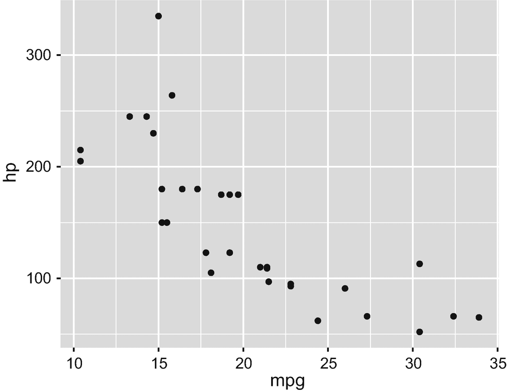
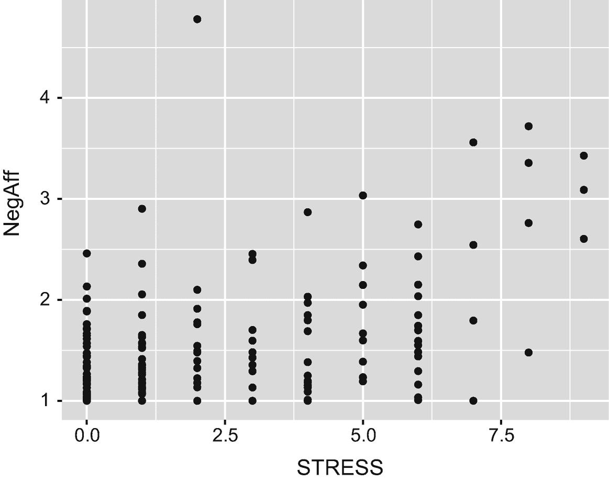

# 10. 假设检验

你已经达到了一个里程碑。你能够建立并使用最流行的统计编程语言之一`R`（第 1 章和第 2 章）。特别是，你可以从多个来源向`R`导入数据（第 3 章），并将外来数据处理成适合分析的格式（第 4 章）。为了发现总体参数，你理解了收集无偏样本的方法（第 5 章）。你拥有了一套探索性数据分析工具，可用于理解样本数据（第 6 章）。最近，你学习了总体分布的理论（第 7 章），分析了变量之间的关系（第 8 章），并评估了置信区间——将样本统计量映射回总体参数（第 9 章）。你甚至通过可视化方式评估了两个样本是否来自同一个总体。诚然，这种评估是视觉化的；现在是时候完善这个想法并将其变得更加严谨了。

尽管在统计研究/数据科学领域总会有更多的技术和技能需要学习，但能够判断一个样本是否可能来自特定总体，是本书最后的主要哲学思想。能够确定样本是否可能来自特定总体，使你能够回答各种各样的问题。新网站是否带来了更高水平的客户参与度？“一键式”购买是否增加了每次购买的金额？梦幻岛上的企鹅是否拥有最长的鳍状肢？新的教学大纲格式是否提高了学生的表现？

回答这些推断性统计问题需要假设检验，到本章结束时，你应该能够做到：

*   建立零假设并确定备择假设。
*   理解第一类错误和第二类错误。
*   应用零假设显著性检验 (NHST) 的步骤。
*   评估 NHST 的结果。
*   创建简单的、英文式的陈述，向相关受众解释 NHST 的结果。

## 10.1 R 环境设置

按照惯例，为了继续练习创建和使用项目，我们为本章节启动一个新项目。

如有需要，请回顾第 1 章节中的步骤来创建一个新项目。启动`RStudio`后，在左上角的菜单栏中，选择*File*并点击*New Project*。选择*New Directory* ➤ *New Project*，在*Directory name*处填写`ThisChapterTitle`，然后选择*Create Project*。要创建一个`R`脚本文件，在顶部功能区中，*File*字样正下方，点击那个带有加号的白纸小图标，然后选择*R Script*菜单选项。点击软盘形状的*保存*图标，将此文件命名为`PracticingToLearn_XX.R`（其中`XX`为本章节编号），然后点击*Save*。

在右下方面板中，你应该能看到项目的两个文件。在*Files*选项卡正下方，点击名为*New Folder*的按钮。在弹出的*New Folder*对话框中，输入`data`并选择*OK*。在右下方面板中，点击你新建的*data*文件夹。重复创建文件夹的过程，新建一个名为`ch10`的文件夹。

请记住，本章节使用的所有包已在第 2 章节中安装到你的本地计算机上了。无需重新安装。但这是一个新项目，我们是首次运行这组代码。因此，你需要运行以下`library()`调用：

```r
library(data.table)
## data.table 1.13.0 using 6 threads (see ?getDTthreads). Latest news: r-datatable.com
library(ggplot2)
library(visreg)
library(palmerpenguins)
library(JWileymisc)
```

在本章节中，我们仅使用 ACES 每日数据集中某一天的晚间调查数据继续工作，因此每个人只贡献一个观测值。没有特别的原因，我们选择了 2017 年 3 月 3 日的数据：

```r
acesData <- as.data.table(aces_daily)[SurveyDay == "2017-03-03" & SurveyInteger == 3]
```

当然，我们也会使用熟悉的企鹅数据和汽车数据集。

```r
penguinsData <- as.data.table(penguins)
mtcarsData <- as.data.table(mtcars, keep.rownames = TRUE)
```

现在，你可以自由地学习更多统计学知识了！

## 10.2 零假设 vs. 备择假设

假设是一个声称的理由或事实，可以检验其真实性（或至少是合理性）。在正式的统计检验中，我们传统上从零假设开始。零假设通常缩写为`H0`或`H[0]`，有时读作"H 零"或"H Nought"。`H[0]`是声称没有差异或没有变化。考虑你一直在探索的企鹅数据。`H[0]`的一个例子可能是："比斯科岛上的阿德利企鹅的鳍状肢长度与一般的阿德利企鹅相同。"

`H[0]`的这个"无差异"特征必须是一个可检验的声称，这一点很重要。在阿德利企鹅的例子中，这个声称确实是可以测量的。`H[0]`声称的另一个特征是它包含了相等性的概念。在阿德利企鹅的例子中，这指的是比斯科岛上阿德利企鹅的平均鳍状肢长度等于任何地方阿德利企鹅的平均鳍状肢长度。

如果`H[0]`是声称无差异或相等，那么就只有另一种可能性。另一种可能性是某种变化、差异或不平等的结果，称为备择假设。备择假设通常缩写为`H1`、`H[1]`或`H[a]`。在阿德利企鹅的例子中，`H[1]`有几种可能性。如果我们对这些不同岛屿上的企鹅鳍状肢长度一无所知，我们可能会选择最宽泛的`H[1]`："比斯科岛上的阿德利企鹅的鳍状肢长度与一般的阿德利企鹅不同。" 这将是一个所谓双尾检验的例子——不相等可能是左尾的小于或右尾的大于。

另一方面，或许我们碰巧知道比斯科岛食物丰富；因此，我们可能怀疑那些企鹅应该有更长的鳍状肢。在这种情况下，我们可能希望将`H[1]`设为："比斯科岛上的阿德利企鹅的鳍状肢长度比一般的阿德利企鹅更长。" 这将是一个`H[1]`为单尾，实际上是右尾，并且是大于的情景。

当然，如果我们反而知道比斯科岛最近遭遇了饥荒，我们可能会猜测`H[1]`为："比斯科岛上的阿德利企鹅的鳍状肢长度比一般的阿德利企鹅更短。" 这当然会导致`H[1]`成为单尾、左尾、小于的情景。

`H[0]`与`H[1]`的关键特征在于它们是互补的；决定了`H[0]`也就决定了`H[1]`是什么。

### 示例

回顾第 8 章节，我们对`mtcarsData`中的每加仑英里数(`mpg`)和马力(`hp`)进行了相关性分析。当时，我们只对这个数据的负相关性感兴趣。一个更严谨的问题可能包括用零假设和备择假设的术语来表述这个探索。以下是使用这些数据的研究问题示例：

`H[0]`：`mpg`和`hp`之间的相关性等于 0。换句话说，`mpg`和`hp`之间既不存在正相关也不存在负相关。

由此，基于我们有限的物理学知识，我们可能会想知道是否马力越大导致发动机效率越低。因此，我们可能会提出一个不包括相等性的备择假设——并特别预期相关性应该是负的。这将是一个左尾或"小于" `H[1]`的例子。

`H[1]`：`mpg`和`hp`之间的相关性小于 0。换句话说，有证据表明`mpg`和`hp`之间存在负相关。

### 示例

回顾第 8 章节，我们对`acesData`中的`STRESS`和`NegAff`进行了相关性分析。当时，我们只对这个数据的正相关性感兴趣。一个更严谨的问题可能包括用零假设和备择假设的术语来表述这个探索。以下是使用这些数据的研究问题示例：

`H[0]`：`STRESS`和`NegAff`之间的相关性等于 0。换句话说，`STRESS`和`NegAff`之间既不存在正相关也不存在负相关。

由此，基于我们对压力的了解，我们可能会想知道是否压力越大导致负面情绪（例如，负面情感）越多。因此，我们可能会提出一个不包括相等性的备择假设——并特别预期相关性应该是正的。这将是一个右尾或"大于" `H[1]`的例子。

`H[1]`：`STRESS`和`NegAff`之间的相关性大于 0。换句话说，有证据表明`STRESS`和`NegAff`之间存在正相关。

## 10.3 第一类/第二类错误

现在我们必须讨论更多的概率知识。原假设和备择假设是互斥的——用你在第 7 章学到的概率术语来说就是如此。正如你在本章前一节所学到的，它们正是为此目的而构建的。

想必，我们正准备分享如何利用统计学来判断`H[0]`还是`H[1]`更可能成立。然而，回顾第 9 章中关于 95%置信水平的例子：从"完美"分布中抽取的 100 个样本，最终有 7 个置信区间未能覆盖目标，而非预测中的 5 个。任何有限的现实世界样本都无法保证与概率完全吻合。抛一次硬币不会得到正反各半的结果（除非极其罕见的硬币立地边缘情况）。相反，抛一次硬币要么 100%正面，要么 100%反面。因此，当我们面对`H[0]`或`H[1]`两种可能情景时，必须准备好基于概率做出的最佳决策有时会是错误的。

因此，思考事情可能出错的方式会很有帮助。这样，我们就能理解出错的概率有多大，并且至少能确保：即使我们错了，也是以"最好"的方式犯错。

现在，英文表述可能显得有些笨拙。在你即将学习的统计方法中，一切都以`H[0]`为框架。也就是说，两个可能的选项是：你将（基于计算出的概率）要么拒绝`H[0]`，要么不拒绝`H[0]`。无论概率表明什么可能成立，在真实事实中，要么`H[0]`为真，要么`H[1]`为真。

理想情况下，当你拒绝`H[0]`时，`H[1]`实际上应当是真实的。同样，你希望当你不拒绝`H[0]`时，`H[0]`实际上是真实的。

然而，有时你基于统计概率会拒绝`H[0]`，但在现实生活中，结果却显示`H[0]`才是真实的选择。这被称为第一类错误，当基于数据你拒绝了`H[0]`，而实际上`H[0]`是真实情况时，就会发生这种错误。

其他时候，你基于统计概率不会拒绝`H[0]`，但在现实生活中，结果却显示`H[1]`才是真实的选择。这被称为第二类错误，当基于数据你不拒绝`H[0]`，而实际上`H[1]`是真实情况时，就会发生这种错误。

表 10-1 展示了拒绝/不拒绝`H[0]`与`H[0]`是否为真之间的关系。值得注意，I 和 II 是 1 和 2 的罗马数字。同样值得注意，我们准备做出的决策（相信`H[0]`或`H[1]`）是基于"押注"概率。因此，在正式的统计语言中，措辞总是谨慎的。没有人会说"我们选择`H[1]`"或"我们选择`H[0]`"。相反，人们只会说拒绝`H[0]`或不拒绝`H[0]`——选择概率更大的那一个。

**表 10-1**

**第一类和第二类错误**

| | `H[0]` 实际上为真 | `H[0]` 实际上为假 |
| --- | --- | --- |
| 拒绝 `H[0]` | 第一类错误 | 统计概率与真实结果匹配 |
| 不拒绝 `H[0]` | 统计概率与真实结果匹配 | 第二类错误 |

### 示例

回到比斯科岛上的阿德利企鹅，让我们明确原假设和备择假设，并考虑第一类或第二类错误可能带来的后果。

虽然这并不完全准确，但为了这个示例，假设阿德利企鹅鳍肢长度的总体均值为 190 毫米：

```r
summary(penguinsData[species == "Adelie"]$flipper_length_mm)
##    Min. 1st Qu. Median     Mean 3rd Qu.    Max.    NA’s
##     172     186    190      190     195     210       1
```

那么，针对比斯科岛的双尾检验，我们的正式原假设和备择假设如下：

`H[0]`：比斯科岛上的阿德利企鹅的平均鳍肢长度在统计上**等于**所有阿德利企鹅的平均值，即 190 毫米。

`H[1]`：比斯科岛上的阿德利企鹅的平均鳍肢长度在统计上**不等于**所有阿德利企鹅的平均值，即 190 毫米。

你即将看到的统计检验会告诉你要么拒绝`H[0]`，要么不拒绝`H[0]`。

假设 NHST 告诉你拒绝`H[0]`。因此，你相信比斯科岛的阿德利企鹅*不同于*其他阿德利企鹅。你撰写资助申请，获得资金，并在（想必是）寒冷的比斯科岛上待了一年。如果检验结果正确，你会发现这种差异（并希望找出原因）。你的名字将永远载入企鹅学殿堂。另一方面，如果检验误导了你呢？这就是第一类错误；你拒绝了`H[0]`，相信了`H[1]`，但实际上那些比斯科岛的阿德利企鹅与其他阿德利企鹅并无不同。你白白忍受了一年的寒冷。

假设 NHST 告诉你不要拒绝`H[0]`。因此，你相信比斯科岛上的阿德利企鹅*并不*不同于其他阿德利企鹅。研究这个没有意义，你也从未撰写那份资助申请。也许你认为所有可能的企鹅研究都已完成。你退出海洋生物学，重返学校成为厨师，并开了一家成功的三明治店。另一方面，如果检验误导了你呢？这就是第二类错误；你没有拒绝`H[0]`，相信了`H[0]`，但实际上那些比斯科岛的阿德利企鹅确实不同。你本可以登上企鹅学的高峰，开辟新的研究途径，然而，虽然成功了，你仍在为那些继续研究企鹅的人做三明治。

哪种错误更糟糕？从我们这个虚构的故事可以看出，答案是"视情况而定"。的确，`H[0]`和`H[1]`的每种组合都会为第一类或第二类错误带来不同的后果。在下一节中，我们将讨论一些方法来思考如何控制这些错误的概率。现在，我们继续讨论另外两个例子。

### 示例

在`mtcarsData`的例子中，我们确定了以下左尾或"小于"的研究问题。

`H[0]`：`mpg`与`hp`之间的相关系数等于 0（即无相关性）。

`H[1]`：`mpg`与`hp`之间的相关系数小于 0（即负相关）。

假设 NHST 告诉你拒绝`H[0]`。因此，你相信`H[1]`是正确的——即随着`mpg`增加，`horsepower`降低。如果`H[1]`不正确，你就犯了第一类错误，这可能导致你为了获得更大的`horsepower`以获得更快的驾驶体验而购买一辆低`mpg`的车。

假设 NHST 告诉你不要拒绝`H[0]`。因此，你相信`H[0]`是正确的——即随着`mpg`增加，`horsepower`没有变化。如果`H[0]`不正确，你就犯了第二类错误。你可能会发现自己在当地赛道上试图与一辆混合动力车比赛。

### 示例

在`acesData`的例子中，我们确定了以下右尾或"大于"的研究问题。

`H[0]`：`STRESS`与`NegAff`之间的相关系数等于 0。

`H[1]`：`STRESS`与`NegAff`之间的相关系数大于 0；压力增加导致负面情绪增加。

假设 NHST 告诉你拒绝`H[0]`。因此，你相信`H[1]`是正确的——即随着压力增加，负面情绪增加。如果`H[1]`不正确，你就犯了第一类错误。你的新减压球在老板对你大喊大叫后将无法改善你的坏心情。

假设 NHST 告诉你不要拒绝`H[0]`。因此，你相信`H[0]`是正确的——即随着压力增加，对负面情绪没有影响。如果`H[0]`不正确，你就犯了第二类错误。有一天老板对你大喊大叫，你认为无计可施。而实际上，你本可以买一个减压球。

## 10.4 α 与 β

在前面的例子中，你可能已经注意到，根据具体场景，你可能会更关注第一类错误或第二类错误。当然，这并不是说错误是我们想要的结果。相反，你可能会发现某一种错误比另一种更糟糕。一个例子是决定是否采用某种医疗方案。如果`H[0]`是“病人没生病”，`H[1]`是“病人病了，我们必须做手术！”，那么第一类错误（对健康病人进行手术）和第二类错误（让生病病人不接受手术而离开）都是有代价的。

我们如何理解并为每类错误设定风险水平呢？

回顾第 9 章曾指出`α = 1 - CL`；这个`α`就是犯第一类错误的概率。在第 9 章的“完美”例子中，假设我们有一个随机样本，如同那七个未与已知总体均值参数相交的*区间*之一。如果我们使用这些样本中的某一个（如同真实生活中可能发生的那样）进行即将讨论的检验，就会导致第一类错误。提高置信水平——同时也会增大置信区间——会*降低*`α`。

那么，为什么我们有时会使用不是 99% 的置信水平呢？毕竟，那样可以将`α`限制在`0.01`，即只有 1%。嗯，回想一下，第一类错误发生在拒绝`H[0]`之后。如果我们使用超宽的置信区间，就几乎永远不会拒绝`H[0]`。因为最终你必须在`H[0]`或`H[1]`之间做出选择，如果你从不拒绝`H[0]`，那么你就永远生活在可能犯第二类错误的世界里。因此，完全避免第一类错误是不切实际的。由于`H[0]`总是包含相等关系，它通常可以翻译成“当前场景与常规情况没有差异”。因此，高置信水平很容易导致不作为或决策瘫痪。

这就是统计学的艺术性所在：权衡可能的错误风险及犯这类错误的后果，并为每种错误决定可接受的风险水平。这让我们将注意力转向第二类错误及其概率。

犯第二类错误的概率称为`β`（希腊字母，发音为“贝塔”）。`β`的补集称为“检验功效”。在不知道总体真实标准差的情况下，无法精确计算`β`。相反，我们通常使用估计值。正如 95% 的置信水平被认为在许多学科中都是标准（主要是因为传统——毕竟，96% 实际上也不会有太大不同），检验功效设定为 80% 也很典型。因此，由于`β = 1 - 检验功效`，传统上`β`为 20%。

检验功效（以及`β`）也在一定程度上由效应强度决定。因此，如果比斯科阿德利企鹅的鳍肢长度是其他阿德利企鹅的两倍，那应该很容易发现。但如果差异只有 1 毫米左右，那就需要在样本中包含更多企鹅来确认。为了估算，传统上使用柯恩 d 值 [8]，它为我们可能认为的效应水平提供一个数值。表 10-2 包含了估计的效应水平及其对应的数值。

**表 10-2** 柯恩 d 值

| 效应量 | `d` |
| --- | --- |
| 小 | 0.2 |
| 中 | 0.5 |
| 大 | 0.8 |

要使用这个检验功效，`R`中有一个名为`power.t.test()`的函数。它接受七个参数。如果你为前四个参数中的任意几个输入数据，它会估算剩下的第五个。我们最常使用这种功效概念来估算达到所需检验功效所需的样本量`n`。换句话说，对于我们愿意接受的某个`β`水平，我们使用这个函数来计算将第二类错误限制在某个水平所需的样本量。

参数`n`用于样本量；通常将其设为`NULL`，以便函数给出所需的估计样本量。

根据表 10-2，将`delta`参数设置为你认为你会发现的效应水平对应的正确值。请记住，在选择备择假设`H[1]`时，你可以选择双尾（不相等）、左尾（小于）或右尾（大于）。虽然当你不知道正确选择时默认是双尾，但在某些情况下（例如，mpg 或 stress），你可能已经有理由怀疑是小于或大于。同样，对于柯恩 d 值，你会怀疑你正在观察的效应或你正在部署的处理将具有小、中或大效应。

以这种方式使用此函数时，标准差被设置为标准正态曲线的`sd = 1`。更改此值背后的数学原理更适合统计理论课程而非统计方法书籍，因此我们现在将其设置为 1。

`sig.level`是`α`，它是我们置信水平的补集。当然，如果你愿意，可以选择 95% 以外的`CL`。类似地，通过选择`β`，可以确定检验功效。

最后两个参数让函数知道我们正在做哪种类型的检验。`type =`参数接受`one.sample`（针对本章处理的数据类型）或`two.sample`（如果你要比较两个样本）。`alternative =`参数关注你使用的是双尾检验`two.sided`还是左尾/右尾检验`one.sided`。

最常见的用途是利用这种功效检验来估算样本量，而不是估算检验的功效。例如，对于企鹅、mtcars 或 aces 数据集，现在估算这些检验的功效意义不大。错误要么发生要么不发生，我们必须使用已经收集的数据。此外，为这些数据集估算样本量的价值也很小——因为数据收集已经结束。

然而，假设你正准备开始一个新的研究项目。你决定采用通常的`CL`即 95%。此外，你选择了通常的 β 即 20%。最后，因为你正在对一个成本中等且预期效应水平为中的项目做出决策，你选择柯恩 d 值为 0.5。你知道你只有时间收集一个样本，并且你的干预措施未经测试，因此为了安全起见，你选择双尾`H[1]`：

```
confidenceLevel <- 0.95
alpha <- 1 - confidenceLevel
beta <- 0.20
powerOfTest <- 1 - beta
#此处我们选择中等效应水平。
cohensD <- 0.5
power.t.test(n = NULL ,
delta = cohensD,
sd = 1,
sig.level = alpha,
power = powerOfTest,
type = "one.sample",
alternative = "two.sided")
##
##      One-sample t test power calculation
##
##               n = 33.37
##           delta = 0.5
##              sd = 1
##       sig.level = 0.05
##           power = 0.8
##     alternative = two.sided
```

如你所见，结果是你需要样本中至少有 34 人才能有信心。这人数不多；中等效应量预计会产生如此清晰的结果，以至于我们不需要看得太远就能注意到正在发生的情况。

在所有其他条件相同的情况下，小的效应量则需要研究中几乎 200 人：

```
#此处我们选择小效应水平。
cohensD <- 0.2
power.t.test(n = NULL ,
delta = cohensD,
sd = 1,
sig.level = alpha,
power = powerOfTest,
type = "one.sample",
alternative = "two.sided")
##
##      One-sample t test power calculation
##
##               n = 198.2
##           delta = 0.2
##              sd = 1
##       sig.level = 0.05
##           power = 0.8
##     alternative = two.sided
```

你已经有了零假设和备择假设，了解了可能犯的错误类型，甚至估计了需要收集的样本量以将这些错误控制在较低水平。在实际完成零假设显著性检验之前，我们可能面临哪些假设或偏差？

## 10.5 假设

你已经有了零假设和备择假设。你选择了一个置信水平，它决定了`α`——第一类错误的风险。你甚至估计了需要收集的样本量，以将第二类错误控制在可接受的水平。

零假设显著性检验（NHST）还需要什么？与许多统计检验一样，数据集存在一些假设。

样本应来自服从正态分布的总体；这一假设完全是由于本入门教材使用了正态分布。也有高度类似的方法可用于其他分布。请记住，可以使用第 7 章中的一些技术来估计正态性。

样本的元素之间应相互独立。这通常通过随机抽样来实现。

## 10.6 零假设显著性检验（NHST）

现在你已经准备好进行零假设显著性检验，常缩写为`NHST`。从哲学上讲，当我们谈论零假设`H[0]`为“无差异”时，我们实际在问的是：“我们的样本来自预期总体的可能性有多大？”换句话说，我们是在问样本统计量的置信区间是否包含总体参数。

因此，当你选择置信水平（这也决定了`α`）时，你就在设定一个基准，用于衡量特定样本来自总体正态分布极端的概率。

请记住，对于任何给定的总体，如果你抽取一个样本，中心极限定理（`CLT`——见第 7 章）告诉我们，样本“过于极端”是“不太可能”的。然而，随机意味着的确存在随机性。世界上存在一个由 100 人组成的随机样本，其中所有人都是亿万富翁。这有可能吗？当然不可能！随机拨打 100 个电话，全都接给亿万富翁，这将是一个极其罕见的事件——甚至比你和你两个朋友连续三次抛一枚公平硬币，每次都得到反面（`TTT`）还要罕见（回顾第 7 章中的公平硬币示例）。

p 值是样本估计的概率，表示从你的`H[0]`总体中得到你的样本的可能性。如果`p`值很小，那么你的样本不太可能是从`H[0]`总体中抽取的。因此，你拒绝`H[0]`。另一方面，如果`p`值很大，那么你的样本很可能来自`H[0]`总体。因此，你不拒绝`H[0]`。

`p`值并非`H[0]`或`H[1]`为真的概率！`p`值只是告诉我们，从`H[0]`总体中随机捕获一个样本，其统计量与我们的样本统计量一样极端（或比我们的统计量更远离参数）的可能性有多大。请记住，统计量是样本的度量（例如均值或相关系数），而参数是`H[0]`总体的度量。

小到多少才能拒绝`H[0]`？小于`α`。这恰恰是首先选择置信水平的目的。如果`p`值小于`α`，那么你的第一类错误风险不会大于`α`。

`NHST`的步骤列举如下供参考：

1.  确定你的研究问题。该问题应清晰且可衡量。
2.  根据研究问题，构建一个包含等式的零假设`H[0]`。基于`H[0]`，构建备择假设`H[1]`，该假设要么是不等于、严格小于、要么是严格大于`H[0]`中的测量值。
3.  选择一个置信水平（通常是 95%），它决定了`α`。这个`α`是你的第一类错误。因此，你对`α`的选择部分取决于你对犯第一类错误的容忍度。
4.  如果你的研究要使用新收集的数据，则基于你对`β`（第二类错误）的选择和对效应水平（Cohen's `d`）的估计，使用`power.t.test()`确定所需的样本量。
5.  确认你的样本（无论是新收集的还是历史数据）是随机的、独立的，并且来自足够正态的总体。
6.  将计算出的`p`值与`α`进行比较。对于`p < α`，拒绝`H[0]`。对于`p >= α`，不拒绝`H[0]`。
7.  用简单的语言表述你拒绝或不拒绝`H[0]`的选择，以便非统计背景的听众能够理解。解释哪种错误类型（第一类或第二类）存在风险，并（理想情况下）说明该风险的一些后果。

现在你已经具备了进行`NHST`所需的全部背景知识。

### 示例

**1: 研究问题**

阿德利企鹅生活在三个岛屿上，总体上，它们的平均鳍肢长度似乎是 190 毫米。也许是出于先前的研究，也许是某种直觉猜测，你好奇比斯科岛上的阿德利企鹅是否有所不同。在你撰写资助申请并亲自前往比斯科岛进行一年的企鹅研究之前，你决定先做一些背景调查：

```
penguinsData[species == "Adelie",
.N,
by = island]
##       island  N
## 1: Torgersen 52
## 2:    Biscoe 44
## 3:     Dream 56
mean(penguinsData[species == "Adelie"]$flipper_length_mm, na.rm = TRUE)
## [1] 190
```

**2: `H[0]`与`H[1]`**

基于这个研究问题，你提出了零假设`H[0]`和备择假设`H[1]`。

`H[0]`：比斯科岛上的阿德利企鹅的平均鳍肢长度在统计上**等于**所有阿德利企鹅的平均值，即 190 毫米。

`H[1]`：比斯科岛上的阿德利企鹅的平均鳍肢长度在统计上**不等于**所有阿德利企鹅的平均值，即 190 毫米。

**3: 选择`α`**

你决定使用标准的 95%置信水平，你也知道这决定了`α` = 0.05。你知道，如果拒绝了`H[0]`，就可能发生第一类错误。第一类错误的后果包括：在一个（可以预见的）寒冷岛屿上待了一年，却最终发现比斯科岛上的阿德利企鹅和其他所有的阿德利企鹅并无区别。

**4: 考虑`β`**

这项研究依赖于已经收集到的数据；没有必要考虑`power.t.test()`。在这种情况下，发生第二类错误的概率超出了你的控制范围。当然，你或许可以继续计算一下，一旦你到了那里，需要采样多少只企鹅才能确认你的结果。不过，那是以后的事了。

**5: 假设检验**

根据 `palmerpenguins` [11] 的研究，你相信数据是正确收集的。企鹅采样的纯粹随机性可能存在一些限制（文章中提到天气条件阻碍了对所有选定巢穴的访问）。即便如此，数据应该基本是随机的且基本独立的。先前的分析表明，鳍肢长度大致呈正态分布。

**6: 计算并比较`p`与`α`**

使用`R`语言中的`t.test()`函数，你进行零假设显著性检验（NHST）。你有一个数据集，因此你将第一个数据参数`x =`设置为比斯科岛阿德利企鹅的鳍肢长度。你的备择假设`H[1]`是“不等于”，即`two.sided`。在这种情况下，你假定样本中整个阿德利物种的`x̄ = 190`可能足够接近总体参数，可以冒险作为`mu =`的替代值。最后，你之前已经选择了 95%作为`conf.level =`：

```
t.test(x = penguinsData[species == "Adelie" & island == "Biscoe"]$flipper_length_mm,
alternative = "two.sided",
mu = 190,
conf.level = 0.95)
##
##      One Sample t-test
##
## data:  penguinsData[species == "Adelie" & island == "Biscoe"]$flipper_length_mm
## t = -1.2, df = 43, p-value = 0.2
## alternative hypothesis: true mean is not equal to 190
## 95 percent confidence interval:
##  186.7 190.8
## sample estimates:
## mean of x
##     188.8
```

阅读 t 检验的输出结果，你发现了一些合情合理的内容。然而，你关注的是第二行末尾的`p-value = 0.2`。p 值大于 alpha（此处为 0.05）。因此，你**不能拒绝`H[0]`**。当然，你足够精明，知道有可能犯了第二类错误。但同样凭借你的经验，你也知道这种可能性并不会改变检验的结果。如果第二类错误的后果很严重，你只需要自行开展研究性检验即可。

**7: 沟通结果**

虽然你在统计学上有足够的经验明白这意味着什么，但你还需要向那些因为看到你即将前往比斯科岛而兴奋不已的家人和朋友解释。你可能会告诉他们：

“要值得在这个领域花上一年的时间，我们需要确认我们 188.8 毫米的样本均值（比阿德利企鹅的平均值短 1.2 毫米）具有统计显著性。通过 t 检验分析，我们发现，像我们这样极端或更极端的样本，有 20%的概率来自已知的阿德利企鹅总体。这个概率足够高，以至于我们没有理由相信比斯科岛的阿德利企鹅与普通的阿德利企鹅不同。这意味着我们不会去比斯科岛了。当然，我们的分析也有可能让我们做出了错误的决定，如果是这样，我们就错过了一次迷人的考察之旅。”

成功地将统计分析的结果传达给利益相关者，本身就是一项技能。在某些情况下，这个利益相关者可能就是你自己。在另一些情况下，他们可能是经验丰富的研究人员，你可以直接提及具体的检验名称。然而，在许多情况下，你的利益相关者虽然在自己的专业领域经验丰富（例如 CEO 或董事会成员），却需要你解释你的统计专业知识。

### 示例

**1：研究问题**

每加仑汽油行驶英里数（油耗）与马力被认为存在相关性。实际上，由于物理原理表明马力增加可能导致汽车效率降低，人们推测存在负相关。在一个“相关性不等于因果性”的经典例子中，图 10-1 显示，虽然 `mpg` 增加且 `hp` 减少，但这并不意味着 `mpg` 的单独增加必然导致 `hp` 减少。事实上，很可能情况恰恰相反：

```r
ggplot(data = mtcarsData,
mapping = aes(x = mpg,
y = hp)) +
geom_point()
```

无论如何，尽管你在第 8 章中看到它们似乎存在相关性，但问题随之而来：“这种相关性是否具有统计学显著性？”我们可以通过建立零假设和对立的备择假设来检验这一点。



图 10-1

`mtcars` 数据集中每加仑英里数（`mpg`）与马力（`hp`）的散点图

**2：`H[0]` 和 `H[1]`**

`H[0]`：`mpg` 与 `hp` 之间的相关系数等于 0（即无相关性）。

`H[1]`：`mpg` 与 `hp` 之间的相关系数小于 0（即负相关）。

**3：选择 `α`**

虽然这可能有失严谨，但汽车 `mpg` 与 `hp` 的关系并非重大议题。降低置信水平至 90%或许是合理的，这自然将 alpha 值提高到 0.10。

**4：考虑 `β`**

你使用的数据来自 `mtcars` [1]，该数据集源自 1974 年（你知道这些数据已经过时）。因此无需执行 `power.t.test()`。

**5：假设检验**

你没有那本杂志的原件，只能假设他们抽取的是随机样本。但很可能事实并非如此。虽然从技术上讲，你知道应该在此处停止，但你希望练习新学的技能，于是继续了下去。

**6：计算并将 `p` 值与 `α` 比较**

与之前的例子不同，这里是*相关性*分析。因此，你知道要使用 `R` 中的 `cor.test()` 函数。你将第一个数据值 `x =` 设为 `mpg`，第二个数据值 `y =` 设为 `hp`。在此情况下，`H[1]`（你的备择假设）是“小于”。因此，你设置 `alternative = "less"`，而不是 `"two.sided"` 或 `"greater"`。从第 8 章可知，两者关系是一致的，满足皮尔逊相关性的假设条件。因此，你设置 `method = "pearson"`，而不是 `"kendall"` 或 `"spearman"`。最后，你认为 1974 年的汽车数据仅供娱乐而非严谨分析，因此设置 `conf.level = 0.90`：

```r
cor.test(x = mtcarsData$mpg,
y = mtcarsData$hp,
alternative = "less",
method = "pearson",
conf.level = 0.90)
##
##      Pearson's product-moment correlation
##
## data:  mtcarsData$mpg and mtcarsData$hp
## t = -6.7, df = 30, p-value = 9e-08
## alternative hypothesis: true correlation is less than 0
## 90 percent confidence interval:
##  -1.0000 -0.6627
## sample estimates:
##     cor
## -0.7762
```

阅读学生 t 分布检验的输出结果后，你发现多项内容均符合预期。但你重点关注第二行末尾的 `p-value = 9e-08`。你知道这是科学计数法，表示小数点后向左移动八位（包括首位的 9），即 `p-value = 0.00000009`。因此，p 值明显小于 `α = 0.10`。所以，你拒绝 `H[0]`。当然，你足够睿智，知道存在犯第一类错误的可能性。不过，你也积累了足够的经验，明白这种可能性并不会改变检验结果。如果第一类错误在现实世界中的后果很严重（对于 1974 年的汽车来说大概率不会），你只需自行开展研究，使用更大的样本量（并确保是恰当的随机样本）即可。

**7：沟通结果**

尽管如此，你已经准备好向朋友们发表关于汽车的看法，并自信地告诉他们：经过统计检验，每加仑英里数与马力似乎呈负相关。虽然 `mpg` 与 `hp` 之间可能根本不存在相关性，但在工作一周后与朋友们的友好聊天中，即使说错了，后果似乎也无足轻重。

### 示例

**1：研究问题**

压力与负面情绪之间被认为存在相关性。事实上，由于从心理学角度看，压力增加可能导致负面情绪，这合乎情理，因此推测两者呈正相关。

**2：`H0` 与 `H1`**

`H0`：`STRESS` 与 `NegAff` 之间的相关系数为 0。

`H1`：`STRESS` 与 `NegAff` 之间的相关系数大于 0；压力增加会导致负面情绪增加，如图 10-2 所示，并由以下代码生成：

```r
ggplot(data = acesData,
aes(x = STRESS,
y = NegAff)) +
geom_point()
## Warning: Removed 2 rows containing missing values (geom_point).
```

**3：选择 `α`**

通常，对于心理学研究，置信水平为 95%，因此 alpha 值为 0.05。

**4：考虑 `β`**

您使用的是从 `acesData` 中已收集的数据；因此无需执行 `power.t.test()`。

**5：假设检验**

这些数据是使用 `JWileymisc` 包根据在澳大利亚墨尔本进行的一项正规研究 [24] 模拟生成的 [21]。研究中的个体是独立的，您可以将其视为独立样本。

**6：计算 `p` 值并与 `α` 比较**

由于您正在检验相关性，因此知道要使用 `R` 语言中的 `cor.test()` 函数。您将第一个参数设置为 `x = STRESS`，第二个参数设置为 `y = NegAff`。在本例中，您的备择假设 `H1` 是*大于*。因此，您设置 `alternative = "greater"`，而不是 `"two.sided"` 或 `"less"`。根据第 8 章，您知道连接有些不可靠，因此非参数选项（如 Kendall 相关）最适合用于相关性分析。因此，您设置 `method = "kendall"`，而不是 `"pearson"`。如前所述，您设置了 `conf.level = 0.95`：

```r
acesData[, cor.test(x = STRESS,
y = NegAff,
alternative = "greater",
method = "kendall",
conf.level = 0.95
)]
```



**图 10-2** ACES 每日数据集中压力与负面情绪（心境）的散点图

```
##
##      Kendall's rank correlation tau
##
## data:  STRESS and NegAff
## z = 6.1, p-value = 4e-10
## alternative hypothesis: true tau is greater than 0
## sample estimates:
##    tau
## 0.3342
```

阅读学生 t 分布检验的输出结果，您可以看到几个有意义的信息。但您重点关注第二行末尾的 `p-value = 4e-10`。您知道这是科学记数法，表示小数点向左移动十位，即 `p-value = 0.0000000004`（包括开头的 4 在内共十位小数）。因此，p 值明确小于 `α = 0.05`。所以，您拒绝 `H0`。当然，您足够精明，知道存在犯第一类错误的可能性。不过，您也经验丰富，知道这种可能性并不会改变检验的结果。如果在现实世界中犯第一类错误的后果很严重（例如，比老板对你大吼之后，一个减压球无法改善你的情绪更糟糕），您可能需要增加研究的样本量。当然，这可能需要再申请一笔研究经费。

**7：沟通结果**

由于这项研究涉及人类参与者，因此向为该研究付出时间和精力的参与者分享结果非常重要。您可以告诉他们，对某一天晚间调查数据的统计分析显示，压力增加与负面情绪增加相关。您还可以提供一些应对压力的信息，以及为那些觉得应对压力（及相关负面情绪）有困难的人提供的本地资源。

## 10.7 本章小结

本章探讨了零假设显著性检验 (NHST) 的概念和步骤。表 10-3 应作为您在本章所学关键概念的良好参考。

**表 10-3** 本章小结

| 概念 | 含义 |
| --- | --- |
| 假设 | 一个可测量的主张。 |
| 零假设 (`H0`) | 样本与总体无差异。 |
| 备择假设 (`H1`) | 样本与总体存在差异。 |
| 第一类错误 | `H0` 为真，但因 `p − value < α` 而拒绝了 `H0`。 |
| 第二类错误 | `H0` 为假，但因 `p − value >= α` 而未能拒绝 `H0`。 |
| Alpha (α) | 若 `H0` 为真，犯第一类错误的概率。 |
| Beta (β) | 若 `H0` 为假，犯第二类错误的概率。 |
| 检验效力 / Cohen's d | 一组用于界定小、中、大效应量的传统值。 |
| `power.t.test()` | 使用 Cohen's d，可估算所需的样本量。 |
| NHST | 零假设显著性检验 |
| p-value (p 值) | 在 `H0` 为真的总体中获得当前样本（或更极端样本）的概率。 |
| `t.test()` | 计算样本均值 `x̄` 与总体均值 `μ` 比较时的 p 值。 |
| `cor.test()` | 计算两个样本相关系数的 p 值。 |

## 10.8 掌握程度的练习

通过完成一些练习来检查你的进步并在实践中成长。理解检查题提出批判性思维问题，最好通过书面或口头回答。统计学的艺术之一是成功地将结果传达给利益相关者或受众。有时受众技术性很强，有时则非常不技术。练习题则更直接地应用本章所探讨的概念。

### 理解检查题

1.  p 值小于 `α` 是否*证明*备择假设为真？

2.  在关于比斯科岛阿德利企鹅的例子中，我们估计总体均值为 190 毫米，比斯科岛的样本均值为 188.8 毫米。在这个案例中，p 值是 0.20。然而，假设 p 值改为 0.02。这将足以认为鳍状肢长度存在*统计上*显著的差异。统计显著性是否总是能转化为现实世界中的显著性？换句话说，1.2 毫米的差异是否会造成可察觉的差别？为什么或为什么不？

### 练习题

1.  进一步探索比斯科岛的阿德利企鹅。这次，不要考虑鳍状肢长度，而是考虑体重。也许比斯科岛的食物更多或更少？按部就班地完成 NHST 的所有步骤。

2.  进一步探索 `mtcars` 数据集。用车重 (`wt`) 替换马力。你的发现是什么？你对 NHST 的步骤理解得更好了吗？

3.  你研究了 `STRESS` 和 `NegAff`。重新处理关于 `STRESS` 和 `PosAff` 的数据集。你需要改变 `H0` 吗？NHST 的结果是什么？