# 11. 多元回归

最后三章（包括本章）确实有些复杂。如果你是通过本书第一次学习统计学和`R`语言，不妨在此稍作停留，回顾一下已经学过的内容。如果觉得某一章特别有挑战性，不妨重读一遍。这听起来可能有点吓人，但不必过分担忧！在每个学习者的旅程中，总有一个时刻，当你积累了大量知识后，需要攀登到新的高度。现在，就是你攀登的时刻。

当你第一次在第 8 章接触到回归时，你了解到它建立了`x`值（输入/预测变量）与`y`值（输出/响应变量）之间的关系。在那个场景中，关系里只涉及两个值。引入更多的输入/预测变量可以产生更完整的输出/响应。然而，关系中的变量越多，情况就越复杂。

学完本章后，你应该能够：

*   通过更深入地探索理论，更好地理解线性回归。
*   应用线性回归的背景/理论原则来实现多元回归。
*   针对多个输入/预测变量创建并拟合一个多元回归模型。
*   评估非数值型或类别型预测变量。

## 11.1 R 环境设置

与往常一样，为了继续练习创建和使用项目，我们为本章启动一个新项目。

如有必要，请回顾第 1 章中创建新项目的步骤。启动 RStudio 后，在左上角的菜单栏中，选择 *File* 并点击 *New Project*。选择 *New Directory* ➤ *New Project*，在 *Directory name* 中输入 `ThisChapterTitle`，然后选择 *Create Project*。要创建一个 `R` 脚本文件，在顶部工具栏的 *File* 字样正下方，点击那个带有加号的白纸小图标，然后选择 *R Script* 菜单选项。点击软盘形状的 *save* 图标，将此文件命名为 `PracticingToLearn_XX.R`（其中 XX 是本章编号），然后点击 *Save*。

在右下角的面板中，你应该能看到项目的两个文件。在 *Files* 选项卡的正下方，点击标有 *New Folder* 的按钮。在弹出的 *New Folder* 对话框中，输入 `data` 并选择 *OK*。在右下角的面板中，点击你新建的 *data* 文件夹。重复文件夹创建过程，新建一个名为 `ch11` 的文件夹。

请记住，本章使用的所有包已在第 2 章中安装到你的本地计算机上，无需重新安装。但这是一个新项目，并且我们是首次运行这段代码。因此，你需要运行以下 `library()` 调用：

```r
library(data.table)
## data.table 1.13.0 using 6 threads (see ?getDTthreads). Latest news: r-datatable.com
library(ggplot2)
library(palmerpenguins)
library(visreg)
library(emmeans)
library(JWileymisc)
```

在本章中，我们继续使用来自 ACES 日常数据集中某一天的晚间调查数据，因此每个人只贡献一个观测值。我们随意选择了 2017 年 3 月 3 日的数据：

```r
acesData <- as.data.table(aces_daily)[SurveyDay == "2017-03-03" & SurveyInteger == 3]
```

虽然这与本书前面的内容无关，但此数据集中的 `STRESS` 变量取值范围是 0 到 9。

```r
range(acesData$STRESS, na.rm = TRUE)
## [1] 0 9
```

一些研究（以及本章中我们将要进行的某些模型）关注高于 2 的压力水平。因此，我们**重新编码**数据，将其压缩为三个级别：0、1 和 2 或更高（编码为 `2+`）。现实世界中的数据通常需要进行这种预分析工作或**重新编码**，才能变为"可供分析"的数据。

一种实现方法是使用 `factor()`。你已经在本书中接触过因子；企鹅种类就是因子数据的一个例子（参见第 5 章）。**因子**在 `R` 语言中，简单地对字符或*有序*数据赋予一个幕后数值。在这种情况下，我们的目标是将值为 2 或更高的 `STRESS` 值合并到一个名为 `2+` 的单一类别中。这是一个列操作，属于 `j` 这个列操作的位置。如果 `STRESS` 值大于或等于 2，我们希望将其存储为 `2+`，并在幕后赋予一个有序的因子值。否则，如果值小于 2（例如，0、1 或 NA），我们希望保留原样。这可以通过快速条件判断函数 `fifelse()` 实现。快速条件判断的结果被包裹在 `factor()` 函数中，并在一次操作中赋给一个名为 `StressCat` 的新列：

```r
acesData[, StressCat := factor(fifelse(STRESS >= 2,
"2+",
as.character(STRESS)))]
```

通过使用结构函数 `str()`，我们可以查看这三列的外观。注意新列 `StressCat` 上的 `Factor w/ 3 levels`：

```r
str(acesData[, .(UserID, STRESS, StressCat)])
## Classes 'data.table' and 'data.frame':       189 obs. Of 3 variables:
##  $ UserID   : int 1 2 3 4 5 6 7 8 9 10 ...
##  $ STRESS   : num 2 1 4 4 0 0 0 4 0 1 ...
##  $ StressCat: Factor w/ 3 levels "0","1","2+": 3 2 3 3 1 1 1 3 1 2 ...
##  - attr(*, ".internal.selfref")=
```

使用 `unique()`，我们可以更深入地查看这个新列的内容：

```r
unique(acesData$StressCat)
## [1] 2+   1    0    
## Levels: 0 1 2+
```

我们还使用了熟悉的企鹅数据集；这里再次展示其结构，以便你观察因子：

```r
penguinsData 
```


## 11.2 线性回归再探

之前我们学习了单预测变量的线性回归，但那时尚未涉及置信区间和假设检验。如今这些内容已熟悉，我们可以通过加入置信区间和假设检验来更新并扩展线性回归的讨论。

在 `R` 语言中，线性回归通常使用 `lm()` 函数进行，该函数拟合一个**线**性模型。它通过公式接口指定所需模型，格式为 *结果变量 预测变量*。我们可以将线性回归的结果存储在一个对象 `m` 中，然后调用各种函数来获取更多信息。例如，使用 `summary()` 可以快速获取摘要，其中包括回归系数和整个模型的假设检验。还可以使用 `confint()` 函数获取回归系数的置信区间。

首先，让我们重新审视一个简单线性回归，并查看 `summary()` 函数的输出结果。使用 `summary()` 会得到相当多的输出内容。其标题如下：

-   **Call（调用）**：这是我们用来调用 `R` 生成模型的代码；它方便地提醒了所用变量和结果，尤其是在运行并保存多个模型时。
-   **Residuals（残差）**：本部分提供残差的一些描述性统计量，包括最小值（第 0 百分位）、第一四分位数（第 25 百分位）、中位数（第二四分位数，第 50 百分位）、第三四分位数（第 75 百分位）、最大值（第 100 百分位）。
-   **Coefficients（系数）**：这实际上是回归分析中通常报告的主要表格。“Estimate”列给出了模型参数估计值或回归系数（即 *b* 值）。“Std. Error”列给出了每个系数的标准误（SE），这是一种不确定性的度量。“t value”列给出了每个参数的 t 值，用于计算 p 值，定义为 `b / SE`。最后一列“*Pr*(> |*t*|)”给出了概率值，即每个系数的 p 值。底部附有显著性标记，用以说明星号的含义。
-   接下来是残差标准误 *σ*[*ε*] 和残差自由度（与 t 值一起用于计算 p 值）。
-   接下来是整体模型的 *R*²，即在该特定样本数据中模型所解释的结果变量方差的比例，以及调整后的 *R*²，它是真实总体 *R*² 的更好估计值。
-   最后提供 F 统计量、自由度和 p 值。F 检验是对整个模型是否具有统计学显著性的整体检验，它会同时检验所有预测变量。由于目前只有一个预测变量，F 检验的 p 值与 `stress` 系数的 t 检验 p 值是相同的。在多元回归模型中，它们则不会相同。

### 示例

为了具体观察这些内容，我们以积极情感为正结果变量，压力为预测变量：

```
m |t|)
## (Intercept)    3.075      0.103    29.8  < 2e-16 ***
## STRESS        -0.141      0.032    -4.4  1.8e-05 ***
## ---
## Signif. codes:  0 '***' 0.001 '**' 0.01 '*' 0.05 '.' 0.1 ' ' 1
##
## Residual standard error: 1.06 on 185 degrees of freedom
##   (2 observations deleted due to missingness)
## Multiple R-squared:  0.0946, Adjusted R-squared:  0.0897
## F-statistic: 19.3 on 1 and 185 DF,  p-value: 1.85e-05
```

结果很多。我们逐一解读每个部分。在继续之前，我们强烈建议您确保理解每一部分，并能将每个输出要素对应到您对线性回归及其图形的理解上。

补充说明一点，在 `R` 的输出中，有时会看到科学计数法。科学计数法是一种简洁表示非常大或非常小数字的方式。例如，10,000 可以写作 “1e4”；其中的 “e4” 表示将小数点向右移动四位。因此，从 1.0 变为 10000.0，即 10,000。接近零的极小数字也可以用此方法表示。例如，.0001 写作 1e-4。其中的 “e-4” 表示将小数点向左移动四位，因此 1.0 变为 .0001。2.3e-3 等于 .0023，以此类推。最后，`R` 依赖数字的近似表示，只能有效处理一定小数位数的数字。因此，有时它会给出一个界限。例如，`< 2e-16` 表示小于 .0000000000000002。`R` 无法精确表示比这更接近零的数字，因此会直接写出 `< 2e-16`。

-   **Call（调用）**：这是我们用来调用 `R` 生成模型的代码；它显示我们使用 `lm()` 拟合了一个线性模型，定义模型的公式以积极情感 `PosAff` 为结果变量，`STRESS` 为预测变量。用于拟合数据的数据集名为 `acesData`。
-   **Residuals（残差）**：本部分提供残差的一些描述性统计量。我们可以看到最小残差为 -2.08，这是所有观测到的积极情感得分与预测值偏差最大的情况（因为此值为负），表示观测值**低于**预测的积极情感得分。同样，最大残差为 2.48，这是所有观测到的积极情感得分与预测值偏差最大的情况（因为此值为正），表示观测值**高于**预测的积极情感得分。查看最小和最大残差值有助于快速了解是否存在极端值。此外，如果残差服从正态分布，其中位数应接近于零。因此，检查残差中位数是否接近零是另一个有帮助的快速诊断方法。


好的，作为一名高级文档工程师和翻译员，我将严格遵循您提供的注意事项和示例，将给定的英文文本翻译成中文。


## 系数

这通常是回归分析中报告的主要表格。“Estimate”（估计值）列给出了模型参数估计值或回归系数（即 *b*）。在此模型中，系数为 3.08 和 -0.14。这些值给出了回归线的截距和斜率。“Std. Error”（标准误差）列给出了每个系数的标准误差（SE）。标准误差反映了由于我们分析的样本是从一个更大的总体中抽取的，因此每个系数的估计值存在多少不确定性。也就是说，尽管我们想了解总体系数，但由于我们仅拥有总体中的一个（假设是随机的）样本，真实的总体回归系数可能存在差异。标准误差量化了我们使用样本估计值来推断总体系数时的不确定程度。这里的标准误差为 0.10 和 0.03。“t value”（t 值）列给出了每个参数的 t 值。虽然这是一个回归模型，但就像 t 检验一样，回归模型会使用一个 t 值，并在 t 分布中查找该值以计算 p 值。事实上，报告的 t 值为 ，即回归系数除以其标准误差。这里的 t 值为 29.82 和 -4.40。最后，“*Pr*(> |*t*|)”列给出了概率值，即每个系数的 p 值。即使模型中的预测变量在统计上不显著（即，不小于指定的 *α*（alpha）值），截距（即当所有预测变量都等于零时结果变量的期望值）通常也显著异于零，因此其 p 值会非常小，接近于零。出于这个原因，p 值在 `R` 中通常使用科学计数法显示。在这个例子中，p 值分别为 *p* < .001 和 *p* < .001。因为 p 值并非恰好为零，按照惯例，当它们非常小时，我们将其写为 < .001 或 < .0001，而不是四舍五入后写成例如“p = 0.000”，因为后者暗示 p 值恰好为零，而实际上很可能并非如此。底部的显著性代码用于指示星号的含义。*** 表示 *p* < .001，** 表示 *p* < .01，* 表示 *p* < .05，句点“.”表示 *p* < .10，空白表示 *p* > .10。

## 残差标准误

*σ*[*ε*] 和残差自由度（与 t 值一起用于计算 p 值）。这里的残差标准误是 1.06。残差自由度的计算公式为 *df* = *N* − *k*。其中，*N* 是数据行数或*观测值*的数量，而 *k* 是系数的数量。在这个例子中，结果是 187 – 2 = 185。我们还会在括号中看到关于因缺失数据而移除的任何观测值的说明。这里我们看到一条注释，说明因缺失数据移除了两个观测值。如果观测值在模型中的任何一个变量（即结果变量或任何一个预测变量）上存在数据缺失，那么这些观测值将被移除。

## R 平方

接下来是整体模型的 *R*²，即在此特定样本数据中，模型所能解释的结果变量方差的比例。*R*² 也是结果变量（这里是积极情感 `PosAff`）与预测的积极情感（*b*[0] + *b*[1] ∗ *ST RESS*）之间相关性的平方。我们如何理解 *R*²？

如果 *R*² 为 0，则表示预测变量无法解释结果变量中的任何变异性。对于此模型，这意味着人们积极情感的差异完全无法用他们的压力水平来解释。换句话说，这意味着模型预测的积极情感与观察到的积极情感之间的平方相关性为零，这是一个相当糟糕的模型！如果 *R*² 为 1，则表示压力可以解释积极情感 100%（全部）的方差，或者说预测值与观测值的积极情感平方相关性为 1，这意味着完全相关。也就是说，我们可以根据压力完美地预测积极情感。如果模型如此之好，那么预测变量很可能与结果变量是同一个东西。正常的模型其 *R*² 值通常在 0 到 1 之间，且通常更接近于 0。

在此模型中，*R*² 为 0.0946。此外，输出结果还包括调整后的 *R*²，这是对真实总体 *R*² 的更好估计，本例中为 0.0897。调整后 *R*² 背后的思想是，因为我们将模型拟合到我们的样本，它总是会比在真实总体中解释更多的样本数据方差，我们可以对此进行调整。*R*² 与调整后的 *R*² 之间的差异在样本量较小时会更大，而在样本量非常大时则往往非常微小。

## F 统计量

提供了整体模型的 F 统计量、自由度和 p 值。F 检验是对模型整体上是否具有统计显著性的检验。它同时检验所有预测变量。因为我们目前只有一个预测变量，所以 F 检验的 p 值与 `STRESS` 系数的 t 检验的 p 值相同。在多元回归模型中，它们不会相同，因为 F 检验可以是一个多变量检验，而 t 检验每次只检验一个预测变量。

使用 `confint()` 函数可以得到参数估计值（即回归系数）的 95% 置信区间。回忆一下，一个居中的 95% 置信区间在中间留下了 5% 分配到正态曲线的两个尾端。5% 的一半是 2.5%，所以置信区间的左侧从 2.5% 开始，然后从左到右移动，2.5% + 95% 得到 97.5%。这就是正态曲线右尾开始的位置：

```
confint(m)
##              2.5 %   97.5 %
## (Intercept)  2.872  3.27841
## STRESS      -0.204 -0.07762
```

置信区间的结果给出了一个小表格，每个系数（包括截距）占一行。两列分别给出了第 2.5 个百分位数和第 97.5 个百分位数，即 95% 置信区间的下限和上限。虽然也可以得到其他类型的置信区间（例如，99% 的区间），但 95% 几乎是普遍的标准，所以我们重点关注这个。

置信区间的计算公式为

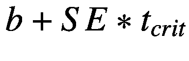

其中，*b* 是回归系数，*SE* 是回归系数的标准误差，*t*[*crit*] 是基于自由度和所需置信区间宽度确定的临界 t 值。例如，一个 95% 的置信区间使用了 t 分布的下 2.5 个百分位数和上 97.5 个百分位数。在 `R` 中，我们可以通过使用 `qt()` 函数来计算临界 t 值，该函数根据给定的概率 *p* 和自由度 *df* 返回 t 值。回想一下第 9 章中的 `qnorm()` 函数（用于计算 z 分数）。此处思路相同，只不过针对的是 t 分数。以下是自由度为 185 时的临界 t 值：

```
qt(p = .025, df = 185)
## [1] -1.973
qt(p = .975, df = 185)
## [1] 1.973
```

我们系数的下限置信区间：截距为 3.075 + 0.103 * -1.973 = 2.872，斜率为 -0.141 + 0.032 * -1.973 = -0.204。


我们系数的置信区间上界具有截距和斜率，分别为 `3.075 + 0.103 * 1.973 = 3.278` 和 `-0.141 + 0.032 * 1.973 = -0.078`。

我们可以如下解读回归结果。压力与积极情绪之间存在统计学上显著的关联。压力评分每升高一个单位，积极情绪评分就会降低 -0.14 [95% CI -0.20 至 -0.08]，*p* < .001。对于压力评分为零的人，其积极情绪预期为 3.08 [2.87, 3.28]，*p* < .001（截距）。总体而言，压力解释了积极情绪 9.0% 的方差。

我们还可以使用 `visreg` 包来帮助可视化回归结果，以便更好地理解其含义（见图 11-1）。在本例中，默认设置效果相当不错，为我们提供了回归线（蓝色），阴影灰色区域显示了回归线周围的 95% 置信区间。默认情况下，偏残差也会被绘制出来。我们使用参数 `gg = TRUE` 来要求 `visreg()` 生成一个 `ggplot2` 图形，这样我们就可以自定义主题，并采用我们已经习惯的常用 `ggplot2` 图形框架进行操作。

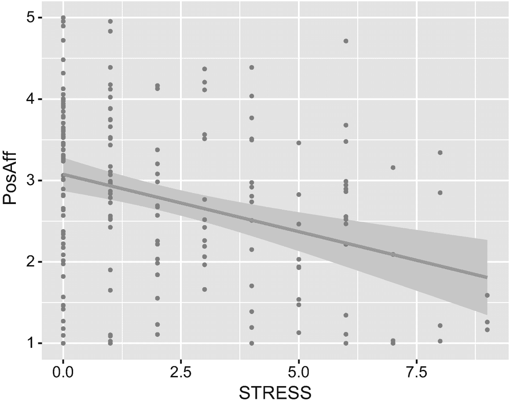

*图 11-1* 使用 `visreg()` 函数可视化压力预测积极情绪的回归模型

```
visreg(m, xvar = "STRESS", gg = TRUE)
```

如果您只想要回归线，可以设置 `partial = FALSE` 和 `rug = FALSE` 来停止绘制偏残差。与 `ggplot2` 中的其他图形一样，我们可以使用 `+` 来添加额外元素，例如使用 `ggtitle()` 函数控制标题。此自定义设置的结果如图 11-2 所示：

```
visreg(m, xvar = "STRESS", partial = FALSE, rug = FALSE, gg = TRUE) +
  ggtitle("积极情绪对压力的线性回归",
          subtitle = "阴影区域显示 95% 置信区间。")
```

您可以使用 `annotate()` 函数向图形添加注释，例如指示系数和 p 值的标签。在任何图形中，找到最佳且美观的位置和大小通常都需要经历一些试错过程。尝试调整 x 和 y 坐标以及大小，直到您满意为止。您还可以使用 `xlab()` 函数为 x 轴标签添加文本，并使用 `ylab()` 函数为 y 轴标签添加文本。

最终图形如图 11-3 所示，它为我们提供了回归模型的一个很好的高级摘要，包括关键信息。

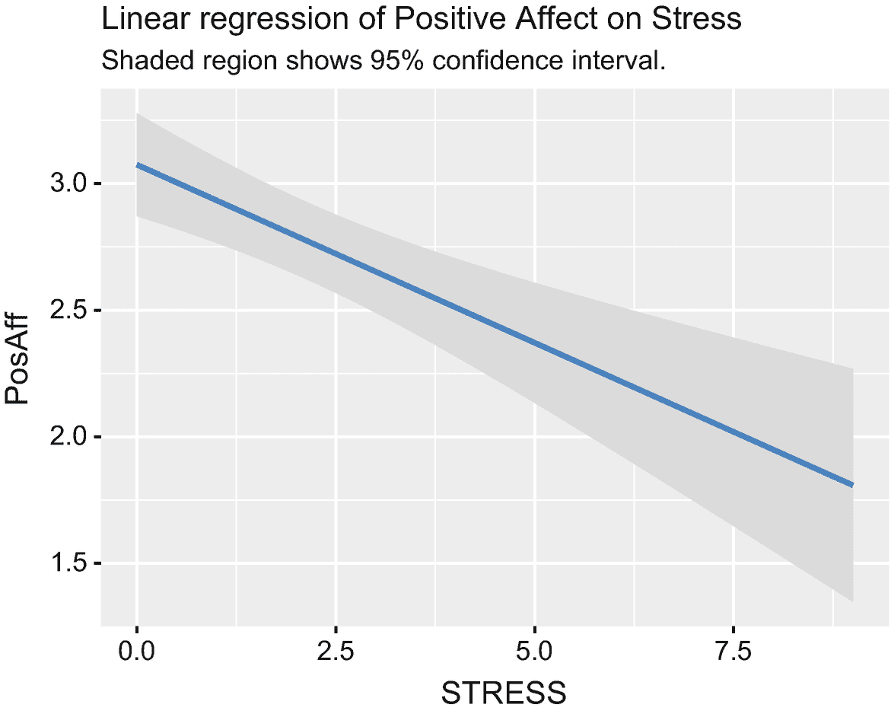

*图 11-2* 自定义来自 `visreg()` 的回归模型可视化

```
visreg(m, xvar = "STRESS", partial = FALSE, rug = FALSE, gg = TRUE) +
  ggtitle("积极情绪对压力的线性回归",
          subtitle = "阴影区域显示 95% 置信区间。") +
  annotate("text", x = 6, y = 3, label = "b = -0.14, p < .001", size = 5) +
  xlab("感知压力") + ylab("积极情绪（心境）")
```

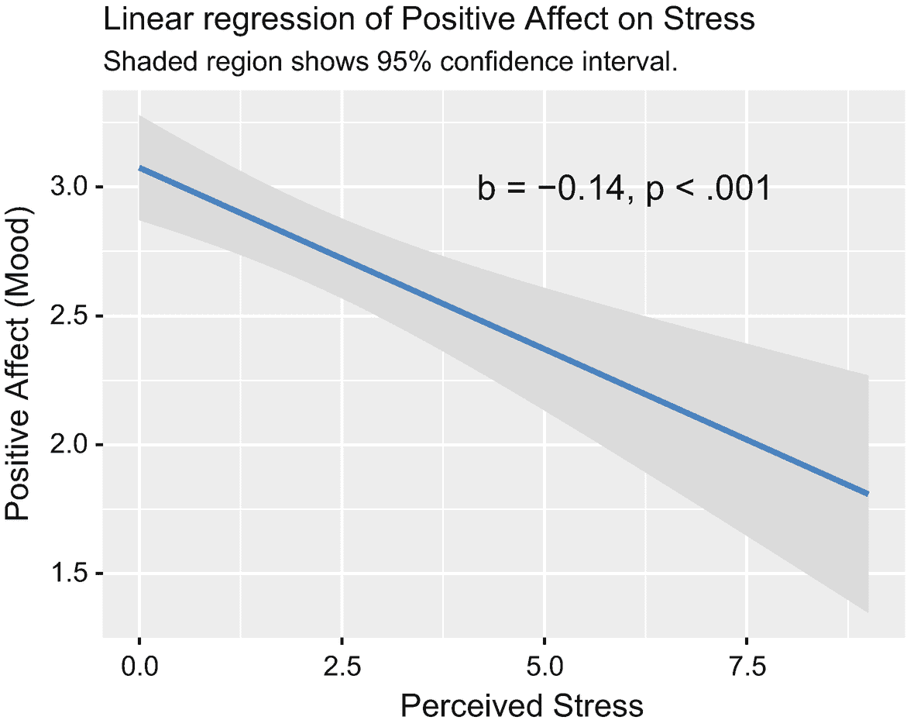

*图 11-3* 添加注释以显示回归模型可视化中的斜率

## 11.3 多元回归

既然你已经对第 8 章背后的数学原理有了更深入的了解，那么你已经准备好进入多元回归的学习了。请记住，学习统计学是一个过程，而非一次性事件。你在第 8 章所做的工作帮助你理解了前面的部分。每一次通读（以及每一轮对代码的试验），你都会学到更多，理解更深。不可否认，接下来的部分相当复杂。毕竟，你的目标是利用计算机和数学来构建数据中*多个*变量（或维度）之间的关系！话虽如此，你并不需要立刻理解所有内容。运行代码，比较和对比单个预测变量与多个预测变量，并逐次阅读文本解释。每一次重读都会帮助你更好地理解。没有人能在第一次尝试时就理解多元回归！至少，我们肯定没有。

### 多个预测变量的意义

多元线性回归的原理与简单线性回归基本相同。区别在于允许在单个模型中使用多个预测（解释）变量。与只有一个预测（解释）变量的简单线性回归相比，在同一个回归中包含多个预测变量有两个主要意义。

首先，所有变量都用于生成结果变量的预测值。由于生成模型预测时使用了更多变量，我们通常期望该模型比仅有一个预测变量的模型同样准确或更加准确。这关注的是模型的预测准确性。

其次，通过包含多个变量，我们可以检验某个变量与结果变量之间的*独特*关联。这对于更好地理解事物之间如何以及为何相互关联非常有用。识别变量的独特关联有助于识别潜在的因果关系类型关联。请注意，通常如果没有数据中的其他设计要素（如随机化），很难确信所识别的是因果关系关联，但多元回归可以帮助排除可能的替代解释。

我们将专注于拥有多个预测变量的第二个方面：识别每个变量的独特关联。例如，假设你认为高压力会导致人们感到不快乐。你可以尝试通过运行一个用压力预测积极情绪的线性回归来检验数据是否支持这一观点。你会预期压力与积极情绪之间存在负相关。然而，你的朋友有不同的想法。你的朋友认为，当人们感到孤独时，他们会感到更有压力，也更不快乐。也就是说，你的朋友认为孤独或缺少朋友的支持会导致压力和不开心的情绪。你的朋友推理说，压力和幸福看起来有负相关是很自然的，因为它们都是由同一件事引起的：缺少好朋友。

你如何解决这个问题呢？一种方法是只收集那些拥有大量好朋友的人的数据，或者都缺少好朋友的人的数据。然后你可以看看，仅在拥有好朋友的人群中，压力是否与幸福感相关。在实践中，这可能有困难，因为寻找和收集特定人群的数据并不总是那么容易。此外，这可能很快就会变得不切实际。假设你还有另一位朋友，他认为这与压力或朋友无关；而在于你住得离工作地点有多远。如果你住得太远，你就会花很长时间通勤；所以你没有时间交朋友，感觉压力更大，也更不快乐。为了收集数据以回应对这两位朋友的论点，你需要获取那些居住地距离工作地点相同、且拥有相同数量好朋友的人群的压力和幸福感数据——这是一项具有挑战性的任务。


### 多元回归

多元回归是尝试解决这一问题的另一种方法。通过在同一模型中纳入额外变量，你可以建模这些变量之间的关联，并识别每个变量的**独特**关联。也就是说，你可以尝试在统计上控制以下事实：不同人的通勤时长或来自朋友的支持程度可能有所不同。然后，在统计上将这些其他变量纳入考量后，你就能判断压力与幸福感是否相关。与简单线性回归相比，这实际上是多元回归的“关键”所在。在多元回归中，每个回归系数捕捉的并非该变量与结果之间的总关联，而是预测变量与结果之间的**独特**关联。

在实践中，你会看到人们以多种不同方式谈论和书写这一相同概念。如果你刚接触回归分析，这可能会令人困惑，而且不清楚它们是否都指向同一含义。以下是人们描述多元回归结果时常用的一些表述，这些表述都试图传达同一概念：

- 压力与幸福感的独立关联
- 压力与幸福感的独特关联
- 控制朋友支持后的压力与幸福感关联
- 协变朋友支持后的压力与幸福感关联
- 调整朋友支持后的压力与幸福感关联

这些并非人们讨论多元回归结果的全部方式；希望这些例子能为你提供一些参考。在所有情况下，关键在于多元回归在*统计上*调整或考虑了其他变量的影响，从而能够探索两个变量之间调整后的或独立的关联。如果模型假设成立（例如存在线性关联），多元回归可以利用统计方法控制其他变量（如朋友支持和通勤时长）在个体间的差异，从而构建一个假设世界——在这个世界中这些变量的差异已被消除——以回答这个问题：“如果朋友支持和通勤时长没有变化，压力与幸福感之间的独特或独立关联是什么？”通过剔除这些协变量的变异，消除压力与幸福感关联中的干扰因素或替代解释，有助于澄清压力与幸福感是否真正相关，或者仅仅因为某个第三变量而偶然相关。

值得注意的是，即使我们发现压力与幸福感*确实*彼此独立关联，这仍然不能证明压力导致了幸福感变化。如果没有随机化，你总可能遇到另一位朋友，他提出某个新变量或许能解释压力与幸福感为何相关，而你将需要无休止地测量变量并将其纳入回归模型。尽管如此，多元回归可以让我们调整或控制其他变量，这有助于排除我们感兴趣检验的关联中的替代解释。

### R 语言中的多元回归

如前所述，我们有一个结果变量*y*，由模型参数（即*b*系数）的组合来预测；但与只有一个预测变量*x*不同，现在我们可以有任意数量的预测变量，记为*k*个。这个*k*可以是两个预测变量、三个、二十个……数量不会改变底层技术原理：

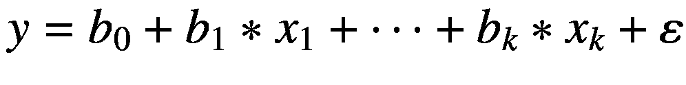

回归系数（有时更笼统地称为模型参数，此处模型即为回归模型）的解释与简单线性回归中的解释非常相似，但有一些额外要求：

- *b*[0] 是截距，即当所有预测变量为零时*y*的期望值（模型预测值）。请注意，你可能会看到这有时被写为 *E*(*y|x*[1] = 0*, ..., x*[*k*] = 0)，这只是表示当预测变量为零时*y*的期望值或预测值。如果人们有很多预测变量或不想全部写出，有时他们只写 *E*(*y|X* = 0)，其中大写“X”代表所有预测变量。
- *b*[1] 是直线的斜率，表示在控制其他预测变量的条件下，*x*[1]每变化一个单位，*y*预期变化多少。
- *b*[*k*] 是直线的斜率，表示在控制其他所有预测变量的条件下，*x*[*k*]每变化一个单位，*y*预期变化多少。
- *ε* 是残差/误差项，即模型预测值与观测值之间的差异。

从视觉上看，这变得更难直观呈现，但借助三维图形仍然可以实现，我们稍后将进行探索。

### 示例

为了练习多元回归，让我们看一个真实案例。我们将使用前面讨论过的假设情景。你认为压力会使人不快乐；你的朋友则认为缺乏支持性朋友既会导致压力，也会导致不快乐。

有了合适的数据，我们可以使用多元回归来帮助判断谁是对的。为此，我们将压力和社会支持变量同时纳入一个预测积极情感的回归模型中。这样可以分离出压力与积极情感以及社会支持与积极情感的**独特**关联。该模型以方程形式表示如下：

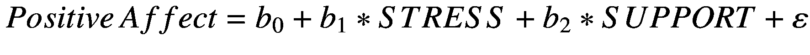

在`R`语言中执行多元线性回归的方式几乎与简单线性回归相同。只需在预测变量之间使用`+`即可添加更多预测变量。以下代码展示了同时将`STRESS`和社会`SUPPORT`作为预测变量添加的示例：

```
m2 <- lm(formula = PosAff ~ STRESS + SUPPORT,
data = acesData)
```

接下来，我们运行诊断，并且只在完成诊断后才查看汇总结果。我们故意将`summary()`放在诊断之后，因为如果模型假设被严重违反，解释系数就没什么意义。我们应当首先修正模型，然后再进行解释。方便的是，多元回归的模型诊断与简单线性回归基本相同。具体来说，我们检查残差的分布以评估正态性假设是否成立，并识别潜在的极端值。我们还会查看预测积极情感与残差值的散点图，以评估残差变异量是否在预测值范围内相等（同方差性）。我们使用正态分布的第 0.5 和第 99.5 百分位数作为定义极端值的标准。诊断图如图 11-4 所示：

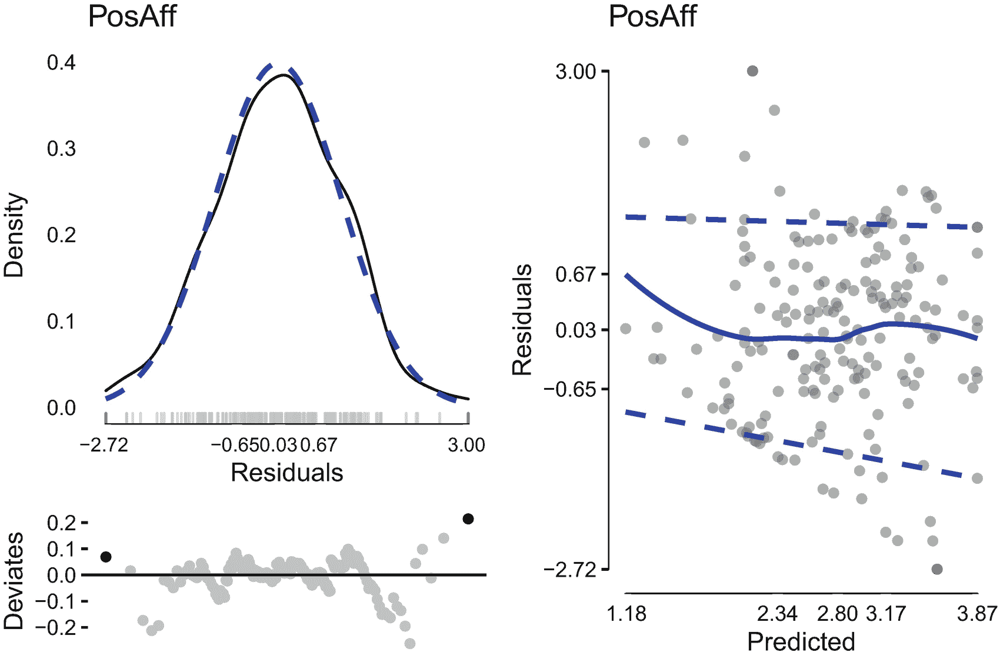

图 11-4：多元回归模型诊断

```
m2d <- modelDiagnostics(m2, ev.perc = .005)
plot(m2d, ncol = 2, ask = FALSE)
```

*注意：如果你收到关于奇异性问题或极小对角线的警告，不必担心；这些警告源于用于估计残差与预测值图中蓝色线条绘制位置的内部函数。添加这些蓝色线条仅是为了帮助更容易地观察数据中的模式，但并非评估诊断结果所必需，且警告仅涉及这些模型，因此你可以安全地忽略它们。本书中不会打印这些警告。*


查看图 11-4，我们可以看到一些极端残差值，但它们并非过于极端。此外，似乎只有两个这样的值，因此无论我们保留还是剔除它们，可能都不会产生太大影响。评估极端值的关键在于尝试确定这些极端值是否可能指示问题或不准确的数据（例如，如果这些值不可能出现），或者这些少数极端值是否足够极端，或者它们的数量是否足以显著影响模型的结果。相对于样本中的其他观测值，极端值的数量越少，且它们越不极端，那么它们对模型结果产生实质性影响的可能性就越小。记住这一点很有帮助：相对极端并不意味着这些观测值就是“问题”、“错误”或需要被“修正”。我们应当检查它们，然后做出合理的决定。数据中总会有最低值和最高值，但经常检查极端值有助于识别是否存在问题。

图 11-4 看起来相当不错，因此我们或许可以决定继续进行，不做任何更改。接下来我们可以查看模型结果的摘要以及结果的置信区间：

```
summary(m2)
##
## Call:
## lm(formula = PosAff ˜ STRESS + SUPPORT, data = acesData)
##
## Residuals:
##     Min      1Q  Median      3Q     Max
## -2.5611 -0.6133  0.0285  0.6304  2.8065
##
## Coefficients:
##             Estimate Std. Error t value Pr(>|t|)
## (Intercept)   2.0881     0.1714   12.18  < 2e-16 ***
## STRESS       -0.1340     0.0287   -4.67  5.8e-06 ***
## SUPPORT       0.1780     0.0260    6.84  1.2e-10 ***
## ---
## Signif. codes:  0 '***' 0.001 '**' 0.01 '*' 0.05 '.' 0.1 ' ' 1
##
## Residual standard error: 0.949 on 184 degrees of freedom
##   (2 observations deleted due to missingness)
## Multiple R-squared:  0.278,  Adjusted R-squared:  0.27
## F-statistic: 35.4 on 2 and 184 DF,  p-value: 9.7e-14
confint(m2)
##               2.5 %   97.5 %
## (Intercept)  1.7500  2.42619
## STRESS      -0.1906 -0.07737
## SUPPORT      0.1267  0.22943
```

我们逐部分解读输出，以确保非常清楚如何解释每一部分：

-   **Call**：这是我们调用`R`生成模型的代码；它显示我们使用`lm()`拟合了一个线性模型，定义模型的公式将积极情感`PosAff`作为结果变量，并将`STRESS`和`SUPPORT`作为预测变量。用于拟合数据的数据集名为`acesData`。

-   **Residuals**：这部分提供关于残差的一些描述性统计信息。我们可以看到最小残差为 -2.56，这是观察到的积极情感得分中，结果**低于**预测积极情感得分的最大值。同样，最大残差为 2.81，这是观察到的积极情感得分中，结果**高于**预测积极情感得分的最大值。由于压力和社交支持都是预测变量，预测的积极情感得分将基于这两个预测变量，但残差仍然是观察到的积极情感得分与预测积极情感得分之间的差值。查看最低和最高残差有助于快速了解是否存在极端值。此外，如果残差服从正态分布，其中位数应接近零均值。因此，检查残差中位数是否约为零是另一个快速有用的诊断方法。

-   **Coefficients**：这实际上是回归报告中通常显示的主要表格。“Estimate”列给出了模型参数估计值或回归系数（即 *b*）。在该模型中，系数分别为 2.09、-0.13 和 0.18。这些给出了截距，以及压力为零且社交支持为零（即所有预测变量均为零）的个体的期望积极情感值。这些系数还包含了压力与积极情感、社交支持与积极情感各自独特关联的回归线斜率。

  “Std. Error”列给出了每个系数的标准误（SE）。标准误反映了由于我们分析的是从更大总体中抽取的样本，导致每个系数估计中存在的不确定性程度。也就是说，尽管我们想了解总体参数，但由于我们只有来自总体的（假设为随机的）样本，真实的总体回归系数可能存在差异。标准误量化了我们在使用样本估计值推断总体系数时的不确定性程度。此处标准误分别为 0.17、0.03 和 0.03。

  “t value”列给出了每个参数的 t 值。尽管这是回归模型，但与 t 检验一样，回归模型使用 t 值并对照 t 分布来查找以计算 p 值。实际上，报告的 t 值是 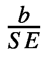，即回归系数除以其标准误。这里的 t 值分别为 12.18、-4.67 和 6.84。

  最后，“*Pr*(> |*t*|)”列给出了概率值，即每个系数的 p 值。即使模型中的预测变量在统计上不显著（即不小于指定的 *α* (alpha) 值），截距（即所有预测变量等于零时结果的期望值）通常也显著异于零，因此其 p 值非常小，接近于零。正因如此，`R`中经常用科学记数法显示 p 值。在本例中，p 值均为 *p* < .001。由于 p 值并不精确为零，习惯上在它们非常小时写为 < .001 或 < .0001，而不是进行四舍五入后写成例如“p = 0.000”，因为后者暗示 p 值精确为零，而实际上很可能并非如此。底部的显著性代码用于指示星号的含义。*** 表示 *p* < .001，** 表示 *p* < .01，* 表示 *p* < .05，. 表示 *p* < .10，空白表示 *p* > .10。

-   **Residual standard error**: *σ*[*ε*] 和残差自由度（与 t 值一起用于计算 p 值）。此处残差标准误为 0.95。残差自由度计算公式为 *df* = *N* − *k*。这里 *N* 是数据行数或*观测值*数量，而 *k* 是系数个数。在本例中为 187 – 3 = 184。我们还可以在括号中看到关于因缺失数据而被移除的观测值的说明。这里我们得到一个说明：有两个观测值因缺失数据而被移除。如果观测值在模型中的任何一个变量（即结果变量或任何预测变量）上存在数据缺失，则这些观测值将被移除。

-   **R-squared**：接下来是整体模型的 *R*²，即在此特定样本数据中，由模型（此处模型有两个预测变量：压力与社交支持）所解释的结果变量（积极情感）方差的比例。*R*² 也是结果变量（此处为积极情感`PosAff`）与预测的积极情感（*b*[0] + *b*[1] ∗ *STRESS* + *b*[2] ∗ *SUPPORT*）之间相关性的平方。


如果`R`²为 0，则表示结果中的任何变异性都无法由预测变量解释。对于此模型，这意味着人们积极情绪中的任何方差都无法由他们的压力水平或社会支持来解释。换句话说，这意味着模型预测的积极情绪与观察到的积极情绪之间的平方相关性为零。如果`R`²为 1，则表示积极情绪中 100%（全部）的方差都可以由压力和社会支持来解释。再换句话说，预测的积极情绪与观察到的积极情绪之间的平方相关性为 1，这意味着完全相关。也就是说，我们可以根据压力和社会支持完美地预测积极情绪。

在此模型中，`R`²为 0.278，这是该样本中可被压力和社会支持解释的积极情绪方差的比例。此外，输出中包含调整后的`R`²，这是对真实总体`R`²的更好估计，在此例中为 0.2701。调整后的`R`²背后的理念是，由于我们拟合模型到样本上，它在样本数据中解释的方差总是比在真实总体中解释的方差略多一点，我们可以对此进行调整。

- **F 统计量**：提供了整体模型的 F 统计量、自由度及 p 值。F 检验是对模型是否在整体上具有统计显著性的检验。它将同时检验所有预测变量；即，检验压力和社会支持的系数是否均为 0 或至少有一个不为 0。由于我们有多个预测变量，F 检验的 p 值不会与特定系数的 t 检验的 p 值匹配，这与简单线性回归时的情况不同。

我们已经看到了多重回归的大量输出，但它到底是什么样子的呢？图 11-5 显示了由积极情绪对压力和社会支持进行多重回归所预测的回归曲面。对于两个预测变量，多重回归会形成一个三维（3D）平面或曲面。该曲面是平坦的，像一张纸，因为我们目前仅为每个预测变量建模了线性关联。

多重回归的图形如图 11-5 所示。这两幅不同的图只是从不同方向观察同一曲面，以帮助看清平面的样子。共有三个轴：一个代表压力，一个代表社会支持，一个代表预测的积极情绪。需要重点注意的是，图中绘制的是来自多重回归模型的**“预测”**积极情绪。实际的积极情绪得分并未显示。观察该图，您会发现无论另一个变量取值如何，任何单个变量的直线斜率都是相同的。也就是说，无论社会支持水平如何，压力与积极情绪之间的关联斜率都相同。同样地，无论压力水平如何，社会支持与积极情绪之间的关联斜率也相同。这背后的思想是，多重回归允许人们在一个变量上（例如社会支持）存在差异，但仍然假设压力与积极情绪的关联对每个人都是相同的。由于其他变量（如社会支持）的影响，人们可能从不同的水平出发，但其基本假设是关联强度对每个人都相同。通过让直线（即曲面）根据其他变量（如社会支持）的不同而具有不同的高度，就有可能分离出压力独立于社会支持的独特效应。如果我们从另一个角度观察该图，我们可以类似地解读，但重点关注在控制压力或保持压力不变的情况下，社会支持的独特效应。这是同一个模型，但我们既可以谈论压力，也可以谈论社会支持。

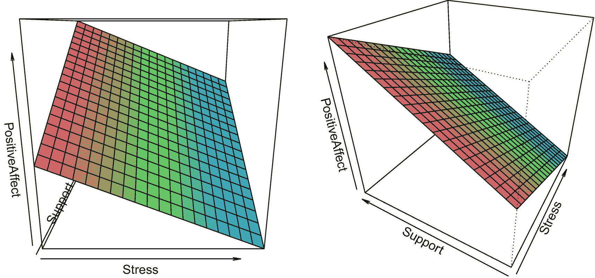

图 11-5  
多重回归曲面的 3D 图

多重回归可以包含许多预测变量，但要展示包含两个以上预测变量的图形并不太可行。然而，其理念保持不变。无论添加多少预测变量，多重回归使我们能够检验每个预测变量与结果之间的**独特**关联，同时控制（或独立于）模型中添加的所有其他预测变量。

在实践中，即使对于仅有两个变量的多重回归，我们也很少创建 3D 图，因为在纸或屏幕等二维介质上展示或解读 3D 图并不容易。相反，我们通常一次只绘制一个变量的关联图。这样做是可以的，因为您会从 3D 图形中回忆起，无论社会支持水平如何，捕捉压力与积极情绪关联的斜率都是相同的。积极情绪的高度或绝对水平会改变，但直线的斜率不变。因此，我们实际上可以任意选择一个社会支持水平，然后绘制压力与积极情绪之间的关联。我们可以使用`visreg()`函数来实现这一点，这可能是获取快速图形以帮助解读和理解`R`中回归模型的最简单方法。

以下代码创建了一个图形，展示在社会支持保持不变的情况下，压力与积极情绪之间的关联。`visreg()`通常默认将未绘制的其他预测变量保持在其均值，但您可以根据需要更改此设置。请注意，此代码实际上与我们之前在只有简单线性回归时使用的代码相同。改变的是，我们的模型现在在统计上控制或调整了社会支持，因此我们现在绘制的是压力与积极情绪的独特关联。该图显示在图 11-6 中。我们可以看到，较高的压力得分与较低的积极情绪得分相关，且独立于社会支持。灰色阴影区域表示回归线周围的 95%置信区间：

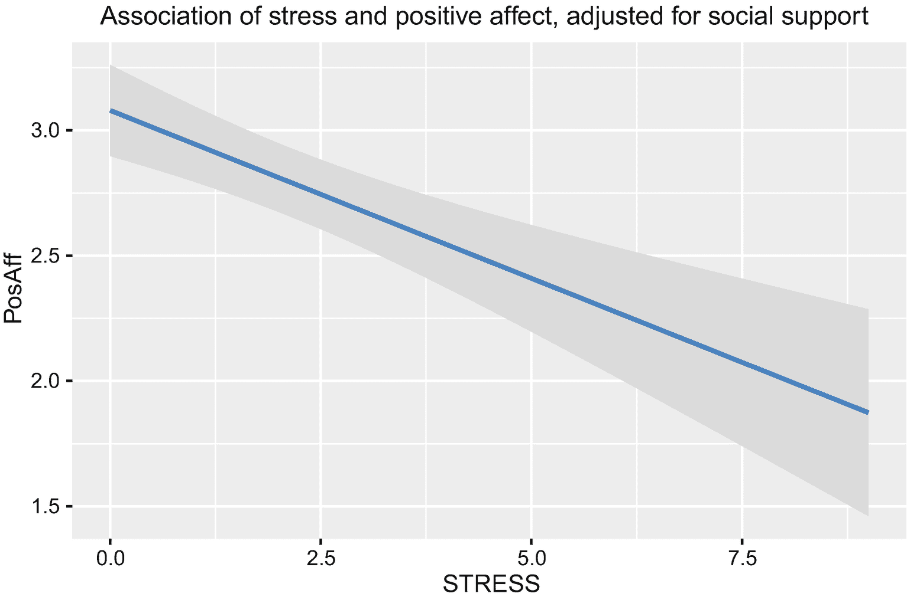

图 11-6  
压力和社会支持预测积极情绪的多重回归。该图仅展示压力与积极情绪的独特关联。

```
visreg(m2, xvar = "STRESS", partial = FALSE, rug = FALSE, gg = TRUE) +
ggtitle("Association of stress and positive affect, adjusted for social support")
```

我们可以为社会支持而不是压力创建相同类型的图形，在这种情况下，我们将看到在控制压力后，社会支持与积极情绪的独特关联。该图显示在图 11-7 中。

```
visreg(m2, xvar = "SUPPORT", partial = FALSE, rug = FALSE, gg = TRUE) +
ggtitle("Association of support and positive affect, adjusted for stress")
```

从图中我们可以看到，社会支持与积极情绪呈正相关：较高的社会支持得分与较高的积极情绪得分相关，且独立于压力。

如果我们把学到的一切综合起来，我们可以如下解读并撰写此多重回归模型的结果。请注意，这是一份相当详细的报告。在实践中，您可能只包含其中的一部分，而不是报告所有内容。


### 多元线性回归模型：以积极情绪为结果，压力和社会支持为预测变量

在控制社会支持的情况下，压力与积极情绪之间存在统计学上显著的关联（见图 11-6）。独立于社会支持，压力得分每增加一个单位，积极情绪得分降低`-0.13` [95% CI -0.19 至 -0.08]，`p < .001`。同样，在控制压力的情况下，社会支持与积极情绪之间存在统计学上显著的关联（见图 11-7）。独立于压力，社会支持得分每增加一个单位，积极情绪得分提高`0.18` [95% CI 0.13 至 0.23]，`p < .001`。当压力和社交支持得分均为零时，预期积极情绪得分为`2.09` [1.75, 2.43]，`p < .001`（截距项）。总体而言，压力和社会支持解释了积极情绪`27.0%`的方差。

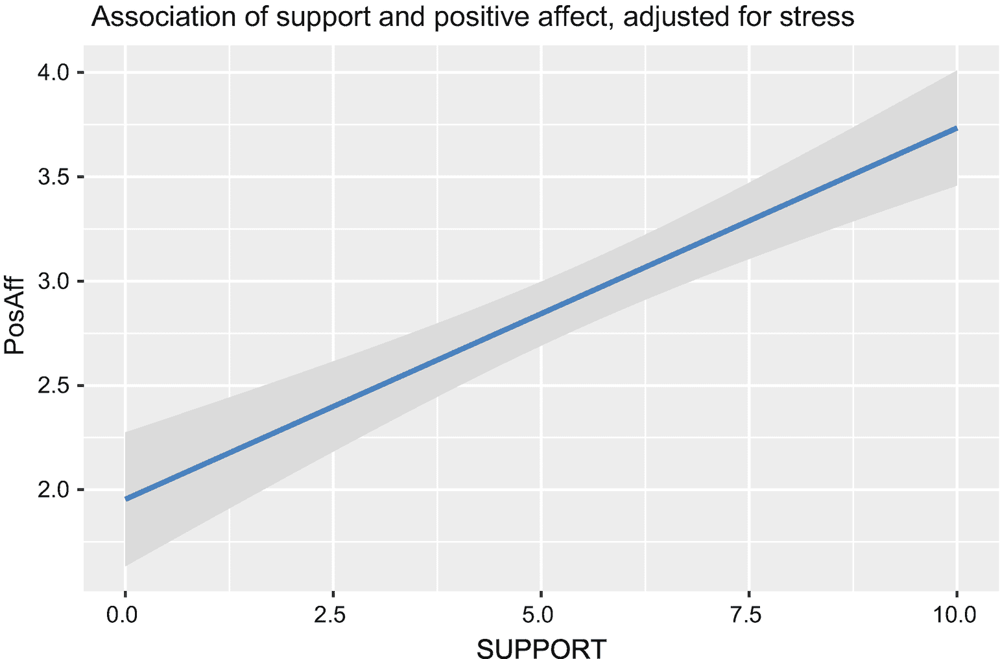

**图 11-7**

压力和社交支持预测积极情绪的多元回归。此图仅显示独特的社会支持与积极情绪的关联。

### 效应量及其格式化

我们已经了解了`R²`，它捕捉了模型解释的结果变量的方差比例。通常，我们也会关注`R²`或其他效应量。效应量是标准化的，允许跨变量或研究比较效应的大小。例如，由于回归系数以预测变量和结果变量的原始单位为单位，因此它们之间不可直接比较。

举个简单的例子，假设一项研究以秒为单位测量时间，另一项研究以分钟为单位。即使两项研究中效应的大小完全相同，回归系数（即`b`值）也不会相同，因为时间的尺度不同（秒 vs. 分钟）。效应量的目标就是实现某种标准化，以便可以比较效应的大小。`R²`就是一种标准化的度量。无论结果变量或预测变量是什么，它的取值范围始终为从 0（或 0%，表示没有解释任何方差）到 1（或 100%，表示解释了全部方差）。

我们也可以使用`R²`来获取某个预测变量独特贡献的效应量估计值。其背后的数学原理相当直接。假设我们有一个多元回归模型，称其为`Model[AB]`：

```
Model[AB]: Positive Affect = b0 + b1 * STRESS + b2 * SUPPORT + ε
```

假设我们想知道的是压力与积极情绪独特关联的效应量。我们的回归模型`Model[AB]`的`R²`告诉我们压力和社交支持共同能解释的积极情绪的总方差；我们称之为`R²[AB]`。我们可以*再*运行一个仅以社会支持作为预测变量的回归模型，称其为`Model[A]`：

```
Model[A]: Positive Affect = b0 + b1 * SUPPORT + ε
```

该模型的`R²`告诉我们社会支持解释的积极情绪的总方差，我们称之为`R²[A]`。现在我们有两个`R²`值：`R²[AB]`是压力和社交支持共同解释的积极情绪总方差。`R²[A]`是社会支持解释的积极情绪方差。两个模型（以及两个`R²`值）之间的唯一区别在于是否加入了压力变量。因此，这两个`R²`值的差值就是压力在社交支持之外*独特*解释的积极情绪中的额外方差：

```
R²_stress = R²[AB] - R²[A]
```

我们可以将相同的过程普遍应用于任何变量或变量集，以识别它们独特解释了多少结果变量的方差，将其作为效应量度量。通用过程如下：

1.  拟合一个包含所有预测变量的多元回归模型，并记下其`R²`值；此为完整模型的`R²[AB]`。

2.  拟合一个包含除目标预测变量（即要计算效应量的变量）之外的*所有*其他预测变量的（多元）回归模型，并记录其`R²`值；此为简化模型的`R²[A]`。

3.  计算这两个`R²`值的差值，即可得到目标预测变量所解释的独特方差，这便是一个针对它们的效应量度量。


### 示例

之前，我们拟合了一个包含压力和社会支持作为积极情感预测变量的完整多元回归模型，并将结果存储在对象 `m2` 中。如果我们仅拟合一个以社会支持预测积极情感的回归模型，就能获得识别压力单独解释的积极情感独特方差所需的所有信息。`R2()` 函数可用于直接从模型中提取 *R*² 值，无需获取完整的 `summary()`。我们对完整模型使用 `R2()` 来获取压力和社会支持共同解释的总方差，然后减去社会支持所能解释的方差，剩下的就是压力单独解释的方差：

```r
model_a <- lm(PosAff ~ SUPPORT, data = acesData)
R2(m2) - R2(model_a)
##      R2   AdjR2
## 0.08557 0.08209
```

通常，人们在计算出一个预测变量的独特方差后便会止步。然而，Cohen [8] 定义了另一种效应量指标，称为 *f*²。*f*² 背后的思想是：如果考虑到某个预测变量在结果中解释的独特或额外方差，那么当已被解释的方差越多时，越难以再解释新的方差。例如，如果模型 *Model*[*A*] 已经解释了结果中 90% 的方差，那么再额外解释 9% 的方差（这将使模型解释接近 100% 的方差）会非常困难。相比之下，如果一个模型解释了 0% 的方差，那么增加一个预测变量可能更容易地解释 9% 的方差。因此，Cohen 的 *f*² 效应量考虑了这一点。对于整体模型，Cohen 的 *f*² 效应量定义为

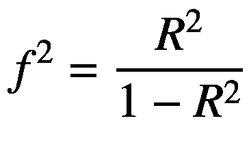

它基于模型的 *R*²，但除以未解释的方差 1 − *R*²。

此外，对于单个预测变量，Cohen 的 *f*² 效应量定义为

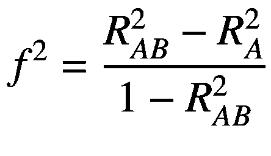

我们看到分子是该预测变量解释的独特方差。Cohen 的 *f*² 的唯一新增之处在于，将独特方差除以未解释方差 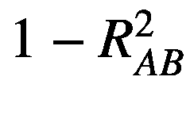。因此，Cohen 的 *f*² 可以是大于或等于零的任何数值。

根据 Cohen [8] 的指南，对于什么是小、中或大效应量，有一些常用的惯例：

* **小**效应量：*f*² ≥ 0.02。
* **中**效应量：*f*² ≥ 0.15。
* **大**效应量：*f*² ≥ 0.35。

数据科学家经常使用这些指南或临界值来帮助解释某个预测变量的 *f*² 效应量，根据其所解释的独特方差量，判断其效应是小、中还是大。我们已经了解了如何使用 `R2()` 函数计算 *R*² 值的差。将其除以  即可轻松得到 Cohen 的 *f*²：

```r
(R2(m2) - R2(model_a)) / (1 - R2(m2))
##     R2  AdjR2
## 0.1185 0.1125
```

在这个例子中，我们看到 *f*² 值处于“小”到“中”的范围之间，因为它们接近但尚未完全达到“中”效应量的阈值。

虽然可以手动进行这些计算，但随着回归模型中包含的预测变量增多，这会变得繁琐。为了计算每个预测变量的效应量，都需要两个模型：完整模型和不包含该预测变量的模型。此外，尽管 `summary()` 函数提供了我们可能想要的关于回归模型的大部分信息，但它仍遗漏了一些内容，并且其格式通常不易于直接纳入报告中。

虽然以下两个函数并非使用和报告多元回归模型的严格必要条件，但它们可以帮助您将所有可能想要的信息格式美观地集中在一处。`modelTest()` 函数接收一个模型，并自动为其进行额外的计算，例如每个预测变量的置信区间和效应量。它执行了我们之前识别压力的独特效应量时所做的工作，但 `modelTest()` 会自动完成所有步骤，并且针对回归模型中的每个预测变量都执行此操作。此外，可以对 `modelTest()` 的结果使用 `APAStyler()` 函数，以获得格式美观的输出集，其中包含诸如四舍五入等处理。

*注意，我们确实认识到“格式美观”可能是一个非常个人化的选择，因此我们教授拟合回归和获取输出的通用基础构建块，但在许多应用中，`APAStyler()` 的格式接近当今常见的结果呈现方式。*

```r
m2test <- modelTest(m2)
APAStyler(m2test)
##                 Term                    Est          Type
##  1:      (Intercept)  2.09*** [ 1.75, 2.43] Fixed Effects
##  2:           STRESS -0.13*** [-0.19,-0.08] Fixed Effects
##  3:          SUPPORT  0.18*** [ 0.13, 0.23] Fixed Effects
##  4: N (Observations)                    187 Overall Model
##  5:        logLik DF                      4 Overall Model
## ---
##  9:               F2                   0.38 Overall Model
## 10:               R2                   0.28 Overall Model
## 11:           Adj R2                   0.27 Overall Model
## 12:           STRESS     f2 = 0.12, p < .001 Effect Sizes
## 13:          SUPPORT     f2 = 0.25, p < .001 Effect Sizes
```

该表格包含三列和三个子部分：

* **Term**：“Term”列告诉我们看到的是什么。例如，它指示是哪个回归系数或哪个效应量。
* **Est**：“Est”列提供数值，即模型的实际数字结果。
* **Type**：“Type”列指示表格的广义区域或类别，下文将进一步介绍。

表格的三个广义部分分布在不同的行中。通过查看“Type”列，您可以判断某一行属于哪个部分。这些部分包括：

* **Fixed Effects**：固定效应部分包含我们学过的回归系数，即 *b*。在线性回归和多元回归中，这些回归系数始终是固定效应。`modelTest()` 使用这个名称（固定效应）是因为相同的函数也可用于其他可能存在随机效应的模型，即允许在不同个体之间随机变化的效应。目前这并不重要，但可能有助于解释为何事物被如此标记。
* **Overall Model**：总体模型部分包含与整体模型相关的信息或细节，例如包含的观测数、整体模型 *R*² 等。
* **Effect Sizes**：效应量部分包含回归模型中每个预测变量的效应量。它们的标记方式与回归系数基本相同，但报告的效应量是 *f*² 值。

如果您眼尖的话，可能会注意到之前打印的表格从第 5 行跳到了第 9 行，跳过了几行。这是因为它是一个 `data.table`，并且我们设置为仅显示前五行和后五行，这在展示数据集时有助于避免打印数百行，但对于模型输出表之类希望看到全部内容的情况则不太有用。不同计算机上的环境设置不同，可能会产生不同的结果。您可以使用 `print()` 函数并指定最大行数来确保打印每一行，如下所示：


```r
print(APAStyler(m2test), nrow = 100)
##                 项                   估计值          类型
##  1:      (截距)       2.09*** [ 1.75, 2.43] 固定效应
##  2:           压力   -0.13*** [-0.19,-0.08] 固定效应
##  3:          社会支持  0.18*** [ 0.13, 0.23] 固定效应
##  4: N（观测数）                   187 整体模型
##  5:        对数似然自由度              4 整体模型
##  6:           对数似然          -254.09 整体模型
##  7:              AIC            516.18 整体模型
##  8:              BIC            529.10 整体模型
##  9:              F2              0.38 整体模型
## 10:              R2              0.28 整体模型
## 11:         调整后 R2              0.27 整体模型
## 12:           压力    f2 = 0.12, p < .001  效应量
## 13:         社会支持    f2 = 0.25, p < .001  效应量
```

现在我们将处理完整的输出，逐行解读以确保清楚了解每项输出的确切含义，以及如何实际解读并应用：

1. **项 – (截距)**：此行包含截距的回归系数 *b*；星号用于表示显著性（p 值），与`summary()`中一致。`***`表示 *p* < .001，`**`表示 *p* < .01，`*`表示 *p* < .05。在此例中，截距显著不等于零，*p* < .001。方括号内是截距的 95%置信区间。所有输出均保留两位小数，这与书面报告中的常见做法一致。这里可以看到，当压力和社会支持为零时，模型预测的积极情感得分为 2.09，且该值显著不等于零。

2. **项 – 压力**：此行包含回归系数 *b*，即压力与积极情感之间关联的斜率。与截距类似，星号表示显著性水平，方括号内为 95%置信区间。这里可以看到，独立于社会支持，压力与积极情感呈负相关，*p* < .001。

3. **项 – 社会支持**：此行包含回归系数 *b*，即社会支持与积极情感之间关联的斜率。与截距类似，星号表示显著性水平，方括号内为 95%置信区间。这里可以看到，独立于压力，社会支持与积极情感呈正相关，*p* < .001。

4. **项 – N（观测数）**：此行显示纳入回归模型的总观测数。若因数据缺失而排除某些观测，则这些观测不计入在内。这里统计的是实际纳入分析、有可用数据的观测数量。

5. **项 – 对数似然自由度**：此行及其后三行可用于检验或比较不同模型。这些内容超出了本 `R` 语言统计入门教程的范围，你可以忽略它们。

6. **项 – 对数似然**：参见上文说明。

7. **项 – AIC**：参见上文说明。

8. **项 – BIC**：参见上文说明。

9. **项 – F2**：此行给出了整个模型的 Cohen's *f*²，即 `R² / (1 - R²)`。这里可以看出，总体而言，压力和社会支持（即该回归模型，因为它们是模型中的两个预测变量）具有较大的效应量，表明压力和社会支持共同解释了积极情感中相当大的方差。

10. **项 – R2**：此行给出了模型中（即压力和社会支持共同）解释的、本数据样本中积极情感方差的比例。

11. **项 – 调整后 R2**：此行给出了模型中（即压力和社会支持共同）解释的、总体中积极情感方差的估计比例。这是调整后的 *R*²，调整的目的是给出更准确的总体估计，而不仅仅是本数据样本中的估计值。

12. **项 – 压力**：此行给出了压力的唯一效应量。它显示了独立于社会支持时压力的 Cohen's *f*²。同时给出了精确的 p 值，而非像之前固定效应部分那样“仅”用星号表示。在此例中，我们看到了与之前手动计算相同的 *f*²。独立于社会支持，压力对积极情感的效应量介于小到中等之间。

13. **项 – 社会支持**：此行给出了社会支持的唯一效应量。它显示了独立于压力时社会支持的 Cohen's *f*²。同时给出了精确的 p 值，而非像之前固定效应部分那样“仅”用星号表示。在此例中，可以看到独立于压力，社会支持对积极情感具有中等效应量。

除了我们从各个信息点中了解到的内容外，还有一点最终信息需要厘清。与回归系数不同（回归系数无法直接比较，因为“一个单位”的压力可能与“一个单位”的社会支持差异巨大），效应量*是可以*比较的。因此，尽管我们对此没有显著性检验，但可以认为在该模型中，社会支持对积极情感的唯一效应量大于压力。


### 示例

这看起来可能是一个很长的过程，从某种程度上说，确实如此。但另一方面，一旦你熟悉了代码和流程，整个过程可以相当快。作为示例，我们考虑一下鳍状肢长度和喙深度是否是体重的预测因子。

在学习了上一节之后，你知道一切始于一个线性模型。在此例中，`body_mass_g` 是你的结果变量，而 `flipper_length_mm` 和 `bill_depth_mm` 是你的预测变量。你将模型存储在 `m2Penguin` 中：

```
m2Penguin <- lm(formula = body_mass_g ˜ flipper_length_mm + bill_depth_mm,
data = penguinsData)
```

你再次使用正态分布的第 0.5 个和第 99.5 个百分位数运行 `modelDiagnostics()` 函数，以突出显示极端值：

```
m2Penguind <- modelDiagnostics(m2Penguin, ev.perc = 0.005)
plot(m2Penguind, ncol = 2, ask = FALSE)
```

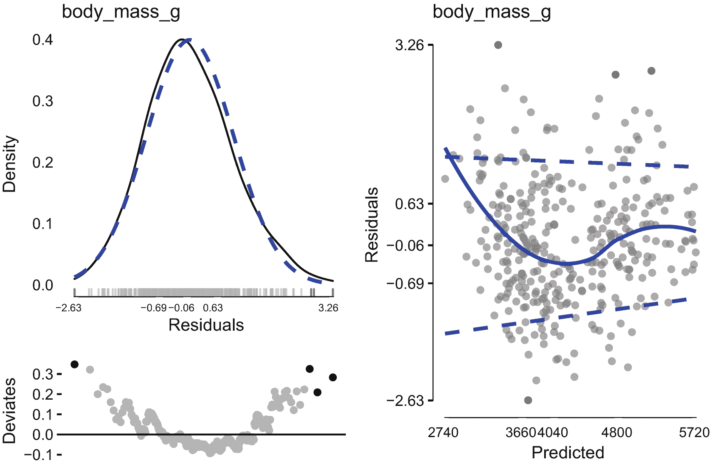

图 11-8

企鹅数据的多元回归模型诊断

在图 11-8 中，左侧的分布看起来大致呈正态分布。偏差线只有少数几个极端值，并且你可以看到左下角偏差的 y 轴范围并不大。在右侧，那些虚线看起来相当水平。总体来看，这已经足够好，可以继续下一步了。

接下来，运行 `summary()` 函数，你将逐步检查我们在前一个示例中提到的六个方面：

*   **调用（Call）**：正如预期，它重复了我们刚刚构建的模型。

*   **残差（Residuals）**：查看最小和最大的残差有助于快速了解是否存在极端值。此外，如果残差服从正态分布，中位数应接近平均值零。因此，检查残差的中位数是否接近于零是另一个有用的快速诊断方法。在此例中，-23.6 并不正好是 0。但它比我们在第 8 章运行类似模型（未包含喙深度）时更接近 0。我们继续往下进行。

*   **系数（Coefficients）**：在此模型中，系数分别为 -6541.91、51.54 和 22.63。这些给出了截距（即鳍状肢长度和喙深度均为零时企鹅体重的预期克数），以及鳍状肢长度与体重、喙深度与体重的独特关联的回归线斜率。

    “Std. Error” 列给出了每个系数的标准误差。标准误差反映了由于你分析的只是从更大总体中抽取的一个样本，导致每个系数估计中存在的不确定性。也就是说，尽管你想了解总体系数，但由于只拥有来自总体的（假设为随机的）样本，真实的总体回归系数可能存在差异。标准误差量化了你使用样本估计值推断总体系数时的*不确定*程度。此处的标准误差分别为 540.75、1.87 和 13.28。

    “t value” 列给出了每个参数的 t 值。虽然这是一个回归模型，但与 t 检验类似，回归模型使用 t 值并对照 t 分布来查找 p 值。实际上，报告的 t 值是 `b / SE`，即回归系数除以其标准误差。此处的 t 值分别为 -12.10、27.64 和 1.70。

    最后，“Pr(> |t|)” 列给出了概率值，即每个系数的 p 值。即使模型中的预测变量没有统计学显著性（即，不小于指定的 α (alpha) 值），截距（即所有预测变量为零时结果的预期值）通常也显著不同于零，因此其 p 值非常接近于零。出于这个原因，`R` 中的 p 值通常使用科学记数法显示。在此例中，p 值分别为 p < .001、p < .001 和 p < .089。

    底部的显著性代码用于指示星号的含义。*** 表示 p < .001，** 表示 p < .01，* 表示 p < .05，. 表示 p < .10，空白表示 p > .10。

*   **残差标准误差（Residual standard error）**：σ[ε] 和残差自由度（与 t 值一起用于计算 p 值）。此处的残差标准误差为 393.18。残差自由度的计算方式为 `df = N - k`，在本例中为 342 - 3 = 339。在适用的情况下，我们还会在括号中看到关于因缺失数据而被移除的观测值的说明。此处我们得到一个说明：有两个观测值因数据缺失而被移除。如果观测值在模型中的任何变量（即结果变量或任何一个预测变量）上存在数据缺失，这些观测值都将被移除。

*   **R 方（R-squared）**：接下来是整体模型的 R²，即在此特定样本数据中，模型（这里我们的模型有两个预测变量：以毫米为单位的鳍状肢长度和以毫米为单位的喙深度）所解释的结果变量（以克为单位的体重）方差的*比例*。R² 也是结果变量（此处为体重 `body_mass_g`）与预测体重 `b0 + b1 * flipper_length_mm + b2 * bill_depth_mm` 之间的*平方相关系数*。

    如果 R² 为 0，则表明结果变量中的任何变异性都不能由预测变量解释。对于这个模型，这意味着企鹅体重的*任何*变异都不能用它们的鳍状肢长度或喙深度来解释。换句话说，这意味着模型预测的体重与观察到的体重之间的平方相关系数为零。如果 R² 为 1，则表明结果变量中*所有*（100%）的变异都可以由鳍状肢长度或喙深度来解释。同样，这意味着预测值与观察值体重的平方相关系数为 1，即完美相关。也就是说，我们可以*完美地*根据鳍状肢长度或喙深度预测体重。

    在此模型中，R² 为 0.761，即在此样本中，鳍状肢长度或喙深度所解释的体重方差的比例。此外，输出还包括调整后的 R²，这是一个对真实总体 R² 更好的估计，在本例中为 0.7596。调整后 R² 背后的思想是，由于我们将模型拟合到我们的样本，它解释样本数据中的方差总会比在真实总体中稍微多一点，我们可以对此进行调整。在本例中，差异不大。

*   **F 统计量（F-statistic）**：提供了整体模型的 F 统计量、自由度和 p 值。F 检验是一个*整体*检验，用于判断模型总体上是否具有统计显著性。它将同时检验所有预测变量，即检验鳍状肢长度和喙深度的系数是否*均为零*，或者*至少有一个不为零*。由于我们有多个预测变量，F 检验的 p 值与特定系数的 t 检验的 p 值将不匹配，这与简单线性回归的情况不同。


```r
summary(m2Penguin)
##
## Call:
## lm(formula = body_mass_g ~ flipper_length_mm + bill_depth_mm,
##    data = penguinsData)
##
## Residuals:
##     Min     1Q   Median      3Q     Max
## -1029.8 -271.5    -23.6   245.2  1276.0
##
## Coefficients:
##                   Estimate Std. Error t value Pr(>|t|)
## (Intercept)       -6541.91     540.75   -12.1   <2e-16 ***
## flipper_length_mm    51.54       1.87    27.6   <2e-16 ***
## bill_depth_mm        22.63      13.28     1.7    0.089 .
## ---
## Signif. codes:  0 '***' 0.001 '**' 0.01 '*' 0.05 '.' 0.1 ' ' 1
##
## Residual standard error: 393 on 339 degrees of freedom
##   (2 observations deleted due to missingness)
## Multiple R-squared:  0.761,  Adjusted R-squared:  0.76
## F-statistic:  540 on 2 and 339 DF,  p-value: <2e-16
```

需要注意的一点是，与第 8 章中仅用单一预测变量 `flipper_length_mm` 相比，加入 `bill_depth_mm` 似乎并没有为我们带来多少 *R*² 的提升。另一件值得留意的事是，`bill_depth_mm` 在 p 值方面表现也不够理想。

观察图 11-9 中的 3D 图像，就能开始明白为什么上述两点都成立。你可以看到，虽然较大的喙深确实会使这个平面略微倾斜，但这并不是影响企鹅体重的关键因素。请记住，p 值衡量的是效应的显著性。如果总变化非常大（例如，抛硬币连续抛出 20 次反面），那么较小的样本量就足以产生显著的 p 值。另一方面，即使总变化较小（例如，仅连续出现三次反面），如果我和两个朋友都能得到这个结果，那么它也可能具有显著性。在这里，p 值为 0.089，这表明总变化较弱，且样本量不足以确保该变化的显著性达到应有的水平（例如，相对于鳍长而言）。

接下来，你进行更深入的探究，使用 `visreg()` 检查二维图形。在图 11-10 中，你能看到相对较宽的 95% 置信区间带。喙深的作用范围仅能使体重发生较小的变化：

```r
visreg(m2Penguin, xvar = "bill_depth_mm", partial = FALSE, rug = FALSE, gg = TRUE) +
  ggtitle("Association of bill depth and body mass, adjusted for flipper length")
```

作为对比，你考虑图 11-11 中关于 `flipper_length_mm` 的二维图形，并注意到更窄的置信区间带以及 y 轴上更大的总变动幅度：

```r
visreg(m2Penguin, xvar = "flipper_length_mm", partial = FALSE, rug = FALSE, gg = TRUE) +
  ggtitle("Association of flipper length and body mass, adjusted for bill depth")
```

查看 `modelTest()` 的输出时，最后一项证据表明 `bill_depth_mm` 可能并非我们希望在模型中使用的变量。使用 Cohen 的 *f*² 计算的 `bill_depth_mm` 独特效应量为 0.01。回想一下，较小的效应量起始值应*大于* 0.02。喙深对企鹅体重的影响确实不大：

```r
m2PenguinTest <- modelTest(m2Penguin)
print(APAStyler(m2PenguinTest), nrow = 100)
##                  Term                              Est          Type
##  1:       (Intercept) -6541.91*** [-7605.56, -5478.26] Fixed Effects
##  2: flipper_length_mm    51.54*** [   47.87,    55.21] Fixed Effects
##  3:     bill_depth_mm       22.63 [   -3.49,    48.76] Fixed Effects
##  4:  N (Observations)                              342 Overall Model
```

```r
##  5:         logLik DF                                4 Overall Model
```

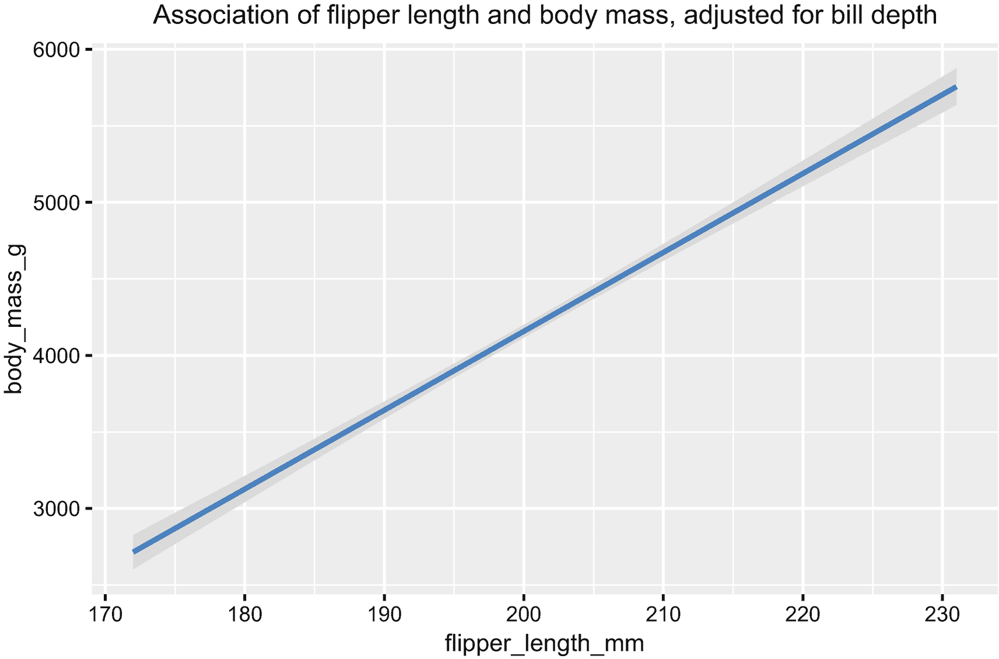

图 11-11

鳍长与喙深对企鹅体重的多元回归。此图仅展示鳍长与体重的独特关联。

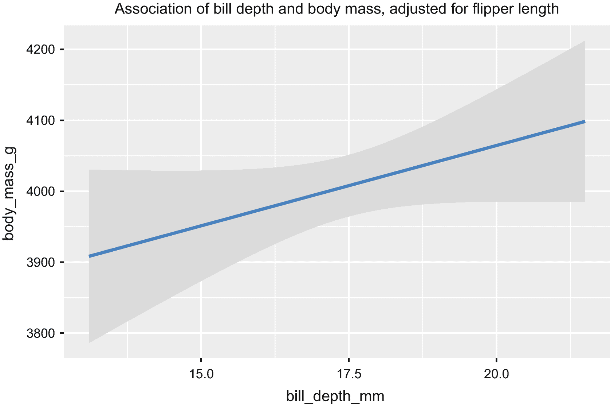

图 11-10

鳍长与喙深对企鹅体重的多元回归。此图仅展示喙深与体重的独特关联。

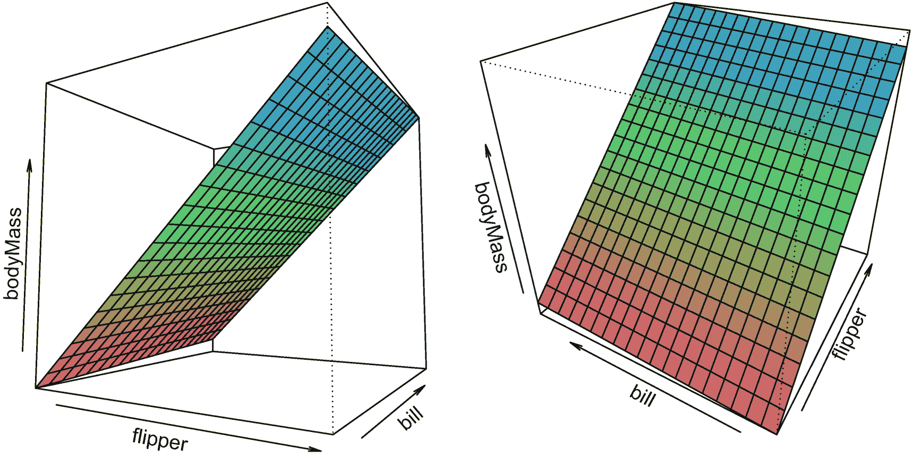

图 11-9

企鹅数据多元回归曲面的 3D 图形。

```r
##  6:            logLik                         -2526.97 Overall Model
##  7:               AIC                          5061.94 Overall Model
##  8:               BIC                          5077.28 Overall Model
##  9:                F2                             3.18 Overall Model
## 10:                R2                             0.76 Overall Model
## 11:            Adj R2                             0.76 Overall Model
## 12: flipper_length_mm              f2 = 2.25, p < .001  Effect Sizes
## 13:     bill_depth_mm              f2 = 0.01, p = .089  Effect Sizes
```

现在你已经看到了这第二个示例，注意你可以多么快速地尝试数据集中的不同变量。如果你曾设想更大的喙深能捕获更多的鱼，你可能会认为喙深对企鹅体重有某种不成比例的巨大影响。但看起来这种影响非常微弱；或许唯一的影响仅仅来自于喙本身多出的重量。


### 假设与数据清洗

多元回归与线性回归具有相同的假设条件，因此你可以参考第 8 章了解更多细节。

通常在简单线性回归和多元回归之间有所区别的诊断方法只有两点：(1) 假设所有预测变量（而非仅一个）都呈线性关联；(2) 有时检查预测变量之间是否存在高度相关性会很有帮助。第二个问题——预测变量高度相关——通常被称为**多重共线性**。虽然这个概念听起来很复杂，但其原理并不难理解。

假设你想根据校友在校期间各门课程的成绩，来预测其毕业后的工作薪资。你有一门课程的数据，该课程进行了一系列小测验和一次期末考试。你拥有课堂总成绩、小测验总成绩和期末考试成绩这三项数据。你可以将小测验成绩和期末考试成绩，或小测验成绩和总成绩，或期末考试成绩和总成绩纳入回归模型，但不能同时加入这三个变量。之所以不能三者全用，是因为课堂总成绩恰好是小测验成绩与期末考试成绩之和。尽管你拥有三个变量，且任意两个变量都不完全相同，但其中两个变量能完美预测第三个变量。这就是多重共线性的含义。表面上看似有多个变量，但实际上其中某个或多个变量并未提供独特有效的信息。

在实际操作中，即使你的某个预测变量不能被其余变量完美预测，它依然可能带来问题。例如，你可能拥有一些高度相关的变量，比如两个变量之间的相关系数 *r* > 0.90 或 *r* < -0.90。在同一回归模型中引入高度相关的变量会产生问题，原因在于——回想一下，多元回归的用途之一就是识别某个变量的**独特**贡献。然而，如果你有两个相关系数 *r* = 0.95 的预测变量，那么两者携带的独特信息都非常少。它们几乎全部的预测能力都是重叠的，而非独特的。在最极端的情况下，比如课堂总成绩恰好等于期末考试成绩与小测验成绩之和，回归模型将无法得出唯一解，因此 `R` 通常会自动为你剔除一个预测变量，否则回归无法进行估计。

总的来说，多重共线性并非一个主要问题。而且，通常只需了解你的预测变量是什么，就能判断出是否可能存在此问题。例如，如果你拥有课堂数据，即使不做任何统计计算，也能知道小测验成绩和期末考试成绩会与总成绩存在共线性。我们在实践中发现，除了运用常识判断两个预测变量是否实质上捕捉了相同信息之外，多重共线性并不常见，也很少需要特别处理。如果你确实遇到了多重共线性问题，或者对此有所担忧，最常见的解决方法就是直接剔除一个或多个预测变量。还有其他一些可选方案，但已超出入门书籍的讨论范围。

### 示例

为了举例说明假设检验的过程，我们回顾一下本章一直在使用的那个多元回归示例。我们之前简要地检查过假设条件，情况尚可。现在，我们来更仔细地审视一遍。首先，我们可以快速检查一下压力与社会支持这两个变量是否高度相关。由于压力和社会支持是不同的衡量指标，多重共线性不太可能成为问题；但如果你不确定，随时可以查看它们之间的相关性：

```
acesData[, cor(STRESS, SUPPORT, use = "pairwise.complete.obs")]
## [1] -0.03476
```

压力与社会支持之间的相关系数实际上非常接近于零，因此多重共线性完全不成问题。接下来，我们可以使用 `modelDiagnostics()` 函数来计算诊断结果，并用 `plot()` 函数来创建可视化图形：

```
### 评估模型诊断结果
m2d <- modelDiagnostics(m2, ev.perc = .005)
plot(m2d, ncol = 2, ask = FALSE)
```

如前所述，正态性假设通常通过将模型残差与正态分布进行比较来检验。独立性假设通常无法直接检验，但如果参与者之间相互独立（例如，他们不是兄弟姐妹，我们没有对同一个人进行重复测量等），我们通常假定该假设成立。

方差齐性假设通常通过绘制残差与预测值的散点图来进行评估。预期结果是，在预测值的整个范围内，残差的分布（方差）大致相等，并且残差中不应出现任何系统性的变化趋势。

虽然不属于假设条件，但我们通常希望识别出可能不当影响我们研究结果的异常值或极端值。这通常通过检查模型的残差来完成。

图 11-12 的**左图**显示了残差的密度图（实心黑色线条），并附有具有相同均值和残差方差的标准正态分布的密度图（蓝色虚线）作为参考。密度图下方的地毯图（细小的竖直线条）显示了原始数据点的分布位置。x 轴标签（对应残差）显示了最小值、第 25 百分位数、中位数、第 75 百分位数和最大值，提供了一个快速的定量摘要。

左图的下方是一个 QQ 偏差图；这与通常所说的 QQ 图有关。该图以 x 轴表示观测分位数，以 y 轴表示观测分位数与理论正态分位数之间的偏差。如果点恰好落在线上，则表明这些点完全符合正态分布下的预期位置。地毯图和 QQ 偏差图中的点：如果非极端值，则以浅灰色显示；如果满足调用 `modelDiagnostics()` 时指定的极端值标准，则以实心黑色显示。以图 11-12 为例，左下角的面板中有两个这样的极端值。

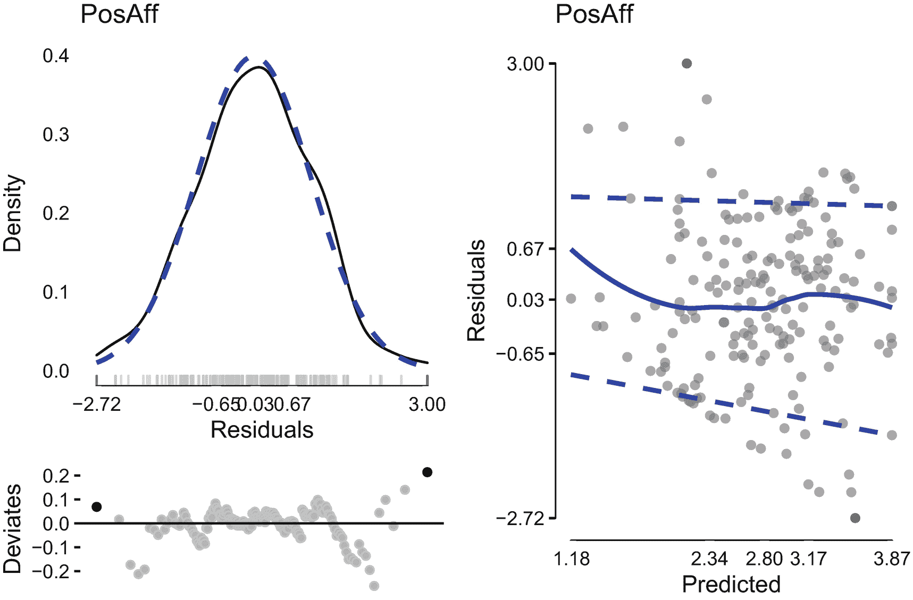

图 11-12

回归模型诊断图。左图显示了用于评估正态性的残差图，若为极端值则以黑色突出显示。右图显示了预测值与残差值的散点图，用于帮助评估方差齐性假设。


图 11-12 的**右面板**显示了模型预测值与残差的散点图。这有助于评估方差齐性假设。如果残差方差是齐性的，我们期望残差（y 轴）的散布在所有预测值水平上大致相同。有时这很容易通过视觉观察，有时则不那么容易。为了辅助视觉解释，图中添加了分位数回归线。分位数回归线允许回归模型预测第 10 和第 90 百分位数。这些预测值以蓝色虚线添加。在方差齐性的假设下，我们期望这些线大致水平且相互平行。如果它们不平行，则表明某些预测值的方差比其他预测值更大/更小，这称为异方差性。中间的实蓝线是一条`loess`平滑线，理想情况下也应是平坦的且接近零，以表明残差中没有系统偏差。系统偏差可能发生，例如，当低预测值对应的残差总是为正，而高预测值对应的残差总是为负时，这通常表明数据存在天花板/地板效应和/或需要通过修订模型来解决的问题。与密度图一样，散点图的坐标轴显示了最小值、第 25 百分位数、中位数、第 75 百分位数和最大值，提供了残差和预测值的良好定量汇总。

这些图形看起来相当不错。它们并不完美，但真实数据从来都不完美，且残差散布的变异程度并不极端。我们可能有理由认为正态性和方差齐性假设已满足，或者至少没有严重违背。

### 示例

我们来看另一个结果变量`NegAff`，即负面情感。我们再次使用`STRESS`和`SUPPORT`作为预测变量：

```
malt <- lm(NegAff ˜ STRESS + SUPPORT, data = acesData)
## assess model diagnostics
maltd <- modelDiagnostics(malt, ev.perc = .005)
plot(maltd, ncol = 2, ask = FALSE)
```

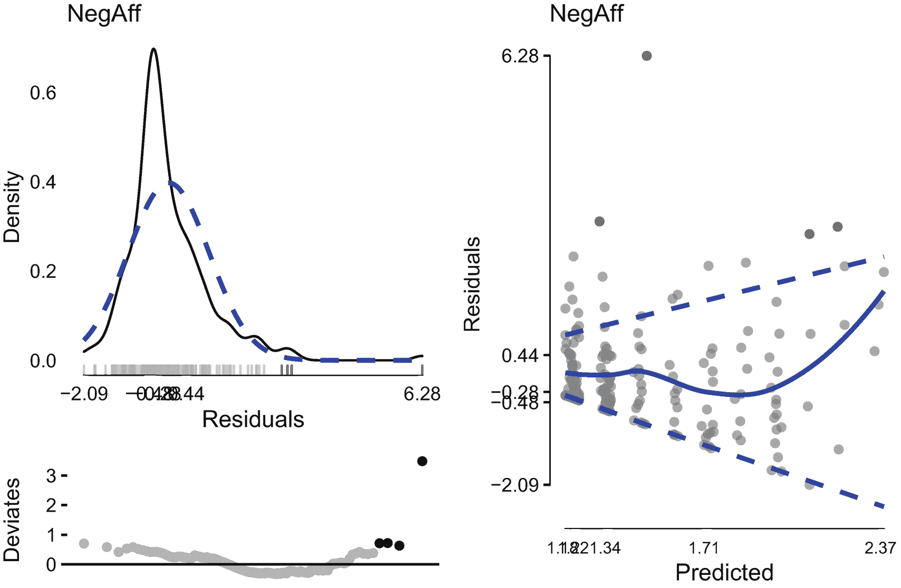

图 11-13

回归模型诊断。左面板显示用于评估正态性的残差图，若存在极端值则会以黑色高亮显示。右面板显示预测值与残差值的图，以帮助评估方差齐性假设。

图 11-13 中显示的这些图形清楚地表明了模型中的问题。残差完全不符合正态分布。根据当前标准，存在极端值。方差齐性图看起来并不那么糟糕，但残差中的极端值显而易见。至少，我们希望移除这些极端值。然而，显著的非正态性也是一个问题。虽然其数学原理超出了本书的范围，但“修复”大的正极端值的一种方法是使用对数变换。为示例起见，我们在此进行此操作。对数（及其他变换）的“魔力”在另一本书[22]中有深入讨论。

与大多数魔法一样，对数变换是有代价的，并且仅在所有结果分数大于零时才有定义。在零或以下，对数未定义。

我们拟合一个新模型`malt2`，使用`log()`获取负面情感的对数并将其作为结果变量。我们再次绘制诊断图，如图 11-14 所示：

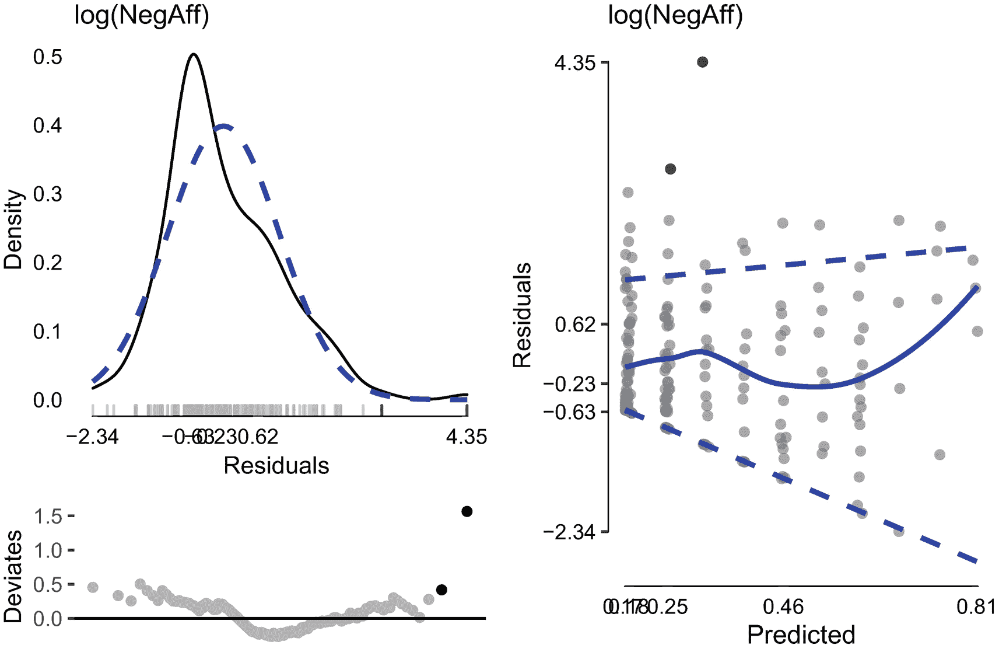

图 11-14

对结果变量进行对数变换后的回归模型诊断图

```
malt2 <- lm(log(NegAff) ˜ STRESS + SUPPORT, data = acesData)
## assess model diagnostics
malt2d <- modelDiagnostics(malt2, ev.perc = .005)
plot(malt2d, ncol = 2, ask = FALSE)
```

即使经过对数变换，极端值仍然存在。

如果我们移除那些值呢？

极端值存储在诊断对象输出`malt2d`中并可访问。它显示了结果变量的分数、索引（数据中极端值所在的行）以及它们作为极端值的效应类型，在此例中为残差上的极端值。我们使用`Index`值将它们从数据集中移除，然后重新拟合模型。我们可以在索引前使用`-`来告诉数据表，我们要**排除**这些行，而不是选择它们：

```
malt2d$extremeValues
##    log(NegAff) Index EffectType
## 1:       1.565   123  Residuals
## 2:       1.066   174  Residuals
malt3 <- lm(formula = log(NegAff) ˜ STRESS,
data = acesData[-malt2d$extremeValues$Index])
## assess model diagnostics
malt3d <- modelDiagnostics(malt3, ev.perc = .005)
plot(malt3d, ncol = 2, ask = FALSE)
```

结果显示在图 11-15 中。

在排除了初始的极端值后，出现了一个新的极端值。然而，它相对不那么极端；尽管仍有证据表明残差的方差不相等，但整体模型诊断看起来现在好多了。注意，对于低预测值，负残差如何小得多，并且随着预测值的增加，负残差变得更大。此时我们已无太多办法来改善模型假设。残差方差可能（甚至很可能）不相等（违反方差齐性）这一情况，我们将在任何报告中承认其作为一项局限性，并在解释此多元回归结果时加以考虑（即，由于假设可能至少在一定程度上被违反，结果可能会有轻微偏差）。

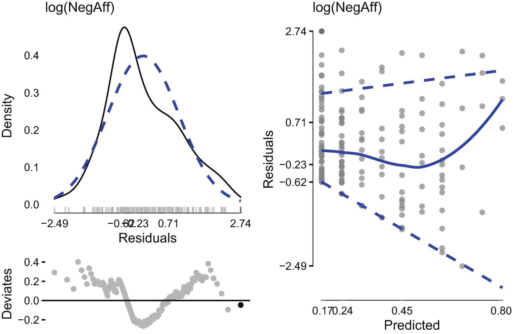

图 11-15

对结果变量进行对数变换并移除极端值后的回归模型诊断图

更高级的统计学书籍涵盖了不需要相同假设的替代分析方法，但这些方法要复杂得多。实际上，对数变换和移除极端值需要巧妙的手法。我们向您展示这个更复杂的示例，主要目的是表明假设检验是必要的。一个有用的次要目的是鼓励您在读完本书后继续学习；通常有一些方法可以对数据进行变换，以提取出一些有用的信息。这往往需要更多的时间和练习。


## 11.4 分类预测变量

除了连续变量外，分类变量也可以作为回归中的预测变量/解释变量。纳入分类预测变量最常用的方法是使用虚拟变量编码。虚拟变量编码的基本思想是将一个具有 *k* 个水平的分类预测变量转化为 *k* 个独立的虚拟编码变量，其中每个虚拟编码变量在变量的某个特定水平上编码为 1，在其他水平上编码为 0。最简单的情况是二分类变量，即只有两个水平的分类变量（例如，年轻成年人、年长成年人），此时你可以创建一个新的虚拟编码变量，其中 1 = 年长成年人，0 = 年轻成年人。这个虚拟编码变量现在是一个数值型预测变量（包含 0 和 1），可以像往常一样纳入回归分析。“虚拟编码”这个名称源于你创建一组替代（即虚拟）变量的想法。它有时也被称为独热编码，因为它创建的新变量每次只有一个旧变量的水平是“活跃的”或“热的”（hot 指带电的导线），编码为 `1`。

解释虚拟编码变量与解释常规连续预测变量之间唯一的实际区别在于：(1) 零点并非随意设定，而是代表某一个特定组（例如，年轻成年人）；(2) 虚拟编码变量的一个单位变化也不是随意的，而是代表组与组之间的差异（因为从 0 到 1 **就是**一个单位的变化）。

为了具体说明，我们可以查看 `mtcars` 数据集的前几行。其中有一个变量 `cyl`，表示汽车的汽缸数：4、6 或 8。下表展示了 `cyl` 的前几行以及虚拟编码变量的样子：

```
##                 cyl dummy_cyl4 dummy_cyl6 dummy_cyl8
## Mazda RX4         6          0          1          0
## Mazda RX4 Wag     6          0          1          0
## Datsun 710        4          1          0          0
## Hornet 4 Drive    6          0          1          0
## Hornet Sportabout 8          0          0          1
## Valiant           6          0          1          0
```

在该示例中，注意观察例如 `dummy_cyl4` 在 *cyl* = 4 时编码为 1，否则编码为 0。

虽然我们总可以为分类变量的每个唯一水平创建一个虚拟编码变量，但在回归模型中，我们只纳入 *k* − 1 个虚拟编码变量。其原因在于，否则这些虚拟编码变量之间存在多重共线性。例如，延续 `cyl` 的例子，我们知道该数据集中的每辆车都有四个、六个或八个汽缸。如果我们在模型中纳入 `dummy_cyl4` 和 `dummy_cyl6`，那么如果一辆车的 `cyl4` 为 1，我们就知道它有四个汽缸。如果它的 `cyl6` 为 1，我们就知道它有六个汽缸。如果它在 `cyl4` 和 `cyl6` 上都为 0，那么剩下的唯一可能就是它是一辆八缸汽车。

一般规则是，如果你有一个 *k* 水平的分类预测变量，你可以创建 *k* 个虚拟编码，并在回归模型中纳入 *k* – 1 个虚拟编码。在汽缸的例子中，有三个水平；我们可以创建三个虚拟编码，但在任何回归模型中我们只会纳入两个虚拟编码。

我们的书 *Advanced R Statistical Programming and Data Models: Analysis, Machine Learning, and Visualization* [22] 更详细地介绍了虚拟编码。

然而，不需要另一本书，因为使用虚拟编码将分类预测变量纳入回归的功能已内置于 `R` 中。`R` 会自动对你作为预测变量输入回归的任何因子变量进行虚拟编码，因此你无需手动操作。如果变量不是因子，你可能需要先使用 `factor()` 函数将其转换为因子。

请看一个包含分类预测变量的简单线性回归。我们拟合模型并将结果存储在 `mcat1` 中。我们也可以像之前的回归模型一样将结果绘制成图表。在这个例子中，我们将使用积极情感作为结果变量，但使用教育水平作为预测变量。`EDU` 是一个二分类变量，0/1，表示人们是否完成了学士学位（1）或未完成（0）。首先，我们将其设为因子变量，然后像往常一样将其添加到线性回归中：

```
acesData[, EDU := factor(EDU)]
mcat1 <- lm(formula = PosAff ~ EDU,
data = acesData)
APAStyler(modelTest(mcat1))
##                 Term                   Est          Type
##  1:      (Intercept) 2.82*** [ 2.62, 3.02] Fixed Effects
##  2:             EDU1   -0.13 [-0.47, 0.20] Fixed Effects
##  3: N (Observations)                   187 Overall Model
##  4:        logLik DF                     3 Overall Model
##  5:           logLik               -284.24 Overall Model
##  6:              AIC                574.47 Overall Model
##  7:              BIC                584.16 Overall Model
##  8:               F2                  0.00 Overall Model
##  9:               R2                  0.00 Overall Model
## 10:           Adj R2                  0.00 Overall Model
## 11:              EDU   f2 = 0.00, p = .436  Effect Sizes
visreg(mcat1, xvar = "EDU", partial = FALSE, rug = FALSE, gg = TRUE) +
ggtitle("EDU as a categorical predictor")
```

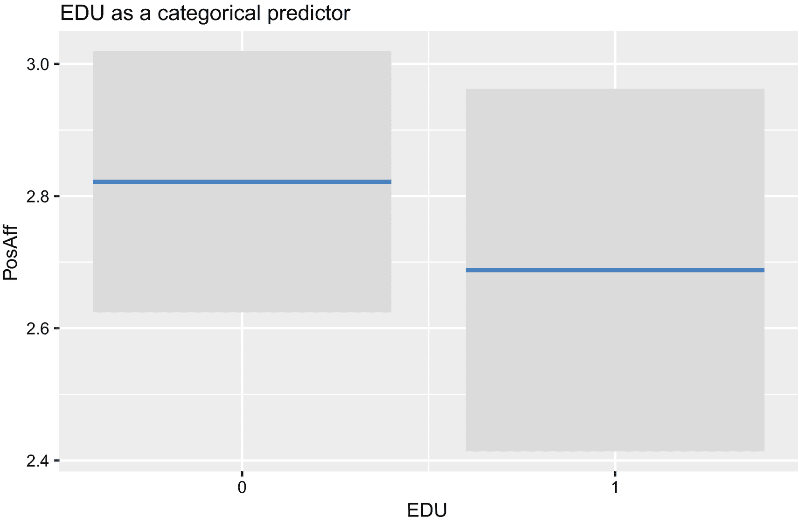

**图 11-16**

来自 `visreg` 的简单线性回归图，包含一个分类预测变量（教育），展示了每个教育水平的预测积极情感和 95% 置信区间

图 11-16 用蓝色实线展示了每个教育水平的预测积极情感，灰色阴影区域是预测均值周围的 95% 置信区间。在这个简单例子中，由于没有其他预测变量，截距（即预测变量为 0 时积极情感的期望值）是低教育水平人群（*EDU* = 0）的积极情感均值，而 `EDU` 的回归系数是低教育水平人群与高教育水平人群之间平均积极情感的**差异**，我们可以看到这个差异在统计上并不显著。

起初将 `EDU1` 的回归系数称为均值差异可能看起来很奇怪。毕竟，我们一直把回归系数说成是直线的斜率。实际上两者都成立。`EDU1` 的回归系数就是一条直线的斜率。因为 0 表示低教育水平，1 表示高教育水平，一个单位的变化（即该直线的斜率）恰好就是低教育水平与高教育水平人群之间的预测差异。事实上，虚拟编码成为一种流行技术的全部原因就在于，它允许我们利用回归的工作原理（计算斜率）来获取关于分类预测变量的有意义信息。

顺便提一下，这个使用虚拟编码的线性回归结果，将与我们通过双样本 t 检验得到的结果完全一致（将低教育水平组的均值与截距和均值差异进行比较，以及 `EDU1` 的 p 值）：

```
t.test(PosAff ~ EDU,
data = acesData,
var.equal = TRUE)
##
##      Two Sample t-test
##
## data:  PosAff by EDU
## t = 0.78, df = 185, p-value = 0.4
## alternative hypothesis: true difference in means is not equal to 0
## 95 percent confidence interval:
##  -0.2044  0.4721
## sample estimates:
## mean in group 0 mean in group 1
##           2.822           2.688
```

然而，我们要学习如何在回归中进行此操作的原因是，与 t 检验不同，回归可以包含多个预测变量以及分类和连续预测变量的混合，从而能够拟合比 t 检验复杂和灵活得多的模型。


### 示例

接下来，考虑使用一个具有三个水平而非两个水平的分类预测变量。在本章开头，我们有一段代码创建了一个分类的压力变量，该变量编码为压力 0、1 或 2+，并存储为因子变量，名为`StressCat`。

我们将使用该分类变量来预测积极情感。注意，由于`StressCat`具有三个水平，即使我们只添加一个预测变量，一旦将其进行虚拟编码，模型中就会加入两个虚拟编码后的预测变量。我们还将使用`modelDiagnostics()`运行一些模型诊断，这与使用连续预测变量时的做法相同。结果如图 11-17 所示。残差与预测值图看起来可能与我们之前见过的有些不同，因为对于分类预测变量，我们实际上并不会生成连续的预测值；只有三个可能的预测值，尽管观测到的结果数据是连续的，因此残差仍然是连续的：

```
mcat2 <- lm(formula = PosAff ~ StressCat,
data = acesData)
plot(modelDiagnostics(mcat2), ncol = 2)
```

尽管预测值是离散的（这并不违反任何回归假设——只有结果变量需要是连续的），但诊断结果看起来相当不错。接下来，我们可以再次使用`modelTest()`函数获取模型结果和效应量：

```
APAStyler(modelTest(mcat2))
##                 Term                     Est          Type
##  1:      (Intercept)  3.14*** [ 2.88,  3.39] Fixed Effects
##  2:       StressCat1    -0.32 [-0.74,  0.11] Fixed Effects
##  3:      StressCat2+ -0.69*** [-1.03, -0.34] Fixed Effects
##  4: N (Observations)                     187 Overall Model
##  5:        logLik DF                       4 Overall Model
## ---
##  8:              BIC                  575.22 Overall Model
##  9:               F2                    0.08 Overall Model
## 10:               R2                    0.08 Overall Model
## 11:           Adj R2                    0.07 Overall Model
## 12:        StressCat     f2 = 0.08, p < .001  Effect Sizes
```

在结果中，我们可以看到包含了`StressCat`的两个虚拟编码。被省略的虚拟编码变量是`StressCat0`，这意味着当其他两个虚拟编码为零时，模型的截距就是无压力者预测的积极情感值。因此，我们现在可以将截距解释为当所有预测变量为零时预测的积极情感得分，在这种情况下即指`StressCat` = 0。

第一个预测变量是`StressCat1`，它捕捉了无压力人群与压力评分为 1 的人群之间的差异。负号表明压力评分为 1 的人积极情感低于压力为 0 的人，但我们可以看到它并未达到统计显著性，并且 95%置信区间包含零。

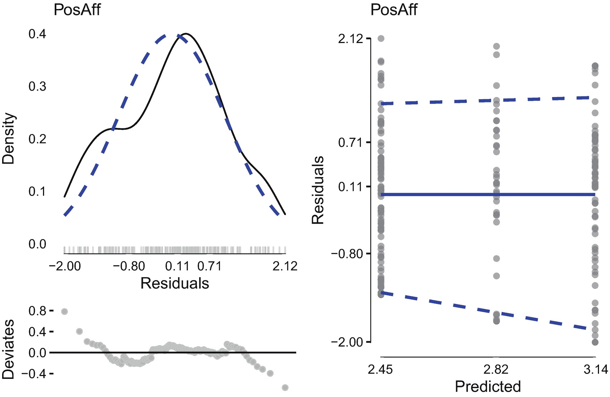

图 11-17

仅包含分类预测变量时的回归诊断图

第二个预测变量是`StressCat2+`，它捕捉了无压力人群与压力评分为 2+的人群之间的差异。负号表明压力评分为 2+的人积极情感低于压力为 0 的人，我们可以看到它具有统计显著性，`p` < .001，并且 95%置信区间不包含零。

通过`modelTest()`，我们还得到了效应量估计。注意，这只是一个效应量和一个 p 值。最后显示的效应量和 p 值实际上针对的是整个`StressCat`变量。也就是说，它测试的是该变量整体（两个虚拟编码共同）是否与积极情感相关。这是一种了解分类预测变量整体是否具有统计显著性及其总体效应量大小的有用方法。

你可能会好奇的一点是，尽管两个虚拟编码都告诉我们压力为 1 或 2+的人群在积极情感上是否与压力为 0 的人群不同，但我们并没有检验压力为 1 的人群与压力为 2+的人群是否存在差异。也就是说，我们并没有获得分类预测变量各水平之间所有可能的成对比较。当只有两个水平时，这不成问题，但当分类预测变量有三个或更多水平时，你可能会有许多成对比较。通常有两种选择。首先，你可以更改被省略的虚拟编码变量，这将使其成为新的“比较”组，从而让你获得其他成对比较。然而，这需要重新拟合模型，如果你有一个五水平的分类预测变量，你可能需要这么做很多次。另一种方法是使用`emmeans`包[13]，它提供了对回归模型运行附加测试的有用函数。我们将探讨这个选项。我们需要使用两个函数。首先，我们使用`emmeans()`函数，将回归模型作为第一个参数，将我们要计算均值的变量作为`specs`参数。我们保存这些结果并打印它们。显示的是每组中估计的积极情感均值以及 95%置信区间：

```
mcat2.means <- emmeans(object = mcat2, specs = "StressCat")
mcat2.means
## StressCat emmean    SE  df lower.CL upper.CL
## 0           3.14 0.130 184     2.88     3.39
## 1           2.82 0.174 184     2.48     3.16
## 2+          2.45 0.119 184     2.22     2.69
##
## Confidence level used: 0.95
```

现在我们有了一个包含每个压力类别水平积极情感均值的对象，我们可以使用`pairs()`函数获取所有可能的成对比较。默认情况下，`pairs()`还会使用 Tukey 方法对多重比较进行 p 值调整。在输出中，我们可以看到每组之间的均值差异，标记为“estimate”和“p.value”，后者指示这两组之间是否显著不同。从结果中，我们可以看到压力为 2+的人群与压力为 0 的人群显著不同（基于中间那一行的 p 值列），但其他比较未达到统计显著性：

```
pairs(mcat2.means)
## contrast estimate    SE  df t.ratio p.value
## 0 - 1       0.316 0.217 184 1.451   0.3172
## 0 - (2+)    0.685 0.177 184 3.880   0.0004
## 1 - (2+)    0.370 0.211 184 1.751   0.1893
##
## P value adjustment: tukey method for comparing a family of 3 estimates
```


好的，作为一名高级文档工程师和翻译员，我将根据您提供的注意事项和示例，将给定的英文文本翻译成中文。


### 示例

在最后一个示例中，我们再次审视`StressCat`，但这次是在一个多元回归中，其中我们还有一个连续预测变量，即社会支持`SUPPORT`。我们首先以一种现在希望是熟悉的方式来拟合模型，然后绘制一些模型诊断图，如图 11-18 所示：

```
mcat3 <- lm(formula = PosAff ˜ StressCat + SUPPORT,
data = acesData)
plot(modelDiagnostics(mcat3), ncol = 2)
```

诊断结果看起来相当不错，因此我们可以继续进行。首先，我们将结果图形化，以帮助理解和解释它们。我们像之前一样使用`visreg()`函数。我们将存储在`mcat3`中的多元回归模型结果传递给它。x 轴变量是`SUPPORT`。通常最好将连续预测变量放在 x 轴上。我们还做了一些新的事情。我们将`StressCat`添加到`by`参数中。这将为`StressCat`的每个级别创建一条单独的回归线。`overlay=TRUE`参数意味着我们希望所有三条线都放在一个图中，而不是单独的面板中：

```
visreg(mcat3, xvar = "SUPPORT", by = "StressCat",
partial = FALSE, rug = FALSE, overlay = TRUE,
gg = TRUE) +
ggtitle("SUPPORT and StressCat as predictors")
```

结果在图 11-19 中。我们可以看到有三条线，分别对应压力类别的每个级别。然而，尽管我们有三条线，但它们的斜率都是平行的。这是因为社会支持与积极情感之间的关联被认为是相同的。唯一改变的是，对于不同的压力类别，线的水平高度可以不同。我们也可以通过比较三条线的高度来观察压力的关联。例如，很明显，有 2+个压力源的人通常积极情感最低，尽管社会支持的斜率足够大，例如，社会支持为 10 且有 2+个压力源的人，其预测的积极情感仍然高于压力为 0 但支持为 0 的人。

回归模型的系数捕获了图 11-19 的几个不同部分。截距将是所有预测变量为零（即 0 压力和 0 支持）时的预期积极情感。压力类别的回归系数捕获了线的高度相对于截距的差异。社会支持的斜率捕获了图中线的斜率。现在我们将使用`modelTest()`来获取数值模型结果：

```
APAStyler(modelTest(mcat3))
##                 Term                    Est           Type
##  1:      (Intercept)  2.12*** [ 1.74,  2.50] Fixed Effects
##  2:       StressCat1    -0.22 [-0.61,  0.17] Fixed Effects
```

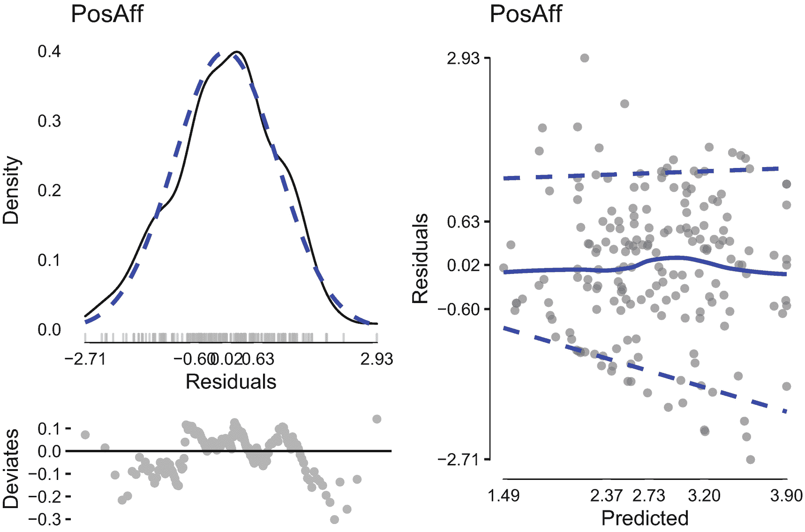

图 11-18

包含一个分类预测变量和一个连续预测变量时的回归诊断图

```
##  3:      StressCat2+ -0.63*** [-0.94, -0.32] Fixed Effects
##  4:          SUPPORT  0.18*** [ 0.13,  0.23] Fixed Effects
##  5: N (Observations)                     187 Overall Model
## ---
## 10:               F2                    0.35 Overall Model
## 11:               R2                    0.26 Overall Model
## 12:           Adj R2                    0.25 Overall Model
## 13:        StressCat     f2 = 0.09, p < .001  Effect Sizes
## 14:          SUPPORT     f2 = 0.25, p < .001  Effect Sizes
```

在这些结果中，我们可以再次看到，在控制了社会支持后，压力类别 2+的积极情感显著低于压力类别 0。压力类别 1 仍然与 0 没有差异（同样，你可以在“Est”列中看到，其置信区间包含 0）。在控制了压力类别后，社会支持与积极情感呈显著的正相关。我们还可以比较效应量，并看到社会支持作为一个变量具有中等效应量`f²`，而压力类别总体上具有较小的效应量。

最后，如果我们想要压力类别之间的所有成对比较，我们可以重用之前的代码。`emmeans()`函数计算了在保持其他变量（本例中为社会支持）为样本平均值时的调整后均值：

```
mcat3.means <- emmeans(object = mcat3,
specs = "StressCat")
mcat3.means
##  StressCat emmean    SE  df lower.CL upper.CL
##  0           3.09 0.117 183     2.86     3.33
##  1           2.87 0.157 183     2.57     3.18
##  2+          2.46 0.107 183     2.25     2.67
```

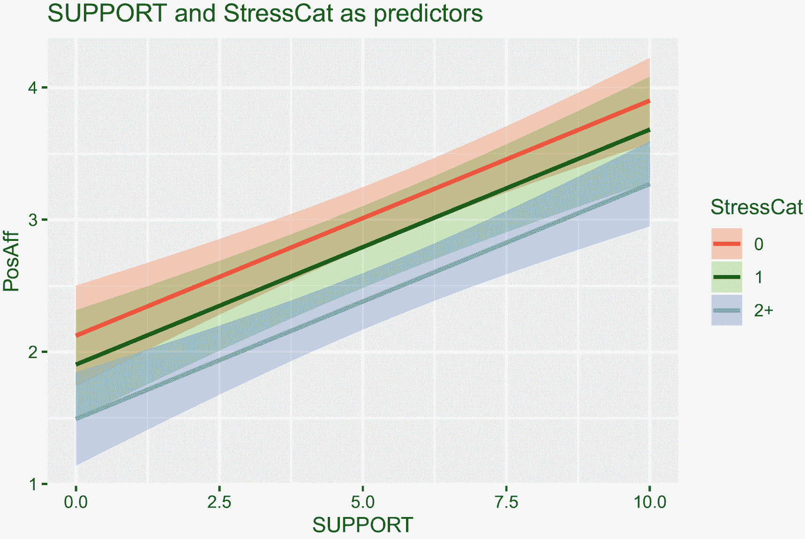

图 11-19

来自`visreg`的简单线性回归图，包含连续预测变量`SUPPORT`，显示了每个`StressCat`级别的预测积极情感和 95%置信区间

```
##
## Confidence level used: 0.95
pairs(mcat3.means)
##  contrast estimate    SE  df t.ratio p.value
##  0 – 1       0.219 0.196 183 1.117   0.5045
##  0 - (2+)    0.630 0.159 183 3.963   0.0003
##  1 - (2+)    0.411 0.190 183 2.164   0.0802
##
## P value adjustment: tukey method for comparing a family of 3 estimates
```

从这些比较中，我们可以看到，比较有 1 个压力源与有 2+个压力源的人现在几乎达到了统计学显著性，`p` = .08，而在我们没有控制社会支持时，这个结果并不接近。因此，在这种情况下，控制社会支持似乎确实使压力的结果略微强一些，尽管仍然没有达到统计学显著性。

## 11.5 总结

本章探讨了多元回归，它允许我们对单个结果变量有多个预测变量。此外，我们学习了如何使用虚拟变量或独热编码将分类预测变量添加到回归模型中，从而允许我们检查连续或分类变量的任意组合作为结果的预测变量。表 11-1 应该是你本章所学关键概念的良好参考。

表 11-1

章节总结

| 概念 | 含义 |
| --- | --- |
| `factor()` | 将字符型（分类）列转换为包含数值型（虚拟）因子的列。 |
| `fifelse()` | 快速 if/else；如果（条件为真）则执行 A，否则执行 B。 |
| Call | 重复线性模型公式。 |
| Residuals | 是实际值与预测值之间的差异；如果正态，中位数 == 0。 |
| Coefficients | 给出每个预测变量的 b 值和 p 值。 |
| Residual | 用于进一步计算和缺失值的标准误差统计数据。 |
| R-squared | y 值中由 x 值解释的方差比例。 |
| F-statistic | 包括模型整体是否显著的 p 值。 |
| `confint()` | 用于模型；给出`bs`的置信区间。 |
| `qt()` | 学生 t 分布的分位数函数；与`qnorm()`比较。 |
| `visreg()` | 帮助可视化回归模型。 |
| `annotate()` | `ggplot2`函数，用于添加文本（包括用于`visreg()`）。 |
| `xlab()` | `ggplot2`函数，用于添加 x 轴标签。 |
| `ylab()` | `ggplot2`函数，用于添加 y 轴标签。 |
| `ggtitle()` | `ggplot2`函数，用于添加标题文本。 |
| `ev.perc =` | `modelDiagnostics()`的新参数，用于极端值。 |
| Cohen's `f`^`2`^ | 近似效应量；¿= .02 为小，¿= .15 为中等，¿= .35 为大。 |
| `APAStyler` | “整洁地”打印`modelTest()`对象；提供`f`^`2`^。 |
| Multicollinearity | 高度相关的预测变量；通常不是问题。 |
| `log()` | 对数函数；用于正值、非正态值以“使其”正态。 |
| Categorical | 预测变量通过独热或虚拟编码包含在多元回归模型中。 |
| `emmeans()` | 显示给定分类预测变量的均值输出。 |
| `pairs()` | 显示一对分类预测变量的均值输出之间的差异。 |


## 11.6 掌握练习

通过完成一些练习来检查你的进度并在实践中成长。理解性检验会提出批判性思考问题，最好以书面或口头回答。统计学的艺术之一在于成功地向利益相关者或受众传达结果。有时受众是高度技术性的，而其他时候则非常不技术。练习则是对本章所探讨概念的更直接应用。

### 理解性检验

1.  想想企鹅的情况，我们知道比斯科岛似乎没有改变阿德利企鹅的某些特征。因此，我们可能会忽略岛屿因素。此外，我们知道喙深度在预测体重方面似乎并不十分有效。除了鳍状肢长度，还有哪些变量能让我们对体重有更深入的了解？

2.  如果任何额外的企鹅变量是分类变量，我们是否需要先将它们转换为因子？`str()` 函数告诉我们关于 `penguinsData` 的什么信息？

### 练习

1.  假设你认为生物性别可能是一个预测企鹅体重的良好附加变量。查看 `m2Penguin` 的汇总数据，我们想用哪个变量来替换 `sex`？残差的中位数是多少，理想情况下残差的中位数应该是多少？校正 R 平方是多少，我们如何利用它来判断 `sex` 是否比我们替换掉的变量是更好的预测变量？

```
summary(m2Penguin)
##
## Call:
## lm(formula = body_mass_g ˜ flipper_length_mm + bill_depth_mm,
##     data = penguinsData)
##
## Residuals:
##     Min      1Q  Median      3Q     Max
## -1029.8  -271.5   -23.6   245.2  1276.0
##
## Coefficients:
##                   Estimate Std. Error t value Pr(>|t|)
## (Intercept)       -6541.91     540.75   -12.1   <2e-16 ***
## flipper_length_mm    51.54       1.87    27.6   <2e-16 ***
## bill_depth_mm        22.63      13.28     1.7    0.089 .
## ---
## Signif. codes:  0 '***' 0.001 '**' 0.01 '*' 0.05 '.' 0.1 ' ' 1
##
## Residual standard error: 393 on 339 degrees of freedom
##   (2 observations deleted due to missingness)
## Multiple R-squared:  0.761,  Adjusted R-squared:  0.76
## F-statistic:  540 on 2 and 339 DF,  p-value: <2e-16
```

2.  使用 `lm(formula = , data = penguinsData)` 函数，在 `formula =` 后面填空，创建一个以体重为结果、由鳍状肢长度和性别预测的多元回归模型。将该模型赋值给一个巧妙命名为 `m3Penguin` 的变量。`summary()` 函数告诉了你关于模型的什么信息？

3.  如果你之前的代码块正确完成，以下代码块应生成一个诊断图：

```
m3Penguind <- modelDiagnostics(m3Penguin, ev.perc = 0.005)
plot(m3Penguind, ncol = 2, ask = FALSE)
```

该图是否表明你的模型运行良好？

4.  如果你之前的代码块编码正确，分类变量 `sex` 的回归模型均值应生成一个类似于图 11-16 的图形。在该示例中，教育水平的均值正影响的置信区间是有重叠的。企鹅生物性别的均值体重是否有重叠？

5.  再次，如果一切顺利，你应该能够看到鳍状肢长度和性别的 *f*² 效应量。使用本章中关于科恩 *f*² 的图表，鳍状肢长度的效应量是多少？性别的效应量是多少？

```
m3PenguinTest <- modelTest(m3Penguin)
print(APAStyler(m3PenguinTest), nrow = 100)
```

```
visreg(m3Penguin, xvar = "sex", partial = FALSE, rug = FALSE, gg = TRUE) +
ggtitle("Association of sex and body mass, adjusted for flipper length")
```

