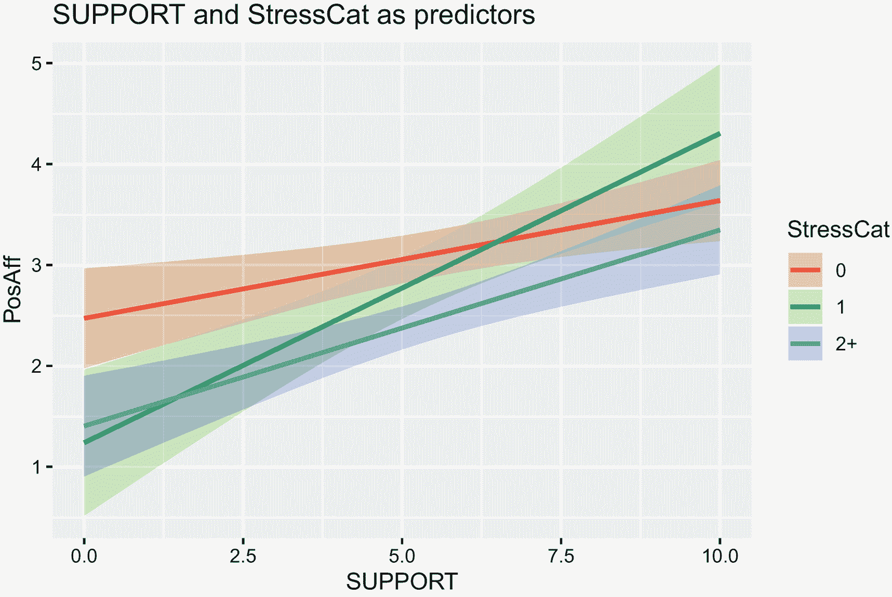
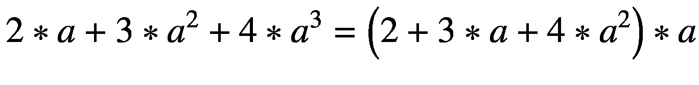

# 12. 调节回归

多元回归允许使用多个变量来预测感兴趣的结果。这通常倾向于产生更准确的模型。然而，多元回归本身不允许两个预测变量相互交互。想想企鹅的情况，也许体重不仅取决于鳍状肢长度或喙深度，而是两者之间存在某种独特的协同作用，共同造就了一只体态圆润的企鹅。本章探讨两个（或更多）预测变量可能相互交互的方式。通常，这些方法可以创建更完整的模型。

在本章结束时，你应该能够：

- 理解多元回归和调节回归之间的区别。
- 创建调节回归模型和可视化图表。
- 分析来自调节回归模型的各种数据的含义。
- 创建人性化的图表和沟通内容，以传达调节回归模型的结果。

## 12.1 R 环境设置

像往常一样，为了继续练习创建和使用项目，我们为本章节开始一个新项目。

如有必要，请复习第 1 章中创建新项目的步骤。启动 RStudio 后，在左上角的菜单栏中，选择 `File` 并点击 `New Project`。选择 `New Directory` ➤ `New Project`，将 `Directory name` 设置为 `ThisChapterTitle`，然后选择 `Create Project`。要创建一个 R 脚本文件，在顶部功能区中，`File` 正下方，点击带有加号的小图标（空白纸张上的加号），然后选择 `R Script` 菜单选项。点击软盘形状的保存图标，将此文件命名为 `PracticingToLearn_XX.R`（其中 XX 是本章的章节号），然后点击 `Save`。

在右下方面板中，你应该能看到你的项目的两个文件，直接在 `Files` 选项卡下方，点击名为 `New Folder` 的按钮。在 `New Folder` 弹出窗口中，输入 `data` 并选择 `OK`。在右下方面板中，点击你新建的 `data` 文件夹。重复文件夹创建过程，创建一个名为 `ch12` 的新文件夹。

请记住，本章使用的所有包都已在第 2 章中安装到你的本地计算机上了。无需重新安装。但是，这是一个新项目，我们首次运行这组代码。因此，你需要运行以下 `library()` 调用：

```r
library(data.table)
## data.table 1.13.0 using 6 threads (see ?getDTthreads). Latest news: r-datatable.com
library(ggplot2)
library(visreg)
library(emmeans)
library(palmerpenguins)
library(JWileymisc)
```

我们以与第 11 章相同的方式设置我们的数据集。

```r
data(aces_daily)
acesData = aces_daily[, .(mean = mean(impact, na.rm = TRUE),
sd = sd(impact, na.rm = TRUE)),
by = .(STRESS)]
acesData[, stress_z := scale(mean)]
acesData[, stress_high := factor(ifelse(
stress_z > 1, "2+",
as.character(STRESS)))]
penguinsData <- as.data.table(penguins)
```

现在，你可以自由地学习更多关于统计学的知识了！

## 12.2 调节效应理论

到目前为止，在回归分析中，我们主要关注每个预测变量如何与结果变量相关联，无论是单独作用还是在更大模型的背景下。这种方法使我们能够检验两个变量是否相互关联，以及这种关联是否独特或独立于其他变量。然而，迄今为止，我们始终假设这种关联对所有个体都是相同的。如果两个变量之间的关联并非对所有人都相同，那该如何处理呢？

例如，当你饥饿时，进食可能会让你感觉更好；但如果你已经饱了，再吃东西反而会让你感觉更糟。这在统计学中被称为**调节效应**。进食与感觉更好之间的关联，受到进食前饱腹程度的调节。对于未饱腹的人，进食与感觉更好相关；而对于已饱腹的人，进食则与感觉更差相关。

再举一个例子，抗抑郁药物已被证明平均能有效减轻抑郁症状，但这可能并非对所有人都成立。例如，抗抑郁药可能对抑郁患者有帮助，但对非抑郁患者则可能毫无益处。从形式上讲，我们可以说抗抑郁药对情绪的有益效应受到是否存在抑郁状态的调节。

我们还可以举出更多例子。回想一下自己的生活或工作，很容易发现某些事物会让一个人感到享受或受益，但对另一个人却不然。因此，尽管我们目前学到的多元回归已经足够强大，但我们仍然需要一种方法使其更加灵活。我们需要能够解释这样一个事实：某些群体中变量之间的关联可能与其他群体不同。调节效应就是这一概念的正式术语，在回归分析中，我们可以通过两个或多个变量之间的交互作用来检验调节效应。

交互项是两个（或多个）变量的算术乘积。换句话说，我们将两个或多个变量相乘。

为了理解调节效应，我们从熟悉的包含两个预测变量 `x` 和 `w` 的多元回归方程开始，该方程预测结果变量 `y`：

```
y = b0 + b1 * x + b2 * w + ε
```

我们可以通过增加一个预测变量（即两个变量的算术乘积）来检验 `x` 和 `w` 这两个预测变量之间是否存在调节效应。该方程如下所示：

```
y = b0 + b1 * x + b2 * w + b3 * (x * w) + ε
```

这里存在第三个回归系数 `b3`，对应两个变量乘积项 `x * w`，而 `b3` 被称为交互项。

*注意：交互作用或调节效应可能涉及两个以上的变量。不过，本书将重点介绍和解释两个变量之间的交互作用。*

任意两个变量之间都可能存在交互作用，无论它们都是连续变量、都是分类变量，还是一个连续变量和一个分类变量。要在回归中包含分类变量的交互作用，我们采用相同的思路来创建变量的算术乘积，但这是基于虚拟编码后的变量，而非原始的类别变量。这种做法是可行的，因为虚拟编码后的变量是数值型的，因此可以对它们进行乘法之类的操作。

以上是对调节效应和交互作用背后的一些理念和概念的简要概述。艾肯和韦斯特（1991）[5] 有一本经典短著，专门深入探讨回归中的调节效应和交互作用，如果你想更深入地理解，这是一本极佳的补充读物。

现在，我们将重点转向如何在 `R` 中运行和解释一些应用性的调节效应案例。

### 在 `R` 中进行调节作用分析

在 `R` 中包含交互项非常简单。在回归公式内部，我们使用 `*` 运算符。这个单一的 `R` 运算符（并非单纯的乘法）会展开，同时给出这些变量之间的主效应和交互效应。

要观察这种展开的实际效果，请回顾第 11 章关于多元回归的内容。关于鳍状肢长度和喙深度的（不太理想的）*多元*回归是通过以下代码实现的：

```r
mPmul <- lm(formula = body_mass_g ~ flipper_length_mm + bill_depth_mm,
data = penguinsData)
```

特别注意，在前面的代码中，鳍状肢长度和喙深度之间有一个明显的 `+`。

如果你查看 `summary()` 的结果，你会看到截距、`b0`、鳍状肢长度的 `b1` 和喙深度的 `b2` 的数值：

```r
summary(mPmul)
##
## Call:
## lm(formula = body_mass_g ~ flipper_length_mm + bill_depth_mm,
##     data = penguinsData)
##
## Residuals:
##     Min      1Q  Median      3Q    Max
## -1029.8  -271.5   -23.6   245.2 1276.0
##
## Coefficients:
##                   Estimate Std. Error t value Pr(>|t|)
## (Intercept)       -6541.91     540.75   -12.1   <2e-16 ***
## flipper_length_mm    51.54       1.87    27.6   <2e-16 ***
## bill_depth_mm        22.63      13.28     1.7    0.089 .
## ---
## Signif. codes:  0 '***' 0.001 '**' 0.01 '*' 0.05 '.' 0.1 ' ' 1
##
## Residual standard error: 393 on 339 degrees of freedom
##   (2 observations deleted due to missingness)
## Multiple R-squared:  0.761,  Adjusted R-squared:   0.76
## F-statistic:  540 on 2 and 339 DF,  p-value: <2e-16
```

换句话说，多元回归的一般公式

$$ y = b_0 + b_1 \ast x + b_2 \ast w + \varepsilon $$

变成了具体公式

$$ body\_ mass\_g = -6541.91 + 51.54 \ast flipper\_ length\_ mm + 22.63 \ast bill\_ depth\_ mm + \varepsilon $$

对于*调节*回归，对 `lm()` 的函数调用几乎相同，只是将 `+` 替换为 `*`：

```r
mPmod <- lm(formula = body_mass_g ~ flipper_length_mm * bill_depth_mm,
data = penguinsData)
```

然而，`summary()` 函数返回了更多的变量！

```r
summary(mPmod)
##
## Call:
## lm(formula = body_mass_g ~ flipper_length_mm * bill_depth_mm,
##     data = penguinsData)
##
## Residuals:
##    Min     1Q Median      3Q     Max
## -938.9 -254.0  -28.2   220.7  1048.3
##
## Coefficients:
##                                    Estimate Std. Error t value Pr(>|t|)
## (Intercept)                       -36097.06    4636.27   -7.79   8.6e-14
## flipper_length_mm                  196.07        22.60    8.67   < 2e-16
## bill_depth_mm                      1771.80      273.00    6.49   3.1e-10
## flipper_length_mm:bill_depth_mm      -8.60        1.34   -6.41   4.8e-10
##
## (Intercept)                       ***
## flipper_length_mm                 ***
## bill_depth_mm                     ***
## flipper_length_mm:bill_depth_mm   ***
## ---
## Signif. codes:  0 '***' 0.001 '**' 0.01 '*' 0.05 '.' 0.1 ' ' 1
##
## Residual standard error: 372 on 338 degrees of freedom
##   (2 observations deleted due to missingness)
## Multiple R-squared:  0.787,  Adjusted R-squared:  0.785
## F-statistic:  416 on 3 and 338 DF,  p-value: <2e-16
```

换句话说，调节回归的一般公式

$$ y = b_0 + b_1 \ast x + b_2 \ast w + b_3 \ast \left( x \ast w \right) + \varepsilon $$

变成了具体公式

$$ body\_ mass\_g = -36097.06 + 196.07 \ast flipper\_ length\_ mm + 1771.80 \ast bill\_ depth\_ mm - 8.60 \ast \left( flipper\_ length\_ mm \ast bill\_ depth\_ mm \right) + \varepsilon $$

这就是我们所说的“展开”——当你在 `R` 中写 `*` 时，它知道你正在做调节回归。同时也要注意，所有 `b_i` 从一个模型到下一个模型都发生了变化。尽管有相似之处，但在数学层面上，回归中发生了相当多的事情。

## 12.3 在 `R` 中处理连续变量与分类变量的调节作用

我们现在转向探讨一个连续变量受一个分类变量调节的情况。我们将通过一个示例来完成这一任务。

## 示例

在第 11 章中，我们探讨了一个示例，其中压力类别（0、1、2+）和社会支持都能预测积极情感。我们将以此示例为基础，但这里允许社会支持与压力类别之间存在交互作用。与先前模型版本相比，代码中唯一的变动是将 `StressCat` 和 `Support` 之间的 `+` 改为 `*`。

一个连续变量与一个分类变量之间的交互作用或许是最容易首先解释的，这就是我们以此为例的原因。在深入模型输出之前，我们先绘制结果图表。与之前一样，我们使用 `visreg()` 函数。实际上，`visreg()` 代码与第 11 章中使用的代码完全相同，只是模型已改为包含交互作用的回归模型：

```
mint1 <- lm(formula = PosAff ˜ StressCat * SUPPORT,
data = acesData)
visreg(mint1, xvar = "SUPPORT", by = "StressCat",
partial = FALSE, rug = FALSE, overlay = TRUE,
gg = TRUE) +
ggtitle("SUPPORT and StressCat as predictors")
```



图 12-1

压力类别与社会支持对积极情感预测的有调节回归。线表示各组的预测值，附带 95%置信区间

我们在图 12-1 中看到了结果。该图与第 11 章的图类似，只是现在线条不再平行。也就是说，对于所有压力类别的人，社会支持与积极情感之间的关联不再被强制设为相同。同样，您也会发现不同压力类别之间在积极情感上的差异也不再相同。例如，当社会支持为零时，压力为 1 的人预测的积极情感最低，但当社会支持为 10 时，他们的积极情感却最高。图 12-1 中的线条互不平行，这正是图中所示的交互作用和调节效应。

与统计学中的许多情况一样，视觉上线条之间可能看似存在一些差异，但我们通常要检验这些差异是否具有统计显著性（通常 `p` < .05），以此作为一种检验方式，来判断这些差异可能代表真实的总体差异，还是仅仅由于偶然随机抽样导致某些群体中的关联更强或更弱而产生的差异。我们通过回归模型以及对交互作用项系数的检验来获得这一检验结果。

在本例中，尽管我们只有两个预测变量，但由于压力类别有三个因子水平，因此包含了两个虚拟编码，并且两者都与社会支持存在交互作用。我们的模型方程如下：


与之前一样，我们可以使用 `modelTest()` 函数配合 `APAStyler()` 来获取模型结果。由于系数更多，为确保打印所有行，我们使用 `print()` 函数并指定愿意打印的最大行数。请花点时间体会一下通过编程切换模型有多么便捷。因为许多 `R` 函数足够“智能”，能够检测不同的模型，代码端无需或只需极少改动，计算机端就能得出正确的计算结果：

```
mint1Test <- modelTest(mint1)
print(APAStyler(mint1Test), nrow = 100)
##                    Term                    Est          Type
##  1:         (Intercept) 2.47*** [ 1.98,  2.97] Fixed Effects
##  2:          StressCat1 -1.23** [-2.11, -0.36] Fixed Effects
##  3:         StressCat2+ -1.07** [-1.77, -0.37] Fixed Effects
##  4:             SUPPORT  0.12** [ 0.04,  0.19] Fixed Effects
##  5:  StressCat1:SUPPORT   0.19* [ 0.04,  0.34] Fixed Effects
##  6: StressCat2+:SUPPORT    0.08 [-0.04,  0.19] Fixed Effects
##  7:    N (Observations)                    187 Overall Model
##  8:           logLik DF                      7 Overall Model
##  9:              logLik                -253.26 Overall Model
## 10:                 AIC                 520.52 Overall Model
## 11:                 BIC                 543.14 Overall Model
## 12:                  F2                   0.40 Overall Model
## 13:                  R2                   0.28 Overall Model
## 14:              Adj R2                   0.26 Overall Model
## 15:           StressCat    f2 = 0.07, p = .003  Effect Sizes
## 16:             SUPPORT    f2 = 0.05, p = .003  Effect Sizes
## 17:   StressCat:SUPPORT    f2 = 0.04, p = .039  Effect Sizes
```

交互作用中的乘积项（方程中的 `b[4]` 和 `b[5]`）在输出中显示为 `StressCat1:SUPPORT` 和 `StressCat2+:Support`。研究人员通常会首先检查交互作用项。如果交互作用项不具有统计显著性，研究人员通常会删除交互作用。这是因为，当你需要报告不同组中变量之间的关联时，解释结果会困难得多。而仅使用多元回归时，你可以更简单地表述类似“这两个变量呈正相关”这样的话。

当模型中包含交互作用时，构成该交互作用的变量的回归系数通常被称为“简单效应”，因为它们捕捉的是调节变量在某个特定值上的效应（斜率）。我们模型中的交互作用项捕捉的是社会支持斜率在不同压力类别之间的*差异*。我们可以通过一些因式分解和重排来查看每个组中的斜率。

为什么我们如此关注斜率？在数学中，两个值（一个 `x` 值和一个 `y` 值）之间的斜率就是变化率。回顾第 8 章中线性回归的简单模型，在公式 `y = b[0] + b[1] * x` 中，常数 `b[1]` 就是斜率。如果将 `x` 的输入从 1 改为 2，那么 `b[1]` 值就翻倍了。这反过来会增加 `y` 的总量。因此，通过观察 `b[1]`——即斜率——我们可以看出 `x` 增加时 `y` 增加的速率。当然，如果 `b[1]` 为负值，那仅表示 `x` 增加时 `y` 减少的速率。

所以现在我们有了一个复杂得多的方程——各处都有许多值。解决方法是使用数学/代数因式分解（而非代码中的 `factor`）。如果我们想知道 `SUPPORT` 的增加将如何改变（增加/减少）`PosAff`，我们需要找到 `SUPPORT` 的斜率。然而，`SUPPORT` 出现在多个项中。我们需要在一堆数值的末尾得到一个单独的 `SUPPORT` 值。这就是数学或代数因式分解发挥作用的地方——你在代数课上很可能练习过这种分解。

作为代数/数学因式分解的提醒，如果你有三个都包含 `a` 的项，你可以如所示那样提取公因子 `a`：



类似地，如果我们希望理解 `SUPPORT` 的斜率（即变化率），我们可以将所有涉及 `SUPPORT` 的项放在同一行。然后，我们可以提出公因子 `SUPPORT`。看看我们之前使用压力类别和支持作为积极情感预测因子的方程。该方程这样排列，使得第二行是所有与 `SUPPORT` 相乘的项。然后，就像前面例子中的 `a` 一样，我们可以提取公因子 `SUPPORT`。这比理想的稍微杂乱一些；尽管如此，你可以看到提取公因子的明显标志：`(*stuff*) * SUPPORT`。这个“stuff”实际上就是 `SUPPORT` 的斜率！


是的，这个过程需要一些数学知识。不过，我们的重新排列和提取公因子是值得的；提取公因子突出了支持与积极情感之间的斜率（或变化率）是：


这比以前任何斜率都要复杂。变化率本身会随着压力的变化而变化！想象一下，当我们为压力类别代入特定值时，这个斜率会发生什么变化。以下是所有三种可能性：

- **2+压力的人**：`b[3] + b[4] * 0 + b[5] * 1 = b[3] + b[5] * 1 = b[3] + b[5]`
- **1 个压力的人**：`b[3] + b[4] * 1 + b[5] * 0 = b[3] + b[4] * 1 = b[3] + b[4]`
- **没有压力的人**：在两个虚拟编码变量上都是零：`b[3] + b[4] * 0 + b[5] * 0 = b[3]`

从这项工作中可以得到几个重要教训。首先，`b[3]` 是当压力类别为零时社会支持的简单斜率。也就是说，`b[3]` 是社会支持的实际斜率。请注意，这里的一般概念是，无论我们选择省略哪个虚拟编码，它都是压力类别参考组中社会支持的斜率。

接下来，我们看到 `b[4]` 和 `b[5]` *不是* 1 个压力或 2+压力人群的社会支持斜率。相反，`b[4]` 和 `b[5]` 被*加到* `b[3]` 上，以找出其他组中社会支持的斜率。`b[4]` 和 `b[5]` 捕捉了压力 1 组与压力 0 组之间，以及压力 2+组与压力 0 组之间社会支持斜率的*差异*。这通常是一件好事。因为 `b[4]` 和 `b[5]` 捕捉了斜率的差异，我们可以检验该差异是否显著不为零。如果是（即显著的 `p < .05`），那么我们可以说两个斜率彼此不同；如果斜率的差异不显著地不同于零，我们可以得出结论，在我们的样本中，我们无法判断斜率在现实中是否不同，还是仅仅在我们的随机样本中不同。

捕获两个（或多个）预测变量值之间的交互作用，就是我们如何调节 `SUPPORT` 的斜率（即变化率）。回头看图 12-1。那里的三条线有三条不同的斜率。是哪三条斜率？正是刚刚讨论的三种可能性。注意 `StressCat = 0` 线的斜率是最平缓的。对于没有压力的人，更多的社会支持是好的，但它并不会产生巨大差异。然而，对于 `StressCat = 1` 的人，那条线相当陡峭。换句话说，斜率更强，这意味着多一点社会支持对帮助这些人感受更积极的情绪大有裨益。

虽然我们刚刚使用压力类别来帮助我们理解支持与积极情感之间的关系，但交互作用和调节是双向的。任何变量都可以是调节变量。为了说明这一点，我们重新排列方程，以突出压力组之间的差异是什么。遗憾的是，我们必须重新提取公因子。当然，由于我们中有一位曾是数学教授，我们很想说：“看吧，你们还是需要知道如何提取公因子！”

为了重新提取公因子，我们从方程的第一行开始。接下来，我们重新排列加法项，将 `StressCat1` 和 `StressCat2+` 分别放在各自的行上。最后，在每一行上，我们提取出公因子 `StressCat1` 和 `StressCat2+` 项，以看到每一行的斜率：

![$$ {\displaystyle \begin{array}{l} PosAff={b}_0+{b}_1\ast StressCat1+{b}_2\ast StressCat2+\\ {}\kern2.52em +{b}_3\ast SUPPORT+{b}_4\ast \left( StressCat1\ast SUPPORT\right)+{b}_5\ast \left( StressCat2+\ast SUPPORT\right)+\varepsilon \\ {}\kern2.04em ={b}_0+{b}_3\ast SUPPORT\\ {}\kern2.759999em +{b}_1\ast StressCat1+{b}_4\ast \left( StressCat1\ast SUPPORT\right)\\ {}\kern2.879999em +{b}_2\ast StressCat2++{b}_5\ast \left( StressCat2+\ast SUPPORT\right)+\varepsilon \\ {}\kern2.16em ={b}_0+{b}_3\ast {SUPPORT}_i+\\ {}\kern2.639999em \left({b}_1+{b}_4\ast SUPPORT\right)\ast StressCat1+\\ {}\kern2.639999em \left({b}_2+{b}_5\ast SUPPORT\right)\ast StressCat2++\varepsilon \end{array}} $$](img/495868_1_En_12_Chapter_TeX_Equk.png)

这突出显示了没有压力的人与有 1 个压力的人之间的差异是 `b[1] + b[4] * SUPPORT`，同样地，没有压力的人与有 2+压力的人之间的差异是 `b[2] + b[5] * SUPPORT`。

如果我们设定 `SUPPORT = 0`，那么我们看到 `b[1]` 可以解释为*当社会支持为零时*，没有压力的人与有 1 个压力的人之间的差异。

类似地，`b[2]` 可以解释为*当社会支持为零时*，没有压力的人与有 2+压力的人之间的差异。

这些差异或斜率不再适用于*所有*人。在调节回归中，斜率适用于*特定的*人群。因此，我们必须改变我们谈论和写作斜率的方式，以说明我们在描述哪个组，添加诸如“当社会支持为零时”之类的表述。例如，如果我们有压力组与教育之间的交互作用，我们就需要说“当教育程度为零时”。当然，我们不必将变量保持在零；我们可以代入不同的值并计算差异。

综上所述，我们回过头来看模型输出，看看我们是否能解释这些数字。以下供参考：

```
`print`(`APAStyler`(`mint1Test`), nrow = 100)
##                    Term                    Est          Type
##  1:         `(Intercept)` 2.47*** [ 1.98,  2.97] Fixed Effects
##  2:          `StressCat1` -1.23** [-2.11, -0.36] Fixed Effects
##  3:         `StressCat2+` -1.07** [-1.77, -0.37] Fixed Effects
##  4:             `SUPPORT`  0.12** [ 0.04,  0.19] Fixed Effects
##  5:  `StressCat1:SUPPORT`   0.19* [ 0.04,  0.34] Fixed Effects
##  6: `StressCat2+:SUPPORT`    0.08 [-0.04,  0.19] Fixed Effects
##  7:    `N (Observations)`                    187 Overall Model
##  8:           `logLik DF`                      7 Overall Model
##  9:              `logLik`                -253.26 Overall Model
## 10:                 `AIC`                 520.52 Overall Model
## 11:                 `BIC`                 543.14 Overall Model
## 12:                  `F2`                   0.40 Overall Model
## 13:                  `R2`                   0.28 Overall Model
## 14:              `Adj R2`                   0.26 Overall Model
## 15:           `StressCat`    `f2 = 0.07, p = .003`  Effect Sizes
## 16:             `SUPPORT`    `f2 = 0.05, p = .003`  Effect Sizes
## 17:   `StressCat:SUPPORT`    `f2 = 0.04, p = .039`  Effect Sizes
```

解释可以如下所示：