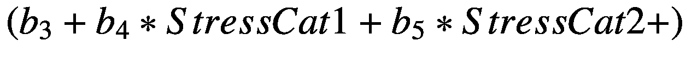
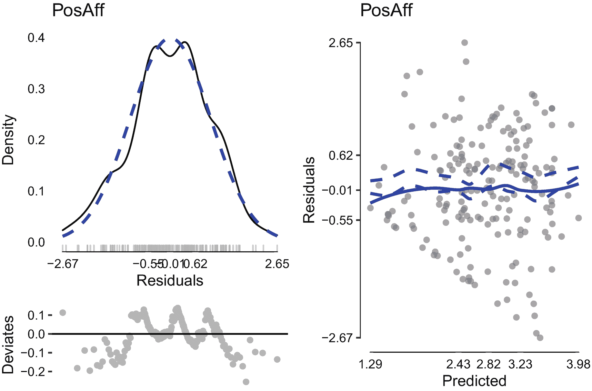
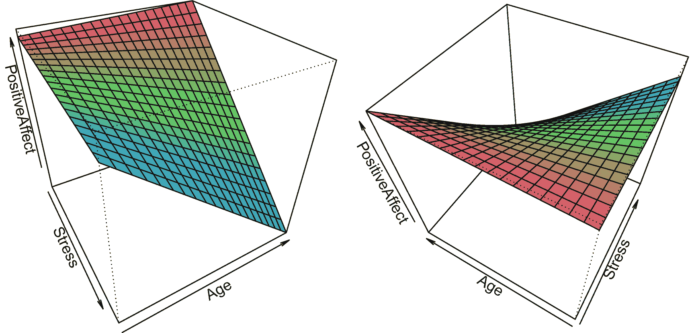
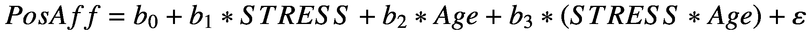
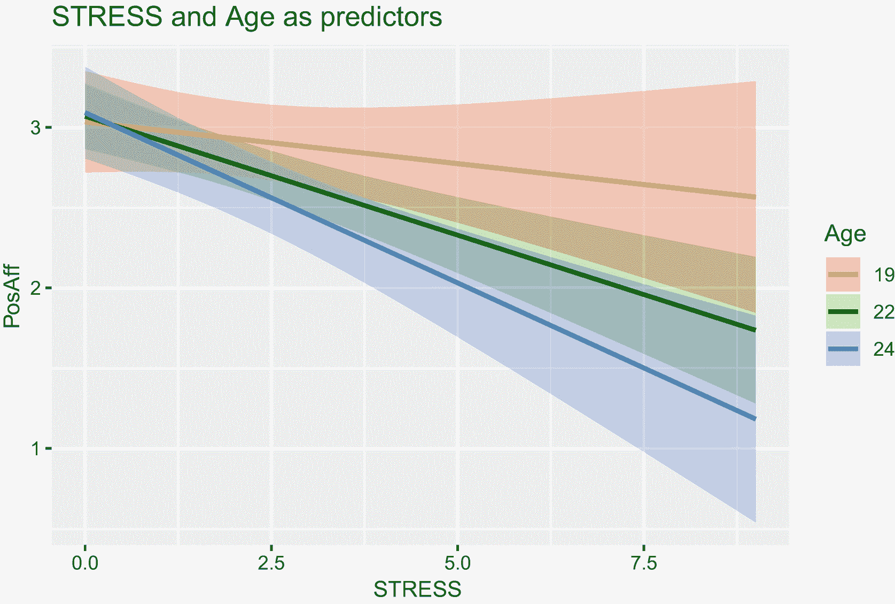
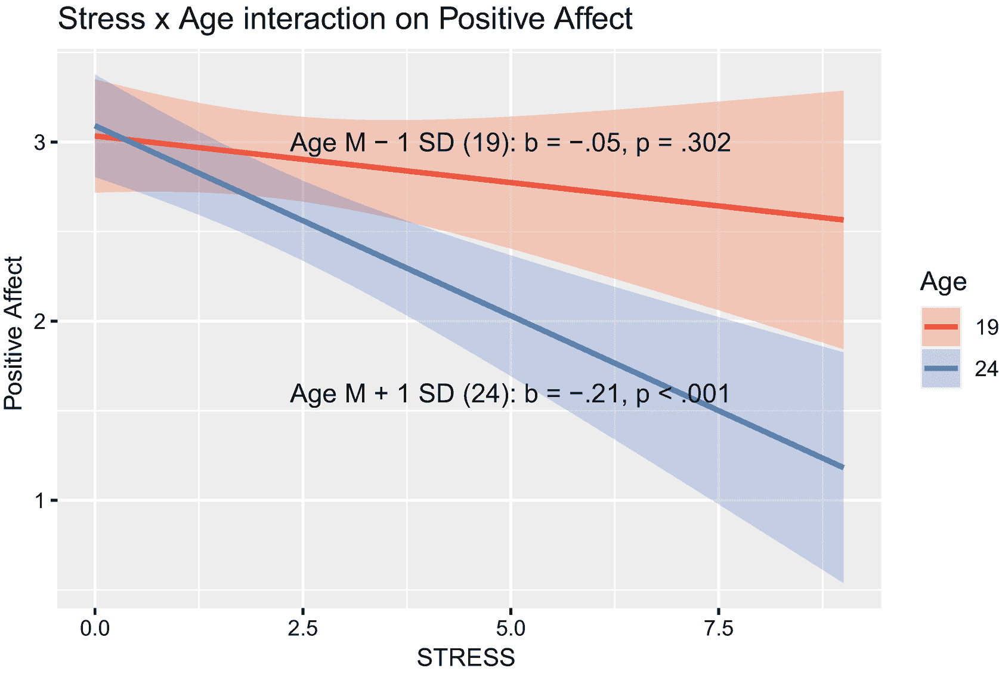
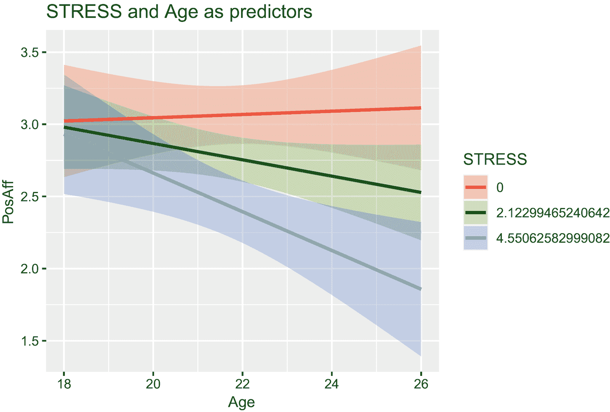
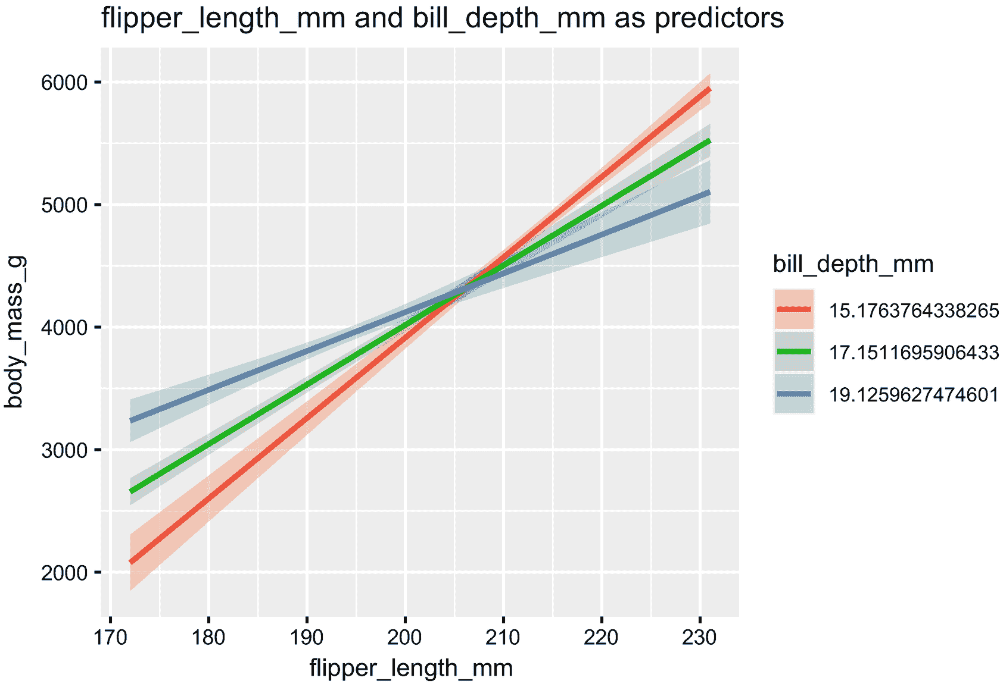

# 12. 调节回归

多元回归允许使用多个变量来预测感兴趣的结果。这通常倾向于产生更准确的模型。然而，多元回归本身不允许两个预测变量相互交互。想想企鹅的情况，也许体重不仅取决于鳍状肢长度或喙深度，而是两者之间存在某种独特的协同作用，共同造就了一只体态圆润的企鹅。本章探讨两个（或更多）预测变量可能相互交互的方式。通常，这些方法可以创建更完整的模型。

在本章结束时，你应该能够：

- 理解多元回归和调节回归之间的区别。
- 创建调节回归模型和可视化图表。
- 分析来自调节回归模型的各种数据的含义。
- 创建人性化的图表和沟通内容，以传达调节回归模型的结果。

## 12.1 R 环境设置

像往常一样，为了继续练习创建和使用项目，我们为本章节开始一个新项目。

如有必要，请复习第 1 章中创建新项目的步骤。启动 RStudio 后，在左上角的菜单栏中，选择 `File` 并点击 `New Project`。选择 `New Directory` ➤ `New Project`，将 `Directory name` 设置为 `ThisChapterTitle`，然后选择 `Create Project`。要创建一个 R 脚本文件，在顶部功能区中，`File` 正下方，点击带有加号的小图标（空白纸张上的加号），然后选择 `R Script` 菜单选项。点击软盘形状的保存图标，将此文件命名为 `PracticingToLearn_XX.R`（其中 XX 是本章的章节号），然后点击 `Save`。

在右下方面板中，你应该能看到你的项目的两个文件，直接在 `Files` 选项卡下方，点击名为 `New Folder` 的按钮。在 `New Folder` 弹出窗口中，输入 `data` 并选择 `OK`。在右下方面板中，点击你新建的 `data` 文件夹。重复文件夹创建过程，创建一个名为 `ch12` 的新文件夹。

请记住，本章使用的所有包都已在第 2 章中安装到你的本地计算机上了。无需重新安装。但是，这是一个新项目，我们首次运行这组代码。因此，你需要运行以下 `library()` 调用：

```r
library(data.table)
## data.table 1.13.0 using 6 threads (see ?getDTthreads). Latest news: r-datatable.com
library(ggplot2)
library(visreg)
library(emmeans)
library(palmerpenguins)
library(JWileymisc)
```

我们以与第 11 章相同的方式设置我们的数据集。

```r
data(aces_daily)
acesData = aces_daily[, .(mean = mean(impact, na.rm = TRUE),
sd = sd(impact, na.rm = TRUE)),
by = .(STRESS)]
acesData[, stress_z := scale(mean)]
acesData[, stress_high := factor(ifelse(
stress_z > 1, "2+",
as.character(STRESS)))]
penguinsData <- as.data.table(penguins)
```

现在，你可以自由地学习更多关于统计学的知识了！

## 12.2 调节效应理论

到目前为止，在回归分析中，我们主要关注每个预测变量如何与结果变量相关联，无论是单独作用还是在更大模型的背景下。这种方法使我们能够检验两个变量是否相互关联，以及这种关联是否独特或独立于其他变量。然而，迄今为止，我们始终假设这种关联对所有个体都是相同的。如果两个变量之间的关联并非对所有人都相同，那该如何处理呢？

例如，当你饥饿时，进食可能会让你感觉更好；但如果你已经饱了，再吃东西反而会让你感觉更糟。这在统计学中被称为**调节效应**。进食与感觉更好之间的关联，受到进食前饱腹程度的调节。对于未饱腹的人，进食与感觉更好相关；而对于已饱腹的人，进食则与感觉更差相关。

再举一个例子，抗抑郁药物已被证明平均能有效减轻抑郁症状，但这可能并非对所有人都成立。例如，抗抑郁药可能对抑郁患者有帮助，但对非抑郁患者则可能毫无益处。从形式上讲，我们可以说抗抑郁药对情绪的有益效应受到是否存在抑郁状态的调节。

我们还可以举出更多例子。回想一下自己的生活或工作，很容易发现某些事物会让一个人感到享受或受益，但对另一个人却不然。因此，尽管我们目前学到的多元回归已经足够强大，但我们仍然需要一种方法使其更加灵活。我们需要能够解释这样一个事实：某些群体中变量之间的关联可能与其他群体不同。调节效应就是这一概念的正式术语，在回归分析中，我们可以通过两个或多个变量之间的交互作用来检验调节效应。

交互项是两个（或多个）变量的算术乘积。换句话说，我们将两个或多个变量相乘。

为了理解调节效应，我们从熟悉的包含两个预测变量 `x` 和 `w` 的多元回归方程开始，该方程预测结果变量 `y`：

```
y = b0 + b1 * x + b2 * w + ε
```

我们可以通过增加一个预测变量（即两个变量的算术乘积）来检验 `x` 和 `w` 这两个预测变量之间是否存在调节效应。该方程如下所示：

```
y = b0 + b1 * x + b2 * w + b3 * (x * w) + ε
```

这里存在第三个回归系数 `b3`，对应两个变量乘积项 `x * w`，而 `b3` 被称为交互项。

*注意：交互作用或调节效应可能涉及两个以上的变量。不过，本书将重点介绍和解释两个变量之间的交互作用。*

任意两个变量之间都可能存在交互作用，无论它们都是连续变量、都是分类变量，还是一个连续变量和一个分类变量。要在回归中包含分类变量的交互作用，我们采用相同的思路来创建变量的算术乘积，但这是基于虚拟编码后的变量，而非原始的类别变量。这种做法是可行的，因为虚拟编码后的变量是数值型的，因此可以对它们进行乘法之类的操作。

以上是对调节效应和交互作用背后的一些理念和概念的简要概述。艾肯和韦斯特（1991）[5] 有一本经典短著，专门深入探讨回归中的调节效应和交互作用，如果你想更深入地理解，这是一本极佳的补充读物。

现在，我们将重点转向如何在 `R` 中运行和解释一些应用性的调节效应案例。

### 在 `R` 中进行调节作用分析

在 `R` 中包含交互项非常简单。在回归公式内部，我们使用 `*` 运算符。这个单一的 `R` 运算符（并非单纯的乘法）会展开，同时给出这些变量之间的主效应和交互效应。

要观察这种展开的实际效果，请回顾第 11 章关于多元回归的内容。关于鳍状肢长度和喙深度的（不太理想的）*多元*回归是通过以下代码实现的：

```r
mPmul <- lm(formula = body_mass_g ~ flipper_length_mm + bill_depth_mm,
data = penguinsData)
```

特别注意，在前面的代码中，鳍状肢长度和喙深度之间有一个明显的 `+`。

如果你查看 `summary()` 的结果，你会看到截距、`b0`、鳍状肢长度的 `b1` 和喙深度的 `b2` 的数值：

```r
summary(mPmul)
##
## Call:
## lm(formula = body_mass_g ~ flipper_length_mm + bill_depth_mm,
##     data = penguinsData)
##
## Residuals:
##     Min      1Q  Median      3Q    Max
## -1029.8  -271.5   -23.6   245.2 1276.0
##
## Coefficients:
##                   Estimate Std. Error t value Pr(>|t|)
## (Intercept)       -6541.91     540.75   -12.1   <2e-16 ***
## flipper_length_mm    51.54       1.87    27.6   <2e-16 ***
## bill_depth_mm        22.63      13.28     1.7    0.089 .
## ---
## Signif. codes:  0 '***' 0.001 '**' 0.01 '*' 0.05 '.' 0.1 ' ' 1
##
## Residual standard error: 393 on 339 degrees of freedom
##   (2 observations deleted due to missingness)
## Multiple R-squared:  0.761,  Adjusted R-squared:   0.76
## F-statistic:  540 on 2 and 339 DF,  p-value: <2e-16
```

换句话说，多元回归的一般公式

$$ y = b_0 + b_1 \ast x + b_2 \ast w + \varepsilon $$

变成了具体公式

$$ body\_ mass\_g = -6541.91 + 51.54 \ast flipper\_ length\_ mm + 22.63 \ast bill\_ depth\_ mm + \varepsilon $$

对于*调节*回归，对 `lm()` 的函数调用几乎相同，只是将 `+` 替换为 `*`：

```r
mPmod <- lm(formula = body_mass_g ~ flipper_length_mm * bill_depth_mm,
data = penguinsData)
```

然而，`summary()` 函数返回了更多的变量！

```r
summary(mPmod)
##
## Call:
## lm(formula = body_mass_g ~ flipper_length_mm * bill_depth_mm,
##     data = penguinsData)
##
## Residuals:
##    Min     1Q Median      3Q     Max
## -938.9 -254.0  -28.2   220.7  1048.3
##
## Coefficients:
##                                    Estimate Std. Error t value Pr(>|t|)
## (Intercept)                       -36097.06    4636.27   -7.79   8.6e-14
## flipper_length_mm                  196.07        22.60    8.67   < 2e-16
## bill_depth_mm                      1771.80      273.00    6.49   3.1e-10
## flipper_length_mm:bill_depth_mm      -8.60        1.34   -6.41   4.8e-10
##
## (Intercept)                       ***
## flipper_length_mm                 ***
## bill_depth_mm                     ***
## flipper_length_mm:bill_depth_mm   ***
## ---
## Signif. codes:  0 '***' 0.001 '**' 0.01 '*' 0.05 '.' 0.1 ' ' 1
##
## Residual standard error: 372 on 338 degrees of freedom
##   (2 observations deleted due to missingness)
## Multiple R-squared:  0.787,  Adjusted R-squared:  0.785
## F-statistic:  416 on 3 and 338 DF,  p-value: <2e-16
```

换句话说，调节回归的一般公式

$$ y = b_0 + b_1 \ast x + b_2 \ast w + b_3 \ast \left( x \ast w \right) + \varepsilon $$

变成了具体公式

$$ body\_ mass\_g = -36097.06 + 196.07 \ast flipper\_ length\_ mm + 1771.80 \ast bill\_ depth\_ mm - 8.60 \ast \left( flipper\_ length\_ mm \ast bill\_ depth\_ mm \right) + \varepsilon $$

这就是我们所说的“展开”——当你在 `R` 中写 `*` 时，它知道你正在做调节回归。同时也要注意，所有 `b_i` 从一个模型到下一个模型都发生了变化。尽管有相似之处，但在数学层面上，回归中发生了相当多的事情。

## 12.3 在 `R` 中处理连续变量与分类变量的调节作用

我们现在转向探讨一个连续变量受一个分类变量调节的情况。我们将通过一个示例来完成这一任务。

## 示例

在第 11 章中，我们探讨了一个示例，其中压力类别（0、1、2+）和社会支持都能预测积极情感。我们将以此示例为基础，但这里允许社会支持与压力类别之间存在交互作用。与先前模型版本相比，代码中唯一的变动是将 `StressCat` 和 `Support` 之间的 `+` 改为 `*`。

一个连续变量与一个分类变量之间的交互作用或许是最容易首先解释的，这就是我们以此为例的原因。在深入模型输出之前，我们先绘制结果图表。与之前一样，我们使用 `visreg()` 函数。实际上，`visreg()` 代码与第 11 章中使用的代码完全相同，只是模型已改为包含交互作用的回归模型：

```
mint1 <- lm(formula = PosAff ˜ StressCat * SUPPORT,
data = acesData)
visreg(mint1, xvar = "SUPPORT", by = "StressCat",
partial = FALSE, rug = FALSE, overlay = TRUE,
gg = TRUE) +
ggtitle("SUPPORT and StressCat as predictors")
```


图 12-1

压力类别与社会支持对积极情感预测的有调节回归。线表示各组的预测值，附带 95%置信区间

我们在图 12-1 中看到了结果。该图与第 11 章的图类似，只是现在线条不再平行。也就是说，对于所有压力类别的人，社会支持与积极情感之间的关联不再被强制设为相同。同样，您也会发现不同压力类别之间在积极情感上的差异也不再相同。例如，当社会支持为零时，压力为 1 的人预测的积极情感最低，但当社会支持为 10 时，他们的积极情感却最高。图 12-1 中的线条互不平行，这正是图中所示的交互作用和调节效应。

与统计学中的许多情况一样，视觉上线条之间可能看似存在一些差异，但我们通常要检验这些差异是否具有统计显著性（通常 `p` < .05），以此作为一种检验方式，来判断这些差异可能代表真实的总体差异，还是仅仅由于偶然随机抽样导致某些群体中的关联更强或更弱而产生的差异。我们通过回归模型以及对交互作用项系数的检验来获得这一检验结果。

在本例中，尽管我们只有两个预测变量，但由于压力类别有三个因子水平，因此包含了两个虚拟编码，并且两者都与社会支持存在交互作用。我们的模型方程如下：


与之前一样，我们可以使用 `modelTest()` 函数配合 `APAStyler()` 来获取模型结果。由于系数更多，为确保打印所有行，我们使用 `print()` 函数并指定愿意打印的最大行数。请花点时间体会一下通过编程切换模型有多么便捷。因为许多 `R` 函数足够“智能”，能够检测不同的模型，代码端无需或只需极少改动，计算机端就能得出正确的计算结果：

```
mint1Test <- modelTest(mint1)
print(APAStyler(mint1Test), nrow = 100)
##                    Term                    Est          Type
##  1:         (Intercept) 2.47*** [ 1.98,  2.97] Fixed Effects
##  2:          StressCat1 -1.23** [-2.11, -0.36] Fixed Effects
##  3:         StressCat2+ -1.07** [-1.77, -0.37] Fixed Effects
##  4:             SUPPORT  0.12** [ 0.04,  0.19] Fixed Effects
##  5:  StressCat1:SUPPORT   0.19* [ 0.04,  0.34] Fixed Effects
##  6: StressCat2+:SUPPORT    0.08 [-0.04,  0.19] Fixed Effects
##  7:    N (Observations)                    187 Overall Model
##  8:           logLik DF                      7 Overall Model
##  9:              logLik                -253.26 Overall Model
## 10:                 AIC                 520.52 Overall Model
## 11:                 BIC                 543.14 Overall Model
## 12:                  F2                   0.40 Overall Model
## 13:                  R2                   0.28 Overall Model
## 14:              Adj R2                   0.26 Overall Model
## 15:           StressCat    f2 = 0.07, p = .003  Effect Sizes
## 16:             SUPPORT    f2 = 0.05, p = .003  Effect Sizes
## 17:   StressCat:SUPPORT    f2 = 0.04, p = .039  Effect Sizes
```

交互作用中的乘积项（方程中的 `b[4]` 和 `b[5]`）在输出中显示为 `StressCat1:SUPPORT` 和 `StressCat2+:Support`。研究人员通常会首先检查交互作用项。如果交互作用项不具有统计显著性，研究人员通常会删除交互作用。这是因为，当你需要报告不同组中变量之间的关联时，解释结果会困难得多。而仅使用多元回归时，你可以更简单地表述类似“这两个变量呈正相关”这样的话。

当模型中包含交互作用时，构成该交互作用的变量的回归系数通常被称为“简单效应”，因为它们捕捉的是调节变量在某个特定值上的效应（斜率）。我们模型中的交互作用项捕捉的是社会支持斜率在不同压力类别之间的*差异*。我们可以通过一些因式分解和重排来查看每个组中的斜率。

为什么我们如此关注斜率？在数学中，两个值（一个 `x` 值和一个 `y` 值）之间的斜率就是变化率。回顾第 8 章中线性回归的简单模型，在公式 `y = b[0] + b[1] * x` 中，常数 `b[1]` 就是斜率。如果将 `x` 的输入从 1 改为 2，那么 `b[1]` 值就翻倍了。这反过来会增加 `y` 的总量。因此，通过观察 `b[1]`——即斜率——我们可以看出 `x` 增加时 `y` 增加的速率。当然，如果 `b[1]` 为负值，那仅表示 `x` 增加时 `y` 减少的速率。

所以现在我们有了一个复杂得多的方程——各处都有许多值。解决方法是使用数学/代数因式分解（而非代码中的 `factor`）。如果我们想知道 `SUPPORT` 的增加将如何改变（增加/减少）`PosAff`，我们需要找到 `SUPPORT` 的斜率。然而，`SUPPORT` 出现在多个项中。我们需要在一堆数值的末尾得到一个单独的 `SUPPORT` 值。这就是数学或代数因式分解发挥作用的地方——你在代数课上很可能练习过这种分解。

作为代数/数学因式分解的提醒，如果你有三个都包含 `a` 的项，你可以如所示那样提取公因子 `a`：


类似地，如果我们希望理解 `SUPPORT` 的斜率（即变化率），我们可以将所有涉及 `SUPPORT` 的项放在同一行。然后，我们可以提出公因子 `SUPPORT`。看看我们之前使用压力类别和支持作为积极情感预测因子的方程。该方程这样排列，使得第二行是所有与 `SUPPORT` 相乘的项。然后，就像前面例子中的 `a` 一样，我们可以提取公因子 `SUPPORT`。这比理想的稍微杂乱一些；尽管如此，你可以看到提取公因子的明显标志：`(*stuff*) * SUPPORT`。这个“stuff”实际上就是 `SUPPORT` 的斜率！


是的，这个过程需要一些数学知识。不过，我们的重新排列和提取公因子是值得的；提取公因子突出了支持与积极情感之间的斜率（或变化率）是：



这比以前任何斜率都要复杂。变化率本身会随着压力的变化而变化！想象一下，当我们为压力类别代入特定值时，这个斜率会发生什么变化。以下是所有三种可能性：

- **2+压力的人**：`b[3] + b[4] * 0 + b[5] * 1 = b[3] + b[5] * 1 = b[3] + b[5]`
- **1 个压力的人**：`b[3] + b[4] * 1 + b[5] * 0 = b[3] + b[4] * 1 = b[3] + b[4]`
- **没有压力的人**：在两个虚拟编码变量上都是零：`b[3] + b[4] * 0 + b[5] * 0 = b[3]`

从这项工作中可以得到几个重要教训。首先，`b[3]` 是当压力类别为零时社会支持的简单斜率。也就是说，`b[3]` 是社会支持的实际斜率。请注意，这里的一般概念是，无论我们选择省略哪个虚拟编码，它都是压力类别参考组中社会支持的斜率。

接下来，我们看到 `b[4]` 和 `b[5]` *不是* 1 个压力或 2+压力人群的社会支持斜率。相反，`b[4]` 和 `b[5]` 被*加到* `b[3]` 上，以找出其他组中社会支持的斜率。`b[4]` 和 `b[5]` 捕捉了压力 1 组与压力 0 组之间，以及压力 2+组与压力 0 组之间社会支持斜率的*差异*。这通常是一件好事。因为 `b[4]` 和 `b[5]` 捕捉了斜率的差异，我们可以检验该差异是否显著不为零。如果是（即显著的 `p < .05`），那么我们可以说两个斜率彼此不同；如果斜率的差异不显著地不同于零，我们可以得出结论，在我们的样本中，我们无法判断斜率在现实中是否不同，还是仅仅在我们的随机样本中不同。

捕获两个（或多个）预测变量值之间的交互作用，就是我们如何调节 `SUPPORT` 的斜率（即变化率）。回头看图 12-1。那里的三条线有三条不同的斜率。是哪三条斜率？正是刚刚讨论的三种可能性。注意 `StressCat = 0` 线的斜率是最平缓的。对于没有压力的人，更多的社会支持是好的，但它并不会产生巨大差异。然而，对于 `StressCat = 1` 的人，那条线相当陡峭。换句话说，斜率更强，这意味着多一点社会支持对帮助这些人感受更积极的情绪大有裨益。

虽然我们刚刚使用压力类别来帮助我们理解支持与积极情感之间的关系，但交互作用和调节是双向的。任何变量都可以是调节变量。为了说明这一点，我们重新排列方程，以突出压力组之间的差异是什么。遗憾的是，我们必须重新提取公因子。当然，由于我们中有一位曾是数学教授，我们很想说：“看吧，你们还是需要知道如何提取公因子！”

为了重新提取公因子，我们从方程的第一行开始。接下来，我们重新排列加法项，将 `StressCat1` 和 `StressCat2+` 分别放在各自的行上。最后，在每一行上，我们提取出公因子 `StressCat1` 和 `StressCat2+` 项，以看到每一行的斜率：

![$$ {\displaystyle \begin{array}{l} PosAff={b}_0+{b}_1\ast StressCat1+{b}_2\ast StressCat2+\\ {}\kern2.52em +{b}_3\ast SUPPORT+{b}_4\ast \left( StressCat1\ast SUPPORT\right)+{b}_5\ast \left( StressCat2+\ast SUPPORT\right)+\varepsilon \\ {}\kern2.04em ={b}_0+{b}_3\ast SUPPORT\\ {}\kern2.759999em +{b}_1\ast StressCat1+{b}_4\ast \left( StressCat1\ast SUPPORT\right)\\ {}\kern2.879999em +{b}_2\ast StressCat2++{b}_5\ast \left( StressCat2+\ast SUPPORT\right)+\varepsilon \\ {}\kern2.16em ={b}_0+{b}_3\ast {SUPPORT}_i+\\ {}\kern2.639999em \left({b}_1+{b}_4\ast SUPPORT\right)\ast StressCat1+\\ {}\kern2.639999em \left({b}_2+{b}_5\ast SUPPORT\right)\ast StressCat2++\varepsilon \end{array}} $$](img/495868_1_En_12_Chapter_TeX_Equk.png)

这突出显示了没有压力的人与有 1 个压力的人之间的差异是 `b[1] + b[4] * SUPPORT`，同样地，没有压力的人与有 2+压力的人之间的差异是 `b[2] + b[5] * SUPPORT`。

如果我们设定 `SUPPORT = 0`，那么我们看到 `b[1]` 可以解释为*当社会支持为零时*，没有压力的人与有 1 个压力的人之间的差异。

类似地，`b[2]` 可以解释为*当社会支持为零时*，没有压力的人与有 2+压力的人之间的差异。

这些差异或斜率不再适用于*所有*人。在调节回归中，斜率适用于*特定的*人群。因此，我们必须改变我们谈论和写作斜率的方式，以说明我们在描述哪个组，添加诸如“当社会支持为零时”之类的表述。例如，如果我们有压力组与教育之间的交互作用，我们就需要说“当教育程度为零时”。当然，我们不必将变量保持在零；我们可以代入不同的值并计算差异。

综上所述，我们回过头来看模型输出，看看我们是否能解释这些数字。以下供参考：

```
`print`(`APAStyler`(`mint1Test`), nrow = 100)
##                    Term                    Est          Type
##  1:         `(Intercept)` 2.47*** [ 1.98,  2.97] Fixed Effects
##  2:          `StressCat1` -1.23** [-2.11, -0.36] Fixed Effects
##  3:         `StressCat2+` -1.07** [-1.77, -0.37] Fixed Effects
##  4:             `SUPPORT`  0.12** [ 0.04,  0.19] Fixed Effects
##  5:  `StressCat1:SUPPORT`   0.19* [ 0.04,  0.34] Fixed Effects
##  6: `StressCat2+:SUPPORT`    0.08 [-0.04,  0.19] Fixed Effects
##  7:    `N (Observations)`                    187 Overall Model
##  8:           `logLik DF`                      7 Overall Model
##  9:              `logLik`                -253.26 Overall Model
## 10:                 `AIC`                 520.52 Overall Model
## 11:                 `BIC`                 543.14 Overall Model
## 12:                  `F2`                   0.40 Overall Model
## 13:                  `R2`                   0.28 Overall Model
## 14:              `Adj R2`                   0.26 Overall Model
## 15:           `StressCat`    `f2 = 0.07, p = .003`  Effect Sizes
## 16:             `SUPPORT`    `f2 = 0.05, p = .003`  Effect Sizes
## 17:   `StressCat:SUPPORT`    `f2 = 0.04, p = .039`  Effect Sizes
```

解释可以如下所示：

# 多重回归分析：压力、社会支持与积极情绪

对一个包含 187 名参与者的数据集进行了多重回归分析，预测积极情绪，自变量为压力类别、社会支持及其交互作用。

在无压力组中，社会支持每增加一个单位，积极情绪增加 0.12（95% CI = [0.04, 0.19]），`p` < .01。

压力评分为 1 的参与者中，社会支持与积极情绪的斜率比无压力组高`b = 0.19 [0.05, 0.34]`，`p` < .05，表明压力组与社会支持确实存在交互作用。

压力评分为 2+的参与者中，社会支持与积极情绪的斜率较高，但未达到统计显著性（`p` > .05）。

总体而言，压力×社会支持交互作用的效应量较小，Cohen's `f`^2 = 0.04，但具有统计显著性，`p` = .039。对于无社会支持的参与者，压力为 1 或 2+均与显著较低的积极情绪相关（两者均为`p` < .01）。

默认情况下，`APAStyler()`使用星号表示 p 值以简化输出，但如果需要每个系数的精确 p 值，可以通过`pcontrol()`参数获取。示例如下：

```
print(APAStyler(modelTest(mint1),
pcontrol = list(digits = 3, stars = FALSE,  includeP = TRUE,
includeSign = TRUE, dropLeadingZero = TRUE)),
nrow = 100)
##                    Term                          Est          Type
##  1:         (Intercept)  2.47p < .001 [ 1.98,  2.97] Fixed Effects
##  2:          StressCat1 -1.23p = .006 [-2.11, -0.36] Fixed Effects
##  3:         StressCat2+ -1.07p = .003 [-1.77, -0.37] Fixed Effects
##  4:             SUPPORT  0.12p = .003 [ 0.04,  0.19] Fixed Effects
##  5:  StressCat1:SUPPORT  0.19p = .012 [ 0.04,  0.34] Fixed Effects
##  6: StressCat2+:SUPPORT  0.08p = .179 [-0.04,  0.19] Fixed Effects
##  7:    N (Observations)                          187 Overall Model
##  8:           logLik DF                            7 Overall Model
##  9:              logLik                      -253.26 Overall Model
## 10:                 AIC                       520.52 Overall Model
## 11:                 BIC                       543.14 Overall Model
## 12:                  F2                         0.40 Overall Model
## 13:                  R2                         0.28 Overall Model
## 14:              Adj R2                         0.26 Overall Model
## 15:           StressCat          f2 = 0.07, p = .003  Effect Sizes
## 16:             SUPPORT          f2 = 0.05, p = .003  Effect Sizes
## 17:   StressCat:SUPPORT          f2 = 0.04, p = .039  Effect Sizes
```

这种解释涵盖了相当多的内容，但仍有一些不足之处。例如，人们可能会想知道压力 1 组或压力 2+组中社会支持的斜率实际是多少，而不仅仅是其差异。您可能还注意到，我们未解释`StressCat`或`SocialSupport`的效应量。这是因为这些是这些变量的独特效应，但独立于模型中的其他变量。因此，例如，它将是`SocialSupport`独立于压力组以及压力×社会支持交互作用的独特贡献。由于交互作用包含了社会支持，讨论一个变量部分独立于自身的“效应量”有些奇怪。其背后的数学/统计学更适合统计理论，而非这里的应用讨论。通常，常见的做法是仅报告交互作用的效应量，其余部分报告简单斜率。

为了获取每个压力组中社会支持与积极情绪的简单斜率，我们可以使用`emmeans`包，其中有一个有用的函数`emtrends()`。`emtrends()`函数计算趋势（斜率），如果需要，可按另一个变量的水平进行分组。我们传递三个参数：`mint1`作为模型对象，`specs`用于指定我们希望按压力组划分的支持斜率，最后是`var`参数，指定用于简单斜率的变量，此处为社会支持。保存结果后，使用`summary()`函数并设置`infer = TRUE`来获取每个简单斜率的 p 值。附注：`infer`参数来自推断性统计，与描述性统计相对：

```
m1int.slopes <- emtrends(
object = mint1,
specs = "StressCat",
var = "SUPPORT")
summary(m1int.slopes, infer = TRUE)
##  StressCat SUPPORT.trend     SE  df lower.CL upper.CL t.ratio p.value
##  0                 0.117 0.0389 181   0.0398    0.194 2.997   0.0031
##  1                 0.307 0.0643 181   0.1797    0.433 4.770   <.0001
##  2+                0.194 0.0425 181   0.1106    0.278 4.578   <.0001
##
## Confidence level used: 0.95
```

输出显示了压力组 0、1 和 2+中社会支持的斜率，以及 95%置信区间和每个斜率的 p 值。这些结果有助于我们更细致地理解交互作用。现在我们可以说，在所有压力组中，社会支持与积极情绪呈正向且显著相关。然而，正如我们之前所知，压力组 1 相对于组 0 的斜率显著更大。

类似地，我们可能想知道压力组之间如何相互差异。同样，由于我们正在研究交互作用，我们不能简单地说压力组总体上如何不同。相反，这取决于社会支持的水平。

与容易分步骤处理的分类变量压力不同，社会支持`SUPPORT`是连续变量。由于社会支持是连续的，我们可以选择许多不同的值。就像直方图将数据“分箱”到列中以更易观察一样，我们也必须为连续变量选择一些水平。连续变量常见的“默认”水平有三个：低于均值一个标准差（低）、均值（平均）和高于均值一个标准差（高），通常写作`M` ± 1`SD`。

我们让`R`来计算这三个值：

```
## calculate M - 1 SD, M, and M + 1 SD
m1.MeanSDlow <- mean(acesData$SUPPORT, na.rm = TRUE) -
sd(acesData$SUPPORT, na.rm = TRUE)
m1.MeanSD <- mean(acesData$SUPPORT, na.rm = TRUE)
m1.MeanSDhigh <- mean(acesData$SUPPORT, na.rm = TRUE) +
sd(acesData$SUPPORT, na.rm = TRUE)
```

计算完成后，我们使用`emmeans()`函数，通过`at`参数指定社会支持的选定值，获取每个压力组在这些值处的平均积极情绪得分：

```
m1int.means <- emmeans(
object = mint1,
specs = "StressCat",
by = "SUPPORT",
at = list(SUPPORT = c(m1.MeanSDlow, m1.MeanSD, m1.MeanSDhigh)))
```

现在我们已经存储了均值，可以使用`pairs()`函数获取它们之间的所有成对比较。其工作原理与第 11 章相同，只是现在结果是在社会支持的具体值上进行的。通过选择三个良好的社会支持水平，我们可以了解随着社会支持增加会发生什么。还记得经验法则吗？即 68%的总体落在±1`σ`之内。通过选择这三个社会支持水平，我们捕获了总体的相当大一部分，这些部分位于这些范围之内及附近。

```r
pairs(m1int.means)
## SUPPORT = 2.79:
##  contrast estimate    SE  df t.ratio p.value
##  0 - 1       0.703 0.271 181  2.595  0.0275
##  0 - (2+)    0.852 0.223 181  3.818  0.0005
##  1 - (2+)    0.148 0.266 181  0.557  0.8429
##
## SUPPORT = 5.46:
##  contrast estimate    SE  df t.ratio p.value
##  0 - 1       0.196 0.194 181  1.008  0.5729
##  0 - (2+)    0.644 0.157 181  4.099  0.0002
##  1 - (2+)    0.448 0.188 181  2.379  0.0481
##
## SUPPORT = 8.14:
##  contrast estimate    SE  df t.ratio p.value
##  0 – 1      -0.312 0.287 181 -1.085  0.5243
##  0 - (2+)    0.436 0.217 181  2.009  0.1129
##  1 - (2+)    0.748 0.292 181  2.563  0.0299
##
## P value adjustment: tukey method for comparing a family of 3 estimates
```

从输出结果可以看出，在低水平的社会支持（低于均值一个标准差，即`SUPPORT = 2.79`）下，无压力组的积极情感显著高于有 1 次压力组或有 2 次及以上压力组（前两行的估计值显示了无压力组与有 1 次压力组或 2 次及以上压力组之间的差异）。

在社会支持处于平均水平（`SUPPORT = 5.46`）时，无压力组的积极情感高于有 2 次及以上压力组，而有 1 次压力组的积极情感也显著高于有 2 次及以上压力组。请注意，此处第一行（0 – 1）的 p 值不显著，且其估计值加减标准误差`SE`所构成的置信区间几乎包含 0（即几乎无差异）。

在社会支持处于高水平（`SUPPORT = 8.14`）时，有 1 次压力组的积极情感高于有 2 次及以上压力组。对于α为 0.05 的显著性水平，其他组间差异均不显著。

最后，尽管我们忽略了模型诊断，但其对于交互模型的重要性与其他任何回归模型一样。然而，调节回归模型仍然是多元回归模型，因此我们之前学习的所有常规假设和诊断方法都以相同的方式适用。因此，本章我们主要聚焦于新内容：交互作用、调节效应，以及计算简单效应或简单斜率。

话虽如此，我们在图 12-2 中展示了一个常规诊断的示例。对此，我们的解读方式与往常相同：



*图 12-2*：调节回归模型的回归诊断图

```r
mint1d <- modelDiagnostics(mint1)
plot(mint1d, ncol = 2, ask = FALSE)
```

有一点需要注意：在图 12-2 右侧面板的残差与预测值散点图中，分位数回归拟合失败。判断依据是，通常用于突出显示残差第 10 和第 90 百分位数的蓝色虚线，其位置明显不在第 10 或第 90 百分位数上。这些线条通常有助于我们直观地判断百分位数是否大致平行。这并不值得担忧；我们在此情况下只需忽略它们即可。添加蓝色线条始终只是为了辅助视觉解读，而非替代人工判断。

## 12.4 R 中的连续变量×连续变量调节效应

两个连续预测变量也可以在回归中产生交互作用。其概念解释和实际应用与我们本章前面讨论的连续×分类变量的交互作用非常相似。

或许主要区别在于，由于交互作用中的两个预测变量都是连续的，我们无法讨论某个特定人群组在某一变量上的斜率。相反，我们必须讨论在另一个变量的特定取值上的简单斜率。当然，我们在前文关于压力变量的部分已经看到了如何处理这种情况。

拥有两个连续预测变量也使得绘制最终的回归曲面变得更加困难。这样的图形严格来说是三维的。尽管如此，这并没有看起来那么可怕。这是因为在现实生活中的模型中，我们经常使用多个预测变量；因此，我们无法以任何人类可见的方式来绘制整个模型。毕竟，一个七维的图形会是什么样子呢？所以，虽然我们会展示一个三维图形，但它仅仅有助于学习一些良好的结果解读原则。大多数现代模型都无法被完全图形化。

在我们的示例中，我们考察压力、年龄及其交互作用对积极情感的预测作用。拟合调节回归模型的过程与我们所有其他回归模型遵循相同的格式。我们将此模型命名为`mint2`：

```r
mint2 <- lm(formula = PosAff ~ STRESS * Age,
data = acesData)
```

在深入探讨代码、方程、解读和输出之前，我们先看一下这个回归曲面的样子。你可能还记得第 11 章中我们有几个三维回归曲面的例子。那时曲面是完全平坦的，像一张纸。当我们加入交互作用时，就意味着回归曲面不再是平坦的。它发生了扭曲。我们刚才拟合的模型`mint2`所预测的、在不同压力和年龄水平下的积极情感值，如图 12-3 所示。你可以看到这个曲面并不平坦。如果你观察年龄与积极情感之间的斜率，它会随着压力的取值不同而不同。同样，如果你观察压力与积极情感之间的斜率，它也会随着年龄的变化而变化。这就是交互作用的含义。当两个连续变量交互时，其中一个变量没有天然的“断点”，所以我们不能仅仅绘制三条线来涵盖所有情况。要涵盖所有情况，我们需要绘制一个回归曲面，如图 12-3 所示。



*图 12-3*：调节多元回归曲面的三维图形

本节的剩余部分将尝试阐明我们如何理解、解读、检验和展示调节回归模型的结果，以及如何将图 12-3 转化为文字和数字，并通过检验来确定哪些差异是可靠的，哪些可能仅仅只是噪声。这是一项需要培养的重要技能，因为现实生活中的大多数模型都无法完全图形化。因此，我们必须建立起相应的思维理解能力，使得数值输出“合乎情理”。

作为一个方程，`mint2`可以表示为：



交互项的回归系数，即 *b*[3]，表示当另一个变量变化一个单位时，压力或年龄的简单斜率会如何不同。如果我们重新排列方程并提取公因式（压力或年龄），可以得到以下等价的方程：


这些强调说明，在包含交互作用的模型中，压力（`Stress`）的简单斜率是`b[1] + b[3] * Age`。`b[1]`是当年龄为零时压力的简单斜率。

同样，年龄（`Age`）的简单斜率是`b[2] + b[3] * Stress`。`b[2]`是当压力为零时年龄的简单斜率。

虽然压力的范围是 0 到 10，因此零值并非不合理，但年龄在此样本中的范围是 18 到 26，因此求零岁时的压力简单斜率是对样本数据的严重不合理外推。

我们可以像处理所有其他回归模型一样获取模型信息和效应量：

```r
mint2Test <- modelTest(mint2)
APAStyler(mint2Test)
##                 Term                  Est          Type
##  1:      (Intercept) 2.82** [ 0.86, 4.77] Fixed Effects
##  2:           STRESS   0.56 [-0.05, 1.16] Fixed Effects
##  3:              Age   0.01 [-0.08, 0.10] Fixed Effects
##  4:       STRESS:Age -0.03* [-0.06, 0.00] Fixed Effects
##  5: N (Observations)                  187 Overall Model
## ---
## 11:               R2                 0.13 Overall Model
## 12:           Adj R2                 0.12 Overall Model
## 13:           STRESS  f2 = 0.02, p = .073  Effect Sizes
## 14:              Age  f2 = 0.00, p = .801  Effect Sizes
## 15:       STRESS:Age  f2 = 0.03, p = .024  Effect Sizes
```

在输出中，我们可以看到`b[3]`（交互作用系数）为 -0.03，且具有统计显著性（`p` < .05，基于星号 *）。负号表示，随着压力或年龄的增加，另一变量的简单斜率会减小。

两个简单斜率均未达到统计显著性，即当年龄为零时压力的简单斜率（即`b[1]`，0.56）与零无显著差异，当压力为零时年龄的简单斜率（即`b[2]`，0.01）与零也无显著差异。

我们看到交互作用具有较小的效应量，`f² = 0.03`。与分类变量×连续变量的交互作用类似，我们不解释其他变量的效应量，因为它们本质上是当另一个变量为零时的简单效应量。例如，单独解释压力的效应量，就是当年龄为零时压力效应的效应量。

我们可以通过**中心化**变量来改进简单效应量的**解释**。想象一下给一棵树拍照。树牢牢地扎根在地下，但你可以通过移动相机，确保树是**居中**的。这样做并不会改变树的任何属性。然而，与拍摄一张偏斜的照片相比，这能帮助你的朋友更好地理解这棵树。

在我们的案例中，虽然压力对于参与者来说可以为零，但年龄不能：

```r
range(acesData$Age,
na.rm = TRUE)
## [1] 18 26
summary(acesData$Age)
##    Min. 1st Qu.  Median    Mean 3rd Qu.    Max.    NA's
##    18.0    20.0    21.0    21.6    23.0    26.0       2
```

我们注意到均值是 21.6，因此我们可能决定对年龄变量进行中心化或调整，使得 0 表示 22 岁而不是 0 岁。就像在照片中把一棵大树居中并不一定意味着树是完全对称的一样，我们也可以决定在哪里以及如何对数据进行中心化。虽然这个想法听起来可能很复杂，但编码却非常简单。我们创建一个新列，命名为`Age Centered at 22`，或简写为`Agec22`。这是一个列运算，我们希望每个参与者的每个年龄都比原来小 22：

```r
acesData[, Agec22 := Age - 22]
```

完成！

顺便提一下，就像我们在前一章中做的`log()`**变换**一样，中心化也是一种数据变换，帮助我们更好地使用或理解数据和结果。如果你在本书接近尾声时，已经在寻找接下来要学习的新主题，那么变换将是一个值得加入你清单的好内容。

变换必须在模型拟合**之前**进行。因此，我们使用这个新中心化的变量重新拟合回归模型，并再次运行`modelTest()`。记住，树仍然是那棵树！实际上什么也没有改变，只是我们现在得到了压力在`Agec22`为零（即针对 22 岁的人，这更合理）时的简单效应，包括简单斜率和简单效应量，而不是针对零岁的人（这不合理）：

```r
mint2b <- lm(formula = PosAff ˜ STRESS * Agec22,
data = acesData)
mint2bTest <- modelTest(mint2b)
APAStyler(mint2bTest)
##                 Term                     Est          Type
##  1:      (Intercept)  3.07*** [ 2.87,  3.27] Fixed Effects
##  2:           STRESS -0.15*** [-0.21, -0.09] Fixed Effects
##  3:           Agec22     0.01 [-0.08,  0.10] Fixed Effects
##  4:    STRESS:Agec22   -0.03* [-0.06,  0.00] Fixed Effects
##  5: N (Observations)                     187 Overall Model
## ---
## 11:               R2                    0.13 Overall Model
## 12:           Adj R2                    0.12 Overall Model
## 13:           STRESS     f2 = 0.12, p < .001  Effect Sizes
## 14:           Agec22     f2 = 0.00, p = .801  Effect Sizes
## 15:    STRESS:Agec22     f2 = 0.03, p = .024  Effect Sizes
```

现在，当我们说什么都没改变时，我们是指**实质性**的内容没有改变。毕竟，如果你给一棵树拍了一张偏斜的照片，你可能会漏掉一些树枝。而居中后，你可能会看到树后面一栋以前没注意到的建筑。因此，你会注意到截距发生了变化，并且一些其他数字看起来也会不同。然而，压力与年龄之间的交互作用——无论年龄是否中心化——**不会改变**，就像无论你如何构图，树与地面之间的交互作用都不会改变一样。

与其他交互作用类似，促进解释的一种常用方法是计算简单斜率并绘制成图。两个变量都是连续的，因此我们没有自然定义的“组”。然而，我们可以使用之前的方法，将“低”、“平均”和“高”定义为低于均值一个标准差、均值、以及高于均值一个标准差。

尽管我们努力对模型进行了中心化，但如果基于标准差通过`R`计算简单斜率，则中心化变量并没有实际好处，因此我们将直接使用原始模型`mint2`。

首先，我们将计算在不同压力水平下年龄的简单斜率。这实际上揭示了一个情况，即*M* ± 1*SD* 的方法有时并不适用。`STRESS`的取值范围是 0 到 10，但低于均值一个标准差会出现负值（可以从全局环境中的变量`m2.MeanSDlow`看出）。负的压力值是不可能的，因此我们手动将其设为最小值 0：

```r
m2.MeanSDlow <- mean(acesData$STRESS, na.rm = TRUE) -
sd(acesData$STRESS, na.rm = TRUE)
m2.MeanSD <- mean(acesData$STRESS, na.rm = TRUE)
m2.MeanSDhigh <- mean(acesData$STRESS, na.rm = TRUE) +
sd(acesData$STRESS, na.rm = TRUE)
m2.MeanSDlow <- 0
```

`emtrends()`代码的格式与我们在本章前面分类变量×连续变量交互作用中使用的格式相同：

```R
m2int.slopes <- emtrends(
  object = mint2,
  specs = "STRESS",
  var = "Age",
  at = list(STRESS = c(m2.MeanSDlow,
                       m2.MeanSD,
                       m2.MeanSDhigh)))
summary(m2int.slopes, infer = TRUE)
##  STRESS Age.trend     SE  df lower.CL upper.CL t.ratio p.value
##    0.00    0.0114 0.0453 183   -0.078   0.1008  0.252  0.8014
##    2.12   -0.0565 0.0343 183   -0.124   0.0111 -1.649  0.1009
##    4.55   -0.1342 0.0486 183   -0.230  -0.0384 -2.762  0.0063
##
## Confidence level used: 0.95
```

观察结果，我们可以看到，对于压力水平较低的人群，年龄与积极情感无关（第一行的 p 值大于 alpha）。

只有当压力高于均值一个标准差时，我们才会发现年龄较大的人积极情感较低。具体来说，对于压力值为 4.6（高于均值一个标准差）的人群，他们每增加一岁，积极情感预计会下降 -0.136，*p* = .010。

接下来，我们可以用同样的方法计算不同年龄下压力的简单斜率。不过，这次我们将年龄四舍五入到最近的整年。这样做有助于我们更好地进行解读：

```R
m2.MeanSDAgelow <- round(mean(acesData$Age, na.rm = TRUE) -
                          sd(acesData$Age, na.rm = TRUE), 0)
m2.MeanSDAge <- round(mean(acesData$Age, na.rm = TRUE), 0)
m2.MeanSDAgehigh <- round(mean(acesData$Age, na.rm = TRUE) +
                           sd(acesData$Age, na.rm = TRUE), 0)
```

使用我们设定的年龄截点，让 `emtrends()` 执行计算，然后查看 `summary()`：

```R
m2intAge.slopes <- emtrends(
  object = mint2,
  specs = "Age",
  var = "STRESS",
  at = list(Age = c(m2.MeanSDAgelow,
                    m2.MeanSDAge,
                    m2.MeanSDAgehigh))
)
summary(m2intAge.slopes, infer = TRUE)
##  Age STRESS.trend     SE  df lower.CL upper.CL t.ratio p.value
##   19      -0.0521 0.0504 183   -0.151   0.0473 -1.034  0.3024
##   22      -0.1481 0.0317 183   -0.211  -0.0856 -4.676  <.0001
##   24      -0.2121 0.0443 183   -0.300  -0.1247 -4.786  <.0001
##
## Confidence level used: 0.95
```

从这些结果中，我们看到，除了最年轻的参与者外，对于所有其他人，更高的压力与显著更低的积极情感相关（*p* < .001）。对于 19 岁的参与者（低于年龄均值一个标准差），方向是相同的，但该简单斜率不具有统计学显著性（p 值大于 0.05 的 alpha 水平）。

我们可以使用 `visreg()` 函数来绘制模型中的简单斜率。我们需要一个新的参数 `breaks`，它指定要使用的断点，因为我们的调节变量是连续型变量。当我们有分类调节变量时，`visreg()` 会直接使用该分类变量的不同水平，但现在最好由我们选择并指定所需的断点。结果如图 12-4 所示，该图以图形方式展示了我们之前用 `emtrends()` 进行的简单斜率检验。通常，同时进行数值简单斜率检验和绘制图形会很有帮助。图形有助于人们理解模式，而数值检验则为视觉呈现提供了具体的值和 p 值：



**图 12-4** 预测积极情感的压力与年龄交互作用的调节回归。线条为在年龄 M – 1 SD、均值及 M + 1 SD 处的预测值，并带有 95% 置信区间

# 12.5 调节回归图示与总结

`visreg(mint2, xvar = "STRESS", by = "Age",`
       `breaks = c(m2.MeanSDAgelow, m2.MeanSDAge, m2.MeanSDAgehigh),`
       `partial = FALSE, rug = FALSE, overlay = TRUE,`
       `gg = TRUE) +`
  `ggtitle("STRESS and Age as predictors")`

在线性模型中，斜率的差异是线性的，因此均值大约会位于低值和高值（均值 – 1 SD 和均值 + 1 SD）的中间。有时为了让图形看起来更简洁，人们会省略均值简单斜率的线条，只展示极端值。我们还可以使用 `ggplot2` 包中的 `annotate()` 函数来添加一些文本标签。这里我们添加了从 `emtrends()` 计算出的简单斜率和 p 值，以便将数值摘要包含在图中，并使用 `ylab()` 函数重新标记 y 轴，使其更简洁。结果如图 12-5 所示：



**`图 12-5`** 预测积极情感的压力与年龄交互作用的调节回归。线条为在年龄 M – 1 SD 和 M + 1 SD 处的预测值，并带有 95% 置信区间

```R
visreg(mint2, xvar = "STRESS", by = "Age",
       breaks = c(19,  24),
       partial = FALSE, rug = FALSE, overlay = TRUE,
       gg = TRUE) +
  ggtitle("Stress x Age interaction on Positive Affect") +
  annotate("text", x = 5, y = 3, label = "Age M - 1 SD (19): b = -.05, p = .302") +
  annotate("text", x = 5, y = 1.6, label = "Age M + 1 SD (24): b = -.21, p < .001") +
  ylab("Positive Affect")
```

正如我们之前指出的，交互作用中不存在方向性。一个变量并非总是预测变量，另一个也不总是调节变量。你可以选择将任一变量绘制在 x 轴上。

因此，也有必要按压力水平分解年龄的简单斜率，如图 12-6 所示：



**`图 12-6`** 预测积极情感的压力与年龄交互作用的调节回归。线条为在压力 M – 1 SD、均值及 M + 1 SD 处的预测值，并带有 95% 置信区间

```R
visreg(mint2, xvar = "Age", by = "STRESS",
       breaks = c(m2.MeanSDlow,
                  m2.MeanSD,
                  m2.MeanSDhigh),
       partial = FALSE, rug = FALSE, overlay = TRUE,
       gg = TRUE) +
  ggtitle("STRESS and Age as predictors")
```

## 12.5 总结

本章探讨了什么是统计调节效应，以及如何通过回归中的交互项对其进行检验。您应该能够理解如何检验调节效应，以及在出现显著交互作用时，如何通过简单斜率或效应以及图表来解读和呈现结果。**`表 12-1`** 可以作为您在本章所学关键概念的良好参考。

**`表 12-1`** 章节总结

| 概念 | 含义 |
| --- | --- |
| `lm()` | 用于拟合回归模型的函数，包括调节回归。 |
| `modelTest()` | 用于以简洁方式汇总回归模型（包含置信区间和效应量）的函数。 |
| `emmeans()` | 用于从回归模型中计算分类预测变量各组的估计边际均值及组间均值差异的函数。 |
| `emtrends()` | 用于在回归模型存在交互作用时计算连续变量简单斜率的函数。 |
| `visreg()` | 用于绘制和可视化回归模型（包括调节回归模型）结果的函数。 |

## 12.6 实践精进

通过完成一些练习题来检查你的进度并在实践中成长。理解性质的问题会提出批判性思维问题，最好通过书面或口头回答。统计学的艺术之一在于成功地将结果传达给你的利益相关者或受众。有时受众是高度技术性的，而其他时候则非常非技术性。练习题是对章节中所探讨概念的更直接应用。

### 理解检查

1.  直线的斜率表示 x 轴输入与 y 轴输出之间的变化率关系。斜率越陡，变化率越快。请查看图 12-6。是否存在某个压力水平，使得年龄成为积极因素？哪条直线的斜率最陡？对于斜率最陡的直线，年龄每*增加*两年，积极情绪大约会*减少*多少？

2.  我们何时使用 `emmeans()` 和 `pairs()`，何时使用 `emtrends()` 和 `summary()`？分类预测变量与连续预测变量是否会影响选择？

### 练习



图 12-7

以鳍状肢长度和喙深度的交互作用预测体重的调节回归。线条是在喙深度的均值减一个标准差、均值、均值加一个标准差处的预测值，并带有 95% 的置信区间。

1.  回到本章开头的示例，该示例展示了以鳍状肢长度和喙深度预测企鹅体重的多元回归与调节回归之间的差异。交互作用是否显著？

```
    mPmod <- lm(body_mass_g ~ flipper_length_mm * bill_depth_mm, data = penguinsData)
    summary(mPmod)
    ##
    ## Call:
    ## lm(formula = body_mass_g ~ flipper_length_mm * bill_depth_mm,
    ##     data = penguinsData)
    ##
    ## Residuals:
    ##     Min      1Q  Median      3Q     Max
    ## -1143.6  -252.8    -0.5   252.1  1123.8
    ##
    ## Coefficients:
    ##                                   Estimate Std. Error t value Pr(>|t|)
    ## (Intercept)                      -36097.06    4636.27   -7.79  8.6e-14
    ## flipper_length_mm                   196.07      22.60    8.67  < 2e-16
    ## bill_depth_mm                      1771.80     273.00    6.49  3.1e-10
    ## flipper_length_mm:bill_depth_mm      -8.60       1.34   -6.41  4.8e-10
    ##
    ## (Intercept)                      ***
    ## flipper_length_mm                ***
    ## bill_depth_mm                    ***
    ## flipper_length_mm:bill_depth_mm  ***
    ## ---
    ## Signif. codes:  0 '***' 0.001 '**' 0.01 '*' 0.05 '.' 0.1 ' ' 1
    ##
    ## Residual standard error: 372 on 338 degrees of freedom
    ##   (2 observations deleted due to missingness)
    ## Multiple R-squared:  0.787,  Adjusted R-squared:  0.785
    ## F-statistic:  416 on 3 and 338 DF,  p-value: <2e-16
```

2.  使用 `modelTest()` 和 `APAStyler()`，交互作用系数是多少？它在统计上是否显著？

3.  鳍状肢长度或喙深度能否为零？此模型是否适合进行中心化处理？

4.  假设我们选择不将这些数据进行中心化处理。请正确完成以下代码行，以获取*均值* ± 1*个标准差*和*均值*：

```
    #练习 3
    mPmod.MeanSDlowBill <- mean(penguinsData$bill_depth_mm , na.rm = TRUE) -
    sd(penguinsData$bill_depth_mm , na.rm = TRUE)
    mPmod.MeanSDBill <- mean(penguinsData$bill_depth_mm , na.rm = TRUE)
    mPmod.MeanSDhighBill <- mean(penguinsData$bill_depth_mm , na.rm = TRUE) +
    sd(penguinsData$bill_depth_mm , na.rm = TRUE)
```

5.  如果操作正确，上述问题应能使以下代码生成所示输出：

```
    mPmod.slopes <- emtrends(
    object = mPmod,
    specs = "bill_depth_mm",
    var = "flipper_length_mm",
    at = list(bill_depth_mm = c(mPmod.MeanSDlowBill,
    mPmod.MeanSDBill,
    mPmod.MeanSDhighBill)))
    summary(mPmod.slopes, infer = TRUE)
    ##  bill_depth_mm flipper_length_mm.trend   SE  df lower.CL upper.CL
    ##           15.2                    65.6 2.81 338     60.1      71.2
    ##           17.2                    48.6 1.82 338     45.0      52.2
    ##           19.1                    31.7 3.57 338     24.6      38.7
    ##  t.ratio p.value
    ##  23.311  <.0001
    ##  26.710  <.0001
    ##   8.877  <.0001
    ##
    ## Confidence level used: 0.95
```

随着喙深度的增加，我们注意到鳍状肢长度趋势有何变化？

6.  请仔细查看图 12-5 以及生成该图的代码，了解标注是如何创建的。请注意，标注需要手动确定点在图上的 (*x, y*) 坐标，以使标注位置合适。另外请注意，该示例中修改了坐标轴刻度，移除了中间年龄值（例如，与图 12-4 进行对比）。

修改以下代码以移除中间喙长度的刻度。此外，使用 `annotate()` 添加标注。请确保包含正确的斜率和 p 值！将您的图片与图 12-7 进行比较和对比。哪一张图更清晰地显示了喙深度交互作用虽然小但显著的差异？

```
    visreg(
    mPmod,
    xvar = "flipper_length_mm",
    by = "bill_depth_mm",
    breaks = c(mPmod.MeanSDlowBill,
    mPmod.MeanSDBill,
    mPmod.MeanSDhighBill),
    partial = FALSE,
    rug = FALSE,
    overlay = TRUE,
    gg = TRUE
    ) +
    ggtitle("flipper_length_mm and bill_depth_mm as predictors")
```

7.  将这些练习与本章中的示例进行比较和对比。特别注意各个代码块中的变量选择。观察哪些变量被更改以及哪些部分适用，请记住，大多数优秀程序员都是从复制可运行的代码开始，稍作编辑，然后运行编辑后的代码看看结果如何。