# 13. 方差分析

你一直在研究的企鹅生活在三个不同的岛屿上。我们最初探索了比斯科岛上的阿德利企鹅——并将它们与所有阿德利企鹅进行了比较。然而，这种方法可能略有缺陷。我们真正想做的是测量每个岛屿上阿德利企鹅的平均体重——看看是否有三个岛屿与众不同。这种测量组间变化或*方差*的检验被称为方差分析（简称 ANOVA）。本章将帮助你使用方差分析来检测分类组之间的差异——或者，用 `R` 的话来说，即 `factor()`。

学完本章，你应该能够：

*   评估适用于方差分析的数据结构和研究问题。

*   创建可视化图表以理解方差分析结果。

*   评估单因素方差分析和多因素方差分析之间的差异（以及何时使用）。


## 13.1 R 环境设置

按照惯例，为了继续练习创建和使用项目，我们为本章节新建一个项目。

如有需要，请回顾第 1 章中创建新项目的步骤。启动 RStudio 后，在左上角菜单栏中选择*文件*，点击*新建项目*。选择*新建目录* ➤ *新建项目*，在*目录名称*处填入`ThisChapterTitle`，然后选择*创建项目*。要创建一个`R`脚本文件，在顶部功能栏中，*文件*二字正下方，点击带有加号图标的空白纸张小按钮，然后选择*R 脚本*菜单选项。点击软盘形状的*保存*图标，将此文件命名为`PracticingToLearn XX.R`（其中 XX 是本章编号），然后点击*保存*。

在右下方面板中，你应该能看到项目中的两个文件。在*文件*标签卡正下方，点击标题为*新建文件夹*的按钮。在*新建文件夹*弹出窗口中，输入`data`，然后选择*确定*。在右下方面板中，点击你新建的`data`文件夹。重复文件夹创建过程，新建一个名为`ch13`的文件夹。

请记住，本章使用的所有包已在第 2 章中安装到你的本地计算机上。无需重新安装。不过，这是一个新项目，我们是首次运行这组代码。因此，你需要运行以下`library()`调用：

```r
library(data.table)
## data.table 1.13.0 using 6 threads (see ?getDTthreads). Latest news: r-datatable.com
library(ggplot2)
library(visreg)
library(emmeans)
library(palmerpenguins)
library(ez)
## Registered S3 methods overwritten by 'lme4':
##   method                          from
##   cooks.distance.influence.merMod car
##   influence.merMod                car
##   dfbeta.influence.merMod         car
##   dfbetas.influence.merMod        car
library(JWileymisc)
```

我们按照第 11 章相同的方式设置数据集。

```r
acesData = 2,
"2+",
as.character(STRESS)))]
penguinsData <- as.data.table(penguins)
```

现在，你可以自由地学习更多统计学知识了！

## 13.2 ANOVA 背景

方差分析（**A**nalysis **o**f **va**riance，ANOVA）是一套统计模型，其原理是通过分解连续型结果变量的变异，并估计其中有多少变异可归因于不同分组。ANOVA 是广义线性模型的一个子集，因此可以被视为回归分析的特例。具体来说，ANOVA 允许将连续型变量作为结果变量，将分类变量作为预测变量。ANOVA 不能处理连续型预测变量。ANOVA 一直是分析实验数据非常流行的技术。对于实验数据，ANOVA 通常效果很好，因为主要感兴趣的预测变量是随机分配到的组别或条件，这通常是分类变量。

从历史上看，ANOVA 有许多优势，因为它专注于连续型结果和分类预测变量，允许许多计算上的捷径，使得与回归等其他方法相比，ANOVA 更容易通过手工或计算器计算。即使是现在，计算能力意味着无需为了简便而选择 ANOVA 而非回归，但某些过程和目标在 ANOVA 中更为自然，因此它们仍被继续使用。

ANOVA 可以回答许多问题。以下是一些例子：

*   作物的生长是否因在早晨、下午还是夜间浇水而有所不同？
*   当营养信息被显著展示，与信息被隐藏或不可获取时，人们摄入的卡路里是否更少？
*   儿童的孤独感是否因依恋类型（安全型、焦虑- preoccupied 型、恐惧-回避型、 dismissive-回避型）而异？
*   如果随机分配到健身房锻炼或参加团队运动，人们活动的时间是否更多？
*   阿德利企鹅在某些岛屿上是否似乎比在其他岛屿上获得更好的食物？

ANOVA 类似于 t 检验，因为它比较组间的均值。t 检验只限于比较两个组，而 ANOVA 可以检验两个或更多组均值之间的差异。ANOVA 有多种类型，但一般来说，ANOVA 检验的是所有组的均值（用希腊字母 *μ* [mu] 表示）都相等的零假设。即：

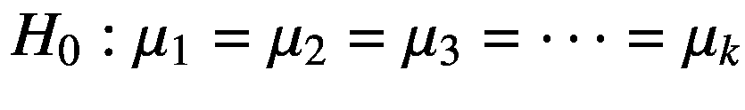

一个统计显著的 ANOVA 表明并非所有均值都相等。换句话说，一个统计显著的 ANOVA 表明至少有一个组的均值与其他组的均值不同。注意，一个显著的 ANOVA 也可能表明不止一个组的均值不同；我们所能确定的只是至少有一个不同。

如果我们只有两个组，那么 t 检验和 ANOVA 会给出相同的结果。因此，一个问题可能是：我们能否仅仅使用 t 检验？如果我们想比较多个组的均值，能否使用 t 检验来比较成对的组？尽管可以将多个组的比较分解为每次只比较两个组的 t 检验，但这种方法有一些缺点。首先，运行多次检验会膨胀第一类错误率。其次，你无法同时考虑多个变量的影响。第三，当假设条件满足时，对于多于两个组的情况，ANOVA 比成对 t 检验提供更高的统计功效。更高的功效意味着更少的第二类错误（即，未能拒绝事实上是错误的零假设）。

对于多于两个组的数据，ANOVA 比 t 检验功效更高的一个原因是，t 检验包含对组间合并方差的估计。在 ANOVA 中，合并方差是在所有组中估计的，其自由度依赖于总样本量。较大的样本量能带来更高的检测统计显著差异的功效。通过同时使用所有组，ANOVA 能够有效地拥有比一系列成对 t 检验更大的样本量。如果只有两个组，选择哪种方法都无关紧要。


如果你正在阅读关于方差分析（ANOVA）的内容或看到它们被使用，你经常会遇到诸如"单因素"（one-way）方差分析这样的术语。在标记方差分析时，自变量的数量（即因子）就代表了方差分析的"因素"（ways）数量：

- **单因素**：一个自变量或因子（即一个预测变量）
- **双因素**：两个自变量或因子（即两个预测变量）
- **三因素**：三个自变量或因子
- **多因素**：这个过程可以继续延伸，不过实践中大多数方差分析是单因素或双因素；但有时你也会看到更多"因素"的方差分析。

默认情况下，在包含多个自变量的方差分析中，预测变量之间所有可能的交互作用都会被纳入分析。如果你需要复习交互作用，请参见第 12 章。

由于方差分析是广义线性模型的一种特例，它们与线性回归有着基本相同的基本假设。方差分析的关键假设如下：

- **独立性**：观测值之间相互独立（但请注意，在重复测量方差分析或混合效应方差分析中，这一假设可以放宽，就像在混合效应回归中一样；这些主题通常在更高级的书籍中讨论）。
- **连续性**：结果变量是区间或比率类型（即连续变量）。
- **正态性**：参数抽样分布呈正态分布，通常通过检查残差分布来评估。
- **方差齐性**：每个组的结果变量方差必须近似相等（齐性）。如果方差不相等（异质性），则违反了这一假设。

顾名思义，方差分析通过分析（分解）方差来工作。例如，假设我们有一个包含一个自变量（组别）的方差分析，并且该组别有 3 个不同的水平。方差分析会将结果变量的总变异性分解，如图 13-1 所示。

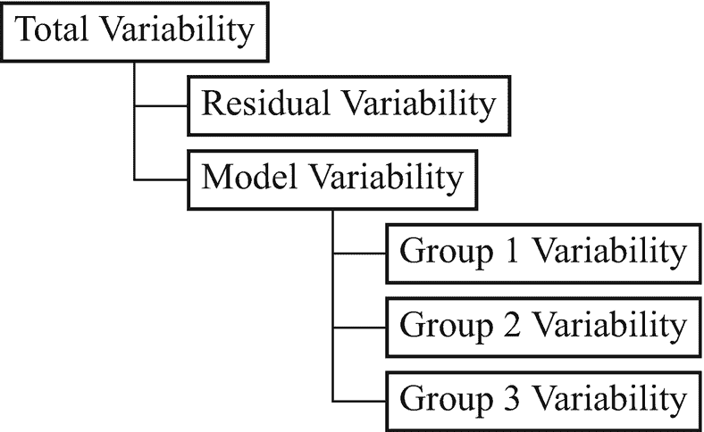

**图 13-1** 一个含有一个自变量（有 3 个不同水平/组别）的方差分析的方差分解示意图

### 正式数学表述

我们可以将这种变异性分解的一般思想形式化。假设我们有一个连续的结果变量 `y`，在 `k` 个不同的组中测量，并且每个组有 `n[k]` 个人。我们用 `y[ij]` 表示特定组 `j` 中特定个体 `i` 的结果。我们用 `y̅` 表示所有观测值的总平均值。最后，我们用 `y̅[j]` 表示每组中 `y` 的平均值。有了这些定义，方差分析在形式上定义了三个广泛的变异性来源。具体来说，它使用的是所谓的平方和（`SS`），即离差的平方和。以下方程展示了这三个来源：

```
SS_Total = Σ(j=1 to k) Σ(i=1 to n_k) (y_ij - y̅)²
SS_Model = Σ(j=1 to k) n_k * (y̅_j - y̅)²
SS_Residual = Σ(j=1 to k) Σ(i=1 to n_k) (y_ij - y̅_j)²
```

- `SS_Total` 是所有观测值相对于总平均值的离差平方和。这基本上是结果变量 `y` 的总变异性。
- `SS_Model` 是各组均值相对于总平均值的离差平方和，并按该组中的观测值数量进行加权。它反映了结果变量的总变异性 `SS_Total` 中有多少可以由组间差异来解释。
- `SS_Residual` 是观测值相对于其各自组均值的离差平方和。它反映了在考虑了观测值所属组别之后，观测值中“剩余”或未解释的变异性有多少。这通常被认为是未解释的变异性，有时也称为误差。它类似于回归中的残差方差。

这三个平方和的直观示意图如图 13-2 所示。面板 A 显示 `SS_Total`，面板 B 显示 `SS_Model`，面板 C 显示 `SS_Residual`。平方和相当于将每段垂直线段取平方，然后将它们全部相加得到的结果。

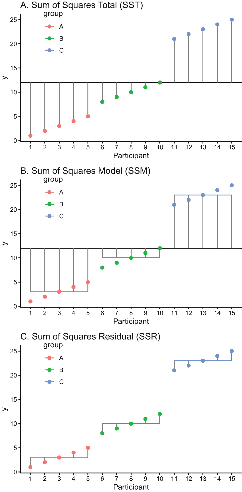

**图 13-2** 方差分析中不同类型平方和的直观解释

要实际进行方差分析，我们还需要一些信息。方差分析使用的不是原始的平方和，而是均方，即平方和除以各项的自由度。在进行常规方差分析时，有两种不同的自由度（`df`）：

```
DF_Model = k - 1
DF_Residual = N - k
```

例如，如果我们使用如图 13-2 所示的例子，总共有 15 个观测值，所以 `N = 15`，并且有 3 个组，所以 `k = 3`。这意味着 `DF_Model = 3 - 1 = 2` 且 `DF_Residual = 15 - 3 = 12`。

模型和残差的均方定义如下：

```
MS_Model = SS_Model / DF_Model
MS_Residual = SS_Residual / DF_Residual
```

为了确定组均值是否存在显著差异，我们比较模型解释的变异性与残差变异性。这个比值称为 F-比值。


### 统计概念：F 比率与方差分析（ANOVA）

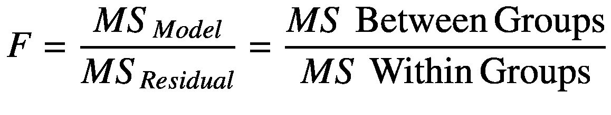

我们认为`F 比率`是处理效应（组效应）即`MS[Model]`与随机误差导致的差异即`MS[Residual]`的比值。当处理（分组）无效应时，处理间的差异（分子）完全由随机因素导致：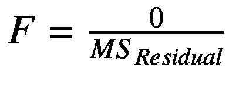。

若差异由随机因素引起，则分子远小于分母，`F 比率`趋近于 0，此时可认为不存在处理效应。

当处理确实产生效应并导致样本间差异时，处理间差异（分子）应大于随机差异（分母）：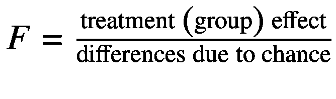。

较大的`F 比率`表明处理间差异大于随机差异，即处理具有统计显著效应。

`F 比率`服从`F 分布`，这是一种与我们之前见过的正态分布或`t 分布`类似的统计分布。

若`F 比率`大于我们设定的统计显著性临界值，则表明一个或多个处理（组）均值之间存在统计显著差异。最终，我们使用`F 比率`计算`p 值`，并像使用`t 检验`、相关分析或回归模型中的`p 值`一样，将其用于假设检验。

是什么驱动了大的`F 比率`？若`MS[Model]`很大（即组间均值差异大），或`MS[Residual]`很小（即组内变异很小），则`F`值可能较大。这意味着，如果你在设计实验并希望获得显著结果，你可以尝试增大组间差异（例如使用效果极强的处理），或者让每组内的个体尽可能相似（例如招募非常相似的受试者）。

`F 比率`仅告诉我们直接或间接的操作是成功的，即组均值存在差异。但它并不能具体指出哪些组均值之间存在差异。我们需要额外的检验来确定组间差异具体在哪里。通常，在运行`ANOVA`后，我们会通过组均值的两两比较来确定哪些组存在差异。这些比较可以使用`ANOVA`中的合并残差方差`MS[Residual]`进行，因此它们仍比单独进行`t 检验`更有效。

此处需注意，若组别水平较多，例如有四个不同的组（命名为 A、B、C、D），则存在六种独特的两两比较。这是如何得出的？`R`函数`combn()`提供了所有（无序的）**组合**。第一个参数（本例中为名为`groups`的变量，包含字母 A-D）中的元素以大小为`m`的集合形式组合（本例中`m = 2`，因为我们讨论的是配对）：

```
groups <- LETTERS[1:4]
combn(groups,
m = 2)
##      [,1] [,2] [,3] [,4] [,5] [,6]
## [1,] "A"  "A"  "A"  "B"  "B"  "C"
## [2,] "B"  "C"  "D"  "C"  "D"  "D"
```

运行六次假设检验会增加第一类错误率。由于这并非理想情况，人们通常会尝试进行一些调整来控制总体错误率。最简单且最保守的方法之一是`Bonferroni`法。`Bonferroni`校正易于应用：将期望的`α`值（例如`α = 0.05`）除以执行的检验次数，得到新的`α`值。例如，`Bonferroni[α] = 0.05 / 6 = 0.0083`。这种方法非常简单，无需复杂计算，但已知过于保守，因为它将第一类错误率控制在低于实际期望的总体 0.05 错误率。尽管如此，由于其安全且简便，它仍然很受欢迎。

零假设显著性检验是“全有或全无”的。即，结果要么在`p < 0.05`时统计显著，要么在`p > 0.05`时不显著。现实生活并非如此绝对。此外，统计显著性并不一定意味着实际显著性（即现实世界的重要性）。显著性检验排除了随机因素，但效应有多大呢？像“有多大”或“有多少”这样的问题可以通过效应量来传达。`ANOVA`中一个常见的效应量是方差解释比例，在回归中称为`R²`，在`ANOVA`中通常称为`η²`（eta 平方），或`ω²`（omega 平方），这与回归中的调整后`R²`基本相同。有了这些背景知识，我们接下来在`R`中运行并解读一些`ANOVA`分析。

## 13.3 单因素方差分析

正如你可能预料的那样，在`R`中，这些计算变得相当容易。我们从单因素`ANOVA`开始，即只有一个自变量或预测变量的`ANOVA`。这个预测变量是分类变量，在`R`中需要是`factor()`类型。


### 示例

在本例中，我们考察压力类别（0、1、2+）是否能解释积极情绪的变异。我们将使用 `R` 语言中的 `ez` 包来运行方差分析。具体来说，`ezANOVA()` 函数可以运行独立测量、重复测量和混合模型方差分析，并提供假设检验。本书只讲授独立测量方差分析，但要知道，如果你需要更复杂的方差分析，`ezANOVA()` 函数仍然适用。`ezANOVA()` 函数需要以下参数才能工作：

- `data`，要分析的数据集。应为数据框，且不应包含缺失数据，因此我们先剔除缺失数据。
- `dv`，结果变量的变量名。
- `wid`，包含每个被试 ID 的变量，最好存储为因子，以供 `ezANOVA()` 使用。
- `between`，自变量（预测变量）。注意，在更复杂的重复测量方差分析中，你可能也会使用 `within` 参数来指定变量。该参数也需要是因子。
- `type`，要计算的平方和类型。常见选择是类型 3，尽管还有其他类型，且对于哪种类型最好，尤其是当各组规模不均衡（即并非所有组的人数完全相同）时，专家们意见不一。

此外，虽然并非必需，但我们使用 `detailed` 参数来获取更详细的输出，并使用 `return_aov` 参数来简化事后两两比较。

我们通过使用 `!` 与 `is.na()` 结合，创建一个不含缺失变量的数据集。同时，我们将 `UserID` 转换为 `factor()`：

```
aovdata <- acesData[!is.na(PosAff) & !is.na(StressCat)]
aovdata[, UserID := factor(UserID)]
```

我们不必将数据集缩减为仅用于方差分析的列。不过，只查看 `R` 将用于方差分析的列可能会有所帮助。特别要注意哪些列是因子（例如分类数据），哪些是数值型数据：

```
str(aovdata[, .(UserID, StressCat, PosAff)])
## Classes 'data.table' and 'data.frame':       187 obs. of  3 variables:
##  $ UserID   : Factor w/ 187 levels "1","2","3","4",..: 1 2 3 4 5 6 7 8 9 10 ...
##  $ StressCat: Factor w/ 3 levels "0","1","2+": 3 2 3 3 1 1 1 3 1 2 ...
##  $ PosAff   : num  1.55 3.17 3.51 1.7 2.22 ...
##  - attr(*, ".internal.selfref")=
```

在数据经过适当“清理”并格式正确后，我们按照描述使用 `ezANOVA()` 函数拟合方差分析。我们将结果存储在 `anova1` 中。最后，我们可以使用 `print()` 查看方差分析的输出结果：

```
anova1 <- ezANOVA(
data = aovdata,
dv = PosAff,
wid = UserID,
between = StressCat,
type = 3,
detailed = TRUE,
return_aov = TRUE)
## Warning: Data is unbalanced (unequal N per group). Make sure you specified a well-considered value for the type argument to ezANOVA().
## Coefficient covariances computed by hccm()
print(anova1)
## $ANOVA
##        Effect DFn DFd     SSn   SSd        F         p p<.05     ges
## 1 (Intercept)   1 184 1325.43 212.2 1149.429 4.643e-81     * 0.86201
## 2   StressCat   2 184   17.46 212.2    7.569 6.934e-04     * 0.07602
##
## $'Levene's Test for Homogeneity of Variance'
##   DFn DFd    SSn   SSd      F      p p<.05
## 1   2 184 0.3051 76.43 0.3673 0.6931
##
## $aov
## Call:
##    aov(formula = formula(aov_formula), data = data)
##
## Terms:
##                 StressCat Residuals
## Sum of Squares      17.46    212.17
## Deg. of Freedom         2       184
##
## Residual standard error: 1.074
## Estimated effects may be unbalanced
```

我们主要关注的输出是“ANOVA”标题下的部分。虽然包含了截距项，但我们主要对第二行感兴趣，即分组变量 `StressCat` 所在的行。我们可以看出，分子自由度（标记为“DFn”）为 2（3 组 – 1）。分母自由度（DFd）是残差自由度（*N − k* = 187 − 3 = 184）。我们有压力的平方和（SS）和残差平方和。由于压力类别是我们唯一的预测变量，因此它即是模型平方和。我们得到 F 比率，这里约为 7.6，然后利用 F 比率和自由度，系统根据假定的 F 分布查找到了 p 值。压力类别的 p 值非常小（0.00069），表明至少有一个压力类别的平均积极情绪存在差异。请注意，此时我们尚未获得任何组别的平均积极情绪信息，也不知道哪些组之间存在差异。我们将在稍后获取这些信息。

换句话说，我们现在只知道这些组中至少有一组与其他组不同。

最后一列“ges”是广义效应量指标，但对于像本例这样简单的独立测量方差分析，它等于 *eta*²，与回归中的 *R*² 相同，即该预测变量所能解释的结果变量总变异比例。我们可以看到，压力类别可以解释积极情绪变异中约 7.6% 的部分。

在“ANOVA”标题之后是莱文方差齐性检验。该检验用于检验积极情绪的方差（标准差的平方）是否在所有组中相等，在本例中，这些组即为压力类别 `StressCat`。

因为我们希望方差相等（这是方差分析的一个假设），所以我们希望 p 值*不*显著。莱文检验的 p 值显著表明组间方差存在差异，因此方差齐性假设被*违背*。这类检验在回归中无法进行，因为对于连续预测变量，你无法定义组别来计算组内方差。

我们还可以使用您之前在回归中用过的 `modelDiagnostics()` 函数。我们并不直接对 `anova1` 对象调用它，而是对存储在 `anova1` 内部的 `aov` 对象调用。除此之外，我们可以像往常一样使用诊断图来帮助识别极端值和正态性。结果如图 13-3 所示。在本例中，结果相当不错。残差近似正态分布，没有明显的离群值或极端值。方差齐性似乎也满足；我们知道这也得到了莱文检验的支持，我们在之前的文本输出中已经看到：

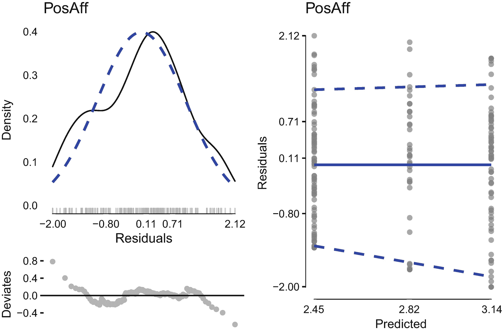

图 13-3  
ANOVA 的诊断图

```
plot(modelDiagnostics(anova1$aov), ncol = 2)
```

至此，我们所知道的是，并非所有压力类别的平均积极情绪都相同，F(2, 184) = 7.6, *p* < .001。但是，我们不知道平均值是多少，也不知道哪些组之间存在差异。为了更细致地理解我们的结果，我们再次求助于 `emmeans` 包。我们将平均值存储在一个对象 `anova1.means` 中：

```
anova1.means <- emmeans(object = anova1$aov,
specs = "StressCat")
```

我们可以使用 `summary()` 函数来查看平均值，并检验每个平均值是否显著不等于零（尽管在这个案例中，这并不是一个特别有趣的假设）。换句话说，此处的 p 值并不太值得关注。而平均值本身则更有意义：

```
summary(anova1.means, infer = TRUE)
##  StressCat emmean    SE  df lower.CL upper.CL t.ratio p.value
##  0           3.14 0.130 184     2.88     3.39 24.090  <.0001
##  1           2.82 0.174 184     2.48     3.16 16.197  <.0001
##  2+          2.45 0.119 184     2.22     2.69 20.549  <.0001
##
## Confidence level used: 0.95
```


查看各种均值有助于我们理解压力的影响，而不仅仅是 F 比率告诉我们压力类别与积极情感相关。

为了更好地理解，我们可以用图形展示均值。我们在均值对象上使用`plot()`函数，该函数在后台使用了`ggplot2`包。由于这是一个`ggplot2`图表，我们可以使用熟悉的代码对其进行一些修改和标注。我们使用一行新代码`coord_flip()`来翻转坐标，使`PosAff`位于 Y 轴，`StressCat`位于 X 轴。最终结果如图 13-4 所示。哪两组之间互不相同变得更加清晰——即置信带不重叠的两组（也就是组 0 和组 2+）：

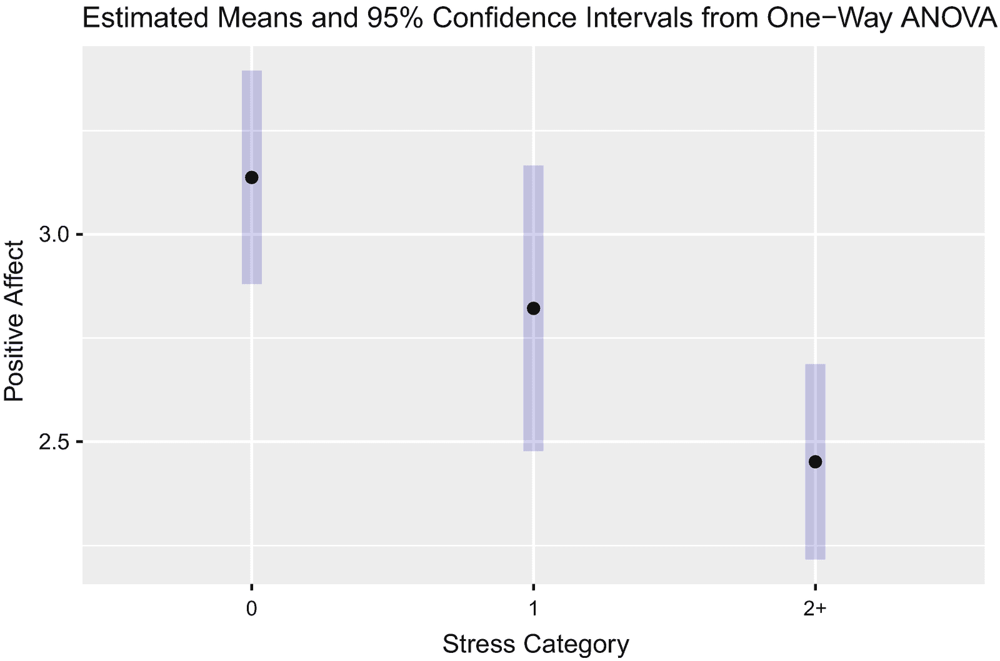

**图 13-4** ANOVA 均值图

```
plot(anova1.means) +
xlab("Positive Affect") +
ylab("Stress Category") +
coord_flip() +
ggtitle("Estimated Means and 95% Confidence Intervals from One-Way ANOVA")
```

最后，为了确认我们的视觉观察，我们使用`pairs()`函数获取压力组之间的所有成对比较。这与我们在第 11 章回归中对分类预测变量使用的方法相同：

```
pairs(anova1.means)
##  contrast estimate    SE  df t.ratio p.value
##  0 - 1       0.316 0.217 184 1.451   0.3172
##  0 - (2+)    0.685 0.177 184 3.880   0.0004
##  1 - (2+)    0.370 0.211 184 1.751   0.1893
##
## P value adjustment: tukey method for comparing a family of 3 estimates
```

`pairs()`函数进行了一些更复杂的计算，因此我们得到了使用 Tukey 方法进行多重比较校正后的 p 值（这里 p 值再次成为关注点）。Tukey 方法虽然比前面提到的 Bonferroni 校正更复杂，但效果更好。结果显示，压力为 0 与压力为 2+的组别在平均积极情感值上存在显著差异（*p* < .001）。根据 p 值，其他成对比较均无统计学显著性。

现在我们已经看到了一个完整的单因素方差分析示例。我们了解了如何检验假设、估计方差分析、进行后续检验以及获取效应量。

### 示例

现在你已经了解了此过程的所有机制，可以尝试另一个分析了。你将注意力转向企鹅，特别是栖息在所有三个岛屿上的阿德利企鹅。你通过在列操作中使用`.N`和合适的`by`语句来确认这一点：

```
penguinsData[order(species, island),
.N,
by = .(species, island)]
##      species    island   N
## 1:    Adelie    Biscoe  44
## 2:    Adelie     Dream  56
## 3:    Adelie Torgersen  52
## 4: Chinstrap     Dream  68
## 5:    Gentoo    Biscoe 124
```

你的问题依然是：“哪个岛屿最适合阿德利企鹅寻找最多的食物？”

你快速将阿德利企鹅的数据保存到一个用于方差分析的数据集中，并花时间确保你感兴趣的两个变量（岛屿和体重）中没有缺失值：

```
aovPenguins <- penguinsData[ species == "Adelie" &
!is.na(body_mass_g) &
!is.na(island)]
```

企鹅数据集缺少一个 ID 变量。记住`.N`用于计算值的总数，而`1:10`会列出数字 1 到 10，你创建了一个名为`ID`的新列，编号从 1 到阿德利企鹅的总数。你将此列设置为因子变量（这是`ezANOVA()`所要求的），并快速查看你打算使用的变量：

```
aovPenguins[ , ID := 1:.N]
aovPenguins[, ID := factor(ID)]
str(aovPenguins[, .(ID, island,body_mass_g)])
## Classes 'data.table' and 'data.frame':       151 obs. Of  3 variables:
##  $ ID         : Factor w/ 151 levels "1","2","3","4",..: 1 2 3 4 5 6 7 8 9 10 ...
##  $ island     : Factor w/ 3 levels "Biscoe","Dream",..: 3 3 3 3 3 3 3 3 3 3 ...
##  $ body_mass_g: int  3750 3800 3250 3450 3650 3625 4675 3475 4250 3300 ...
##  - attr(*, ".internal.selfref")=
```

你现在准备使用`ezANOVA()`函数，并将输出赋值给`anovaP1`。请注意，你的因子化分类预测变量是`island`，而数值型结果变量是`body_mass_g`：

```
anovaP1 <- ezANOVA(
data = aovPenguins,
dv = body_mass_g,
wid = ID,
between = island,
type = 3,
detailed = TRUE,
return_aov = TRUE)
## Warning: Data is unbalanced (unequal N per group). Make sure you specified a well-considered value for the type argument to ezANOVA().
## Coefficient covariances computed by hccm()
print(anovaP1)
## $ANOVA
##        Effect DFn DFd       SSn      SSd         F          p p<.05
## 1 (Intercept)   1 148 2.049e+09 31528779 9.616e+03 1.533e-136     *
## 2      island   2 148 1.365e+04 31528779 3.205e-02 9.685e-01
##         ges
## 1 0.9848427
## 2 0.0004329
##
## $'Levene's Test for Homogeneity of Variance'
##   DFn DFd   SSn      SSd      F     p p<.05
## 1   2 148 16967 11425914 0.1099 0.896
##
## $aov
## Call:
##    aov(formula = formula(aov_formula), data = data)
##
## Terms:
##                   island Residuals
## Sum of Squares     13655  31528779
## Deg. of Freedom        2       148
##
## Residual standard error: 461.6
## Estimated effects may be unbalanced
```

在`print()`输出中，你看到`island`没有显著的 p 值（0.9685）。这基本结束了你关于阿德利企鹅是否存在理想岛屿以享受无尽盛宴的希望（或者说，所有岛屿的食物都同样充足）。至少 Levene 检验显示不显著的 p 值为 0.896；方差很可能是相等的（这很好）。

运行模型诊断可能有些过度。然而，为了确保无误，你检查了`emmeans()`并查看了`summary()`结果。虽然在这个视图中 p 值不是关注点，但值得注意的是，边际均值都非常接近：

```
anovaP1.means <- emmeans(object = anovaP1$aov,
specs = "island")
summary(anovaP1.means, infer = TRUE)
##  island    emmean   SE  df lower.CL upper.CL t.ratio p.value
##  Biscoe      3710 69.6 148     3572     3847 53.310  <.0001
##  Dream       3688 61.7 148     3567     3810 59.800  <.0001
##  Torgersen   3706 64.6 148     3579     3834 57.350  <.0001
##
## Confidence level used: 0.95
```

对图 13-5 的快速目视检查显示，所有这些置信区间都重叠了。就体重而言，每个岛屿上的企鹅之间根本没有差异：

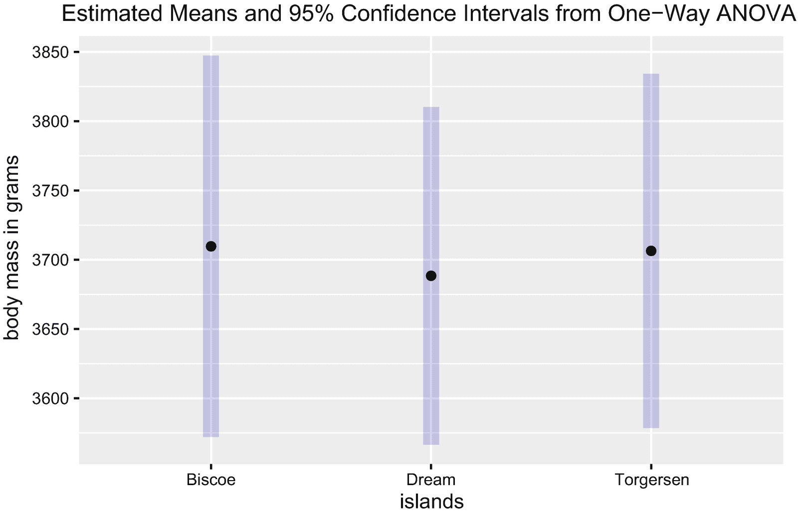

**图 13-5** ANOVA 均值图

```
plot(anovaP1.means) +
xlab("body mass in grams") +
ylab("islands") +
coord_flip() +
ggtitle("Estimated Means and 95% Confidence Intervals from One-Way ANOVA")
```

快速查看`pairs()`结果确认了这一点。各对之间没有显著的 p 值：

```
pairs(anovaP1.means)
##  contrast           estimate   SE  df t.ratio p.value
##  Biscoe - Dream        21.27 93.0 148  0.229  0.9716
##  Biscoe - Torgersen     3.29 95.0 148  0.035  0.9993
##  Dream - Torgersen    -17.98 89.3 148 -0.201  0.9779
```

```
##
## P value adjustment: tukey method for comparing a family of 3 estimates
```

请注意，一旦你熟悉了这类分析，在`R`中检验一个假设并不会花费太长时间。在下一节中，我们将考虑包含两个自变量的示例。

## 13.4 因子方差分析

因子方差分析是一种包含多个自变量的方差分析，其中包含了所有自变量所有可能的组合。它是一个统称，因为“多个”就属于这一类。


### 示例

在接下来的示例中，我们将同时考虑压力类别（即`StressCat`）和生理性别（即`Female`），其中女性编码为 1，男性编码为 0。`ezANOVA()`函数要求所有预测变量均以因子形式存储，因此我们需先将`Female`转换为因子：

```
aovdata[, Female := factor(Female)]
```

若要查看交叉因子结构，我们可以使用标准的`data.table`技术。具体而言，我们可通过`.N`列操作并结合适当的`by =`语句，统计每对类别中的研究参与者人数：

```
aovdata[order(StressCat, Female),
.N,
by = .(StressCat, Female)]
##    StressCat Female  N
## 1:         0      0 26
## 2:         0      1 42
## 3:         1      0 13
## 4:         1      1 25
## 5:        2+      0 34
## 6:        2+      1 47
```

然而，交叉分类因子在实际应用中十分常见，因此基础`R`语言提供了一个名为`xtabs()`的专用函数。该函数可生成频率交叉表，运用熟悉的公式结构展示所有单元格中的人数（频数）。无论采用哪种方法，所有组合的单元格或行数值均相同（例如，`StressCat`为 1 且`Female`为 1 的组合人数为 25）：

```
xtabs(formula = ˜ StressCat + Female,
data = aovdata)
##           Female
## StressCat   0  1
##         0  26 42
##         1  13 25
##        2+  34 47
```

结果显示，尽管某些单元格的人数少于其他单元格，但人数最少的单元格有 13 人（压力类别为 1 的男性），而人数最多的单元格有 47 人（压力类别为 2+ 的女性）。

为了拟合双因素（因为我们有两个自变量）因子方差分析，我们再次使用`ezANOVA()`函数。代码与之前的示例几乎完全相同，只是在`between`参数中增加了`Female`作为另一个变量。同样，我们可以打印结果来查看输出：

```
anova2 <- ezANOVA(
data = aovdata,
dv = PosAff,
wid = UserID,
between = .(StressCat, Female),
type = 3, detailed = TRUE,
return_aov = TRUE)
## Warning: Data is unbalanced (unequal N per group). Make sure you specified a well-considered value for the type argument to ezANOVA().
## Coefficient covariances computed by hccm()
print(anova2)
## $ANOVA
##             Effect DFn DFd       SSn   SSd         F         p p<.05
## 1      (Intercept)   1 181 1205.8395 205.5 1062.0816 1.186e-77     *
## 2        StressCat   2 181   15.8228 205.5    6.9682 1.215e-03     *
## 3           Female   1 181    0.6124 205.5    0.5394 4.636e-01
## 4 StressCat:Female   2 181    6.6638 205.5    2.9347 5.568e-02
##        ges
## 1 0.854394
## 2 0.071492
## 3 0.002971
## 4 0.031409
##
## $'Levene's Test for Homogeneity of Variance'
##   DFn DFd   SSn   SSd      F      p p<.05
## 1   5 181 1.378 73.52 0.6787 0.6401
##
## $aov
## Call:
##    aov(formula = formula(aov_formula), data = data)
##
## Terms:
##                 StressCat Female StressCat:Female Residuals
## Sum of Squares      17.46   0.01             6.66    205.50
## Deg.of Freedom          2      1                2       181
##
## Residual standard error: 1.066
## Estimated effects may be unbalanced
```

在主方差分析结果表中，我们现在可以看到`StressCat`、`Female`以及它们的交互作用`StressCat:Female`的结果。交互作用项接近但未达到统计显著性，*p* = .056。

然而，与第 12 章中讨论的带交互作用的多元回归不同，在因子方差分析中，即使交互作用不显著，我们也不会将其剔除。此外，与多元回归不同的是，`StressCat`和`Female`的结果并非仅在调节变量的特定取值下才呈现简单效应。它们仍然是主效应，捕捉了该变量的整体主效应，因此我们依然可以对其进行解释。结果表明，独立于生理性别，积极情感均值在不同压力类别间存在显著差异。同时可见，生理性别不具有主效应。效应量指标`ges`可大致理解为总方差中由压力类别主效应、生理性别主效应以及它们交互作用所解释的比例。它们并非回归中的简单效应。

Levene 方差齐性检验的结果不显著，表明我们的模型未违反齐性假设。这很好。

我们再次使用`modelDiagnostics()`查看图形以检验其他假设。正态性假设和方差齐性假设均得到满足，且未出现新的极端值，如图 13-6 所示：

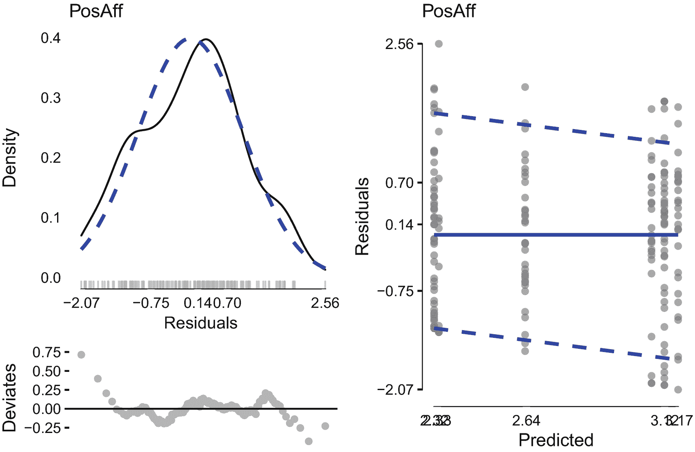

图 13-6 方差分析诊断图

```
plot(modelDiagnostics(anova2$aov), ncol = 2)
```

完成诊断后，我们可以继续获取估计均值并比较不同组别以找出差异所在。然而，对于因子方差分析，我们面临多种选择。以下简要概述各选项，并逐一进行快速示例：

- **A**：计算每个独立“单元格”（即压力类别与生理性别的交叉点）的均值。分别针对女性和男性，比较不同压力类别间的差异。
- **B**：计算每个独立“单元格”（即压力类别与生理性别的交叉点）的均值。针对每个压力类别，分别比较女性和男性之间的差异。
- **C**：计算每个压力类别的均值（跨生理性别取平均）。对压力类别进行两两比较差异。
- **D**：计算每个生理性别类别的均值（跨压力类别取平均）。对生理性别类别进行两两比较差异。

选项 A 和 B 都考虑了交互作用，然后针对不同变量进行两两检验。选项 C 和 D 都忽略了交互作用，而关注每个自变量的主效应，考虑到交互作用不显著，这并非不合理。

现在我们查看每个选项的结果。为使各选项清晰明了，我们将每个选项的代码整合在一个代码块中。

**选项 A**：计算每个独立“单元格”（即压力类别与生理性别的交叉点）的均值。使用`emmeans()`中的`by = "Female"`参数，分别针对女性和男性比较不同压力类别间的差异：

```
anova2.meansA <- emmeans(object = anova2$aov,
specs = "StressCat",
by = "Female")
summary(anova2.meansA, infer = TRUE)
## Female = 0:
##  StressCat emmean    SE  df lower.CL upper.CL t.ratio p.value
##  0          3.17 0.209 181     2.75     3.58 15.153  <.0001
##  1          2.33 0.296 181     1.75     2.92  7.903  <.0001
##  2+         2.63 0.183 181     2.27     3.00 14.420  <.0001
##
## Female = 1:
##  StressCat emmean    SE  df lower.CL upper.CL t.ratio p.value
##  0          3.12 0.164 181     2.79     3.44 18.969  <.0001
##  1          3.07 0.213 181     2.65     3.50 14.426  <.0001
##  2+         2.32 0.155 181     2.01     2.63 14.922  <.0001
##
## Confidence level used: 0.95
```


好的，作为一名高级文档工程师和翻译员，我将严格遵循您的注意事项和示例，将给定的英文文本翻译成中文。


图 13-7 中的均值图将女性和男性分为不同的面板，x 轴是压力类别，y 轴是积极情感。我们可以看到不同压力类别的平均积极情感略有不同，男性在压力类别 1 时积极情感最低，而女性在压力类别 2+ 时积极情感最低：

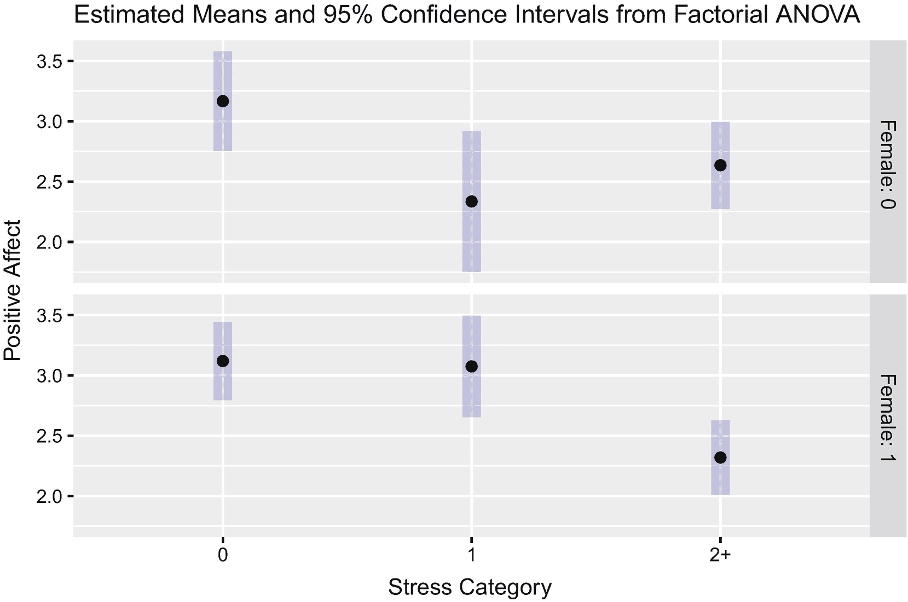

**图 13-7** 因子方差分析均值图 – 选项 A

```
plot(anova2.meansA) +
xlab("Positive Affect") +
ylab("Stress Category") +
coord_flip() +
ggtitle("Estimated Means and 95% Confidence Intervals from Factorial ANOVA")
```

在成对比较中，对于男性 (`Female = 0`)，所有压力类别的成对比较均未达到统计显著性。对于女性 (`Female = 1`)，压力类别 2+ 的积极情感显著低于压力类别 0 和 1（两者 *p* ≤ .01）。

```
pairs(anova2.meansA)
## Female = 0:
##  contrast estimate    SE  df t.ratio p.value
##  0 - 1      0.8311 0.362 181  2.296  0.0589
##  0 - (2+)   0.5314 0.278 181  1.914  0.1375
##  1 - (2+)  -0.2997 0.347 181 -0.863  0.6646
##
## Female = 1:
##  contrast estimate    SE  df t.ratio p.value
##  0 - 1      0.0445 0.269 181  0.165  0.9850
##  0 - (2+)   0.7996 0.226 181  3.534  0.0015
##  1 - (2+)   0.7551 0.264 181  2.863  0.0130
##
## P value adjustment: tukey method for comparing a family of 3 estimates
```

**选项 B**：计算每个单独“单元格”（即压力类别和生物学性别的交叉点）的均值。使用 `emmeans()` 函数中的 `by = "StressCat"` 参数，单独比较每个压力类别中女性和男性之间的差异：

```
## calculate the estimated means
anova2.meansB <- emmeans(object = anova2$aov,
specs = "Female",
by = "StressCat")
## print the means
summary(anova2.meansB, infer = TRUE)
## StressCat = 0:
##  Female emmean    SE  df lower.CL upper.CL t.ratio p.value
##  0        3.17 0.209 181     2.75     3.58 15.153  <.0001
##  1        3.12 0.164 181     2.79     3.44 18.969  <.0001
##
## StressCat = 1:
##  Female emmean    SE  df lower.CL upper.CL t.ratio p.value
##  0        2.33 0.296 181     1.75     2.92  7.903  <.0001
##  1        3.07 0.213 181     2.65     3.50 14.426  <.0001
##
## StressCat = 2+:
##  Female emmean    SE  df lower.CL upper.CL t.ratio p.value
##  0        2.63 0.183 181     2.27     3.00 14.420  <.0001
##  1        2.32 0.155 181     2.01     2.63 14.922  <.0001
##
## Confidence level used: 0.95
```

图 13-8 中的均值图将每个压力类别分为独立的面板，x 轴是生物学性别，y 轴是积极情感。我们可以看到不同压力类别的平均积极情感略有不同。男性和女性似乎仅在压力类别为 1 时存在差异。请注意，这些实际上是与**选项 A** 相同的均值和置信区间，只是重新排列并以不同的布局呈现：

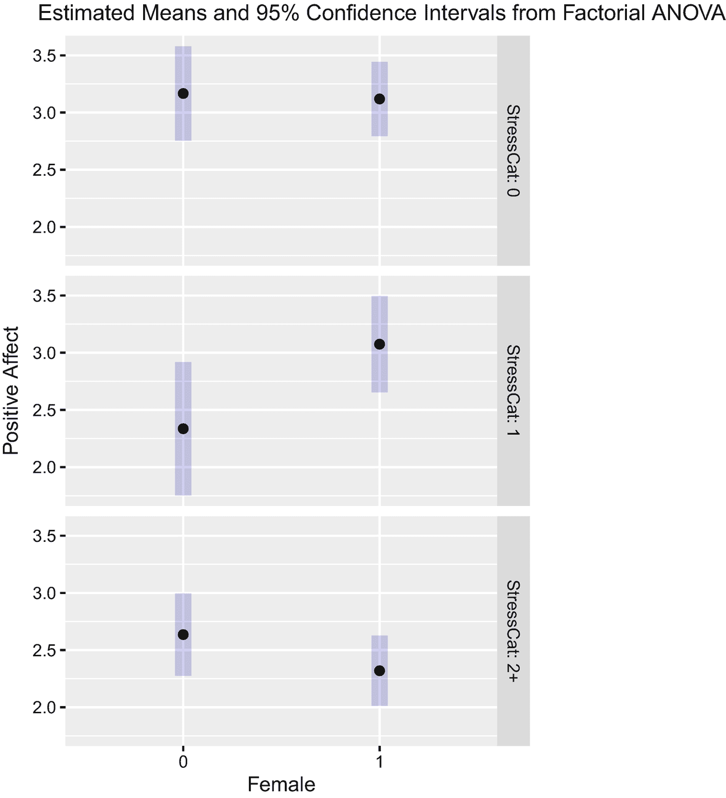

**图 13-8** 因子方差分析均值图 – 选项 B

```
plot(anova2.meansB) +
xlab("Positive Affect") +
ylab("Female") +
coord_flip() +
ggtitle("Estimated Means and 95% Confidence Intervals from Factorial ANOVA")
```

在成对比较中，我们确认男性和女性仅在压力类别为 1 (*p* = .040) 时，在积极情感方面存在显著差异，其模式表现为：当压力类别为 1 时，男性的积极情感低于女性：

```
pairs(anova2.meansB)
## StressCat = 0:
##  contrast estimate    SE  df t.ratio p.value
##  0 - 1      0.0477 0.266 181  0.180  0.8577
##
## StressCat = 1:
##  contrast estimate    SE  df t.ratio p.value
##  0 – 1     -0.7389 0.364 181 -2.028  0.0440
##
## StressCat = 2+:
##  contrast estimate    SE  df t.ratio p.value
##  0 – 1      0.3159 0.240 181  1.317  0.1896
```

**选项 C**：计算每个压力类别的均值，并对生物学性别进行平均。比较压力类别之间的成对差异。

此选项对生物学性别的均值和成对比较进行了平均。剩下的只是压力类别的影响：

```
anova2.meansC <- emmeans(object = anova2$aov,
specs = "StressCat",
by = NULL)
## NOTE: Results may be misleading due to involvement in interactions
summary(anova2.meansC, infer = TRUE)
```

```
##  StressCat emmean    SE  df lower.CL upper.CL t.ratio p.value
##  0           3.14 0.133 181     2.88     3.40 23.639  <.0001
##  1           2.70 0.182 181     2.35     3.06 14.848  <.0001
##  2+          2.48 0.120 181     2.24     2.71 20.652  <.0001
##
## Results are averaged over the levels of: Female
## Confidence level used: 0.95
```

这些均值都不会与选项 A 或选项 B 中的均值完全相同，因为单个单元格的均值已被合并，这些是“边际”均值，因为它们位于进行平均的表格的“边缘”。

图 13-9 中的均值图现在仅按压力类别显示均值，而未按生物学性别区分。我们可以看出，总体上，积极情感随着压力类别的增加而下降：

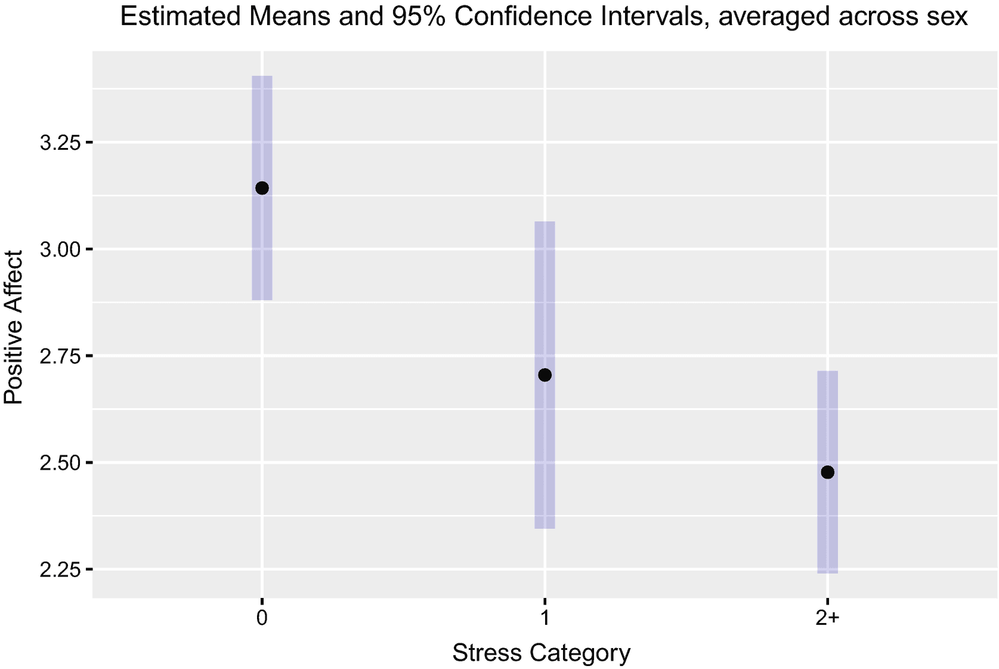

**图 13-9** 因子方差分析均值图 – 选项 C

```
plot(anova2.meansC) +
xlab("Positive Affect") +
ylab("Stress Category") +
coord_flip() +
ggtitle("Estimated Means and 95% Confidence Intervals, averaged across sex")
```

成对比较也显示，总体而言，只有压力类别 0 和 2+ 之间存在统计学上的显著差异，其他成对比较未达到统计显著性：

```
pairs(anova2.meansC)
##  contrast estimate    SE  df t.ratio p.value
##  0 - 1       0.438 0.226 181 1.941   0.1301
##  0 - (2+)    0.665 0.179 181 3.717   0.0008
##  1 - (2+)    0.228 0.218 181 1.044   0.5502
##
## Results are averaged over the levels of: Female
## P value adjustment: tukey method for comparing a family of 3 estimates
```

**选项 D**：计算每个生物学性别类别的均值，并对压力类别进行平均。比较生物学性别类别之间的成对差异。

此选项对压力类别的均值和成对比较进行了平均。剩下的只是生物学性别的影响：

```
anova2.meansD <- emmeans(object = anova2$aov,
specs = "Female",
by = NULL)
## NOTE: Results may be misleading due to involvement in interactions
summary(anova2.meansD, infer = TRUE)
##  Female emmean    SE  df lower.CL upper.CL t.ratio p.value
##  0        2.71 0.135 181     2.45     2.98 20.069  <.0001
##  1        2.84 0.104 181     2.63     3.04 27.387  <.0001
##
## Results are averaged over the levels of: StressCat
## Confidence level used: 0.95
```

这些均值都不会与选项 A 或选项 B 中的均值完全相同，因为单个单元格的均值已被合并，这些是“边际”均值，因为它们位于进行平均的表格的“边缘”。图 13-10 中的均值图现在仅按生物学性别显示均值，而未按压力类别区分。我们可以看出，总体而言，女性的积极情感高于男性：

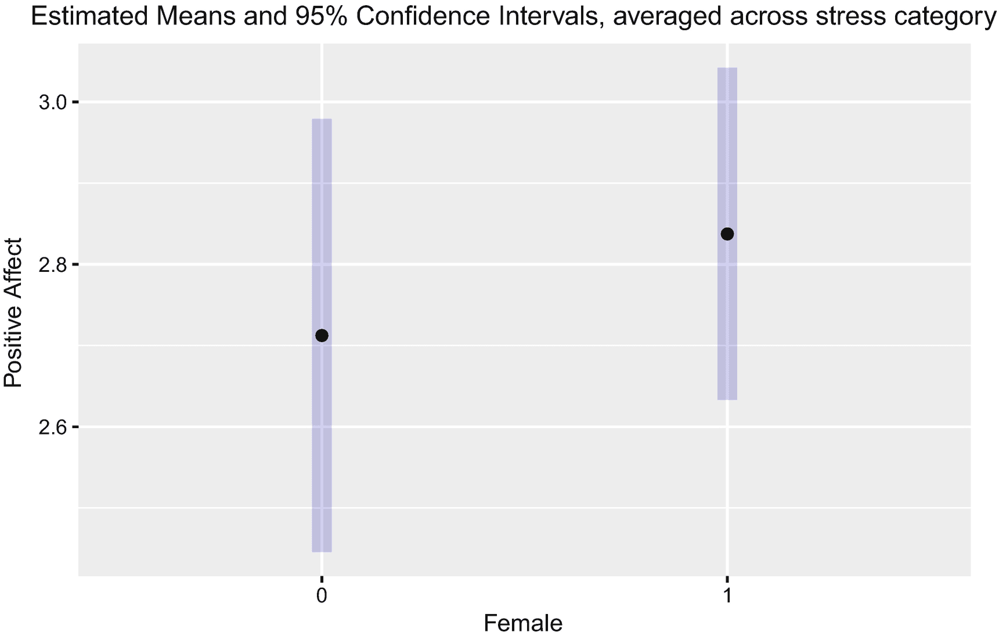

**图 13-10** 因子方差分析均值图 – 选项 D


```r
plot(anova2.meansD) +
xlab("积极情绪") +
ylab("女性") +
coord_flip() +
ggtitle("估计均值与 95%置信区间（按压力类别平均）")
```

女性和男性之间的成对比较显示，虽然均值并非完全相同，但它们在统计上并无显著差异：

```r
pairs(anova2.meansD)
##  contrast estimate   SE  df t.ratio p.value
##  0 - 1      -0.125 0.17 181 -0.735  0.4636
##
## Results are averaged over the levels of: StressCat
```

以上就是因子方差分析的全部内容。在实践中，人们通常不会计算并报告我们为估计均值和成对比较展示的所有选项（A – D）。然而，为了完整性和展示可能性，我们包含了所有这些选项。通常情况下，人们会选择一两种最直观、最适合数据解释的选项。

例如，如果交互作用在统计上完全不够显著，那么重点关注选项 C 或 D 可能更合理。如果交互作用显著，那么某个变量的平均值可能就没有意义，因此通常在选项 A 和 B 之间选择最合适——这两者实际上是相同的均值，只是排列方式不同。具体选择哪种呈现结果最有效，由数据分析者自行决定。

### 示例

最后一次，你坐下来深入学习关于企鹅的知识。你相当确信岛屿并不能解释体重差异，于是决定尝试用`species`（物种）和生物`sex`（性别）来分析。具体来说，你认为企鹅的体重（以克为单位）可以通过物种和性别来预测。你知道这类方差分析需要因子型预测变量（因此称为因子方差分析）。通过`str()`快速查看企鹅数据集后，你发现这两个变量已经是因子类型了。一切顺利：

```r
str(penguinsData)
## Classes 'data.table' and 'data.frame':       344 obs. of 8 variables:
##  $ species          : Factor w/ 3 levels "Adelie","Chinstrap",.. : 1 1 1 1 1 1 1 1 1 1 ...
##  $ island           : Factor w/ 3 levels "Biscoe","Dream",..: 3 3 3 3 3 3 3 3 3 3 ...
##  $ bill_length_mm   : num  39.1 39.5 40.3 NA 36.7 39.3 38.9 39.2 34.1 42 ...
##  $ bill_depth_mm    : num  18.7 17.4 18 NA 19.3 20.6 17.8 19.6 18.1 20.2 ...
##  $ flipper_length_mm: int  181 186 195 NA 193 190 181 195 193 190 ...
##  $ body_mass_g      : int  3750 3800 3250 NA 3450 3650 3625 4675 3475 4250 ...
##  $ sex              : Factor w/ 2 levels "female","male": 2 1 1 NA 1 2 1 2 NA NA ...
##  $ year             : int  2007 2007 2007 2007 2007 2007 2007 2007 2007 2007 ...
##  - attr(*, ".internal.selfref")=
```

你也知道需要排除缺失值。由于这次需要所有企鹅物种，之前示例的数据集就不适用了。通过行选择操作和对`is.na()`取反（使用`!`），你能够移除体重、物种或性别中至少有一项缺失的企鹅：

```r
aovPenguinsFull <- penguinsData[!is.na(body_mass_g) &
!is.na(species) &
!is.na(sex)]
```

你还记得`ezANOVA()`函数需要一个 ID 变量（也必须是因子类型）。沿用之前的解决方案，你在数据集中添加了一列 ID：

```r
aovPenguinsFull[ , ID := 1:.N]
aovPenguinsFull[, ID := factor(ID)]
```

使用`xtabs()`函数，你发现在频次交叉表中，每种类型的企鹅数量似乎都很充足：

```r
xtabs(formula = ˜ species + sex,
data = aovPenguinsFull)
##            sex
## species     female male
##   Adelie        73   73
##   Chinstrap     34   34
##   Gentoo        58   61
```

接下来，只需简单调整前面示例中的代码即可。经过几次变量替换，你就得到了一个双因素因子方差分析：

```r
anovaP2 <- ezANOVA(
data = aovPenguinsFull, dv = body_mass_g,
wid = ID,
between = .(species, sex),
type = 3, detailed = TRUE,
return_aov = TRUE)
## Warning: Data is unbalanced (unequal N per group). Make sure you specified a well-considered value for the type argument to ezANOVA().
## Coefficient covariances computed by hccm()
print(anovaP2)
## $ANOVA
##        Effect DFn DFd       SSn      SSd         F          p p<.05
## 1 (Intercept)   1 327 5.233e+09 31302628 54661.828  0.000e+00     *
## 2     species   2 327 1.430e+08 31302628   746.924 1.185e-122     *
## 3         sex   1 327 2.985e+07 31302628   311.838  1.761e-49     *
## 4 species:sex   2 327 1.677e+06 31302628     8.757  1.973e-04     *
##       ges
## 1 0.99405
## 2 0.82041
## 3 0.48813
## 4 0.05084
##
## $'Levene's Test for Homogeneity of Variance'
##   DFn DFd    SSn      SSd     F      p p<.05
## 1   5 327 240535 11310528 1.391 0.2272
##
## $aov
## Call:
##    aov(formula = formula(aov_formula), data = data)
##
## Terms:
##                   species      sex species:sex Residuals
## Sum of Squares  145190219 37090262     1676557  31302628
## Deg.of Freedom          2        1           2       327
##
## Residual standard error: 309.4
## Estimated effects may be unbalanced
```

与之前的示例不同，交互项`species:sex`在*α*=0.05 水平上也是显著的。你当然仍然保留这一项；这次你明白了，不同物种之间的差异部分取决于性别。

你记得对于莱文检验，理想情况是 p 值不显著。本例中正是如此，你对此感到满意。


快速查看图 13-11 可知，左下角没有异常值，偏差主要落在直线上，右侧大致平行。一切看起来正常：

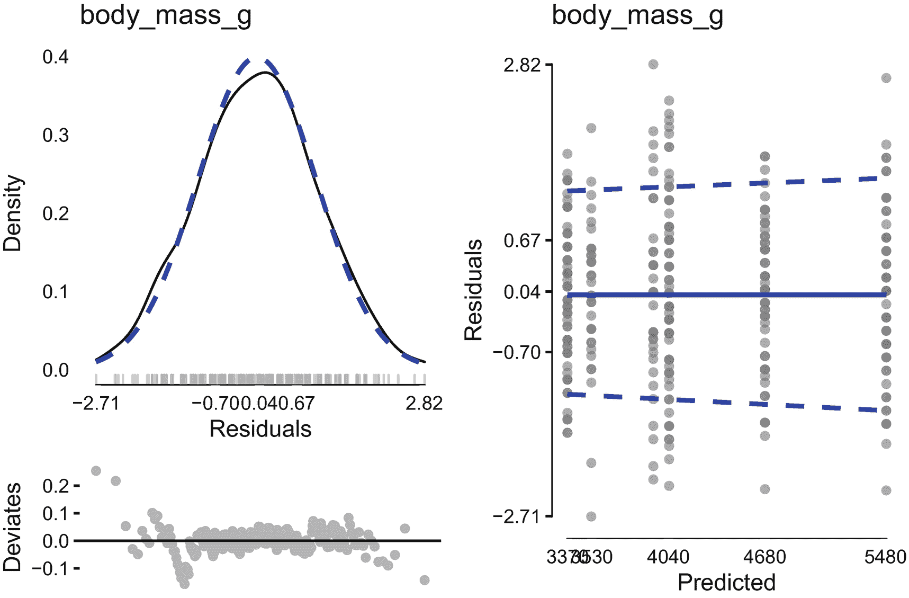

**图 13-11**  
方差分析的诊断图

```
plot(modelDiagnostics(anovaP2$aov), ncol = 2)
```

由于交互作用显著，从前一个示例讨论的选项 A 或 B 中选择一个是有意义的。您决定使用“A”模型，即在每个单独的“单元格”（物种与生物性别的交叉）中计算平均值。您将分别比较雌性和雄性在不同物种类别（例如，阿德利、金图与帽带）之间的差异。

```
anovaP2.meansA  <- emmeans(object = anovaP2$aov,
specs = "species",
by = "sex")
summary(anovaP2.meansA, infer = TRUE)
## sex = female:
##  species   emmean   SE  df lower.CL upper.CL  t.ratio p.value
##  Adelie      3369 36.2 327     3298     3440   93.030 <.0001
##  Chinstrap   3527 53.1 327     3423     3632   66.470 <.0001
##  Gentoo      4680 40.6 327     4600     4760  115.190 <.0001
##
## sex = male:
##  species   emmean   SE  df lower.CL upper.CL t.ratio p.value
##  Adelie      4043 36.2 327     3972     4115 111.660 <.0001
##  Chinstrap   3939 53.1 327     3835     4043  74.230 <.0001
##  Gentoo      5485 39.6 327     5407     5563 138.460 <.0001
##
## Confidence level used: 0.95
```

虽然摘要信息在数值上很清晰（并且您可以看到 p 值都很显著），但图表通常能最好地展示实际发生的情况。在图 13-12 中，您可以看到物种与性别交互作用的可视化效果。查看图表，金图企鹅雄性个体的体重远大于其他物种，甚至大于金图企鹅雌性。正是物种与性别的组合使得金图企鹅雄性如此庞大：

```
plot(anovaP2.meansA) +
xlab("Body Mass") +
ylab("species") + coord_flip() +
ggtitle("Estimated Means and 95% Confidence Intervals from Factorial ANOVA")
```

在成对比较中，除了阿德利企鹅与帽带企鹅的雄性之外，所有差异都很显著。在图 13-12 的图表中，您可以看到阿德利企鹅和帽带企鹅的雄性个体都非常接近 4000 这条线：

```
pairs(anovaP2.meansA)
## sex = female:
##  contrast           estimate   SE  df t.ratio p.value
##  Adelie - Chinstrap     -158 64.2 327  -2.465 0.0377
##  Adelie - Gentoo       -1311 54.4 327 -24.088 <.0001
##  Chinstrap - Gentoo    -1152 66.8 327 -17.246 <.0001
##
## sex = male:
##  contrast           estimate   SE  df t.ratio p.value
##  Adelie - Chinstrap      104 64.2 327  1.627  0.2357
##  Adelie - Gentoo       -1441 53.7 327 -26.855 <.0001
##  Chinstrap - Gentoo    -1546 66.2 327 -23.345 <.0001
##
## P value adjustment: tukey method for comparing a family of 3 estimates
```

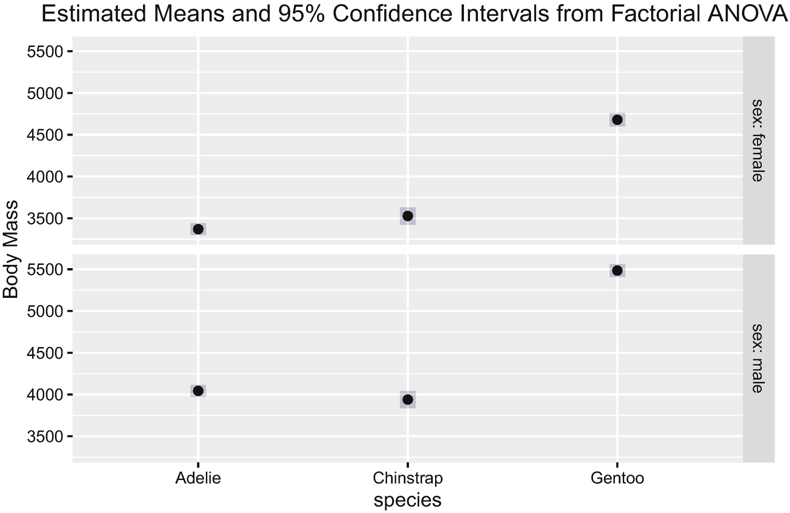

**图 13-12**  
析因方差分析均值图 – 选项 A

您终于找到了一种预测企鹅体重的有效方法。

## 13.5 总结

通过本章对单因素和双因素（析因）方差分析的探索，您已经到达了本书的终点。与大多数事情一样，您练习得越多，运用这些不同分析技术就越熟练。更重要的是，您现在像一名数据科学家一样思考。您对 RStudio 和 `R` 已经相当熟悉了——这两项技能务必添加到您的简历中。

特别地，您已经注意到 `R` 非常擅长遵循一个通用框架。相同的 `formula =` 参数是计算统计模型的函数中常见的特征。更难掌握的技能是理解何时使用哪种模型。这在一定程度上需要练习和反复阅读。在本书的第二遍阅读中，您很可能会注意到那些更有意义、更重要的细节和假设。

从这里开始，在继续学习数据的道路上，您有两条相互关联但又可能不同的路径可以考虑。如果您需要成为模型背后假设和数学方面的高度专家，那么对统计理论的正式学习可能很有价值。那条路最终会引导您学习微积分。另一条路是继续您的 `R` 之旅。许多 `R` 专家拥有数学、计算机科学或统计学特定领域之外的背景。尽管如此，他们通过使用 `CRAN` 上的众多 `R` 包，能够完成一些相当惊人的科学工作。

好消息是，您可以选择其中一条或两条路（并且可以随时在它们之间来回切换）。我们中的一位是受过经典训练的数学家，并完成过正式的编程课程。另一位是心理学家，在 `CRAN` 上拥有多个 `R` 包。`R` 社区一个非常好的特点是它对新的终身学习者的欢迎态度及其多样性。

在您从新手迈向专家的旅程中练习最后这些技能时，表 13-1 应该能作为您在本章学到的主要想法的良好参考。

**表 13-1**  
章节总结

| 概念 | 含义 |
| --- | --- |
| `ezANOVA()` | 用于拟合单因素和析因方差的函数。 |
| `emmeans()` | 基于方差分析获取估计的单元格均值或边际均值。 |
| `xtab()` | 显示两个或多个类别之间的汇总计数。 |

## 13.6 掌握练习

通过完成一些练习来检查您的进步并获得成长。理解力检验会提出批判性思维问题，最好以书面或口头形式回答。统计艺术的一部分在于成功地向利益相关者或受众传达结果。有时受众是高度技术性的，其他时候则非常不技术。练习是对本章探索概念的更直接应用。

### 理解力检验

1.  在方差分析中，如果交互作用不显著，是否要将其移除？
2.  预测变量可以是比率水平数据用于方差分析吗？

### 练习

1.  是否可能完成最后一个示例，仅将 `species` 替换为 `island`？用代码进行实验，看看会发生什么。
2.  重做关于企鹅物种和生物性别的最后一个示例。但是，将体质量替换为鳍状肢长度。您看到了什么？在方法 A、B、C 和 D（参考倒数第二个示例）中，哪条路线最有希望探索？
3.  重做关于企鹅物种和生物性别的最后一个示例。但是，将体质量替换为喙深度。您看到了什么？在方法 A、B、C 和 D（参考倒数第二个示例）中，哪条路线最有希望探索？


好的，作为一名高级文档工程师，我将遵循您提供的所有规则和示例，为您排版以下内容。

---

