# 第 6 章：网站监控

在本章中，您将学习如何建模并创建一个网站监控工具，该工具包含报表和仪表盘，可帮助企业的 IT 和业务部门衡量在线零售商店网站（例如`MyGizmoStore.com`）的不同方面。

## 监控网站

企业通常使用网站监控来确保其网站正常运行并能响应用户请求。在对网站或应用程序进行更新并投入生产之前，IT 部门通常会模拟数千名访问者访问网站的行为，并观察网站或应用程序的响应情况。他们还会模拟来自不同地理区域和服务器的访问者。

我们为`MyGizmoStore.com`创建的示例数据与这种方法非常相似，包含一组定义明确且可自定义的模式。当网页或网站的部分功能出现故障时，监控工具会发送告警，使 IT 部门能够更快地解决问题。您在第 5 章中了解了如何使用 Splunk 告警获取通知。

监控对于确保网站对用户可用并最大限度减少停机时间至关重要。依赖网站或应用程序进行工作的用户，如果其可靠性无法保证，可能会感到沮丧，甚至停止使用该应用程序。如果网站是在线业务（如`MyGizmoStore.com`），这一点就更加关键，因为网站失效意味着客户会转向竞争对手购买，从而导致收入损失。监控可以涵盖应用程序或网站运行所需的许多方面：网络连接、DNS 记录、数据库连接、带宽以及计算机资源（如 RAM、CPU 负载、磁盘空间、事件等）。IT 方面常用的衡量指标包括响应时间、服务器可用性、流量模式；而业务方面则包括用户人口统计数据、用户在网站上花费的时间、新用户与现有用户的数量对比等。

在第 2 章、第 3 章和第 4 章中，您学习了如何使用不同的 SPL 命令处理、分析和可视化数据。在本章中，我们将利用您之前学到的不同 SPL 命令和搜索方法，着手创建一个网站监控工具，帮助我们监控`MyGizmoStore.com`站点。本章将回顾之前的一些讲解，并补充一些想法，介绍如何快速集合并生成一些关键报表，这些报表可从 IT 和业务角度出发，并通过仪表盘进行监控。当您在本书后续章节处理更多样化的数据集时，可以在此基础上扩展此监控工具。

我们将利用以下用例来为监控仪表盘创建报表。

### IT 运维

*   按主机统计的点击量
*   排除内部访问后的按主机统计的点击量
*   具有良好 HTTP 状态的流量
*   具有不良 HTTP 状态的流量
*   按不良 HTTP 状态排序的热门页面

### 业务

*   按地区划分的用户人口统计数据
*   跳出率
*   独立访客数

### IT 运维

### 按主机统计的点击量

在此用例中，我们希望查看指定时间段内进入`MyGizmoStore.com`主机的流量。虽然您可以使用时间轴来调整时间段，但您已经熟悉了第 5 章中使用的时间修饰符；我们将利用它们来指定时间范围。在下面的搜索中，您将查看过去七天内的事件，按主机统计事件数量，并使用`timechart`命令以图表形式呈现。您会注意到时间修饰符`earliest`的赋值中包含了`@`符号。时间修饰符允许将`@`符号作为指定值的一部分，以指示时间应如何向下取整。在我们的搜索中，我们将其向下取整到天，但您可以将时间修饰符向下取整到任何支持的时间单位，例如秒、分钟、小时、天、周、特定的星期几、月、季度和年。让我们在搜索栏中输入以下搜索：

```
sourcetype=access_*
  earliest=-7d@d
  latest=now
| timechart count by host
```

图 6-1 显示了此搜索的柱状图，图中每个柱形代表一个`MyGizmoStore.com`主机。在大多数日子里，三个主机中有两个处理的请求数量几乎相等，而另一个主机的负载较轻。IT 部门可以使用此报表并通过增加查询天数来进一步分析数据，看看能否发现三个主机中哪个主机处理的请求较少，并找出其模式。然后，他们可以微调负载均衡器，以便所有用户请求都能得到快速响应，并且硬件资源得到适当优化。我们将使用“格式选项”链接来修改图表以及`x`轴和`y`轴的标题，并将此报表保存为“按主机统计的点击量”（图 6-1）。

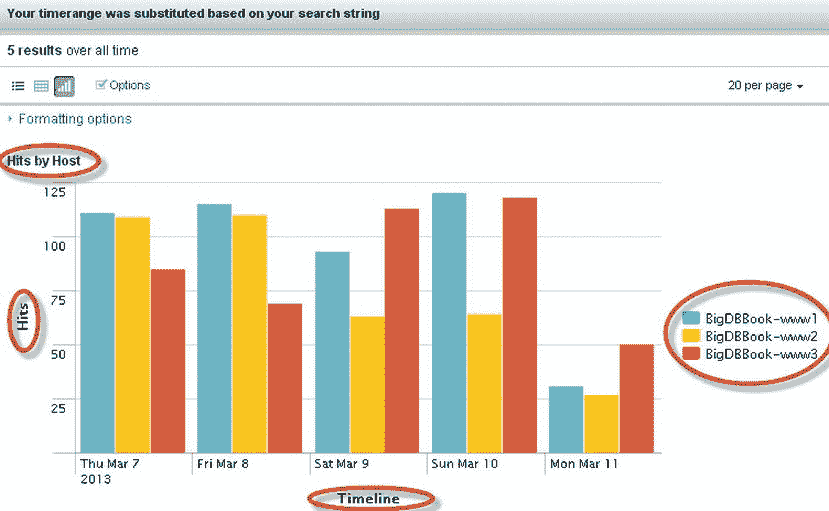

图 6-1。按主机统计的点击量

### 排除内部访问后的按主机统计的点击量

对于像`MyGizmoStore.com`这样的在线零售商店，会有来自内部员工或正在浏览或购物的用户的点击。如果排除掉来自网络内部 IP 地址的事件，那么按主机统计的点击量图表会呈现出怎样的不同，这将非常有趣。为此，我们可以修改上述搜索，只查看`clientip`字段不等于`192*`的事件。如果需要，您可以向搜索中添加更多的子网。让我们在搜索栏中输入修改后的搜索：

```
sourcetype=access_*
  earliest=-7d@d
  latest=now
  clientip != 192*
| timechart count by host
```

图 6-2 展示了更新后搜索的列类型图表。我们为`MyGizmoStore.com`提供的样本数据中内部访问事件不多，因此图表上看不出差异；但在实际应用中，比较这两张图表有助于判断内部请求是否导致请求数量偏差。IT 部门可以利用这一信息，将来自内部 IP 地址的流量分流到其他主机，以免影响外部客户。接下来，我们将修改图表以及 X 轴和 Y 轴的标题，并将此报告另存为“按主机统计的访问量（不含内部访问）”。

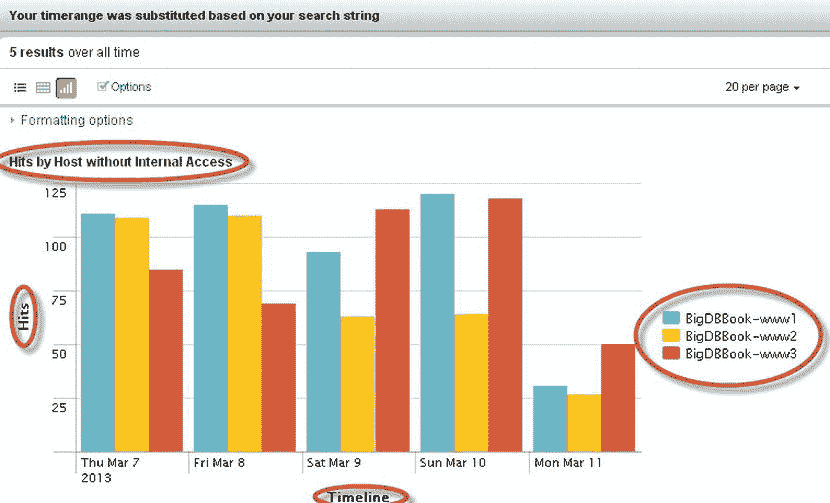

图 6-2. 按主机统计的访问量（不含内部访问）

## 具有良好 HTTP 状态码的流量

在前几章中，我们处理了使用 HTTP 状态码的搜索。从运维角度来看，了解 HTTP 流量的成功率至关重要；这能告诉我们有多少请求是成功的，多少是失败的。我们首先找出良好流量。我们在时间修饰符中使用了 15 天的时间窗口，但您可以通过设置`earliest=-24h@h`将其调整为最近 24 小时。现在，让我们在搜索栏中输入以下搜索：

```
sourcetype=access_*
  earliest=-15d@d
  latest=now
  status>100 status<300
| timechart count BY status
```

尽管我们指定的搜索条件是查找`status`字段在 100 到 300 之间（不含端点）的所有事件，但我们的样本数据在此范围内仅有状态码为 200 的事件，正如图 6-3 所示。我们将对图表以及 X 轴和 Y 轴的标题进行适当修改，并将此报告另存为“具有良好 HTTP 状态码的流量”。

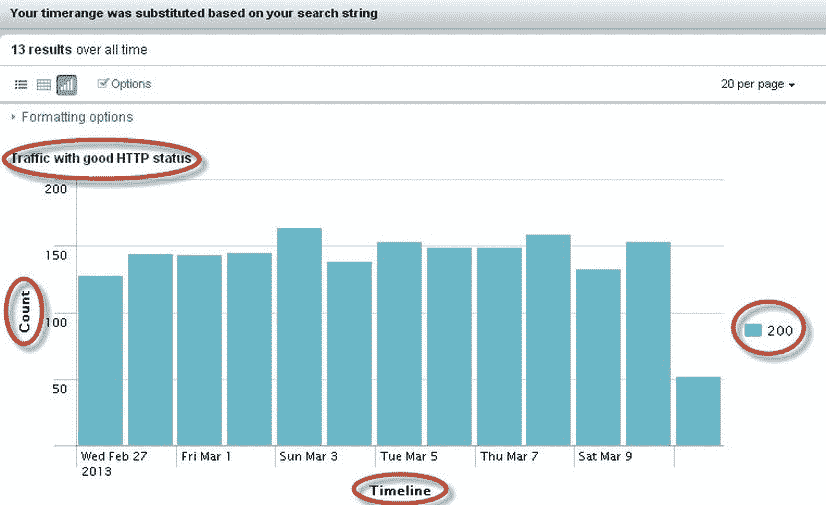

图 6-3. 具有良好 HTTP 状态码的流量

## 具有不良 HTTP 状态码的流量

了解具有不良 HTTP 状态码的流量比了解良好流量重要得多，因为不良状态可能导致直接的经济损失。我们可以更新之前的搜索，使其查找所有`status`字段大于或等于 300 的事件。当网站已迁移或需要临时重定向时，可能会用到 3xx 范围内的 HTTP 状态码（在这种情况下，它们并不一定意味着不良 HTTP 流量）。在这个特定示例中，我们包含了 3xx 范围内的状态码，但可以通过将`status >=300`改为`status >= 400`来细化搜索以排除它们。也可以通过修改时间修饰符，将此搜索用作一个报表，显示过去 24 小时内非 200 的 HTTP 状态。现在，让我们在搜索栏中输入以下搜索：

```
sourcetype=access_*
  earliest=-15d@d
  latest=now
  status>=300
| timechart count BY status
```

图 6-4 展示了具有不良 HTTP 状态码的图表；与我们之前仅包含 HTTP 状态码 200 的搜索不同，我们可以在此看到事件分布在 400、404、406、408、500 和 503 这些 HTTP 状态码上。虽然我们在第 3 章中讨论过这些代码的含义，但用文字说明这些状态码比直接显示数字更有意义。我们可以通过查找表来实现这一点，您将在接下来的几章中学习到。由于本章旨在提供创建监控工具的基本框架，在本书结束时，您将能够将这些报表转化为满足企业需求的工具。我们将对图表以及 X 轴和 Y 轴的标题进行适当修改，并将此报告另存为“具有不良 HTTP 状态码的流量”（图 6-4）。

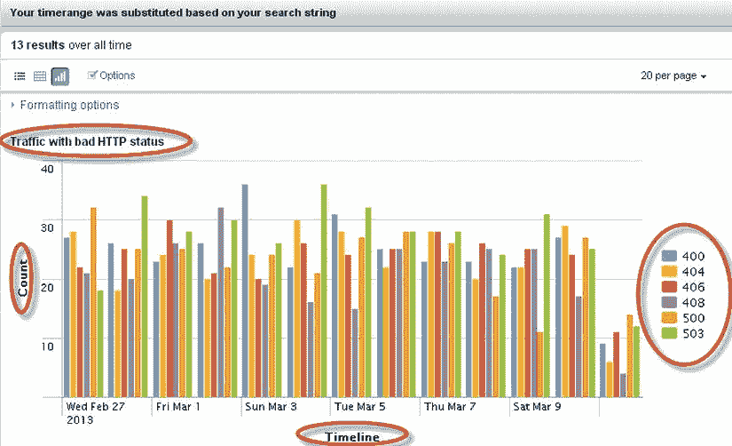

图 6-4. 具有不良 HTTP 状态码的流量

您始终可以深入查看图表中的单个列，或点击右侧的不同状态图例。例如，点击 404 状态将显示下钻事件列表，如图 6-5 所示。您会注意到搜索中还有一个额外的字段子句，即`status=404`。

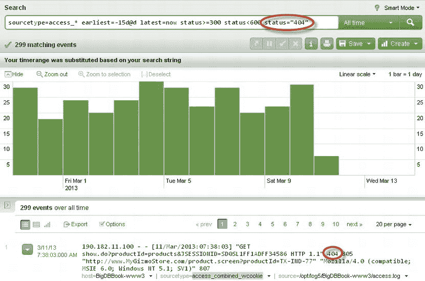

图 6-5. HTTP 404 状态的下钻图表

## 按不良 HTTP 状态码统计的热门页面

在获得不良 HTTP 状态码流量的信息后，下一步可能是找出属于不良 HTTP 状态的热门页面。我们可以使用以下搜索来实现，该搜索查找不良 HTTP 状态事件、不同的 IP 地址，并通过`uri`字段获取计数，该字段代表用户尝试访问的页面。现在，让我们在搜索栏中输入以下搜索：

```
sourcetype=access_*
  earliest=-3d@d
  latest=now
  status>=300
| stats dc(clientip) as "unique ips"
  count as "total count" by uri, status
```

图 6-6 展示了结果图表。根据您拥有的数据集以及时间修饰符的值，此图表会显得非常不同。在第 4 章中，您已经看到并非所有图表类型都适用于所有数据类型。在此特定用例中，我们得到的图表中各字段的值处于不同的数量级。这意味着我们同时拥有非常小和非常大的值。为了使图表更有意义，我们将图表类型更改为“折线图”，并选择对数刻度而非线性刻度，以提高图表的清晰度。要将刻度设置为对数，请点击“格式化选项”，点击 Y 轴，并将轴刻度值更改为对数。我们将对图表以及 X 轴和 Y 轴的标题进行适当修改，并将此报告另存为“按不良 HTTP 状态码统计的热门页面”。

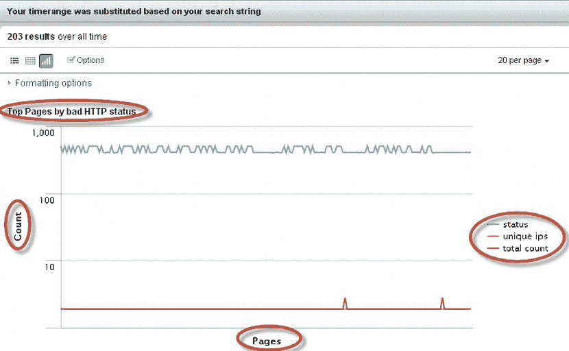

图 6-6. 具有不良 HTTP 状态码的热门页面

### 业务

#### 按区域划分的用户人口统计

从业务角度来看，了解哪些地区或地方拥有最多的用户/客户会很有趣。在第 4 章中，我们使用了 Google Maps 应用程序来可视化 IP 地址。我们可以利用 Google Maps 应用程序中的`geoip`命令来找出用户来自的前五个国家。`geoip`命令将 IP 地址作为输入，并将这些 IP 地址绘制在全球地图上。在我们的示例`MyGizmoStore.com`数据中，我们有`clientip`字段，其中包含我们可以输入的 IP 地址。除了在 Google Maps 中绘制 IP 地址外，`geoip`命令还会输出以下字段：

*   `<field>_country_name`
*   `<field>_country_code`
*   `<field>_region_name`
*   `<field>_city`
*   `<field>_latitude`
*   `<field>_longitude`
*   `_geo`

字段名称以作为输入的字段名称作为前缀。因为我们使用`clientip`字段作为输入，所以`geoip`将生成名称为`clientip_country_name`、`clientip_country_code`、`clientip_region_name`、`clientip_city`、`clientip_latitude`和`clientip_longitude`的新字段。`_geo`字段包含组合的纬度和经度信息。我们可以从一个简单的搜索开始，查看由`geoip`产生的新字段。让我们在搜索栏中输入以下内容：

```
sourcetype=access_*
| geoip clientip
```

图 6-7 显示了 Splunk 搜索的左侧栏，我们可以从中看到由`geoip`命令产生的字段。

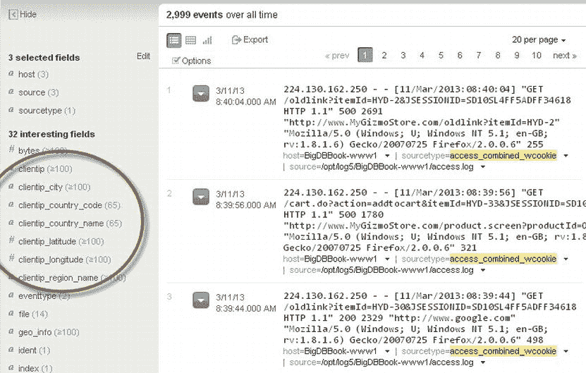

图 6-7. `geoip`命令产生的字段

现在你已经熟悉了 `geoip` 命令，可以通过添加时间修饰符来扩展这个简单的搜索，查找过去 15 天的所有事件，并将 `geoip` 命令的结果通过管道传递，利用 `clientip_country_name` 字段找到排名前五的国家。如果你想按城市而不是国家查看，也可以使用 `clientip_city` 字段。请在搜索栏中输入以下搜索：

```
sourcetype=access_*
  earliest=-15d@d
  latest=now
| geoip clientip
| top limit=5 clientip_country_name
```

我们将对图表以及 x 轴和 y 轴的标题进行适当的修改，并将此报告保存为“按地区划分的用户人口统计信息”。图 6-8 展示了用户来源排名前五的国家的柱状图；在这个例子中，我们可以看到美国位居榜首。

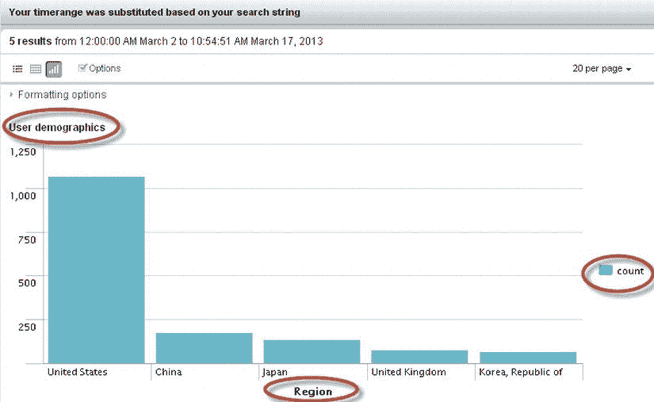

图 6-8. 按地区划分的用户人口统计信息

#### 跳出率

从商业角度来看，了解客户对 `MyGizmoStore.com` 等网站的访问跳出率会很有趣。当访问者进入和退出都在同一个页面上，且没有访问网站上的其他任何页面时，视为一次跳出。为了实现这一点，我们使用 `transaction` 命令根据特定 IP 地址访问的页面数量来分组事件。在以下搜索中，我们使用 `clientip` 作为事件组的共同标识符，并使用 `maxpause` 选项来指定事件之间的暂停时间不超过一小时。`transaction` 命令会产生两个字段：

* `duration`，即第一个事件和最后一个事件时间戳之间的差值
* `eventcount`，即事务中的事件总数。

我们使用 `eventcount` 字段配合 `eval` 命令将事务分类为：

* 跳出
* 2-5 个页面
* 6-10 个页面

为了将事务归类到这三个桶中，我们使用了一个 `case` 函数，该函数比较每个事务 `eventcount` 的值，并将其归入三个桶之一。请在搜索栏中输入以下搜索：

```
sourcetype=access_*
| transaction clientip maxpause=1h keepevicted=t mvlist=t
| eval user_type=case(eventcount=1, "Bounced",
        eventcount<=5, "2-5 pages",
        eventcount<=10,"6-10 pages")
| top limit=5000
  user_type
```

图 6-9 展示了跳出率分布的饼图，以及跳出访问和不同深度访问（如 2-5 个页面和 6-10 个页面）的百分比。我们将对图表以及 x 轴和 y 轴的标题进行适当的修改，并将此报告保存为“跳出率”。

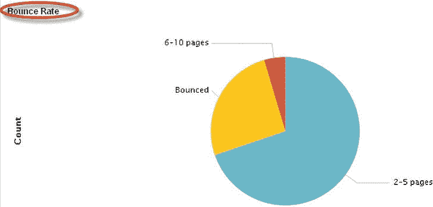

图 6-9. 跳出率

你可以将鼠标悬停在饼图上，查看用户数量和跳出率的百分比，如 图 6-10 所示。

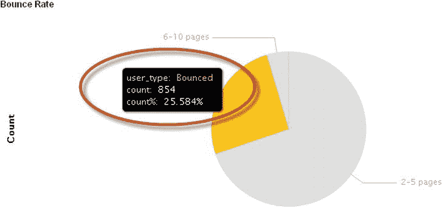

图 6-10. 带有计数和平均值的跳出率

## 唯一访客

从商业角度来看，了解访问网站的唯一用户数量会很有趣。我们可以使用`clientip`字段的去重计数函数来查看在给定时间段内有多少唯一访客。在以下搜索中，我们查找`MyGizmoStore.com`不同主机在过去10天内的唯一访客。请在搜索栏中输入以下搜索：

```
sourcetype=access_*
  earliest=-10d@d
  latest=now
| timechart  dc(clientip) AS unique_visitors by host
```

图6-11展示了主机`BigDBook-www1`、`BigDBook-www2`和`BigDBook-www3`的唯一访客柱状图。

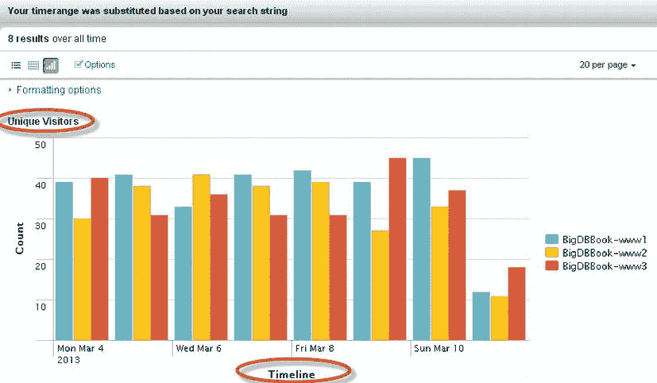

图6-11. 独立访客

我们将对图表以及`x`轴和`y`轴的标题进行适当修改，然后将此报告另存为“独立访客”。

在第4章中，我们处理了一些已添加到`MyGizmoStore.com`仪表板中的报告。其中部分报告同样适合用作网站监控工具。我们在第4章中添加的、值得回顾的报告包括：

- 每个产品的购买数和浏览数图表
- 购买趋势
- 交易持续时间
- 按产品统计的热门购买
- 获取与提交

现在，您可以创建一个名为“网站监控”的仪表板。虽然您已在第4章中学习了如何创建新仪表板，但我们还是快速回顾一下如何向仪表板添加报告。单击“仪表板和视图”菜单下的“创建仪表板...”链接，如图6-12所示。

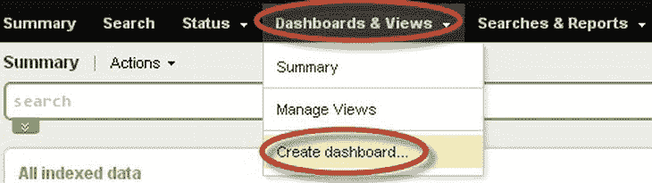

图6-12. 创建仪表板

这将弹出“创建新仪表板”对话框。输入`WSM`作为ID，输入`Web Site Monitoring`作为名称，如图6-13所示。单击“创建”按钮。

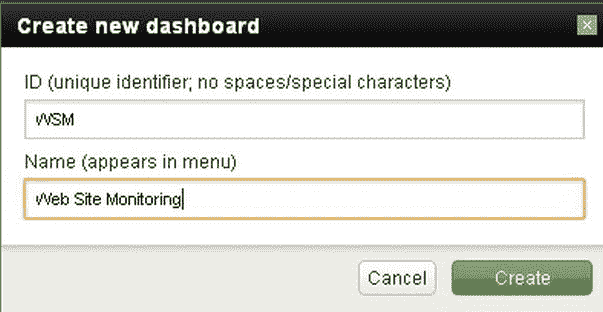

图6-13. 创建网站监控仪表板

您将看到已创建一个空仪表板。要使其可编辑并添加之前创建的报告，请将“编辑”开关打开，如图6-14所示。


图6-14. 编辑网站监控仪表板

要开始向仪表板添加报告，您必须先创建一个新面板来容纳报告。单击“新建面板”按钮，将弹出一个对话框，如图6-15所示。开始为“按主机统计的点击量”报告创建面板。输入`Hits by Host`作为标题，并选中“已保存搜索”单选按钮；下拉框将显示已保存的报告列表。选择`Hits by Host`报告，然后单击“保存”按钮。

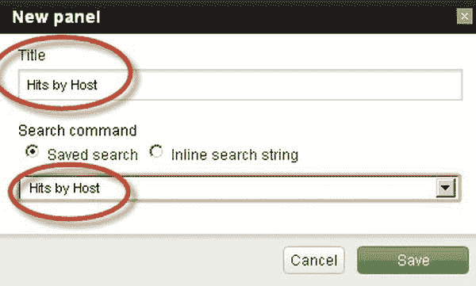

图6-15. 按主机统计的点击量面板

这将使报告以表格格式显示。为了将其可视化为图表，您需要单击“编辑”并选择“编辑可视化”，如图6-16所示。

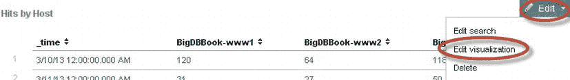

图6-16. 为“按主机统计的点击量”编辑可视化

这将弹出一个对话框，您可以在其中根据希望如何可视化表格数据来进行更改。选择“柱状图”，如图6-17所示，然后单击“保存”按钮。

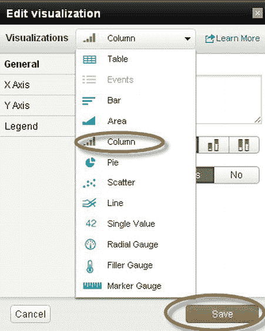

图6-17. 编辑可视化

现在，您将能够看到“按主机统计的点击量”的表格数据以柱状图的形式呈现，如图6-18所示。

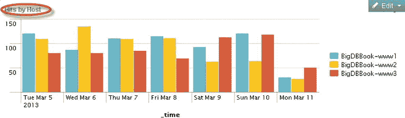

图6-18. 按主机统计的点击量

对于我们在本章中创建的其余每个报告，您都可以在“网站监控”仪表板中创建一个新面板，并编辑该面板的可视化，使其呈现适当的图表。将所有面板添加到仪表板后，您可以移动面板，以便监控信息得到合理分组。

“网站监控”仪表板创建完成后，可以从“仪表板和视图”菜单访问它，如图6-19所示。

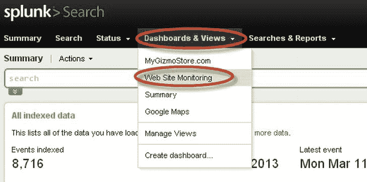

图6-19. 启动网站监控仪表板

图6-20和6-21展示了您在本章中创建的所有报告的仪表板面板。这些图表看起来会有显著差异，因为它们将基于您拥有的样本数据。除了本章创建的报表，您还可以将前面章节的报表添加到网站监控仪表板中。

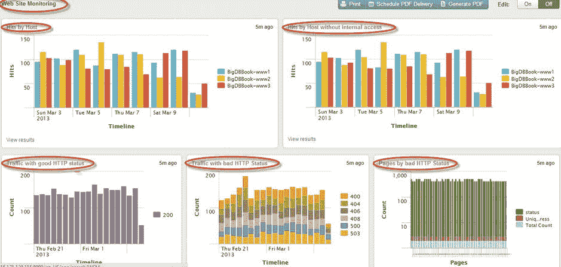

图6-20. 网站监控仪表板

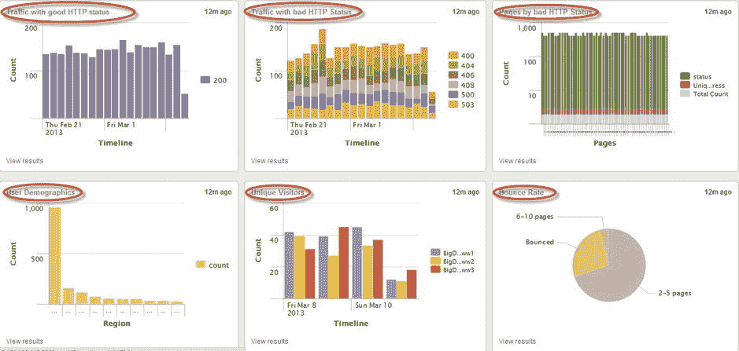

图6-21. 网站监控仪表板

## 本章小结

在本章中，我们创建了一个网站监控工具，它可以显示按主机统计的点击量、良好与不良HTTP流量、用户人口统计信息、独立访客、跳出率以及其他指标。

