# 第 14 章：情感分析

情感分析通常与社交媒体相关联，进而与大数据挂钩。在本章中，你将学习情感分析是什么，并通过一些实际示例来分析推文中的情感。本章的项目是世界情感指标，其目标是基于对全球众多网络新闻媒体的新闻标题进行分析，提供一个反映世界总体情感的指标。

## 观点、看法、信念、信仰

情感分析可以定义为：检视文本或语音，以找出作者或说话者针对特定主题所持的观点、看法或感受的过程。（此定义适用于计算机系统，因为当人类进行此操作时，通常简称为阅读。）本节标题中的所有词汇都与情感密切相关，并且描述了高度主观和模糊的概念。这使得计算机程序从文本（无论是长文档还是推文）中提取这些信息变得相当具有挑战性。当你考虑到某些词汇或表达方式会根据知识领域（即专业领域）的不同而有不同含义时，这个挑战的复杂性会进一步增加。例如，“go around”在普通对话中的含义与对飞机飞行员而言完全不同，对后者来说，它意味着中止着陆程序并重新尝试。与专业领域相关的问题中，还夹杂着通常与之相关的行话术语。

某些知识领域的文档或演讲往往比其他领域更难分析，而政治通常被认为是最复杂的领域。试图判断一篇政治演讲是否支持某个特定议题是困难的，因为这些讨论充满了讽刺、引文和（可能相当复杂的）对其他组织或人物的引用。我们很容易得出结论：情感是具有语境依赖性和领域依赖性的。

考虑到所涉及概念和人类本性的模糊性，我们也可以预期不同的人对正在检视的文本或观看的演讲会有不同的理解，并得出不同的结论，后者由于能看到肢体语言而更有优势。到目前为止所描述的这些挑战独立于所使用的语言而存在，并且是在人类进行信息提取工作的背景下呈现的。

试图通过计算机系统自动化信息提取过程会增加复杂性，因为软件程序需要明确的边界来消除歧义。这不可避免地会使得分析趋向于按领域进行专门化，此外，还要考虑所使用的媒介类型。例如，对新闻文章的处理方式会与对推文的处理方式不同。文章通常遵循其书写语言的语法规则，使用规范的词汇，且没有拼写错误。相比之下，推文缺乏句子结构，很可能使用俚语，包含表情符号，有时还会通过重复字母来拉长单词以增强情感色彩（“我超超超超超级喜欢巧克力”）。此外，由于用于创建推文的设备特性，拼写错误的频率也更高。

如你所见，情感分析是困难的。在本章后面，我们将更详细地探讨自动化这种分析的各种技术，但首先，我们来了解一下为什么你可能需要使用它。

## 商业用途

从历史的角度出发，并随着技术和社交媒体的演变，我们可以将情感分析（也称为意见挖掘）的用途分为两大类。第一类是将其用作决策过程的输入。他人的想法一直是这个过程中一个非常重要的组成部分，尤其是在决定购买某件物品时。在过去，获取他人意见的途径仅限于家人、朋友，以及在行业杂志或其他媒体上发表评论的专家。`Consumer Reports` 是一本致力于评测从搅拌机到汽车等各种产品的杂志，它是提供“他人想法”的专家典范。

随着数字足迹的不断增长以及互联网上商业交易的持续增加，我们发现了越来越多的数字论坛，这些论坛让人们能够分享自己的经验和观点，从而满足了解“别人怎么想”的需求。这些论坛的范围很广，从将互联网作为另一种媒介来发布观点的传统专家，到专门收集和分享任何人观点的组织良好的网站。像`Yelp`、`Angie’s List`和`Rotten Tomatoes`这样的网站在根据公众反馈来汇总和排名商业机构、商家、工匠和电影方面做得非常出色。此外，人们还可以在他们购买产品的网站上留下评论，例如`amazon.com`。最后，还有个人观点，范围从博客文章到推特，可以被视为“口口相传”的等价物。

处理特定主题的数字论坛，例如`stackoverflow.com`（开发者的必备网站），以及由企业支持部门创建的论坛，提供了简单而强大的方式，允许参与者对答案的质量以及提供答案的人的可信度进行隐式评分。

这类决策支持在过去几年里得到了爆发式增长，任何人都可以非常轻松快速地找到他们可能感兴趣的任何事物的信息。当然，他们仍然需要从不完整或无用的评论中筛选出受尊敬的观点，并且识别出伪装成专业评论的纯粹广告。

第二个大类与企业获取其产品或服务反馈有关。从历史上看，企业必须通过组织焦点小组、进行民意调查、审查服务中心记录或保修索赔来了解其品牌、产品和服务的认知度。现在，他们可以监控社交媒体渠道，并近乎实时地了解其自身产品以及竞争对手产品的情况。通过使用情感分析，企业可以监控消费者趋势和市场热度。他们可以更快地找到其网站中客户行为的根本原因，也能更快地发现新的机遇和威胁。最终，这一切都引导到对公司最重要的东西——其品牌声誉——的管理上。

正如我们所看到的，情感分析并不容易，但若操作得当，它可以非常强大。在 2010 年由`O’Connor`等人发表的一篇题为“From Tweets to Polls: Linking Text Sentiment to Public Opinion Time Series”的论文中，作者提出了一个令人信服的观点：“我们分析了 2008 年至 2009 年期间关于消费者信心和政治观点的几项调查，发现它们与同时期推特消息中的情感词频率存在相关性。虽然我们的结果因数据集而异，但在几种情况下，相关性高达 80%，并且捕捉到了重要的大尺度趋势。这些结果突显了文本流作为传统民意调查的替代和补充的潜力。”

当然，如果情感分析做得不好，可能会导致一些相当有趣的情况。`Dan Mirvish`在一篇题为“The Hathaway Effect: How Anne Gives Warren Buffet a Rise”（`http://www.huffingtonpost.com/dan-mirvish/the-hathaway-effect-how-a_b_830041.html`）的文章中描述了一个例子。作者怀疑华尔街的机器人交易程序包含了情感分析，每当`Anne Hathaway`登上头条新闻时，`Warren Buffett`的`Berkshire Hathaway`的股票（代码`BRK.A`）就会上涨。`Dan`列出了`Anne Hathaway`职业生涯中的里程碑日期以及`BRK.A`股价的相应涨幅。当然，这篇文章基于一个非常简单的分析，但这是一个很好的例子。

很明显，情感分析有很多商业用途，并且有许多商业和开源产品声称具有各种功能。但是，在你决定是构建还是购买之前，让我们先来看看情感分析的技术方面。

## 情感分析的技术层面

当你在互联网上搜索情感分析的信息时，你通常会发现大量充斥着复杂概率公式的科学论文，或者是解释其“秘方”如何优于他人的营销文档。我们冒着过度简化甚至可能曲解某些概念的风险，对情感分析的技术层面进行解释，这样你无需拥有统计学学位就能获得一个不错的理解。本章的这一部分大致基于`Bo Pang`和`Lillian Lee`（2008 年）的开创性论文“Opinion Mining and Sentiment Analysis”。

情感分析本质上是一种文本分类；因此，此类分析的结果通常分为两类：

*   **极性**，这是一个直接的正面、中性或负面结果。
*   **极性范围**，即评分或排名，例如电影的星级评定，有时可以扩展到意见的强度，比如从 1 到 10 的量表。

可以在不同层面进行极性或极性范围的判定：词汇、短语、句子或文档。通常的做法是将一个层面的分析结果作为更高层面分析的输入。例如，你可以对词汇进行情感分析，然后使用结果来评估短语，然后是句子，依此类推。

基于情感对文本进行分类面临着许多挑战，我们将通过介绍各种基于所谓“特征”来提取和分类极性的算法来回顾这些挑战：

*   **词频**。这可能是所有特征中最明显、最直观的一个。其思想是，文档中出现频率最高的词反映了该文档的极性。可以想象，这个前提并不总是正确的。
*   **词项出现**。这是词频的反向思路。不是关注最常见的词，而是寻找最独特的词，并基于它们来确定极性。同样，这个前提也并不总是准确的。
*   **N-gram**。单词的位置决定，有时甚至会逆转一个短语的极性，从正面变为负面，反之亦然。分析是通过尝试理解单词在`unigram`（单个单词）、`bigram`（两个连续单词）、`trigram`（三个连续单词）等语境中的含义来进行的。
*   **词性**。传统的英语语法将单词分为八种词性：动词、名词、代词、形容词、副词、介词、连词和感叹词。在此特定情况下，形容词被认为是文本情感非常好的指示器；因此，它们被用来定义极性。这个特征涉及到将句子分解成所有不同的词性。
*   **句法**。已经有人尝试将句法关系纳入特征集，但关于使用此特征的优缺点仍然存在讨论。
*   **否定**是情感分析中最重要的特征之一。虽然“我喜欢这本书”和“我不喜欢这本书”的词袋表示被大多数常用的相似度度量认为是非常相似的，但唯一不同的词——否定词——迫使这两个句子走向相反的极性。然而，并非所有显式否定词的出现都会反转所在句子的极性。

如您所见，这些算法各有优缺点，没有一种算法能解决所有问题。通常，文本分类器会组合使用多种特征提取器来分配极性。然而，要让这些特征提取器能分配语境极性，就意味着它们必须预先知道词语的基本极性。获取词语基本极性有几种方法：

*   使用情感词典。最基本的词典仅为每个独立词汇提供极性，但它们可以通过添加额外标签来变得非常精细，例如，可以指代特定情绪的强度等级。
*   使用训练文档。每个训练文档包含若干句子，并且每个文档都预先被标记了特定的极性或极性范围。单个词汇的极性是根据特征提取器的组合以及它在不同分类中出现的频率来计算的。这种计算被称为训练，其结果存储在一个模型中。显然，每个分类文档中的句子越多，最终分类结果的准确性就越高。

使用训练文档的文本分类器属于机器学习工具的范畴。可以说，最流行的情感分析工具都基于机器学习分类器，它们通常采用以下方法之一：

*   **朴素贝叶斯分类器**。一种基于贝叶斯定理的简单概率分类器。其特征提取器包括单词或一元组、二元组和三元组，以及每个句子中的词性。朴素贝叶斯分类器可以包含正面和负面词汇的计数，以及词汇序列极性的计数。它还可以包含结合了极性信息的词性计数。
*   **最大熵模型**。与朴素贝叶斯假设每个特征相互独立不同，最大熵模型不假设特征独立。这使得我们可以使用二元组和短语，而无需担心词汇重叠的问题。
*   **支持向量机**。基于向量，这些向量的长度与分析所使用特征提取器的数量相同。可以对向量应用多种函数，例如线性函数、多项式函数、Sigmoid 函数等。最简单的分析基于单个词汇与表示该词是否出现的词项的组合。

关于这些方法，已有大量的研究和比较。结论可以概括为：每种方法都有可能略微优于其他方法，具体取决于被分析文本所属的领域。共同点是，只要使用高质量的训练文档，所有方法在特定领域（如电影评论）的准确率都能达到 80%以上。由于编程更简单，朴素贝叶斯方法往往是最流行的。

如您所见，在使用机器学习工具进行情感分析时，获得良好结果的关键在于拥有高质量的训练文档。这意味着您应该使用与待分析数据相同的数据来训练系统；否则，如果用其他领域的文档进行训练，很可能会降低结果的准确性。例如，在书评领域，“go read the book”这句话表达的是正面情感，但在影评领域，它却是负面情感。

互联网上有大量可用作训练资料的资源。例如，`imdb.com` 上的电影评论已经根据极性范围（星级评定）进行了标记。每篇评论都不止包含几个句子，而且数量庞大。其他网站如 `amazon.com` 和 `cnet.com` 也有大量已经分类的评论。显然，只有当您要分析的是评论数据时，使用这些评论才有意义。

获取训练数据有不同的方法。您会听到监督训练和无监督训练的概念，这取决于您在多大程度上参与训练数据的分类。还有一种称为训练数据自举的方法，即获取一些现有数据并将其转换成您需要的形式。创建训练数据有很多富有创意的方法。Go 等人（2009 年）发表的一篇优秀论文《使用远距离监督进行推特情感分类》就对此提供了一个很好的例子。作者描述了如何使用表情符号来对推文的极性进行分类，然后将这些分类后的推文作为训练数据。这项工作的成果可在 `http://www.sentiment140.com` 上获取。在这个网站上，您可以输入一个关键词，它会分析包含该关键词的推文，然后生成一些包含情感信息的图表，以及根据极性用颜色编码的实际推文。图 14-1 显示了一个搜索关键词 `splunk` 的结果截屏。

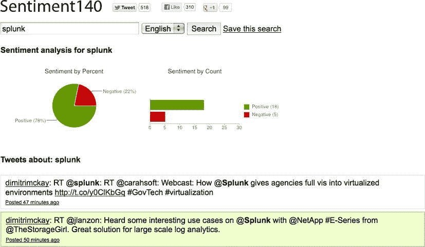

图 14-1. 使用 sentiment140.com 对单词 `splunk` 进行的基于推特的情感分析

## 情感分析应用

您可以在 Splunkbase 上找到一个情感分析应用。该应用基于朴素贝叶斯方法，提供了一组有趣的命令和几个仪表盘。此外，该应用还包含了训练和测试数据的必要工具，以及两个基于推特和 IMDB 电影评论预训练好的模型。您可以在以下地址找到它：

```
http://splunk-base.splunk.com/apps/57214/sentiment-analysis
```

该应用由 Splunk 工程师 David Carasso 编写，根据“知识共享 BY 3.0”许可免费提供。从 Splunk 内部安装该应用的步骤如下：

*   在用户界面的任意屏幕，点击位于右上角的应用下拉菜单，然后选择“在线上查找更多应用”
*   搜索情感分析应用；搜索框位于屏幕的右上方，输入 `sentiment`
*   找到“Sentiment Analysis”，然后点击“免费安装”

应用现已安装完毕，可以随时使用。除了几个留给您自行探索的仪表盘外，该应用还包含三个命令：

*   `sentiment`，根据软件包中提供的训练工具创建的特定模型来计算情感
*   `language`，一个专门用来预测某个字段内容语言的命令
*   `token`，用于更方便地将术语和短语分词，以便进行文本分析

## 全局启用命令

在本章的示例中，我们将只使用 `sentiment` 和 `language` 命令。这为我们提供了一个解释如何在一个应用中使用其他应用命令的机会。默认情况下，这些命令仅限于在情感分析应用内部使用。要使其在 Splunk 范围内全局可用，请执行以下步骤：

*   在用户界面的任意屏幕，点击右上角的“管理器”按钮
*   点击位于选项左下角的“高级搜索”
*   接着点击“搜索命令”选项
*   在标题为“应用上下文”的下拉菜单中，选择“所有”，如图 14-2 所示

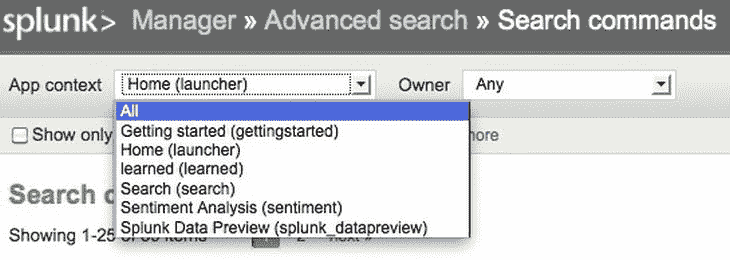

图 14-2. 选择应用命令的上下文

*   在第一列名为“命令名称”中找到 `sentiment`。在我们的示例中，它位于第二页。点击“权限”链接，如图 14-3 所示

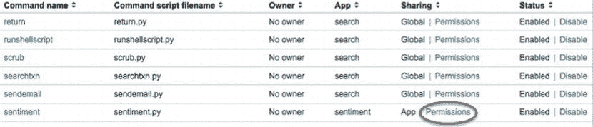

图 14-3. 选择一个命令的共享权限

在“Object should appear in”下，选择“All apps”，如图 14-4 所示。然后点击右下角的“Save”。此处也是您可以为命令授予基于角色的权限的地方。

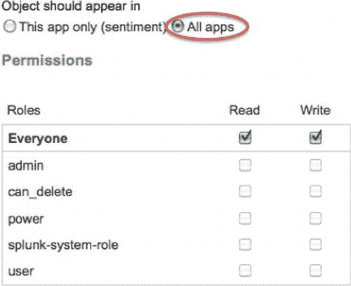

图 14-4. 全局启用命令

按照相同的步骤全局启用`language`命令。从现在开始，我们将在`search` App 的上下文中工作。

## 发现情感

使用我们在第 12 章中处理的 Twitter 数据（这是一个包含近五百万条推文的样本日），我们将探索`sentiment`和`language`命令的使用。我们的好奇心驱使我们首先回顾包含单词“love”的推文的情感。我们预期结果情感将是正向的。

在制定合适的搜索之前，我们必须解释情感是以数字表示的。当它们是纯粹的极性（正向或负向）时，通常用 1 表示正向，−1 表示负向，0 表示中性。极性范围由训练数据的人定义的数字序列表示。例如，1 到 5 可用于表示许多电影评论网站使用的流行的五星评级系统。

 **注意** 本章中的所有示例和训练数据均基于英语。机器学习工具足够灵活，可以处理任何语言。在训练期间，必须使用所需语言的适当训练数据。

搜索非常简单，因为我们只需要选择英文且包含单词“love”的推文，然后将它们传递给`sentiment`命令，最后计算结果的平均值：

```
index=twitter lang=en
| where like(text, "%love%")
| sentiment twitter text
| stats avg(sentiment)
```

`sentiment`命令有两个参数。第一个参数是用于计算情感的模型。在此情况下，我们使用了`sentiment` App 自带的名为`twitter`的模型。第二个参数是包含待分析文本的字段名。情感分析的结果被放入一个名为`sentiment`的字段中，该字段被`stats`命令用来计算所有已分析事件的平均情感。此搜索的结果是 0.4666，正如我们预期的那样，偏向正向。这个结果也说明了特征提取器面临的挑战之一：并非所有包含像“love”这样强烈正向词的文本都是正向的。在范围从−1 到 1 的情况下，该结果也可以解释为“大约 75%包含单词 love 的推文是正向的”。要理解这个说法，您可以这样看：得分为 0（中性）意味着 50%的推文是正向的，另一半是负向的。得分为 1 意味着 100%的推文是正向的；因此，接近 0.50 的得分可以解释为 75%的推文是正向的。

从可视化的角度来看，将这个结果显示为一个纯数字相当令人沮丧。我们认为更合适的可视化方式是径向仪表盘，但当我们选择它时，Splunk 会显示一个如图 14-5 所示的仪表盘，其刻度范围是 0 到 100，而我们需要的是从−1 到 1 的刻度。此外，颜色编码也不合适，因为绿色分配给了 0 到 30，黄色分配给 31 到 70，红色分配给 71 到 100。对我们来说，理想的颜色编码是负向用红色，正向用绿色，中性用黄色。


图 14-5. 默认径向仪表盘

不幸的是，提供的格式化选项不包括更改刻度。解决方法是创建一个仪表盘。编辑面板时，您可以选择编辑可视化。通过选择“Color ranges”并点击“Manual”，您可以修改刻度和颜色。默认情况下，对话框显示 3 个范围，可以根据需要增加或减少，并且每个范围都有默认颜色。第一个范围是绿色，第二个是黄色，最后一个是红色。由于颜色范围的值必须从最低到最高输入，并且我们处理的是负数，因此我们必须更改颜色的顺序。如图 14-6 所示，我们选择将第一个范围（负向情感）设置为从−1 到−0.25，使用红色。我们将第二个范围（中性）设置为从−0.25 到 0.25，使用黄色。最后一个范围（正向情感）设置为从 0.25 到 1，使用绿色。生成的径向仪表盘可以在图 14-7 中看到。

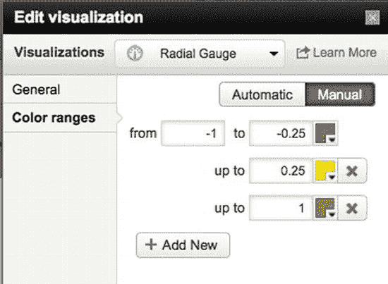

图 14-6. 颜色范围选择对话框

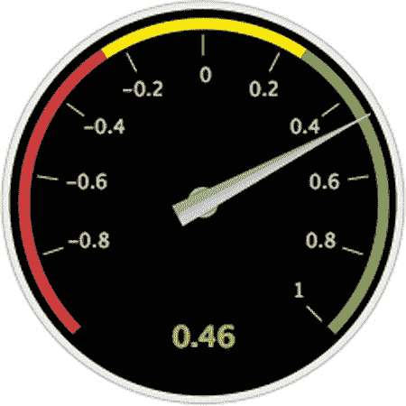

图 14-7. 自定义径向仪表盘

如果我们分析了包含单词“love”的推文的情感，那么也应该探究那些包含单词“hate”的推文，这才公平。在图 14-8 中，您将看到在增强型仪表盘中呈现的部分结果（搜索仍在运行）。有趣的是，这些结果在任何实际用途上都是互补的。

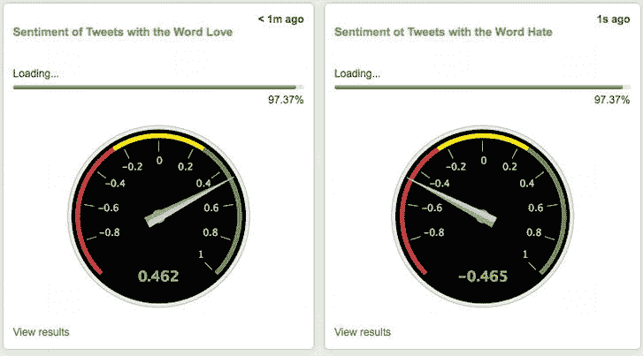

图 14-8. Love 与 Hate 情感仪表盘

为了完善我们对情感的探索，我们决定分析一组我们怀疑是高度正向的推文。由于 Justin Bieber 在 Twitter 上的粉丝数量排名前三，我们只能认为他的粉丝会正面地发布关于他的推文，尤其是在他们使用#Beliebers 标签时。结果可以在图 14-9 中看到一个更增强的仪表盘，证实了我们的怀疑。我们使用的搜索基于第 12 章中回顾的一个类似搜索。

```
index=twitter lang=en
| rename entities.hashtags{}.text as hashtags
| fields text, hashtags
| mvexpand hashtags
| where like(hashtags, "Beliebers")
| sentiment twitter text
| stats avg(sentiment)
```

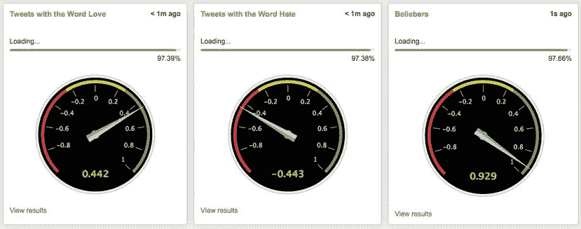

图 14-9. Love、Hate 与 Justin Bieber

## 处理语言

尝试从一小段文本中猜测语言是一项相当有挑战性的任务。考虑到推文的性质——拼写错误频率更高，包含大量俚语，此外还有以@符号开头的用户名，大量以`http://t.co/`...形式的链接以及单词拉长——挑战会急剧增加。

在第 12 章中，我们看到推文对象包含两个语言字段。一个是用户声明的语言，另一个我们认为是的 Twitter 对实际推文语言的预测。您可能还记得，我们发现 Twitter 对推文语言的猜测并不十分准确。当出现像这样的推文时，这并不令人惊讶：

```
@cutiemz1 Lol...I knw jor
#crawleycrowd 5850
@arturo_p hahahahahahahahahahahahahahahahahahahsjjahahajasjhsjshjshash
RT @carlitos898: #teamfollowback
```

意识到这颇具挑战性后，让我们通过查看前 35 条语言为英语的推文来试试`language`命令。此时必须说明，情感分析应用仍处于实验阶段，截至本文撰写时存在一些小缺陷，我们会提供变通方案。让我们看看这个相当简单的搜索：

```
index=twitter lang=en
| head 35
| language text
| rename language as Lng
| stats count by Lng
```

`language`命令只有一个参数，即需要分析以预测语言的字段。结果会存放在名为`language`的字段中。当前版本的小缺陷是结果字段可能丢失（或许是在翻译过程中），变通方法是重命名字段。搜索结果指出 35 条推文中有 34 条是英语，1 条是波兰语。那条被归类为波兰语的推文正是我们之前列出的示例中的第一条。对我们而言，这个准确率已经相当不错了。

当我们将需分析的语言改为西班牙语时，情况变得更有趣。仅查看前 10 条语言为西班牙语的推文，结果显示 5 条为西班牙语，4 条为英语，1 条为加泰罗尼亚语。经我们复核，实际计数是 6 条西班牙语、1 条葡萄牙语、3 条无法确定。考虑到西班牙语和葡萄牙语的相似性，这种误分类可以理解。

通过更加严格的筛选条件，我们可以获得更高准确率。我们再次尝试分析西班牙语推文，但这次不仅指定推文语言为西班牙语，还要求用户声明的语言也是西班牙语。结果显示 7 条西班牙语、2 条英语、1 条加泰罗尼亚语。我们人工查验的结果是 8 条西班牙语、2 条无法确定。

经过这些简单测试，我们认为`language`命令的表现与 Twitter 对推文的语言猜测基本相当。我们确信，如果文本长度超过推文 140 字符的限制，情感分析应用自带的`language`命令将有更出色的预测表现。如果你计划使用该命令，应当根据具体应用场景进行更仔细的针对性测试，这样才能对结果建立合理预期。

## 训练与测试数据

本章前文已提及，训练数据的质量是良好情感预测的关键。基于前文讨论的特征提取相关问题，我们知道情感分析并非精确科学。即使有科学家和学者参与，最佳准确率也仅在 80%到 85%之间。本节将详细说明如何构建训练数据集并测试其质量。

首要任务之一是确定如何处理极性：你的结果是基于简单极性还是极性范围？情感应用已附带两个预训练模型。之前示例中使用的 Twitter 模型基于简单极性（积极或消极）。应用附带的另一个模型基于 IMDb 电影评论，使用 1 到 10 的极性范围。

对于简单极性，你需要提供两组文档：一组包含积极情感样本，另一组包含消极情感样本。如果你的领域包含大量中性句子，还应提供中性样本集。对于极性范围，则需要为范围内的每个评分提供一组文档。这些文档统称为训练语料库。当处理多个模型时，则称为拥有多个语料库。

机器学习软件将处理语料库并创建模型，随后用该模型预测情感。语料库越大（即训练数据样本越多），模型质量越高。在前面的示例中，`sentiment`命令使用的模型名为`twitter`，其语料库包含 190,852 条积极推文和 37,469 条消极推文，总计 228,321 条推文。`imdb`模型的语料库则基于 10 个评分的各 11 条电影评论，每条评论平均约 200 词。该模型以`imdb`名称供`sentiment`命令调用。与之前示例（结果返回 1 或-1）类似，使用`imdb`模型会为每个分析事件返回 1 到 10 之间的数值。

要评估创建模型的效果，需进行测试。为此需要测试数据，且测试数据必须与训练数据不同。测试数据的分类方式应与训练数据相同，这样测试程序才能知道预期结果。随后测试程序会运行模型，将预测结果与预期结果进行比较。测试数据语料库越大，模型准确率的可信度越高。通常会将约 10%的训练数据专门留作测试用途。

应用自带的 Twitter 模型也包含测试数据，分类为 2,000 条积极推文和 2,000 条消极推文。当我们用这些测试数据运行 Twitter 模型的测试程序时，准确率为 69.09%，这被认为相当不错。此外，测试程序还会给出计算的误差范围，在此例中为 1.11%。

为更好理解训练和测试流程，我们将获取一个语料库并演示完整过程。经过网络搜索，我们找到了一个有趣的 Twitter 语料库候选。该语料库由 Niek Sanders 创建，包含 5,513 条推文，由作者分为积极、消极、中性和无关四类。此外，语料库按主题标注了 Apple、Google、Microsoft 和 Twitter，意味着推文中包含这些关键词。由于 Twitter 服务条款的限制，实际推文不能随情感语料库一起分发，但作者提供了 Python 程序，可按照 Twitter 规则（本例中每 28 秒下载一条推文，总耗时约 43 小时）下载推文。文档中作者对分类标准有详细说明。该语料库可在以下地址找到：

```
http://www.sananalytics.com/lab/twitter-sentiment/
```

我们下载了语料库和推文，然后手动提取了积极、消极和中性推文，并删除了标签（主题、情感、推文 ID 和时间戳）。下一步是创建三个测试文件。由于语料库相对较小，我们决定从正在使用的数据中提取推文自行创建测试文件，并将它们分为三类，每类十条推文。

现在拥有了包含训练和测试数据的必要文件，我们将说明创建和测试 Sanders 模型的步骤。由于训练和测试程序用 Python 编写，几乎可以在任何操作系统上运行。我们将在 Linux 系统上演示该流程。鉴于应用目前处于实验阶段，程序并非十分用户友好。假设`$SPLUNK_HOME`包含 Splunk 的安装路径，请切换目录并按如下方式创建新的子目录：

```
cd $SPLUNK_HOME/etc/apps/sentiment/training_data
mkdir sanders
mkdir sanders/train
mkdir sanders/test
```

### 复制训练文件

将正面训练文件复制到`sanders/train`子目录下，命名为`1.txt`，中性训练文件命名为`0.txt`。同时将负面训练文件复制到`sanders/train`子目录下，命名为`-1.txt`。操作时需注意，许多Unix命令不接受以减号（`-`）开头的文件名。如果与文件处于同一目录，每次引用该文件时请使用以下表示法：`./-1.txt`。

对测试文件重复复制过程，但将它们复制到`sanders/test`子目录下。记得相应命名为`1.txt`、`0.txt`和`-1.txt`。切换目录并按如下方式运行程序以训练数据：

```
cd $SPLUNK_HOME/etc/apps/sentiment/bin
python train.py train sanders m_sanders
```

`train.py`程序可用于训练和测试，因此我们指定将使用`sanders`子目录中的数据进行训练，它将创建一个名为`m_sanders`的模型。该程序的输出消息可在图 14-10 中找到。

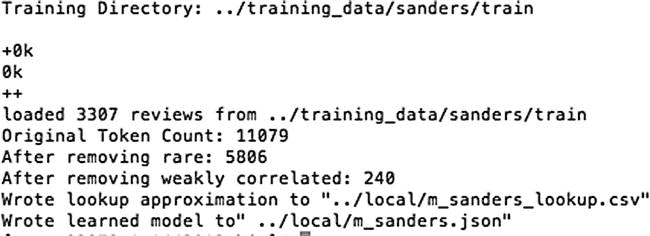

图 14-10. 训练程序的输出

如图 14-10 所示，通过移除罕见词和弱相关词，令牌数量得以减少。这些操作可以作为训练程序中的选项进行选择，将在本章后面部分进行回顾。您应当注意，训练程序不仅创建模型，还创建一个包含训练数据中令牌的查找表，每个令牌都带有预期的情感评分。将此查找表视为可用于基本情感分析或其他相关目的的额外收获。

我们非常想了解此模型与应用程序附带模型的比较情况，因此我们进行测试。为此，我们输入`python train.py test sanders m_sanders`，输出结果可在图 14-11 中看到。

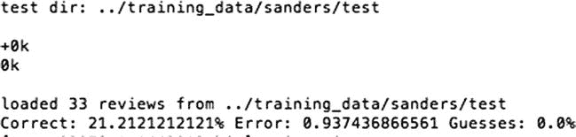

图 14-11. 测试程序的输出

准确率为 21.21%，我们对这个语料库并不满意。低准确率可归因于该语料库相比情感分析应用程序附带的 Twitter 语料库（几乎大 70 倍）规模较小。另一个需要考虑的问题是，与 Twitter 模型的 4000 条推文相比，我们的测试数据极少。此外，训练程序中内部选项的设置也可能产生影响，但这将在本章后面讨论。

我们可以用 Twitter 模型的测试数据测试 Sanders 模型，看看准确率是否变化。这将会很有趣，因为测试数据比训练数据更大。为了测试，我们在 Unix 提示符下输入以下命令：

```
python train.py test twitter m_sanders
```

结果更加令人沮丧，准确率降至 11.67%。请注意，我们只是更改了测试数据，并未更改模型。这表明模型对训练和测试数据的数量与质量有多么敏感。出于好奇，我们再次运行了“爱、恨与贾斯汀·比伯”仪表板，这次使用了 Sanders 模型。结果截然不同，可在图 14-12 中看到。与图 14-9 中呈现的结果相比，爱和贾斯汀·比伯为中性，恨为略负面。

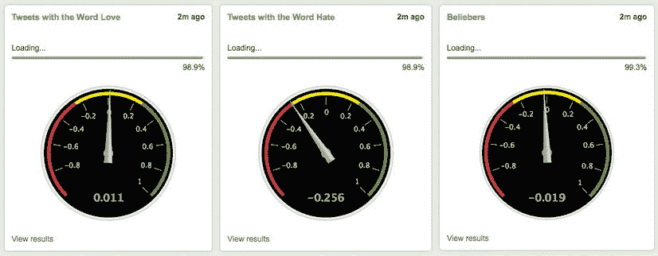

图 14-12. 使用 Sanders 模型的爱、恨与贾斯汀·比伯

为了理解模型对预测情感的影响，我们使用`sentiment`命令对 Twitter 模型和 Sanders 模型进行了快速比较。由于后者模型更偏向技术话题，我们选择分析前 1000 条包含“twitter”一词的推文。使用附带的 Twitter 模型，情感值为 0.35，而使用 Sanders 模型则为 -0.08。这是一个巨大的差异，从积极的下限滑入了中性的负面区域。这是模型敏感性的另一个例子。

为了探究更大的语料库是否能提高模型准确率，我们再次搜索了互联网。这次我们偶然发现了 Ibrahim Naji 的博客，他将 Sanders 语料库与密歇根大学 Kaggle 竞赛中创建的一个非常大的语料库进行了合并。两个来源的 URL 如下：

```
http://thinknook.com/twitter-sentiment-analysis-training-corpus-dataset-2012-09-22/
```

```
http://inclass.kaggle.com/c/si650winter11
```

下载语料库、删除标签并创建正面和负面文件后，我们从每个文件中提取了 50,000 条记录作为测试数据。最终统计结果是，该语料库包含 740,185 条正面推文和 738,442 条负面推文，总计 1,478,627 条训练推文。创建模型后，我们使用手头的三组 Twitter 测试数据对其进行了测试。结果见表 14-1。

表 14-1. 密歇根大学 Twitter 语料库的准确率

| 测试数据 | 准确率 | 误差幅度 |
| --- | --- | --- |
| 密歇根大学 | 72.49% | 1.05% |
| Twitter（应用程序附带） | 68.79% | 1.12% |
| Sanders | 60.61% | 0.76% |

基于这些结果，假设极性分类质量较高，那么语料库越大，模型准确率似乎越高。但在宣布优胜者之前，我们应该回顾一下 Twitter 模型在密歇根大学测试数据上的准确率。为了进行比较，我们在表 14-2 中展示了使用情感分析应用程序附带的 Twitter 语料库对我们手头三组测试数据集进行测试的结果。

表 14-2. 情感分析应用程序附带 Twitter 语料库的准确率

| 测试数据 | 准确率 | 误差幅度 |
| --- | --- | --- |
| 密歇根大学 | 64.41% | 1.19% |
| Twitter（应用程序附带） | 69.09% | 1.11% |
| Sanders | 57.57% | 0.84% |

再次表明，越大越好，并且有趣的是，每个模型在自己的测试数据上表现更佳。问题在于，更大的模型天生更慢且占用更多内存。这些是在做决策时需要权衡的要点。在结束本节时，我们提醒您，良好预测的关键在于训练数据的质量。

### 世界情感指标项目

在回顾了如何基于 Twitter 衡量情感并看到其流行程度后，我们认为应该提出一个不涉及推文的项目来衡量情感。可以说，报纸可以被视为最初的社交媒体，因此它成为衡量情感的一个有趣替代方案。几乎所有报纸、期刊出版物和电视台都拥有网站，这些网站免费提供新闻，或基于提供不同级别受限访问权限的付费墙。此外，还有许多仅存在于互联网上的新闻媒体。

## RSS 新闻源与情感分析项目概述

大多数新闻网站都提供一项服务，新闻头条会不断更新并向公众开放。该服务基于一种称为RSS（Rich Site Summary，也称为Really Simple Syndication）的格式。RSS文档（通常称为RSS源或简称为源）使用标准化的XML格式，我们稍后将对其进行介绍。RSS源的使用不仅限于新闻网站；任何想要分发或联合发布内容的网站（例如博客和其他在线发布者）也使用RSS来分发不仅是新闻，还包括播客和视频等其他媒体。提供此服务的网站会显示一个RSS链接，通常带有一个小图标和缩写RSS、XML或RDF，以告知用户有可用源。这种典型的橙色图标示例如图 14-13 所示。


图 14-13 RSS 图标

RSS源可以使用名为RSS阅读器、源阅读器或聚合器的程序读取。用户可以指示阅读器订阅多个源。这意味着阅读器程序会定期（例如每小时）读取所需网站上的RSS文档。这些阅读器程序（从非常简单到功能丰富的都有）允许用户按自己的意愿组织头条，从而创建自己的出版物。RSS源仅携带头条和一些附加信息。要阅读实际的新闻文章，用户点击包含的链接，该链接会将其带到原始网站。

每个新闻网站的布局都不同，RSS源也是如此。有些网站只有最新新闻的一个源，而其他网站则提供多个按主题（例如国内、商业、国际、体育等）分类的源。

有趣且使本项目可行的是，世界各地大量主要语言非英语的新闻网站都提供一个或多个英语源。诚然，新闻条目的撰写方式取决于文章和头条的作者，但同一新闻条目的不同变体可能会导致情感感知从一个极性变为另一个极性。我们将在讨论本项目的训练语料库时更详细地讨论这一点。

RSS文档包含一些描述源（技术上称为频道）的字段，以及每个新闻条目的另一组字段。尽管存在RSS和Atom两种标准，但并非所有网站都完全遵守它们，尤其是在每个字段中放置的内容方面。RSS源中典型的新闻条目字段列于表 14-3 中。

表 14-3 典型的 RSS 条目字段

| 字段 | 描述 |
| --- | --- |
| `title` | 新闻头条 |
| `description` | 新闻条目的摘要。内容差异很大，从空值、重复标题到整篇新闻文章 |
| `content` | 并不总是存在。与`description`字段一样，内容差异很大 |
| `link` | 网站上文章的链接 |
| `pubDate` | 网站发布新闻条目的时间戳 |

还有其他字段，如`author`、`copyright`、`category`和`image`，但并未广泛使用。就本项目而言，`title`字段应已足够，因为这是我们预测情感所需的全部内容。通过选择来自世界各地的英语RSS新闻源，我们应该能够获得一个相当好的样本来预测全球普遍情感。本项目需要执行的步骤如下：

- 收集RSS源
- 将头条索引到Splunk中
- 定义情感语料库
- 创建结果的可视化

### 收集 RSS 源

理想的解决方案是拥有一个能够完成此任务的Splunk应用，但这需要我们编写该应用，很可能使用Python语言，这超出了本书的范围。因此，我们需要寻找收集RSS源的替代方法。我们查看了各种RSS阅读器和聚合器，但都没有提供将头条存储到文件中的方法，而文件随后可用于在Splunk中进行索引。扩大搜索范围后，我们发现了一个名为Feedory的开源应用程序，它可以收集RSS源并将其存储在数据库中。该应用程序使用PHP编写，可在以下网址找到：

```
http://sourceforge.net/projects/feedory/
```

安装非常简单，将其连接到我们的MySQL数据库也轻而易举。我们发现唯一的缺点是，对于读取的每个新闻条目，它都会生成一个警告，因为它使用了一个旧版本的库。这很烦人，但似乎不影响应用程序。主页面截图见图 14-14。

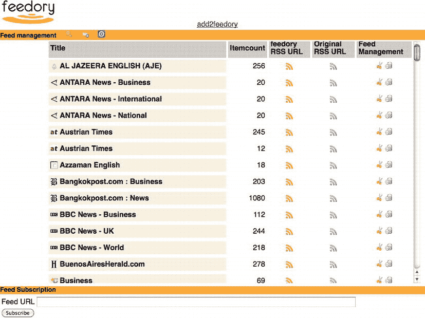

图 14-14 Feedory 的主页面

如图 14-14 所示，源或频道的命名相当不一致。印度尼西亚的安塔拉通讯社和泰国的曼谷邮报明确指定了其RSS源的主题，而奥地利时报则没有。如前所述，一些网站只有一个通用的英语源；在此例中，有卡塔尔的半岛电视台、伊拉克的Azzaman和阿根廷的布宜诺斯艾利斯先驱报。您还可以看到最后一个条目，它有一个徽标和单词Business；这信息量不大。事实证明，这个源来自休斯顿纪事报，但我们之所以能弄清楚，是因为我们将鼠标悬停在第四列的RSS徽标上，该徽标对应于原始URL，并显示了该源的URL。这些不一致性也体现在构成RSS源的其他字段中。

我们为Feedory订阅了来自全球约100个网站的150多个新闻源。我们的选择是国际、世界和商业新闻；当这些不可用时，我们就订阅通用源。源列表可在本书的下载包中的`world_sentiment.opml`文件中找到。OPML格式是专门为交换RSS源的URL而设计的。Feedory或任何RSS阅读器都可以读取此文件并自动订阅这些源。

为了定期获取RSS源，我们使用Unix的`crontab`命令每15分钟执行一次Feedory更新程序：

```
0,15,30,45 * * * * /usr/bin/php /var/www/html/feedory/feedstore.php
```

### 将头条索引到 Splunk 中

我们已经在第 9 章中解释了如何从数据库进行索引，当时我们是从MySQL数据库加载航空数据。不同之处在于，那一章我们进行了一次性加载，而这次我们将进行“尾部”加载，即我们定期访问数据库并获取最新的新闻头条。在此之前，我们需要回顾Feedory在数据库中创建的表和字段。然后我们可以决定要将哪些字段加载到Splunk中。Feedory创建了两个表：`fy_feeds`，其中包含我们订阅的RSS源列表；以及`fy_items`，其中保存实际的新闻条目。由于我们只对新闻条目感兴趣，我们将重点关注`fy_items`表的字段，这些字段在图 14-15 中展示。

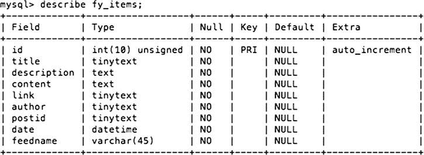

图 14-15 `fy_items` 数据库表的描述

### `id` 字段及其作用

`id`字段将是本项目中的关键，因为DB连接应用（DB Connect App）会利用它来追踪上次加载到Splunk的最新条目是哪一个。`title`字段包含我们需要的新闻标题。我们将忽略`description`和`content`字段，但会保留`link`字段，因为我们可以从中提取新闻的来源网站。如前所述，`author`字段使用并不广泛，因此我们不会加载它。`postid`字段包含了访问文章链接的变体，因此我们也会忽略它。

### `date` 字段与时间戳处理

与往常一样，`date`字段需要更详细的审视。我们首先要检查的是RSS订阅源中的时间戳是如何设置的。然后，我们需要了解数据库是否对时间戳进行了任何转换。在审查了随机选择的十几个RSS订阅源后，我们得出结论：它们在`pubDate`字段中都提供了格式良好的时间戳；日期格式如下：`Wed, 13 Feb 2013 01:22:59 +800`。唯一的区别在于时区格式，但它们始终符合标准。接着，我们检查了之前所选RSS订阅源中的特定新闻条目，并将其原始时间戳与数据库中的时间戳进行了对比；我们注意到数据库已将它们统一为GMT时区。基于此，我们决定使用数据库中的`date`字段作为Splunk中头条新闻的时间戳。因为我们处理的是来自世界各地的信息，使用GMT时区将更为方便。

### 定义数据库连接

确定好所需的字段后，我们可以在Splunk中进行必要的定义。首先，我们将数据库连接名称定义为`RSS`，如图 14-16 所示。您可以从用户界面的任何页面，点击右上角的“管理（Manager）”选项卡，然后选择“外部数据库（External Databases）”选项，再点击“新增（Add new）”来进入该界面。

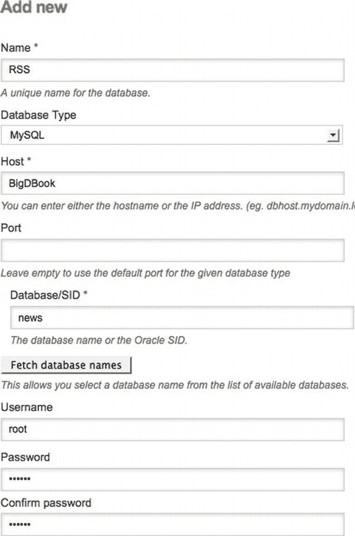

图 14-16. 定义数据库连接

### 创建数据输入

现在，我们已经建立了一个直接连接到Feedory RSS数据库的连接，接下来可以定义Splunk数据输入，以便定期抓取新闻。在与Feedory的测试过程中，我们注意到它每小时会从我们订阅的所有RSS订阅源中抓取大约100条新闻头条，因此数据量足以让Splunk每15分钟更新一次。

要进入数据输入页面，请点击用户界面右上角的“管理（Manager）”选项卡，然后选择“数据输入（Data inputs）”；在该页面中，点击“数据库输入（Database Inputs）”选项右侧的“新增（Add new）”链接。这将带您进入图 14-17 所示的界面。

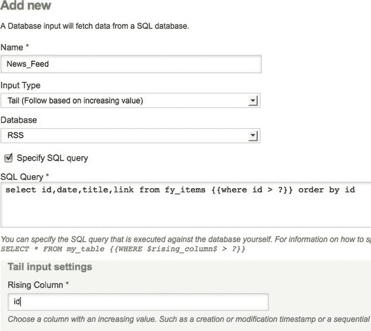

图 14-17. 用于从数据库提取 RSS 新闻条目的 SQL 查询

图 14-17 展示了定义界面的前半部分。如您所见，我们将输入命名为`News_Feed`，并将其定义为尾追（tail）类型。该查询选择了我们想要加载到Splunk中的字段，外加`id`字段，该字段将用作递增列，以追踪最后加载的记录。DB连接应用（DB Connect App）会将查询中的问号（`?`）替换为相应的数字。双花括号（`{}`）括起来的部分是查询首次运行时不会使用的部分。定义此输入所需的其余信息如图 14-18 所示。

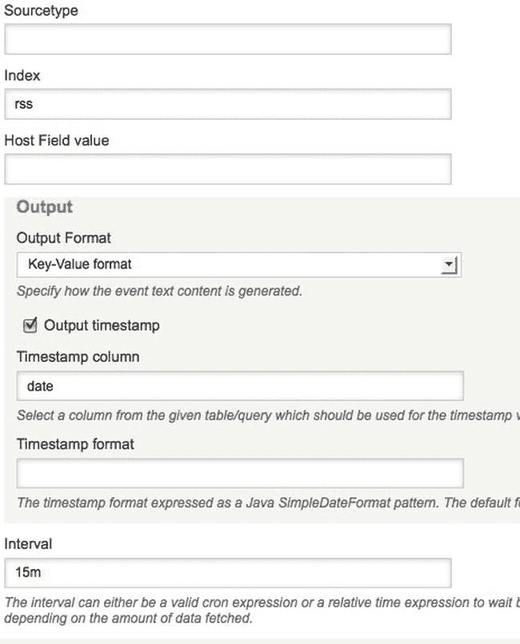

图 14-18. 补充定义

图 14-18 展示了数据输入界面的第二部分，我们可以在其中定义源类型、索引和主机字段值。在这种情况下，我们无需定义源类型，因为我们将使用键值对输出选项。这将为我们从数据库提取的每个值都提供一个字段名。正如第 9 章中提到的，这是为Splunk提供数据以便索引的最高效方式。在此界面中，我们还可以定义包含时间戳的字段以及我们希望Splunk抓取数据的间隔时间，即每15分钟一次。

保存这些选择后，Splunk连接到Feedory数据库，提取所有记录，并将其加载到`rss`索引中。从那时起，它只提取和加载自上次之后新增的记录。照例，我们在Splunk中审查事件，以确保我们拥有预期的字段。我们在用户界面的搜索栏中输入`index=rss | head`，输出结果如图 14-19 所示。

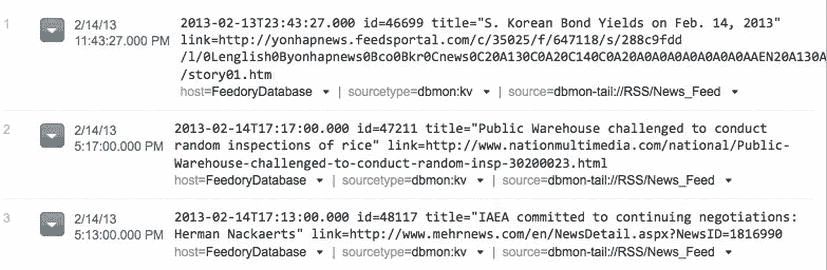

图 14-19. Splunk 中的 RSS 新闻头条

时间戳是正确的，我们需要的每个字段都存在，并且字段名位于值之前。这些值也是每个字段所预期的值。主机名正确，源类型反映了我们选择使用键值对输出。通过这次快速的审查，我们确信RSS新闻头条已被正确地索引到Splunk中。

## 定义情感语料库

基于我们本章前面学到的内容，这是项目的关键部分。新闻头条的问题在于，作者和编辑力求令其标题对潜在读者具有吸引力。在此过程中，他们可能会改变新闻条目的感知情感。例如，表 14-4 包含了同一新闻条目的几个头条标题以及我们个人的情感分类。

表 14-4. 某新闻条目的情感示例

| 头条标题 | 情感 |
| --- | --- |
| 教皇本笃十六世宣布辞职 | 中性 |
| 教皇“太虚弱”无法继续履职 | 负面 |
| 教皇辞去天主教会领袖职务 | 中性 |
| 教皇因健康原因辞职 | 负面 |

如您所见，情感分类是一个极其主观的命题。教皇本笃十六世于 2013 年 2 月宣布辞职的新闻，出于多种原因通常可以被视为中性，而所有这些原因都可能存在争议。从我们的角度来看，这条新闻与世界上的部分人口相关，而对其他人则无关紧要；因此，我们将其归类为中性。我们将另外两条归类为负面，是因为健康状况不佳通常可以被认为偏向负面情感。

作为此过程的一部分，了解我们所处理的新闻头条的特点将大有裨益。与推文不同，头条标题是由专业作者撰写的，因此不应存在拼写错误或俚语。此外，也不应出现任何奇怪的字符、词语延长或表情符号。总的来说，新闻头条是我们可以期望从文本中得到的最干净的数据。为了查明头条标题的平均字符数，我们执行了以下搜索：

```
index=rss
| eval chars=len(title)
| stats avg(chars)
```

这个简单搜索的结果是 47.79 个字符。为了查明头条标题的平均单词数，我们输入了以下搜索：

```
index=rss
| makemv title
| eval words=mvcount(title)
| stats avg(words)
```

此搜索将标题转换为多值字段，其中每个值都是一个单词，因为 `makemv` 命令的默认分隔符是单个空格。`eval` 命令使用 `mvcount` 函数来统计所有值的数量，在此例中即单词的数量。结果显示，每个标题平均包含 7.6 个单词。当我们将这些数字与本章开头提到的 Go 等人论文中的发现（每条推文 14 个单词或 78 个字符）进行比较时，我们的标题要短得多，几乎只有推文的一半大小。有了这些信息，我们可以考虑为训练语料库做出几种选择：

*   基于新闻标题创建我们自己的语料库
*   使用现有的 Twitter 语料库
*   使用电影评论语料库

对于第一个选项，我们花了几个小时创建训练和测试文件。这是一个枯燥的过程，我们只为每个训练文件生成了 100 个标题，为每个测试文件生成了 10 个标题。我们还可以证实一个普遍的看法：在我们处理此任务的这段时间里，正面新闻很少，并且主要出现在商业新闻版块。我们在新闻标题中发现的另一个特点是，其中很大一部分可以被视为中性，因此理想情况下，我们的语料库除了正面和负面文件之外，还应包含一个中性文件。基于我们本章前面所做的测试，我们可以预测这个语料库的质量不会很好。为了充分利用它，我们将尝试训练程序提供的一些选项，这些选项在表 14-5 中进行了描述。

表 14-5. 训练选项

| 名称 | 描述 |
| --- | --- |
| phrases | 定义是使用短语（例如“United States”）还是仅使用单个词元（例如“United”、“States”） |
| remove_stopwords | 排除位于停用词列表中的单词 |
| dedup | 定义是否应从文本中消除重复单词，从而降低它们的权重 |
| stem | 是否对一个单词进行词干提取，即还原为其词根形式。例如，单词 `stemmer`、`stemming` 和 `stemmed` 将被还原为 `stem`。 |
| punct | 定义是否关注“!”或“?”字符 |
| emo | 是否包含表情符号 |
| min_term_percent | 定义我们愿意接受的最小词项出现频率。默认是接受至少在 200 个标题、推文或评论中出现 1 次的词项（5%）。 |

在撰写本文时，这些选项必须在训练程序中更改。由于组合方式数不胜数，我们将重点关注其中几个，并首先将 `dedup` 和 `stem` 定义为 `false`，因为我们希望保留尽可能多的单词。这样做的原因是因为我们的语料库相当小。我们还将把 `punct` 和 `emo` 定义为 `false`，因为标题不包含表情符号，而且我们个人认为“!”和“?”实际上不会影响情感。最后，通过将 `min_term_percent` 变量设置为 `none`，我们接受所有单词，无论它们多么罕见。尽管这可能基于错误的假设，我们还是通过每次更改 `phrases` 和 `remove_stopwords` 选项中的一个来训练和测试我们的最小新闻语料库。在训练和测试了四种选项组合后，我们发现它们的准确率完全相同，只有 38.89%。虽然这在意料之中且令人沮丧，但这些结果是合理的，因为标题太短了，以至于任何单词出现在停用词列表中的可能性都很小。出于同样的原因，我们可以预期，将单词作为短语或单个词元来分析不会带来太大的差异。

我们的第二个选项是使用现有的 Twitter 语料库。我们之前尝试过两个：情感分析应用附带的一个，以及密歇根大学语料库。虽然领域或格式不同，但由于它们都基于短文本消息，因此具有些许相似性，我们需要测试它们以满足我们的好奇心。我们用它们各自的数据训练了这两个语料库，并用我们用于新闻模型训练的数据进行了测试。使用 Twitter 模型的结果显示准确率为 40.80%，而密歇根大学语料库的准确率为 43.81%。很明显，更大的语料库会产生更好的准确率，即使提升幅度很小。然而，低准确率也表明，语料库必须基于将要进行情感分析的数据所处的相同领域和格式。

为了完成研究周期，我们将利用 Pang 和 Lee 在本章前面提到的论文所做的实验中提供的电影评论语料库。除了极性范围语料库之外，还有一个基于简单极性的版本。您可以在以下位置找到这些语料库：

`http://www.cs.cornell.edu/people/pabo/movie-review-data/`

我们下载、准备、训练并测试了极性数据集 2.0 版，该版本包含正面和负面评论各 1000 条。我们期望获得比 Twitter 语料库更高的准确率，尽管领域或格式不同。这是因为这些评论基于大量的词汇，这可能更接近于新闻标题。令人惊讶的是，准确率下降到了 36.79%，是所有语料库中最差的。

考虑到我们过于简化的语料库（正面、负面和中性各 100 条）与其他语料库相比产生了可观的准确率，我们决定再花几个小时来扩大语料库的规模。新版本每个类别包含 200 个新闻标题。当我们测试这个新模型时，我们惊讶地发现准确率提升了近九个百分点，达到 47.22%。这证明了使用与分析数据相同的数据训练语料库是所有选项中的最佳选择。我们在表 14-6 中列出了语料库测试的最终结果汇总。

表 14-6. 新闻模型的准确率

| 模型 | 准确率 | 误差幅度 |
| --- | --- | --- |
| 新闻 (300 个标题) | 38.89% | 1.02% |
| 新闻 (600 个标题) | 47.22% | 1.05% |
| Twitter | 40.80% | 1.16% |
| 密歇根大学 | 43.81% | 1.11% |
| 电影评论 | 36.79% | 1.23% |

显然，我们将使用基于我们扩展语料库的模型。如果模型之间的差异很小，比如在 3% 的误差范围内，我们很可能会选择我们的新闻模型，因为它更小、更快。为了测试一下我们的模型，我们在 10,000 个标题的样本上运行它，结果显示为 -0.35，符合我们的预期。根据我们在创建训练语料库时对标题的广泛审阅，新闻标题主要是中性的，带有轻微的负面倾向。

## 结果可视化

世界情感指标可以提供许多信息。除了显示最近一段时间的情感之外，我们还可以呈现一个历史图表，它可以提供过去趋势的视图。我们还可以展示一些最近的标题，以及我们预测的情感，还有新闻来源。最后，我们还可以有一个精细打印部分，说明预测的准确率和用于计算最近情感指标的标题数量。所有这些可视化内容都可以放置在一个仪表板中。

为了显示情感分析结果，我们可以使用本章前面构建的仪表盘。为此，我们将计算过去一小时新闻标题的情感得分。对于历史情感趋势，我们可以使用基于过去 24 小时的折线图。到目前为止，这些都是一些非常简单的搜索，但对于显示最新新闻标题的表格来说，情况会稍微复杂一些。复杂之处在于定义正则表达式，该表达式将从新闻文章的链接中提取网站的域名。搜索语句如下：

```
index=rss
| rename title as Headline
| sentiment news Headline
| eval Sentiment=case(sentiment==1, "Positive",
                      sentiment==0, "Neutral",
                      sentiment==-1, "Negative")
| rex field=link "http:\/\/(?<Source>[^\/]*)"
| table Headline, Sentiment, Source
```

我们首先重命名`title`字段，使其在表格中作为表头能更美观地显示。我们使用`eval`命令的`case`函数将情感数值转换为更易读的文本，最后通过`rex`命令，使用正则表达式捕获`http://`之后、下一个斜杠（`/`）之前的内容到`Source`字段，从而提取域名。请注意，斜杠字符在正则表达式中具有特殊含义；因此，我们通过在其前面放置一个反斜杠字符（`\`）来转义它。

对于详细摘要信息，我们将使用一种仅在仪表盘上可用的可视化组件，即“单值”显示。在仪表盘中定义面板时，可以在可视化组件列表中选择“Single Value”。弹出的对话框如图 14-20 所示。在这里，除了面板标题外，您还可以定义将放置在单值前后显示的文本。

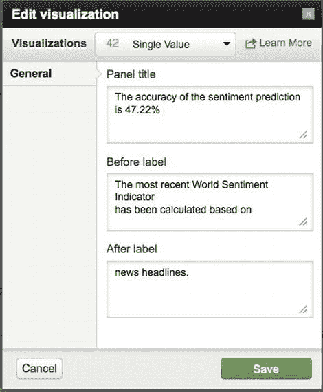

图 14-20. 单值可视化对话框

我们使用的搜索语句非常简单，如图 14-21 所示，它展示了搜索的对话框。在此图中，您还可以看到所选的时间范围，该范围是从当前时间回溯 1 小时，即从搜索执行那一刻开始的过去一小时。

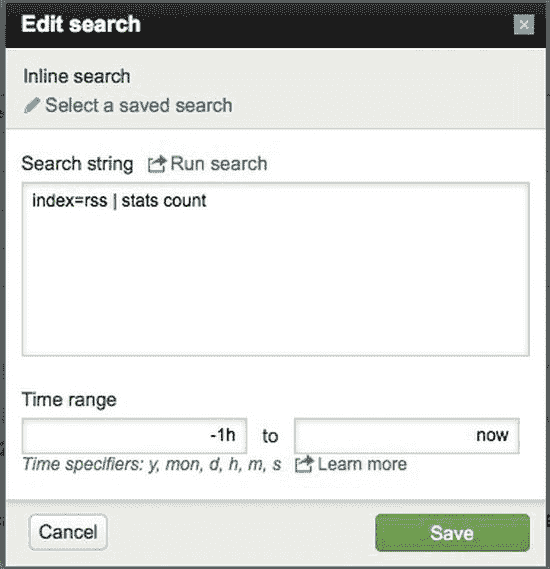

图 14-21. 单值搜索对话框

当我们把这些面板组合到一个名为`WorldSentimentIndicator`的仪表盘中时，就得到了项目的最终可视化效果，如图 14-22 所示，您也可以在其中看到显示不那么详细摘要信息的单值显示。

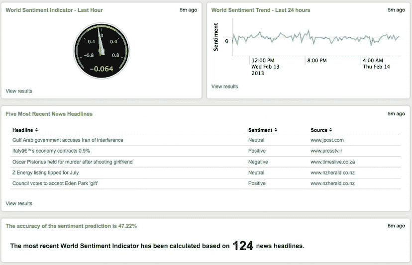

图 14-22. 世界情感指示器仪表盘

剩下的唯一事情是我们希望这个仪表盘每 15 分钟自动刷新一次。为此，我们需要编辑定义仪表盘的 XML 文件。这并没有听起来那么困难。只需按照以下步骤操作即可。从用户界面的搜索屏幕中，从“Dashboards & Views”下拉菜单中选择“Manage views”选项，如图 14-23 所示。

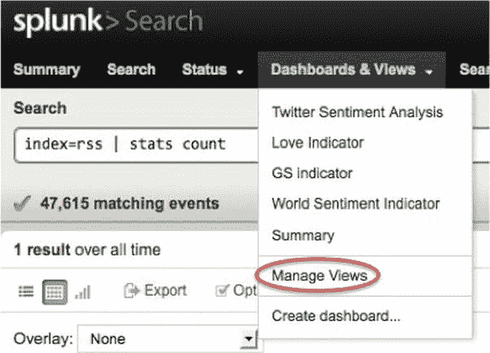

图 14-23. 选择管理视图

进入“Manage Views”页面后，您将看到所有视图的列表。找到`WorldSentimentIndicator`并点击它。这将打开一个包含仪表盘配置 XML 定义的页面。第二行包含字符串`<dashboard>`，您需要通过在结束符号前添加以下内容来修改它：`<dashboard refresh=900>`。最终的修改结果如图 14-24 所示。该指令表明我们希望仪表盘每 900 秒自动刷新一次，即 15 分钟。

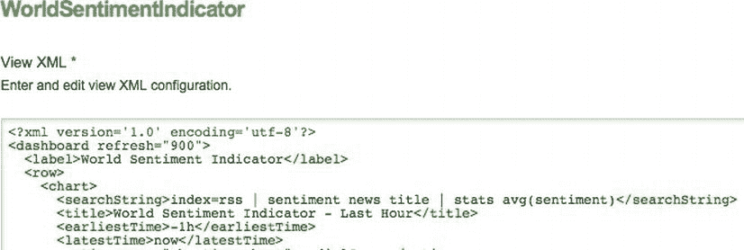

图 14-24. 为仪表盘添加自动刷新功能

一旦您点击页面右下角的保存按钮，仪表盘将开始每 15 分钟自动刷新一次。您可以在`http://www.opallios.com`找到该项目的最新版本，我们会在那里继续扩大训练语料库，力求提高世界情感指示器的预测准确率。

## 总结

在本章中，您学习了分析情感的原因。然后，我们下载并使用了情感分析应用。您还了解了与创建情感模型和训练语料库相关的所有问题，以及使用将要分析的数据来获得更高预测准确率的重要性。接着，我们研究了世界情感指示器项目，该项目引导我们如何从世界各地收集 RSS 新闻源，通过定期连接到包含新闻标题的数据库将其索引到 Splunk 中。然后，我们创建了自己的训练语料库，并与其他语料库进行了比较，再次发现最佳的训练数据是基于将要分析的数据。最后，我们创建了一个每 15 分钟自动刷新一次的仪表盘，以可视化我们创建的不同搜索结果。

