# 第 16 章：扩展与高可用性

到目前为止，本书中的所有示例和项目都基于使用单个 Splunk 实例，该实例同时充当索引器和搜索器。在本章中，我们将回顾如何通过添加更多服务器来处理索引和搜索组件，从而扩展 Splunk。您还将学习集群的基本原理，它通过处理索引器的自动故障转移来提高 Splunk 的弹性。我们将建立一个示例集群来说明此过程的基本步骤。

## 扩展 Splunk

Splunk 的功能大致可以分为三个基本领域：

-   收集数据
-   索引收集到的数据
-   在已索引的数据中搜索信息

Splunk 的强大功能之一在于您可以分离这些功能区域并分别对它们进行扩展。在第 15 章中，您学习了如何通过使用转发器将数据收集扩展到远程服务器（无论是基于 Unix 的系统还是 Windows 服务器）；您还回顾了一些涉及使用转发器的典型拓扑结构。在本章中，我们将回顾如何单独或组合地扩展索引和搜索功能。

扩展任何一个功能都有多种理由。如果您有数百个转发器向单个 Splunk 实例发送信息，根据它们发送的数据量，单个实例可能会迅速成为瓶颈，因此您可以添加另一个 Splunk 实例来协助分担负载。这样做的一个优点是，转发器可以将数据分发到两个实例上，有助于扩展。另一个优点是该分发隐式地为转发器创建了故障转移能力。当一个 Splunk 实例宕机时，转发器会自动切换到另一个实例。这种拓扑结构可以在图 16-1 中看到。

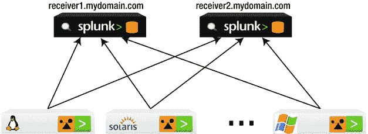

图 16-1. 多个转发器在两个索引器上负载均衡数据

### 分布式搜索配置

图 16-1 展示的拓扑结构虽然是有效的，但它引发了一个问题：每个 Splunk 实例只会拥有部分已索引数据。在一个实例上执行搜索时，只会搜索该实例所索引的数据部分，而不是全部数据。为了能够搜索两个实例上的所有已索引数据，必须使用分布式搜索。这并不像听起来那么困难，只需两步操作即可完成：首先在 Splunk Web 的 Manager 中激活此功能（见图 16-2），然后定义搜索对等节点。要进入激活界面，请转到 Manager 并从 Distributed Environment 部分选择 Distributed search 选项。进入后，点击 Distributed search setup 链接。

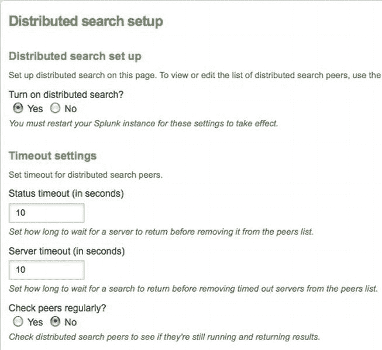

图 16-2：启用分布式搜索

启用分布式搜索后（我们通常保持其他选项为默认值），需要重启 Splunk 实例。该过程的第二步是定义参与搜索的其他 Splunk 实例，也非常简单，如图 16-3 所示，我们将第二个索引器定义为第一个索引器的对等节点。

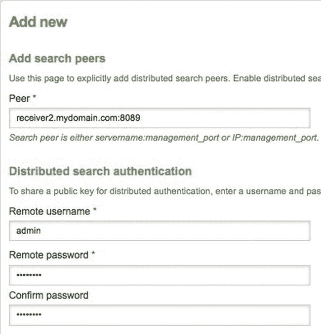

图 16-3：定义搜索对等节点

 **注意**：使用分布式搜索时，必须更改 Splunk 的初始密码。使用默认密码将无法正常工作。

图 16-3 中的搜索对等节点是从第一个索引器定义的。然后必须将第一个索引器定义为第二个索引器的对等节点。基本上，必须为混合环境中的每个索引器定义所有搜索对等节点，并且请记住需要在防火墙上开放管理端口（通常为 `8089`），否则连接将无法工作。

在转发器方面，有几件事需要完成。第一件事是定义接收器集合。这可以通过 CLI 或直接修改 `outputs.conf` 文件来完成。无论采用哪种方式，都可以在 DNS 列表中为每个接收器的 IP 地址定义一个新的 A 记录，使其看起来像这样：

```
receiver.mydomain.com           A       192.186.1.1
receiver.mydomain.com           A       192.186.1.2
```

显然，你应该使用自己的域名和合适的 IP 地址。使用此方法时，`outputs.conf` 文件将类似于以下内容：

```
[tcpout]
defaultGroup=my_indexers

[tcpout:my_indexers]
disabled=false
server=receiver.mydomain.com:9997
```

需要指出的一点是，转发器基于时间分发数据：即负载均衡通过按固定时间段（默认为 30 秒）从一个索引器切换到下一个索引器来实现。由于 Splunk 是一个时间序列索引器，这是关于数据分发的关键点。这意味着当进行搜索时，每个索引器将根据轮询机制拥有总数据的 30 秒切片。这种数据分发方式非常高效，索引器仅在有搜索时间段内的数据时才会参与分布式搜索。结果通常是几乎所有索引器都会以相当平衡的方式参与搜索。通常没有理由更改 30 秒的默认值，但如果想将其更改为 20 秒，只需在 `outputs.conf` 文件中添加以下指令：`autoLBFrequency=20`。另一种指定负载均衡的方式是使用 CLI；在这种情况下，需要在 Unix 提示符下发出以下命令：

```
./splunk add forward-server receiver.mydomain.com:9997 –method autobalance
```

此示例假设你已按前述方式定义了 DNS A 记录。如果未这样做，你可以在转发器上指定每个单独的索引器，如下所示：

```
./splunk add forward-server receiver1.mydomain.com:9997 –method autobalance
./splunk add forward-server receiver2.mydomain.com:9997 –method autobalance
```

如果你正在使用部署服务器，就像第 15 章的示例中那样，只需修改 `send/default` 目录下的 `outputs.conf` 文件，更改将自动发送到转发器，转发器在收到更新后将重启，并以 30 秒的间隔在两个 Splunk 实例之间分发数据。

通过启用分布式搜索，用户可以访问任何 Splunk 实例进行搜索，它将使用所有 Splunk 实例（或本示例中的两个实例）上索引的数据。最终的拓扑结构（其中搜索在索引器之间协调）如图 16-4 所示。在此示例中，用户根据负载均衡器的决定访问任一 Splunk 实例。

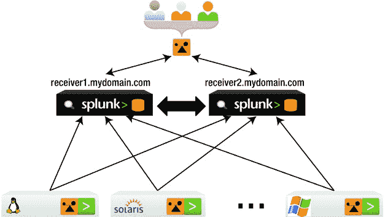

图 16-4：启用分布式搜索的拓扑结构

提醒一下，此设置中使用两个网络端口：管理端口（通常为 `8089`），用于 Splunk 实例之间的相互通信；以及接收器端口（通常为 `9997`），用于接收器获取转发器的数据流。无需多言，这两个网络端口必须在防火墙上开放才能工作。我们指出这一点是因为忘记开放防火墙上的网络端口是一个常见错误，而 Splunk 产生的错误消息与防火墙无关。

任何已保存的搜索、Splunk 应用或一般的知识对象（即在某个 Splunk 实例上定义的）称为知识包。在分布式搜索环境中，知识包必须复制到其他 Splunk 实例或搜索对等节点，以便用户可以透明地使用任何实例进行搜索。如果知识包相当大，将其复制到所有搜索对等节点可能是一个缓慢的复制过程。为了提高效率，可以使用所谓的挂载包，即将实际的知识包放置在由所有搜索对等节点共享的磁盘上（使用 NFS 或 SMB），这样可以消除复制的需要。Splunk 文档详细说明了启用挂载包所需采取的步骤。包含使用挂载包的搜索对等节点的最终拓扑结构如图 16-5 所示。请注意，这种拓扑结构对于所谓的中型部署可以正常工作。在某个节点上，搜索数量将迅速压垮挂载包和搜索轮询。

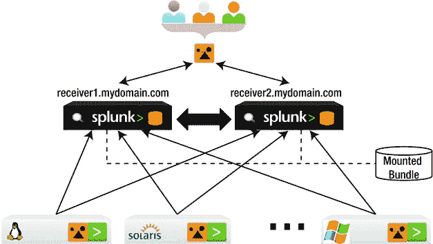

图 16-5：使用挂载包的分布式搜索拓扑结构

在本章到目前为止使用的示例中，Splunk 实例是自包含的，即它们同时拥有索引器和搜索组件。我们之前提到这些组件可以分离。一个典型的例子是将搜索组件安装在自己的服务器上，如图 16-6 所示，此时它被称为搜索头。搜索头不接收和/或收集数据，它所做的只是协调所有索引器的搜索。此外，接收器或索引器不再由用户直接访问，用户必须通过搜索头来进行搜索。

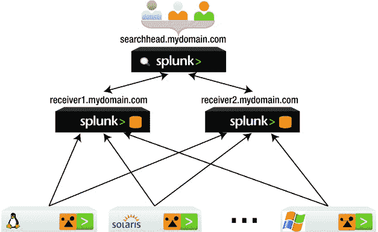

图 16-6：使用搜索头的分布式搜索拓扑结构

随着您对 Splunk 的使用不断增加，您可以信赖其提供的灵活性，特别是分离基本功能的能力，如图 16-7 所示的拓扑结构中，不仅有各种索引器，还有多个搜索头。这个例子相当复杂，但也非常实际。增加更多搜索头的驱动因素是并发搜索的数量，通常是仪表板中的计划搜索。随着仪表板越来越普及，通常会发现有专门用于服务仪表板搜索的搜索头。当存在大量与 Splunk 交互的用户（无论是进行临时搜索还是保存的搜索）时，也需要额外的搜索头。关于何时添加索引器或搜索头的讨论可以在附录 A 中找到。

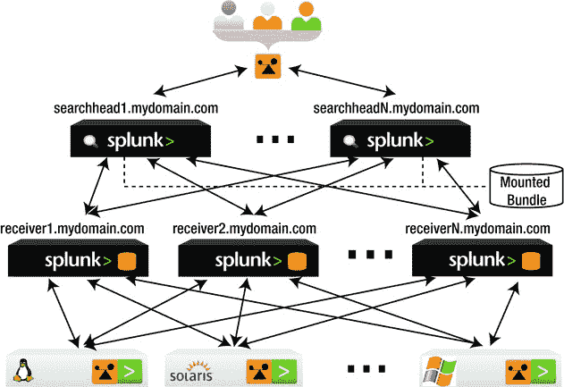

图 16-7. 具有多个搜索头的分布式搜索拓扑

关键在于，由于 Splunk 允许将搜索与索引分离，并且能够定义搜索对等节点和知识包，因此您可以创建最适合您独特需求的拓扑结构。这种灵活性不仅限于扩展，还可以用于其他需要管理组织上或地理上分散数据的情况。例如，您可能有一个公司，其大部分数据在本地层级处理，但加利福尼亚州除外，旧金山和洛杉矶的办公室共享数据。除此之外，总部还有一个搜索头可以访问所有办公室的数据。这种情况在图 16-8 中进行了描述。

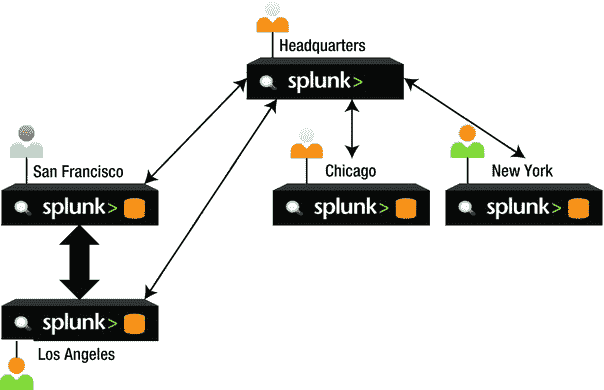

图 16-8. 地理上分散的拓扑结构

如图 16-8 所示的例子所见，通过分离索引器和搜索功能所能实现的灵活性，可以满足大多数需求，无论是为了处理更多数据和搜索而扩展，还是为了处理特殊的组织或地理需求。有关扩展的更多细节，例如何时添加索引器或搜索头，可以在附录 A 中找到。

## 集群

对 Splunk 索引器进行集群是实现高可用性的方法。分布式搜索的一个问题是，当搜索对等节点或索引器不可用时，该索引器中的数据将不再可用。尽管这对于自动负载均衡的转发器来说不是问题，因为它们会将数据流发送到下一个索引器，但对于执行搜索的人或进程来说，这就成了一个问题。在该 Splunk 实例中索引的那部分数据不再可用，搜索结果将不完整。

集群在多个索引器上复制数据，这样当一个索引器宕机时，包含复制数据的其他索引器可以介入，为搜索提供数据的完整性。复制、故障转移和其他集群特定项目的协调由集群主机完成，集群主机是一个 Splunk 实例，仅执行此协调功能，不执行其他任何操作。在图 16-9 中，您可以看到一个集群拓扑，其中包括一组转发器、四个索引器、一个搜索头和必要的集群主机，说明了数据流的走向。

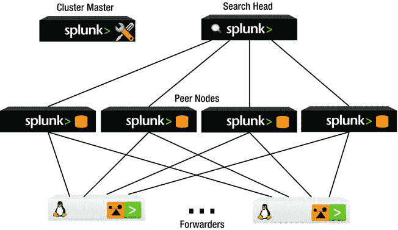

图 16-9. 展示数据链路的典型集群拓扑

由于集群主机仅协调对等节点之间的复制和故障转移活动，图 16-9 并未显示主机节点与其他实例之间的任何连接。在解释主机节点如何履行职责以及复制机制如何工作之前，我们必须先解释数据在 Splunk 中的存储方式。Splunk 中的数据分为两部分：

*   **原始数据**，这并不是严格意义上的原始数据，而更像是一个已经分解成事件的处理版本。它以压缩格式存储。
*   **索引**，包含指向原始数据的元数据。这使得搜索非常快，因为搜索从索引开始，并在原始数据中查找特定事件以检索所需信息（如果存在）。

这两部分都存储为平面文件，它们一起被统称为 Splunk 索引，并组织成桶。这些桶只是包含这些平面文件的目录，根据事件的时间戳按“年龄”排列。桶有自己的生命周期，经历从热到温再到冷，最后到冻结的各个阶段。数据根据大小从热阶段滚动到温阶段；此后，数据根据大小和年龄滚动到下一阶段。滚动到冻结阶段的数据将被删除，除非您将其归档，在这种情况下，以后可以解冻。在所有阶段中都可能存在（并且通常存在）许多桶。

在集群环境中，Splunk 会复制桶，而且是以相当高效的方式进行的。需要指定两个参数，第一个是**复制因子**。它定义了拥有桶原始数据的总索引器或对等节点数量。第二个是**搜索因子**，它定义了其中有多少个副本还包含索引或元数据。默认值是复制因子为 3，搜索因子为 2。这意味着一个索引器包含主桶（原始数据和索引）；另一个索引器包含主桶的副本（包含原始数据和索引）；第三个索引器仅包含桶原始数据的副本。主桶是用于搜索的桶，而其他副本仅在出现故障时使用。

其效率基于这样一个事实：索引部分可以随时从原始数据生成；因此，存在一个完整的次要桶可用，如果由于任何原因该桶不再可用，第三个部分副本可以重新生成索引部分，成为一个功能完整的桶。

当然，您可以将复制因子和搜索因子定义为最适合您特定情况的值，但复制因子不能大于对等节点的数量。类似地，搜索因子不能大于复制因子。请注意，一旦定义了这些值并启动了集群，您就无法更改它们。在图 16-10 中，您可以看到一个在集群中使用默认值的索引工作示例。最左边的索引器接收数据，并将一个完整副本复制到另一个对等节点，并将部分桶复制到第三个节点。主节点告知索引器将复制数据发送到哪些对等节点。

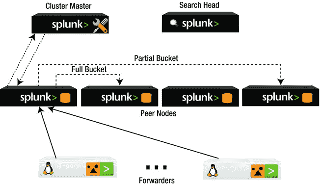

图 16-10. 显示一个索引器复制过程的集群拓扑

在使用集群时，强烈建议您使用转发器收集数据并启用数据确认选项，以确保索引器接收到转发器发送的数据流。

主节点每秒接收来自所有对等节点的心跳信号。当它在 60 秒内（这是默认值；虽然不推荐，但可以更改）未收到心跳信号时，会假定某个对等节点宕机，并启动补救措施。除此之外，主节点还有其他重要功能，总结如下：

-   它告诉每个对等节点数据应复制到哪里。虽然对等节点分配算法没有公开，但这显然取决于复制因子和搜索因子。
-   它向搜索头提供一个可用索引器列表。
-   当一个对等节点不可用时，协调补救措施：
    -   对于故障对等节点中的每个主存储桶，选择一个拥有完整存储桶的新对等节点作为新的主存储桶。这通常只需几秒钟。
    -   对于故障对等节点中的每个完整存储桶，选择一个将托管完整存储桶的新对等节点，以维持搜索因子。在某些情况下，这可能需要从部分存储桶的原始数据中计算元数据。这可能需要几分钟。
    -   对于故障对等节点中的每个部分存储桶，选择一个将托管部分存储桶的新对等节点，以维持复制因子。

此关于 Splunk 集群基本原理的高级概述应为您提供设置集群所需的基础知识。我们强烈建议您在设置生产集群之前，先查阅 Splunk 关于此主题的文档。

# 设置集群

为了说明我们刚刚回顾的集群概念，我们将练习设置一个类似于图 16-9 中描述的集群，该集群由四个索引器（或对等节点）、一个搜索头和一个主节点组成。我们将使用 `replication_factor` 3 和 `search_factor` 2 的默认值。

第一步是启用集群主节点。请注意，主节点不能同时作为对等节点或搜索头，它只能是一个主节点。一旦您安装并启动了 `Splunk` 实例，请转到管理器并选择集群选项。在那里，您单击“配置”，这将调出图 16-11 中显示的屏幕。您可以看到，我们正在启用集群并将此实例设为集群主节点，并使用所有默认设置。您还可以提供一个密钥，该密钥将用于验证主节点与所有对等节点之间的通信。所有集群实例上的密钥必须相同。我们选择将其留空。


**图 16-11. 为主节点启用集群**

保存此配置后，您必须重启 `Splunk` 才能生效。重启实例后，它就可以接受对等节点了。请注意，它会阻止对等节点上的索引，直到有足够多的对等节点满足 `replication_factor`。下一步是启用对等节点。这通过转到与启用主节点时相同的屏幕来完成，但您要选择将此实例设为集群对等节点，如图 16-12 所示。在这里，您需要提供主节点的名称和管理端口，通常为 `8089`。记得添加`https://`，否则会失败。此外，您需要提供对等节点用于从其他对等节点接收复制数据的网络端口。任何未使用的端口都可以，因此我们选择了 `8100`。因为我们没有在主节点上定义密钥，所以这里我们也将其留空。

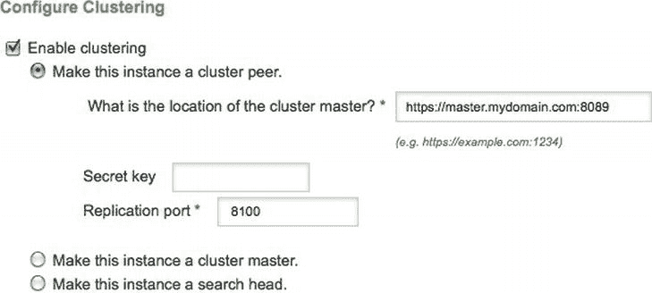

**图 16-12. 启用集群对等节点**

在第一个对等节点上重启 `Splunk` 实例后，我们会收到以下警告消息：

```
Indexing not ready; fewer than replication_factor peers are up
```

这是意料之中的，因为集群中只有一个对等节点。在主节点上，您可以通过转到管理器，然后选择集群，再单击仪表盘链接来查看集群状态。此仪表盘可以配置，但默认情况下包含三个信息部分。在图 16-13 中，我们展示了集群概览，其中显示了我们刚刚评论的状态。

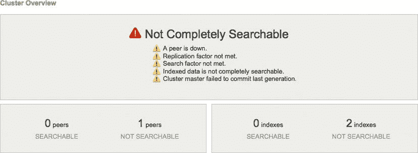

**图 16-13. 集群概览报告**

再次提醒，您必须确保防火墙中所有必要的网络端口均已打开；否则，集群将无法工作，因为所有对等节点间的通信都无法进行。一旦您启用了所有搜索对等节点，就可以继续启用搜索头了。该过程与启用主节点或对等节点相同，但您只需选择搜索头。这将要求您提供主节点的 URL 和密钥。保存配置后，您需要重启 `Splunk` 实例。要验证搜索头是否正常工作，您可以在管理器的集群组下查看搜索头仪表盘。此选项的输出如图 16-14 所示。

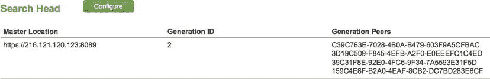

**图 16-14. 搜索头仪表盘**

搜索头仪表盘中显示的信息相当晦涩，但您需要查找的是在 `Generation Peers` 标题下是否有与对等节点数量相同的行。在我们的示例中，如图 16-14 所示，它显示了四行，这是正确的。值得注意的是，您可以拥有多个活动集群，并且一个搜索头或一组搜索头可以访问多个集群。这为您提供了所需的灵活性，可以设计出几乎适用于任何情况的解决方案。

现在集群已启动并运行，您可以在主节点上查看集群概览报告，如图 16-15 所示。尽管此图仍呈现了总报告的部分信息，但我们添加了一个显示对等节点详细信息的章节。

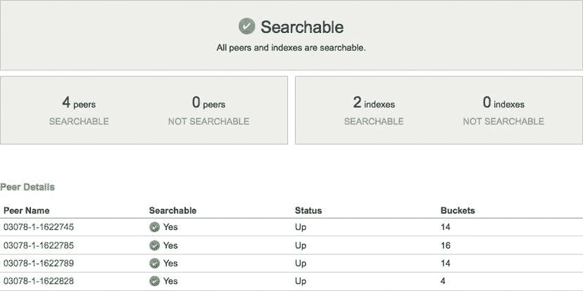

**图 16-15. 完整集群的概览报告**

到目前为止，我们执行的步骤适用于仅使用主索引的基本集群。如果您使用任何其他索引或应用程序，则需要准备一个所谓的 `configuration bundle` 在主节点上，这将允许您将附加信息分发到所有对等节点。有关此主题的更多详细信息，请查阅 `Splunk` 文档。

最后一点是关于主节点的。诚然，它可以被认为是一个单点故障，但它并不像看起来那么脆弱。如果主节点不可用，对等节点之间会继续相互通信，根据需要复制数据，因为它们拥有所有必要的信息。当某个对等节点不可用时，主节点的缺失就会成为一个问题，因为没有一个主节点可以协调补救活动并为搜索提供数据完整性。当一个新的对等节点加入集群（无论是重启还是新节点）且不知道该使用哪些对等节点进行复制时，情况也是如此。`Splunk` 文档介绍了一种设置备用主节点的方法。

## 总结

# 附录 A

## Splunk 的性能表现

本附录概述了 `Splunk` 在索引、搜索、分布式搜索以及磁盘速度对搜索影响方面的性能表现。我们还提出了一些建议，帮助您更好地了解您的 `Splunk` 环境，包括搜索头。

## 搜索类型

我们必须在此附录开头提出严正警告：性能不能一概而论，也不能从其他类似系统进行类推。无论您认为您的应用与另一个应用多么相似，或者与在别处运行的同一个应用多么相像，您都无法准确推断出其性能表现。事实上，您的应用会根据使用模式表现出不同的性能特征。`Splunk` 是一个复杂的软件系统，没有公式可以计算其性能。在本附录中，我们将分享 `Splunk` 在不同情况下的性能表现，以便您了解其行为并设定合理的预期。

此处提供的性能数据仅用于说明目的，不应视为 `Splunk` 性能的准确体现。如果您运行相同的性能测试，您得到的结果也会有所不同。这是因为有太多的配置文件，不仅在 `Splunk` 中，也在底层操作系统中，任何微小的差异都可能产生巨大影响。

`Splunk` 拥有多个活动组件，这使我们无法提供通用的性能衡量标准。从宏观层面来看，以下因素会影响 `Splunk` 的性能：

*   搜索类型
*   索引器数量
*   搜索头数量
*   被索引数据的类型
*   底层硬件和操作系统

`Splunk` 的工程团队根据搜索结果中返回的事件数量对搜索类型进行分类。您的预期可能是根据搜索的复杂度进行分类，但这实际上无法衡量；而搜索生成的事件数量是可以衡量的，并且对搜索的响应时间有非常大的影响。以下是搜索的类别或类型：

*   **密集**：每索引一至一千个事件返回一个结果（1 到 1,000）
*   **稀疏**：每索引一千至一百万个事件返回一个结果（1,000 到 1,000,000）
*   **罕见**：每索引一百万至十亿个事件返回一个结果（1,000,000 到 1,000,000,000）
*   **大海捞针**：每索引十亿个或更多事件返回一个结果（1,000,000,000+）

可以这样理解：密集搜索会产生大量事件，是对索引数据的全景式浏览。稀疏搜索则稍微放大，如同使用了双筒望远镜。罕见搜索开始深入细节，如同显微镜；而大海捞针搜索则真正深入到了分子层面，如果愿意的话，可以将其比作电子显微镜。从俯瞰森林，到观察树枝，再到审视树叶，最后目睹光合作用的进行。您越聚焦放大，`Splunk` 的性能就越好，正如我们将在本附录中看到的。

 **注意** 我们必须提醒您，本附录中呈现的性能测试是在实验室的真空中完成的，不能指望其反映真实世界的情况。

`Splunk` 不会对搜索结果进行缓存或使用缓冲区。为了提供正确的比较，本附录中执行的所有性能测试都在运行前清除了 Unix 缓存。

## 搜索性能概览

为了展示性能如何依赖于搜索类型，我们进行了一个简单的实验。我们按照组合日志格式创建了一个典型的 Web 访问日志文件，但在末尾放置了一些关键字，例如 `every2`、`every100` 等，以及一个用于验证目的的序列号。每个关键字出现在相应的每个事件中，因此 `every2` 会出现在每第二个事件中，而 `every100` 出现在每第一百个事件中。多个关键字会相应出现，例如，每第一百个事件也将包含 `every2` 关键字，因为 100 是 2 的倍数；而每第一万个事件不仅包含 `every10K` 关键字，还包含 `every2` 和 `every100`。典型的 Web 访问日志条目如下所示：

```
150.135.220.120 - - [04/Jan/2012:23:59:59 -0700] "GET /themes/splunk_com/img/skins/white/logos/downloads/logo_freebsd.gif HTTP/1.1" 200 - "http://www.splunk.com/index.php/landing?ac=ostg-cpd" "Mozilla/4.0 (compatible; MSIE 7.0; Windows NT 5.1; .NET CLR 1.0.3705; .NET CLR 1.1.4322; Media Center PC 4.0)" "150.135.220.120.0000044400204798" every2 every100 num=000000100051200
```

我们生成了略多于 36 亿个事件，约 1 TB 的原始数据，这些数据被索引到一台普通服务器上。我们使用另一台服务器作为搜索头。这项测试并不十分真实，因为没有任何其他操作发生，没有数据被索引，也没有其他人执行其他搜索，但它仍然为我们提供了基于搜索分类的响应时间的相当不错的概念。测试是使用 CLI 通过简单搜索完成的，例如：

```
search every2
| stats count
```

结果可以在图 A-1 中看到。我们不得不使用对数刻度，因为使用 `every2` 关键字的密集搜索的结果与光速测试的结果之间存在四个数量级的差距，光速测试只是搜索关键字 `SpeedOfLight`，我们知道它在生成的数据中并不存在。当您执行搜索时，`Splunk` 会检查其数据桶，看其中是否有该字符串。光速搜索只是用来衡量遍历 `Splunk` 基础设施寻找一个不存在的字符串需要多长时间；在这个例子中只需两秒钟。当它在某个桶中找到该字符串时，它会在原始数据中查找包含搜索字符串的实际事件，但要做到这一点，它必须先解压缩原始数据，因为原始数据是以压缩格式存储的。匹配搜索的事件越多，它需要解压缩的数据就越多，因此密集搜索往往受限于 CPU。如结果图表所示，非常密集的 `every2` 关键字搜索耗时近四小时，因为 `Splunk` 必须处理超过 18 亿个 Web 访问事件。当我们转向不太密集的搜索，如 `every100`，响应时间降至 45 分钟，因为 `Splunk` 只需处理约 3600 万个事件。随着结果包含的事件越来越少，性能显著提升，如 `every200million` 关键字所示，仅需 26 秒即可返回匹配搜索的 18 个事件。

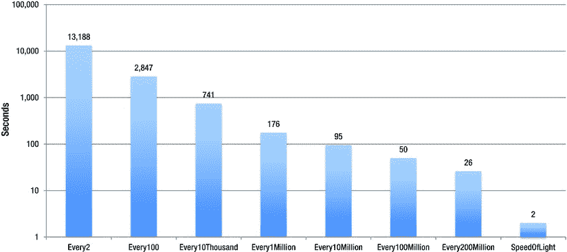

图 A-1 . 按类型划分的搜索性能

随着搜索从密集到稀疏、稀有再到大海捞针，它们会从 CPU 密集型转变为 I/O 密集型，因为需要解压的原始数据减少了，但对桶的读取操作增多了。图 A-2 展示了在每索引 10,000 到 100,000 个事件中返回一个结果时发生的转变，这将其置于稀疏搜索类别的中间位置。

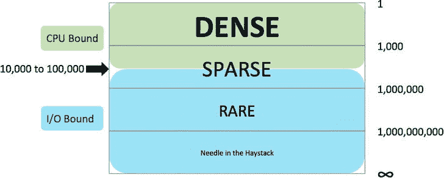

图 A-2. 搜索资源消耗

要判断搜索是 CPU 密集型还是 I/O 密集型，只需点击作业检查器按钮，该按钮位于用户界面的搜索屏幕上，在时间选择器下方，是一个内含字母“i”的蓝色方块。这将打开另一个浏览器窗口，其中包含该特定搜索的执行成本信息。在图 A-3 中，你可以看到我们在第 10 章中使用的一个简单搜索的部分输出，该搜索寻找计划飞行时间为 31 小时的美联航航班：

```
UniqueCarrier=UA CRSElapsedTIme=1865
```

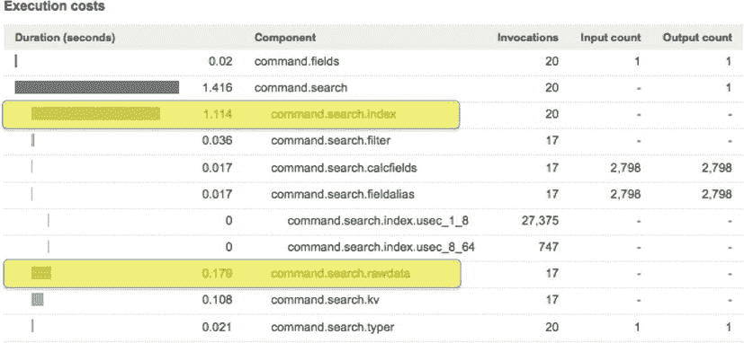

图 A-3. 搜索执行成本

仔细查看作业检查器的输出，你会发现`command.search.index`花费的时间是 1.114 秒，而`command.search.rawdata`是 0.179 秒；因此，此搜索是 I/O 密集型的。这在意料之中，因为该搜索属于稀有类别，在 1.47 亿个已索引事件中仅有一个结果。最后提醒一点：这不适用于基于`tsidx`机制的搜索。

## 大海捞针

为大海捞针搜索设置性能测试非常复杂且耗时；这就是为什么之前的实验没有包含这种搜索类型的原因。然而，我们有幸专门为此案例运行了一些独立的性能测试。与之前的测试类似，我们使用组合访问格式创建了一组 Web 访问日志，并为每个事件附加了一个唯一的序列号，这次没有使用关键词。我们生成了 560 亿个事件，并将其平均分布在 10 个 `Splunk` 索引器上。该集群还有一个单独的搜索头。我们从 CLI 使用的搜索命令如下：

```
search 0000028000000123
```

这会查找该特定字符串，该字符串在 560 亿个事件中是唯一的，对应的事件编号为 28000000123，可以在大约一半的位置找到。此搜索的结果可以在表 A-1 中找到。

表 A-1. 大海捞针性能

| 桶大小 | 布隆过滤器 | 响应时间（秒） |
| --- | --- | --- |
| 1GB | 否 | 186.636 |
| 1GB | 是 | 31.788 |
| 10GB | 否 | 71.459 |
| 10GB | 是 | 9.727 |

当然，最引人注目的焦点是从 560 亿个事件中找出唯一事件只用了不到 10 秒，但有几个地方需要先解释一下。我们先从桶开始。这是 `Splunk` 存储原始数据的地方；默认大小在安装 `Splunk` 时由系统自动计算。它基于运行 `Splunk` 的服务器上的核心数量和其他配置信息进行设置。当桶与主索引关联时，默认大小很可能是每个桶 10GB，而对于与自定义索引（即您定义的索引）关联的桶，默认大小很可能为 1GB。您可以配置桶大小，但一般来说，对于高容量索引（例如主索引），我们建议使用预定义的`auto_high_volume`设置，否则使用`auto`设置。一个高容量索引通常被认为是每天接收超过 10GB 数据的索引。

对搜索性能有巨大影响的另一项是布隆过滤器。这是一种可以明确声明某个元素不在数据集中的数据结构。`Splunk` 使用布隆过滤器来判断某个字符串是否不在某个桶中。这样，`Splunk` 就不必打开并处理不包含我们正在查找的字符串的桶，从而显著提高性能。当您将更大的桶大小与布隆过滤器结合使用时，桶的数量会更少，这意味着需要处理的布隆过滤器更少，从而减少了搜索的处理时间。布隆过滤器在索引时创建，并且在 `Splunk` 中默认启用。创建它们会有相对较小的开销，但当您进行稀有或大海捞针搜索时，这点开销是非常值得的。开销包括索引期间创建布隆过滤器的额外处理时间，以及用于存储过滤器的额外磁盘空间。我们建议，如果您的大多数搜索是稀有或大海捞针类型，您可以在自定义索引上使用 10GB 的桶大小。

## 分布式搜索

最常见的问题之一是何时应向 `Splunk` 服务器集群中添加索引器。由于这个问题没有精确答案，我们准备了一组三个性能测试，这些测试将让您对 `Splunk` 在增加部署中索引器数量时的行为有一个相当清晰的认识。

### 性能测试 1

在这组测试中，我们保持固定数量的事件（1 亿个）均匀分布在所有索引器上，同时增加索引器的数量。第一个数据点是使用一个索引器，它拥有全部 1 亿个事件。接下来，我们将索引器数量增加到十个，但由于事件数量固定，现在每个索引器只有 1000 万个事件。下一个数据点是 50 个索引器，每个有 200 万个事件，最后是 100 个索引器，每个有 100 万个事件。密集搜索的第一组结果见表 A-2。

表 A-2. 性能测试 1——密集搜索

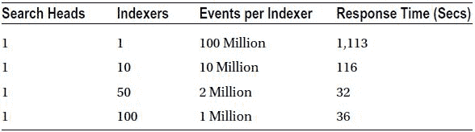

随着我们增加索引器，性能提高了。在 1 到 10 个索引器之间，有线性可扩展性的迹象，但数据点不足以确定。然而，我们可以看到，从 50 个索引器增加到 100 个索引器时出现了一个拐点，响应时间增加了。这是一个收益递减点，再增加索引器已经不值得了。我们将性能下降归因于搜索头与索引器之间的通信开销。

在表 A-3 中，你可以看到稀疏搜索的响应时间。虽然不那么明显，但在 1 到 10 个索引器之间，我们也有线性可扩展性的迹象。我们也可以看到与密集搜索相同的拐点，原因与之前相同。

表 A-3. 性能测试 1——稀疏搜索

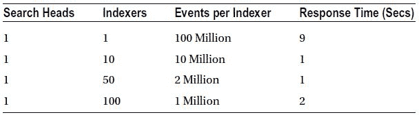

表 A-4 显示了索引器过多实际上会损害稀有搜索的性能。拐点比其他搜索类型出现得更早。这是因为稀有搜索的性质决定：每个索引器的响应都非常快，但所有额外索引器的通信开销直接影响了响应时间。

表 A-4. 性能测试 1——稀有搜索

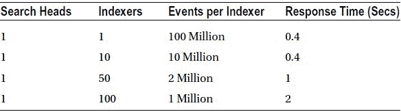

从这个性能测试中，我们可以得出结论：

*   增加索引器的数量往往能提高性能
*   存在一个收益递减点，即过多的索引器会对搜索性能产生负面影响，尤其是对稀有搜索。

### 性能测试 2

In this performance test, we fixed the number of events per indexer. That means the total number of events increased every time we added an indexer. We used only two data points: the first with 10 indexers each containing 10 million events, resulting in a total of 100 million events; the second with 200 indexers each containing 10 million events, giving a total of 2 billion events.

In Table A-5, we can see the test results under dense search. In this case, scalability was far better than linear, but our data points are insufficient to draw this conclusion. Remember, in this set of tests, we increased the number of indexers, each with additional data. In the previous set of tests, we increased the number of indexers but diluted the number of events per indexer.

Table A-5. Performance Test 2 – Dense Search

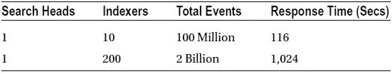

In Table A-6, we again observe indications that the scalability of sparse search is far better than the linear model. By extrapolation, the response time for 2 billion events should have been 20 seconds, but it was actually only 9 seconds.

Table A-6. Performance Test 2 – Sparse Search

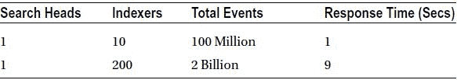

Finally, as shown in Table A-7, the rare search exhibits a similar pattern, also showing indications of far better than linear scalability. From this, we can conclude that under these conditions, adding indexers as the number of events increases makes sense, and scalability is at least linear or better.

Table A-7. Performance Test 2 – Rare Search

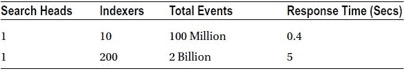

## Performance Test 3

我们称之为真实世界的性能测试。前两个性能测试中描述的场景在实践中并不会发生。用于索引的新事件均匀分布在所有索引器上，因此一个新索引器只会接收到总事件的一小部分。由于新索引器在刚加入时没有任何事件，因此总事件数并未均匀分布在所有索引器上。

在这组测试中，我们从一个搜索头和一个索引器开始。第一个数据点包含1亿个事件。然后我们将事件增加到2亿和3亿。此时，我们增加另一个索引器，并将事件增加到4亿和5亿。这里发生的情况是：当我们添加新的索引器并增加1亿个事件时，其中5000万个事件会流向新的索引器（使其总数达到5000万事件），另外5000万个事件流向旧索引器（使其总数达到3.5亿事件）。当我们再增加1亿个事件时，它们会在两个索引器之间均匀分配。此时，新索引器总共有1亿个事件，旧索引器有4亿个事件。

在图 A-4 中，我们绘制了五个数据点的实际响应时间，并添加了一条代表线性可扩展性的趋势线。如您所见，实际响应时间优于预期的线性可扩展性。事实上，结果可能比图中显示的更好。这是因为搜索操作会访问所有数据，而在现实场景中，这些搜索通常针对最近的、持续滚动的时间窗口，因此搜索时间的整体改善将大于我们在此展示的结果。

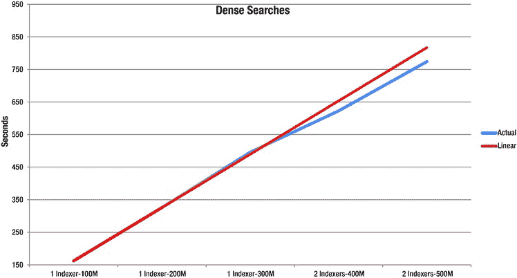

图 A-4. 性能测试 3，密集搜索

解释图 A-5 的另一种方式是观察线性可扩展性趋势线。您可以看到，对于单个索引器，当事件数达到4亿时，响应时间为80秒；在我们添加第二个索引器后，80秒的响应时间仅在事件达到5亿时才出现，因此这对性能和可扩展性都做出了重大贡献。

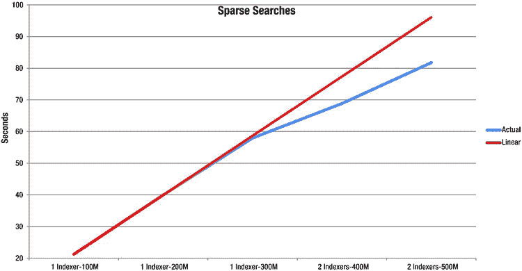

图 A-5. 性能测试 3，稀疏搜索

在图 A-6 中，我们可以看到添加索引器带来了一点小改善，但考虑到响应时间已经非常快，添加另一个索引器似乎没有必要。

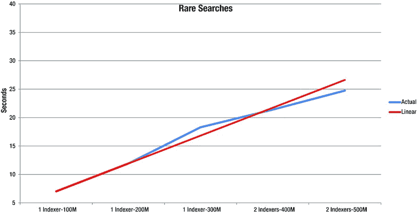

图 A-6. 性能测试 3，罕见搜索

根据这组性能测试的结果，我们可以得出结论：添加另一个索引器是有用的，特别是对于稀疏搜索，但它似乎对罕见搜索没有优势。显然，通过添加索引器进行横向扩展可以在一定程度上延迟响应时间的退化，这可以成为添加索引器的一个理由。

## Indexing Performance

另一个性能无法一概而论的例子是索引性能。这种情况高度依赖于被索引的数据类型。此外，将数据加载到`Splunk`时执行的转换也有影响。这在第9章讨论处理航空准点性能数据的不同方法时已彻底讨论过。最后，底层操作系统和硬件也会影响性能。

根据数据类型，事件的大小可能差异很大。例如，使用组合日志格式的Web访问日志事件平均约300个字符。`syslog`文件的平均事件大小因源类型而异；我们观察到的范围从300到1200个字符。另一种常见类型是`JBoss`日志文件；当包含内容时，它通常是Java堆栈跟踪，这往往很长，平均约5000个字符。由于这些事件大小差异很大，更倾向于以千字节每秒（`KBps`）来衡量索引性能，而不是简单地计算事件数量。

在图 A-7 中，您可以看到使用前面讨论的三种日志文件类型测量索引吞吐量的结果。Linux环境下的结果非常稳定，约为14,000 `KBps`。Solaris环境下的情况类似，尽管吞吐量下降到约11,000 `KBps`。Windows操作系统下索引吞吐量的不一致性令人惊讶。为了提供更完整的图景，我们选择使用`gzip`压缩`syslog`文件。我们可以将Linux和Solaris上稍慢的吞吐量归因于需要解压`syslog`文件。然而，Windows在处理压缩文件时似乎表现更好。

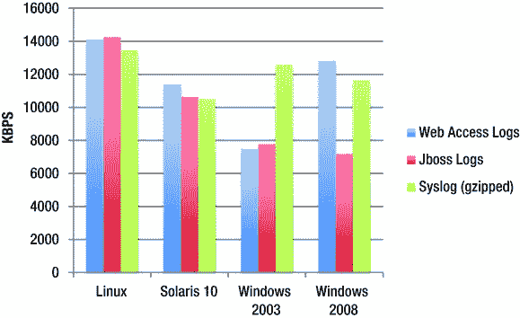

图 A-7. 索引性能

此图表并非意在推荐任何特定的操作系统。如您所知，影响操作系统性能的因素繁多。但是，这些测试是在同一台通用服务器上进行的，因此Solaris 10运行在x86架构上，而不是`SPARC`服务器上。此图表旨在说明数据类型之间存在差异，而这些差异也可能受到底层操作系统和硬件的影响。

## Disk Speed and Search

作为计算机中最慢的硬件组件，磁盘驱动器确实会影响性能，尤其是在像`Splunk`这样将数据存储在磁盘上的应用程序中。在`Splunk`中，数据存储在桶（`bucket`）中。这些桶可以是热（`hot`）、温（`warm`）、冷（`cold`）或冻结（`frozen`）状态。我们不会详细讨论它们的工作原理以及数据如何从一个桶滚动到另一个桶，但可以说，索引性能与存储热桶和温桶的设备（`device`）的写入性能直接相关。搜索性能部分与存储热桶、温桶和冷桶的设备的读取性能相关。您可以在配置文件中指定桶的位置。

我们进行的测试旨在测量使用不同转速磁盘驱动器时的搜索性能。为了更清楚地了解这一行为，我们还会考虑并发搜索的数量。

图 A-8 中的图表显示，固态硬盘（`SSD`）提供了最佳的搜索性能，并且随着并发搜索次数的增加，性能还会提升。其相对于传统机械磁盘驱动器的提升非常显著，以至于我们必须使用对数刻度。`SSD`在搜索性能上的差异可能足以证明其价格差异是合理的。

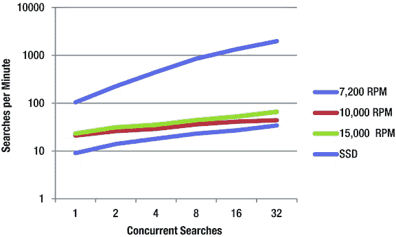

图 A-8 .  磁盘速度与搜索性能

图 A-9 放大了机械磁盘的性能视图，这样我们就能在没有`SSD`不同存储技术造成的扭曲的情况下，更好地理解其性能。7,200 RPM 磁盘与 10,000 RPM 磁盘之间的差距是显著的，平均约为 50%。然而，10,000 RPM 与 15,000 RPM 之间的差异则小得多。随着并发搜索次数的增加，性能确实会提升，在 32 次并发搜索时达到了 34% 的提升。

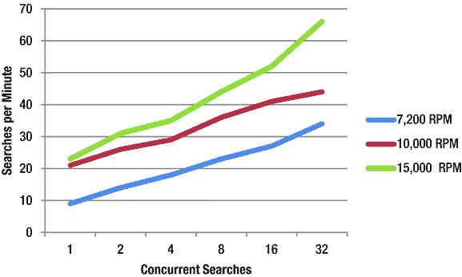

图 A-9 .  机械磁盘速度与搜索性能

尽管这些性能测试中未使用，但在使用 `RAID` 配置时，推荐设置为 `RAID 10`，也称为 `RAID 0+1`。`RAID 10` 提供了快速的读写性能以及最高的冗余度。请勿使用 `RAID 5`，因为重复写入会导致索引速度变慢。

此测试结果可能会帮助您为自己的安装环境选择磁盘驱动器，但请记住，在做出决定之前，您必须使用自己的数据、搜索模式和用法进行测试。另一个提示是，并发搜索可能由多个用户、仪表盘或两者共同发起。我们提到这一点，是因为我们看到过有人在计算并发搜索时忘记了仪表盘。

## 了解您的 Splunk 环境

`SplunkWeb`，即 `Splunk` 的用户界面，提供了一组全面的报告，能让您非常清楚地了解您的 `Splunk` 环境的行为。当您在搜索应用中时，“摘要”选项卡会按来源、源类型和主机显示所有已索引数据的概览。当您选择“状态”选项卡时，会看到一个下拉菜单，其中包含多个选项，如图 A-10 所示。这些选项中的每一个都提供了关于 `Splunk`、您的数据和搜索的内部运作的详细信息。我们强烈建议您熟悉这些报告。


图 A-10 .  状态选项

我们还想与您分享一些其他技巧，以便您能更好地了解您的 `Splunk` 环境。我们已经讨论了 `Splunk` 工程团队使用的搜索分类方法，因此我们将向您展示如何为自己的搜索计算这个分类。但首先，我们将告诉您如何找到哪些是您最耗资源的搜索，以及它们随时间推移的响应情况。最后，我们将讨论关于搜索头性能的问题。

### 最耗资源的搜索

您可能希望首先了解哪些是最耗资源的搜索，以便查看它们是否可以改进或优化。当您在状态下拉菜单中选择“搜索活动概览”选项时，您将看到一个包含多个面板的仪表盘。滚动到页面底部，您会找到一个标题为“最近按资源消耗排序的搜索（最近一小时）”的面板。这包含我们想要的核心信息，但时间范围仅限于最近一小时，并且它没有显示已保存搜索的名称，只显示了实际的搜索语句。

我们已修改此搜索，以便它能够提供已保存搜索的名称；如果不是已保存的搜索，则将其标识为“临时搜索”。如果您点击面板左下角的“查看结果”，它将带您进入一个搜索屏幕，其中包含实际的搜索语句和结果。您可以在此处修改搜索，方法是添加一行使用`eval`命令来创建一个名为`saved_name`的字段。同时，在`stats`命令中添加一行，以便搜索名称显示在表格中。然后，将时间范围修改为更适合您需求的时段（可能是一个月），并将其保存为“最耗资源的搜索”。最终的搜索语句如下所示，其中`高亮`显示了更改部分：

```
`audit_searchlocal`
|  convert num(total_run_time)
| eval user = if(user="n/a", null(), user)
| `audit_rexsearch`
| eval is_scheduled = if(search_id LIKE "scheduler%", "yes", "no")
| eval saved_name = if(savedsearch_name LIKE "", "Ad Hoc", savedsearch_name)
| stats min(_time) as _time
        first(user) as user
        first(total_run_time) as total_run_time
        first(saved_name) as saved_search_name
        first(search) as search
        first(is_scheduled) as is_scheduled by search_id
| search user=*
| sort - total_run_time
```

此搜索的输出结果如图 A-11 所示。通过添加已保存搜索名称的列，可以非常容易地识别出耗资源的搜索。输出结果仅显示每次搜索中资源消耗最高的那次出现。下一步是更深入地理解那些有问题的搜索。

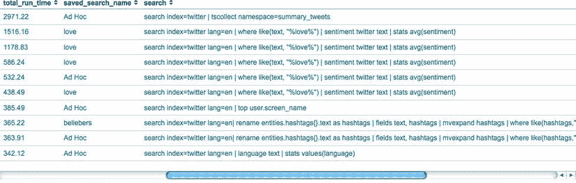

图 A-11 .  最耗资源的搜索

### 历史运行时间

一旦您识别出最耗资源的搜索，我们建议您回顾那些您最关心的搜索随时间推移的行为变化。之前的报告“最耗资源的搜索”仅显示每次搜索中资源消耗最高的记录。查看历史运行时间（即响应时间）会让我们有更清晰的概念。为此进行的搜索非常简单。如果它是已保存搜索，请使用以下命令：

```
index=_audit info=completed savedsearch_name="saved search name"
| chart first(total_run_time) as RunTime over _time
```

对于临时搜索，您必须输入实际的搜索语句而不是已保存的搜索名称。不要忘记将已保存搜索的名称或实际搜索语句用双引号（`"`）括起来，并注意`over`关键字和特殊字段`_time`之间有一个空格：

```
index=_audit info=completed savedsearch_name="actual search"
| chart first(total_run_time) as RunTime over _time
```

这两种搜索的输出都会生成一张图表。你需要调整图表选项才能获得清晰的图像。对我们而言，通常需要调整折线图 `y` 轴的最小值以获得更好的分辨率。根据我们的经验，上下浮动 10% 的偏差可以视为可接受范围。如果你分析的搜索包含许多数据点，那么更容易观察到趋势（如果有的话）。显示搜索响应随时间恶化的趋势可能由以下原因导致：

*   你索引的数据量比之前更多
*   搜索返回的事件比例比之前更高，也就是说，搜索正在变得更高密度
*   搜索覆盖的时间范围比之前更长

上述任何一个原因都可能导致搜索随时间恶化。你需要详细分析你的配置，以确保如果出现上述原因，它们都出于已知的原因。如果你无法根据上述任何原因解释性能恶化，说明你的搜索存在问题，应当进行更深入的检查。

有时我们会使用前述搜索的变体来展示搜索返回的事件数量。你可以尝试将两者结合，但我们发现有时两组数值之间的量级差异会搞乱图表。替代搜索如下：

```
index=_audit info=completed savedsearch_name="saved search name"
| chart first(event_count) as ReturnedEvents over _time
```

## 对搜索进行分类

了解我们拥有哪种类型的搜索有助于我们对性能设定合理的预期。要确定某个搜索属于哪一类，首先需要计算响应中的事件数量与索引中事件总数的比率：

```
比率 = 索引中事件总数 / 搜索结果中的事件数量
```

乍看之下，找到搜索结果中的事件数量可能并不容易，尤其是对于包含大量子句（即使用大量管道）的搜索。搜索通常以可流式命令开始，这些命令对事件执行某些操作（例如修改），或仅从索引中选择事件，并将其传递给搜索的下一部分。我们希望关注搜索的第一个命令，这通常是一个直接搜索。我们基于这个命令来计算比率，因为它负责在数据桶中查找符合请求条件的事件。在处理包含子搜索的搜索时，为了对其进行分类，每个子搜索都应被视为独立的搜索。

查找索引中的事件数量很简单，只需使用 `eventcount` 命令或前往搜索应用的摘要页面即可。如果计算出的比率范围在：

*   1 到 1000 之间，搜索属于高密度（Dense）
*   1000 到 100 万之间，搜索属于稀疏（Sparse）
*   100 万到 10 亿之间，搜索属于罕见（Rare）
*   超过 10 亿，搜索属于大海捞针（Needle in the Haystack）

当然，这项计算的目标是动态变化的，因为索引通常在不断增长，尤其是在搜索基于滚动时间范围的情况下。遗憾的是，Splunk 并不保存索引中存储的事件数量的历史记录，因此我们无法得知某个搜索随时间推移究竟属于哪一类。

## 搜索头性能

我们对 Splunk 性能所做的大部分研究都集中在搜索、索引和拓扑结构上。随着我们看到包含多个面板甚至复杂搜索的仪表盘越来越受欢迎，我们意识到在理解实际搜索头本身所承受的负载方面投入的精力还不够。构成仪表盘的大多数搜索都基于滚动时间段，例如最后一分钟或最后五分钟。即使这些搜索处理的事件量相对较小，滚动汇总也属于高密度搜索，而使用报告加速或 `tsidx` 加速并不总能奏效，因为汇总操作必须在面板下一次刷新之前的某个时间点完成，而这个时间间隔可能短到无法完成。

仪表盘像兔子一样容易滋生蔓延，你很快就会发现，自己面临大量仪表盘，每个仪表盘又包含十几个面板，受众范围从高管、管理层到真正使用它们的运维人员。与此同时，我们看到越来越多的人部署搜索头，这些搜索头专门用于处理仪表盘的搜索。

那么问题就变成了：何时应该添加另一个搜索头？在尝试回答这个问题之前，我们需要解释一下仪表盘的工作方式。所有仪表盘都由定时搜索组成。定时搜索应该在特定的时间间隔运行，例如每五分钟一次或每小时整点运行一次。如果搜索的启动时间出现延迟，很可能是因为系统过载。轻微的、不规则的延迟是可以接受的，平均延迟在几秒钟范围内也可接受，但当延迟持续较大时，你就应该认真考虑添加另一个搜索头了。

另一个指标是跳过的搜索次数。当前一次搜索运行耗时过长，以至于已经到了运行下一个（被跳过的）搜索的时间时，该搜索就会被跳过。例如，假设我们有一个计划每分钟运行一次的搜索，但它需要两分钟才能完成，因此它将跳过下一次执行（该执行时间点已成为过去），并在下一个间隔运行。如果这个搜索之前需要 45 或 50 秒，而现在耗时更长，那么很可能存在负载问题，这可以通过延迟或跳过来识别。当然，如果你的搜索耗时超过了为其分配的时间间隔，那这不是负载问题，而只是调度逻辑问题。

那么，回到我们的问题。答案分为两部分，而且我们必须说明，这部分更多是基于经验和直觉，而非像在本附录中进行的正式实验。第一部分基于使用 Splunk 在用户界面的“状态”选项卡下提供的综合信息，特别是“调度器活动概览”页面。在那里你会找到两个重要的面板，一个显示过去 24 小时内已启动和已跳过的搜索次数，另一个显示过去 24 小时内的平均执行延迟。根据前面的解释，你应该能够快速评估搜索头（或多个搜索头）的负载情况。

答案的第二部分侧重于 Unix/Linux 操作系统的指标。一般性的说法是，当任何资源（如 CPU 或内存）达到容量上限时，你就应该添加另一个搜索头。这太笼统了，让我们来看一些更具体的内容。我们的通用服务器运行的是 CentOS 6.2，`top` 命令为我们提供了两个我们认为很关键的指标：Unix 负载和 I/O 等待百分比。其他命令也能提供这些指标。在图 A-12 中，你可以看到在 `top` 命令的输出中哪里可以找到这些指标。

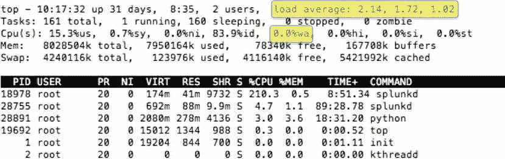

图 A-12。Unix `top` 命令的输出

平均负载显示在右上角。它呈现了三个数字，分别代表过去 1 分钟、过去 5 分钟和过去 15 分钟的平均负载。如果这些数字始终高于服务器拥有的 CPU 核心数，那么是时候认真考虑添加另一个搜索头了。第二个指标是 I/O 等待，可以在平均负载标题下方几行找到。在图 A-12 中，它显示为 `0.0%wa`。此指标表示 CPU 核心等待 I/O 的时间。该指标从 0.2% 开始，往往会非常迅速地呈指数级增长，你将在相当短的时间内陷入混乱。现在，你对搜索头及其性能的了解和我们一样多。

## 总结

在本附录中，你了解了搜索类型及其性能。我们还回顾了何时应考虑向我们的环境添加另一个索引器。经验法则是，添加另一个索引器几乎总能改善整体搜索时间。我们看到了磁盘 I/O 对搜索性能的重要性。我们分享了一些了解你的 Splunk 设置的技巧，特别是查找最昂贵的搜索；并且我们建议你同时查看其搜索时间的历史记录，并尝试了解性能下降的原因（如果有）。最后，我们回顾了如何监控搜索头以避免出现不可接受的性能。


# 附录 B


## 有用的 Splunk 应用

本章概述了一些有用的 Splunk 应用和插件，它们属于监控、安全、数据库、应用、应用服务器和网络等类别。

## Splunk 应用

在本书的前面章节中，我们探索并使用了一些 Splunk 应用和插件，例如 `Splunk App for Windows`、`*Nix`、`Google Maps`、`Globe`、`Web Intelligence`、`Sentimental Analysis`、`Splunk DB Connect`、`Splunk Deployment Monitor` 等。在深入本章之前，让我们快速回顾一下 Splunk 应用。

Splunk 被设计为一个平台，充当第三方开发者或独立软件供应商可以构建为 Splunk 提供扩展的专用应用程序的基础架构。有两种构建这些扩展的方式：应用和 `Technology Add-On`。Splunk 应用将扩展功能与标准特性（如已保存搜索、仪表板和已定义的输入）捆绑在一起。此外，它们还在 Splunk 用户界面之上捆绑了自己的用户界面。相比之下，`Add-On`（或简称为 `TA`）与应用相比是较小的组件，它们包含附加功能，但没有自己的用户界面。我们将必须使用标准的 Splunk 搜索应用程序来查询通过 `Add-On` 配置的索引数据。任何拥有相当编程知识的人都可以编写应用和 `Add-On`。Splunk 拥有一个充满活力的社区，不断创建和分享应用和 `Add-On`。它托管在 `http://splunk-base.splunk.com/apps/`。

在撰写本书时，`Splunkbase` 上至少有几百个 Splunk 应用和 `Add-On`。我们将一些流行且有趣的应用大致分类为监控、网络、安全、数据库、应用和应用服务器。本章的目的是让你熟悉 `Splunkbase`，并提供一个你可以利用到 Splunk 部署中的热门应用和 `Add-On` 的简短列表。由于这些应用和 `Add-On` 经常更新，我们建议你参考 `Splunkbase` 中的具体应用页面以查找最新信息。本章为每个应用或 `Add-On` 提供的详细信息仅是基本的，旨在让你快速了解该应用的功能、它捕获的数据来源以及它提供的报告或仪表板。本章不深入介绍列出的应用或 `Add-On` 的安装、部署、配置和使用细节。你可以利用在前面章节中使用过的应用和 `Add-On` 的知识和理解，探索一些你可能发现对你的环境有用的应用。我们将要查看的应用和 `Add-On` 有：

- 应用、数据库和应用服务器
  - `Splunk for Oracle WebLogic Server`
  - `Splunk Hadoop Connect`
  - `Splunk App for Microsoft Exchange`
  - `Technology Add-On for Microsoft SQLServer 2012 and 2008r2`
  - `Splunk App for AWS usage tracking`
- 安全
  - `Splunk for FISMA`
  - `Splunk App for PCI Compliance`
  - `Splunk App for Enterprise Security`
  - `Splunk for RSA SecurID Appliances`
- 监控
  - `Splunk App for VMware`
  - `Splunk App for HadoopOps`
  - `Splunk App for Active Directory`
  - `Splunk on Splunk (S.o.S.)`
  - `Splunk for Nagios`
  - `Splunk App for Snort`
- 网络
  - `Cisco Security Suite`
  - `Splunk for Palo Alto Networks`
  - `Splunk for Juniper Firewalls`
  - `Splunk for Barracuda Networks Web Application Firewall`

### Splunk for Oracle WebLogic Server

| 字段 | 描述 |
| --- | --- |
| 分类 | 应用、数据库和应用服务器 |
| 应用名称 | `Splunk for Oracle WebLogic Server` |
| 作者/供应商 | `Function1_Inc` |
| 许可证 | `Creative Commons BY 3.0` |
| 价格 | 免费 |
| Splunk 版本兼容性 | `5.x, 4.3, 4.2` |
| Splunk 支持 | 否 |
| 应用 URL | `http://splunk-base.splunk.com/apps/72283/splunk-for-oracle-weblogic-server` |
| 描述 | `Splunk for Oracle WebLogic Server` 是一个通过收集不同日志来监控 `WebLogic` 服务器组件的应用。`Splunk for Oracle WebLogic Server Technology Add-On (TA)` 与此应用打包在一起。该应用以不同时间间隔轮询 `WLS AdminServer`，并将数据加载到 Splunk 中。该应用附带所有域和应用程序的拓扑概览。它提供一组报告，供用户向下钻取到 `WLS` 实例级别、域内的特定应用程序或多个应用程序、服务器、`JMS` 实例、`JDBC` 数据源和 `JVM` 堆大小。此应用收集整个 `WLS` 部署的数据，并提供简单易懂的报告和图表。 |

### Splunk Hadoop Connect

| 字段 | 描述 |
| --- | --- |
| 分类 | 应用、数据库和应用服务器 |
| 应用名称 | `Splunk Hadoop Connect` |
| 作者/供应商 | `Splunk` |
| 许可证 | `Splunk` 软件许可协议 |
| 价格 | 免费 |
| Splunk 版本兼容性 | `5.x, 4.3` |
| Splunk 支持 | 是 |
| 应用 URL | `http://splunk-base.splunk.com/apps/57216/splunk-hadoop-connect` |
| 描述 | `Splunk Hadoop Connect` 应用有助于在 Splunk 和 `Hadoop` 之间轻松移动数据。你可以使用 `Hadoop Connect` 的三个关键用例是：将 Splunk 中收集的数据导出到 `HDFS` 进行进一步批处理。你可以从 Splunk 导出一个收集事件的子集。使用应用用户界面浏览 `HDFS` 目录和文件。将数据从 `HDFS` 导入 Splunk，并利用 `SPL` 和可视化功能构建报告、图表和仪表板。 |

### Splunk App for Microsoft Exchange

| 字段 | 描述 |
| --- | --- |
| 类别 | 应用程序、数据库和应用服务器 |
| 应用名称 | `Splunk App for Microsoft Exchange` |
| 作者/供应商 | `Ahall_splunk` |
| 许可证 | `Creative Commons BY 3.0` |
| 价格 | 免费 |
| Splunk 版本兼容性 | `5.x, 4.3` |
| Splunk 官方支持 | 是 |
| 应用 URL | `http://splunk-base.splunk.com/apps/28976/splunk-app-for-microsoft-exchange` |
| 描述 | `Splunk App for Microsoft Exchange` 可消费来自 `Microsoft Exchange` 环境的日志，并为 `Exchange` 部署提供监控能力。该应用采集以下数据：`Exchange` 服务器的 `Internet 信息服务 (IIS)` 日志、`Blackberry Enterprise Server (BES) v5.03` 日志、`Windows` 事件日志、安全日志、`Exchange` 审计日志、应用程序日志、性能监控数据以及 `Senderbase/信誉数据`。`Splunk App for Microsoft Exchange` 提供了多个仪表板，用于概览拓扑结构、消息跟踪、客户端行为、运维、容量规划，识别基础设施问题，监控消息环境中所有服务器的性能，跟踪消息环境中的消息流转，监控客户端使用情况，监控安全事件（如病毒爆发和异常登录），跟踪环境的管理变更，并分析长期邮件运营趋势。 |

### Technology Add-on for Microsoft SQLServer 2012 and 2008r2

| 字段 | 描述 |
| --- | --- |
| 类别 | 应用程序、数据库和应用服务器 |
| 应用名称 | `Technology Add-On for Microsoft SQLServer 2012 and 2008r2` |
| 作者/供应商 | `Ahall_splunk` |
| 许可证 | `Creative Commons BY 3.0` |
| 价格 | 免费 |
| Splunk 版本兼容性 | `5.x` |
| Splunk 官方支持 | 否 |
| 应用 URL | `http://splunk-base.splunk.com/apps/63361/technology-add-on-for-microsoft-sql-server-2008r2` `http://splunk-base.splunk.com/apps/62876/technology-add-on-for-microsoft-sql-server-2012` |
| 描述 | 用于 `Microsoft SQL Server 2012` 和 `2008R2` 的附加组件可采集与配置和审计信息相关的数据库日志。这些附加组件可与本书第二章中安装和配置的 `Splunk TA for Windows` 结合使用。与 `Windows TA` 配合使用时，你可以从 `SQL Server` 日志中采集数据，并深入了解 `Microsoft SQL Server 2012` 和 `2008R2` 的使用情况。这些附加组件提供有关 `SQL Server` 配置和数据库利用率的信息。你可以利用标准的 Splunk 搜索来处理和分析安全日志中的信息，并构建自定义仪表板。在撰写本章时，这两个附加组件仅以 `beta` 版本提供。 |

### Splunk App for AWS usage tracking

| 字段 | 描述 |
| --- | --- |
| 类别 | 应用程序、数据库和应用服务器 |
| 应用名称 | `Splunk App for AWS usage tracking` |
| 作者/供应商 | `Nkhetia` |
| 许可证 | `Creative Commons BY 3.0` |
| 价格 | 免费 |
| Splunk 版本兼容性 | `5.x, 4.3, 4.2, 4.1, 4.x` |
| Splunk 官方支持 | 否 |
| 应用 URL | `http://splunk-base.splunk.com/apps/65926/splunk-app-for-aws-usage-tracking` |
| 描述 | `Splunk App for AWS` 采集与 `AWS` 上使用的计算和存储资源相关的数据，以及账单数据。通过该应用采集的数据有助于分析 `AWS` 使用情况，并优化 `Amazon EC2` 环境的使用。`AWS` 应用提供了多个预构建的报告和仪表板，展示账单分析、按子账户划分的消费趋势、账单预测、月度账单环比、基于用户指定消费限额的消费警报、实例使用情况、按需实例使用情况、预留实例使用情况、任意时刻未使用的预留实例、按实例类型、可用区、标签和子账户进行的实例使用分析、基线计算和建议。 |

### Splunk for FISMA

| 字段 | 描述 |
| --- | --- |
| 类别 | 安全 |
| 应用名称 | `Splunk for FISMA` |
| 作者/供应商 | `Mike Wilson` |
| 许可证 | `Creative Commons BY 3.0` |
| 价格 | 免费 |
| Splunk 版本兼容性 | `5.x, 4.3, 4.2, 4.1, 4.x` |
| Splunk 官方支持 | 否 |
| 应用 URL | `http://splunk-base.splunk.com/apps/44883/splunk-for-fisma` |
| 描述 | `FISMA` 应用帮助企业基于 `NIST 800-53` 指南进行审计。与大多数采集数据的 Splunk 应用不同，`FISMA` 应用是一个框架，它依赖其他技术附加组件（如 `Splunk TA for Windows` 和 `Splunk for Unix and Linux` 技术附加组件 (`*Nix`)）来获取数据。其他数据来源包括代理服务器、防火墙、无线安全、漏洞扫描器、网络扫描器、防病毒系统等。一旦来自外部附加组件的数据被映射，`FISMA` 应用会提供作为仪表板一部分的搜索，你可以在其中查看与访问控制、审计与问责、安全评估和授权、配置管理、应急计划、标识与认证、事件响应、人员安全、风险评估、系统和通信保护以及系统和信息完整性相关的数据。 |

### Splunk App for PCI Compliance

| 字段 | 描述 |
| --- | --- |
| 类别 | 安全 |
| 应用名称 | `Splunk App for PCI Compliance` |
| 作者/供应商 | `Splunk` |
| 许可证 | `Splunk` 软件许可协议 |
| 价格 | 请联系 `Splunk` |
| Splunk 版本兼容性 | `5.x, 4.3` |
| Splunk 官方支持 | 是 |
| 应用 URL | `http://splunk-base.splunk.com/apps/55494/splunk-app-for-pci-compliance` |
| 描述 | `Splunk App for PCI Compliance` 基于 `PCI 数据安全标准 (PCI DSS)` 的要求采集数据并提供监控能力。此应用可与不同的技术附加组件集成，这些附加组件可用于从无线设备、代理服务器、防火墙、入侵检测系统、网络设备、防病毒软件、漏洞管理系统、操作系统以及 `Oracle` 等数据库采集数据。此应用中的仪表板提供了持卡人数据环境的高级概览，以及调查特定事件或合规性问题的能力。该应用包含的其他仪表板有：* `PCI` 合规性状态仪表板，提供当前合规状态，可用于每日监控 `PCI` 合规状态。* 事件审查仪表板，帮助识别威胁并快速响应这些威胁。* 审计仪表板，验证环境的持续监控情况，有助于在事件审查仪表板中查看审计变更。* 资产中心仪表板，帮助识别持卡人数据环境中包含的资产。 |

### Splunk App for Enterprise Security

| 字段 | 描述 |
| --- | --- |
| 类别 | 安全 |
| 应用名称 | `Splunk App for Enterprise Security` |
| 作者/供应商 | `Splunk` |
| 许可证 | 商业版 |
| 价格 | 联系 `Splunk` |
| Splunk 版本兼容性 | `5.x` |
| Splunk 官方支持 | 是 |
| 应用 URL | `http://splunk-base.splunk.com/apps/22297/splunk-app-for-enterprise-security` |
| 描述 | `Splunk` 企业安全应用是一款用于分析 Splunk 中收集的安全数据的应用。该应用有助于收集系统性能信息，并将其与端点、网络和访问安全数据进行关联。可使用技术插件与该应用配合，收集来自防火墙、入侵检测系统等来源的安全相关数据。`Splunk` 企业安全应用专注于安全事件数据的收集与关联，并提供带有告警功能的监控解决方案。用户可以从聚合数据轻松下钻到原始系统数据，并使用仪表盘可视化数据。应用中的工作流功能允许用户跨数据源调查事件。仪表盘有助于审查事件、端点、网络、身份和审计信息。 |

### Splunk for RSA SecurID Appliances

| 字段 | 描述 |
| --- | --- |
| 类别 | 安全 |
| 应用名称 | `Splunk for RSA SecurID Appliances` |
| 作者/供应商 | `Joshd` |
| 许可证 | `知识共享 BY 3.0` |
| 价格 | 免费 |
| Splunk 版本兼容性 | `5.x, 4.3, 4.2, 4.1, 4.x` |
| Splunk 官方支持 | 否 |
| 应用 URL | `http://splunk-base.splunk.com/apps/33495/splunk-for-rsa-securid-appliances` |
| 描述 | 此 Splunk 应用提供与 `RSA SecurID` 设备上活动相关的有用数据。该应用设计用于 `RSA SecurID Appliance 130` 和 `230` 型号。该应用利用 `SNMP` 从 `RSA` 设备捕获数据。`Splunk` 服务器对来自 `SNMP` 陷阱的传入数据进行索引，并使事件可用于搜索和分析。此应用提供多个报表，汇总所有访问设备的用户、事件数量、总共失败/成功的登录、连接次数最多的前十台主机以及前十项操作。在用户活动类别报表中包括：成功操作、失败操作、成功操作原因、失败操作原因、按用户统计的登录失败次数、非工作时间事件、系统级操作、运行时级操作和管理员级操作。在网络活动类别报表中包括：按接口统计的接收千字节数、按接口统计的传输千字节数、按接口统计的入站数据包总数、按接口统计的出站数据包总数、`TCP` 入站/出站数据段总数、`UDP` 入站/出站数据段总数、`TCP` 活跃/被动连接打开总数、`TCP` 和 `UDP` 错误计数总数等。 |

# Splunk App for VMWare

| 字段 | 描述 |
| --- | --- |
| 类别 | 监控 |
| 应用名称 | `Splunk App for VMWare` |
| 作者/供应商 | Splunk |
| 许可证 | Splunk for VMWare 解决方案的 Splunk 软件许可协议 |
| 价格 | 免费 |
| Splunk 版本兼容性 | 5.x, 4.3 |
| Splunk 官方支持 | 是 |
| 应用 URL | `http://splunk-base.splunk.com/apps/28423/splunk-app-for-vmware` |
| 描述 | `Splunk App for VMWare` 提供了仪表盘和已保存搜索，可深入洞察虚拟化层。该应用包含四个主要组件：`Splunk App for VMWare`、`TA for vCenter`（用于将 `vCenter` 数据转发到 Splunk）、`Splunk for VMWare` 虚拟设备转发器（也称为 `Splunk FA VM`，用于从 `VMWare` 环境收集数据）以及 `TA for VMWare`（随 `Splunk FA VM` 打包）。利用这些组件，您可以直接从 `vSphere` 主机收集日志和性能指标。`Splunk App for VMWare` 包含针对从虚拟化层收集的 `VMWare` 数据的报表、图表、搜索和索引定义。该应用通过从 `VMWare` 环境收集数据来提供运维智能。您可以使用标准的 Splunk 搜索来分析数据，并为 `VMWare` 环境中的数据创建报表和告警。 |

# Splunk App for HadoopOps

| 字段 | 描述 |
| --- | --- |
| 类别 | 监控 |
| 应用名称 | `Splunk App for HadoopOps` |
| 作者/供应商 | Splunk |
| 许可证 | Splunk 软件许可协议 |
| 价格 | 免费 |
| Splunk 版本兼容性 | 5.x, 4.3 |
| Splunk 官方支持 | 是 |
| 应用 URL | `http://splunk-base.splunk.com/apps/57004/splunk-app-for-hadoopops` |
| 描述 | Apache Hadoop 的典型部署以集群方式运行，这使得管理和监控 Hadoop 集群具有挑战性。这正是 `Splunk App for HadoopOps` 发挥作用的地方，它支持 `Cloudera` 和 `Hortonworks` 的 Hadoop 发行版。该应用提供了集群的整体视图，并能对单个日志事件、告警和通知进行索引，以提供对 Hadoop 操作的监控、分析和可视化。该应用在仪表盘中附带了一组预打包的报表，有助于查看集群的当前健康状况以及单个节点的状态以及各个节点上运行的服务。应用的默认仪表盘提供了集群健康状况和状态的视图。节点仪表盘提供了与集群内节点相关的图表，活动仪表盘提供了当前作业活动，作业历史仪表盘提供了历史作业活动。 |

# Splunk App for Active Directory

| 字段 | 描述 |
| --- | --- |
| 类别 | 监控 |
| 应用名称 | `Splunk App for Active Directory` |
| 作者/供应商 | `Ahall_splunk` |
| 许可证 | Creative Commons By 3.0 |
| 价格 | 免费 |
| Splunk 版本兼容性 | 5.x, 4.3 |
| Splunk 官方支持 | 是 |
| 应用 URL | `http://splunk-base.splunk.com/apps/51338/splunk-app-for-active-directory` |
| 描述 | `Splunk App for Active Directory` 为 Windows Server `Active Directory` (AD) 部署提供监控功能。该应用收集 Windows 事件日志，包括安全、应用程序、系统、分布式文件系统复制、NT 文件复制服务、DNS 服务器、AD 架构变更、AD 林范围运行状况、信息和复制统计信息、域控制器运行状况和性能指标以及 DNS 服务器运行状况信息。该应用提供不同的仪表板。运维仪表板包含 AD 拓扑、域和 DNS 状态的信息。安全仪表板提供 AD 安全配置文件和操作的信息。此外，该仪表板还提供登录失败、试图破坏用户安全设置、用户利用率等信息，并显示环境中所有 AD 对象的审计和报告。预构建的审计报告提供用户、计算机、组和组策略对象的当前状态详情。变更管理仪表板提供对 AD 环境最近所做变更的详细信息。 |

# Splunk on Splunk (S.o.S)

| 字段 | 描述 |
| --- | --- |
| 类别 | 监控 |
| 应用名称 | `Splunk on Splunk (S.o.S.)` |
| 作者/供应商 | Splunk |
| 许可证 | Splunk 软件许可协议 |
| 价格 | 免费 |
| Splunk 版本兼容性 | 5.x, 4.3, 4.2, 4.1, 4.x |
| Splunk 官方支持 | 是 |
| 应用 URL | `http://splunk-base.splunk.com/apps/29008/sos-splunk-on-splunk` |
| 描述 | `Splunk on Splunk (S.o.S.)` 是一款利用 Splunk 的监控能力来分析和排查 Splunk 环境中问题的应用。该应用从 Splunk 日志和其他配置文件中收集数据，同时收集内存和 CPU 使用情况（针对 `Splunk Web`、`splunkd` 和搜索进程）以及其他系统资源信息。该应用提供不同的报告和仪表板，展示 Splunk 相关信息以及不同 Splunk 进程的 CPU/内存使用情况。 |

# Splunk for Nagios

| 字段 | 描述 |
| --- | --- |
| 类别 | 监控 |
| 应用名称 | `Splunk for Nagios` |
| 作者/供应商 | `Luke Harris` |
| 许可证 | Lesser GPL |
| 价格 | 免费 |
| Splunk 版本兼容性 | 5.x, 4.3, 4.2, 4.1, 4.x |
| Splunk 官方支持 | 是 |
| 应用 URL | `http://splunk-base.splunk.com/apps/22374/splunk-for-nagios` |
| 描述 | Nagios 是一个监控系统，使组织能够识别和解决 IT 基础设施问题。`Splunk for Nagios` 应用与 Nagios 集成，可以轻松地将日志文件从 Nagios 服务器加载到 Splunk。该应用在 Splunk 中提供多个报告、仪表板和计划的已保存搜索，用于向 Nagios 发送警报。一些仪表板包括：状态仪表板，显示最近的警报和通知；警报仪表板，用于显示警报历史记录；主机仪表板，包含显示不同指标的图表，如从 Nagios 收集的 CPU、内存、交换空间、负载、磁盘使用率、网络接口利用率、进程等；NAS 仪表板提供存储和配额使用情况的图表；Cisco 网络仪表板附带网络利用率图表。 |

# Splunk App for Snort

| 字段 | 描述 |
| --- | --- |
| 类别 | 监控 |
| 应用名称 | `Splunk App for Snort` |
| 作者/供应商 | `Ayn` |
| 许可证 | Creative Commons BY – NC-SA 2.5 |
| 价格 | 免费 |
| Splunk 版本兼容性 | 5.x, 4.3, 4.2, 4.1, 4.x |
| Splunk 官方支持 | 否 |
| 应用 URL | `http://splunk-base.splunk.com/apps/22369/splunk-for-snort-splunk-4x` |
| 描述 | Snort 是由 Sourcefire 开发的开源网络入侵防御和检测系统 (IDS/IPS)。`Splunk for Snort` 捕获 Snort 日志，并提供仪表板，将捕获的数据以不同的报告和图表形式呈现。此应用提供的最基本功能是从 Snort 日志中提取字段。提取的字段包括：源 IP 地址、目标 IP 地址、源端口、目标端口、网络协议、ID 值、网络接口、名称、签名名称、签名类别、签名分类、签名优先级、服务类型、数据包 IP 头部长度、数据包总长度。该应用包含一个自定义搜索界面。`Splunk for Snort` 的“地图视图”提供了一个用于查看已触发警报的源 IP 地理位置的仪表板。 |

# Cisco Security Suite

| 字段 | 描述 |
| --- | --- |
| 类别 | 网络 |
| 应用名称 | `Cisco Security Suite` |
| 作者/供应商 | `Will Hayes` |
| 许可证 | Splunk 软件许可协议 |
| 价格 | 免费 |
| Splunk 版本兼容性 | 5.x, 4.3, 4.2, 4.1, 4.x |
| Splunk 官方支持 | 否 |
| 应用 URL | `http://splunk-base.splunk.com/apps/22300/cisco-security-suite` |
| 描述 | `Cisco Security Suite` 应用为 `Cisco Security Suite` 中其他应用和附加组件收集的所有数据提供了一个通用接口。与 `Cisco Security Suite` 集成的应用和附加组件包括：`Splunk for Cisco Client Security Agent (CSA)`、`Splunk for Cisco IronPort Email Security Appliance (ESA)`、`Splunk for Cisco IronPort Web Security Appliance (WSA)`、`Splunk for Cisco Firewalls (PIX, FWSM, ASA)`、`Splunk for Cisco IPS`、`Splunk for Cisco MARS`。此套件应用利用一个或多个应用或附加组件从不同的 Cisco 设备收集数据。至少需要配置其他应用或附加组件之一以及此主应用才能查看数据。此套件应用附带报告、视图和搜索，这些功能利用从各种 Cisco 设备捕获并索引到 Splunk 的数据。 |

# Splunk for Palo Alto Networks

| 字段 | 描述 |
| --- | --- |
| 类别 | 网络 |
| 应用名称 | `Splunk for Palo Alto Networks` |
| 作者/供应商 | `Monzy` |
| 许可证 | Creative Commons BY 3.0 |
| 价格 | 免费 |
| Splunk 版本兼容性 | 5.x |
| Splunk 官方支持 | 否 |
| 应用 URL | `http://splunk-base.splunk.com/apps/22327/splunk-for-palo-alto-networks` |
| 描述 | `Splunk for Palo Alto Networks` 应用利用 Palo Alto Networks 防火墙提供的数据，为 `Palo Alto Networks` 设备提供了一个简单易用的报告和分析工具。`Palo Alto` 设备带有不同的日志，此 Splunk 应用设计用于与默认日志配置配合使用。此应用帮助用户关联跨不同来源的数据，例如不同网络域中的应用程序和用户活动。该应用提供了一套全面的报告和仪表板，涵盖威胁详情、添加和删除特定主机、IP 地址、用户 ID 等功能。还可以使用 Splunk 标准搜索机制，基于从 `Palo Alto Networks` 设备日志捕获的数据创建自定义报告。 |

# Splunk for Juniper Firewalls

| 字段 | 描述 |
| --- | --- |
| 类别 | 网络 |
| 应用名称 | `Splunk for Juniper Firewalls` |
| 作者/供应商 | `Defensive-ISS` |
| 许可证 | Creative Commons BY 3.0 |
| 价格 | 免费 |
| 兼容的 Splunk 版本 | 5.x, 4.3, 4.2, 4.1, 4.x |
| Splunk 官方支持 | 否 |
| 应用 URL | `http://splunk-base.splunk.com/apps/57437/splunk-for-juniper-firewalls` |
| 描述 | `Splunk for Juniper Firewalls` 应用用于从 Juniper 防火墙设备 `ISG` 和 `SSG` 平台收集数据。该应用提供了多种不同的仪表板，包括：威胁摘要仪表板、深度检测摘要仪表板、防火墙摘要仪表板、地理摘要仪表板以及变更管理仪表板。 |

# Splunk for Barracuda Networks Web Application Firewall

| 字段 | 描述 |
| --- | --- |
| 类别 | 网络 |
| 应用名称 | `Splunk for Barracuda Networks Web Application Firewall` |
| 作者/供应商 | `Barracuda_networks` |
| 许可证 | Creative Commons BY 3.0 |
| 价格 | 免费 |
| 兼容的 Splunk 版本 | 5.x, 4.3, 4.2, 4.1, 4.x |
| Splunk 官方支持 | 否 |
| 应用 URL | `http://splunk-base.splunk.com/apps/67085/splunk-for-barracuda-networks-web-application-firewall` |
| 描述 | `Splunk App for Barracuda Networks Web Application Firewall` 用于收集防火墙提供的日志，以及报告和仪表板。该应用与 `Barracuda Web Application Firewall` 固件 7.7 或更高版本兼容，并使用 TCP/UDP 收集数据。其实时仪表板、报告和搜索字段可用于调查收集到的数据。还提供了特定的报告来查看安全、流量和审计数据。报告还利用地理位置映射来显示攻击客户端的所在位置。 |

## 索引

 A

- 加速
- 报告
- 访问计数
- 航空公司
- `dedup` 命令
- 大型数据集
- 负载与使用
- 问题
- 报告命令
- Splunk
- 摘要索引
- 摘要状态
- 统计信息
- 到达延误
- 商业航班
- `count` 函数
- `delete` 命令
- `distinct` 函数
- 航班数据
- `groupby` 子句
- `max` 函数
- 准点航班
- 计划飞行时间
- Splunk
- `stats` 命令
- `tscollect` 命令
- `tsidx`
- `tstats` 命令
- “高级搜索”
- 航空公司准点表现项目
- 机场流量分析
- 数据分析
- 初生方法论
- 航班数据
- 航班追踪
- 初步方法论
- `lookup` 表
- Splunk
- 可视化
- 航空公司数据分析
- `AirlineID` 字段
- `carrier` 字段

计数

航班数据

策略

`UniqueCarrier` 字段

可视化

面积图

柱状图

效果

`limit` 参数

折线图

按月

迷你图

`stats` 函数

`timechart` 命令

按年

机场数据分析

航空公司产出

计数

达拉斯/沃斯堡

仪表板

`dedup` 命令

`Origin` 和 `Dest` 字段

`OriginCityName` 字段

`valid` 选项

警报

严重错误

创建警报

相关事件

为警报选择节流

触发的警报

定义

登录失败

警报操作

警报管理器

创建警报

触发失败警报的事件

搜索故障事件

基于结果的警报

产品销售

警报操作

警报管理器

创建警报

计划警报

共享警报

时间修饰符

昨日总销量

昨日购买警报

滚动窗口警报

计划警报

印度尼西亚安塔拉新闻社

`append` 命令

 B

大数据

替代数据处理技术

商业潜力

CARWINGS 系统

分类

定义

端到端交易

Facebook

互联网统计

LinkedIn

机器数据

Netflix

Pandora

关系数据库

社交媒体

结构化数据

Twitter

非结构化数据

体量、速度和多样性

沃尔玛

`bigdbook` 服务器

跳出率

 C

`Chart` 命令

- `eval` 命令

- GET 和 POST 请求

- HTTP 404 错误

- 购买量与浏览量，产品类别

- 购买趋势

- 交易时长

- 类型

- 思科安全套件

- 集群

- 索引

- 主节点功能

- 原始数据

- 复制因子

- 复制过程

- 搜索因子

- 设置

- 集群概览报告

- 完整概览报告

- 启用集群对等节点

- 启用主节点

- 搜索头仪表盘

- 典型集群拓扑

- 命令行界面 (CLI)

- 逗号分隔值 (CSV)

- 下载数据

- 航班数据

- 优势

- 航空公司

- 航班准点性能

- 到达性能

- AWK

- 取消与改航

- 取消与未取消航班

- `CHECK_FOR_HEADER` 属性

- `clean` 命令

- 正确的事件断点

- 数据描述

- 数据预览

- 延误

- 目的地点

- `Div2TailNum`

- 改航机场信息

- 熟悉度

- 航班摘要

- 登机口返回信息

- 索引

- 出发地点

- 弹出窗口

- `props.conf` 配置

- 源类型

- 电子表格

- `strptime()` 表达式

- 时间段

- 时间戳定义

- 时间戳处理器修改

- TranStats 网站

- 类型

- 用户界面

- 字段映射

- 时间戳考量

- 消费者报告

- `count` 函数

- `CRSElapsedTime` 字段

-  D

- 仪表盘

- 高级分析数据

- 列作为可视化

- 创建

- 编辑

- 编辑可视化

- 404 错误报告

- 索引活动

- 输入活动

关键指标

监控（`参见` 网站监控）

`MyGizmoStore.com`

`Nix` 应用

`Nix` CPU 概览

`Nix` 日志记录

`Nix` 内存概览

购买与浏览

购买趋势报告

搜索活动

服务器活动

Splunk 搜索应用

Splunk Web 用户界面

“状态”菜单

热门产品购买报告

事务持续时间报告

数据库服务器

数据源

应用日志数据

应用和插件

“应用”菜单

启用 Windows 事件日志

事件

`Nix` TA（技术插件）

`Nix` 技术

脚本化输入

搜索栏

设置界面

Splunk 应用

Splunk `Nix` (TA)

Windows

广泛类别

点击流数据文件

配置文件

数据生成器

文件和目录

`access.log`

`BigDBook-Test`

数据源

数据类型

事件

索引创建

索引页面

`MyGizmoStore.com`

`mygizmostoreindex`

一次性模式

预览数据

设置来源类型

来源类型

时间戳

防火墙日志

转发器

硬件基础设施

机器数据

网络来源

操作系统层面

样本数据

访问日志文件

`host` 字段

监控

`MyGizmoStore` 访问日志

`mygizmostoreindex`

Python 脚本

运行测试

已保存的配置

设置 `host` 选项

Unix 命令

压缩技术

脚本输出

社交媒体来源

Splunk CLI（命令行界面）

Splunk Web

Web 日志文件

Windows 数据

数据可视化

优势

柱状图格式

仪表板（`参见` 仪表板）

格式化图表

地球仪（`参见` 地球仪应用）

Google Maps 应用（`参见` Google Maps 应用）

洞察

报表构建器

`chart` 命令（`参见` Chart 命令）

图表标题

`clientip` 字段

定义报表

格式化报表

径向仪表

稀有值

`stats` 命令

`timechart` 命令（`参见` Timechart 命令）

最高值

随时间变化的值

电子表格/表格报表

表格格式

时间线条形图

更新后的图表

`dedup` 命令

延误分析

航空公司

机场

`ArrDel115` 字段

条形图

原因

`eval` 命令

`PCTDelayed` 字段

重新排序的列

航班数据

冬季 `与` 夏季

起飞表现

部署监控器

转发器详细信息

按来源类型的信息

来自的警告

部署服务器

类

配置

转发器配置

三个基于 Unix 系统上的转发器

拓扑

典型多层应用

工作原理

备降机场信息

 E

早期结构绑定

错误饼图

`eval` 命令

`eventstats` 命令

 F

联邦航空管理局 (FAA)

`Feedory`

航班数据分析

`CRSElapsedTime` 字段

`dedup` 命令

飞行时间

最长计划航班

`MaxFlightTime`

输出

计划飞行时间

最短计划航班

`stats` 命令

表格形式

时间—条形图

转发器

数据收集方法

定义

功能特性

安装

类型与操作系统

在 Unix 系统上

在 Windows 系统上

拓扑

混合操作系统拓扑

路由拓扑

在服务器上

共享磁盘拓扑

在 Windows 系统上

类型

Foursquare 签到

分类字段

签到格式

签到——柱状图

签到模式

每日签到模式

每小时签到模式

核心 API

定义

性别活动

性别字段

格林威治标准时间（GMT）

谷歌地图应用

活动索引概览界面

`JetSetter`

JSON

`location` 字段

Mashup 应用

在纽约

数量

`NewYork` 指数

`parent` 字段

披萨店（Pizzaiolo）

`pluralName` 字段

实时 API

反向地理编码

在旧金山

`SanFrancisco` 指数

Splunk

Splunk 用户时区

`4sqwifi` 应用

周日早午餐搜索

早午餐场所

分类

`date` 字段

`eval` 命令

食品分类事件

`fullName` 字段

大都市区域

时区注意事项

`timeZone` 字段

Unix 时间戳

`user` 字段

验证搜索

`Zagat`

 G

登机口返回信息

`geoip` 命令

地理位置信息。`另请参阅` Foursquare 签到

谷歌地图应用

Splunk 总部

Globe 应用

`ChromeGlobe`

客户活动

安装

保存搜索

视图

谷歌地图应用

`geoip` 命令

安装

`MyGizmoStore.com` IP 地址全球分布

`MyGizmoStore.com` IP 地址在美国的分布

保存搜索

格林威治标准时间（GMT）

 H

Hadoop 软件框架

半正矢公式（Haversine formula）

重型转发器

高可用性。`参见` 集群

HTTP 状态

- 钻取图表
- HTTP 状态不佳的热门页面
- HTTP 状态不佳的流量
- HTTP 状态良好的流量

 I

多式联运交通数据库

互联网

 J

Java 服务器桥 (JSB)

`JBoss` 服务器

`JetSetter`

`Juniper` 防火墙

 K

知识包

 L

语言命令

后期结构绑定

词库

轻型转发器

行合并属性

`Lingo`

Linux 服务器

日志文件

- 语义日志记录（`参见` 语义日志记录）
- 使用 Splunk
- 传统分析
- 典型日志文件

查找表

# M

## 宏
- 反引号（`` ` ``）
- `calcp`
- `countd`
- 基于 `eval` 的定义
- 搜索
- Splunk
- 字符串
- `makemv` 命令

# N, O
- 朴素贝叶斯分类器

# P, Q
- Palo Alto Networks
- `per_hour` 函数
- 每个结果警报
- 极性
- `props.conf` 文件
- Python 程序

# R
- 简易信息聚合 (RSS)
- 远程数据采集
- 部署监视器 (参见 部署监视器)
- 部署服务器 (参见 部署服务器)
- 转发器 (参见 转发器)
- `restartSplunkd` 属性
- 转推
- 反向地理编码
- 滚动窗口警报

# S
- 桑德斯模型
- `sanders/train` 子目录
- 扩展
    - 部署服务器
    - 分布式搜索
    - 启用
    - 挂载包
    - 多搜索头
    - 搜索头
    - 拓扑结构
    - 转发器分发
    - 地理分布式拓扑
    - 负载均衡
    - 搜索对等节点
- 预定警报
- 调度器活动
- 搜索处理语言 (SPL)
    - 合并访问日志
    - 消费者/业务用户
    - 描述
    - 用户代理/浏览器
    - Web 服务器
    - `eval` 命令
    - 过滤
        - `dedup` 命令
        - `head` 命令
        - 产品
        - `tail` 命令
    - 分组
        - 加入购物车和购买
        - 分布
        - 事件限定
        - 失败事务
        - HTTP 状态码
        - 最大跨度与最大事件数
        - 购买动作
        - `sort` 命令
        - `stats` 命令
        - 事务
    - 日志数据
        - 操作字段
        - 操作方法
        - 分析机器
        - 数据生成器
        - 字段列表
        - 列表类别
        - `MyGizmoStore.com`
        - 处理与分析
        - 选择并感兴趣的字段
        - `sourcetype` 字段
- 时间线条形图
- 时间选择器
- 报表功能
- `addcoltotals` 命令
- `count` 函数
- `distinct_count`
- `fields` 命令
- HTTP 404 状态
- HTTP 状态码
- IP 地址
- 购买行为
- 引荐站点
- 保存链接
- 保存搜索选项
- `search` 命令
- `stats` 命令
- `sum` 函数
- 热门浏览器
- `top` 命令
- URL
- `useragent` 字段
- Web 应用
- 排序
- 语义化日志记录
- 最佳实践/技巧
- `c7` 索引
- 自定义时间范围
- 日均交易时间
- 按产品的日销售额
- 数据预览
- 定义
- 每小时平均交易时间
- 未完成交易
- 索引活动概览
- 已加载数据验证
- 加载新文件
- 伪代码
- `search` 命令
- `transaction` 命令
- 用户画像
- 情感分析
- 商业用途
- 频率
- 互联网
- 词库
- 最大熵
- 多值字段
- 朴素贝叶斯分类器
- 否定
- N-gram
- 意见、观点、信念、信条
- 词性
- 极性
- 极性范围
- 情感分析应用
- 颜色范围选择对话框
- 自定义径向仪表盘
- 默认径向仪表盘
- 编辑可视化
- 全局启用命令
- 语言
- 好恶仪表盘
- 训练与测试数据
- Twitter 数据
- 语法
- 词项存在性
- 训练数据
- 训练文档
- 基于 Twitter 的情感分析
- 向量机
- 世界情感指标项目
- 准确率
- 分类
- RSS
- Splunk
- 培训选项
- 可视化
- 服务级别协议 (SLA)
- 社交媒体
- 固态硬盘 (SSD)
- 迷你图
- Splunk
- CSV 文件 (参见 逗号分隔值 (CSV))
- 关系数据库
- 数据库连接
- FD-DB 数据库连接
- 人类可读格式
- JDBC 驱动程序
- 键值格式
- 监控
- MySQL 表
- `SQL_FlightData`
- 时间戳
- Splunk 应用
- Active Directory
- 附加组件
- AWS 用量跟踪
- Barracuda Networks Web 应用防火墙
- Cisco 安全套件
- 企业安全
- FISMA
- 功能
- Hadoop Connect
- HadoopOps
- Juniper 防火墙
- Microsoft Exchange
- Microsoft SQLServer 2012 和 2008 r2
- Nagios
- Oracle WebLogic Server
- Palo Alto Networks
- PCI 合规性
- RSA SecurID 设备
- Snort
- S.o.S
- Splunkbase
- VMWare
- Splunk 开发者论坛
- Splunk on Splunk (S.o.S)
- Splunk 性能
    - 磁盘速度与搜索
    - 环境
    - 耗费资源的搜索
    - 头节点性能
    - 历史运行时间
    - 搜索类型
    - 状态选项
    - 摘要选项卡
    - 索引性能
- 数据类型
- JBoss 日志文件
- 基于 SPARC 的服务器
- 系统日志文件
- 搜索类型
    - CPU 密集型或 I/O 密集型
    - 密集搜索
    - 执行成本
    - 大海捞针式搜索
    - 关键词
    - 罕见搜索
    - 资源消耗
- 搜索头节点
- 搜索性能
- 稀疏搜索
- SpeedOfLight
- 字符串
- 使用情况
- Web 访问日志文件
- `stateOnClient` 属性
- `stats` 命令
- 统计功能

# T
- `timechart` 命令
- 页面浏览量和购买量
- 跨度选项
- 按产品统计的热门购买量
- `tostring` 函数
- `train.py` 程序
- `transaction` 命令
- `tscollect` 命令
- `tstats` 命令
- 推文
    - 140 字符限制
    - 定义
    - 话题标签
    - 语言
    - 行话
    - 加载到 Splunk
    - `created_at` 字段
    - 删除事件
    - JSON 事件
    - Python 程序
    - 源字段
    - `spath` 命令
    - 测试事件
    - `__time` 字段
    - 时间戳
    - 时间戳位置规范
    - `user.created_at` 字段
- 私信
- @回复
- 转发
- 示例流
    - `created_at` 字段
    - 删除事件
    - 实体字段
    - `followers_count` 字段
    - 格式
    - `friends_count` 字段
    - JSON 格式
    - `lang` 字段
    - 名称和显示名称字段
    - `retweeted_status` 字段
    - `SampleTweets.out` 文件
    - 源字段
    - `statuses_count` 字段
    - 文本字段
    - `__time` 字段
    - 用户字段
    - @用户名
    - `utc_offset` 字段
- Twitter
    - API
    - 应用
    - 语料库
    - `date_hour` 字段
    - `datetime` 字段
    - 删除结构
    - `favstar_bot`
    - 消防水带
    - 关注者
    - 关注者数量 (`followers_count`)
    - 正在关注
    - 朋友数量 (`friends_count`)
    - 地理位置信息
    - 地理标签
    - 语言
    - 位置字段
    - 微博服务
    - 模型
    - 最热门词汇
    - 气泡图
    - 前 200 条推文中的
- `inputlookup` 命令
- 查找表
- `makemv` 命令
- 多值字段
- 搜索命令
- 停用词列表
- `StopWords.csv`
- 子搜索
- `top` 命令
- 可视化
- 词云
- 每小时推文数量
- 个性化趋势
- 实时趋势
- 应用仪表板
- 应用安装
- 黑莓时区
- 实体对象
- `eval` 命令
- 话题标签
- `mvexpand` 命令
- `mvfilter` 函数过滤器
- 饼图
- 正则表达式
- `rex` 命令
- 脚本化输入
- 搜索命令
- `source` 字段
- `spath` 命令
- `table` 命令
- 文本字段
- 时区面板
- 用户代理
- `statuses_count`
- 测试数据
- `time_zone` 字段
- 推文 (参见 推文)
- 美国、巴西和日本
- 用户资料
- `utc_offset` 字段
- 基于 Twitter 的情绪分析

# U
- 通用转发器
- Unix 时间戳
- `Usenull` 选项
- 用户人口统计学
    - 字段
    - `geoip` 命令
    - 按地区
- UTC 时区

# V
- 多样性
- 速度
- 体量

# W, X, Y
- Web 服务器
- Web 站点监控
- 业务
- 跳出率
- 独立访客数
- 用户人口统计学
    - 创建仪表板
    - 所有报告的仪表板
    - 编辑仪表板
    - 编辑可视化
    - 按主机面板统计的点击量
- IT 运维
    - 按主机统计的点击量
    - 排除内部访问后按主机统计的点击量
    - HTTP 状态不正常的热门页面
    - HTTP 状态不正常的流量
    - HTTP 状态正常的流量
    - 启动仪表板
    - 报告
    - 按主机统计的点击量的表格数据
- 世界情绪指标项目
    - 分类
    - 数据库连接
    - `fy_items` 数据库表
    - `id` 字段
    - `postid` 字段
    - `pubDate` 字段
    - RSS
    - Splunk
    - SQL 查询
    - `title` 字段
    - 可视化

# Z
- Zagat