# 数据导入 Splunk

在本章中，您将学习如何将数据导入`Splunk`。我们将探讨不同的数据源以及将其导入`Splunk`的多种方式。我们将使用一个数据生成器为虚构的在线零售商店`MyGizmoStore.com`创建用户活动，并将样本数据加载到`Splunk`中。您还将了解`Splunk Technology Add-ons`如何为来自操作系统（如`Windows`和`Unix`）的特定数据源提供价值。在本章结束之前，您将了解`Splunk forwarders`的概念，以理解如何将远程数据加载到`Splunk`中。

## 数据的多样性

典型的企业信息技术（IT）基础设施如今由网络和服务器组件构成，范围涵盖大型机到分布式服务器。在这套硬件基础设施之上，您会发现存储着与客户、供应商、订单、物流、供应链等交易相关信息的数据库。这些信息由多种业务应用程序捕获、处理和分析。传统上，企业利用所有这些结构化数据来做出业务决策。主要的挑战在于整合并理解来自如此众多不同来源的所有数据。尽管这一直是传统 IT 组织的关注重点，但我们看到数据的定义和使用正在超越传统模式。如今，大多数企业希望处理和分析的数据可以分为以下几大类：

- 存储在数据库或数据仓库中的传统结构化数据
- 存储在内容仓库中的非结构化数据或文档
- 不同类型日志中的多结构数据
- 点击流数据
- 网络数据
- 来自社交媒体应用等的数据

您可以看到这些较新类别的数据（如日志、网络、点击流和社交媒体）正成为企业为做出更好业务决策而进行的主流数据分析的一部分。这些类型的数据有时也被称为机器数据或运维数据。企业希望利用这些数据源的一些典型示例包括：

- `Web`日志文件，由`Apache`和`IIS`等`Web`服务器生成。这些日志文件提供了网站上及关联应用程序中发生的各种活动信息。
- 点击流数据文件提供访问者在网站上的具体行为细节。这可用于分析购物模式和特殊行为，例如购物车放弃。
- 应用程序日志数据，通常包含大量关于应用程序执行的信息，可用于运维目的，例如优化服务器使用。
- 操作系统级日志，可用于性能和系统监控。
- 防火墙日志，用于更好地分析安全问题。
- 来自`Twitter`、`Foursquare`等社交媒体源的数据，可用于大量营销和销售目的。

那些认为机器数据或日志数据只是供系统管理员（坐在阴暗数据中心调试和分析系统为何宕机或性能为何不满足服务水平协议（`SLA`））使用的日子已经一去不复返了。尽管这种用例仍然有效，但企业希望实时、近实时或为传统商业智能和报告而查看、处理和分析的数据已经发生了彻底的范式转变。现在的问题是，`Splunk`能否处理所有这些机器数据或运维数据源，并与数据库和数据仓库等传统数据源协同工作？简而言之，答案是肯定的，我们将在本章后续部分学习如何将数据导入`Splunk`。

## Splunk 如何处理多种数据

实际上，`Splunk`可以处理几乎任何类型的数据，这些数据来自广泛的源，包括`Web`日志、应用程序日志、网络源、系统指标、数据库中的结构化数据、社交数据等。`Splunk`需要针对每个数据源进行单独配置，每个源可以成为一个特定的数据输入。进入`Splunk`的数据可以是本地的，即数据位于或可用于运行`Splunk`的同一台计算机上，也可以是来自连接到运行`Splunk`的服务器（们）的任何远程设备的数据。您将在本章后面看到如何将远程数据加载到`Splunk`中。`Splunk`将可加载的数据源大致分类为：

- 文件和目录
- 网络源
- `Windows`数据
- 其他源

您将详细了解这些源中的每一个。`Splunk`提供了多种选项来定义和配置上述源作为数据输入：

- `Splunk Web` — 这是标准的用户界面，是与`Splunk`交互的最简单方式。
- `Splunk CLI` — 命令行界面（`CLI`）也可用于与`Splunk`交互，但主要用于可处理批处理作业的脚本化程序。
- 应用或插件（`Apps` 或 `Add-ons`）— 这些是运行在`Splunk`框架之上的专用应用程序，可简化与一个或多个数据源类型的工作。我们将在本章后面通过示例讨论`Apps`和`Add-ons`的区别以及如何使用它们。
- 配置文件 — `Splunk`提供了各种配置文件，可以编辑这些文件来配置和指向不同的数据源。无论使用哪种选项来配置数据源，`inputs.conf`文件都会始终被更新，无论是通过`Splunk Web`、`Splunk CLI`、应用和插件，还是手动方式。

无论您选择哪种方式与`Splunk`交互，数据输入的定义和配置最终都存储在配置文件中。对于本书中的示例，我们将使用用户界面`Splunk Web`。最流行的机器或日志数据形式之一，也是企业广泛分析的，是`Web`日志，也称为访问日志。我们将以`Web`日志为起点，探索并熟悉`Splunk`能做什么。为了模拟真实世界`Web`应用中可能发生的情况，我们创建了一个名为`MyGizmoStore.com`的虚构电商网站，它销售小器件。`MyGizmoStore.com`的数据由生成器创建，该生成器将在本章后面介绍。此生成器模拟典型用户活动产生的日志文件，包括浏览小器件目录、添加到购物车以及最终可能完成购买。

## 文件和目录

`Splunk`使得从文件或目录结构中存储的文件获取数据变得非常容易。您可以作为一次性操作（也称为`oneshot`）从静态文件加载数据，也可以让`Splunk`监视一组目录中的特定类型文件。我们从加载单个文件开始。为了简化此操作，我们为`MyGizmoStore.com`生成了一个访问日志，包含大约`250`条日志条目，代表了商店生命周期中两天内的用户活动。文件`access.log`是本书下载包的一部分。获取下载包后，将`access.log`文件复制到`/opt`目录（`Linux`系统）或`C:\opt`目录（`Windows`系统）。

`Splunk`将为您提供根据数据的数据类型或源添加数据的选项。对于这个初始示例，我们将使用一个源，即访问日志文件。登录到`Splunk`实例后，转到`Splunk`主页，点击“Do more with Splunk”部分中的“Add data”按钮。在“Add Data to Splunk”页面中，您将看到分为两类不同的可用选项。

- `选择数据类型` — 允许选择预设的日志类型，例如访问日志、系统日志等。
- `选择数据源` — 允许绑定确定类型的数据源，例如 Windows 注册表数据，或从脚本获取输出作为 Splunk 的数据输入。

点击“选择数据源”部分下的“来自文件和目录”链接。该选项与“选择数据类型”部分中类似选项的区别在于，我们多了一个选项，即利用转发器将数据发送到 Splunk 服务器（在数据类型分类下）。由于你尚未了解转发器的概念，我们将选择简单的入门方式，如图 2-1 所示。

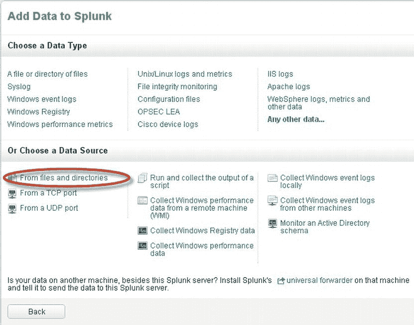

图 2-1 . 选择数据源

这将带你进入数据预览页面，如图 2-2 所示。由于这是我们第一次将数据加载到 Splunk 中，预览数据是合理的。预览选项提供了一个机会，让你查看日志条目在提交到 Splunk 数据存储（称为索引）之前将如何处理。接着，选择“索引前预览数据”单选按钮，并选择`/opt`目录下的`access.log`文件（如果你使用的是 Linux 系统），或`C:\opt`目录下的文件（如果你使用的是 Windows 环境）。然后点击“继续”按钮。

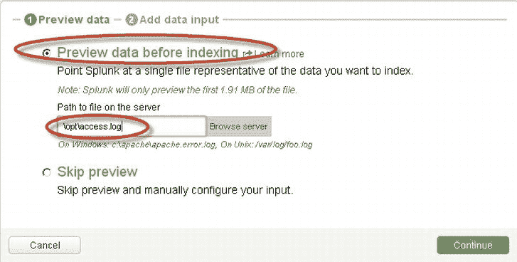

图 2-2 . 预览数据

弹出的对话框为你提供了设置源类型的选项。默认情况下，Splunk 会解析作为输入提供的数据文件，并确定文件的源类型。然后，它会根据源类型的特性加载或索引该文件。在本例中，由于我们加载的是一个访问日志文件，它已被识别为组合访问日志文件，因此我们接受“使用自动检测的源类型”默认选项（如图 2-3 所示），并点击“继续”按钮。在第 3 章中，我们将详细解释组合访问日志文件的格式以及日志条目中存储的信息。在第 9 章中，我们将回顾其他选项，例如定义需要以不同方式处理的自定义数据文件的输入。

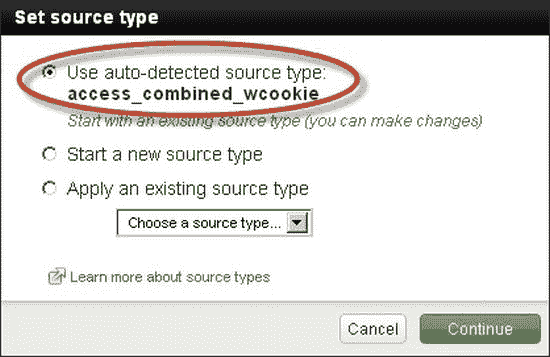

图 2-3 . 设置源类型

通常被称为记录或简单数据行的内容，在 Splunk 中被称为事件，每个事件都有一个时间戳。在本书中，我们将不断使用、分析和操作时间戳，因为它们是 Splunk 和大数据分析的关键元素。数据加载过程的下一屏会显示 Splunk 如何将日志条目分解为不同事件，并附带相关的时间戳。默认行为是按时间戳分割事件，但如果 Splunk 找不到时间戳，它会将文件的所有行视为一个单一事件。然后我们可以自定义将条目分割成不同事件的位置，这将在第 9 章中学习。在本例中，Splunk 将访问日志的条目非常清晰地分解为事件，如图 2-4 所示。在这里，你可以看到每个事件都包含关于`MyGizmoStore.com`上发生的用户活动信息。预览选项还会显示从日志文件中提取的事件数量，本例中共有 243 个事件。

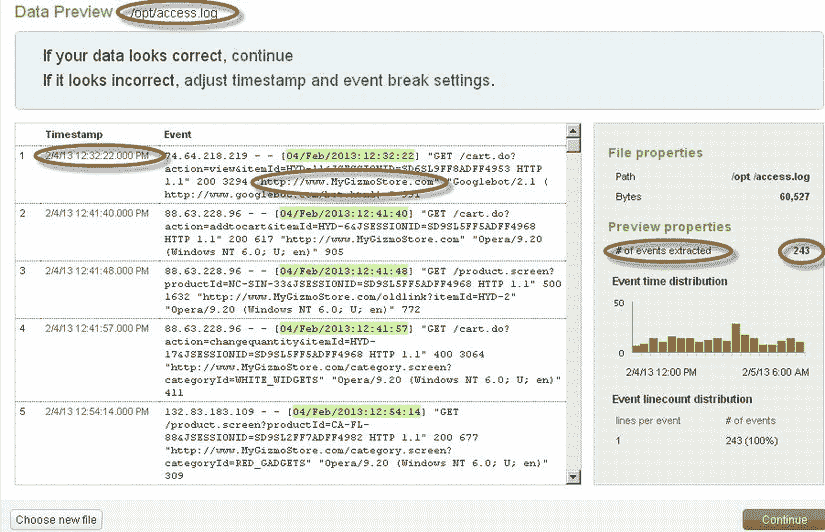

图 2-4 . `access.log`的数据预览

 **注意：** 如果你熟悉关系数据库的概念，那么可以这样理解：Splunk 分解出的每个事件在概念上等同于关系数据库表中的一行。

既然我们已经确认数据看起来不错，并且已被 Splunk 正确处理，你可以点击“继续”按钮，这将带我们进入“添加新内容”页面，在那里我们将自定义一些设置，然后最终将数据索引到 Splunk 中。由于这是一次性文件处理操作，我们将在“源”下选择“从此 Splunk 服务器索引一次文件”单选按钮。由于我们的计算机名称比较复杂，我们还选择将主机文件值更改为`BigDBook-Test`。

在上一步中，我们要求 Splunk 自动确定`sourcetype`，因此我们会看到` sourcetype`被设置为自动。默认情况下，当数据加载到 Splunk 时，它会进入主索引，这是用于存储、处理和分析数据的机制。Splunk 还提供了定义和使用其他索引的功能，这可以帮助你更好地组织和管理数据，尤其是在数据治理方面，例如访问、保护和保留策略。对于这个示例，我们将使用主索引，但我们将在下一节中看到如何创建一个新索引并使用它。点击“保存”按钮。如果 Splunk 能够完全处理数据，下一页将显示一条成功消息。

 **注意：** 如果你熟悉 Oracle 中的模式，Splunk 索引与该概念非常相似。Splunk 中的索引是数据的集合，而模式则包含数据的表集合。

一旦 Splunk 成功索引数据，你就可以开始审查数据以确保其正确性。要列出加载到 Splunk 中的所有日志条目，我们在搜索栏中输入`host=BigDBook-Test`，然后按回车键。此搜索会列出所有事件的完整列表，以及默认字段，包括时间戳、数据来源的主机、源类型和数据源。Splunk 将始终提供这些字段。在图 2-5 中，你可以看到总数为 243 个事件，这与我们刚刚索引的文件中的日志条目数量相同。你还可以看到每个事件左侧的时间戳，以及每个事件下方显示的另外三个默认字段。

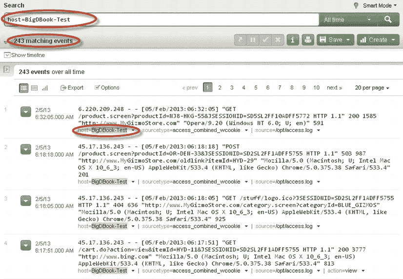

图 2-5 . 搜索结果

当大量数据从单个来源摄入 Splunk 时，使用单独的索引可以更好地管理它们，这些索引可以放置在不同的存储层级上。我们将继续为`MyGizmoStore.com`日志文件创建一个单独的索引。要创建索引，请点击用户界面右上角的“管理器”菜单项，然后在数据部分点击“索引”链接，如图 2-6 所示。

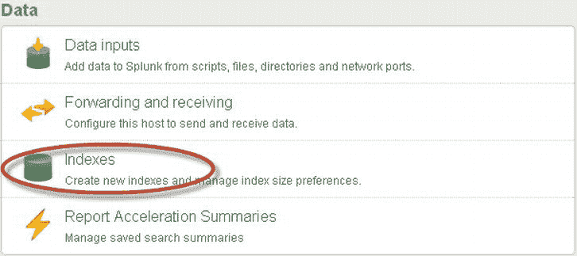

图 2-6 . 创建索引

在索引页面，点击“新建”按钮，并将索引命名为`mygizmostoreindex`。你可以忽略表单中的冷数据和解冻数据路径选项。这些是高级选项，可用于将 Splunk 索引中较旧或未使用的数据移动到，例如，成本更低的存储中。它还提供了使用冻结归档路径的概念将数据归档到 Splunk 之外的能力。在我们的情况下，我们将保留这些选项的默认值，因为模拟数据集不会很大。点击“保存”按钮。一旦新索引创建成功，它将出现在索引页面中，如图 2-7 所示。

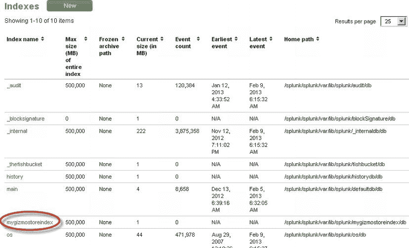

图 2-7 . 索引列表

截至目前，我们了解了如何通过一次性文件索引将数据导入 Splunk。在实际用例中，日志文件会不断更新，新增条目，需要对这些不断扩大的日志文件进行持续处理和分析。Splunk 为此提供了监控某些目录（这些目录中的文件持续更新）的能力。Splunk 的目录监控功能允许我们指定需要监控的目录，该目录中的文件将用作数据输入。

在探索监控选项之前，让我们再次回到`MyGizmoStore.com`。之前我们使用了一个来自该在线商店的静态日志文件，来了解如何将此类数据导入 Splunk。在现实世界中，`MyGizmoStore.com`可能运行在不同主机的多个 Web 服务器上，并写出需要持续监控、处理和分析的日志文件。

为了模拟这种行为，我们设计了一个测试数据生成器来为`MyGizmoStore.com`生成日志文件。我们将回顾测试数据生成器如何运行以及如何启动数据生成。

## 数据生成器

示例数据生成器使用 Python 脚本语言编写，旨在同时支持 Microsoft Windows 和 Linux 操作系统。该生成器使用随机生成器创建随机的 IP 地址（代表网站访客）、一组预定义的产品识别码（格式如`CA-NY-99`）和物项识别码（格式如`HYD-19`）。商店销售的小玩意可分为以下几类：

- `BLUE_GIZMOS`
- `RED_GADGETS`
- `WHITE_WIDGETS`
- `ORANGE_WATCHMACALLITS`
- `PURPLE_DOOHICKEYS`
- `BLACK_DOODADS`

网站访客可以执行以下操作：

- `Purchase`（购买）
- `Addtocart`（添加到购物车）
- `Remove`（从购物车中移除物项）
- `View`（查看小玩意目录）
- `Changequantity`（更改购物车中物项的数量）

网站使用的 HTTP 协议包含一个返回码，用于表示操作成功或描述问题。代码`200`表示操作成功，而`4xx`和`5xx`系列代码表示某种问题。该数据生成器会生成一定比例的错误代码，使其更贴近现实。此外，生成器还包括对用户代理（即浏览器和操作系统组合的描述，包含两者的版本号）的随机选择。

- `Mozilla/4.0 (compatible; MSIE 6.0; Windows NT 5.1; SV1)`
- `Opera/9.01 (Windows NT 5.1; U; en)`
- `Mozilla/5.0 (Macintosh; U; Intel Mac OS X 10_6_3; en-US) AppleWebKit/533.4 (KHTML, like Gecko) Chrome/5.0.375.38 Safari/533.4`
- `Mozilla/4.0 (compatible; MSIE 6.0; Windows NT 5.1)`
- `Googlebot/2.1 (http://www.googlebot.com/bot.html)`
- `Mozilla/4.0 (compatible; MSIE 6.0; Windows NT 5.1; SV1; .NET CLR 1.1.4322)`
- `Mozilla/5.0 (Windows; U; Windows NT 5.1; en-GB; rv:1.8.1.6) Gecko/20070725 Firefox/2.0.0.6`
- `Opera/9.20 (Windows NT 6.0; U; en)`

数据生成器脚本支持自定义用户代理和 HTTP 错误码的百分比，默认设置分别为 25% 和 30%。生成器的事件最大数量默认值为 50,000，周期为 30 天。生成器从当前日期开始，向后 30 天创建示例数据。在本例中，我们采用了如上所述的默认设置。

要运行数据生成器脚本，您的系统上需要安装 Python 2.7 或更高版本。您可以使用 Splunk 捆绑的 Python，它位于`$SPLUNK_HOME/bin`目录中（其中`$SPLUNK_HOME`是 Splunk 的安装目录）。该数据生成器脚本已通过 Splunk 自带的 Python 2.7 和 Python 3.1.5 测试。有关 Python 的更多信息，请访问`http://www.python.org`。本书下载包中包含的示例数据生成脚本名为`Generate_Apache_Logs.py`。我们已将该脚本安装到 Linux 机器的`/datagen/BigDBook`目录中。

## 生成示例数据

要生成示例数据，请执行图 2-8 所示的命令来运行 Python 脚本。该命令同样适用于 Windows 和 Unix。

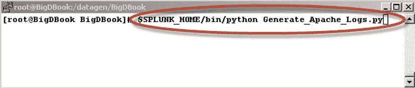

**图 2-8.** 运行测试数据生成器

成功执行 Python 脚本后，您可以在 `/opt/log` 目录（Unix 操作系统）中找到生成的日志文件；如果是 Windows 操作系统，文件则放置在 `c:\opt\log` 目录中。如前所述，典型的电子商务网站运行在多台服务器上，因此我们的数据生成器模拟了三个不同主机的日志条目，分别命名为 `BigDBook-www1`、`BigDBook-www2` 和 `BigDBook-www3`。生成文件的位置可以在脚本文件中自定义。在本章中，日志文件生成在以下目录中：
- `/opt/log/BigDBook-www1/access.log`
- `/opt/log/BigDBook-www2/access.log`
- `/opt/log/BigDBook-www3/access.log`

如果您在 `/opt/log` 目录中键入 Unix 命令 `ls –Rla`，它将列出文件，如图 2-9 所示。我们可以看到，三个不同主机的访问日志文件分别创建在各自的目录中。

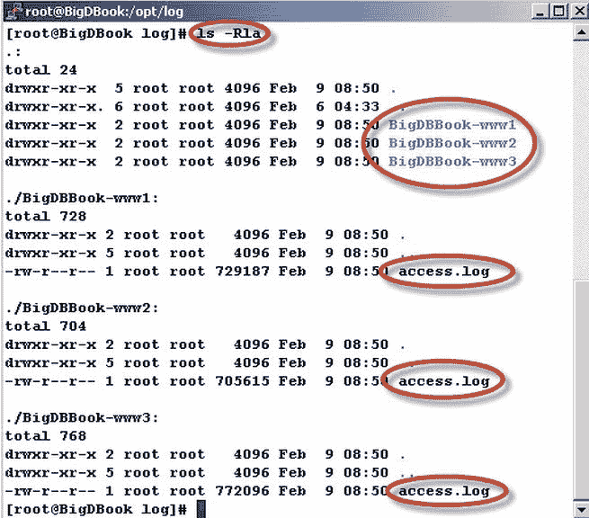

**图 2-9.** 生成的访问日志文件

现在，`MyGizmoStore` 的访问日志文件已创建就绪，您可以配置 Splunk 来监控存放这些日志文件的目录。为此，请像之前一样进入管理器界面，点击“数据输入”链接（如图 2-1 所示）。在“数据输入”页面中，点击“文件与目录”选项的“添加新”链接。现在您可以选择跳过数据预览（因为我们之前已对相同数据执行过此操作），然后点击“继续”按钮。在“添加新”页面中，在“来源”选项下，选择“持续索引此 Splunk 实例可访问的文件或目录中的数据”单选框。由于示例生成器将日志写入 `/opt/log` 目录（Linux 情况下），我们将此路径用作“数据的完整路径”选项的输入。因为我们之前为 `MyGizmoStore.com` 创建了一个名为 `mygizmostoreindex` 的单独索引，所以我们将使用它来演示如何将数据加载到主索引以外的索引中。勾选“更多”设置复选框。这里的一个选项是设置主机名。这非常有用，因为您可以基于主机名执行特定搜索。“设置主机”选项提供以下选择：
- 您可以为主机名定义一个常量值，这在您希望所有日志文件使用单一主机名时非常有用。
- `RegEx` 选项允许您使用正则表达式从字符串中提取主机名。
- 段（segment）选项允许您利用完整文件路径中的特定段。

在我们的 `MyGizmoStore.com` 案例中，由于测试生成器在 `/opt/log/BigDBook-www1`、`/opt/log/BigDBook-www2`、`/opt/log/BigDBook-www3` 目录下创建文件，我们需要使用多个主机名。因为主机名是所有路径中的第三个值，我们将利用 segment 选项，并将值指定为 3。与加载单个文件时一样，我们将让 Splunk 自动设置源类型，并在索引中指定新创建的 `mygizmostoreindex` 索引。我们通过从下拉框中选择该索引来完成此操作。高级选项包括白名单和黑名单，用于指定应监控目录中的哪些文件以及应忽略哪些文件。在我们的案例中，样本数据生成器在每个子目录下只生成一个日志文件，因此我们将其留空，因为没有需要列入白名单或黑名单的内容。图 2-10 显示了我们配置的设置。完成所有定义后，点击“保存”按钮。

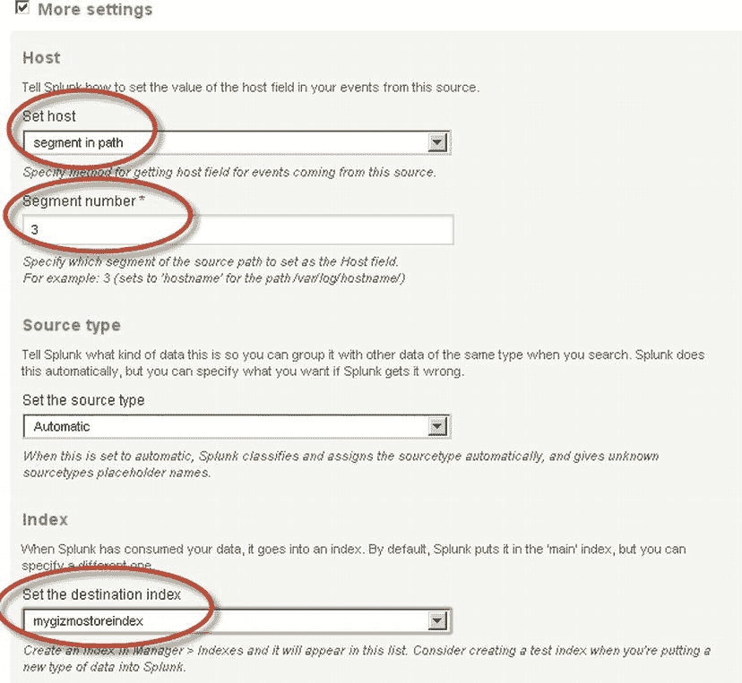

图 2-10. 监控目录

与之前的示例一样，您将在数据输入页面中看到新保存的配置，如图 2-11 所示。

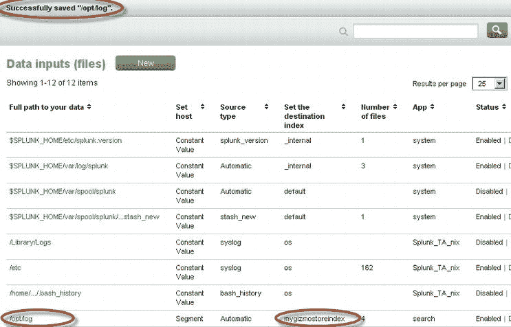

图 2-11. 已保存的配置

一旦 Splunk 成功索引文件，您就可以查看数据。为此，请在搜索栏中输入 `index=mygizmostoreindex` 并按回车键，如图 2-12 所示。此搜索会列出指定索引中的所有事件，并且像之前一样包含默认字段。您可以看到，主机名已根据我们的设置正确设置，即使用文件路径的第三个段。源类型和源字段看起来也是正确的。根据我们简单的审查，数据似乎已正确索引，因此我们可以确信 Splunk 正在定期监控这些目录，并将新信息追加到 `mygizmostoreindex` 中。

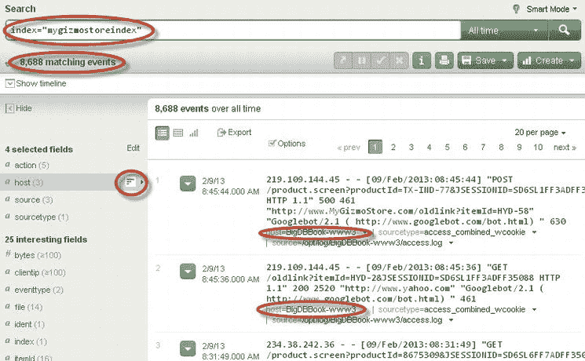

图 2-12. `mygizmostoreindex` 中的事件

现在，我们可以引入左侧边栏，也称为字段栏。该边栏始终显示默认字段和附加字段，Splunk 称之为“关注的字段”。这些字段被定义为在该特定索引中出现在 50% 或更多事件中的字段。这是一个非常有用的工具，可以快速加深对您所处理数据的理解。例如，我们可以快速看到 host 字段有三个值。如果我们想知道这些值是什么，可以单击 host 字段旁边的柱状图图标。如图 2-13 所示，这将弹出一个对话框，显示 host 字段的所有值。这样我们就不必检查大量事件来验证是否出现了预期的三个值。不仅如此，该对话框还显示了一些关于该字段的摘要统计信息，例如包含每个值的事件总数和百分比。此外，它还显示了一个包含这些信息的柱状图，使其成为一种非常引人注目且简便的方法来深入了解特定字段。

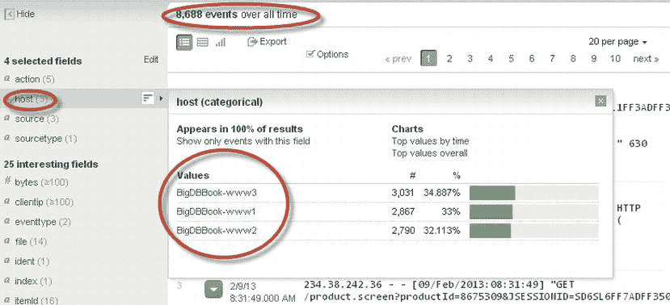

图 2-13. 每个主机中的事件

大多数情况下，生成的日志文件非常大；它们会使用 zip 技术进行压缩。此外，大多数服务器都具备日志轮转功能，即日志文件在达到一定时间或大小后会被移动到其他位置。Splunk 的目录监控功能足够智能，能够应对这些实际用例，因为它可以在索引之前解压目录中的压缩文件。它还可以自动检测日志轮转，并跟踪最后被索引的日志条目所在位置；这样它就可以从该点开始处理。这在 Splunk 重启或执行维护任务时非常有用。

## 网络数据源

许多系统应用和网络设备（如路由器和交换机）通过使用 TCP 或 UDP 协议的网络端口来中继事件。一些应用程序使用 SNMP 标准通过 UDP 发送事件。Syslog 是计算机数据日志记录的标准，是另一组数据源，其中包含大量可在网络端口级别捕获的信息。可以启用 Splunk 来接收来自 TCP 或 UDP 端口的输入。为此，您可以使用 Splunk Web 用户界面配置一个网络输入源，您只需指定主机、端口和源类型即可。保存配置后，Splunk 将开始索引来自指定网络端口的数据。这种网络输入可用于捕获在远程机器上生成的 syslog 信息，而该数据并不驻留在 Splunk 实例本地。Splunk 转发器也可用于在远程主机上收集数据。我们将在本章的最后部分讨论转发器。

## Windows 数据

Windows 操作系统会产生大量日志文件，其中包含有关 Windows 事件、注册表、Active Directory、WMI、性能和其他数据的信息。Splunk 将 Windows 日志流识别为一种源类型，并允许添加一个或多个此类日志流作为输入进行索引，以供进一步处理和分析。尽管可以单独配置诸如 Active Directory 等 Windows 数据源，但 Splunk 提供了一种更好、更简单的方法来处理这些 Windows 日志或事件，即使用 Splunk App for Windows 或 Splunk Technology Add-on for Windows。我们将在本章后面探讨这一点。

## 其他数据源

Splunk 支持将脚本作为从其他未提供特定默认配置的数据源获取数据的机制。脚本可以接触的数据类型没有限制，只要脚本的输出可以作为 Splunk 能够理解或可以调整使其理解的输入提供即可。例如，可以从数据库获取数据的脚本，或者可以从 Twitter 获取数据的脚本——我们将在第 12 章中探讨这个例子。Technology Add-ons 也可能使用脚本来获取数据，但它们提供了一种抽象，带来了附加价值，使得将数据导入 Splunk 以进行进一步处理和分析变得容易。这为我们快速概述 Splunk 应用程序和附加组件提供了一个很好的机会。

## 应用程序和附加组件

Splunk 用户界面默认为“搜索”应用程序。然而，Splunk 被设计为一个平台，作为基础设施，第三方开发人员或 ISV 可以在此基础上构建提供 Splunk 扩展功能的专用应用程序。构建这些扩展有两种方式：应用程序和 Technology Add-ons。

Splunk 应用程序将扩展功能与标准功能（如已保存搜索、仪表板和已定义的输入）打包在一起。此外，它们还捆绑了在 Splunk 用户界面之上构建的自己的用户界面。相比之下，插件（或简称为 TA）是比应用程序更小的组件，它们包含附加功能，但没有自己的用户界面。我们将不得不使用标准的 Splunk 搜索应用程序来查询通过插件配置的已索引数据。任何具备一定编程知识的人都可以编写应用程序和插件。Splunk 拥有一个充满活力的社区，不断创建和分享应用程序和插件。它托管在 `http://splunk-base.splunk.com/apps/` 上。在附录 B 中，您将找到一份可在企业中使用的有用应用程序和插件列表。

为了探索 Windows 数据源，我们将使用适用于 Windows 的 Splunk 技术插件。这将使我们能够将 Windows 数据导入 Splunk。您可以直接访问 splunkbase 找到该插件，或者直接从 Splunk 实例中搜索和查找应用程序。为此，请点击“应用程序”菜单下的“查找更多应用程序...”，如图 2-14 所示。

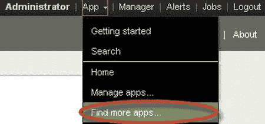

图 2-14 . 查找 Splunk 应用程序

在用户界面的搜索栏中输入单词 `windows` 并按下回车。在撰写本文时，第四个结果是“适用于 Windows 的 Splunk 技术插件”，这正是我们想要使用的。点击“免费安装”按钮，如图 2-15 所示。执行此操作需要 Splunk 登录。注册是免费的。


图 2-15 . 适用于 Windows 的 Splunk TA

系统将提示您输入 Splunk 网站的账户凭据。输入凭据后，该插件将安装到 Splunk 实例上。您应该会看到一条消息，提示需要重启。点击“重启 Splunk”按钮。成功重启并登录到 Splunk 实例后，您将能够在“应用程序”菜单下找到新安装的适用于 Windows 的 Splunk TA，如下方图 2-16 所示。

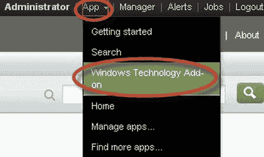

图 2-16 . 适用于 Windows 的 Splunk TA

可以通过点击“应用程序”菜单中的插件链接来启用特定的 Windows 事件日志或文件和目录。一旦启用了特定的数据源，该插件将自动配置要加载到 Splunk 实例中的数据。我们将启用应用程序、系统和安全事件日志，如图 2-17 所示，以进行一些基本测试，并展示 Windows TA 如何帮助简化将 Windows 数据源数据加载到 Splunk 的过程。

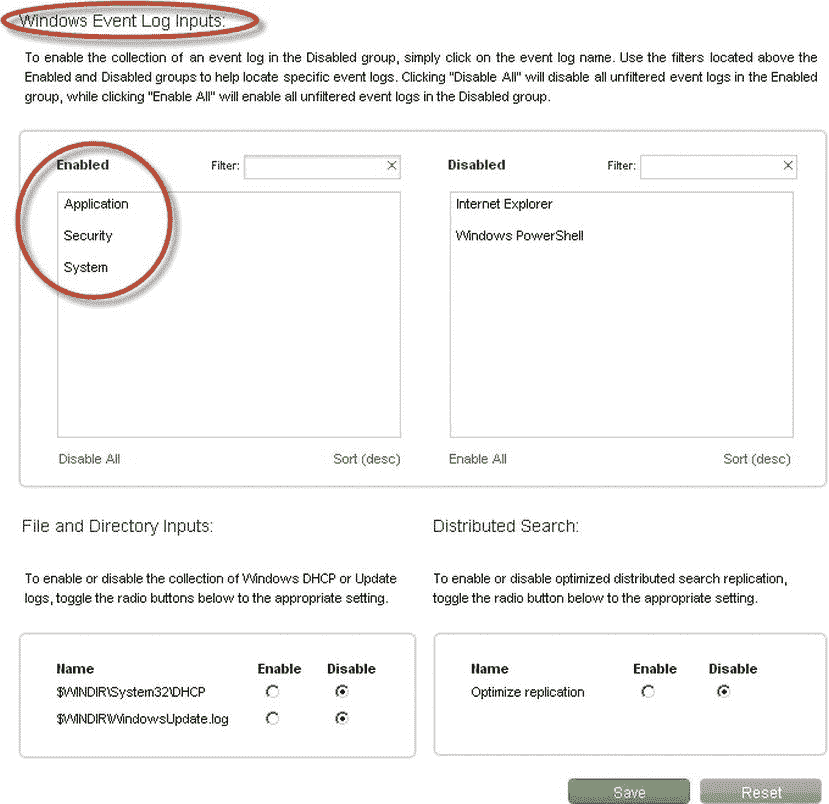

图 2-17 . 启用 Windows 事件日志

 **注意** Windows 技术插件可以安装在运行于 Windows 上的 Splunk 上。如果您在 Linux 上运行 Splunk，则可以将 Windows TA 安装在运行于 Windows 机器上的转发器上。转发器将在本章后面和第 15 章中解释。我们还建议在安装应用程序和插件组合时查看 Splunk 管理手册，以了解支持哪些配置。

现在我们已经安装了 Windows TA 并启用了一些可用的数据源，我们可以转到 Splunk 搜索应用程序并搜索已索引的数据，以测试 TA 是否能够将数据导入 Splunk。我们可以选择“应用程序”，这是我们已启用的数据源之一，然后查看与 Windows 应用程序相关的事件是否已被索引到 Splunk 中。为此，请在搜索栏中输入以下命令：
```
sourcetype="WinEventLog:Application"
```
如图 2-18 所示，搜索返回了来自应用程序事件日志的 12897 个事件。您可以选择其他已启用的事件日志，并搜索与这些日志相关的事件。由于本章重点在于理解如何将数据导入 Splunk，我们不会探索所有已索引到 Splunk 中的可用事件。第 3 章将详细介绍如何在数据进入 Splunk 后对其进行处理和分析，第 4 章将详细介绍如何可视化已索引到 Splunk 中的数据。

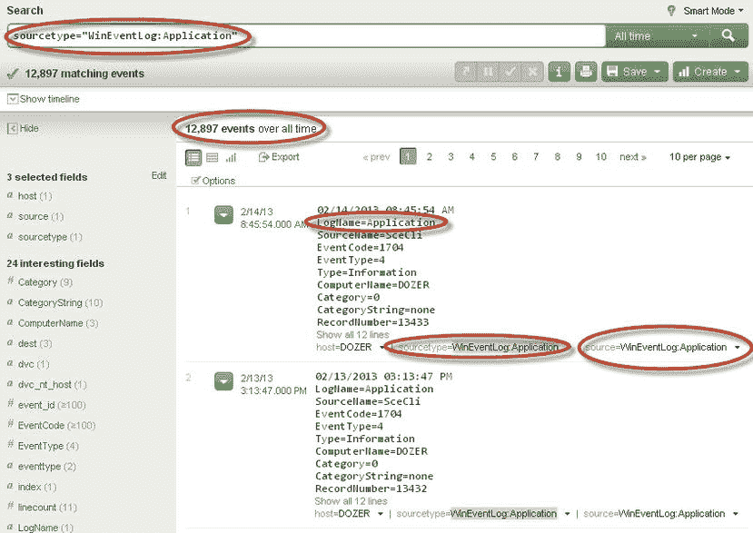

图 2-18 . 来自 Windows 应用程序的事件已索引到 Splunk

Splunk 还为 Linux 和 Unix 提供了类似的技术插件，称为 `*Nix`。该插件利用日志文件和脚本来获取 Linux 或 Unix 中不同的事件集和日志数据并将其导入 Splunk。您可以使用我们安装 Windows 技术插件时使用的相同过程来安装 `*Nix` 技术插件：
- 转到“应用程序”菜单，点击“查找更多应用程序...”，如图 2-14 所示。
- 搜索 `*nix`，在撰写本文时，第二个条目是“适用于 Unix 和 Linux 的 Splunk 技术插件”。
- 点击“免费安装”按钮；成功安装后，系统将提示您重启 Splunk。
- 成功重启后，转到“应用程序”菜单，如图 2-19 所示；在这里您可以看到“Splunk *Nix (TA)”作为一个新的菜单项。

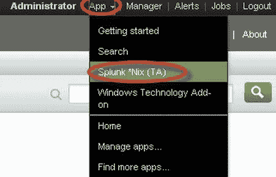

图 2-19 . Splunk *Nix (TA)

点击“Splunk *Nix(TA)”链接，以便您可以为您的 Unix 版本设置数据源。这将打开设置界面，如图 2-20 所示。在这里您可以看到该插件使用了我们之前与 `MyGizmoStore.com` 一起使用的文件和目录监控方法来监控 Unix 中的不同日志文件。它还使用了我们刚才讨论的脚本方法来加载特定的数据输入，例如将 CPU 使用率加载到 Splunk 中。这充分展示了 TA 的强大功能，它抽象了繁琐细节的层次，使将数据加载到 Splunk 变得非常简单。为了快速测试，我们启用了“文件目录输入”下的 `/var/log` 目录，如图 2-20 所示。此外，我们还启用了“脚本化输入”标题下的 `cpu.sh` 脚本，如图 2-21 所示。点击“保存”按钮将设置保存到相应的配置文件中。如果您转到“索引”页面，您将看到所有 `*Nix` 数据都被加载到一个名为 `os` 的单独索引中。

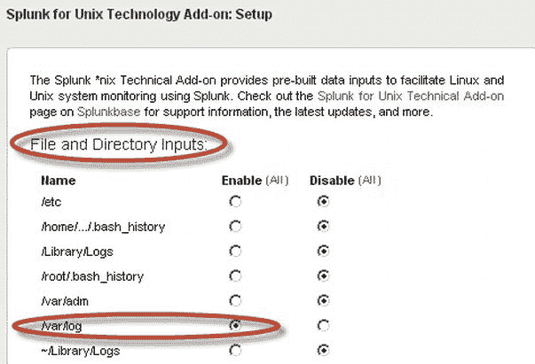

图 2-20 . 配置 *Nix TA

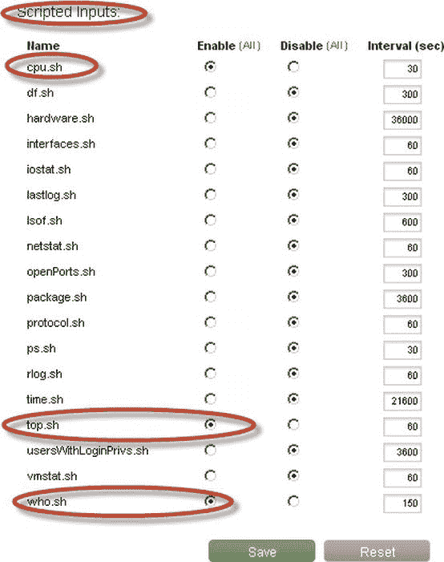

图 2-21 . *Nix TA 中的脚本化输入

现在您已经安装了 `*Nix` TA 并启用了一些可用的数据源，您可以转到 Splunk 搜索应用程序并搜索已索引的数据，以测试 `*Nix` TA 是否能够加载数据。正如我们之前提到的，`*Nix` TA 将数据加载到一个名为 `os` 的单独索引中，因此您可以通过在搜索栏中输入 `index=os` 来继续搜索所有事件，这将检索已启用的数据源所有已索引到 Splunk 中的事件。您可以在图 2-22 中看到，搜索显示了从 `top`、`who` 以及 `/var/log` 目录下的各种日志文件中捕获的事件。

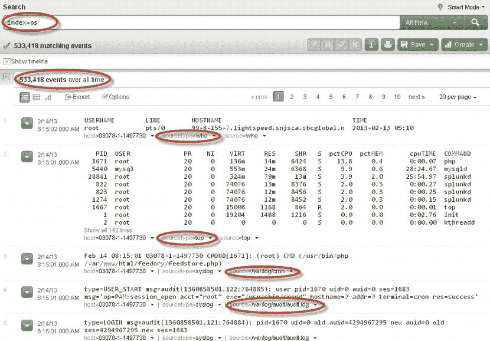

图 2-22. 使用 *Nix 捕获的事件

## 转发器

在实际场景中，企业拥有大量应用程序，其中大多数运行在异构基础设施上，包括各种硬件、数据库、中间件和应用程序。我们无法让 Splunk 在每一个应用程序或基础设施附近本地运行，这意味着数据对 Splunk 而言并非本地的。我们在本章中看到的是如何将 Splunk 本地的数据导入其中。这些用例假设 Splunk 能够访问本地或挂载了远程数据的文件系统中的文件或目录，但这些目录均已挂载到运行 Splunk 的机器上。

为了解决将远程数据导入 Splunk 的用例，我们将介绍 Splunk 转发器。Splunk 转发器与标准 Splunk 实例相同，但仅包含将数据转发到接收器（可以是主 Splunk 实例或索引器）所需的核心组件。转发器的主要任务是收集 Splunk 的远程数据，并将其转发到将加载这些远程数据的主 Splunk 实例或索引器。Splunk 通用转发器是一个可从`splunk.com`下载的组件，可以配置用于转发所需数据。技术插件（如`Windows TA`）可以与通用转发器配合使用，将 Windows 源数据发送到在 Unix 环境下运行的 Splunk 实例。使用 Splunk 转发器是处理远程数据的推荐部署方式或最佳实践。转发器提供了许多优势，包括：
- 它们会在远程位置自动缓冲数据，这在主 Splunk 实例因任何原因宕机时非常有用。
- 它们支持利用技术插件来收集远程可用的不同数据源。
- 它们可以远程管理。
- 它们支持安全地发送远程数据，并具备压缩和数据确认功能。
- 它们提供负载均衡支持，更适合扩展性和性能需求。

它们可以与远程位置上任何可用的网络端口协同工作，以收集这些端口的数据。我们将在第 14 章和第 15 章中详细讨论 Splunk 部署，这两章将涉及分布式拓扑和高可用性。

## 总结

在本章中，我们了解了可以将数据加载到 Splunk 中的不同类型的数据源。我们详细讨论了如何使用`文件和目录`选项获取数据，以及如何利用 Splunk 的监控功能获取`MyGizmoStore.com`的访问日志。我们还简要介绍了如何配置`Windows`和`*Nix`等技术插件来从 Windows 和 Linux 机器收集数据。最后，您了解了 Splunk 转发器以及它们如何帮助获取 Splunk 的远程数据。

## 第 3 章

```

```