# 处理和分析数据

在本章中，您将学习如何使用 Splunk 的搜索处理语言 (SPL) 来处理和分析数据。我们将继续第 2 章中完成的数据加载工作；这将帮助您深入理解组合访问日志格式以及日志条目提供的信息。然后，您将学习如何使用 SPL 的报表、排序、过滤、修改和分组命令来处理 `MyGizmoStore.com` 的数据。

## 了解组合访问日志数据

我们在本书中强调的一点是，需要理解您想要处理和分析的数据集；也就是说，首先要深入了解您将要处理的数据。在本章中，我们将迈出第一步，解释我们在第 2 章中用于生成示例数据的组合访问日志格式的数据。

几乎所有类型的应用程序和服务器都会生成日志文件——无论是最终用户应用程序、Web 服务器，还是作为运行消费者或业务用户所用应用基础设施的复杂中间件平台。操作系统和固件也会将大量原始数据生成到日志文件中。挑战在于理解、分析和挖掘日志文件中的原始数据，并从中提取出有意义的信息。

由 Apache 或 Microsoft IIS 等 Web 服务器生成的组合访问日志提供了关于活动、性能以及间歇性或持续发生的问题的信息。这些日志包含有关服务器处理的所有请求的信息。Apache 和 IIS 都允许自定义组合访问日志格式，这种格式被许多解释和处理这些日志文件中条目的日志分析应用程序广泛使用且易于理解。组合访问日志格式产生的日志条目如下所示：

```
127.0.0.1 - JohnDoe [10/Oct/2000:13:55:36 -0700] "GET /apache_pb.gif HTTP/1.0" 200 2326
"http://www.google.com" "Opera/9.20 (Windows NT 6.0; U; en)"
```

此示例中各个字段的含义在表 3-1 中进行了描述。

表 3-1. 组合访问日志中的字段描述


| 字段 | 描述 |
| --- | --- |
| `127.0.0.1` | 这是发起 HTTP 请求以访问 Web 应用程序或单个网页的客户端（机器、主机或代理服务器）的 IP 地址。该字段的值可以表示为主机名 |
| `-` | 该字段用于标识发起 HTTP 请求的客户端。由于此字段的内容非常不可靠，通常使用连字符表示，这意味着信息不可用 |
| `JohnDoe` | 这是请求网页或应用程序的用户的用户 ID |
| `10/Jan/2013:10:32:55 -0800` | 服务器完成处理请求的时间戳。格式可以通过 Web 服务器设置进行控制 |
| `"GET /apache_pb.gif HTTP/1.0"` | 这是从客户端接收到的请求行。它显示了方法信息，在本例中为 `GET`，客户端请求的资源，在本例中为 `/apache_pb.gif`，以及使用的协议，在本例中为 `HTTP/1.0` |
| `200` | 这是服务器发送回客户端的状态码。状态码是非常重要的信息，因为它们可以告知来自客户端的请求是成功完成还是失败，如果失败，则需要采取一些措施。本例中的 `200` 表示请求已成功 |
| `2326` | 此数字表示返回给客户端的数据大小。在本例中，`2326` 字节被发送回客户端。如果没有内容返回给客户端，则该值将是一个连字符 `"-"` |
| `"http://www.google.com"` | 该字段被称为引荐来源字段，显示请求来自何处。您可能会在引荐来源字段中看到诸如 `http://www.google.com`、`http://www.yahoo.com` 或 `http://www.bing.com` 之类的网站 URL。引荐来源信息有助于网站或在线应用程序了解用户是如何进入网站的，并且此信息可用于确定在线广告费用应投向何处。您可能注意到引荐来源（referrer）多了一个“r”。这是有意为之，源自 HTTP 规范中最初提出的提案。在用户可以使用隐身模式或禁用引荐来源的浏览器（如 Chrome）中，该字段的值将不准确。在 HTML5 中，可以指示报告此信息的用户代理不发送引荐来源信息 |
| `"Opera/9.20 (Windows NT 6.0; U; en)"` | 这是用户代理字段，包含客户端浏览器报告的有关自身的信息。您会看到像 `"Opera/9.20 (Windows NT 6.0; U; en)"` 这样的值，这意味着请求来自运行在 Windows NT（实际上是 Windows Vista 或 Windows Server 2008）操作系统上的 Opera 浏览器。用户代理信息有助于优化网站和 Web 应用程序，并处理来自 iPad 和手机等小型设备的请求 |

现在让我们看一下我们在第 2 章中为 `MyGizmoStore.com` 生成的一些示例日志条目。以下是来自 `/opt/log/BigDBBook-www1/access.log` 文件的示例条目。您可以看到其中包含不同的状态码以及用户代理或浏览器。

```
196.65.184.6 - - [28/Dec/2012:06:54:46] "GET /product.screen?productId=CA-NY-99&JSESSIONID=SD5SL8FF8ADFF4974 HTTP 1.1" 200 992 "http://www.bing.com" "Opera/9.20 (Windows NT 6.0; U; en)" 597

92.189.220.86 - - [29/Dec/2012:02:58:28] "GET /cart.do?action=purchase&itemId=HYD-2&JSESSIONID=SD2SL1FF4ADFF5176 HTTP 1.1" 500 1058 "http://www.MyGizmoStore.com/oldlink?itemId=HYD-2" "Mozilla/4.0 (compatible; MSIE 6.0; Windows NT 5.1; SV1; .NET CLR 1.1.4322)" 604

189.228.151.119 - - [30/Dec/2012:18:18:50] "GET /product.screen?productId=8675309&JSESSIONID=SD6SL9FF2ADFF6808 HTTP 1.1" 404 3577 "http://www.MyGizmoStore.com/product.screen?productId=CA-NY-99" "Opera/9.01 (Windows NT 5.1; U; en)" 916

218.123.191.148 - - [31/Dec/2012:04:28:45] "GET /category.screen?categoryId=BLUE
GIZMOS&JSESSIONID=SD0SL1FF1ADFF7226 HTTP 1.1" 500 2992 "http://www.MyGizmoStore.com/category.screen?categoryId=BLUE GIZMOS" "Mozilla/5.0 (Macintosh; U; Intel Mac OS X 10_6_3; en-US) AppleWebKit/533.4 (KHTML, like Gecko) Chrome/5.0.375.38 Safari/533.4" 928

78.65.68.244 - - [31/Dec/2012:02:22:40] "GET /category.screen?categoryId=ORANGE WATCHMACALLITS&JSESSIONID=SD1SL5FF9ADFF7146 HTTP 1.1" 200 2120 "http://www.bing.com" "Mozilla/4.0 (compatible; MSIE 6.0; Windows NT 5.1; SV1)" 338
```

## 搜索和分析索引数据

搜索和分析机器或日志数据可以提供极其有用的信息，了解应用程序、系统、Web 服务器、负载均衡器和防火墙是如何工作的。这些信息还可用于调试、根本原因分析，以及通常更深入地了解外部或内部客户在用法或购买模式方面的行为。通过分析机器数据，企业可以开始提出以前未曾想到的问题，以了解 IT 基础设施正在发生什么。

我们将使用 `MyGizmoStore.com` 的示例数据，看看是否能找到典型 IT 组织希望了解的有关其网站和应用程序的许多问题的答案。我们可以先尝试一些简单的搜索命令，看看字段名称是否与表 3-1 中的信息正确对齐。在 Splunk 搜索栏中，输入 `sourcetype=access_combined_wcookie`，您可以在图 3-1 中看到检索到了 8,688 个匹配事件。此数字将根据您在第 2 章中对示例数据生成器所做的自定义而有所不同。

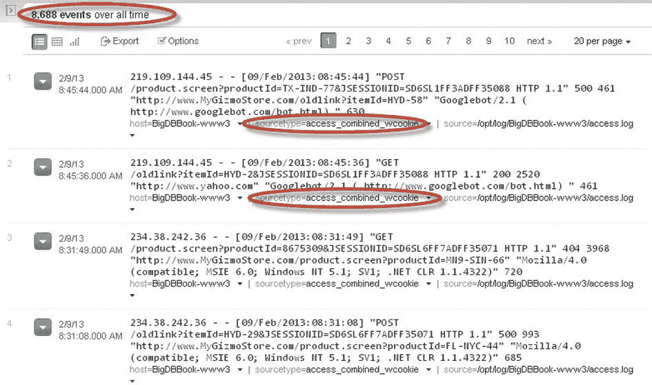

图 3-1. [MyGizmoStore.com](http://MyGizmoStore.com) 的事件总数

为了进一步验证事件总数，我们可以找出每个主机 `BigDBook-www1`、`BigDBook-www2` 和 `BigDBook-www3` 相关的事件数量。所有主机的事件总数应与之前使用 `sourcetype` 字段搜索得到的结果相匹配。在搜索栏中输入 `host=BigDBook*`，您将在图 3-2 中看到检索到了 8,688 个事件，并且所有事件中的主机字段值都被高亮显示。事件数量与我们之前搜索得到的数量相等。

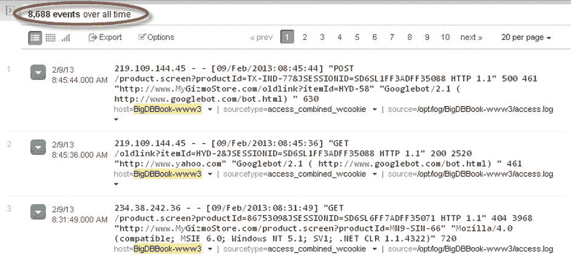

图 3-2. 所有主机的事件总数

我们还可以检查各个字段以进一步验证数据。示例数据生成器默认包含以下类别：

*   `BLUE_GIZMOS`
*   `RED_GADGETS`
*   `WHITE_WIDGETS`
*   `ORANGE_WATCHMACALLITS`
*   `PURPLE_DOOHICKEYS`
*   `BLACK_DOODADS`

您可以转到 Splunk 搜索应用程序中的左侧栏，如图 3-3 所示；此侧边栏始终显示默认字段和附加字段，Splunk 将这些字段称为感兴趣的字段。这些字段被定义为出现在该特定索引的 50% 或更多事件中的字段。

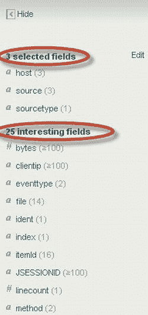

图 3-3. 显示选定字段和感兴趣字段的侧边栏

您可以看到我们是否有一个可以找到类别列表的字段。因为我们在两个字段列表中都找不到类别字段，请点击底部的“查看所有 44 个字段”链接。这将弹出一个显示完整字段列表的对话框。您可以看到 `categoryId` 被列为从上往下数的第三个字段，如图 3-4 所示。

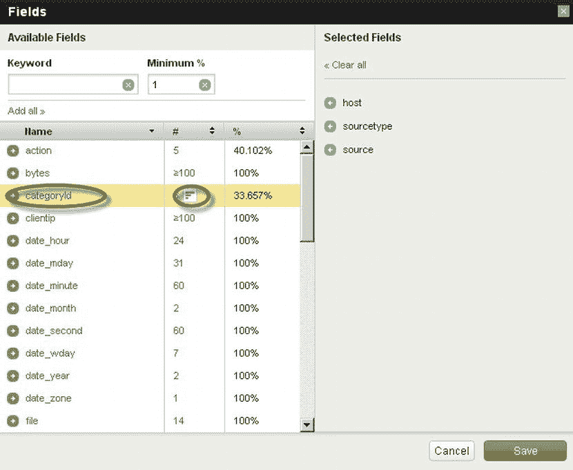

图 3-4. 字段列表


要查看类别列表，请单击`categoryId`字段第 2 列中显示的小条形图图标。您将看到弹出窗口中按所有事件分组的类别列表，如图 3-5 所示，弹出窗口中的列表与我们在示例数据生成器中使用的默认类别列表相匹配。此外，对话框会显示类别字段值；它还显示有关该字段的一些摘要统计信息，例如每个类别的总事件计数和百分比。此外，它还呈现了一个条形图，这使得它成为一种非常引人注目且简单的方法来深入了解特定字段。

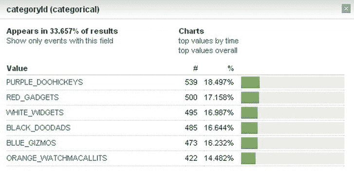

图 3-5. 类别列表

您始终可以向侧边栏添加其他字段。我们可以在“字段”对话框中执行此操作；单击字段列表中的第一个字段`action`旁边的箭头符号，然后单击“保存”按钮。您可以对`action`字段进行快速验证。在我们的示例数据生成器中，我们为`MyGizmoStore.com`访问者可以执行的操作使用了以下方法：

*   购买
*   将商品添加到购物车（Addtocart）
*   从购物车中移除商品（Remove）
*   查看小工具目录（View）
*   更改购物车中商品的数量（Changequantity）

在左侧栏中，您现在可以看到`action`字段已列在选定的字段列表中。单击该字段的小条形图图标。图 3-6 显示了包含`action`字段方法列表的弹出窗口；这些方法与我们的列表相匹配。我们可以看到`view`方法具有最高的事件数。当您学习如何使用 SPL 处理事件时，您将对此进行分析。

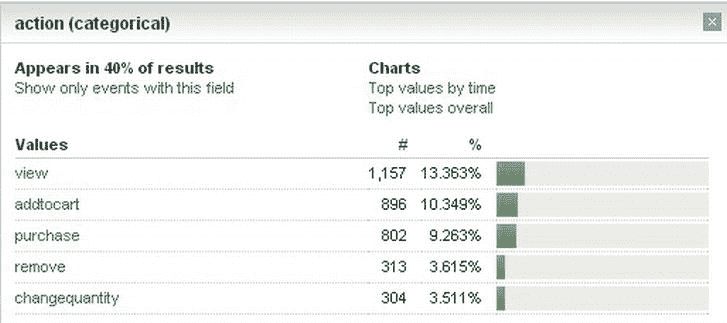

图 3-6. 操作方法列表

我们刚刚对样本数据执行的基本检查和验证帮助我们确认获得了正确的数据；现在我们可以继续详细处理和分析数据集。Splunk 搜索应用程序提供了一个非常有用的时间选择器，它帮助我们根据时间放大到数据子集，这对于熟悉和验证数据非常有用。我们将使用我们之前使用过的相同查询，即：

```
sourcetype=access_combined_wcookie
```

结果如图 3-7 所示。图形化的时间线在一个月的时间范围内以条形图显示事件，在这种情况下，时间范围介于 2012 年 12 月 28 日和 2013 年 1 月 27 日之间。右上角的时间选择器显示我们使用的选项是“所有时间”，在我们的案例中，这映射到我们生成的 30 天样本数据。您还将看到字段`sourcetype`在每个列出的事件中被突出显示。

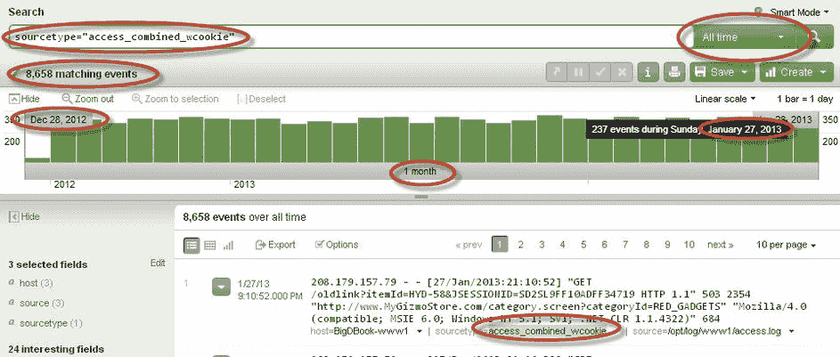

图 3-7. 带有时间选择器的 Splunk 搜索应用

在实际使用场景中，您可能正在处理跨越数月或数年的数据集；或者您可能在非常短的时间内拥有数百万个事件。在任何情况下，您都需要深入到特定的时间窗口并找出正在发生的事情。这就是 Splunk 时间选择器派上用场的地方。单击时间选择器会向我们显示可以使用的不同时间线，如图 3-8 所示。列出的选项允许我们在短时间间隔（例如分钟、小时、天）或自定义时间段（可使用“自定义时间...”选项指定）内查看事件。

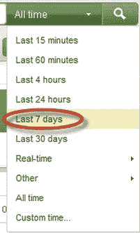

图 3-8. Splunk 时间选择器

在时间选择器中选择“最近 7 天”选项，查看时间线栏如何更新。在图 3-9 中，我们可以看到 2013 年 1 月 21 日至 2013 年 1 月 28 日之间的事件分布，您将看到 1,923 个事件。

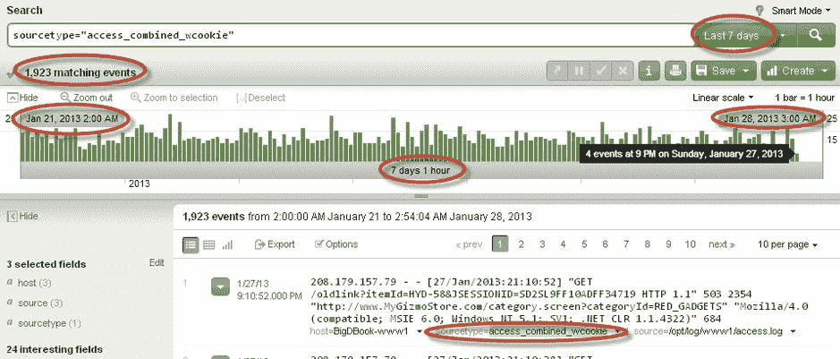

图 3-9. 最近七天的时时间线条形图

Splunk 提供了时间范围命令，我们可以在搜索栏中使用它们来控制处理事件的时间段行为。您将在第 5 章和第 11 章中了解这些时间范围命令。

为了处理和分析实际用例，我们需要了解的不仅仅是在左侧栏和时间线中看到的字段的事件数。这就是 SPL 的用武之地。它提供了简单而强大的方法来分析加载到 Splunk 中的数据。在本章的后续部分，您将学习并探索以下类别中的不同 SPL 命令：

*   报告
*   排序
*   过滤
*   添加和评估字段
*   分组

## 报告

报告对每个 IT 组织以及企业的业务领导者来说都至关重要。他们每天使用报告来获取关于 IT 系统当前状态的信息，或者业务在销售、制造、运输等方面的运作情况。通常，报告汇总信息以呈现易于目标受众理解的摘要。我们将从`top`命令开始探索 Splunk 中的报告命令。此命令非常方便，用于回答在拥有网站或 Web 应用程序的 IT 组织中最常问的以下类型问题：

*   哪些是最常用的浏览器？
*   我的前五个 IP 地址是哪些？
*   哪些是最常引荐的网站？

`top`命令可以与 Splunk 事件中可用的一个或多个字段一起使用。它对给定的数据集进行操作，查找最常出现的字段值，并返回命令后指定的字段的计数和百分比。默认情况下，`top`命令返回前十个结果，但您可以使用`limit`选项控制返回的数量。可能并非每次搜索都需要`top`命令返回的所有列。Splunk 允许您使用`fields`命令从搜索结果中消除某些字段。需要消除的列必须在前面加上`-`指定。

### 哪些是最常用的浏览器？

在表 3-1 中，我们展示了组合访问日志中可用的不同字段。其中一个字段是用户代理，它包含客户端浏览器报告的有关自身的信息。像`MyGizmoStore.com`这样的在线零售商店想知道客户用来查看产品或进行购买的最常用用户代理（浏览器）是哪些。了解正在使用的浏览器将有助于`MyGizmoStore.com`优化在线商店页面，并确保在用户访问网站时最流行的浏览器上正确渲染页面。`top`命令使我们能够非常容易地获取这些信息。在开始使用`top`之前，请确保您已在时间选择器中选择了“所有时间”选项。`useragent`字段包含浏览器信息。Splunk 在索引时自动将表 3-1 中的字段映射到其自己的字段名称，这使得我们很容易找到所需的信息或字段。在搜索栏中输入以下内容：

```
sourcetype=access_combined_wcookie
| top useragent
```


当第一条命令是搜索时，你无需手动输入，因为系统默认它就是搜索。上述搜索的第一个子句等同于：`search sourcetype=access_combined_wcookie`。搜索中的管道符（`|`）的作用是将每个 Splunk 命令的结果作为输入传递给下一个命令。有时，它也会将前一个搜索评估结果中的特定数据子集传递给下一组评估。在此搜索中，你将基于 `sourcetype` 字段获取事件子集，并仅将这些事件通过管道传递给 `top` 命令，以找出最热门的浏览器。如图 3-10 所示，该搜索找到了 6,254 个匹配事件，并找出了最热门的浏览器及其计数和百分比。可以看出，Mac OS 上的 Mozilla 5.0 是最热门的浏览器，而 Windows 上的同一浏览器紧随其后。

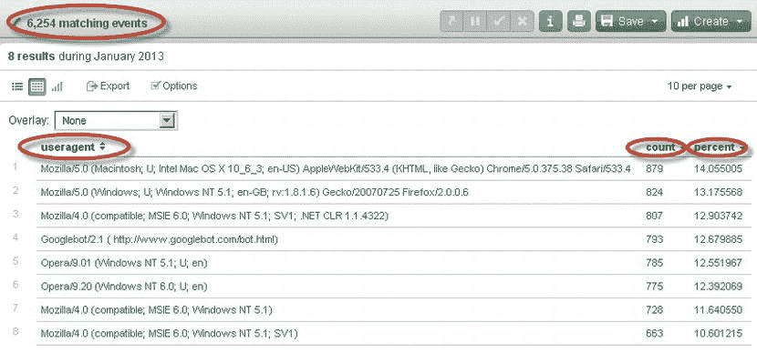

图 3-10. 最热门浏览器

 **注意** 用 SQL 的术语来说，你可以将这种情况类比为在 MySQL 中使用 `TOP` 关键字搭配 `select` 语句，或在 Oracle 中使用 `rownum` 搭配 `where` 子句。这两种情况都会产生相同的结果集。

Splunk 允许我们保存搜索结果，这样我们就不必每次都重新输入搜索查询来查看结果。如图 3-11 所示，点击 Splunk 搜索应用程序右上角的“保存”（Save）链接。在下拉列表中，你将看到三个不同的选项：

*   `保存结果`（`Save results`）选项——允许我们保存当前搜索的结果
*   `保存搜索`（`Save search`）选项——用于保存搜索，之后可以通过 Splunk 搜索应用程序菜单中的“搜索和报告”（Searches & Reports）链接重新获取该搜索
*   `保存并分享结果`（`Save & share results`）选项——允许我们保存搜索查询，并与其他已分配了适当安全角色以访问搜索的 Splunk 用户分享结果。Splunk 的这一特性使其成为一个协作环境，其中一位或多位高级用户可以创建从简单到复杂的搜索，然后与一组业务用户共享。


图 3-11. 保存搜索

当你点击“保存搜索”（Save search）选项时，会弹出如图图 3-12 所示的对话框。此对话框提供了将搜索设为“私有”或与其他 Splunk 用户共享的选项。你还可以看到一个加速搜索的选项，该选项有助于优化搜索，以便历史事件集已被预先汇总，从而加快搜索处理速度。你将在第 10 章中了解更多关于搜索和报告加速的内容。在本示例中，我们将选择“以只读方式分享给当前应用的所有用户”选项的单选按钮，然后点击“完成”（Finish）按钮。

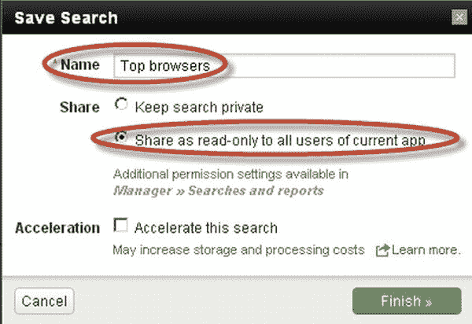

图 3-12. 保存搜索选项

成功保存搜索后，Splunk 会提供一个唯一的 URL，类似于 `http://<hostname>:<port#>/en-US/app/search/%40go?s=Top%20browsers`。此 URL 可以分享给其他用户，他们随后即可直接访问保存了该搜索的服务器。如前所述，已保存的搜索可以通过 Splunk 搜索应用主菜单中的“搜索和报告”（Searches & Reports）链接轻松访问。点击该链接将显示可访问的报告列表。图 3-13 显示了我们刚刚保存的报告。

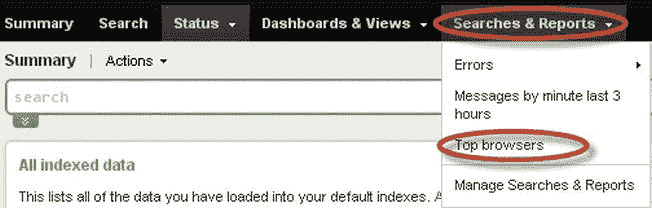

图 3-13. 保存的报告

已保存的搜索也可以通过“管理”（Manager）菜单访问，方法是点击“知识”（Knowledge）部分下的“搜索和报告”（Searches and reports）链接。这将显示搜索和报告的详细列表，如图 3-14 所示。通过这种替代方法访问报告的主要区别在于，你将获得每个报告的更多操作选项，例如“删除”（Delete）、“移动”（Move）和“禁用”（Disable）。这些可用操作显示在表格的右侧，具体取决于分配给用户的安全角色。你还可以通过点击单个搜索并指定告警选项，为已保存的搜索设置告警。我们将在第 5 章中探索 Splunk 告警功能。

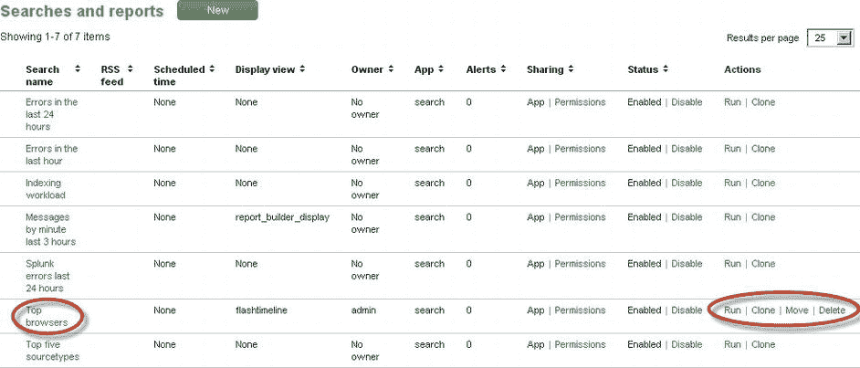

图 3-14. 运行已保存的搜索

### 排名前五的 IP 地址

我们将使用 `top` 命令来查找向 `MyGizmoStore.com` 发出请求的排名前五的 IP 地址。在此搜索中，我们还将对 `top` 命令使用 `limit` 选项，以便仅获取报告中前五个值。在左侧边栏中，我们可以看到 `clientip` 是其中一个字段；该字段保存了各个客户端请求来源的 IP 地址：

```
sourcetype=access_combined_wcookie
| top limit=5 clientip
```

Splunk 处理了 8,688 个事件，并报告了访问 `MyGizmoStore.com` 的排名前五的 IP 地址（这就是 `limit` 选项的用武之地），如图 3-15 所示。在第 4 章中，你将看到如何使用 Splunk 技术插件或应用程序，通过查找这些 IP 地址的地理位置或域名，来更好地理解它们。

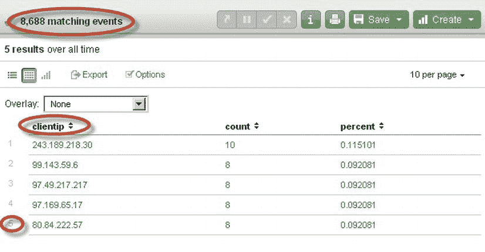

图 3-15. 基于 IP 地址的排名前五用户

### 哪些是排名靠前的引荐网站？

如今，用户大多通过点击第三方网站或搜索引擎（如 Google、Yahoo、Bing 等）来访问网站。在某些情况下，用户会看到他们正在浏览的网站上弹出的在线广告，并点击这些广告进入某个网站并采取行动。对于像 `MyGizmoStore.com` 这样的在线零售商店来说，弄清楚用户来自何处、哪些关键词真正有效、以及将在线广告费用投放在哪里，是很有意义的。

对于我们的 `MyGizmoStore.com`，我们想要找出除了 `MyGizmoStore.com` 自身之外，哪些是排名靠前的引荐网站。我们将使用以下搜索，在该搜索中，我们将查找引荐来源值中不包含 MyGizmo 的事件。我们通过使用 `!=`（意为“不等于”）来实现这一点。管道符将第一个子句的结果传递给 `top` 命令，以生成一份关于引荐至 `MyGizmoStore.com` 的网站报告，最后从结果集中移除百分比字段：

```
sourcetype=access_combined_wcookie referer != *MyGizmo*
| top referer
| fields - percent
```

注意，搜索的第一个子句隐含了 `sourcetype` 和 `referer` 之间的 AND（与）关系。默认情况下，搜索命令假定为 AND（与），因此该子句等同于：

```
sourcetype=access_combined_wcookie
AND referer != *MyGizmo*
```

图 3-16 显示有 2,256 个事件符合搜索条件，其中 Bing、Yahoo 和 Google 显示为除 `MyGizmoStore.com` 自身之外排名前三的引荐网站。你还会注意到，结果中的百分比列已被移除。

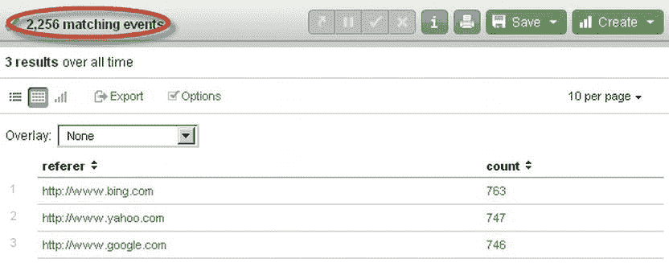

图 3-16. 引荐至 [MyGizmoStore.com](http://MyGizmoStore.com) 的网站


虽然获取不同热门活动或项目集的报告很有用，但你也需要了解哪些事物不起作用。这时我们可以利用报告命令 `rare`。此命令的功能与 `top` 命令完全相反。我们只需将之前所有搜索中的 `top` 替换为 `rare`，就能找出哪些浏览器不常见，或哪些我们预期能提供更多点击量的来源（referrers）并未达到预期，等等。

接下来我们要探讨的另一个报告命令是 `stats` 命令。此命令是主力工具，因为它用于对给定的数据集计算聚合统计信息。`Stats` 命令自带多个函数，例如 `count`、`average`、`min`、`median`、`mode`、`sum` 等，每个函数都从多个事件中提取数值，并依据特定标准对它们进行分组，从而提供单一值或关于一组事件的更有意义的数据。这与 SQL 聚合非常相似。

像 `MyGizmoStore.com` 这样的在线网站，可能因各种原因无法处理来自客户端的请求，而 Apache 和 IIS 等网络服务器会返回属于 4xx 和 5xx 类的 HTTP 状态码。表 3-2 提供了一些常见 4xx 和 5xx 状态码的描述。

表 3-2. HTTP 状态码 4xx 和 5xx 的描述

| HTTP 状态码 | 描述 |
| --- | --- |
| 400 | 错误请求 (Bad Request)—由于语法错误，服务器无法理解客户端发送的请求 |
| 401 | 未授权 (Unauthorized)—客户端发送的请求需要用户身份验证 |
| 403 | 禁止 (Forbidden)—服务器理解客户端发送的请求，但拒绝或拒绝处理该请求。例如，大多数网站阻止用户浏览站点的目录结构 |
| 404 | 未找到 (Not Found)—服务器上找不到客户端请求的特定资源，例如网页或图片 |
| 405 | 方法不允许 (Method Not Allowed)—客户端发送的请求使用了不允许的方法 |
| 407 | 需要代理认证 (Proxy Authentication Required)—这与 401 状态码非常相似，但意味着客户端发送的请求必须首先在代理服务器上进行身份验证 |
| 408 | 请求超时 (Request Timeout)—服务器在等待客户端生成请求时超时 |
| 500 | 内部服务器错误 (Internal Server Error)—服务器遇到某种情况，使其无法完成请求 |
| 501 | 未实现 (Not Implemented)—服务器当前不支持请求的功能 |
| 502 | 错误网关 (Bad Gateway)—服务器在向内部服务器发送请求以完成传入请求时，收到了无效响应 |
| 503 | 服务不可用 (Service Unavailable)—服务器过载，无法处理传入请求 |
| 504 | 网关超时 (Gateway Timeout)—服务器在等待来自其他服务器（如 LDAP 服务器）的响应以进一步处理请求时超时 |
| 505 | HTTP 版本不受支持 (HTTP Version Not Supported)—服务器不支持客户端请求中使用的 HTTP 协议版本 |

为了探索 `stats` 命令，我们来看几个典型的、像 `MyGizmoStore.com` 这样的在线零售商店的使用案例：

*   查找所有因客户端请求失败而产生像 404 这样的 HTTP 状态码的事件，并根据不同的主机或网络服务器统计其数量
*   查找所有包含购买行为的事件，以及这些事件中涉及的产品数量

网站需要跟踪诸如 404 之类的状态码，这意味着请求的资源未找到或不可用。这个资源可以是 HTML 页面、图片或类似项目。跟踪特定的状态码或状态码类别（例如 4xx 消息）有助于网站维护人员修复网站，并确保用户能找到他们想要的内容。我们将逐步处理这两个用例，首先找到包含 404 状态的事件。

### 有多少事件具有 HTTP 404 状态？

`status` 字段包含针对每个来自客户端的请求所返回的 HTTP 状态码信息。Splunk 提供了一种简单的方法，可以使用相关的字段和值将条件作为搜索标准添加到查询中。要查找所有包含 404 状态码的事件，我们将使用以下搜索：

```
sourcetype="access_combined_wcookie" status=404
```

图 3-17 显示了上述搜索的结果。您可以看到总共有 696 个事件具有 404 状态，并且每个满足搜索条件的事件都有一个 404 状态码。

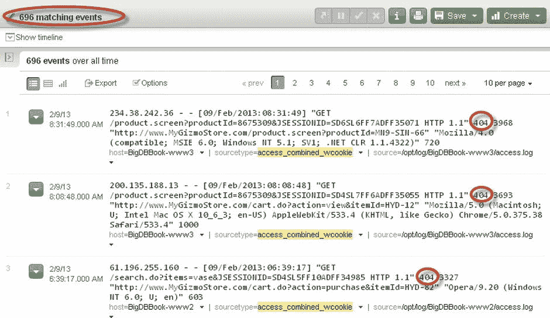

图 3-17. 具有 HTTP 状态 404 的事件

我们将使用刚刚构建的搜索，并将结果通过管道（`|`）传递给一个使用 `count` 函数的 `stats` 命令。`count` 函数将聚合每个主机的计数。在搜索栏中输入以下内容：

```
sourcetype=access_combined_wcookie status=404
| stats count by host
```

图 3-18 显示了 696 个事件具有 404 状态码，以及它们如何在 BigDBook-www1、BigDBook-www2 和 BigDBook-www3 这三台主机之间分布的情况。

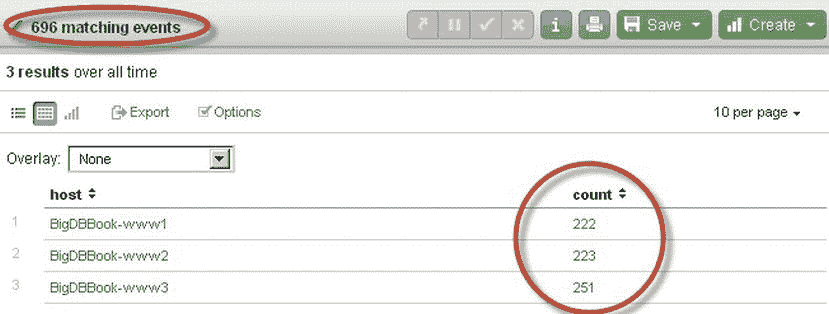

图 3-18. 每个主机的 HTTP 状态 404 事件

第二个用例涉及将 `stats` 命令与 `MyGizmoStore.com` 上可用的产品结合使用。一个非常有用的报告是展示哪些产品是最畅销的。比起找出所有用户查看过的产品，了解哪些产品参与了购买流程或实际被购买会更有趣。这意味着我们想知道该产品在购买流程中出现的次数。`stats` 命令将帮助我们使用 `count` 函数来统计产品数量。首先找到属于购买请求的事件，然后使用之前添加到选定字段列表中的 `action` 字段。

### 有多少事件具有购买行为？

使用以下搜索，其中 `action` 字段的值指定为 `purchase`：

```
sourcetype=access_combined_wcookie action=purchase
```

如图 3-19 所示，有 767 个事件匹配该条件，并且每个事件都将 URL 行为显示为 purchase。

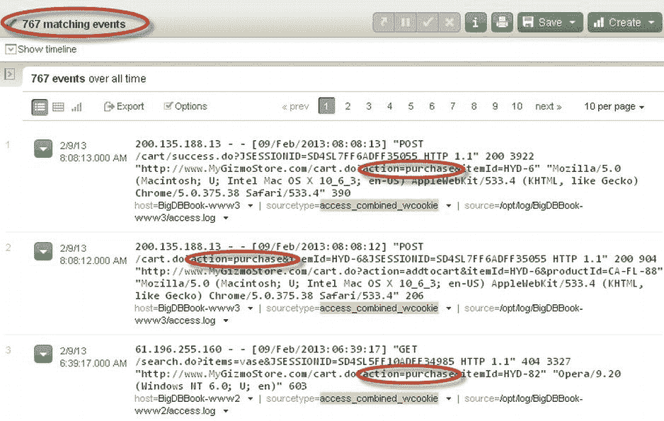

图 3-19. 具有购买行为的事件

现在我们得到了包含购买行为的事件，下一步是进行统计聚合，找出这些事件中涉及的每个产品的计数。

### 参与购买的产品列表

我们将使用刚刚使用的查询，并将结果通过管道（`|`）传递给一个带有 `count` 函数的 `stats` 命令。`count` 函数将聚合每个 `productId` 的计数。在搜索栏中输入以下内容：

```
sourcetype=access_combined_wcookie action=purchase
| stats count by productId
```


图 3-20 展示了如何使用相同的 767 个事件进行统计分析，并在表格中列出了`productid`及对应的`count`。第 2 章中生成的样本数据仅包含产品标识符，但缺少与每个产品标识符对应的实际描述。在第 10 章中，你将了解如何利用 Splunk 中的`lookup`命令关联不同来源的数据，例如从数据库或 CSV 文件中获取产品描述或价格信息，并将其关联起来，使报告更加贴近业务需求，也更易于理解。

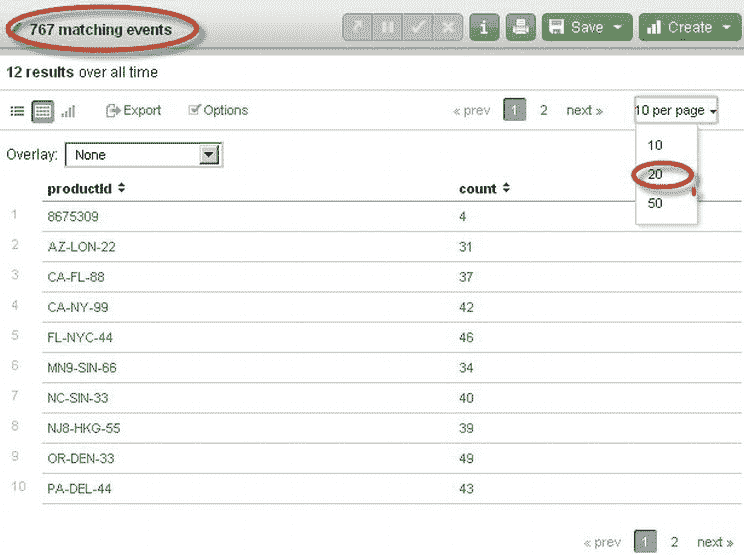

图 3-20. 参与购买行为的商品计数

`stats`命令包含一个名为`distinct_count`（或`dc`）的函数，用于计算特定字段的唯一值数量。`sum`函数可用于计算某一列的总和。例如，我们可以基于之前构建的搜索（查找不包含`MyGizmoStore.com`的主要引荐来源）进行扩展，以查找来自除`MyStoreGizmo.com`以外来源的总引荐数。更新后的搜索如下：

```
sourcetype=access_combined_wcookie   referer != *MyGizmo*
 | top referer
 | fields – percent
 | stats sum(count)
```

我们可以将此查询中的`sum`函数替换为`avg`函数，以计算每个非`MyGizmoStore.com`来源的平均引荐数。对应的搜索如下：

```
sourcetype=access_combined_wcookie   referer != *MyGizmo*
| top referer
| fields – percent
| stats avg(count)
```

你可能希望在报告中展示所有产品标识符及其各自的计数总数，但同时还需要一个总数列来显示售出产品的总数。这时就可以使用`addcoltotals`命令，它对所有汇总值求和，并创建一个包含该字段总计值的新事件。对应的搜索如下：

```
sourcetype=access_combined_wcookie  action=purchase
| stats count by productId
| addcoltotals labelfield=Total label=AllProducts
```

如图 3-21 所示，之前报告中的所有信息都得以保留，但现在你可以汇总报告中的所有产品。此外，`addcolTotals`命令允许你创建一个新事件，该事件将汇总信息保存在名为`Total`的事件中，并标记为`AllProducts`。由于结果超过 13 条，我们可以通过页面滚动选项（如图 3-21 右侧高亮所示）将每页记录数调整为 20，从而使 Splunk 搜索应用程序每页显示 20 条记录。

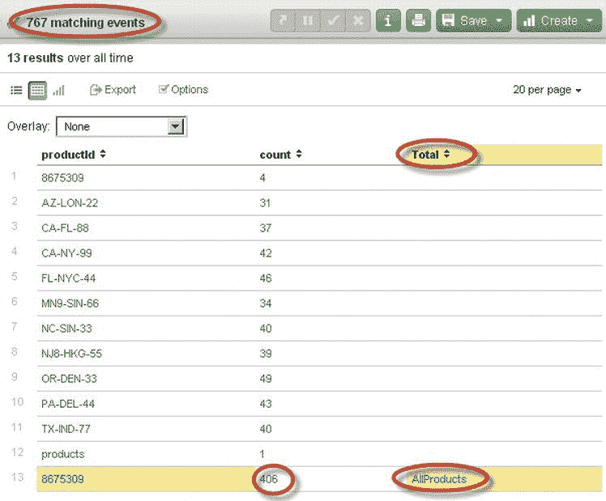

图 3-21. 所有产品的总计

到目前为止，我们已经学习了 SPL 报告命令`top`、`rare`和`stats`，并探讨了使用这些命令可以解决的典型报告用例。其他 SPL 报告命令包括`chart`和`timechart`。我们将在第 4 章开始进行数据可视化时对其进行探讨。

### 排序

报告的一个重要需求是能够对结果进行排序，这有助于我们理解报告中的信息。`Sort`是排序类别中的主要 SPL 命令。如图 3-21 所示，经过计数的产品数量结果并未按任何特定顺序排列，这使得我们难以了解产品数量的高低分布。`sort`命令根据命令后面指定的字段列表对结果事件进行排序。通过字段前的 (`+`) 或 (`-`) 符号来控制升序和降序。我们将使用与前一个示例相同的查询，并将结果通过管道符传递给`sort`命令，以获得降序排列的结果，从而了解哪些是最受欢迎的产品：

```
sourcetype=access_combined_wcookie  action=purchase
| stats count by productId
| sort –count
```

图 3-22 显示了按降序排列的产品。你将看到`productid`为 OR-DEN-33 的产品最受欢迎，计数为 49。

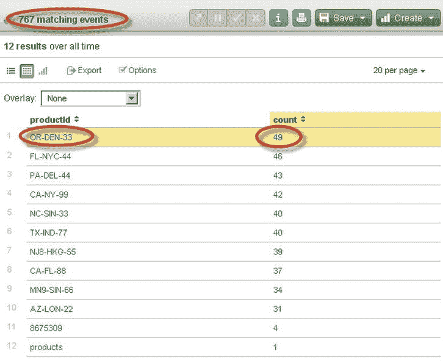

图 3-22. 按降序排列的产品

## 过滤

SPL 命令的第三类是过滤命令。过滤命令接收通过管道符传入的一组事件或结果，并将其过滤成更小的结果集。过滤有助于加速分析，也帮助你聚焦于可以收集更多洞察的特定结果。

如果你希望限制需要处理和分析的事件数量，Splunk 提供了`head`命令，允许你仅处理事件的子集。以查找前 100 个符合条件事件中的热门产品为例。为此，沿用之前查找产品计数并排序的搜索查询；现在我们将使用`head`命令来找出最近 100 个符合条件事件中最受欢迎的产品。

在以下搜索中，将满足购买行为条件的事件通过管道符传递，使用`head`命令获取前 100 个事件，然后使用`count`函数聚合结果集以对最终结果进行排序：

```
sourcetype=access_combined_wcookie  action=purchase
| head 100
| stats count by productId
| sort –count
```

图 3-23 显示了基于前 100 个符合购买条件事件的流行产品。你可以看到产品 OR-DEN-33 是最受欢迎的产品。

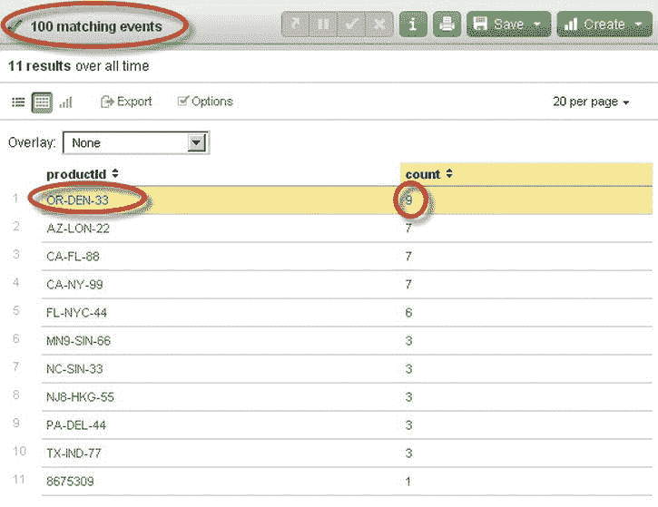

图 3-23. 前 100 个事件中最受欢迎的产品

Splunk 还提供了`tail`命令，它获取最后`n`个事件并进行进一步分析。我们可以修改上一个搜索查询，将`head`命令替换为`tail`，如下所示：

```
sourcetype=access_combined_wcookie  action=purchase
| tail 100
| stats count by productId
| sort –count
```

图 3-24 显示了使用最后 100 个事件（而非前 100 个事件）更新后的结果。最受欢迎的产品变成了 PA-DEL-44，而不是 OR-DEN-33。虽然数据集较小，但这些技术可用于分析前`n`个或后`n`个事件，并识别新的趋势或模式，以判断哪些产品可能变得更受欢迎，以及是否存在特定原因，例如季节变化或节假日影响。

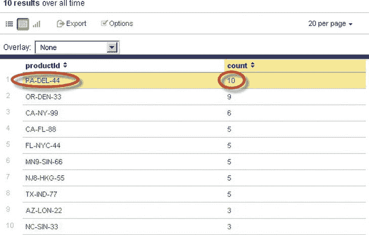

图 3-24. 基于最后 100 个事件的最受欢迎产品


#### 另外两个有用的过滤命令是 `dedup` 和 `where`

`Dedup` 命令用于去除冗余数据，意思是该命令针对指定字段值的每种组合，仅保留第一条结果，并丢弃其余结果。我们将在第 10 章中广泛使用 `dedup` 命令。

### 添加和评估字段

下一类命令用于过滤、修改和添加字段。我们将介绍最强大的命令之一：`eval`。`eval` 命令可用于计算表达式并将值存储在新字段中。`Eval` 可以处理任意表达式，包括数学运算、字符串运算和布尔运算。正如我们在 `stats` 命令中所见，`eval` 提供了几个函数。这些标准函数包括 `case`、`if`，若干数学函数（如 `abs`、`ceiling`、`floor`、`log`、`round` 等），以及字符串函数（包括 `rtrim`、`split`、`substr`、`tostring` 等）。

我们将通过一个有趣的真实案例来探索 `eval` 命令：识别那些只浏览橱窗的客户与那些实际购买了商品的客户。这个案例既适用于实体零售店，也适用于在线零售店。由于 `MyGizmoStore.com` 是一家在线零售店，会有一些客户浏览网站、查看产品，但并不进行任何购买。找出只看页面不购买的用户与实际购买用户的比率将十分有趣。

你可以使用 `eval` 命令来查找最终状态码为 200 的 HTTP 状态码的基本分布情况——这表示请求已成功——并观察该数量与我们示例 `MyGizmoStore.com` 数据中其余 HTTP 状态码总数的对比。这虽然无法提供关于用户购买比率的详细信息，但能让我们在更广泛的层面（所有事件的成功与失败）上开始分析。

`Splunk` 还允许你使用通配符 `*` 来表示所有内容。通常，你会访问不同类型的日志文件，并且很可能需要对它们全部进行处理和分析。为此，请修改搜索条件，将 `sourcetype` 设为等于 `access_*`；这将选取所有以 `access_` 开头的数据源。使用 `eval` 命令来评估一个条件，判断单个事件的状态码是否为 200：如果是，则将其归入 `OK` 类别，其他所有事件则归入 `FAILED` 类别。这些值随后被存储到一个名为 `SuccessRatio` 的字段中并进行聚合。结果如图 3-25 所示。你可以看到，搜索处理了我们一开始使用的示例 `MyGizmoStore.com` 数据中的所有 8,688 个事件，并且显示 `FAILED` 类别中的事件数量多于 `OK` 类别。

```
sourcetype=access_*
| eval SuccessRatio = if (status==200, "OK", "FAILED")
| stats count by SuccessRatio
```

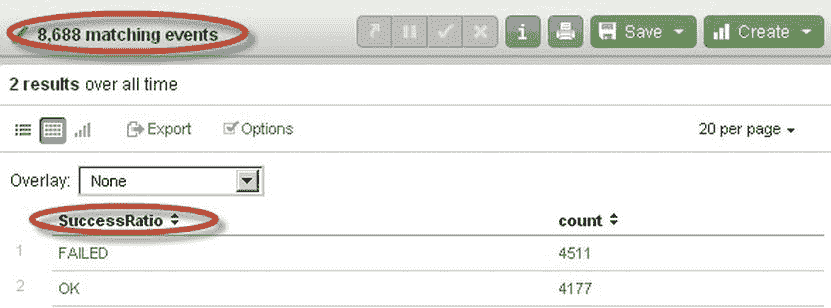

图 3-25. 状态码 200 的数量与其他状态码数量的对比

既然你已经对 `eval` 命令有了初步了解，让我们来计算页面浏览量与实际购买量的比率。为此，请使用包含 `GET` 方法的事件，将这些事件通过管道传递给 `stats` 命令以获取实际的页面浏览次数。然后，在另一个计数中使用 `eval` 命令，检查事件中是否含有等于 `purchase` 的动作。你还需要使用 `stats` 命令的 `AS` 参数来重命名结果字段为 `Page_Views` 和 `Actual_Purchases`。在搜索栏中输入以下内容：

```
sourcetype=access_*   method=GET
| stats count AS Page_Views,
count(eval(action="purchase")) AS Actual_Purchases
```

图 3-26 显示的结果表明，共处理了 6,176 个带有 `GET` 方法的事件，产生了 6,176 次页面浏览，其中只有 144 次是实际购买行为。


```markdown

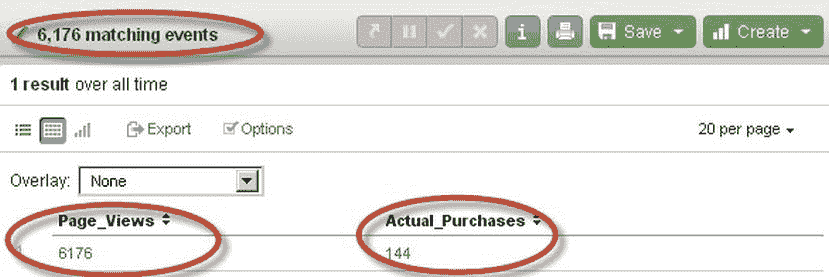

图 3-26. 页面浏览量与实际购买次数

Splunk 的 `eval` 命令也可用于计算数值之间的百分比差异。扩展您刚刚完成的搜索，将结果通过管道传递给另一个 `eval` 命令，该命令用于计算实际购买次数相对于页面浏览量的百分比。这个百分比将存储在一个名为 `PCTofPurchases` 的字段中。

```
sourcetype=access_* method=GET
| stats count AS Page_Views,
          count(eval(action="purchase")) AS Actual_Purchases
| eval PCTofPurchases =((Actual_Purchases*100)/Page_Views)
```

此类用于过滤、修改和添加字段的其他命令包括 `lookup`、`rex`、`replace` 和 `fields`。我们将在第 11 章中大量使用 `lookup` 命令，届时您将处理航空公司准点性能项目。

### 分组

最后一类命令是结果分组。分组的目的是识别已分组数据中的模式。`Transaction` 是 SPL 命令，它允许将事件分组为一个事务。如果满足随命令一起定义的定义约束，则事件被分组在一起。`transaction` 命令中指定的约束标识了事务的开始和结束。这与传统数据库领域中的事务界定非常相似。

我们可以利用 `transaction` 命令进一步分析“只看不买”与“实际购买”的用例。在许多情况下，有些用户会将商品或产品添加到购物车但从不购买，或者有些用户会花相当多的时间浏览、将商品添加到购物车，但从不完成交易。

在我们的示例中，我们将着眼于对与特定会话 ID（`JSESSIONID`）相关且来自同一 IP 地址（`clientip`）的事件进行分组，其中第一个事件包含字符串 `addtocart`，最后一个事件包含字符串 `purchase`。在我们开始搜索之前，让我们看看如果采用如图 图 3-27 所示的一小组样本事件，结果会是什么样子。矩形中高亮显示的区域表明，您获得了相同的 IP 地址和会话 ID，并且在相关事件中也包含了 `addtocart` 和 `purchase` 操作。Splunk 会发现这些事件之间的关系并将它们分组为事务。在样本集中，我们得到了两个事务，涉及 IP 地址 `237.15.107.90` 和 `60.66.3.96`。如果来自客户端的请求中存在 cookie 值，您也可以使用这些值对事务进行分组。

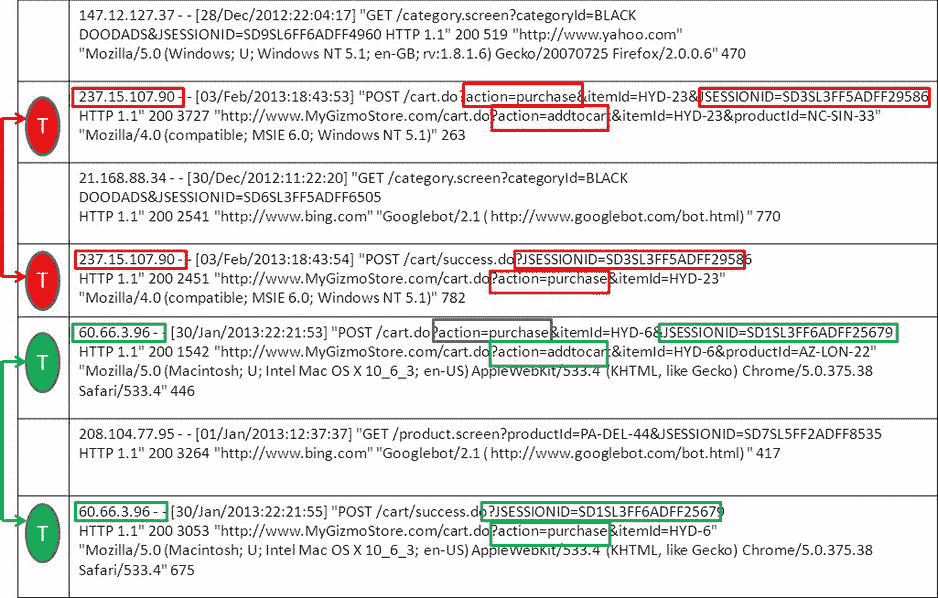

图 3-27. 事务分组

现在在搜索栏中输入以下内容，看看 Splunk 如何将事件分组为事务：

```
sourcetype=access_combined_wcookie
| transaction JSESSIONID clientip startswith="addtocart" endswith="purchase"
```

如图 图 3-28 所示，有 609 个事件匹配您创建的分组模型，您可以看到每个分组事件都包含 `addtocart` 和 `purchase` 作为操作，并且具有相同的 IP 地址和会话 ID。

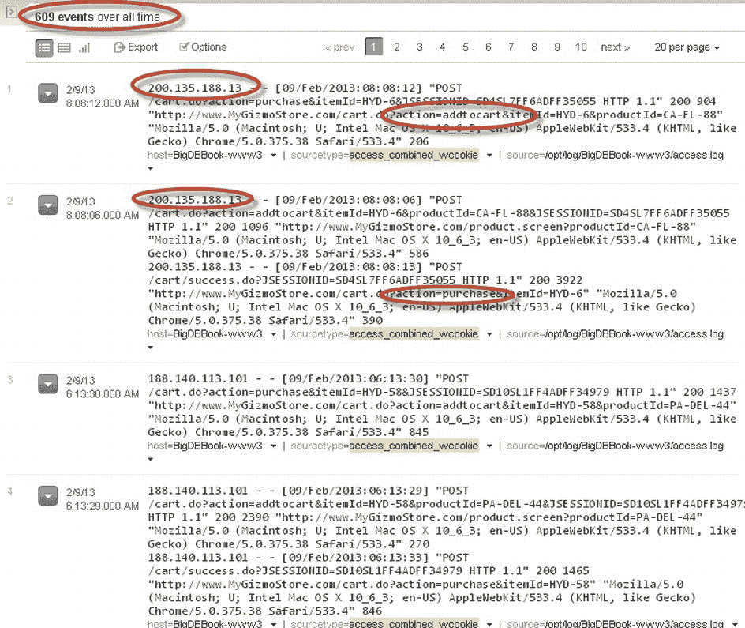

图 3-28. 包含 `addtocart` 和 `purchase` 的事件分组

`transaction` 命令的另一个用例是对来自同一 `clientip` 且具有 `purchase` 操作的事件进行分组，其中每个会话不超过 10 分钟且包含的事件不超过三个。这类组合和事件分组可用于识别那些完成购买花费时间最短或进行长时间事务的用户。在以下搜索中，我们使用了 `maxspan` 和 `maxevents` 属性以及 `clientip` 字段来对事件进行分组：

```
sourcetype=access_combined_wcookie   action=purchase
| transaction clientip maxspan=10m maxevents=3
```

图 3-29 显示有 519 个事件匹配了该分组，您可以看到所有这些事件都具有 `purchase` 操作。

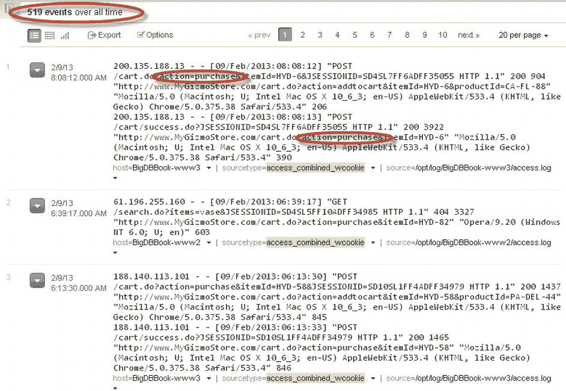

图 3-29. 10 分钟跨度内的事务

我们将通过分析最后一个非常有用的用例来结束本章，该用例在分析组合的访问日志数据时非常有用，并且它也有助于我们练习本章中介绍的一些命令和概念。这个用例与我们的在线应用程序中因失败事务而损失了多少业务量有关。就 `MyGizmoStore.com` 而言，这意味着由于应用程序或服务器错误，用户未能完成购买流程。

我们可以利用 HTTP 状态码来分析我们的样本数据集。在表 3-2 中，列出了 4xx 和 5xx 类别的 HTTP 状态码。范围在 5xx 的 HTTP 状态码与服务器错误相关。任何 5xx 错误都意味着服务器端出了问题。一些常见的例子包括状态码 500（表示通用内部服务器错误），以及状态码 503（表示服务器无法处理请求）。从运维角度看，5xx 错误码意味着服务器存在问题，可能需要立即关注。对于像 `MyGizmoStore.com` 这样的在线零售商店，5xx 状态意味着网站无法执行客户交易，因此该在线零售商店可能因客户无法完成交易而损失了业务。这可能导致客户转向竞争对手的商店，或者至少导致客户支持电话升级。

查看样本数据中的 5xx 状态码，或者状态码大于等于 500 的事件数量。使用 `status` 字段并应用条件 `status >= 500`：

```
sourcetype=access_combined_wcookie   status >= 500
```

图 3-30 显示总共有 1557 个事件的状态码大于等于 500。

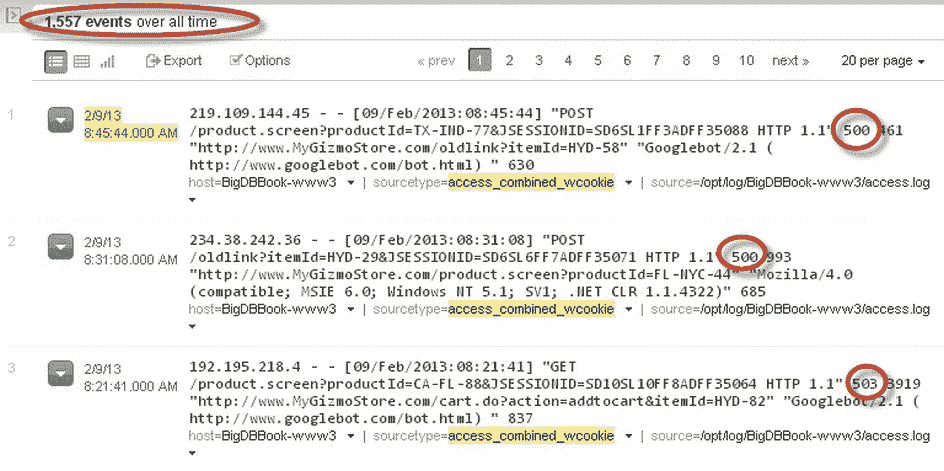

图 3-30. 状态码大于等于 500 的事件

您可以使用 Splunk 统计命令 `stats` 来精确查找不同 5xx 状态码下事件的分布情况。将之前筛选出的事件通过管道传递给 `stats` 命令，并使用 `count` 函数来统计不同的状态码。图 3-31 显示了 1554 个事件在不同 5xx 状态码之间的分布情况。在本例中，我们只有状态码 500 和 503。

您也可以使用 `sort` 命令按升序或降序对状态计数进行排序：

```
sourcetype=access_combined_wcookie    status >= 500
| stats count by status
```

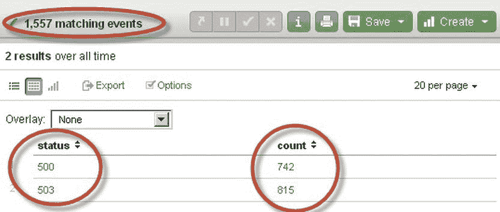

图 3-31. 500 范围状态码的事件分布

既然我们已经确定 `MyGizmoStore.com` 服务器存在问题，我们需要找出哪些状态码大于等于 500 的事件同时也参与了具有 `purchase` 操作的事件。如果存在任何符合该条件的事件，则意味着 `MyGizmoStore.com` 的业务受到了损失。我们将采用之前的搜索，并添加一个额外的字段条件 `action=purchase`，以找出符合条件的事件数量：

```
sourcetype=access_combined_wcookie  status >= 500  action=purchase
```

```


### 排版后的内容

图 3-32 显示了有 175 个事件符合我们的购买行为条件。

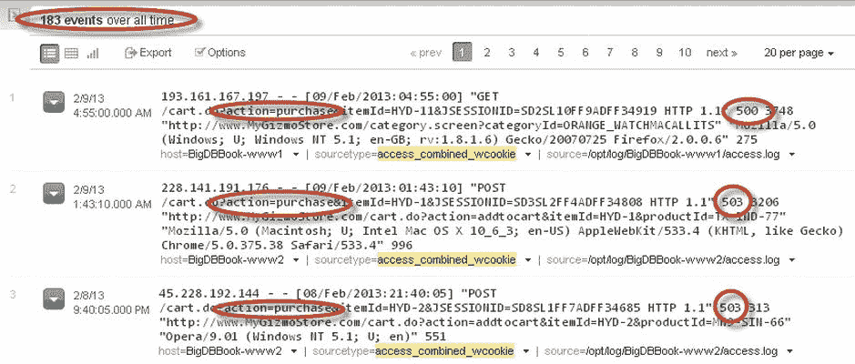

图 3-32. 状态码为 500 且包含购买行为的事件

我们可以进一步分析这 175 个事件，查看失败交易中产品的分布情况。`Splunk` 提供了 `rename` 命令，允许你更改或别名化列名，使其对业务更友好，因为日志可能包含含义模糊的字段名。

执行之前的搜索，并通过管道将其输出到 `stats` 命令，以按产品聚合结果。结果集将按降序排列。最后，将计数字段重命名为 `"Product Units In Failed Transactions"`：

```
sourcetype=access_combined_wcookie   status >= 500  action=purchase
| stats count by productId
| sort –count
| rename count as "Product Units In Failed Transactions"
```

图 3-33 显示相同的 175 个事件已被聚合，并且产品计数字段已相应重命名。

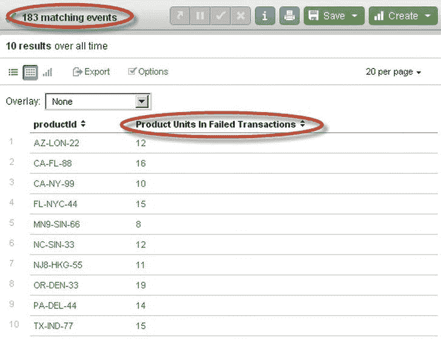

图 3-33. 失败交易中的产品数量

**总结**

在本章中，我们检查了组合访问日志的格式，以了解日志条目中哪些类型的信息可供处理和分析。你学习了一些基本命令，例如 `top`、`rare`、`stats`、`sort`、`addcoltotals`、`eval`、`rename`、`head`、`tail` 和 `transaction`，这些命令帮助你报告、排序、过滤和分组事件，以找到企业通常需要回答的问题的答案。你还了解了如何使用时间选择器和字段来验证数据并处理较小数据子集。

## 第 4 章


