# 可视化结果

在本章中，我们将重点讨论使用报表和仪表盘进行数据可视化。你将学习默认的 `Splunk` 仪表盘以及有助于绘制数据图表的新 `SPL` 命令，并了解如何使用 `Splunk` 报表构建器创建报表。我们还将介绍用于数据可视化的 `Splunk` 应用程序，熟悉它们提供的默认仪表盘，并着手创建有助于可视化多个报表的自定义仪表盘。

## 数据可视化

现代企业正在寻求将日志、网络、点击流和社交媒体等新型数据作为其主流数据分析的输入，以做出更好的业务决策。这意味着企业现在必须处理大数据处理和分析。除此之外，随着企业的扩张和收集多个数据源，它们正面临着巨大的数据增长。传统上，这些数据以电子表格或表格报表的形式交付，使得从中找到必要的模式、趋势和关联以采取行动变得非常困难。不仅如此，传统的电子表格或类似工具已不足以处理和分析企业希望整体审视的多个数据源的数据。

这就是数据可视化发挥作用的地方。可视化有助于清晰、精确地传达复杂的想法或数据模式。它通过在一个相对较小的图表中呈现许多数字，帮助观察者关注数据的实质，使用户能够比盯着成页的原始数字更快、更轻松地比较不同的数据片段。可视化最重要的好处之一是，它允许以其他方式无法实现的方式访问海量数据。最后，也许也是最重要的一点是，可视化使我们能够获得可操作的洞察。考虑在线商店（例如 `MyGizmoStore.com`）定价随时间变化的情况。通过可视化，我们可以快速了解客户是否购买了更多商品，或者他们的购买模式是否发生了改变等等。没有这种洞察，我们实际上就迷失了方向，做出正确决策的可能性会大大降低。无论你是来自 IT 部门还是业务部门，可视化都能让你快速检查大量数据，高效地揭示趋势和问题，与关键参与者交流想法，并最终影响那些将引领成功的决策。

你在 第 2 章 和 第 3 章 中看到了 `Splunk` 如何与多个数据源协同工作并使用 `SPL` 处理数据。下一个问题是：`Splunk` 是否提供任何工具来可视化数据，并使分析大数据以识别关联、趋势、异常值、模式和业务状况变得容易？是的，当然有！在本章中，你将学习如何在 `Splunk` 中可视化数据。

### Splunk 如何处理可视化

`Splunk` 提供了多种方式来构建报表和仪表盘，以可视化索引到其中的数据的搜索结果。在基本层面上，你可以将所有数据可视化为时间线条形图中的一组事件。在 第 3 章 中，你学习了如何使用时间选择器来验证数据；它还可以为我们提供跨事件的快速视觉线索，显示活动的高峰和低谷。以 `MyGizmoStore.com` 的样本数据为例，时间选择器让我们可以可视化任何明显的模式，这些模式可以向下钻取以获得更多细节。让我们通过在搜索栏中输入 `sourcetype=access_*` 来快速搜索。图 4-1 显示了 `MyGizmoStore.com` 数据上的活动；我们可以看到，除了少数几个地方有一些小峰值和下降之外，活动基本上是恒定的。对于真实世界的数据，你很可能看到一个非常不同的图表，在时间线的不同位置会出现巨大的峰值。

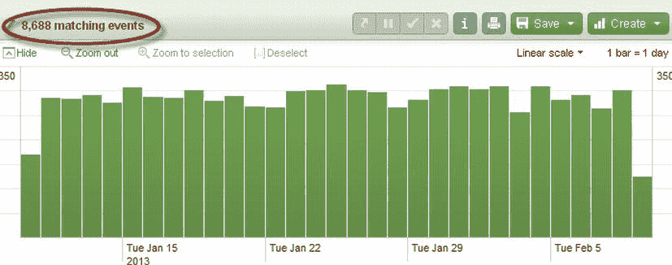

图 4-1. 使用时间线可视化数据

尽管 `Splunk` 的时间选择器很有用，但大多数有趣的细节来自对不同字段进行的统计分析。我们在 第 3 章 中执行的搜索以表格格式为我们提供了数据。例如，我们进行的其中一个搜索帮助我们找到了 `MyGizmoStore.com` 的顶级浏览器。如果我们将相同的搜索输入到搜索栏中，它会给出如 图 4-2 所示的表格报表。

`sourcetype=access_*| top useragent`

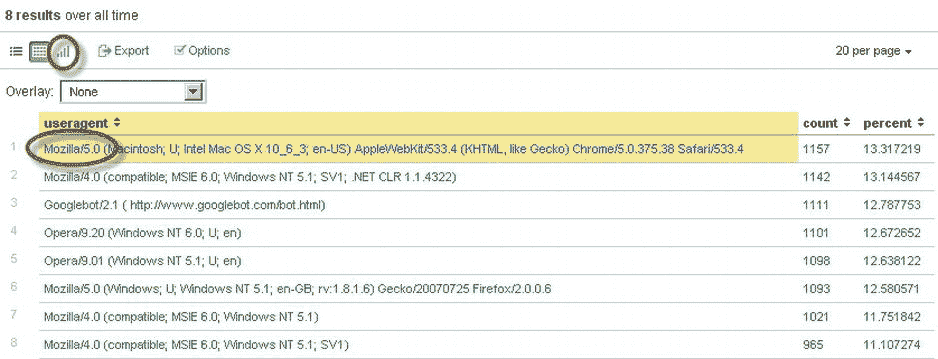

图 4-2. `MyGizmoStore.com` 的顶级浏览器（表格格式）


Splunk 提供了一种非常简便的方式来可视化表格数据。您只需点击 图 4-2 中高亮显示的柱状图图标。Splunk 会将显示顶级浏览器的表格报表转换为可视化图表，如 图 4-3 所示。您现在可以直观地查看数据，而无需阅读原始数字。我们可以看到 `Mozilla 5.0` 是最受欢迎的浏览器，紧随其后的是 `Mozilla 4.0`。该图表还显示前两个浏览器与后续四个浏览器组之间的数值非常接近。

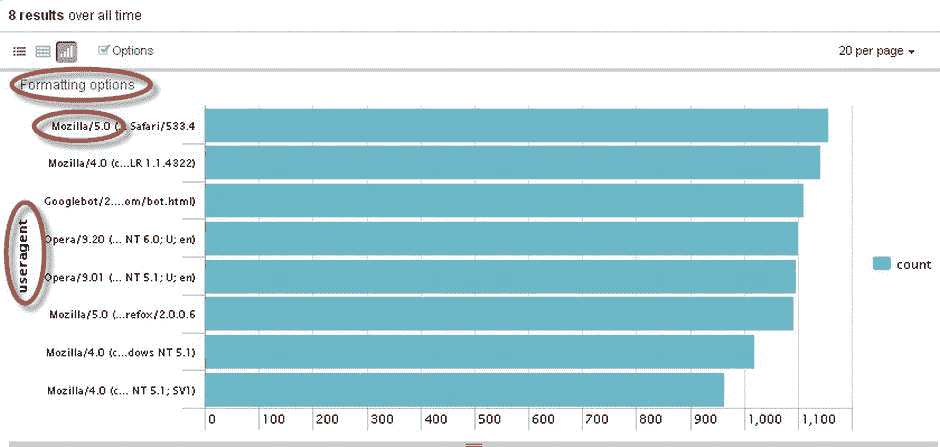

图 4-3. MyGizmoStore.com 的顶级浏览器（柱状图格式）

Splunk 提供了不同的图表类型来可视化数据；我们将在本章后面部分进行探讨。您可以点击“格式选项”链接对图表进行格式化。在此处，您可以选择最能帮助可视化底层数据的图表类型。并非所有图表类型都适用于所有数据。要使 Splunk 图表能够可视化数据，数据必须采用结构化格式。根据您表格数据的数据结构类型，Splunk 会智能地仅启用那些适用的图表类型，并将其他选项置灰，如图 4-4 所示。我们将为此报表选择条形图，然后继续将图表标题更改为“顶级浏览器”，X 轴标题设为“浏览器”，Y 轴标题设为“浏览器计数”。

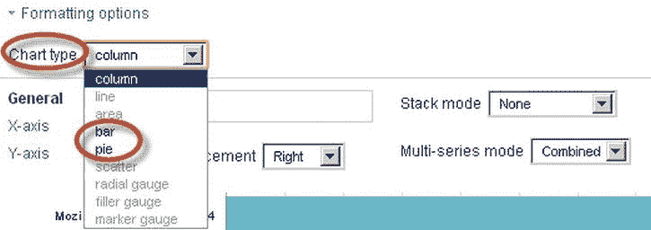

图 4-4. 格式化图表

更新后的图表将如图 4-5 所示。让我们点击“保存”并将此搜索保存为“顶级浏览器”。

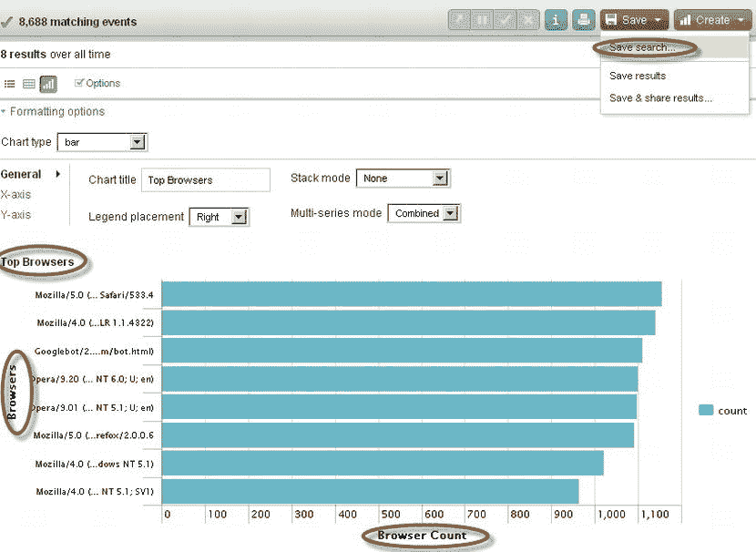

图 4-5. 顶级浏览器

到目前为止，我们所采用的方法是构建搜索并查看来自搜索结果的数据。正如您在第 3 章中所见，这种方法需要相当了解 SPL 命令才能构建搜索。以顶级浏览器搜索为例，我们必须熟悉 `top` 命令。Splunk 还提供了另一种使用报表生成器构建报表的方法。让我们用我们在第 3 章中构建的顶级 IP 地址搜索来探索报表生成器。使用报表生成器，您无需透彻理解 SPL 报表命令，例如 `stats`、`top`、`rare` 或我们将在本章中介绍的图表命令。您可以通过两个步骤使用报表生成器构建报表。

-   定义报表
-   格式化报表

您可以通过选择“创建”下拉列表并点击“报表...”来访问报表生成器（参见图 4-6）。

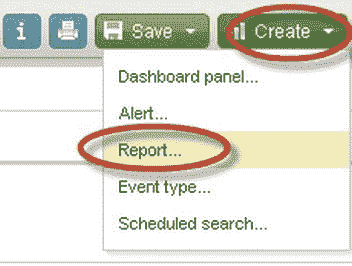

图 4-6. 报表生成器

在“定义报表”步骤中，您可以像在时间选择器中那样选择时间范围；在我们的案例中，我们将保持默认设置，即“所有时间”。在“报表数据”部分，您必须选择要创建的报表类型。可用的三个选项是：

-   **值随时间变化**，用于可视化特定字段在选定时间段内的趋势。在内部，报表生成器将使用 `timechart` 命令，我们稍后将向您介绍该命令。
-   **热门值**，用于显示最常见字段值的报表，例如顶级浏览器、顶级 IP 地址等。报表生成器使用了您在第 3 章中学到的 `top` 命令。
-   **稀有值**，用于显示最不常见或最少见值的报表。报表生成器使用了您在第 3 章中学到的 `rare` 命令。

对于顶级 IP 地址报表，我们将在报表类型中选择“热门值”选项。基于此选择，报表生成器将自动调整报表定义的其余选项。在我们的案例中，您会注意到用于报表显示的选项现在已被隐藏。下一个我们必须选择的选项是我们想要在其中查找常见或热门值的字段。因为我们希望找到顶级 IP 地址，我们将从“字段”下拉列表中选择 `clientip` 字段。“定义报表内容”页面将如图 4-7 所示。您会注意到报表生成器也提供了对它所构建的搜索命令的访问。默认情况下，搜索的编辑功能是禁用的，但对于熟悉 SPL 的用户，他们可以点击“使用搜索语言定义报表”链接并编辑查询。报表生成器还将 `top` 命令返回的值的默认值设为 1000，而不是您在第 3 章中看到的 10。因为我们只需要前五个 IP 地址，我们将通过将 `limit=5` 来编辑搜索以仅返回五个。点击“下一步：格式化报表”按钮。

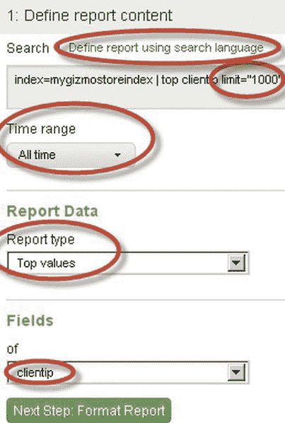

图 4-7. 在报表生成器中创建报表定义

对于前五个 IP 地址，报表生成器默认会显示柱状图。您会注意到在图表类型选项中，Splunk 启用了所有图表类型；但这并不意味着我们从报表获得的数据可以用所有类型的图表来可视化。例如，将图表类型更改为“径向仪表盘”并点击“应用”按钮，将显示如图 4-8 所示的数据，您可以看到这意义不大。

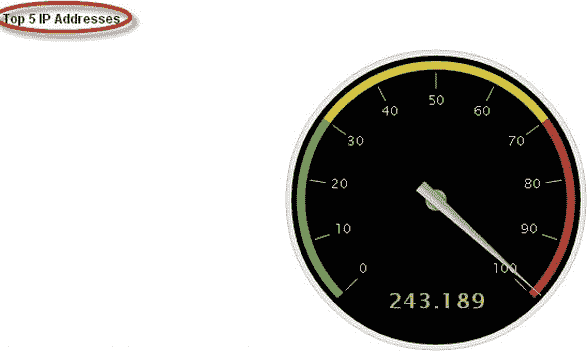

图 4-8. 以径向仪表盘显示的顶级 IP 地址

我们强烈建议您尝试不同的选项，并考虑您展示这些报表的受众，以便选择合适的图表类型。在保存此搜索之前，让我们将图表标题更改为“前 5 个 IP 地址”，X 轴标题设为“IP 地址”，Y 轴标题设为“计数”，将图表类型改回柱状图并点击“应用”按钮。报表应如图 4-9 所示。

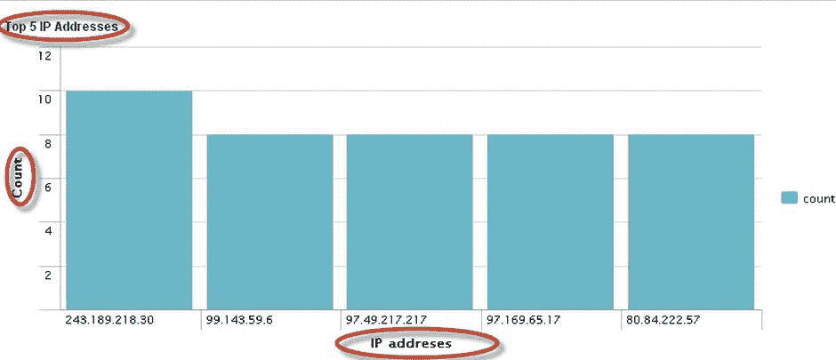

图 4-9. 以柱状图显示的顶级 IP 地址

使用报表生成器与直接使用 SPL 命令之间的关键区别在于，您无需了解 SPL 命令。您也看到了，报表生成器通过在需要时允许您切换到搜索语言模式来提供灵活性。您可能仍然需要具备一些 SPL 知识才能对报表生成器生成的默认搜索进行修改，就像我们对 `top` 命令的 `limit` 选项所做的那样。将此报表保存为“前 5 个 IP 地址图表”。您可以随时使用“搜索和报表”菜单访问已保存的报表。


可以使用`stats`、`chart`和`timechart`命令对数据执行相同的统计计算。`stats`命令返回一个结果表格。`chart`命令返回相同的结果表格，但您可以使用报表生成器将此表格格式化为图表。如果您希望按时间范围绘制结果图表，则应使用`timechart`命令。现在您已经了解了 Splunk 提供的基本可视化形式，让我们探索两个强大的图表类 SPL 命令：

*   `Chart`
*   `Timechart`

与第 3 章中一样，我们将结合实际业务案例（与我们的在线零售商店`MyGizmoStore.com`相关）来探索这些命令。

## `Chart`

`Chart`命令可用于生成表格数据输出，该输出非常适合图表绘制或可视化目的。您必须使用`over`或`by`子句指定`x`轴变量或字段。它旨在与 Splunk 中`stats`报告命令的所有可用函数协同工作。您还可以将`eval`命令与`Chart`命令结合使用，使其成为获取可可视化聚合数据的强大命令。基于`chart`命令生成的数据结构，可以创建不同的图表类型。图表类型包括：

*   柱状图（Column）
*   条形图（Bar）
*   堆积柱状图（Stacked column）
*   堆积条形图（Stacked Bar）
*   折线图（Line）
*   面积图（Area）
*   堆积折线图（Stacked line）
*   堆积面积图（Stacked area）
*   饼图（Pie）
*   散点图（Scatter）
*   仪表盘——径向（Radial）、填充（Filler）和标记（Marker）

我们将通过以下用例来了解其中一些图表类型及其与生成数据的工作方式：

*   绘制每个主机的`GET`和`POST`请求数量图表
*   绘制每个产品类别的购买量与浏览量的图表
*   哪些产品类别受到`404`错误的影响？
*   `MyGizmoStore.com`的购买趋势
*   事务持续时间

### 绘制每个主机的 GET 和 POST 请求数量图表

所有发往`MyGizmoStore.com`的请求要么是`GET`类型，要么是`POST`类型。我们可以开始探索`chart`命令，以可视化发送至主机`BigDBBook-www1`、`BigDBBook-www2`和`BigDBBook-www3`的`GET`和`POST`请求数量。为此，我们将使用`eval`命令来判断方法是`GET`还是`POST`。确定后，使用`count`函数与`chart`命令来统计`GET`和`POST`的数量。我们将按主机分组，主机将成为图表的`x`轴字段。让我们在搜索栏中输入以下搜索：

```spl
sourcetype=access_*
| chart count(eval(method="GET")) AS GET,
  count(eval(method="POST")) AS POST
  by host
```

Splunk 以表格格式显示结果，其中列出了每个主机的 `GET` 和 `POST` 数量。在表格格式报表中，您可以做的一件有趣事情是利用“叠加”（Overlay）功能，让 Splunk 在表格数据的各个值之间创建热图。热图通过使用不同颜色，帮助我们轻松可视化高值和低值。在图 4-10 中，我们可以看到开启了热图的表格报告；由于 `GET` 数量较大，我们可以看到高值单元格以红色显示。

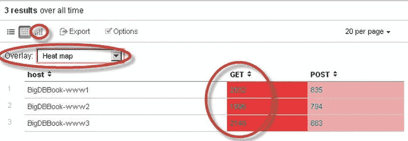

图 4-10. 带有热图的 GET 和 POST 请求表格格式

要可视化图表中的表格数据，请点击条形图图标，该图标在图 4-10 中已高亮显示。默认情况下，Splunk 会选择条形图；因为我们希望`x`轴按主机绘制，所以我们将图表类型从条形图更改为柱状图。您会发现，在比较我们拥有的数据量中的 `GET` 和 `POST` 时，柱状图效果更好。如前所述，您需要探索不同的图表选项，看看哪一个更适合生成的数据结构。让我们将图表标题更改为“GET-POST-Chart”，并将`y`轴标题更改为“Number of Requests”。更新后的图表如图 4-11 所示。将图表保存为“GETPOSTRequestsChart”。

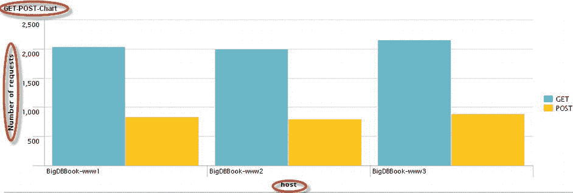

图 4-11. 柱状图中的 Get 和 Post 请求

#### 绘制每个产品类别的购买量与浏览量图表

我们可以复用我们在第 3 章中的工作，在那里我们发现了 `MyGizmoStore.com` 用户的实际购买量与产品浏览量之间的对比。我们将使用 `chart` 命令，而不是 `stats` 命令。我们将为结果列赋予更有意义的名称。让我们在搜索栏中输入以下内容：

```spl
sourcetype=access_* method=GET
| chart count AS views,
  count(eval(action="purchase")) AS purchases
  by categoryId| rename views AS "Views",
  purchases AS "Purchases",
  categoryId AS "Category"
```

图 4-12 显示了该搜索的默认图表。如您在此图表中所见，与浏览量相比，购买数量非常少，几乎可以忽略不计。我们在这里看到的是非常小和非常大的数值混合在一起。这时，您可以利用单位缩放设置，将其改为对数刻度而非线性刻度，以提高图表的清晰度。

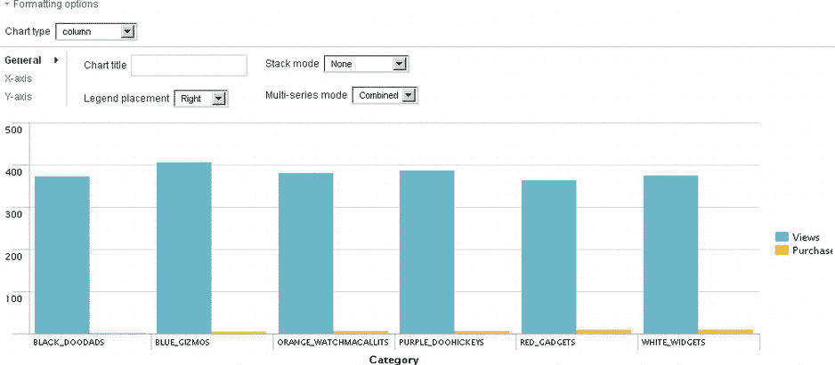

图 4-12. 产品类别的购买量与浏览量对比

让我们继续，点击`y`轴，将轴刻度的值改为对数。我们将图表标题重命名为“Purchases to Views chart”，并将图表保存为“PurchasestoViewsChart”。更新后的图表如图 4-13 所示。同样，根据这些报告的受众不同，您对图表类型和缩放比例的选择也会有所不同。正如我们在这个特定示例中所看到的，图 4-12 和图 4-13 中的图表传达了不同的信息，而数据集是完全相同的。

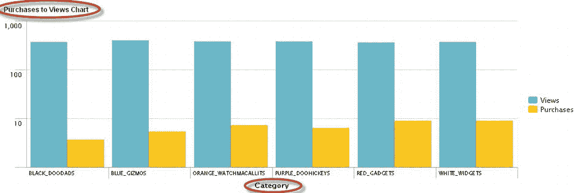

图 4-13. 使用对数刻度的产品类别购买量与浏览量对比

#### 哪些产品类别受到 HTTP 404 错误的影响？

当 Web 服务器（如 Apache 或 Microsoft IIS）响应客户端请求时，如果请求的资源未找到或不可用，则会在客户端浏览器上显示 HTTP 404 错误消息。该资源可以是 HTML 页面、图片或类似内容。任何在线零售商店或网站都应跟踪所有 404 错误消息，以便修复网站并确保用户能找到他们想要的内容；否则，企业可能会因用户流失甚至转向竞争对手而蒙受损失。在第 3 章中，我们使用 `stats` 命令来查找状态为 404 的事件数量。在本用例中，我们希望创建一个图表来查找每个产品类别的 404 错误数量。让我们在搜索栏中输入以下搜索：

```spl
sourcetype=access_* status=404
| chart count by categoryId
```


你可以使用饼图来展示数据各组成部分与整个数据集之间的关系。由于产品类别中每个项目都只有一个值，我们可以创建一个饼图，来查看哪些类别具有最高的 404 错误数量。在图表类型中选择饼图，并将其命名为“404 错误图表”。图 4-14 展示了生成的饼图。你会注意到，用于`x`轴和`y`轴格式选项的字段已被禁用，因为这显然是一个饼图。

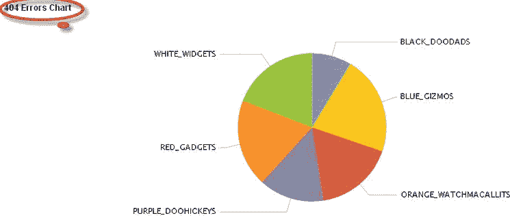

图 4-14. 404 错误饼图

Splunk 为这些可视化图表提供的一项便捷功能是每个字段的下钻值，当你将鼠标悬停在饼图的特定部分时就会触发此功能。图 4-15 向我们展示了`WHITE_WIDGETS`产品类别的计数和百分比。我们将此报告保存为“404 错误图表”。

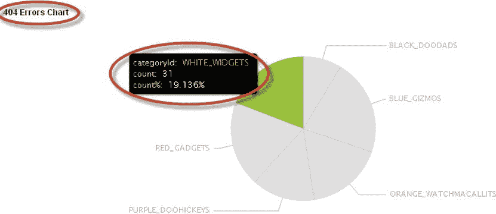

图 4-15. 饼图的下钻信息

#### `MyGizmoStore.com` 的购买趋势

我们想要可视化每个产品类别的购买趋势。趋势最好使用迷你图（sparklines）来呈现。迷你图能很好地展示一段时间内的进展，这种可视化方式广泛应用于医疗行业以及展示地震活动等模式。迷你图可以揭示隐藏的模式，例如 IT 或业务用户、医生或科学家可能正在寻找的大幅飙升或骤降。Splunk 提供了一个`sparkline`函数，可与`stats`或`chart`命令一起使用。在如下所示的搜索中，我们使用`eval`命令查找具有购买操作的请求。我们将统计符合该条件的事件数，并将其传递给`sparkline`函数，该函数与`chart`命令一起使用。我们还将列名改为“购买趋势”，并为每个产品类别进行计算。让我们输入以下搜索：

```
sourcetype=access_*
| chart sparkline(count(eval(action="purchase")))
  AS "Purchases Trend" by categoryId
```

按回车后，如果你看到一个空白图表，这意味着你处于图表模式。你可以点击小表格图标，这将带你进入表格报告，如图 4-16 所示，其中为每个产品类别都显示了迷你图。

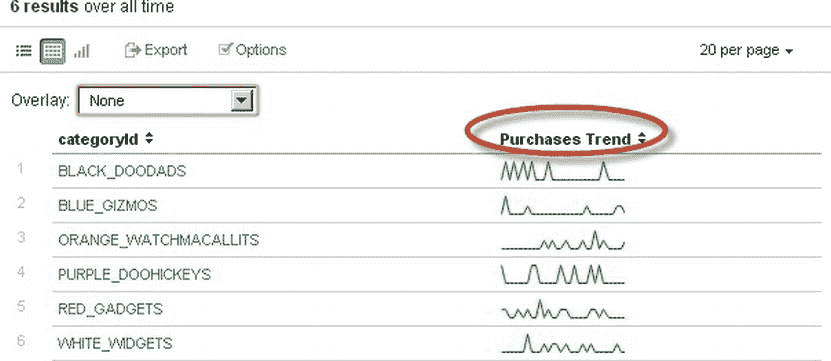

图 4-16. 产品类别的购买趋势

根据这些报告的受众，你对图表类型的选择会有所不同。有时迷你图可能并不最适合网络运营中心（NOC）的用户，但它们可能非常适合管理报告。折线图可能更适合 NOC 的用户，因为折线图的尺度比迷你图大得多。在此表格报告中，我们没有获得每个产品类别的总销售量。我们可以通过在搜索中添加一个额外的`count`函数并将其重命名为“总计”来实现这一点。我们还可以将`categoryId`字段重命名为“类别名称”，这对业务更友好。

```
sourcetype=access_*
| chart sparkline(count(eval(action="purchase")))
  AS "Purchases Trend"
  count(eval(action="purchase"))
  AS Total
  by categoryId
| rename categoryId AS "Category Name"
```

图 4-17 显示了包含迷你图和每个产品类别“总计”列的新表格报告。我们可以看到`RED_GADGETS`是最畅销的产品类别。我们将此报告保存为“购买趋势”。

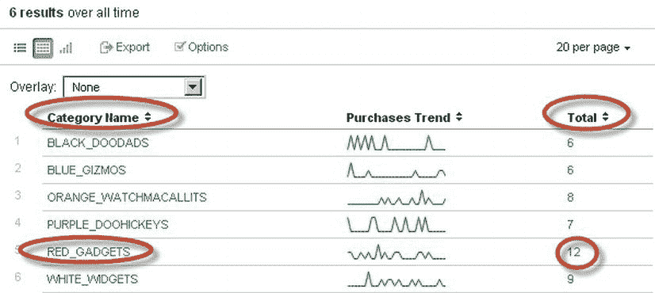

图 4-17. 包含每个类别总计的购买趋势

#### 交易持续时间

在第 3 章中，你学习了如何将一组事件分组为一个交易。现在，我们将利用`transaction`命令创建一个图表，根据交易持续时间（以分钟为单位）显示交易数量。在此搜索中，我们查找所有具有购买操作的事件，并将具有相同 IP 地址的事件分组。交易发生在 10 分钟内。对于分组后的交易，我们使用`chart`命令根据持续时间进行计数。让我们输入以下搜索：

```
sourcetype=access_* action=purchase
| transaction clientip maxspan=10m
| chart count by duration span=log2
```

我们可以使用默认的柱状图，并将标题更改为“交易持续时间”。图 4-18 显示了生成的图表。我们可以看到，很大比例的交易发生在不到一分钟内，其次是持续时间为两到四分钟的交易，然后是一到两分钟的交易。让我们将此图表保存为“交易持续时间图表”。

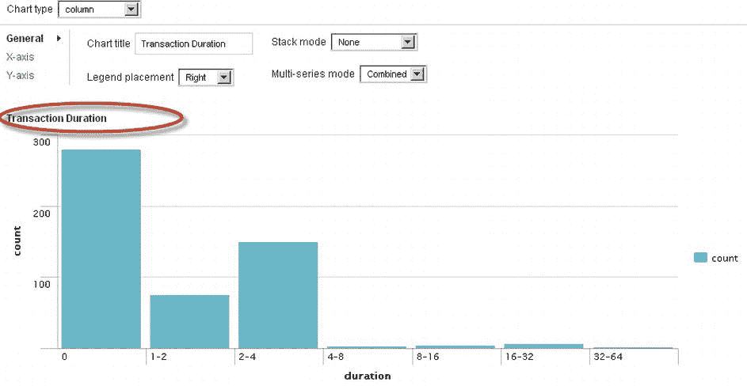

图 4-18. 交易持续时间

### 时间图

`Timechart`命令与之前使用的`chart`命令类似，区别在于`timechart`创建一个图表，其中聚合值针对`x`轴上显示的时间。`x`轴上的时间可以使用`span`选项进行控制。

我们将使用`MyGizmoStore.com`的样本数据探索几个`timechart`命令的用例：

*   按产品划分的热门购买
*   页面浏览量和购买量

### 按产品划分的热门购买

我们想了解针对`x`轴上的时间绘制的每种产品购买图表的样子。在搜索中，我们使用`count`函数来获取每个产品具有购买操作的事件数量，并使用`usenull`选项消除任何空值。图表（和时间线）的时间刻度是根据数据的上下文计算的。例如，如果你正在查看分钟级别的数据，刻度将自动设置为分钟。如果你正在查看小时级数据但数量很多，刻度可以是日级，依此类推，除非你使用`span`参数强制设置。让我们输入以下搜索：

```
sourcetype=access_*
| timechart count(eval(action="purchase"))
  by productId
  usenull=f
```

正如你在图 4-19 中所见，图表显示了每个`x`轴时间变量的多条柱线，使得难以抓住数据的本质。正如我们之前看到的，Splunk 有时会智能地将适用于给定数据结构的图表类型变灰。在这种情况下，图表类型唯一可用的其他选项是折线图和面积图。

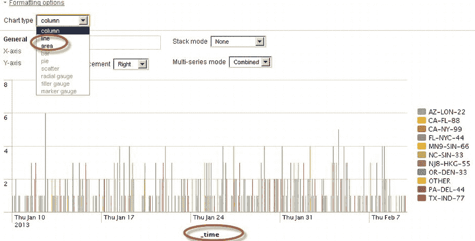

图 4-19. 按产品划分的热门购买

我们不更改图表类型，而是保留柱状图，但采用堆叠模式选项并选择“堆叠”。这将更新图表，如图 4-20 所示。将图表重命名为“热门产品购买图表”，将`x`轴标题重命名为“时间线”，将`y`轴标题重命名为“计数”，然后将其全部保存为“热门产品购买图表”。你可以悬停在堆叠中的每个项目上，将显示该单个部分的计数和百分比。

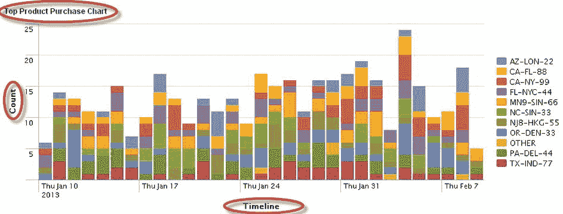

图 4-20. 堆叠模式下的产品购买

### 页面浏览量和购买量


我们可以使用相同的用例，并利用`timechart`命令在`x`轴上按时间线显示数据。在以下搜索中，我们使用`eval`命令来判断事件是否包含 GET 方法或购买行为。我们在`timechart`中使用`per_hour`函数来将数据按时间线布局。`per_hour`是一个聚合函数，能很好地为数据提供一致的比例：

```
sourcetype=access_*
| timechart per_hour(eval(method="GET"))
  AS Views,
  per_hour(eval(action="purchase"))
  AS Purchases
```

我们将此图表的类型更改为“面积图”。当你将面积图与默认的柱状图（通过在图表类型下拉框中切换值）进行比较时，你会注意到面积图对于我们这个用例所得的数据结构来说要清晰得多。我们将图表标题设为“购买与浏览面积图”，选择堆叠模式，并将图例位置切换到顶部。生成的可视化面积图如图 4-21 所示。我们将此图表保存为“购买与浏览面积图”。

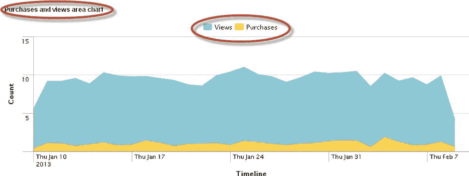

图 4-21. 购买与浏览面积图

到目前为止，你已经学习了如何使用`chart`和`timechart`命令，并熟悉了不同的图表类型。通常，柱状图或条形图更适用于比较字段值的频率。大多数图表要求搜索结果以至少两列的表格结构呈现，其中第一列提供`x`轴的值，其余列提供`y`轴的值。除了图表之外，Splunk 还允许我们通过量表来可视化结果数据。当搜索结果中只有一个结果值，且该值可以映射到量表提供的范围时，量表的效果最佳。Splunk 提供了径向量表、填充量表和标记量表。你将在第 10 章中了解更多关于`chart`和`timechart`命令的信息。

在第 2 章中，你已经了解了 Splunk 技术插件和 Splunk 应用。其中一个关键区别在于，应用用于在数据加载到 Splunk 之后进行数据可视化。在本章前面以及第 3 章中，我们查看了`MyGizmoStore.com`的热门 IP 地址，但从业务角度来看，更有用且更具说服力的是找出这些 IP 地址的地理位置。这样，我们就可以发现模式，例如`MyGizmoStore.com`的大多数客户来自哪里。Splunkbase 上有两个可用的应用用于可视化 IP 地址的地理位置，我们将对它们进行探讨：

*   Google Maps
*   Globe

## 使用 Google Maps 应用进行可视化

我们需要在 Splunk 实例上安装 Google Maps 应用。你可以使用在第 2 章中学到的相同方法，通过“应用”菜单下的“查找应用……”链接进行安装。在 Splunkbase 上搜索 Google Maps 并进行安装。安装完成后，你将能够在“应用”菜单中看到 Google Maps，如图 4-22 所示。

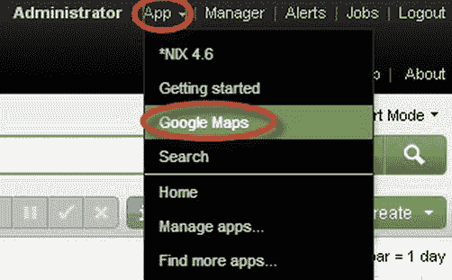

图 4-22. Google Maps 应用

点击“Google Maps”将会打开熟悉的谷歌地图。此应用提供了一个`geoip`命令，该命令接收 IP 地址并将其绘制在地图上，遍布全球。在我们的示例`MyGizmoStore.com`数据中，我们有一个`clientip`字段，其中包含 IP 地址。让我们输入以下搜索：

```
sourcetype=access*
| geoip clientip
```

图 4-23 显示了生成的谷歌地图，它缩放到了美国范围。我们可以看到，`MyGizmoStore.com`在 180 个不同地点拥有客户；在美国，堪萨斯州、肯塔基州和纽约州是前三名区域。

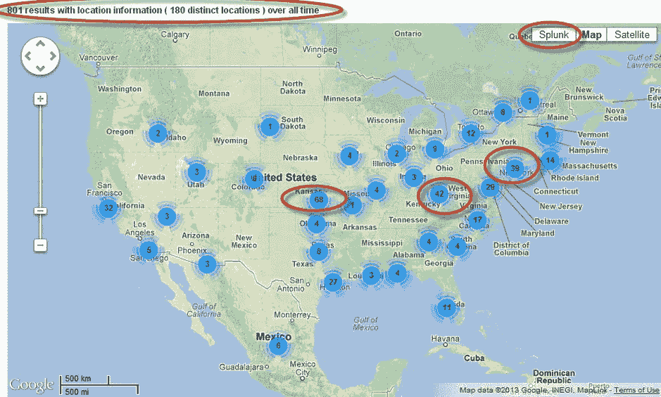

图 4-23. 美国境内`MyGizmoStore.com` IP 地址的可视化

我们可以使用缩放控件缩小地图，以查看全球分布情况。如果你选择 Splunk 叠加层，地图背景会变暗，顶部会显示更亮的数字，如图 4-24 所示。如你所见，北美是`MyGizmoStore.com`最受欢迎的区域。

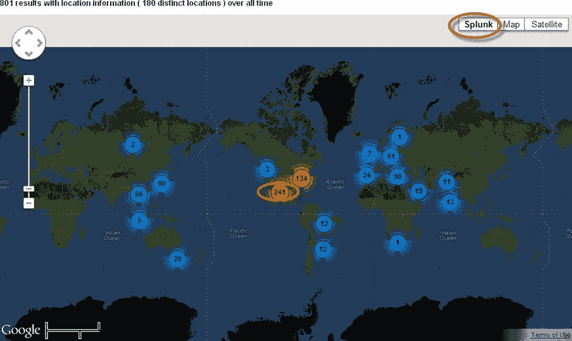

图 4-24. `MyGizmoStore.com` IP 地址全球分布的可视化

我们可以使用“操作”菜单下的“保存搜索”来保存该搜索，如图 4-25 所示。我们将搜索保存为“客户位置地图”。你可以点击“设置”菜单来编辑诸如地理位置数据库等设置，并指定 IP 地址反向查找的工作方式。在“视图”菜单下，你会找到一些演示，可以观看以熟悉该应用。

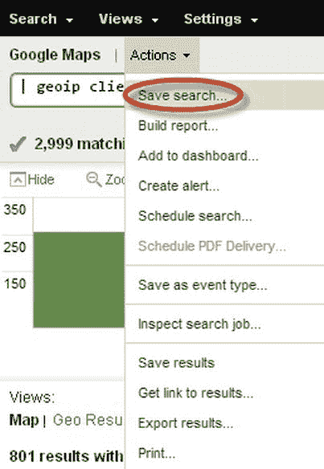

图 4-25. 使用 Google Maps 应用保存搜索

我们要讨论的第二个用于可视化 IP 地址的应用是 Globe。

## Globe

Globe 与 Google Maps 应用非常相似，不同之处在于地理位置的显示是在一个旋转的地球上，并且位置以从地球射出的光束显示。光束越长，表示活动越多。你可以从 Splunkbase 安装 Globe 应用；成功安装后，你可以在“应用”菜单下找到它，如图 4-26 所示。

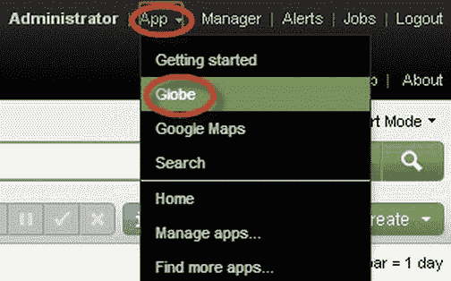

图 4-26. Globe 应用

点击“Globe”后，你将选择“ChromeGlobe”，如图 4-27 所示。

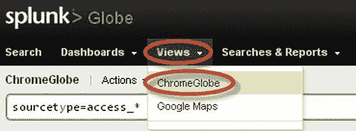

图 4-27. Globe 视图

选择视图后，我们可以使用与 Google Maps 相同的搜索：

```
sourcetype=access*
| geoip clientip
```

这将调出一个带有光束的旋转地球，你可以倾斜地球以从不同方向查看。图 4-28 显示了从北极一侧观察到的客户活动。在撰写本书时，Globe 应用仍处于实验阶段，并且不公开提供下载。我们预计，当你阅读本章时，它应该可以在 Splunkbase 上获取。

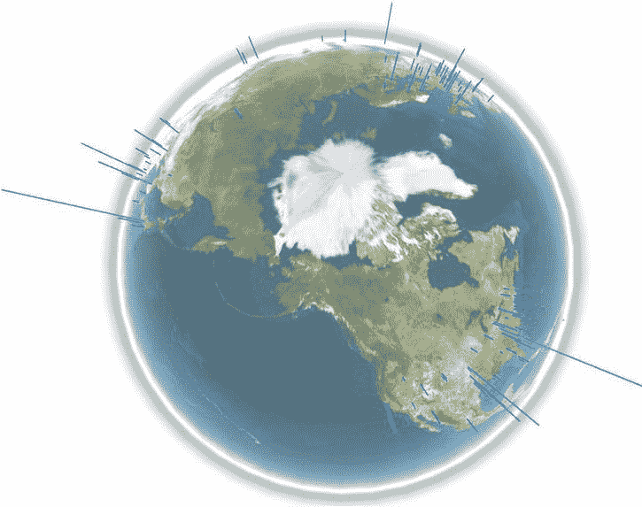

图 4-28. Globe 中的`MyGizmoStore.com`客户活动

与 Google Maps 一样，你可以使用“操作”菜单下的“保存搜索……”选项来保存搜索，如图 4-29 所示。

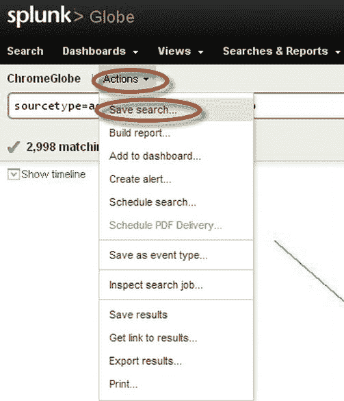

图 4-29. 保存 Globe 搜索

到目前为止，我们专注于构建可用于可视化加载到 Splunk 中的数据的报表，并利用 Splunk 应用来帮助可视化数据。现在，我们将探讨如何将这些报表组合成一个仪表板。

## 仪表板


仪表盘在衡量和跟踪公司绩效方面非常流行，它们是一种管理最佳成功指标的有效方式。仪表盘允许公司不同部门之间共享关键信息，并可被视为查看当前状况的一站式场所。仪表盘能够精准定位优势与挑战；其用户无需费力翻阅大量无关紧要、缺乏意义的数据。相反，仪表盘能够基于高级分析来识别和展示数据。管理者可以根据仪表盘中的信息做出明智的、基于证据的决策。

企业正希望通过使用预测性指标来超越历史和描述性数据，从而进行决策。仪表盘中应仅引入少数几个关键指标。你的受众不需要海量数据；他们需要的是严谨的思考和有充分研究的信息。请务必记住，仪表盘的主要目标是沟通；你不应使用复杂的图形、仪表盘和刻度盘来分散查看者的注意力。仪表盘中的数据应当干净、可用，并以对企业有意义的方式进行整合。

`Splunk`提供了几种创建有意义仪表盘的方法，这些仪表盘基于搜索和可视化图表构建。最简单的方法是使用`Splunk` Web 用户界面。我们一直在使用`Splunk`的搜索应用进行搜索；然而，你可能没有意识到搜索应用已经内置了一个基础仪表盘（图 4-30）。该仪表盘提供了关于加载到`Splunk`中的数据、已索引事件数量、不同数据源、源类型和主机的信息。它提供了一个整体快照，并让用户能够通过下钻或创建搜索来查找特定数据。

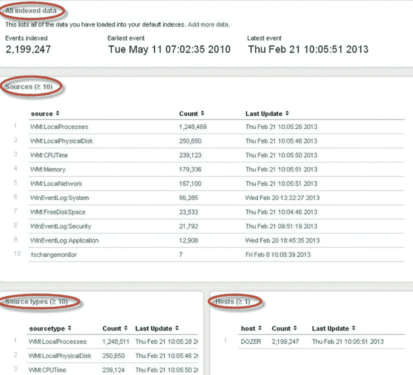

图 4-30. Splunk 搜索应用仪表盘

`Splunk`还提供了一个包含五个状态仪表盘的默认集合，可以通过点击“状态”菜单来访问，如图 4-31 所示。

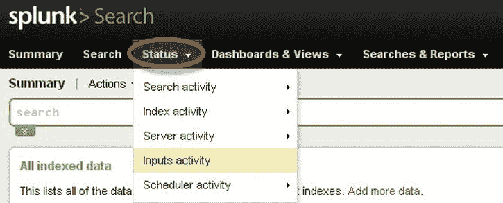

图 4-31. Splunk 状态仪表盘

*   “搜索活动”仪表盘提供了关于`Splunk`实例搜索活动的信息。你可以看到搜索的峰值负载时间、最受欢迎的搜索等。
*   “索引活动”仪表盘提供了关于索引和索引大小的几个有用统计分解，以及资源（如每个索引的 CPU）利用率、过去 24 小时内被索引的前五个来源等信息。
*   “服务器活动”仪表盘提供了关于近期浏览器使用情况、`Splunk` Web 错误以及`Splunk`运行状况的信息。图 4-32 展示了一个精美的服务器活动仪表盘，并很好地使用了仪表图表来显示错误、访问延迟和正常运行时间等信息。你可以控制仪表图表的阈值和范围值，以使数据更有意义。

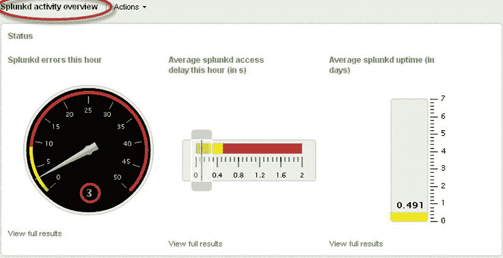

图 4-32. 使用仪表图表的 Splunk 活动概览

*   “输入活动”仪表盘提供了关于已处理或被忽略的日志文件输入的相关信息。
*   “调度器活动”仪表盘提供了关于搜索调度器的信息，其图表显示了已启动和已跳过的搜索、平均执行时间、运行计划搜索所需的平均时间等。

现在你已经了解了`Splunk`作为默认仪表盘提供的内容，以及可以使用的丰富信息，让我们探讨如何创建自定义仪表盘。在本章中，我们创建了与`MyGizmoStore.com`示例数据相关的不同搜索和可视化图表。我们将精心挑选其中一些，创建一个提供关于`MyGizmoStore.com`快照信息的仪表盘。我们将采用以下报告：

*   每个产品的购买量和浏览量图表
*   404 错误
*   购买趋势
*   交易持续时间
*   按产品划分的购买量排名

首先，点击“仪表盘和视图”菜单下的“创建仪表盘...”链接，如图 4-33 所示。

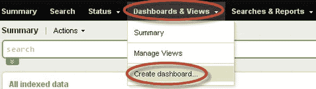

图 4-33. 创建仪表盘

这将调出“创建新仪表盘”对话框。我们将输入`MyGizmoStore`作为 ID，`MyGizmoStore.com`作为名称，如图 4-34 所示。点击“创建”按钮。

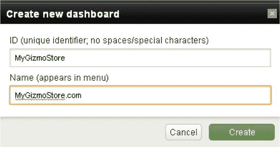

图 4-34. 创建 MyGizmoStore 仪表盘

现在已创建一个空仪表盘。为了使其可编辑并添加之前创建的报告，请点击“编辑”开关以开启状态，如图 4-35 所示。


图 4-35. 编辑`MyGizmoStore.com`仪表盘

为了开始将报告添加到仪表盘，我们需要创建一个新的面板来容纳报告。点击“新建面板”，这将调出一个对话框，如图 4-36 所示。我们将开始为“购买量和浏览量”图表创建一个面板。输入“购买量和浏览量”作为标题，并选择“已保存搜索”单选按钮。下拉框将显示已保存的报告列表。选择“购买量和浏览量面积图”。点击“保存”按钮。

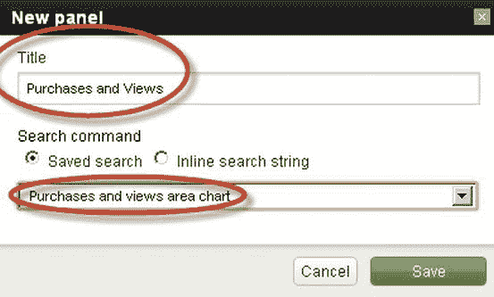

图 4-36. 购买量和浏览量面板

这将使报告以表格格式显示。为了将其可视化为图表，您必须点击“编辑”并选择“编辑可视化”，如图 4-37 所示。

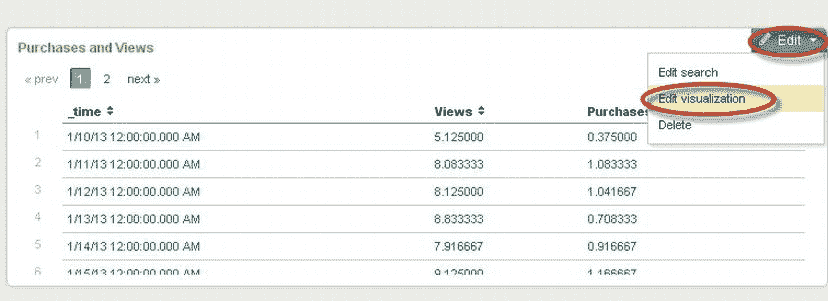

图 4-37. 编辑购买量和浏览量的可视化

这将调出对话框，您可以根据希望如何可视化表格数据来进行更改。让我们选择“面积图”，如图 4-38 所示，我们之前看到这种图表对此数据很有效。点击“保存”按钮。

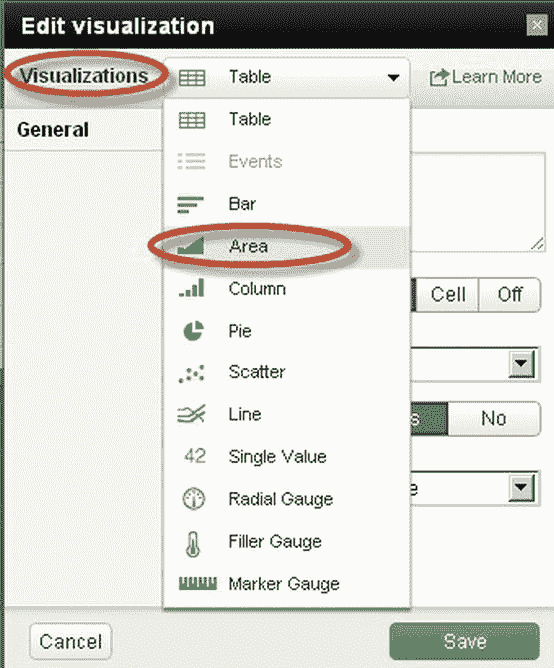

图 4-38. 编辑可视化

您现在将看到购买量和浏览量的表格数据以面积图的形式呈现，如图 4-39 所示。

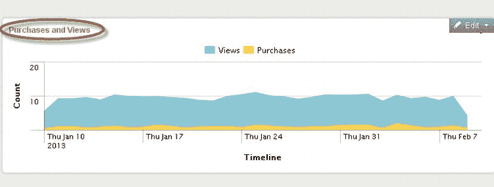

图 4-39. 购买量和浏览量

现在您已经逐步学习了如何将报告添加到仪表盘，我们将把其余的报告也添加到仪表盘中。

对于 404 错误报告：

*   点击“新建面板”；命名为“404 错误”，然后从下拉框中选择“404 错误图表”报告。点击“保存”。
*   编辑该面板，并选择“饼图作为可视化”。点击“保存”。

对于购买趋势报告：

*   点击“新建面板”；命名为“购买趋势”，然后从下拉框中选择“购买趋势”报告。点击“保存”。

对于交易持续时间报告：

*   点击“新建面板”；命名为“交易持续时间”，然后从下拉框中选择“交易持续时间图表”报告。点击“保存”。
*   编辑该面板，并选择“柱状图作为可视化”。点击“保存”。


针对**热销产品购买**报告：

- 点击`新建面板`；命名为“热销产品购买”，然后从下拉框中选择“热销产品购买图表”报告。点击`保存`。
- 编辑该面板，选择“列作为可视化方式”，并将堆叠模式选项设为“堆叠”。点击`保存`。

现在，我们已经将所有希望纳入`MyGizmoStore.com`仪表盘的报告添加完毕，接下来可以合理排列它们，使仪表盘更易于理解。您可以在仪表盘中拖放每个面板以重新排列。重新排列仪表盘后，前往“仪表盘和视图”菜单，点击`MyGizmoStore.com`链接以调出新的仪表盘，如图 4-40 所示。

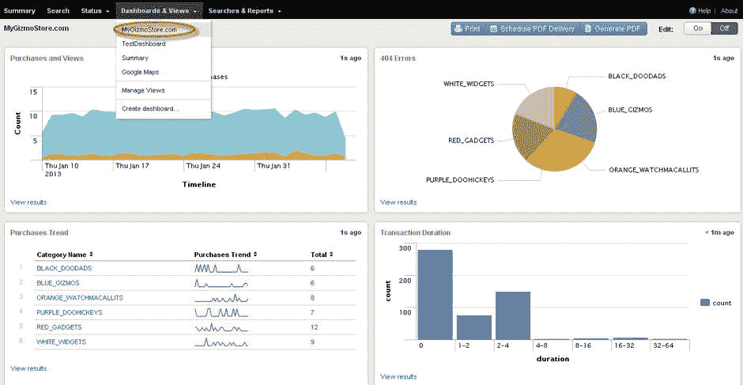

图 4-40. `MyGizmoStore.com` 仪表盘

您已经了解到诸如 Google Maps 或 Globe 之类的 Splunk 应用如何帮助我们实现数据可视化。在第 2 章中，您学习并安装了用于 Windows 和*Unix 环境的 Splunk 技术插件，以便在 Windows 或 Unix 环境中收集数据。这些插件也包含功能完善的 Splunk 应用，这意味着您不仅可以收集数据，还可以通过预制仪表盘实现数据可视化。

让我们看看如何利用 Splunk 的`*Nix`应用。您可以像安装其他应用一样下载并安装`*Nix`应用。如果您同时安装了`*Nix`插件，则需要先禁用它，`*Nix`应用才能正常工作。要禁用某个特定应用，请使用 Splunk 管理器并点击“应用”。安装`*Nix`应用后，它将会列在“应用”菜单下，如图 4-41 所示。

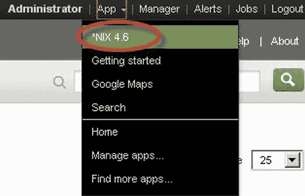

图 4-41. `*Nix` 应用

在 Unix 系统中，您可以启用要加载到 Splunk 的数据源。为了展示`*Nix`仪表盘的效果，我们启用了`/var/logs`作为文件和目录输入，并启用了脚本输入中的`cpu`、`memory`、`top`和`who`。`*Nix`提供了一套全面的仪表盘，让您能够可视化跨 CPU、内存、磁盘、网络、用户及不同日志文件的信息。您可以在此基础上构建自定义仪表盘，或利用`*Nix`加载到 Splunk 的数据，以不同图表格式创建报告。

本章将通过查看`*Nix`中的仪表盘示例来收尾。图 4-42 展示了 CPU 概览仪表盘，您可以从 CPU 菜单访问，它提供了按用户、进程等维度划分的 CPU 消耗可视化信息。您可以看到，该应用使用了`timechart`命令来创建构成仪表盘的报告。

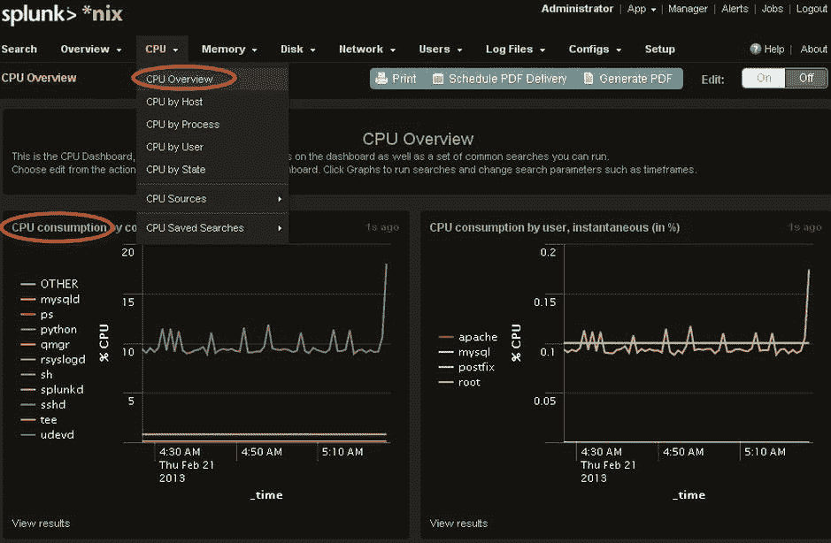

图 4-42. `*Nix` CPU 概览仪表盘

图 4-43 展示了内存仪表盘，它可视化了按进程划分的内存使用情况、前十名用户的内存用量等。

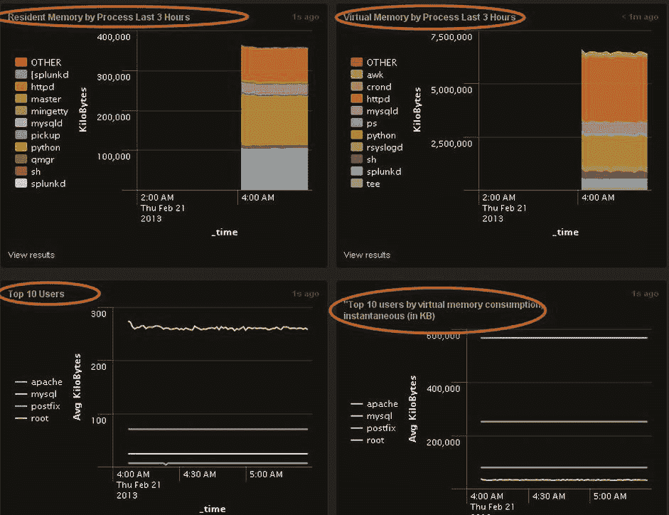

图 4-43. `*Nix` 内存概览仪表盘

图 4-44 展示了日志记录仪表盘，它可视化了跨不同日志文件的吞吐量。Splunk Windows 应用也提供了一套类似于`*Nix`的全面仪表盘。您可以像安装`*Nix`一样安装它。

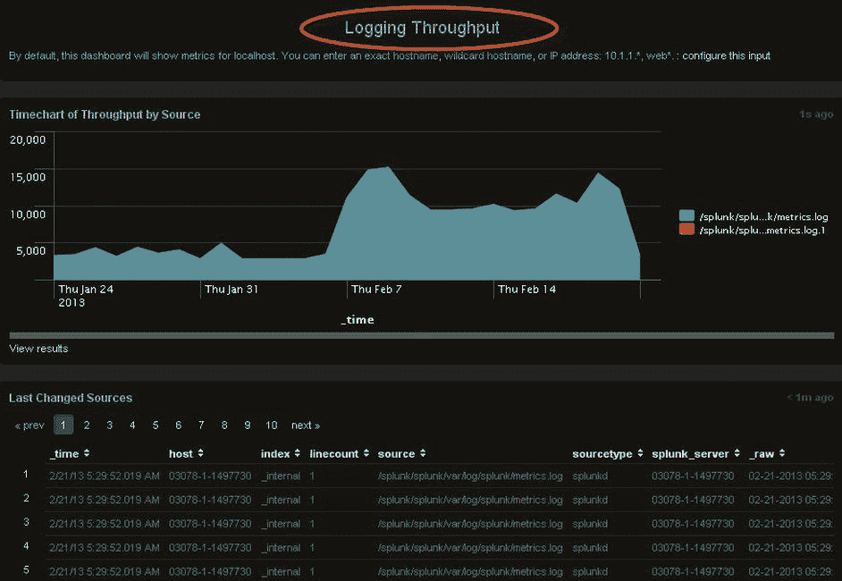

图 4-44. `*Nix` 日志记录仪表盘

## 总结

在本章中，您学习了如何可视化索引到 Splunk 中的数据。您了解了 Splunk 通过报告生成器和 SPL 命令`chart`及`timechart`提供的报告功能。您学习了不同的图表类型，以及如何使用`MyGizmoStore.com`样本数据针对不同类型的数据结构应用这些图表。最后，您学习了如何构建仪表盘以及探索有助于实现可视化并预置仪表盘的 Splunk 应用。

---

## 定义告警

在本章中，您将了解 Splunk 提供的不同类型的告警，以及如何创建告警并采取行动。您将利用来自`MyGizmoStore.com`和`*Nix`的搜索和数据，通过不同的使用场景触发不同类型的告警。

### 什么是告警？

告警是简短的消息或通知，帮助个人了解已发生或可能发生的某些事情。我们在日常生活中都习惯了告警：例如，日历通知提醒我们应参加的会议。在美国乘飞机旅行的人熟知国土安全部的咨询系统，该系统以颜色编码威胁等级发出告警。作为在线客户，我们习惯了从在线商店或在线票务网站收到价格告警，例如当商品、机票或酒店客房价格下降时。企业 IT 团队关注安全、网络、CPU、内存等类型的告警，这些告警对应用程序性能、可能发生的安全漏洞或某些服务水平协议（SLA）是否无法达成有巨大影响。即使没有电脑，我们也习惯了通过收音机、电视、手机和平板电脑接收天气告警。

无论我们是否明确将其视为告警，告警如今已成为我们生活的一部分。对于企业而言，有关网络、硬件、应用程序、网站等的告警是了解 IT 基础设施状况、与 SLA 相比表现如何的关键指标；从业务角度看，也能反映运营状况，无论是库存、运输、呼叫中心、客户支持还是销售方面。那么问题来了：Splunk 为告警提供了什么？我们将在本章接下来的几节中探讨。

### Splunk 如何提供告警

了解所有正在收集的数据发生了什么，以及如何利用这些信息来获知积极和消极类型的事件，这一点至关重要。我们已经看到 Splunk 处理、分析和可视化不同来源的数据；现在需要了解，从 IT 和业务角度来看，用户如何被告警到异常事件。您可以将 Splunk 用作企业的监控工具。Splunk 提供三种不同类型的告警：


