# 警报类型与创建

Splunk 提供了三种类型的警报：

- **计划警报（Scheduled alerts）** — 这类警报用于按指定时间间隔运行的搜索。搜索基于历史事件集工作，当满足特定警报条件时触发警报。例如，一家在线商店（如 `MyGizmoStore.com`）会运行一个统计每日产品销售数量的搜索；当销售数量低于某个阈值时触发警报。这类警报适用于不需要立即响应，但用户希望了解警报条件是否满足的情况，以便他们知悉并可能采取行动或进一步调查问题。
- **按结果警报（Per results alerts）** — 这类警报用于当你希望在搜索中满足警报条件时立即获知。一个典型例子是运行一个检查 HTTP 状态码是否大于等于 500（即服务器错误）的搜索，并在满足条件时每小时发送一次警报。
- **滚动窗口警报（Rolling-window alerts）** — 这类警报用于在滚动时间窗口内实时监控事件，例如过去 10 分钟。当滚动窗口中符合条件的事件满足警报条件时，警报被触发。一个典型例子是欺诈检测，其中某人在 10 分钟滚动窗口内使用同一张信用卡进行了超过三次购买。

现在你已经了解了 Splunk 提供的警报及其不同类型，让我们探索如何创建警报。与前几章类似，我们将以与 `MyGizmoStore.com` 相关的不同用例为例，并使用通过 *Nix 收集的数据。我们将探讨的三个用例是：

- 基于产品销售数量的警报
- 登录失败警报
- 日志文件中严重错误的警报

Splunk Web 是创建警报最简单的方式。我们将从第一个用例开始。

## 基于产品销售数量的警报

在此用例中，我们希望统计昨天的产品销售数量，并在该数量低于 30 时触发警报。

首先，我们将构建一个快速搜索，以便在警报中使用。在第 2 章中，我们使用了时间选择器来聚焦特定日期范围。要计算昨天的产品销售总数，我们可以使用时间选择器中的“Yesterday”选项。Splunk 提供了时间修饰符，用于自定义搜索的时间范围。Splunk 提供三种时间修饰符：

- `earliest` — 指定搜索时间范围的最早时间
- `latest` — 指定搜索时间范围的最晚时间
- `now` — 当前时间

时间修饰符支持以秒、分钟、小时、天、周、星期几、月、季度和年为单位指定时间。在下面的搜索中，我们使用了 `earliest`，并通过指定 `-1d` 回溯一天，这意味着从当前日期减去一天。要计算总购买次数，我们使用 `eval` 命令查找具有购买操作的事件，并使用 `count` 函数。图 5-1 显示搜索已使用时间修饰符，并显示了昨天的产品销售总数。

```
sourcetype=access_*
  earliest=-1d
  action=purchase
| stats count(eval(action="purchase")) AS "Total Products Sold Yesterday"
```

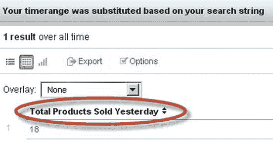

图 5-1. 昨日产品销售总数

现在我们已经有了一个可以统计昨天产品销售总数的搜索，接下来可以使用 Splunk Web 安排一个计划警报，同时保存该搜索。选择“Create”并点击“Alert...”链接，如图 5-2 所示。你也可以通过 Splunk Manager 界面将警报添加到已保存的搜索中，并在“Searches and reports”部分选择特定搜索。本章中我们将探讨的所有警报选项在向已保存搜索添加警报时均可用。


图 5-2. 创建警报

在出现的“Create Alert”对话框中，输入“Yesterday Purchases Alert”作为名称。在“Schedule”下拉菜单中，选择“Run on a schedule once every”。对话框将展开显示更多选项。选择“Day”作为计划周期，即每天运行一次。在“Trigger if”下拉菜单中，选择“Number of results”和“is less than”，并输入 30 作为阈值。当昨天的产品销售数量低于 30 时，此警报将被触发。图 5-3 显示了所选选项。点击“Next”按钮。

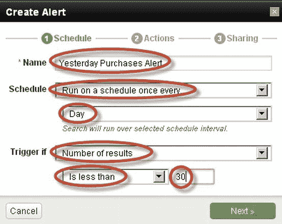

图 5-3. 安排警报

在“Create Alert”对话框的“Actions”页面，你将看到不同的操作选项。三种可能的操作选项包括：向用户或用户组发送电子邮件、运行一个可能采取立即预防措施的脚本（例如配置额外的磁盘空间），以及使用 Splunk Alert Manager 查看触发的警报。

对于此用例，我们将选择警报管理器选项，并在创建警报后探索警报管理器。每个警报都可以标记一个严重级别，以指示警报的重要性。例如，你可能希望查看与 CPU 利用率超过 90% 或内存耗尽相关的警报。图 5-4 显示了一个严重级别下拉框，选项包括 Low、Medium、High 和 Critical。由于这不是高优先级警报，我们将选择“Medium”。你可以使用严重级别作为在警报管理器中筛选已触发警报的方式。警报可以针对所有结果触发，也可以针对每个结果触发。选择“All results”单选按钮。我们将在接下来的两个用例中讨论节流（throttling）机制。点击“Next”按钮。图 5-4 显示了已启用的选项。

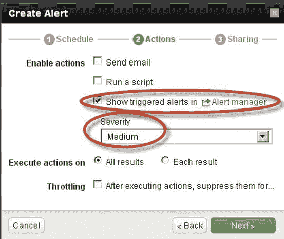

图 5-4. 警报操作

在警报创建过程的最后一步，你可以选择与其他用户共享警报或保持私有。这与共享搜索类似。选择“Share as read-only to all users of current app”单选按钮。这将使多个用户能够查看警报，并及时了解特定活动或性能指标。点击“Finish”按钮。你将看到“Alert saved successfully”弹出框。点击“OK”。

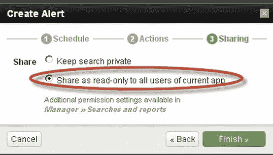

图 5-5. 共享警报

警报管理器显示所有警报的记录，并提供基于应用、所有者、严重级别和警报进行搜索、筛选和查看的选项。也可以删除选定的警报。要访问警报管理器，请点击“Alerts”菜单，如图 5-6 所示。

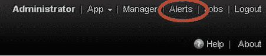

图 5-6. 警报管理器

在 Alert manager 中，在 **Alert** 下拉框里选择 **Yesterday Purchases Alert**，如图 图 5-7 所示。您会看到告警被筛选出来，并显示了与此告警相关的记录。在本例中，我们只有一个告警。

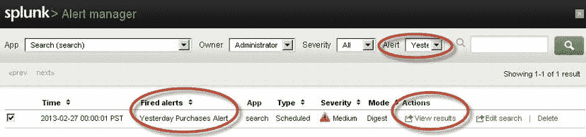

图 5-7. Alert manager 中的昨日购买告警

您可以点击“查看结果”链接来查看此次搜索的实际结果，并找出告警触发的原因。正如您在 图 5-1 中看到的，销售的产品数量只有 18 个，而我们的告警条件设置为当销量低于 30 时触发告警，因此触发了告警。

## 关于登录失败的告警

我们在第 4 章中安装了 Splunk *Nix 应用，并启用了将不同日志中的数据索引到 Splunk。现在我们可以利用从安全日志中加载的数据，找出过去 24 小时内发生了多少次登录失败，从而创建一个不同类型的实时告警。通过“App”菜单进入 *Nix 应用。*Nix 创建了自己的索引 `os`，因此我们指定索引名称开始搜索。在索引名称之后，搜索包含 failure 且 `sourcetype` 为 `linux_secure` 的任何事件。利用 `stats` 命令，按远程主机（`rhost`）统计失败次数。最后，对结果进行排序。

```
index=os sourcetype=linux_secure failure
| stats count by rhost
| sort by count
```

图 5-8 显示了我们在 *Nix 应用搜索栏中输入上述搜索后得到的结果。结果可能会有很大差异，因为这些结果特定于我们在编写本章时所使用的服务器。您可以看到尝试登录的远程主机（`rhosts`）的 IP 地址以及失败次数，这些结果按降序排列。

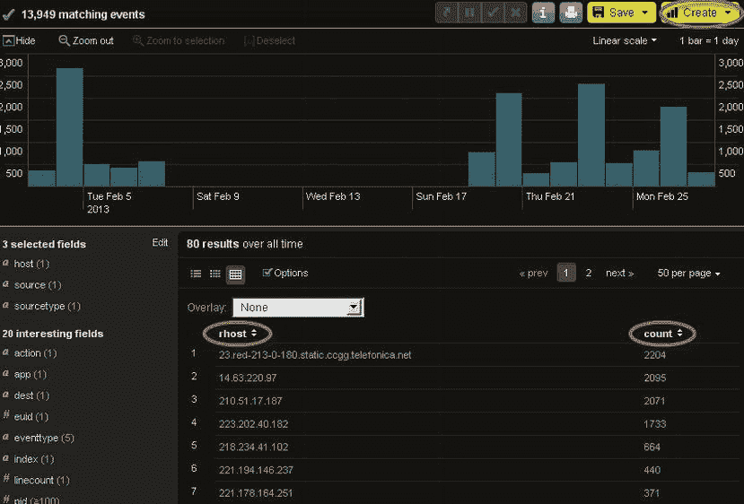

图 5-8. 登录失败

我们将通过从 **Create** 下拉框中选择 **Alert . . .** 来为我们的搜索创建告警。在 **Create Alert** 对话框中，我们将告警命名为 **Login Failure Alert**，并选择 **Trigger in real-time whenever a result matches**。这是我们之前讨论过的第二种告警类型，称为逐结果告警。每当传入的事件实时匹配到搜索条件时，此告警就会被触发。图 5-9 显示了所选选项。点击 **Next** 按钮。

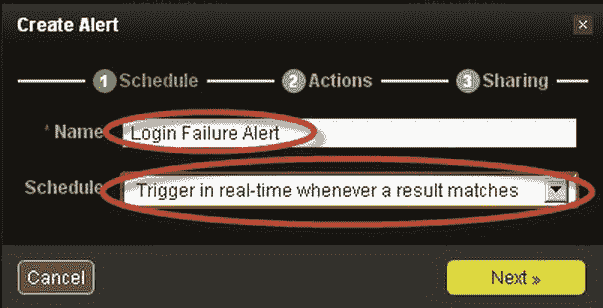

图 5-9. 为登录失败创建告警

在 **Create Alert** 对话框的操作页面中，我们将启用一个操作，让 Splunk 向 `alert@mydomain.com` 发送电子邮件。您可以将结果以内联、CSV 或 PDF 附件的形式包含在内。我们将其设置为内联，并像之前一样启用通过 Alert manager 查看告警的功能。由于此告警与安全相关，我们将严重性设置为 **High**。图 5-10 显示了所选选项。点击 **Next** 按钮。

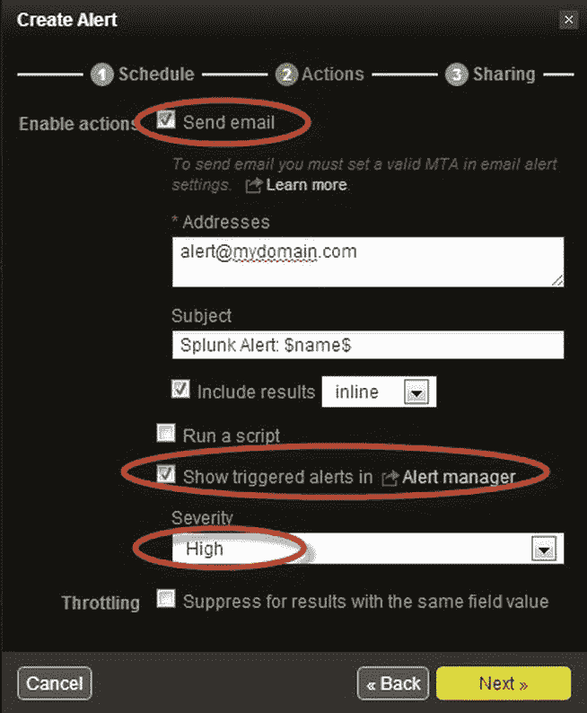

图 5-10. 登录失败的告警操作

一旦告警成功创建，我们可以通过启动 Alert manager 来查看已触发的告警。我们可以使用应用名称来筛选告警，在本例中应用名称为 *Nix。由于 *Nix 应用可能有多个告警，我们可以通过在告警下拉框中选择特定的告警（本例中为 **Login security alert**）来进一步筛选。图 5-11 显示了已触发的一组告警。我们可以看到此告警的类型设置为 **Real-time**，并且它是一种 **Per Result** 类型的告警。您还可以看到，用户可能会被可能触发的告警数量所淹没。这时 Splunk 的告警节流功能就派上用场了，我们将在下一个用例中进行探索。

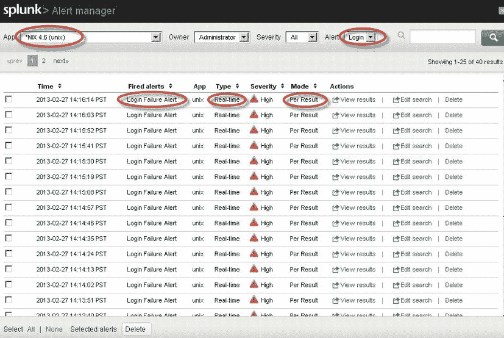

图 5-11. Alert Manager

点击告警旁边的 **View results** 链接将会显示触发该告警的特定事件集，如图 图 5-12 所示。

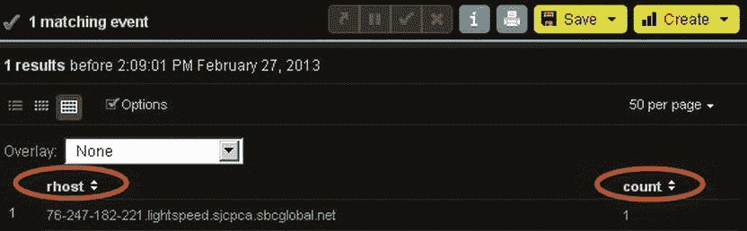

图 5-12. 触发登录失败告警的事件

## 关于日志文件中关键错误的告警

在此用例中，我们将利用 *Nix 应用中启用的 Unix 日志文件数据。我们可以设置一个告警来查找任何关键错误。我们可以通过一个简单的搜索来实现，在其中指定索引为 `os`，`sourcetype` 为 `linux_secure`，并查找其中包含 `critical` 或 `error` 字样的已索引事件。在 *Nix 应用中，输入以下搜索并创建一个名为 **Critical Errors Alert** 的新告警，如图 图 5-13 所示。我们将在 **Schedule** 下拉框中选择 **Monitor in real-time over a rolling window of** 选项。在这里，我们将指定一个 30 分钟的窗口，并在结果数量大于 15 时触发告警。

```
index=os sourcetype=linux_secure critical OR error
```

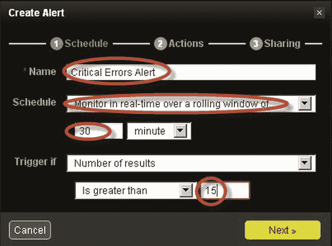

图 5-13. 创建关键错误告警

在告警对话框的操作页面中，我们将启用向 `alert@mydomain.com` 用户发送电子邮件的功能，并启用警报管理器选项。为此用例选择的一个新选项是节流。节流选项会在初始告警触发后，在指定的时间段内抑制后续告警。正如您在之前关于登录失败的用例中看到的，与其收到重复的告警，不如指定在特定的秒、分钟或小时内抑制告警。在此例中，我们将指定为 15 分钟。您需要找到最适合您所创建告警的最佳时间，以便节流不会抑制重要的告警。

Splunk 允许您在告警触发时运行脚本。可以通过在 **Create Alert** 的 **Actions** 页面中选中 **Run a script** 选项来启用此功能。此功能可用于通过脚本化自动化流程立即采取行动。典型的例子包括：在三次失败后禁用用户登录、阻止在 DDOS 攻击中使用的 IP 地址、当用户活动达到预设阈值时在云上预配额外的计算或存储资源，或者将触发告警的详细信息发送给另一个会触发所需操作的应用或系统。需要执行的脚本必须放置在 `$SPLUNK_HOME/bin/scripts` 目录下，其中 `$SPLUNK_HOME` 是 Splunk 的安装目录。

创建告警后，您始终可以通过“管理”菜单中的“搜索与报告”链接对其进行编辑，该链接位于“知识”部分。图 5-14 显示了针对严重错误告警的指定选项。单击**下一步**按钮。

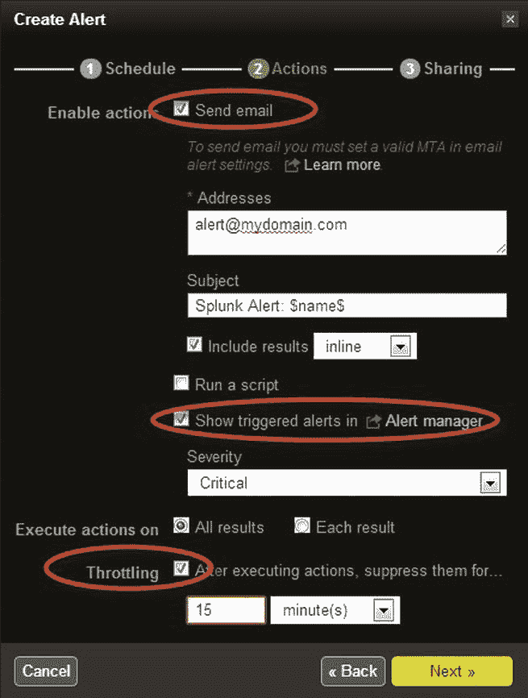

图 5-14。为告警选择节流选项

告警创建完成后，您可以前往**告警管理器**，根据应用程序和告警进行筛选。我们可以在**告警**字段中选择`*Nix`作为应用程序，并选择`Critical Errors Alert`，这样即可调出迄今为止已触发的告警。图 5-15 显示了告警记录。您会注意到**模式**列显示为**摘要**，这意味着该告警与一组事件相关。

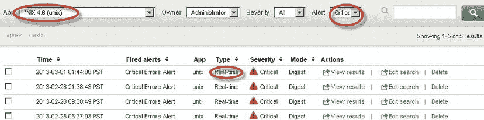

图 5-15。针对严重错误已触发的告警

点击“查看结果”会显示与合格告警摘要相关的事件列表。图 5-16 展示了此告警的示例事件集。

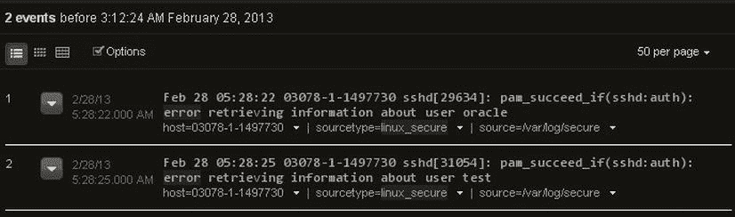

图 5-16。与严重错误相关的事件

## 本章小结

在本章中，您学习了 Splunk 提供的三种不同类型的告警。我们通过一系列常见的用例场景，利用来自`MyGizmoStore.com`和`*Nix`的搜索以及告警中可用的不同操作，探讨了如何创建告警。您还学习了如何利用告警管理器查看已触发的告警。