# 使用日志文件创建高级分析

在本章中，我们将介绍一种新范式：利用日志文件创建高级分析，从而绕过传统分析所采用的路径。为此，我们将通过一系列我们称为“语义日志记录”的建议，回顾创建分析的最佳方法。我们将通过一个示例来说明其简便性。

## 传统分析

传统分析涵盖多种功能，通常有不同名称，如商业智能、数据挖掘、在线分析处理（`OLAP`），或干脆称为分析。通常，公司使用分析来更好地了解自身运营、削减成本、改进决策并识别低效流程，这有助于发现新的商机并重组其流程。

开发分析面临的挑战在于，大多数原始信息存储于通常解耦或分布在分布式系统中的数据存储中。这使得信息整合非常困难。最困难的挑战可能是，执行分析所需的信息必须为此目的而特意提供，而这种努力涉及经历典型的软件开发生命周期，这需要时间。它也会成为信息技术（`IT`）部门待办事项队列中的另一项任务，并且通常优先级较低。

问题的核心在于，传统分析的开发周期基于所谓的“早期结构绑定”，即您需要事先知道将针对数据提出哪些问题。典型的开发步骤可以总结如下：

-   确定要问的问题
-   设计数据模式
-   规范化数据
-   编写数据库插入代码
-   创建查询
-   将结果输入分析工具

根据获取必要数据的程序复杂程度，这个过程可能需要数天、数周甚至数月。通常，执行分析所需的数据将被放入数据仓库或数据集市，然后由各种分析工具访问。这种架构以及典型的数据收集案例，可以在图 7-1 中看到。

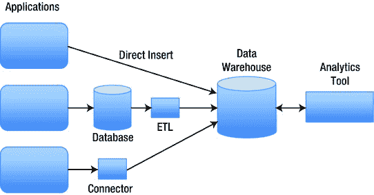

图 7-1. 典型分析工具架构

如图 7-1 所示，数据可以通过在系统中包含代码直接插入所需数据到数据仓库的方式来收集，或者从现有数据库中提取，这通常需要使用提取-转换-加载（`ETL`）程序进行某种转换。最后，许多数据仓库系统包含连接器，以便更轻松地从应用程序收集数据。如前所述，无论数据如何收集，这都是一个为此目的而必须执行的额外步骤。

### 范式转变

我们建议，通过结合使用日志文件和`Splunk`，您可以获得执行传统分析通常所需的所有信息。更棒的是，这个过程更快、更简单。首先，几乎任何程序或基于计算机的设备都会生成至少一个日志文件；诚然，在某些情况下（例如在`Windows`中），与日志文件相关的典型信息存储在事件管理系统中。日志文件通常被忽视这一事实并不会降低它们的重要性。

正如您在之前的章节中所见，日志文件包含一个信息宝库，其中包含广泛的数据，可用于确保系统安全并满足合规性要求。它们是系统中活动和行为的确定性记录。因此，它们可以为`IT`部门和整个业务提供洞察，呈现客户行为、产品和服务使用情况，并最终实现端到端的事务可见性。

如图 7-2 所示，当您从系统基础设施（如`Windows`服务器、`Linux/Unix`服务器、虚拟化和云服务器以及网络）以及应用程序和数据库的日志文件中收集机器数据时，您可以获得所有系统的完整视图。

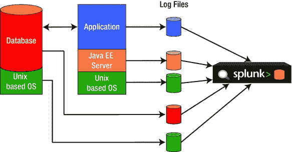

图 7-2 企业系统的典型日志文件

使用像`Splunk`这样的工具可以轻松收集所有这些日志文件，即使它们不被认为是结构化的，因为数据没有预先定义的模式，没有自定义连接器，并且通常您不必使用关系数据库。关于`Splunk`的市场文献将收集和处理的信息称为运营智能。`Splunk`提供运营智能的主要能力包括：

*   `搜索`：允许深入挖掘数据以排查问题和事件，从而促进根本原因分析。
*   `实时可见性`：通过它，您可以监控和告警整个系统，从而跟踪服务水平协议（`SLA`）和性能问题。
*   `历史分析`：通过它，您可以发现趋势和历史模式、行为基线和阈值，并生成合规报告。

使用`Splunk`通过日志文件进行分析更快、更容易的关键在于，它使用了与传统早期结构绑定不同的开发周期。使用`Splunk`，您采用的是所谓的“后期结构绑定”，其步骤简单如下：

*   将数据（或事件）写入日志文件。
*   收集日志文件。
*   使用`Splunk`创建搜索、图表和报告。

与传统开发生命周期相比，这个过程只需要几分钟或几小时，而不是几天、几周甚至几个月。使这一提议更具吸引力的是，您无需改变开发者的任何行为，因为他们已经在记录关键信息。尽管这主要是出于调试和审计的原因，但现有的大部分代码中都散布着相当数量的日志记录指令。

一般来说，从`IT`组织的角度来看，收集一堆日志文件比处理一个不断增长的数据仓库要简单得多，因为大多数操作系统都具备良好的日志文件管理功能，允许基于大小或时间进行轮转。

## 语义日志记录

我们将语义日志记录定义为为了进行数据分析而明确写入日志文件的数据或事件。如前所述，大多数现有代码中已经包含了日志记录语句。通过语义日志记录，我们通过在整个代码中添加或修改日志记录指令来使这个过程正式化。通常，这非常简单；例如，以下是每次处理商业交易时都会调用的高级伪代码片段：

```
void submitPurchase(transactionID)
{
   log.info("action=submitPurchaseStart, transactionID=%d", transactionID,\
            " productId=%d", productId,\
            " listPrice=%d\n", listPrice);

// 如果发生错误，以下每个调用都会抛出异常，异常也会被记录
   submitCreditCard(...);
   generateInvoice(...);
   fulfillOrder(...);

log.info("action=submitPurchaseComplete, transactionID=%d\n", transactionID);
}
```

上述伪代码中以粗体突出显示的日志记录语句，调用了一个记录相应信息并包含时间戳的方法。仅通过添加这两条日志记录语句，我们就能立刻获得足够的信息来回答以下问题：

*   每小时、每天或每月的购买量是多少？
*   在一天中的不同时间和一周中的不同日子，购买过程耗时多长？
*   购买耗时是否比上个月更长？
*   底层系统是随着时间的推移变得越来越慢，还是保持稳定？
*   有多少次购买失败了？将这些失败随时间变化的情况绘制成图表。
*   哪些具体的购买失败了？

几年前，我们生成了一些伪造数据，这些数据本应由前面展示的代码示例创建。该文件包含了从2011年8月29日（星期一）到2011年10月2日（星期日）共5周的交易数据，近400万个事件。您可以在本书的下载包中找到名为`c7sampledata.log.gz`的文件。

在将数据加载到`Splunk`之前，我们按照第2章中介绍的步骤创建一个名为`c7`的新索引。我们将按照以下步骤将样本数据加载到这个索引中：

*   在`Splunk`用户界面的任何屏幕上，点击位于右上角的`Manager`链接。
*   在管理屏幕上选择`Data inputs`选项。
*   在`Files & directories`选项右侧的`Actions`列下，点击`Add new`。
*   在`Preview data before indexing`选项下，点击`Browser server`框选择`c7sampledata.log.gz`文件，然后点击右下角的`Continue`按钮。
*   由于`Splunk`不熟悉此数据源，它会弹出一个窗口，让您选择启动一个新的源类型或使用现有源类型。选择启动一个新的源类型。
*   此时，`Splunk`会显示数据预览，它会高亮显示事件中的时间戳，并显示其解释的时间戳，如图 7-3 所示。

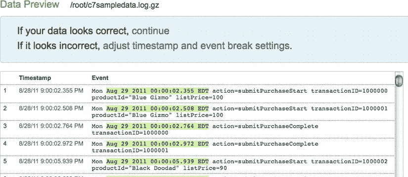

图 7-3 数据预览

在图 7-3 中，您可以看到`Splunk`分配的时间戳与实际事件中高亮显示的时间戳不同。差异的原因是事件的时间戳基于美国东部夏令时区，但`Splunk`用户定义了太平洋时区，因此它相应地显示了时间戳。

 **警告** 尽管 `Splunk` 存储了正确的时间戳，但它会根据用户配置文件中定义的时区进行显示。这也会影响搜索中选择的时间范围。

 **注意** 顺便提一句，要查看或更改当前用户配置文件的时区，可以进入管理器并选择“`Your account`”选项。从图 7-4 中可以看到，该界面允许管理用户配置文件中的多项设置，包括时区。

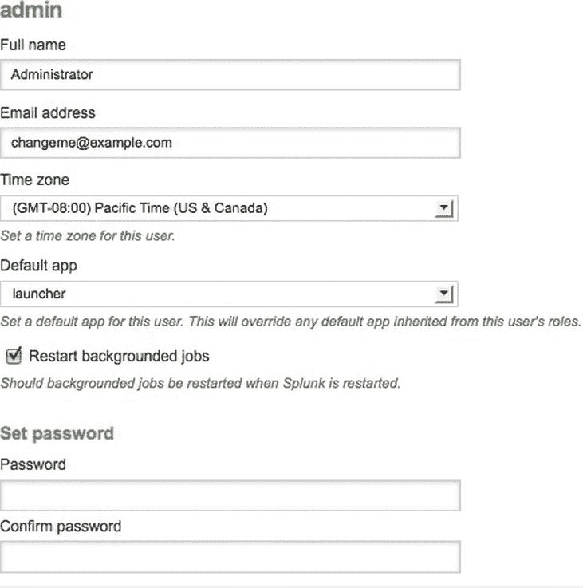

图 7-4. 用户配置文件

回到加载样本数据。现在你理解了时间戳差异的原因，且其余数据看起来都正确，我们点击数据预览上方的“`continue`”链接。此操作会弹出一个窗口，要求命名新的源类型。我们将其命名为`c7example`，然后点击右下角的“`Save source type`”按钮。随后会出现另一个弹出窗口，提示`c7example`已成功创建，接着点击“`Create input`”按钮。

此时，你会看到图 7-5 所示的界面，在此界面中选择“从此`Splunk`服务器索引一次文件”。图 7-5 中未显示，但在“`More settings`”部分下的对应下拉菜单中，选择`Splunk`用于存储这些数据的索引，本例中为`c7`。

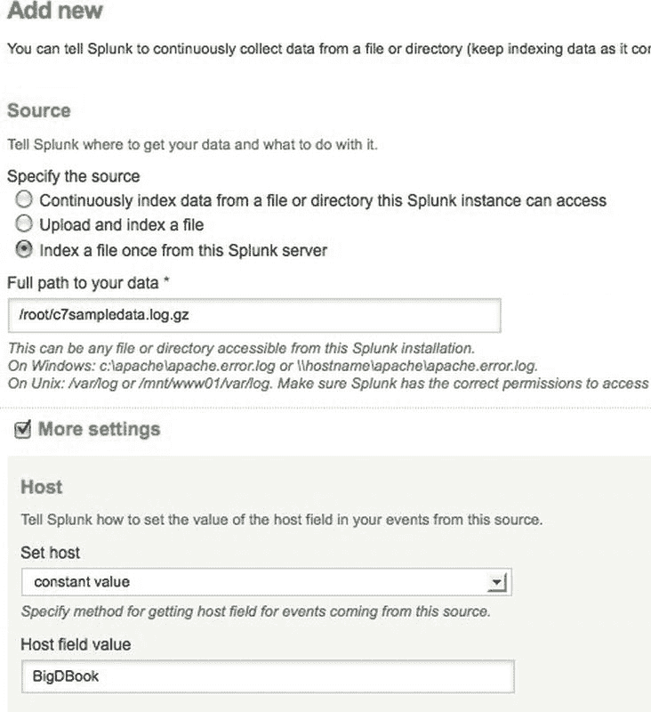

图 7-5. 加载新文件

保存新文件定义后，`Splunk`会立即开始加载。对于本例，加载需要几分钟。要了解加载何时完成，可以在用户界面中进入搜索窗口，从状态下拉菜单中选择“`Index activity`”，然后选择“`Index activity overview`”。这将显示图 7-6 中的信息，从中可以看到`c7`索引拥有 3,815,666 个事件，这与原始文件的事件数量一致。

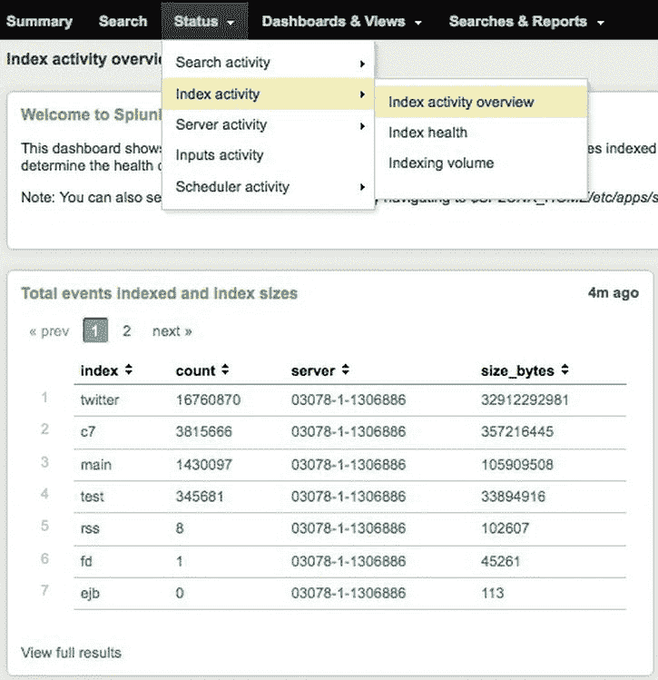

图 7-6. 索引活动概览

下一步是验证数据是否已正确加载。在查看搜索结果之前，必须记住选择正确的数据时间范围，因为数据来自 2011 年。为此，从时间选择器的下拉菜单中选择“`Custom time`”。这会弹出一个窗口，如图 7-7 所示。在窗口中可以看到，我们选择了最早的起始日期，并将 10 月 3 日作为最晚时间。尽管样本数据在 10 月 2 日午夜前几秒结束，但选择 10 月 3 日可以避免在最新时间字段中输入 23:59:59.999。如果不这样做，搜索结果将为空。

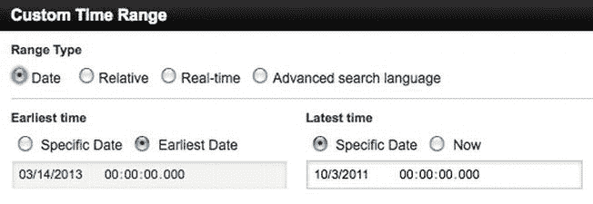

图 7-7. 设置自定义时间范围

现在你可以输入以下搜索来验证数据：`index=c7 | head`。这会显示最新的 10 个事件，用于验证事件中的字段是否被识别并显示在左侧栏中。同时，还要检查`Splunk`为每个事件创建的默认字段的值：这些字段包括主机、源类型和源文件。在图 7-8 中可以看到，左侧栏中显示了`action`、`transactionID`、`productId`和`listPrice`字段，且每个事件的默认字段显示了正确的信息。

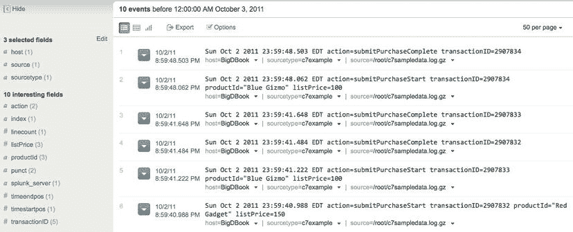

图 7-8. 验证加载的数据

验证完成后，你可以编写搜索来回答之前提出的问题。然而，仅使用`submitPurchaseStart`事件来计算指标是不正确的，因为如果在`submitPurchaseComplete`事件之前的任何函数失败，指标就会出现偏差。由于完整的事务由这两个事件共同组成，你必须使用`Splunk`的`transaction`命令（我们在第3章中已经介绍过）来正确计算所需的指标。

`transaction`命令的开销相当大，因为它会跟踪所有事务的结束点，直到能够将它们与起始点匹配，前提是这些事件是成对的，但实际情况可能并非总是如此。根据事件数量以及首个事件与最后一个事件之间的时间差，这可能会消耗大量内存。跟踪是按逆序进行的，因为`Splunk`按时间逆序查看事件，从最新到最旧。

我们首先找出样本数据中事务开始和结束之间的最长时间。可以通过输入以下命令完成：

```
index=c7
| transaction transactionID maxspan=1m
| stats max(duration)
```

在此搜索中，你指定事务由字段`transactionID`界定，即只有该字段值相同的事件才会被分组。你还指定事务中首个事件与最后一个事件之间的最长时间不能超过一分钟。我们这样做是因为如果不加以限制，某些事务可能会因被移除以腾出空间而不被计入。通过指定一个相对较大的时间，可以确保所有事务都被包含在计数中。

正如你在第6章中所看到的，`transaction`命令会生成两个字段：`duration`和`eventcount`。该搜索的结果是 0.6 秒，因此从此刻起，你可以指定事务的最长时间为 1 秒，以提高效率。接下来，你将找出哪些事务是不完整的，即购买失败。获取此信息的一种搜索方式是：

```
index=c7
| transaction transactionID maxspan=1s
| search NOT *submitPurchaseComplete
```

这个搜索相当有意思，因为我们使用了两次`search`命令。第一次用于从`c7`索引中提取所有事件。然后再次使用它来查找由`transaction`命令创建的新事件，这些事件不包含与正则表达式`*submitPurchaseComplete`匹配的字符串。请注意，第一行没有包含单词“search”，因为第一个命令总默认为搜索。第二次使用该命令时必须明确写出`search`。值得指出的是，此搜索的结果将包含任何耗时超过 1 秒的事务，而我们知道这些事务并不存在。对于样本数据，此搜索的结果产生了四个事务，如图 7-9 所示。这回答了关于购买失败的问题，并具体指出了哪些事务失败了。

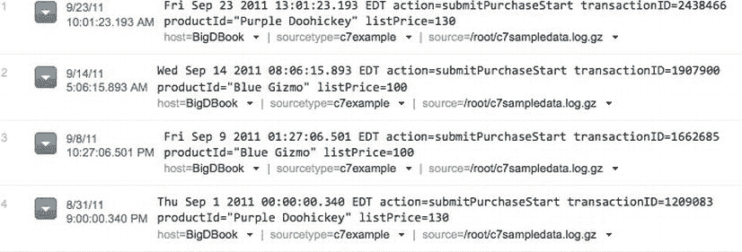

图 7-9. 不完整的事务

现在你可以找出平均事务时间，这有助于回答清单中的几个问题。我们首先了解购买耗时情况。为了在用于呈现结果的柱状图中获得良好的分辨率，我们选择计算一周内每小时的平均事务持续时间，任何更长时间段都会导致图表难以辨认。请记得为此搜索更改时间范围。

```
index=c7
| transaction transactionID maxspan=1s
| timechart avg(duration) span=1h
```

搜索结果可在图 7-10 中查看，该图呈现了一个最小 *y* 轴值为 0.3 的柱状图。我们这样做是为了让图表具有更好的分辨率。当我们将鼠标悬停在某个柱子上时，`Splunk`会显示该特定柱子的详细信息。由此我们可以推断，交易时间较长的情况发生在每天下午 4:00 到晚上 7:00 之间。

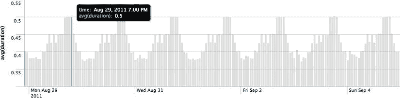

图 7-10：每小时平均交易时间

要查明底层系统是否正在变慢，或者购买时间是否比上个月更长，您可以执行一个类似于之前的搜索，但这次是按天计算平均值。因此，我们将`timechart`命令的`span`参数更改为`span=1d`。这将更好地反映较长时间跨度内的任何问题，并且我们使用折线图，可以清晰地显示任何可能存在的趋势。在将时间范围调整为包含时间选择器中所有 5 周的数据后，结果可在图 7-11 中查看。

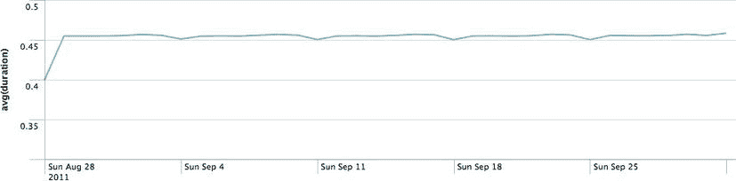

图 7-11：每日平均交易时间

如图 7-11 所示，除了数据第一天出现的偏差外，交易时间在整个样本数据覆盖的时期内看起来相当稳定。如果底层系统存在任何问题，它们会通过折线上随时间推移呈现的上升趋势而显现出来。很可能，整个样本期间的交易数量是相同的。您可以通过创建显示所有产品每日购买量的图表来验证这一点，并部分回答清单中的第一个问题。使用以下搜索，结果以堆积柱状图的形式呈现，可在图 7-12 中查看。从图中可以看出，产品的销售量随时间变化非常稳定，这很可能就是交易时间没有出现任何退化的原因。

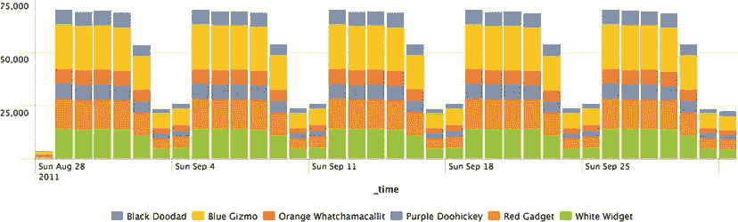

图 7-12：按产品划分的每日销售量

```
index=c7
| transaction transactionID maxspan=1s
| timechart count by productId span=1day
```

图 7-11 中观察到的每日平均时间的偏差，可以通过查看图 7-12 中数据第一天（2011年8月28日，星期日）的销售数量来解释。由于那天的销售数量非常少，交易时间平均比其他日子短了 0.1 秒。

诚然，这是一个简单的例子，但它清楚地说明了从日志文件中进行高级分析是多么容易，而无需处理数据模式或编写特殊代码将数据插入数据仓库或数据库。

## 日志记录最佳实践

为了充分利用 Splunk 中的语义日志记录，我们提供一些提示或最佳实践。第一条，其中包含几个要点，是创建人类可读的日志：具体来说，就是使用纯文本记录。虽然二进制日志记录听起来更好，因为它经过了压缩，但它需要解码，并且不便于分段处理。您还应该让日志易于人类理解，因此不要在日志条目中对某些元素使用需要查找表才能解码的复杂编码。

另一个建议是使用日志条目的类别。大多数日志系统，如 `Log4J`，都提供了一组预定义的类别，可以满足大多数需求；请使用它们，因为这将更容易控制记录的数据量。最后，正如您将在本书的社交媒体部分看到的那样，Splunk 使得使用 JSON 或 XML 变得非常容易，但除非您确实需要多层嵌套，否则请不要使用它们。

时间戳是另一个需要考虑的项目，并且可能最为重要。不要使用时间偏移量，因为这在进行比较和处理时区时，会不必要地导致各种问题。请使用人类可读的标准时间戳，并尽量将其放在行首。这不仅适用于日志文件，正如您将在本书第二部分和第三部分中看到的那样，也适用于几乎所有包含日期和/或时间的数据。底线：为每个事件明确添加时间戳。

使用清晰的键值对。这看起来可能会因为重复大量信息而占用更多空间，但请记住，Splunk 以压缩格式存储原始数据，而键值对具有非常高的压缩率。以下示例是大多数开发者创建日志条目时非常传统的写法：

```
log.debug("Error 1454 - %s %d\n", userID, transID)
```

这种习惯性日志记录方式的问题在于，搜索单词 `Error` 过于宽泛。虽然 Splunk 会非常快速地找到它，但随后理解伴随信息所需的操作可能会相当复杂。通常，这种日志条目需要正则表达式来解析，而键值对则可以使用单一的、一致的规则进行处理。以下是前述示例的推荐等效日志记录语句：

```
log.debug("orderstatus=error, errorcode=1454, user=%s, transactionid=%d\n", userID, transID)
```

如果您无法创建键值对，但您有包含列名或键名的标题行，这对 Splunk 也同样有效。诸如 `ps` 和 `vmstat` 之类的 Unix 命令会产生有价值的信息，但列名仅作为标题行提供。Splunk 知道如何提取这些列名并将其用作对应值的键。这将在本书第二部分的项目中详细回顾。

一种流行的做法是将包含多个值的字段记录为单行，因为开发者认为这是最简单的方式。我们强烈建议将多值信息分解为日志文件中的单独条目。请看这个示例：

```
Mar 10 2013 04:12:02 phonenumber=669-555-1212, app=angrybirds,facebook
```

在 Splunk 中解析 `app` 值要比直接使用键值对困难得多。此外，向每个多值添加数据也存在限制。如果将每个多值分解为日志文件中的单独行，解析和处理附加数据就会容易得多。从开发者的角度来看，这个建议不应增加日志记录语句或语句集的复杂性。如果按如下方式记录，前面的示例会好得多：

```
Mar 10 2013 04:12:02 phonenumber=669-555-1212, app=angrybirds, installdate=Jan-02-2012
Mar 10 2013 04:12:02 phonenumber=669-555-1212, app=facebook, installdate=Jun-29-2012
```

另一个最佳实践是在每次机会出现时记录唯一标识符。这样，您就能有效地跨越系统中不同组件的多个日志文件，并允许您详细追踪事务。您可以使用 Splunk 的 `transaction` 命令来关联不同的日志条目，并将它们转换为单个事务。这也被称为传递闭包，因此，如果您有一些如下例所示的日志条目，您将能够将它们全部链接起来：

`transID=135889976`
`transID=135889976, otherUniqueID=qwas543`
`otherUniqueID=qwas543`

您当下正在记录的信息可能会暴露超出预期的大量信息。重构代码以利用这一新范式的努力起初看似艰巨，但请循序渐进、自然发展。在多数情况下，只需修改现有日志语句，使其遵循已介绍的最佳实践即可。带着这一新范式开发未来的应用程序，您会发现其投资回报将是无价的。

在运维方面，请记得使用日志文件轮转策略，即销毁或备份日志。您可能更倾向于销毁日志，因为所有信息现在都已索引到 Splunk 中。我们还建议您在生成日志文件的服务器本地进行日志记录。更多细节可在第 15 章中了解，该章节回顾了 Splunk 转发器的使用。

总而言之，记录明显需要的内容，即任何能为分析增加价值的信息，尤其是在聚合和可视化之后，因此请记录比调试事件更多的内容。

### 总结

在本章中，您了解了一种新范式：从日志文件中获取高级分析，而非使用数据仓库的传统方法。我们通过一个示例说明了这有多么简单，并回顾了语义日志记录的最佳实践。