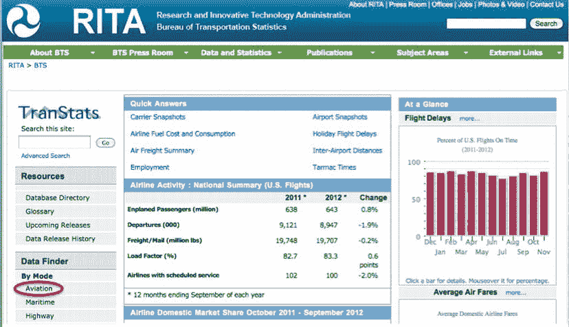

# 第 9 章

## 将航班数据加载到 Splunk 中

本章详细讨论了航空公司准点率项目所使用的数据。它介绍了两种将结构化数据加载到 Splunk 的方法：使用逗号分隔值（CSV）文件以及直接从关系型数据库加载。本章还涵盖了基于分布在多个列上的数据来处理复杂时间戳的各种方法。

### 使用 CSV 文件

CSV 文件可能是从关系型数据库或其他系统与应用程序导入和导出数据最流行、最简单的方法。在本节中，我们将使用一个包含美国所有计划内商业国内航班信息的公共数据集。该数据集将成为本书第二部分示例的基础。

### 航班数据

美国运输统计局有一个专门介绍 TranStats 的网站，TranStats 是一个多式联运运输数据库。该数据库包含定期更新的航空、海运、公路、铁路及其他运输方式的信息。如前所述，我们将仅关注航空公司准点率数据，该数据以一个简单的表格形式提供，包含发生在美国境内所有计划内的直飞航班的起飞和到达数据。这些数据由在美国国内定期客运收入中占比至少百分之一的持证承运人按月报告。航班数据及其描述可在以下网址获取：

`http://www.transtats.bts.gov/DL_SelectFields.asp?Table_ID=236&DB_Short_Name=On-Time`

或者，首先访问 `www.transtats.bts.gov`。然后点击在左侧边栏“数据查找器”下，“按模式”分类中的“航空”链接。此选择如图 9-1 所示。

