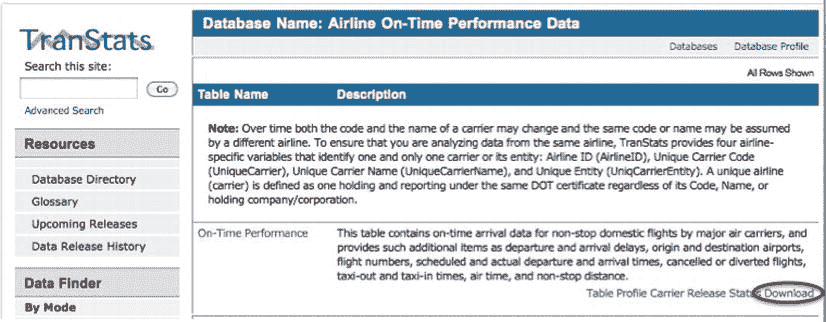
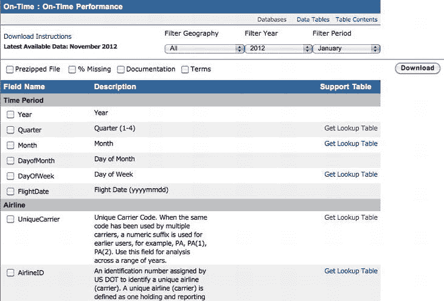

# 文档排版

## 图 9-1  
TranStats 网站

选择 Aviation 链接将进入一个页面，其中列出了与航空相关的数据库列表。在此列表中，通过点击数据库名称选择 Airline On-Time Performance Data。这将进入下一个页面，其中显示了我们感兴趣的数据库的更多详细信息。在此页面中，点击下载链接，如 图 9-2 所示。

## 图 9-2  
航空公司航班准点率页面

### 下载数据

图 9-1 中展示的下载页面提供了一系列全面的下载选项。你可以按州、年份和月份过滤数据，在此示例中，一个月是数据的标准单位。数据从 1987 年 10 月开始提供，网页会明确指示最新可用的月份。

**图 9-3**  
航班准点率下载页面

在过滤选项下方，你会找到与信息类型相关的四个额外选项。为了我们的目的，请选择 *预压缩文件* 选项。此选项为我们提供一个压缩归档文件，其中包含一个包含所有可用字段的 CSV 文件和一个包含字段描述的 HTML 文件。如果你只对选择特定字段感兴趣，你也可以在此页面中进行选择。然而，为了能更轻松地跟随本书中的示例，你应该下载包含所有字段的完整文件。

首先，我们只下载一个月的数据以熟悉数据。但在下一章中，我们将使用所有可用的数据。下载一两个月的数据相当简单，但当需要逐月下载自 1987 年以来的所有数据时，就变得非常繁琐。你可以使用`wget`或`curl`来自动化下载。在编写本文时，使用这些程序下载数据的适用 URL 是：

`http://www.transtats.bts.gov/Download/On_Time_On_Time_Performance_YYYY_M.zip`

在此 URL 格式中，`YYYY`是年份，`M`是月份数字（从 1 到 12，不是 01）。在本书的下载包中，我们包含了一个名为`download_all_flight_data.sh`的脚本，可自动下载所有数据。例如，要使用`wget`命令下载 1987 年 10 月的数据：

`wget "http://www.transtats.bts.gov/Download/On_Time_Performance_1987_10.zip"`

### 了解航班数据

分析数据时最重要的事情之一是熟悉数据。这一论断适用于所有类型的数据，无论是大数据、结构化数据、非结构化数据，等等。通常，数据是一个不断演变的活实体。其内容及其格式总是在变化。实时数据和历史数据都是如此。无论何种情况，请确保你非常熟悉将要分析的数据。必须特别注意彻底理解可用字段的含义。根据我们的经验，许多棘手的问题都可以直接追溯到对数据的误解。

利用下载页面以分组方式展示所有可用字段并附带简要说明这一优势，来熟悉数据。分组如下：

*   **时间段**。此组主要由预期的字段组成：年份、季度、月份、月中日期、星期几以及实际航班日期。最后一个字段是用于在 Splunk 中定义时间戳的最重要字段之一。
*   **航空公司**。此组需要仔细研究，因为如果这些字段之间的差异没有被清楚理解，可能会出现问题。*UniqueCarrier*、*AirlineID* 和 *Carrier* 字段之间的差异很微妙，但它们会对我们的分析结果产生重大影响。我们将在下一章中更详细地讨论这些字段。航空公司组中的另外两个字段是飞机的尾号（即注册号，相当于汽车的牌照）和航班号。

 **注意**：请注意 *Carrier* 字段右侧有一个获取查找表的链接。点击它会下载一个按唯一代码列出的航空公司名称表。你可以看到，下载页面中的许多字段都有这样的链接。

*   **出发地点**。这里我们同样发现四个可能令人困惑的字段：*OriginAirportID*、*OriginAirportSeqID*、*OriginCityMarketID* 和 *Origin*。我们不会在下一章之前深入讨论每个字段的细节，但我们想强调，你需要熟悉正在分析的数据。
*   **目的地**。这些字段与出发地点字段类似，但指示相应的目的地。
*   **出发性能**。这些字段大多不言自明，但需要澄清缩写 CRS，它代表 Computer Reservation System（计算机预订系统）。字段 *CRSDepTime* 是航班官方计划起飞时间。此字段与航班日期一起将用于在 Splunk 中创建时间戳，这将在本章后面解释。
*   **到达性能**。这些字段与出发性能字段类似，但涉及到达性能。
*   **取消和改航**。指示航班是否被取消或改航，并提供取消原因。
*   **航班摘要**。此处信息包括飞行时间和距离等。
*   **延误原因**。描述航班延误的原因。此组及接下来的两个组很有趣，因为它们展示了数据格式如何随时间变化。此组于 2003 年 6 月添加。
*   **返回登机口信息**。包含关于飞机离开登机口后返回的时间信息。这是 2008 年 10 月添加的一组较新的字段。
*   **改航机场信息**。描述最多五次航班改航的详细信息。此组也于 2008 年 10 月添加。

字段数量随时间增加这一事实令人担忧。问题在于我们可能需要处理三种不同类型的 CSV 文件：一种有 56 个字段，另一种有 61 个字段，最后一种有 109 个字段。我们必须仔细检查下载的 CSV 文件。

我们首先回顾第一个可用月份，即 1987 年 10 月。最简单的方法是使用电子表格。我们首先查看标题行，发现它包含所有 109 个字段的字段名称。这很好，因为这意味着我们可能不必担心处理三种不同的 CSV 文件。现在我们查看第一行数据，发现从第 57 列（*CarrierDelay*）到第 109 列（*Div5TailNum*）没有数据。快速浏览所有数据行显示了这个模式。

