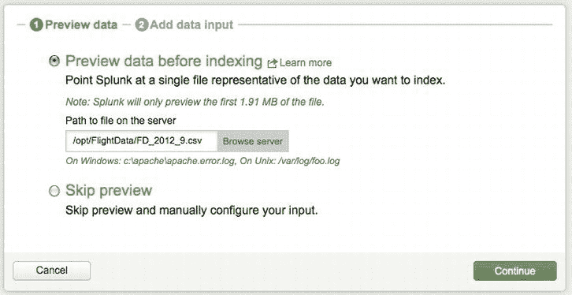
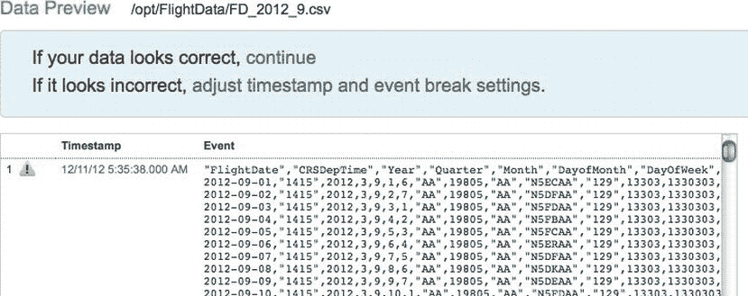
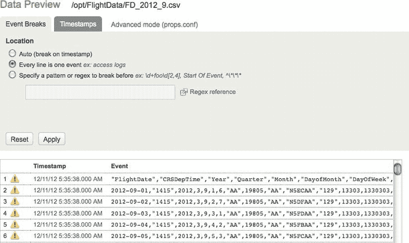
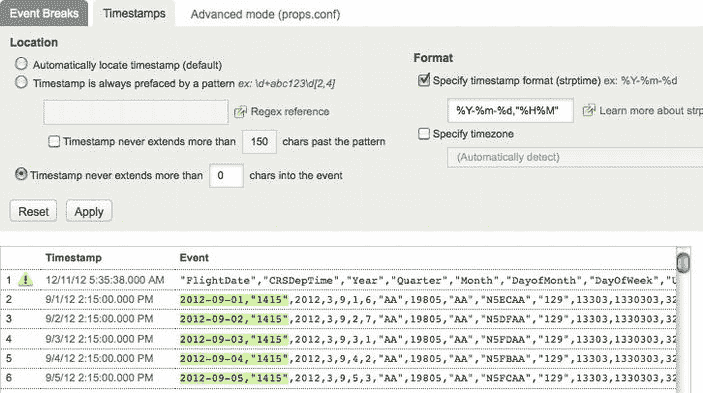
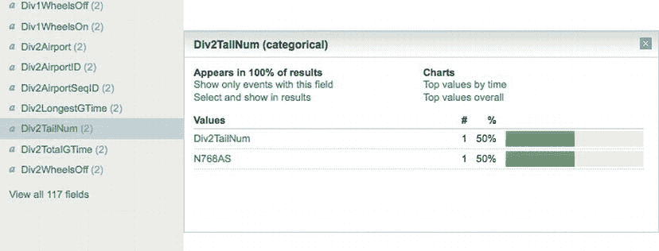
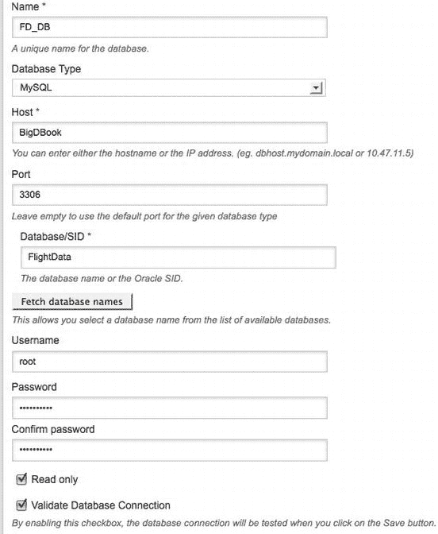
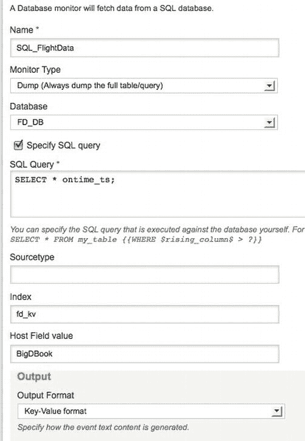
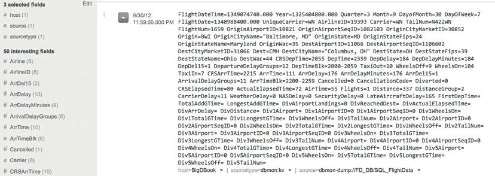

# 预处理航班数据

处理结构化数据的优势之一在于，您总是知道其格式；因此，移动列相对容易。我们选择编写一个 AWK 程序来完成这项工作。该程序基于对作为字段分隔符的逗号进行计数。我们所要做的是读取一行，然后以重新排列后的列顺序写出它。在 AWK 中，程序的核心如下所示：

```awk
BEGIN {
    FS = ",";
    OFS = ","
}
print $6, $30, $1, $2, $3, ..., $109
```

字段分隔符通过输入文件的 `FS` 变量和输出文件的 `OFS` 变量定义为逗号。AWK 会接收每一行输入，分离字段，并将它们作为名为 `$N` 的变量提供，其中 `N` 是字段或列的编号。请注意，在 AWK 中不需要使用 `read` 指令。通过先写入第 6 列和第 30 列，然后写入其余列，我们实现了目标。这个程序（我们称之为 `column_mover.awk`）在 Unix 中按如下方式执行：

```bash
column_mover.awk < original_data_file > modified_data_file
```


我们在使用 `AWK` 时遇到的一个问题是，它会统计所有逗号，包括字符串内（即一对双引号内）的逗号。在高级语言中，字符串内的逗号被视为字符串的一部分。这一点很关键，因为第 30 列之前的两个字段都是始终包含逗号的字符串。第 16 列 `OriginCityName` 和第 25 列 `DestCityName` 总是包含城市名称和州缩写，以逗号分隔，例如 "New York, NY"。我们通过处理这两个额外的逗号来解决这个问题。现在 `OriginCityName` 由第 16 列和第 17 列组成，所有后续列向后移动一列；而 `DestCityName` 从第 26 列开始，由第 26 和第 27 列组成，进一步将所有后续列向后移动一列，至此总共增加了两列。新的 `AWK` 命令如下：

```
print $6, $32, $1, $2, $3, ..., $109, $110, $111
```

要确保此脚本正确运行，我们需要验证第 30 列之后没有其他包含逗号的字符串字段。在检查数据描述后，确认了这一点。这次对数据结构和内容的审查提醒我们，必须非常熟悉要分析的数据。在选定的航班数据上执行此程序后，我们就可以将其加载到 Splunk 中。我们已将 `AWK` 程序以 `column_mover.awk` 的名称包含在本书的下载包中。

为了定义所需的时间戳组合，我们需要创建一个新的源类型。在本示例中，我们将通过用户界面进行操作，但也可以直接修改 `props.conf` 配置文件来完成。按照定义新数据输入文件的对话框，我们选择在索引前预览数据，并选择要加载的文件，如图 9-4 所示。由于我们正在测试新功能，因此只使用一个月的数据。一旦确认所有操作都能正确运行，我们就可以使用所有可用数据。在本例中，我们将使用最新数据（截至撰写本文时为 2012 年 9 月的数据）。



图 9-4 . 数据预览对话框

点击“继续”后，下一个对话框提供了三个与设置源类型相关的选项。我们选择定义一个新的源类型，因为我们将对字段进行特殊处理。下一屏幕如图 9-5 所示，显示了 Splunk 对数据的初步解析。可以看到，它将所有航班记录显示为单个事件。默认设置是按时间戳换行，但由于 Splunk 无法找到时间戳，它将 CSV 文件的所有行呈现为一个事件。



图 9-5 . 初始航班数据视图

由于数据看起来不正确，我们点击了“调整时间戳和事件分隔设置”。这会将我们带到下一个屏幕，其中提供了多种定义事件分隔的选项。我们选择了“每行是一个事件”，然后点击“应用”按钮。经过短暂的事件处理后，它便以正确的事件分隔方式显示数据，如图 9-6 所示。



图 9-6 . 具有正确事件分隔的航班数据

如图 9-6 所示，每行开头有一个警告三角形。将鼠标悬停在其上时，会提示“无法解析时间戳”。在这种情况下，根据优先级规则，显示的时间戳是 CSV 文件的最后修改时间戳。

下一步是处理时间戳。为此，我们选择相应的标签。如图 9-7 所示，“位置”标题下有三个选项。由于时间戳位于事件的开始位置，我们无需指定其前面的模式。如果时间戳位于事件更靠后的位置，并且前面有类似字符串的内容，此选项非常有用，例如：

```
Printed on 04/17/2012 Page 01
```



图 9-7 . 时间戳定义

你可以将模式定义为“Printed on”。你也可以使用正则表达式来定义模式。由于我们的情况并非如此，我们选择了最后一个选项，即定义时间戳处理器可以在事件中查找时间戳的最大字符数。这个数字是 0，因为用于定义时间戳的字段始终位于事件的开头。时间戳字段越靠近事件开头，对 Splunk 来说越好，并且在索引数据时处理时间戳的速度也会越快。

在“格式”标题下，我们可以指定时间戳格式和时区。我们已经决定不使用后者，因此可以继续定义前者。这是通过使用 `strptime()` 表达式完成的，这些表达式非常简单，并且在多种编程语言中都有详细的文档说明。在我们的例子中，表达式是 `%Y-%m-%d,"%H%M,"`，这意味着四位数的年份、短横线、两位数的月份、短横线、两位数日期、逗号、双引号、24 小时制的小时（00 到 23）和两位数的分钟。

 **注意** Splunk 目前无法识别非英文字符的月份名称（`%B`、`%b`）或星期名称（`%A`、`%a`）。替代方案是使用数字月份（`%m`）和星期（`%u`）。

应用这些定义后，图 9-7 中的数据预览屏幕会向我们显示一个事件列表，其中包含所需的时间戳，并且高亮显示了与时间戳表达式匹配的部分。唯一需要注意的是，标题行仍然显示一个警告，提示其无法解析时间戳，因此它使用了 CSV 文件的最后修改时间。在我们的例子中，这不是问题，因为 CSV 文件的标题行不包含任何航班信息。

下一个对话框要求输入新源类型的名称。我们将其命名为 `FD_Source1` 并保存。之后会进入索引数据界面，在该界面上完成最终选择后，它会自动开始索引。此时，你可以转到搜索应用的摘要页面，查看已索引事件数量的增长情况，直到停止增长。在我们的例子中，2012 年 9 月包含了 490,200 个事件。请注意，此计数包括了标题行。

现在，我们可以验证新的源类型是否工作正常。我们首先在用户界面的搜索框中输入以下搜索命令来查看几行数据：`* | head`。由于我们没有指定任何排序，Splunk 默认会按时间戳降序排列，即从最新到最旧。正如预期，标题行是第一个显示的事件，随后是时间戳为 2012 年 9 月 30 日晚上 11:59:00.000 的事件，并继续按时间戳递减排列。这些事件包含了我们期望的信息。我们还可以看到，每个事件都正确显示了主机名称、源类型和源文件。


### 标题层级优化
（根据内容逻辑重新划分，保留原始标题结构，未新增标题）

---

回顾左侧边栏，我们注意到在“Interesting Fields”下，标题行中的字段名称没有显示出来。这并不理想，因为将来分析数据时，我们将无法在这些搜索中使用字段名称。问题在于我们错误地假设 Splunk 会自动将标题行中的字段名称与数据字段关联起来。如果使用 CSV 作为源类型，这通常会发生，但在我们的案例中，我们定义了一个新的源类型。解决方案是在 `props.conf` 文件的 `_FD_Source1_` 配置节中将 `CHECK_FOR_HEADER` 属性设置为 true。

不幸的是，`CHECK_FOR_HEADER` 属性仅在索引时生效，因此我们必须删除已索引的数据并重新索引。在 `_props.conf_` 文件中添加 `CHECK_FOR_HEADER` 属性后，我们停止 Splunk。所有对配置文件的更改都需要重启才能激活。我们停止 Splunk 的原因是，用于删除已索引事件的命令仅在 Splunk 未运行时才有效。

`clean` 命令是通过 Unix 提示符下的命令行界面（CLI）发出的，它根据你是否提供索引名称作为参数，来删除一个或所有索引中的数据。由于我们的 Splunk 实例仅包含主索引中的航班数据，我们将通过执行以下命令来删除所有数据：

```
splunk clean eventdata
```

删除索引中的数据后，我们再次启动 Splunk，然后可以继续重新索引数据。我们的操作方式与之前大致相同：预览数据，但这次我们选择使用现有的源类型，并从下拉菜单中选择 `FD_Source1`。Splunk 向我们呈现了数据，看起来是正确的，然后我们继续索引。

索引完成后，我们再次验证源类型是否正常工作。当我们搜索前 10 个事件时，我们可以看到字段名称出现在左侧边栏中。一切看起来都不错。然而，我们也注意到每个事件上的源类型现在变成了 `FD_Source1-2`。虽然看起来可疑，但这被证明是当 `CHECK_FOR_HEADER` 为 true 时的一个副作用，它会导致索引的源类型被追加一个数字。

  
**注意**   当 `CHECK_FOR_HEADER` 设置为 true 时，字段名称存储在定义源类型的服务器上。因此，此功能在大多数转发数据的环境中将无法使用。

现在，我们可以尝试一些搜索命令，看看字段名称是否与内容正确对齐。第一个快速检查是通过在用户界面的搜索屏幕中输入以下搜索命令，来查找按计划航班数量排序的前 10 个出发机场：

```
* | top Origin
```

此搜索会遍历所有已索引的事件，这也是我们进行这些快速验证时想要做的事情之一。`Origin` 字段包含机场代码。结果显示前 10 个机场，并包含了常见的主要机场：亚特兰大、芝加哥奥黑尔、达拉斯/沃斯堡、丹佛等。

在接下来的检查中，我们将尝试验证如果某个事件具有最后一个字段 `Div5TailNum`，那么它是否也包含实际的尾翼编号。我们使用的搜索是：

```
* | where isnotnull(Div5TailNum)
```

此搜索的结果仅包含标题行，因此本月没有出现五个经停点的航班。我们尝试搜索 `Div4TailNum` 和 `Div3TailNum`，均未成功，直到我们对 `Div2TailNum` 进行搜索并得到结果。这仅显示了 9 月 1 日上午 7:40 阿拉斯加航空的一个事件。我们转到左侧边栏并点击 `Div2TailNum`。图 9-8 显示了一个弹出窗口，其中包含统计信息和字段值的细分。这里有两个值：来自标题行的 `Div2TailNum` 和 `N768AS`，后者是一个正确的尾翼编号，恰好与 `TailNum` 字段中包含的编号相同。



图 9-8 . 带有统计信息的字段弹出窗口

我们使用事件中间的一个字段进行最后一项检查。选择的字段是 `Cancelled`。值为 1 表示航班取消，值为 0 则表示未取消。执行以下搜索命令：

```
* | chart count by Cancelled
```

此命令遍历所有事件，字段弹出窗口显示三个值：0、1 和 `Cancelled`。最后一个值果然来自标题行。由于没有其他值，且未取消航班（99.193%）和取消航班（0.807%）的百分比看起来合理，这个结果以及之前几次搜索的结果让我们确信数据已正确索引到 Splunk 中。

---

### 修改时间戳处理器

将航班数据的期望字段映射到时间戳的第二个选项是修改 Splunk 的时间戳处理器。Splunk 会自动识别并提取大多数明显的時間戳。它通过一组预定义的正则表达式来完成此操作，这些表达式可以在 Splunk 的 `etc` 目录下名为 `datetime.xml` 的文件中找到。

使用此选项，我们需要编写一个新的正则表达式，以便将第 6 列和第 30 列映射为新的时间戳。有许多不同的正则表达式可用于此映射。本例中，我们将采用与之前移动列的 AWK 脚本类似的方式：我们将统计逗号。和之前一样，我们必须考虑到第 6 列（`OriginCityName`）和第 25 列（`DestCityName`）始终包含城市名称和州缩写，两者之间用逗号分隔。

思路是跳过前五列，捕获日期，然后跳过接下来的 26 列，再捕获时间。我们使用的正则表达式是：

```
(?:[^,]*,){5}(\d+)-(\d+)-(\d+)(?:[^,]*,){26}"(\d\d)(\d\d)"
```

虽然这不是正则表达式教程，但我们会解释这串奇怪的字符组合的含义。你可以使用你喜欢的搜索引擎在网上找到各种正则表达式教程。在第一部分 `(?:[^,]*,)` 中，外层括号表示我们对正则表达式的这一部分进行分组。分组会被记住以备后续引用，但这是相当消耗处理资源的。因为我们在此正则表达式部分仅使用分组来跳过字段，所以我们使用了 `?:` 字符，这是一个特殊指令，告诉正则表达式处理器不要记住这个分组，这将加速处理过程。

方括号（`[]`）用于定义字符集，它告诉正则表达式引擎仅匹配该集合中所有字符中的一个。当插入符号（`^`）用作集合中的第一个字符时，它表示该集合被取反。在本例中，`[^,]` 匹配除逗号之外的任何字符。请注意，在所有其他上下文中，插入符号表示行首。紧随其后的星号（`*`）是一个重复指令，表示零次或多次。最后，逗号是一个需要匹配的字面逗号。因此，`(?:[^,]*,)` 意味着该分组匹配任何字符（除逗号外）零次或多次，后跟一个逗号，并且不要记住此分组以备将来引用。分组可以通过用花括号（`{}`）括起来的次数来重复。在本例中，我们将第一个分组重复了五次。

在下一部分 `(\d+)-(\d+)-(\d+)` 中，我们通过定义这三个分组来捕获日期。`\d` 是字符集 `[0-9]` 的简写，它描述所有数字。加号（`+`）是一个重复指令，表示一次或多次。分组之间的短划线是需要匹配的字面字符。请注意，这些分组不包含 `?:` 指令；因此，它们将被记住，以便我们以后可以引用它们来提取日期。


正则表达式的第四部分会跳过接下来的 26 个字段，然后我们将日期捕获为两个独立的分组——小时和分钟，并用双引号（“）括起来。

使用这个正则表达式，我们创建了一个新的时间戳处理器：

```
<datetime>
  <define name="flightdata_csv_timestamp" extract="year, month, day, hour, minute">
    <text><![CDATA[(?:[^,]*,){5}(\d+)-(\d+)(\d+)(?:[^,]*,){26}"(\d\d)(\d\d)"]]></text>
  </define>
  <timePatterns>
    <use name="flightdata_csv_timestamp"/>
  </timePatterns>
  <datePatterns>
    <use name="flightdata_csv_timestamp"/>
  </datePatterns>
</datetime>
```

这里我们定义了一个名为`flightdata_csv_timestamp`的时间戳处理器，它会按照指定的顺序，从那些我们要求正则表达式记住的分组中提取年、月、日、小时和分钟。接下来的语句说明该处理器将用于处理时间和日期模式。按照最佳实践，我们没有将这段 XML 代码直接添加到`datetime.xml`文件中，而是创建了一个单独的文件，名为`datetime_flightdata.xml`，你可以在本书的下载包中找到它。

既然我们已经定义了一个新的时间戳处理器，下一步就是将其与一个源类型关联起来。这一次，我们不使用用户界面，而是直接处理配置文件。在 Splunk 的`etc/system/local`目录中，我们修改已有的`props.conf`文件，并为名为`FD_Source2`的源类型添加以下配置段：

```
[FD_Source2]
DATETIME_CONFIG = /etc/datetime_flightdata.xml
MAX_TIMESTAMP_LOOKAHEAD = 220
SHOULD_LINEMERGE = false
CHECK_FOR_HEADER = true
```

第一个属性指定了包含时间戳处理器的文件。注意，该文件名是相对于 Splunk 的安装目录的。第二个属性指定了 Splunk 应该在事件中向前查找多少个字符来寻找时间戳：在我们的场景中，即第 30 个字段在事件中的位置。在审查了航班数据后，我们估计 150 个字符可以覆盖所有情况，但为了保险起见，我们将上限增加到了 220。请注意，如果这个数值设置不当，你可能会完全错过时间戳。

行合并属性与 Splunk 拆分行的方式有关。如前所述，默认情况下会在时间戳处拆分。如果没有时间戳，它就会创建一个包含所有事件（或者在我们的例子中是航班记录）的单一事件。通过将此属性设置为`false`，Splunk 的行为将变为为每一行创建一个事件，也就是说，它会在换行符处拆分事件。最后一个属性指定 Splunk 应从 CSV 文件的标题行获取字段名。

现在我们已经定义好了使用新时间戳处理器的源类型，可以进行测试了。首先，我们使用 CLI 的`clean`命令删除之前索引的所有事件。然后，通过用户界面，使用预览选项添加一个新文件。在这里，我们指定使用新的源类型`FD_Source2`，预览会显示除了标题行之外，所有事件都带有正确的时间戳。

索引完数据后，我们执行了与预处理选项相同的一组快速测试，并验证了该方法能正确工作。

## 索引所有航班数据

使用本书下载包中包含的`download_all_flight_data.sh`脚本，我们将所有航班数据下载到了名为`/mnt/flight_data`的目录中。现在，我们需要选择使用哪种选项将这些数据索引到 Splunk 中。因为我们有点懒，所以使用修改后的时间戳处理器，从而避免移动时间戳相关列的额外预处理步骤。

在我们开始索引所有航班数据之前，必须在定义`FD_Source2`源类型的`props.conf`文件中添加一个属性。原来，默认情况下，Splunk 只处理从当前日期起过去 2000 天以内的时间戳。这大约是五年半。而我们的数据最早可以追溯到 1987 年 10 月。通过设置`MAX_DAYS_AGO`属性，我们可以定义时间戳有效的过去天数。最大值是 10,951 天，大约为 30 年，这个数值足以覆盖我们的数据。

对于那些时间戳超出了`MAX_DAYS_AGO`属性所定义限制的事件，Splunk 的时间戳将显示为最旧的有效时间戳。因此，你将无法有效使用 Splunk 的时间戳，因为它会显示错误的值。另一种方法是使用数据中包含日期和时间的特定字段。

 **注意** 如果你的数据日期早于 1970 年 1 月 1 日（Unix 纪元），你将无法使用 Unix 时间作为替代时间戳。

如前几章所述，将文件一次性索引到 Splunk 的一种方法是使用 CLI 命令`add`配合`oneshot`选项。鉴于我们需要上传到 Splunk 的单个 CSV 文件数量庞大，索引这些文件的最佳方式是使用以下命令：

```
splunk add oneshot /mnt/flight_data/On_Time_On_Time_Performance_YYYY_M.csv \
–sourcetype FD_Source2
```

然而，由于`oneshot`选项不支持处理多个文件，我们编写了一个快速脚本，指定了`/mnt/flight_data`目录中所有 300 个 CSV 文件。你可以在本书下载包中找到这个脚本，其文件名为`fd_index.sh`。

像往常一样，我们想要验证所有数据是否都已正确索引，因此我们对 2001 年 9 月 11 日（一个我们预计取消率很高的日期）运行了以下搜索命令。首先在用户界面的搜索页面上的时间选择器中设置日期，然后输入：

```
* | stats count by Cancelled
```

结果显示，在 17,430 个计划航班中，有 14,900 个航班被取消。也就是说，只有 14.5%的计划航班未被取消。下一个快速搜索是为了验证数据是否一直索引到了 1987 年 10 月，因此我们在时间选择器中设置适当的时间范围，并执行以下搜索：

```
* | top Dest
```

由于此搜索命令将遍历该月的所有事件，我们首先验证事件数量是否与航班数量一致。结果相差一个，这是正确的。因为 Splunk 中的标题行有一个不属于 1987 年 10 月的时间戳。最终热门目的地机场的结果仍然是那些常见地点：芝加哥奥黑尔、亚特兰大、达拉斯/沃斯堡、洛杉矶和丹佛。虽然这不是一个详尽的验证过程，但我们确信所有航班数据都已正确索引到 Splunk 中。

## 从关系数据库索引数据

使用 CSV 文件的主要原因之一是您无法直接访问数据库。但如果您恰好能够直接访问包含待分析数据的**关系数据库**，即使只有只读权限，也可以避免将数据导出为 CSV 格式的额外步骤。通过使用 Splunk 的 DB Connect 应用，您可以创建并管理到外部关系数据库的连接，这些连接随后可以被定义为数据输入，就像处理任何其他文件、原始 TCP/UDP 输入或脚本化输入一样。

DB Connect 应用的主要组件是 Java 服务器桥接器。该桥接器接收来自 Splunk 的指令，然后将其转换为 SQL 请求，并通过 JDBC 驱动程序发送到一个或多个关系数据库。当您在 Splunk 上安装此应用时，您就获得了创建和管理连接到外部基于 SQL 的关系数据库的能力。


在本节中，我们仅解释如何使用 DB Connect 应用从关系型数据库中提取数据，以便 Splunk 对其进行索引。使用 DB Connect 访问查找表的内容在第 11 章中解释。为了说明直接从数据库索引数据的过程，我们创建了一个 MySQL 实例，其中包含一个表，该表存储了与 CSV 文件字段完全相同的航班数据。要完成此目标，需要执行两个步骤：

1.  定义数据库连接
2.  从数据库中获取数据

### 定义新的数据库连接

安装 DB Connect 应用后，导航至 Splunk 的管理器界面。在“数据”组下，您会看到一个名为“外部数据库”的新选项。选择此选项后，将进入一个新界面，您可以在其中定义连接数据库所需的信息，如图 9-9 所示。



图 9-9 . 定义数据库连接

与 Splunk 中的任何资源一样，您必须为此数据库连接指定一个名称。我们将其命名为 `FD_DB`。从此刻起，所需的信息与任何应用程序连接关系型数据库所需的信息基本相同。您必须提供主机名、端口号、数据库名称（或 Oracle SID）、用户名和密码，并可选择性地设置此连接是否为只读。您还可以在保存前验证连接，这对于确保连接正常工作非常有用。

我们在测试连接时确实遇到了一个问题。连接失败，因为缺少 MySQL 的 JDBC 驱动程序。事实证明，DB Connect 包含了各种 JDBC 驱动程序，但由于许可问题，它没有包含 MySQL 的驱动程序。您只需从提供商处下载 JDBC 驱动程序，并将 JAR 文件放置在 `$SPLUNK_HOME/etc/apps/dbx/bin/lib` 目录中，然后重启 Splunk。Java 类路径在 Splunk 启动时动态构建，并包含上述 `lib` 目录中的所有 JAR 文件。这样 DB Connect 的 Java 桥接器就能使用我们新的 JDBC 驱动程序了。

### 数据库监控

DB Connect 应用用于从关系型数据库获取数据的机制称为数据库监控。有两种类型的监控：

*   **转储**，每次运行时执行相同的 SQL 查询。如果您在计划中未指定间隔，则转储将仅运行一次。这是最基本的机制，相当于使用 CLI 对常规文件进行一次性加载。
*   **尾随**，其工作方式与 Splunk 为文件监控提供的尾随监控类似。此监控类型将确定指定表中的新记录，并仅输出这些记录。查询结果必须包含一个列，该列的值将始终大于任何旧记录的值。您可以为此目的使用自增值或时间戳。

当您从关系型数据库导入数据时，您还可以选择数据获取的格式。您有标准选项：CSV、带标题的 CSV，还可以定义一个模板。此外，您还可以定义基于键值对的格式或多行键值对格式。

无论输出格式如何，您都可以选择是否包含时间戳值。如果包含，事件将以时间戳值为前缀。您还可以指定一个包含时间戳的列。如果未定义时间戳，则使用当前时间。

另一个可定义的项目是执行间隔。您可以选择定义一个静态值（即监控器在两次执行之间应等待的时间量）或一个 cron 表达式。对于固定延迟，只需指定一个固定数字，例如 `1h` 表示 1 小时，或 `3000` 表示 3000 毫秒（3 秒）。Cron 表达式使用与 Unix `crontab` 文件相同的语法。

回到我们的示例，我们将使用转储选项，因为我们只想一次性将所有数据从数据库中取出。（不幸的是，航班数据本身并不适合作为使用尾随监控机制的示例，但此选项将在第 14 章中讨论。）在此之前，我们需要做出几个与数据获取格式和时间戳处理相关的决定。

我们非常倾向于使用键值对格式，原因有很多。首先，Splunk 非常喜欢键值对。键值对是默认格式，也是索引数据时性能最高的方式。其次，键值对格式保持了数据的丰富性和表现力。与 CSV 格式（存在诸多不便，如需要处理逗号计数、标题行被索引为事件等）相比，键值对格式似乎在易用性和强大性方面更胜一筹。我们仍然存在时间戳组件位于两个不同字段的问题，但这可以通过在 MySQL 中创建一个视图来轻松解决，该视图定义一个包含时间戳的新字段，并保留所有其他字段：

```
CREATE VIEW ontime_ts AS
SELECT STR_TO_DATE(CONCAT(FlightDate, ' ', DepTime), '%Y-%m-%d %H%i')
AS FlightDateTime, ontime.* FROM ontime;
```

这种将时间戳放在首位的方法与我们之前处理 CSV 文件的方法类似。但由于新字段具有 Splunk 易于识别的时间戳，我们无需担心任何与时间戳相关的定义。同样，将时间戳作为事件中的第一个字段之一可以使索引更快。

下一步是定义数据输入。我们可以在图 9-10 所示的界面中完成此操作，该界面位于用户界面管理器“数据输入”界面的“数据库监控器”下。



图 9-10 . 定义数据库监控器

定义输入非常简单。我们将此数据库监控器命名为 `SQL_FlightData`，从下拉菜单中将其类型定义为 `Dump`，并指定使用 `FD-DB` 数据库连接。如果您未指定获取数据的查询，输入将默认为选择您定义的表中的所有记录。在本例中，我们希望使用刚刚定义的视图，因此我们的查询非常简单，即选择所有记录，但使用该视图，如图 9-10 所示。或者，我们也可以不创建数据库视图，而是在 Splunk 中编写一个 SQL 查询，其本质与视图的定义相同：

```
SELECT STR_TO_DATE(CONCAT(FlightDate, ' ', DepTime), '%Y-%m-%d %H%i')
AS FlightDateTime, ontime.* from ontime;
```

两种方法均可达到相同的结果，我们没有偏好。为了测试我们的输入是否正常工作，我们指定 `fd_kv` 作为数据加载的索引。我们点击“保存”按钮，查询开始执行，Splunk 开始索引通过数据库连接传入的数据。完成后，我们继续验证数据是否已正确索引。我们通过检查以下搜索的输出（如图 9-11 所示）来做到这一点。

```
index=fd_kv | head
```



图 9-11 . 从 MySQL 表导入的事件


在图 9-11 中，你可以看到事件现在采用键值对格式，时间戳也是正确的，并且左侧边栏中的字段已正确填充。仔细检查第一个事件后，我们注意到 `FlightDateTime`、`Year` 和 `FlightDate` 字段使用的是 Unix 时间。这是因为后两个字段在 `ontime` 表中被定义为 `year` 和 `date` 类型，而 MySQL 内部会将这类字段存储为 Unix 时间。我们通过视图创建的第一个字段被自动归类为 `date` 类型；因此，它也显示为 Unix 时间。如上所见，这并非问题，因为 Splunk 时间戳已正确生成。然而，另外两个字段使用 Unix 时间可能会带来问题，因为任何使用这些字段的搜索都要求我们将其转换为更易读的格式。同样，我们有几种方法可以处理此问题。我们可以在导入查询时转换类型，也可以使用带有 `ctime` 函数的 Splunk `convert` 命令，该函数可将 Unix 时间转换为人类可读的格式：

```
... convert ctime(Year) ctime(FlightDate) ...
```

在决定采用哪种方法之前，我们先退一步，思考一下使用这些字段的频率。事实证明，所讨论的字段仅用于创建 Splunk 时间戳；因此，这不算个问题，我们无需担心。

关于事件，还需注意一点的是已分配的源类型和源。由于我们在定义数据库监视器时没有填写这些字段，它们采用了相当说明性的默认值。源类型是 `dbmon:kv`，由此我们可以快速推断出这是来自数据库监视器的键值对格式。源本身是 `dbmon-dump://FD_DB/SQL_FlightData`，同样，我们也能迅速推断出它来自一个数据库监视器，具体来说是来自名为 `FD_DB` 的数据库，且监视器名为 `SQL_FlightData`。

如您所见，使用 DB Connect 应用连接到关系数据库非常简单。尽管我们没有探讨诸如追踪和调度等其他选项，但使用它们同样与我们在此处所做的一样简单。

## 总结

在本章中，我们介绍了使用 CSV 文件以及直接连接到关系数据库将数据导入 Splunk 的过程。我们还处理了时间戳问题，以及为了创建有效的 Splunk 时间戳并充分利用它而可以采用的各种处理方法。我们使用航空公司的准点运行数据完成了所有这些操作，这些数据现在已完全索引到我们的 Splunk 实例中。在下一章中，我们将分析这些数据，并学习如何加速报告和搜索。

