# 第 10 章


## 分析航空公司、机场、航班与延误

在本章中，我们将分析与实际航班、延误、延误原因以及机场绩效相关的航班数据。分析将使用前几章中介绍的 Splunk 搜索命令，以及新增的命令和功能，例如分析和报告加速。我们还将讨论如何可视化我们构建的搜索结果，否则这些结果可能会显得非常繁杂且难以理解。

## 分析航空公司

我们在前一章中提到的一点是，您应该非常熟悉您将要分析的数据。在本章中，我们将进一步利用这些对航班数据的了解。我们从一些非常基础的搜索开始，以了解聚合数据的概况。我们提出了一些简单的问题，例如查询航班数据中的航空公司数量。航空业务动态性很强，航空公司不断合并、破产，时不时还会有新的公司进入市场。因此，我们不能仅仅计算最近几个月的航空公司数量，因为我们知道，在 26 年的航班数据中，这个数字会发生变化。

我们需要弄清楚的第一件事是，在计算航空公司数量时应该查看哪个字段。你可能还记得，有三个字段以不同的方式提供了这些信息。`UniqueCarrier` 是一个基于字母的代码，通常常旅客能够理解。当同一代码多年被不同承运商使用时，较早的承运商代码后会添加一个数字后缀。例如，`VX` 现在分配给维珍美国航空，但在此之前，它曾被哥伦比亚的 Aces 航空公司使用过，后者于 2003 年停止运营；因此，Aces 的代码是 `VX(1)`。

第二个字段是 `AirlineID`，它是一个基于美国运输部证书的五位数字代码。随着时间的推移，该代码对每个航空公司都是唯一的。如果我们要对航空公司进行长期详细分析，这就是要使用的字段，但在分析的这个阶段它并不是很有用，因为我们必须记住一组五位数字，直到我们在下一章中实现对航空公司名称的查找。查找表用于根据一个表中的值显示另一个表中的信息。在这种情况下，我们将根据这些字段中包含的代码来显示航空公司的实际名称。最后一个字段是 `Carrier`，它几乎总是包含与 `UniqueCarrier` 相同的助记符，但对于重复使用的情况不会添加数字后缀；因此，该代码并不总是唯一的。检查相应的查找表时会出现另一个问题，该表可以从 TranStats 网站下载；包含航空公司名称的字段包括了该航空公司使用该代码的年份。此外，查找表中重复代码的顺序并不一致，如 表 10-1 的示例所示。

表 10-1。承运商字段查找表的选定样本

| 代码 | 描述 |
| --- | --- |
| FL | 边疆航空有限公司（1960–1986） |
| FL | 穿越航空有限公司（1994–） |
| PA | 泛美世界航空公司（1998–1999） |
| PA | 泛美世界航空公司（1997–1998） |
| PA | 泛美世界航空公司（1960–1991） |
| PA | 佛罗里达海岸航空公司（2003–2005） |
| VX | 维珍美国航空（2007–） |
| VX | Aces 航空公司（1992–2003） |

因为我们在下一章中将使用查找表来获取航空公司的名称，所以 `Carrier` 字段存在太多问题，不予考虑。重复代码不总是按顺序排列，这将迫使我们处理日期以找出最新的那个。之后，我们还需要从航空公司名称字段中删除那些日期。这只是太多不必要的工作。我们最好使用 `UniqueCarrier` 字段，因为它的查找表更适合我们的目的。每个航空公司只有一个代码，并且描述只包含航空公司的名称。

 **注意**  对于我们在本书中进行的这种简易分析，我们不需要严格的历史记录来追溯航空公司多年来的名称变化，因此，使用 `UniqueCarrier` 字段来表示我们将要处理的航空公司，我们觉得很合适。

我们用于制定搜索策略的方法是，先从一个小样本数据开始运行搜索，比如最近一个月，仅是为了确保它们能正确工作。如果搜索使用了跨越数月的参数，我们只需用最近的两个月进行测试，以验证它能否正确处理月份边界。同样的原则也适用于日、周和年。总体思路是，你应逐步创建搜索，并在一个小数据样本上进行测试，这样就能快速验证搜索是否生成了正确的结果。

### 统计航空公司数量


我们首先统计航空公司数量。如图图 10-1 所示，我们仅对 2012 年 9 月的数据应用以下命令（该月份通过用户界面中的时间范围选择器定义）：

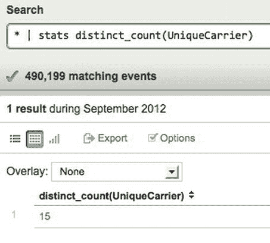

图 10-1 . 统计航空公司数量

结果显示有 15 家航空公司。验证结果是否正确有多种方法。我们可以将特定月份的航班数据加载到电子表格中，对 490,199 条航班记录执行各种计算；或者更简便的方法是，编写一条应能产生相同结果的备用 Splunk 搜索命令。由于我们只需要知道当月有定期航班的承运商数量，因此可以使用强制去重的方法，基于`UniqueCarrier`字段对所有事件进行去重。这样每个航空公司只会保留一条事件记录。Splunk 的工作方式是从最近日期回溯到最早日期，因此它会为每个航空公司呈现最新的事件或航班记录，并忽略其余记录，因为它们是第一条记录的重复项。由于我们关注的是计数而非具体事件，可以使用以下命令，它同样会得到数量 15：

```
* | dedup UniqueCarrier
 | stats count
```

验证搜索正常运行后，我们可以扩展它。由于我们有大约 26 年的航班数据，按年查看这些结果是最简单的方式。如果出于某种原因需要深入查看月度数据，也可以针对感兴趣的时段进行分析。继续遵循逐步构建搜索并使用小样本数据的策略，我们将修改搜索命令，使其按年汇总。因此，我们将时间范围调整为从 2011 年 1 月 1 日到 2012 年 9 月 30 日。请注意，`dc`是`distinct_count`的缩写。搜索命令和结果如图图 10-2 所示：

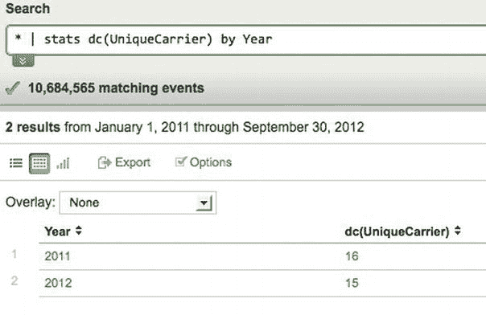

图 10-2 . 2011 年和 2012 年的航空公司数量

在扫描了 10,684,656 条事件后，结果显示 2011 年有 16 家航空公司，2012 年为已知的 15 家。这似乎是合理的，因为联合航空在 2011 年与大陆航空合并，因此承运商数量减少了 1 家。下一步是对所有航班数据运行此搜索。在我们的云服务器上，搜索耗时近三个小时。本章后面将讨论如何加速搜索。同时，我们可以通过图 10-3 中的折线图查看结果，这种形式比一张包含年份和数量的表格能更快地传达信息。

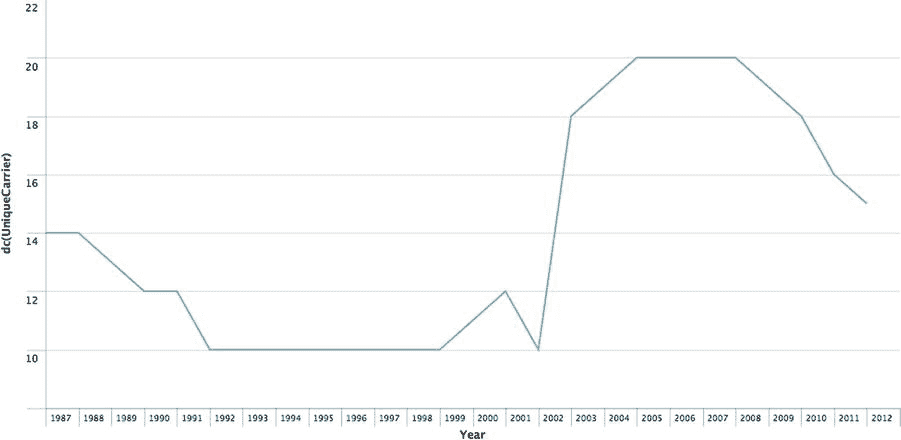

图 10-3 . 各年份航空公司数量

## 可视化结果

如图 10-3 的图表所示，从 1988 年到 1992 年间，航空公司数量从 15 家下降到 10 家，随后近十年保持稳定，直到小幅增加到 12 家。2001 年“9·11”袭击的影响表现为两家航空公司退出市场。从 2003 年开始，行业迅速复苏，在 2006 年达到 21 家航空公司的峰值，此后又缓慢下降至 15 家。我们想了解“9·11”事件后立即发生了什么，因此将搜索修改为按月而非按年计数，并在时间选择器中将时间段改为 2001 年 9 月至 2002 年 6 月。结果显示，一家航空公司在 2001 年 10 月停止运营，另一家在 2001 年 12 月停止运营。了解哪些航空公司停止运营会很有趣。首先想到的搜索命令是：

```
* | stats values(UniqueCarrier) by Month
```

`stats`函数中的`values`会返回`UniqueCarrier`字段所有不同值的列表，作为按字典序排序的多值条目输出。此搜索的问题在于，即使输出包含了我们想要的结果，但处理起来很困难。你可以在图 10-4 中看到部分输出内容。

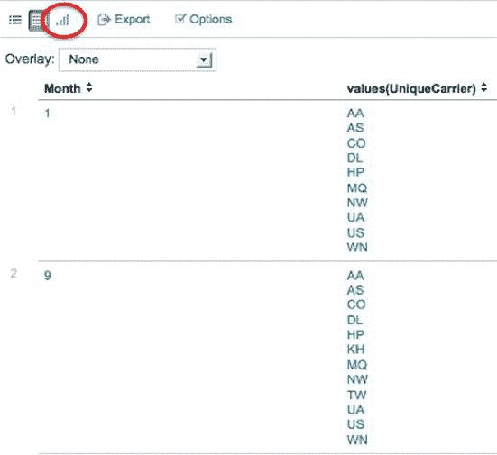

图 10-4 . 各月份航空公司列表

更好的方式是使用更易于解读的图形图表。点击图 10-4 中标注的图表按钮后，我们发现对于任何可用的图表类型，该搜索的结果都只会生成空白图表。让我们尝试另一个更易于生成图表的搜索。此外，由于我们已经确定了那两家航空公司在 2002 年 1 月之前停止运营，因此将时间选择器中的时间段缩短为 5 个月，即从 2001 年 9 月到 2002 年 1 月。我们将使用`chart`命令并结合迷你图：

```
* | chart sparkline(count,1w) by UniqueCarrier
```

默认情况下，迷你图会按被处理数据的最小时间单位呈现。由于我们在搜索中处理的是五个月的数据，迷你图默认以月为单位，但这在可视化中显得太小。使用`1w`作为参数可将分辨率从月度扩展到周度。此搜索的输出如图图 10-5 所示。

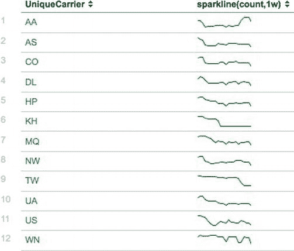

图 10-5 . 使用迷你图展示“9·11”事件后停运的航空公司

`chart`命令的输出相当简陋。我们可以看到 KH（阿罗哈航空）和 TW（环球航空）在不同时间点降至零，因此我们的问题有了答案。然而，尽管迷你图提供了基本情况，但感觉仍不够完整。肯定有办法提供更全面、更具吸引力的可视化效果。为了探索更好的可视化方式，我们尝试使用`timechart`命令：

```
* | timechart count by UniqueCarrier limit=0
```

在此搜索中，我们统计所有事件（航班记录）并按航空公司分组。这是一种找出所有航空公司并获取每家航空公司定期航班数量的简单方法。由于时间跨度为五个月，`timechart`命令将按月显示结果，这正是我们想要的。

使用`limit`参数的原因是，默认情况下显示的最大项数或数据系列数为 10。在我们分析的时间段内共有 12 家航空公司，因此可以将限制设为 12，或者偷懒设为 0。设置`limit=0`意味着`timechart`将容纳`UniqueCarrier`字段中的所有不同项，无论有多少个。使用 0 作为参数时要小心，因为项目数量过多很可能会生成一个混乱且难以辨认的图表。如果未指定`limit`参数，Splunk 将只显示 9 个项目，并将多余的项目归入名为`Other`的类别。哪些项目会落入`Other`类别取决于`timechart`命令使用的函数。在此示例中，将是那些数量较少的项目。控制`Other`分组是否存在的`useother`参数默认开启，但仅在`limit`的值不为零时才生效。


以目标受众易于理解的方式传达结果颇具挑战性。带有颜色的图表通常是首选方法。关键在于找到合适的图表类型。在这个特定示例中，我们将看到两种不同的图表类型清晰地传达了两种不同的信息。对于此次搜索的结果，Splunk 提供的图表类型选项有柱状图、折线图和面积图。如图 10-6 所示的柱状图，通过相应航空公司柱状的消失，清楚地展示了在此期间破产的航空公司。在这个例子中，从 11 月开始，阿罗哈航空的柱状消失，而环球航空在 1 月份也已不复存在。

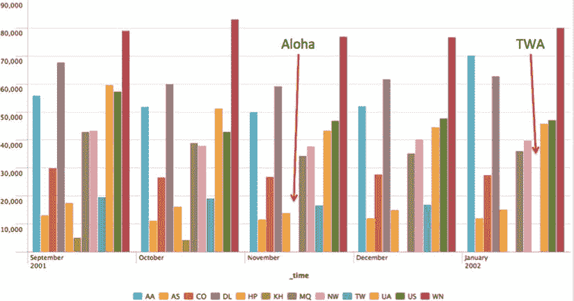

图 10-6. 9/11 后破产的航空公司（柱状图）

图 10-7 展示了相同的结果，但使用了折线图。正如您所见，这张图表非常拥挤，没有像柱状图那样清晰地传达航空公司的消亡信息。然而，在 12 月和 1 月之间，我们可以看到柱状图中不明显的一条信息。虽然环球航空的运量降为零，但美航的航班数量却增加了大致相同的量。实际情况是美航收购了环球航空，因此航班数量相应增加。仅仅通过更改图表类型，就浮现了一条完全不同的信息。

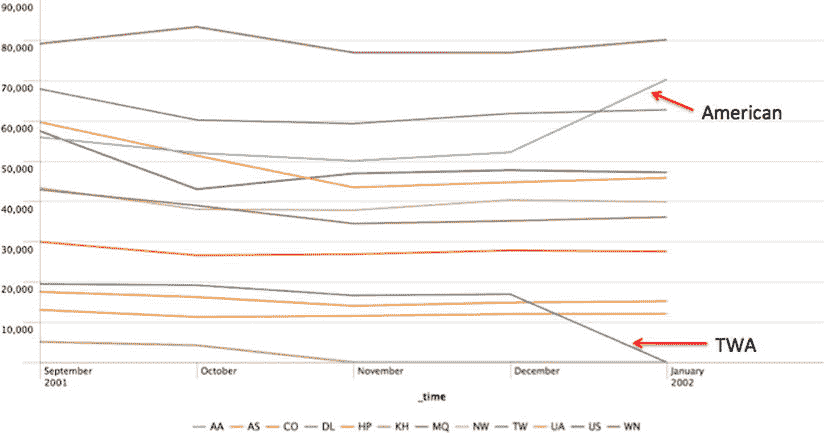

图 10-7. 9/11 后破产的航空公司（折线图）

为了完整性，我们在图 10-8 中展示了与前面两张图表使用相同结果生成的面积图。您几乎无法区分五个项目，并且从图中无法真正推断出任何信息。尽管这种图表类型对于当前这类结果毫无用处，但对于其他搜索产生的结果可能很有用。

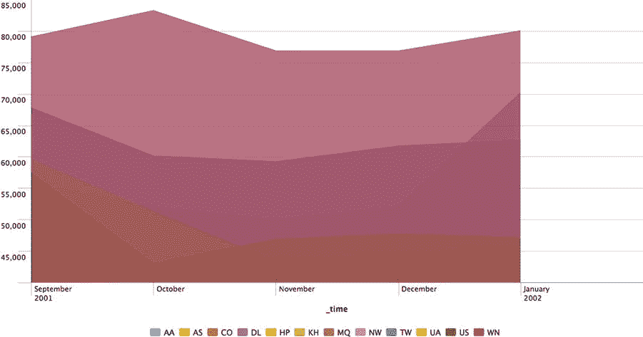

图 10-8. 9/11 后破产的航空公司（面积图）

现在，我们对可用航班数据期间内的航空公司有了相当清晰的了解。下一步是了解机场情况。

## 分析机场

我们的第一个问题与分析航空公司时类似：有多少个机场？对此，有多个字段可以使用，但在深入探讨之前，我们必须注意，航班数据中的机场总是以起飞机场和目的机场成对出现。通常的预期是，起飞机场的数量应与目的机场的数量相同。让我们从检查 2012 年 9 月的数据开始。如图 10-9 所示，我们使用与统计最近一个月航空公司数量类似的搜索：

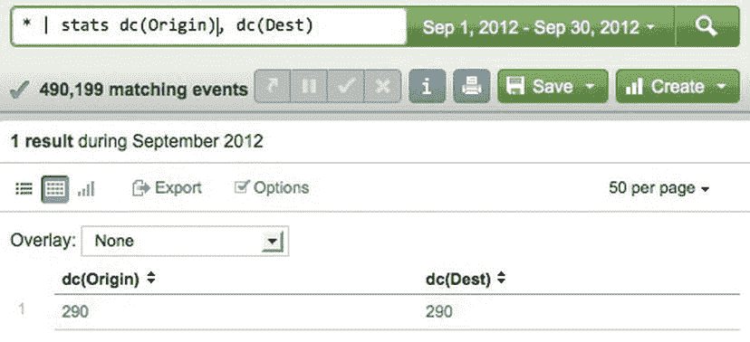

图 10-9. 统计 2012 年 9 月的机场数量

结果显示，起飞机场和目的机场的数量完全相同，即 290 个机场。我们选择使用 `Origin` 和 `Dest` 字段，因为它们包含机场名称的记忆代码，这对经常旅行的人来说相当熟悉。其他与机场相关的字段包含的代码只有该领域的专家才能理解。我们不应使用 `OriginCityName` 字段，因为有些城市拥有不止一个商业机场。我们可以通过以下搜索快速找出这些城市：

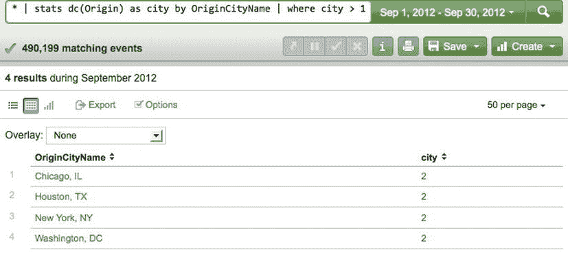

图 10-10. 拥有不止一个机场的城市

让我们继续对机场的研究。我们必须检查这 26 年航班数据中的机场数量。随着航空公司根据经济状况扩张和收缩，它们会增加或取消往返美国各地机场的服务。正如我们对航空公司所做的，让我们尝试对最近几年进行搜索：

```
* | stats dc(Origin), dc(Dest) by Year
```

有趣的是，2012 年有 301 个起飞机场和 302 个目的机场，而 2011 年有 299 个起飞机场和 301 个目的机场。这出乎意料。我们只能认为这是由数据不一致或跨年异常导致。为了确保搜索产生正确结果，我们像在航空公司分析中那样，基于 `dedup` 命令快速运行另一个搜索，该搜索生成了相同的结果。在图 10-11 中，您会找到展示起飞机场和目的机场数量的折线图。我们再次使用不同的图表类型审查了结果，并决定使用折线图，因为它能更清晰地呈现结果。然而，为了使起飞机场和目的机场之间的微小数值差异更明显，我们只展示了 2000 年到 2009 年的数据，并更改了折线图中 `y` 轴的最小值。

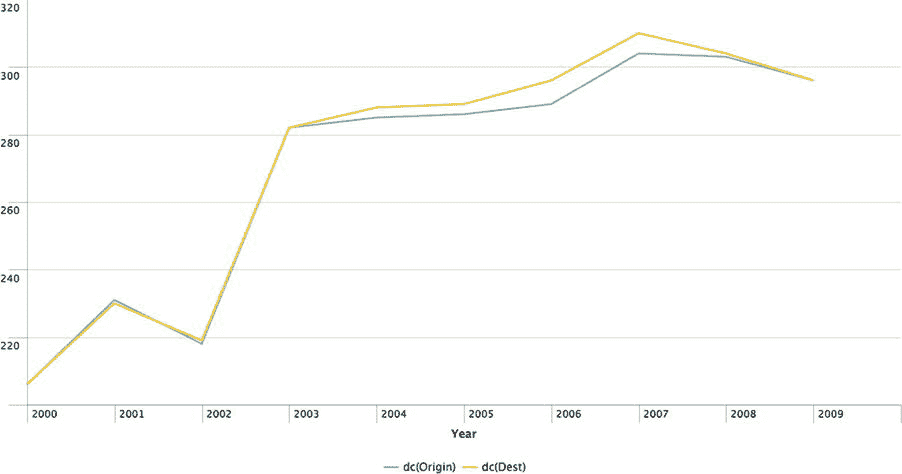

图 10-11. 起飞机场和目的机场的数量

我们将跳过寻找使用最多和最少的机场，因为那些搜索非常简单。相反，我们将探讨另一个可视化挑战。这个搜索相当简单：找出每个航空公司排名前五的机场。为简化起见，我们仅使用起飞机场：

```
* | top limit=5 Origin by UniqueCarrier
```

此搜索产生的输出如图 10-12 所示。这是一个按航空公司代码排序的简单表格，但它横跨了八页；这并非快速了解每个航空公司排名前五机场的最佳方式。

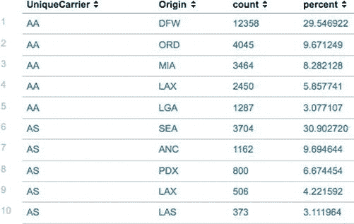

图 10-12. 按航空公司划分的前 5 大机场（表格）

点击图表按钮，只提供柱状图、条形图和饼图作为选项。前两种只显示前四家航空公司的信息，但没有标明具体的机场名称，只显示了每家航空公司排名前五机场的单个计数。饼图选项则什么都不显示。如同尝试可视化多系列（或我们在本章中称之为的多个项目）的情况一样，没有简单的答案。一个有效的选择是将结果分解成易于管理的单元，使结果更容易理解。基于这个原则，我们考虑按航空公司分解结果，理想情况下使用饼图，因为它们非常容易理解。问题在于，我们无法真正通过单个 Splunk 命令生成任意数量的饼图。我们提出的解决方案是创建一个仪表板，其中每个面板专门用于显示特定航空公司的排名前五机场。毋庸讳言，每个面板的搜索都非常简单：

```
UniqueCarrier=UA
| top limit=5 Origin
```

最简单的方法是保存每个面板要使用的搜索，然后创建仪表板。我们已经针对最近一个月的航班数据以及随机选择的三个航空公司（西南航空、达美航空和美联航）完成了此操作。生成的仪表板如图 10-13 所示。这是一种优雅且合乎逻辑的方式来处理一组结果，这些结果以表格形式呈现会难以阅读，并且几乎不可能以单个图表的形式展示。

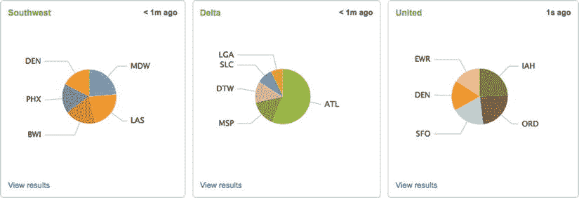

图 10-13. 按航空公司划分的前 5 大机场仪表板示例


在继续分析航班数据之前，我们必须先提醒您一个容易混淆的点。如果您查看图 10-12，会发现百分比加起来并不完全吻合。当您比较第 1 行数据时，美国航空（American Airlines）在达拉斯/沃斯堡机场的航班占比为 29.54%，总数为 12,358 架次，而阿拉斯加航空（Alaska Airlines）在西雅图机场的航班为 3,704 架次，占比 30.90%，这看起来不太合理。为什么阿拉斯加航空的航班数量比美国航空少了约三分之一，但其主要机场的百分比却略高？答案是，这些百分比是针对每个航空公司在所有机场的占比计算的，因为搜索是按`UniqueCarrier`进行的。因此，达拉斯/沃斯堡机场代表了美国航空 29.54%的始发航班，而西雅图机场则代表了阿拉斯加航空 30.90%的始发航班。

## 分析航班

由于到目前为止我们进行的所有搜索都比较简单，本节我们将开始增加搜索的复杂度。我们从一个简单的搜索开始：按航空公司计算平均飞行时间。和往常一样，我们针对最近一个月的数据进行搜索。搜索条件如图 10-14 所示，它基于`CRSElapsedTime`字段，该字段包含的是计划飞行时间（以分钟为单位），而非实际飞行时间。

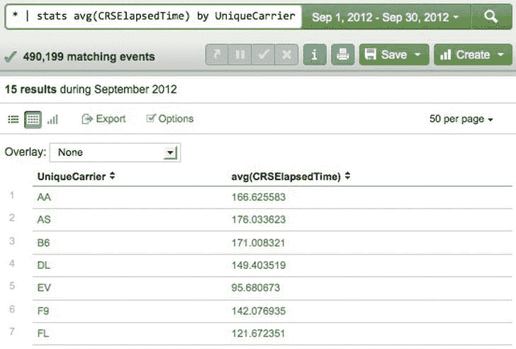

图 10-14 .  按航空公司统计的平均飞行时间

该搜索的输出是一个按航空公司排序的表格，平均飞行时间（计算为算术平均值）保留了六位小数。在确定呈现这些结果的最佳方式之前，我们想先对输出进行一些优化：四舍五入平均值并进行排序。我们按如下方式操作：

```
* | stats avg(CRSElapsedTime) as AverageFlightTime
          by UniqueCarrier
| eval AverageFlightTime=round(AverageFlightTime)
| sort –AverageFlightTime
```

每当我们通过管道操作处理数据以获取部分结果并将其传递给搜索的下一阶段时，我们都倾向于定义新字段，即使新字段并非显式必需。在这个例子中，我们在搜索的第二个子句中创建了一个包含平均值的新字段。输出在搜索的第三个子句中被四舍五入，使其更具可读性，最后按降序排序。`round`函数默认返回整数。如果您需要小数，只需在字段后用逗号分隔指定所需的精度即可。

确定给定数据集的最佳表示形式可能很困难。如果我们关心实际的分钟数，图 10-15 中呈现的表格形式提供了一种快速处理信息的方式，而图 10-16 中的柱状图则在不显示精确数字的情况下提供了信息。

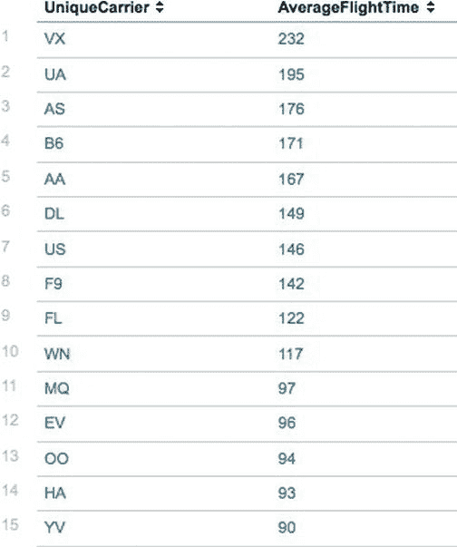

图 10-15 .  表格形式的平均飞行时间

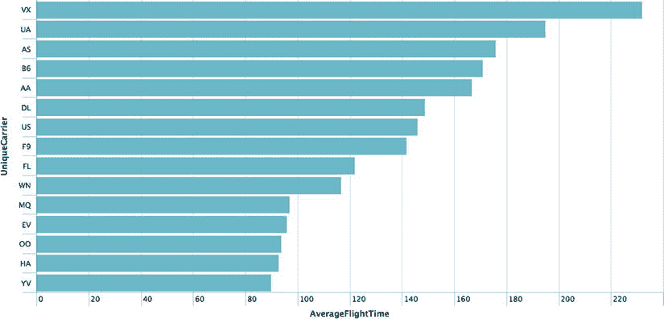

图 10-16 .  平均飞行（时间——柱状图）

值得注意的是，所有支线航空公司的平均飞行时间都在一个半小时左右，这印证了它们的支线定位。奇怪的是，夏威夷航空也出现在这一组中，但这可以归因于其大部分航班是夏威夷群岛内的短途飞行，这拉低了平均值，因为其飞往大陆的航班数量相对较少。

下一个搜索是查找最长飞行时间的航班，但搜索本身很容易实现。我们想知道每家航空公司最长飞行时间的航班，以及这些航班的始发地和目的地。同时呈现始发地和目的地增加了搜索制定的复杂性，但这并不一定意味着最终的搜索会更复杂。

我们无法仅用一个命令完成这个搜索，因此必须通过管道操作将其分解成多个子句。首先想到的是使用`stats`命令来查找最大计划飞行时间。正如预期，这将得出每家航空公司按时间计算的最长航班。下一步是理解如果我们将始发地和目的地添加到该特定搜索中会发生什么，如图 10-17 所示。

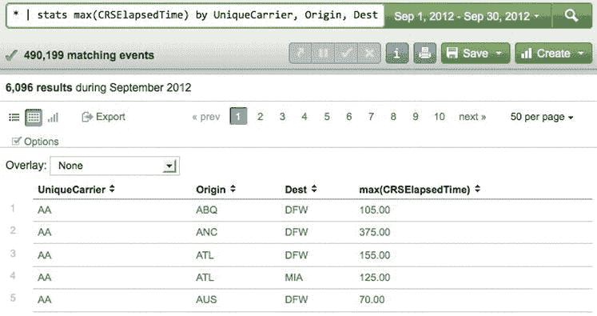

图 10-17 .  按航空公司、城市对分组统计的最长飞行时间

该搜索的输出是一个表格，其中包含每家航空公司每个始发地-目的地对的最大飞行时间。该表格包含 2012 年 9 月的 6,096 条记录，这意味着所有航空公司共存在这么多独特的城市对。出于好奇，我们通过搜索来查看表格中的第一项记录——美国航空从阿尔伯克基到达拉斯/沃斯堡的航班，统计了所有匹配事件，总共有 214 条。

```
UniqueCarrier=AA Origin=ABQ Dest=DFW
```

点击左侧边栏的`CRSElapsedTime`字段，显示有两个值：100 分钟和 105 分钟，如图 10-18 所示。这意味着该航空公司本身对此城市对有两种不同的计划飞行时间。点击出发时间字段时，有八个值，计划到达时间则有九个值。显然，这个城市对有多种航班选择。

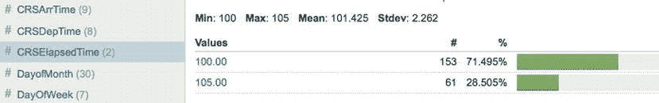

图 10-18 .  美国航空（American Airlines）往返于阿尔伯克基和达拉斯/沃斯堡之间航班的计划飞行时间

现在我们有了包含所有城市对的表格，可以尝试按最大飞行时间进行排序：

```
* | stats max(CRSElapsedTime) as MaxFlightTime
          by UniqueCarrier, Origin, Dest
| sort -MaxFlightTime
```

因为我们通过管道将部分结果传递到下一个子句，所以我们创建了一个新字段`MaxFlightTime`。该搜索的输出提供了一个不区分航空公司的最长航班列表，但这并非我们想要的。我们想要每家航空公司各自的最长航班。因此，让我们尝试将`UniqueCarrier`作为`sort`命令的附加字段。这不会改变结果，因为它唯一的作用是对具有相同飞行时间的记录按航空公司进行排序。下一个合乎逻辑的步骤是按航空公司对条目进行去重。由于表格已按航空公司将最长到最短的所有城市对排序，结果应该就是我们想要的：

```
* | stats max(CRSElapsedTime) as MaxFlightTime
          by UniqueCarrier, Origin, Dest
| sort -MaxFlightTime
| dedup UniqueCarrier
```

当我们验证这个搜索产生了预期的结果（如图 10-19 所示）时，我们注意到可以将其从四个子句优化为三个，因为`dedup`命令本身就带有排序选项：

```
* | stats max(CRSElapsedTime) as MaxFlightTime
          by UniqueCarrier, Origin, Dest
| dedup UniqueCarrier
        sortby –MaxFlightTime
```

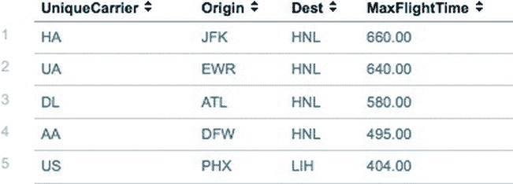

图 10-19 .  按航空公司、城市对统计的最长航班

到目前为止，我们处理的是最大计划飞行时间，但众所周知，实际情况往往大相径庭，所以让我们加入实际飞行时间。我们可以通过将其作为`stats`命令的一部分来实现，并且它应该会贯穿其余部分：

```
* | stats max(CRSElapsedTime) as MaxSchedTime
          max(ActualElapsedTime) as MaxActualTime
          by UniqueCarrier, Origin, Dest
| dedup UniqueCarrier
        sortby –MaxActualTime
```


我们更改了新字段的名称，使其更能代表其内容，并根据最大实际飞行时间进行了排序。处理包含多个字段的结果时，一个问题是它们不便于以彩色图表的形式呈现。我们尝试了 Splunk 提供的各种图表类型，但虽然两种飞行时间都显示得很好，城市对的名称却找不到。图 10-20 以表格形式展示了此次搜索的结果，我们认为这是呈现这些结果的最佳选择。

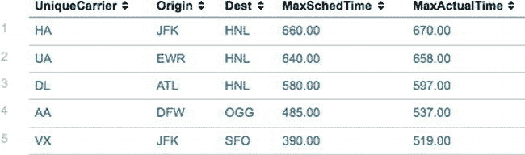

图 10-20. 各航空公司实际最长航班

有趣的是，2012 年 9 月，无论是按计划时间还是实际时间计算，最长的航班都是从纽约飞往檀香山的夏威夷航空航班。这是输出结果顶部的航班。它证实了我们在上一次搜索中看到的情况，即尽管夏威夷航空有最长的航班，但大多数航班都是短途航班，因此拉低了平均飞行时间。我们需要提醒您注意的是，在此次搜索中，如果任何实际飞行时间等于或小于计划飞行时间，结果的顺序将会改变，这可能会影响观众对结果的解读。

为了覆盖所有情况，我们还将查看最短的航班，包括按计划时间和实际飞行时间两个维度。一些读者可能认为最快、最简单的方法是反转我们刚才对最长航班搜索的排序，但这样行不通，因为你将得到最长航班中的最短时间，因为你是在按最大实际时间排序，而不是按最大计划时间。如果你通过删除短划线（`-`）并将字段名称改为 `MaxSchedTime` 来反转排序，它将正常工作；然而，表格中的列标题会出错，因为它们应该是“最小计划时间”和“最小实际时间”。修改后的搜索及部分输出见图 10-21。

```
* | stats max(CRSElapsedTime) as MaxSchedTime
          max(ActualElapsedTime) as MaxActualTime
          by UniqueCarrier, Origin, Dest
| dedup UniqueCarrier
        sortby MaxSchedTime
```

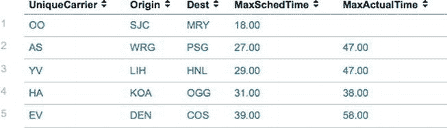

图 10-21. 各航空公司最短航班

最短的计划航班是从加利福尼亚州的圣何塞飞往蒙特雷，时间为 18 分钟，但它在 2012 年 9 月只计划了一次，并且被取消了，所以实际时间为空。由于结果中所有其他航班都有实际飞行时间，我们想知道取消的航班对结果有何影响。查看最短航班组中的其他航班后，我们发现无论是计划还是实际飞行时间的最小值和最大值总会得出一个值。圣何塞到蒙特雷的航班是一个非常特殊的情况，因为没有实际飞行时间，而且只有一个航班，所以最小或最大实际飞行时间的结果为空。

## 分析延误

航班数据中有许多与延误相关的字段，我们必须承认我们对它们了解不多。有关延误和取消报告方式的详细信息，可以访问 `http://www.bts.gov/help/aviation/html/understanding.html`。话虽如此，延误为我们提供了探索更复杂搜索的机会，并加深对某些搜索命令及其参数的理解。

延误信息按出发和到达进行分类，具体原因自 2003 年以来便已提供。航班数据还包括取消和改道的原因。此外，还有与返回登机口的航班相关的详细信息，这些信息自 2008 年开始收集。

### 按航空公司统计的延误

我们将从找出各航空公司的延误情况开始。因为延误分为出发延误和到达延误，我们将重点关注到达延误，因为它们对乘客的影响最大。航班数据中有一个字段指示航班是否延误了 15 分钟或更长时间；因此，我们使用 `ArrDel15` 作为搜索的基础。当有延误时，该字段的值设置为 1。此搜索的输出见图 10-22。

```
* | stats count(ArrDel15) as Total,
          count(eval(ArrDel15=0)) as OnTime,
          count(eval(ArrDel15=1)) as Delayed
          by UniqueCarrier
```

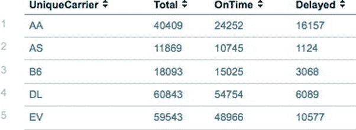

图 10-22. 各航空公司延误 15 分钟或以上的情况

此搜索的结果显示了各航空公司的总航班数，以及准点和延误的航班数，所有这些都按唯一的承运人代码排序。虽然原则上这产生了我们想要的结果，但这有点不公平。根据结果表，将 2012 年 9 月拥有近 90,000 个航班的西南航空与拥有大约 4,600 个航班的维珍美国航空进行比较，并非同等级别的比较。此搜索的柱状图稍微清晰一些，因为比例能传达更好的信息，但这仍然不够。更公平的方式是将延误表示为总航班数的百分比，这可以通过向先前的搜索添加百分比计算来实现：

```
* | stats count(ArrDel15) as Total,
          count(eval(ArrDel15=0)) as OnTime,
          count(eval(ArrDel15=1)) as Delayed
          by UniqueCarrier
| eval PCTOnTime=round(OnTime/Total*100,2)
| eval PCTDelayed=round(Delayed/Total*100,2)
| sort - PCTDelayed
```

除了计算百分比，我们将结果四舍五入到两位小数，并按延误百分比对结果进行排序，这样我们就可以更好地了解各航空公司在 2012 年 9 月的表现。如图 10-23 所示，美国航空公司经历了一个糟糕的月份，近 40%的航班在到达时延误了 15 分钟或更长时间。延误航班数量第二高的是西南航空，超过 11,600 架次，但考虑到其航班总数庞大，这仅占其总航班数的 13%。我们考虑过对这些结果使用柱状图，但它与之前搜索生成的图表相同。问题在于要绘制的数值尺度差异很大，总数为数千，而百分比为数十。该图表仍然提供了很好的比例概念，但百分比却没有显示出来。

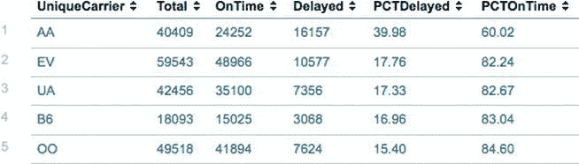

图 10-23. 按航空公司统计的到达延误

### 按机场统计的延误原因

接下来的搜索是按机场统计的延误原因。延误有五种原因，每种原因都有自己的字段，包含延误的分钟数：

*   承运人 — `CarrierDelay`
*   天气 — `WeatherDelay`
*   国家航空系统延误 — `NASDelay`
*   安全 — `SecurityDelay`
*   飞机晚到 — `LateAircraftDelay`

关于这些字段如何报告的详细信息，可以在本节开头提供的 URL 中找到。与之前的搜索一样，这些结果只有在以百分比形式呈现时才有意义。这意味着我们需要为每个延误原因计算百分比：


```
* | stats count(ArrDel15) as Total,
          count(eval(ArrDel15=1)) as Delayed,
          count(eval(CarrierDelay>=15)) as CarrierDel,
          count(eval(WeatherDelay>=15)) as WeatherDel,
          count(eval(NASDelay>=15)) as NASDel,
          count(eval(SecurityDelay>=15)) as SecurityDel,
          count(eval(LateAircraftDelay>=15)) as LateAircraftDel
          by Dest
| eval PCTDelayed=round(Delayed/Total*100,2)
| eval PCTCarrierDelay=round(CarrierDel/Delayed*100,2)
| eval PCTWeatherDelay=round(WeatherDel/Delayed*100,2)
| eval PCTNASDelay=round(NASDel/Delayed*100,2)
| eval PCTSecurityDelay=round(SecurityDel/Delayed*100,2)
| eval PCTLateAircraftDelay=round(LateAircraftDel/Delayed*100,2)
| sort – Total
| fields – Total, Delayed, CarrierDel, WeatherDel, NASDel, SecurityDel, LateAircraftDel
| head 5
```

由于我们在本次分析中使用 `ArrDel115` 字段作为基础，因此必须统计延误时间达 15 分钟或更久的原因对应的计数。这些计数的结果随后被用于计算相应的百分比。我们按照机场的总航班数量对结果进行排序，因为我们希望了解最繁忙机场的延误情况。如果按延误百分比排序（即使用 `sort –PCTDelayed`），则会列出太平洋沿岸一些每天仅有几班航班且易受大雾影响的小型机场，如图 10-24 所示。

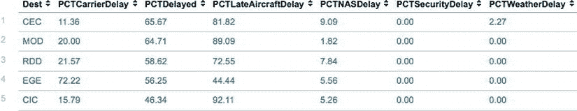

图 10-24 . 延误百分比最高的机场

我们回到最初的搜索，即按航班总数排序。由于我们只关注百分比，因此删除了用于计算百分比的字段。最后，我们使用 `head` 命令仅展示排名前 10 的机场。此次搜索生成的表格如图 10-25 所示。在尝试验证结果时，我们注意到包含 `PCTDelayed` 字段的列位于一个奇怪的位置。由于该字段显示的是每个机场所有延误航班的百分比，我们希望它要么是第二列（紧跟在机场代码之后），要么是最后一列。

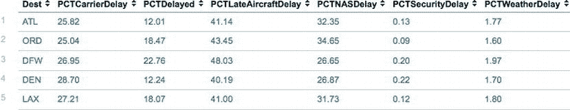

图 10-25 . 按机场统计的到达延误原因（表格形式）

经过详尽测试，我们发现使用 `eval` 命令创建的字段在表格和图表中会按 ASCII 顺序排列。ASCII 是计算机内部表示字符的一种方式，其顺序可描述为：某些符号、数字、另一些符号、字母顺序的大写字母、其他符号、字母顺序的小写字母以及最后一组符号。而使用 `stats` 命令创建的字段则按其创建时的顺序呈现。这种顺序在图 10-23 中清晰可见，其中 `PCTOnTime` 虽在 `PCTDelayed` 之前计算，却排在了表格的最后一列。为了按我们期望的方式调整图 10-25 结果中列的顺序，我们可以在 `PCTDelayed` 字段前添加一个在 ASCII 表中排在 "P" 之前的字符。这样，它就会被放置在 `PCTCarrierDelay` 字段列之前。请注意，它不会被放置在第一列，因为第一列是分配给 `by` 参数中使用的字段（本例中为目标机场）。在实验中，我们发现可以使用特殊字符来命名通过 `eval` 命令创建的字段。唯一的缺点是，当字段包含特殊字符时，它们无法用于进一步的计算。基于此知识，我们将 `PCTDelayed` 字段重命名为 `%Delayed`，它现在显示为本次搜索结果表的第二列，如图 10-26 所示。

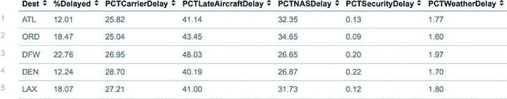

图 10-26 . 按机场统计的到达延误原因（列顺序已调整）

现在表格列的顺序已符合要求，我们可以继续验证结果。由于我们执行的计算相对简单，我们并不特别担心这些个别的结果。然而，我们关注的是各机场所有百分比之和是否等于 100。拉斯维加斯的和为 99.99，足够接近 100，可以认为差异是由四舍五入误差造成的。但芝加哥奥黑尔机场的和却达到了 104.83，这已超出了四舍五入误差可以解释的范围。经过对此问题的研究，我们得出结论：原因在于用于表示延误原因的字段同时反映了出发和到达的延误。TranStats 网站上的文档并未详细说明到这一层级，因此我们无法证实我们的猜测：即如果航班在起飞和到达时都有延误，其原因字段会将两者的分钟数相加，从而导致我们观察到的差异。

我们之前提到过，当搜索结果包含多个信息列时，使用图表来传达结果会比较困难。然而，在此次搜索中，使用带有 100%堆积模式选项的条形图或柱状图，可以很好地实现可视化效果，因为它展示了排名前 10 的机场中每个机场延误原因的百分比。为了在使用此类图表时确保结果准确，我们需要对搜索进行一项修改：需要删除延误航班的总百分比（`PCTDelayed`），最简便的方法就是不再计算它。最终的搜索如下：


```
* | stats count(ArrDel15) as Total,
          count(eval(ArrDel15=1)) as Delayed,
          count(eval(CarrierDelay>=15)) as CarrierDel,
          count(eval(WeatherDelay>=15)) as WeatherDel,
          count(eval(NASDelay>=15)) as NASDel,
          count(eval(SecurityDelay>=15)) as SecurityDel,
          count(eval(LateAircraftDelay>=15)) as LateAircraftDel
          by Dest
| eval PCTCarrierDelay=round(CarrierDel/Delayed*100,2)
| eval PCTWeatherDelay=round(WeatherDel/Delayed*100,2)
| eval PCTNASDelay=round(NASDel/Delayed*100,2)
| eval PCTSecurityDelay=round(SecurityDel/Delayed*100,2)
| eval PCTLateAircraftDelay=round(LateAircraftDel/Delayed*100,2)
| sort – Total
| fields – Total, Delayed, CarrierDel, WeatherDel, NASDel, SecurityDel, LateAircraftDel
| head
```

堆叠柱状图如图 10-27 所示。有趣的是，堆叠的顺序与图例的顺序正好相反。

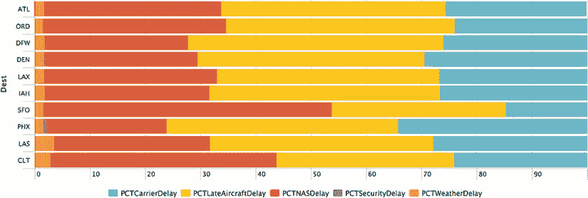

图 10-27 . 按机场划分的到达延误原因（柱状图）

## 冬季与夏季延误对比

接下来，我们想要比较 2012 年 1 月和 7 月排名前 10 的机场的延误情况，以了解冬季是否会对延误产生影响。为此，我们将在两个不同时间段执行两个完全相同的搜索，然后合并结果。要运行两个或更多搜索，`Splunk` 提供了一个子搜索机制。子搜索包含在方括号（`[]`）内，并在主搜索之前执行；这样，子搜索的结果就可以用于主搜索。子搜索仅限于与搜索相关的操作，而不能进行数据转换。通常，我们只在 `join` 和 `append` 命令中看到子搜索的使用。

让我们从计算延误的搜索开始。到目前为止，我们一直在使用用户界面的时间选择器，但这在需要选择两个不同时间段时就行不通了。为此，我们可以使用搜索命令的 `earliest` 和 `latest` 属性来指定时间范围。据此，我们的主搜索如下：

```
earliest=1/1/2012:0:0:0 latest=2/1/2012:0:0:0
| stats count(ArrDel15) as Total_Jan,
        count(eval(ArrDel15=1)) as Delayed_Jan
        by Dest
| eval PCTDelJan=round(Delayed_Jan/Total_Jan*100,2)
```

现在，我们没有使用表示所有事件的 `*`，而是将事件选择范围限制在 `earliest` 和 `latest` 定义的日期和时间之间。日期后的 “0:0:0” 序列表示具体时间（时、分、秒）。请注意，我们将最晚日期和时间定义为 2 月 1 日凌晨，因为 `latest` 参数是排他性的，即不包含指定的日期和时间。而 `earliest` 中指定的日期和时间是包含在内的。

 **注意** 在搜索或子搜索中指定的时间范围会覆盖用户界面时间选择器中选择的时间范围。

子搜索与主搜索相同，只是我们修改了时间段和计算字段的名称。为了合并两个搜索的结果，我们使用了 `join` 命令，这与关系数据库中使用的 SQL `join` 非常相似。在 `Splunk` 的 `join` 命令中，你可以指定用于连接的具体字段。如果不指定，则默认使用两个结果集中所有共同的字段。由于我们的结果集结构相同，因此无需指定字段。你还可以指定要执行的连接类型。有两种连接类型：内连接和外连接（或左连接）。内连接是默认选项，仅包含两个结果集中都匹配的事件。外连接则会合并两个结果集中的所有事件，即使没有匹配项；可以将其视为合并。同样，由于我们的结果集结构相同，我们将使用内连接。搜索的最终版本如下：

```
earliest=1/1/2012:0:0:0 latest=2/1/2012:0:0:0
| stats count(ArrDel15) as Total_Jan,
        count(eval(ArrDel15=1)) as Delayed_Jan
        by Dest
| eval PCTDelJan=round(Delayed_Jan/Total_Jan*100,2)
| join
  [
   search earliest=7/1/2012:0:0:0 latest=8/1/2012:0:0:0
   | stats count(ArrDel15) as ATotal_Jul,
           count(eval(ArrDel15=1)) as Delayed_Jul
           by Dest
   | eval PCTDelJul=round(Delayed_Jan/ATotal_Jul*100,2)
  ]
| sort – TotalJan
| fields – Delayed_Jan, Delayed_Jul
| head
```

我们对搜索进行了缩进，使其更易于阅读，因为 `Splunk` 并没有针对搜索命令的缩进概念。`search` 命令是 `Splunk` 中搜索应用的核心。因此，当它在第一个子句中使用时，你甚至无需输入它；这就是我们一开始在所有搜索中只输入星号（`*`）的原因。但是，在第一个管道符之后，你需要输入它，正如在子搜索中看到的那样；否则，你会收到一条错误消息，指出 `earliest` 不是一个有效的命令。需要注意的一点是，我们使用了与之前搜索类似的技巧，按照我们期望的顺序排列表格列，以便更容易分析结果。如图 10-28 所示，我们展示了两个月的航班总数和延误百分比。我们在 `Total_Jul` 字段的名称中添加了一个 `A`，使其成为第三列。这有点笨拙，但确实达到了目的。

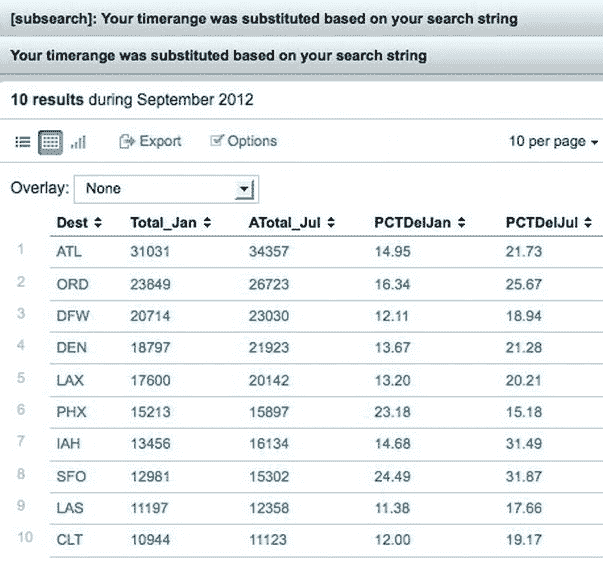

图 10-28 . 延误对比——2012 年 1 月与 7 月

我们特意将用户界面时间选择器的时间范围保留为 2012 年 9 月，以便您可以看到子搜索和主搜索覆盖时间范围的消息。有趣的是，`Splunk` 仍然显示“2012 年 9 月有 10 条结果”。

对于这个搜索，我们选择使用表格形式来显示结果，因为除了延误占航班总数的百分比之外，我们还需要航班总数来进行恰当的分析。不可否认，只显示延误百分比的图表就足以快速回答我们最初的问题（冬季是否会影响延误），但当我们查看结果时，发现了一个异常情况：除凤凰城机场外，所有机场在 7 月的延误都更多。我们的第一个疑问是 1 月份的航班数量是否更高；因此，我们需要获取航班总数。当然，如果我们没有发现这个异常情况，也就没有必要以表格形式查看结果了。

## 创建和使用宏

在“按机场划分的到达延误原因”搜索中，我们重复了五次相同的两个计算：统计延误原因出现次数（大于或等于 15 分钟）并计算每种原因所占的百分比。`Splunk` 提供了定义宏的功能，可在搜索应用中使用。这些宏是搜索片段，可以在搜索中的多个位置重复使用，并且不必是一个完整的命令。宏还可以带有参数。

我们可以创建两个宏来处理这些计算，这应该能简化我们的工作，并使搜索的维护更容易。例如，如果我们想分析超过 60 分钟的延误，只需更改一次宏，而不是更改五次计算。

我们将第一个宏命名为 `countd`，它将有一个参数：我们要统计其值大于等于 15 分钟的字段。该参数用美元符号（`$`）括起来，调用时将被实际值替换：

```
count(eval($cause$>=15))
```

第二个宏 `calcp` 用于计算字段的百分比，并将结果放入另一个字段中：

```
eval $result$=round($input_field$/Delayed*100,2)
```

现在，使用宏后的搜索如下所示：


```spl
* | stats count(ArrDel15) as Total,
          count(eval(ArrDel15=1)) as Delayed,
          `countd(CarrierDelay)` as CarrierDel,
          `countd(WeatherDelay)` as WeatherDel,
          `countd(NASDelay)` as NASDel,
          `countd(SecurityDelay)` as SecurityDel,
          `countd(LateAircraftDelay)` as LateAircraftDel
          by Dest
| `calcp(PCTCarrierDelay,CarrierDel)`
| `calcp(PCTWeatherDelay,WeatherDel)`
| `calcp(PCTNASDelay,NASDel)`
| `calcp(PCTSecurityDelay,SecurityDel)`
| `calcp(PCTLateAircraftDelay,LateAircraftDel)`
| sort – Total
| fields – Total, Delayed, CarrierDel, WeatherDel, NASDel, SecurityDel, LateAircraftDel
| head
```

可以看到，要调用宏，只需将宏名称及其可能的参数括在反引号（`` ` ``）中。在 Splunk 中，定义宏是在用户界面管理器的“高级搜索”屏幕中完成的。图 10-29 展示了 `calcp` 宏定义的部分截图。

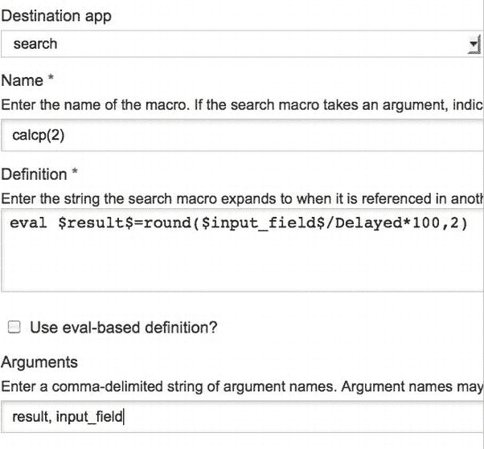

图 10-29. 在 Splunk 中定义宏

在截图中可以看到，我们定义了宏的名称，但附加了 `"(2)"`。这意味着该宏有两个参数，这些参数将在屏幕下方定义。定义中包含了实际的宏。接下来，你可以选择是否指定该宏使用基于 eval 的定义，即宏是否基于 `eval` 命令。我们的这两个宏都是直接的扩展、文本替换；因此，我们不会勾选此项。最后，你还可以为参数定义一个验证表达式，这是一个 `eval` 表达式，其结果要么是布尔值，要么是字符串。如果布尔表达式返回 false 或为 null，宏将返回在“验证错误消息”中定义的字符串。如果验证表达式不是布尔表达式，则预期返回一个字符串或 null。如果返回 null，则视为验证成功，否则返回的字符串将用作错误信息。

## 报表加速

正如我们在本章中讨论的，大多数报表都会聚合信息，以呈现目标受众易于理解的摘要。创建报表所需的时间与要处理的数据量成正比。计算特定字段的平均值或像统计事件数量这样简单的操作，都意味着要读取每一个事件，在大型数据集中，这可能需要很长时间。当你需要定期汇总大型数据集生成报表时，这可能效率很低，尤其是在不同用户运行类似报表的情况下，这会增加系统负载，并可能迅速演变成一个重大问题。

问题的核心在于，每次运行报表时，它都会逐一遍历所有必需的事件。解决这种重复性问题的一种方法是定期为该特定报表创建数据摘要。这样一来，当你运行报表时，它会使用摘要数据，从而显著减少处理时间。对于尚未汇总的那部分数据，仍会进行常规处理，但由于数据量大幅减少，处理时间通常会快得多。

Splunk 提供了两种为报表创建数据摘要的方法：报表加速和摘要索引。你创建的大部分报表可能都可以通过报表加速功能来处理，这也是两种方法中最简单的一种。你只需点击一个复选框并指定一个时间范围，其余的工作 Splunk 会自动为你完成。不仅如此，任何与你为报表定义的搜索类似的搜索，也能受益于这些摘要。

为了展示报表加速的工作原理，我们将使用之前定义的“按航空公司统计最长航班”的搜索。在构建这个搜索时，我们将时间范围限制在最近一个月的数据，即 2012 年 9 月。为了使示例更有趣，我们假设这个搜索将每月运行一次，呈现过去 12 个月的数据，即一份滚动式的过去 12 个月报表。由于 TranStats 上传最新月份数据需要几个月时间，我们还定义了搜索从当前日期前 2 个月开始，并回溯到该时间点之前的 12 个月，即总共 14 个月。在这种情况下，`earliest` 定义为 `-14mon`，`latest` 定义为 `-2mon`。请记住，当使用月份作为时间修饰符时，必须使用 `mon`、`month` 或 `months`，而不是代表分钟的 `m`。这似乎是一个常见错误。

在不加速此报表的情况下，处理近五百万个事件大约需要四分钟。在一个等待超过五秒就无法接受的世界里，四分钟简直是永恒。因此，让我们来了解一下加速此报表的必要步骤。有几种方法可以做到：在保存报表时加速，或者通过编辑现有报表来加速。我们将演示后者，为此，我们需要转到用户界面管理器的“搜索和报表”页面。在那里点击我们搜索的名称“按航空公司统计最长航班”。在图 10-30 中，可以看到对话框包含了我们之前提供的所有信息。当我们点击“加速此搜索”时，会弹出一个下拉菜单，其中提供了摘要范围的各种选项。我们选择一年，因为我们的报表覆盖了大约过去 12 个月的数据。之后，我们只需点击保存按钮即可。

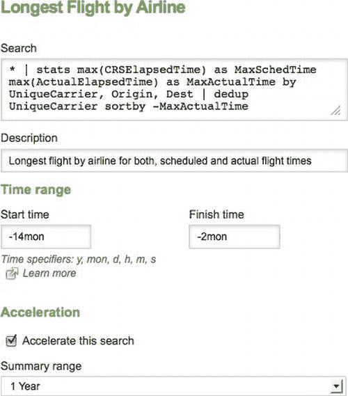

图 10-30. 加速报表

从这时起，Splunk 将在后台定期负责更新摘要，以至于我们甚至不会察觉到。摘要首次创建是即时进行的，但可能需要一段时间才能完成。要了解摘要是否完成，你可以访问用户界面管理器的“报表加速摘要”页面。在图 10-19 中，你会在“摘要状态”标题下看到我们报表的摘要已完成。如果它正在用最新信息更新摘要，则会以百分比形式显示已完成的工作量。“汇总负载”是一个重要的指标，因为它反映了 Splunk 在更新摘要方面付出的努力。这个数字越大，涉及的处理就越多。但是请注意，该计算基于更新摘要所需的时间及其发生频率。对于我们的报表（每月更新一次），这个数字会非常低。事实上，在图 10-31 中，你可以看到该数字是 0.00004，因为它在过去几周内没有更新过。

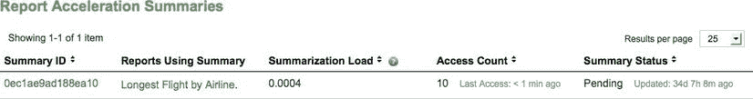

图 10-31. 报表加速摘要

另一个重要的指标是“访问计数”，它也会显示报表上次运行的时间。如果你有一个负载很高但很少使用或长时间未使用的报表，你应该认真考虑删除此摘要。除了 `Complete`（完成）之外，汇总状态还可以是 `Pending`（待处理）、`Suspended`（已暂停）和 `Not enough data to summarize`（数据不足，无法汇总）。`Pending` 意味着即将检查是否需要更新，而 `Suspended` 意味着 Splunk 已确定该搜索不值得汇总，因为摘要体积过大。这通常发生在具有高数据基数的搜索中，即它们会产生大量事件，其数量几乎与原始数据集中的事件一样多。


如果您对摘要的更多细节感兴趣，可以点击“摘要 ID”列下的奇怪数字。图 10-32 显示了摘要的详细信息。

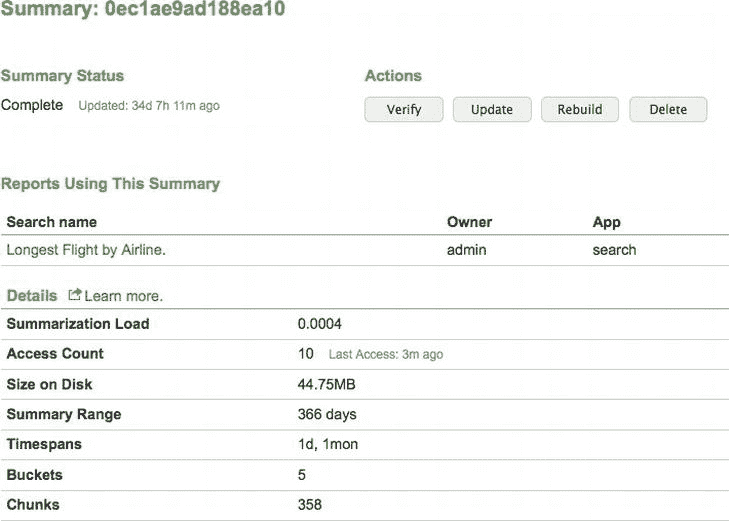

图 10-32 .  摘要状态

在详细信息中，值得一提的是`size on disk`（磁盘上的大小）。此功能非常强大，以至于人们很容易忘记它是有成本的，即需要定期运行搜索，并且摘要会占用额外的磁盘空间。考虑到航班数据大约占用 17GB，而该摘要的 45MB 几乎可以忽略不计。当然，这会随着时间的推移而增长，我们应该注意它可能对长期产生的影响。

在 图 10-32 中，您还可以看到有多种可用的操作。由于数据、字段以及我们操作它们的方式往往会发生变化（有时是在我们不知情的情况下），我们可以使用`verify`（验证）操作来确保摘要仍在生成正确的结果，并且数据仍然是一致的。其他操作，如`update`（更新）、`rebuild`（重建）和`delete`（删除），是标准的维护问题。

现在的问题是，我们加速后的搜索有多快？非常快，大约只需要三秒钟。这快了好几个数量级，在这种情况下非常值得。再次提醒，您无法违背物理定律；您必须在某处付出代价。在这种情况下，我们增加了磁盘使用量，并将处理过程分散在后台进行。在摘要负载和使用方面，我们有两个很好的指标，可以让我们知道这个强大且非常简单的功能对每个报告是否值得。

当然，并非所有搜索都符合报表加速的条件，因为这有一些限制。首先，搜索必须使用报表命令，例如`chart`、`timechart`、`stats`、`top`、`rare`等。此外，为报表命令提供数据的命令必须是流式命令，例如`search`、`eval`、`fields`、`regex`、`lookup`、`multikv`等。第二个限制是，要汇总的数据必须至少有 100,000 个最近的事件。

摘要的工作方式是，Splunk 会定期在后台运行搜索并存储摘要信息，以便下次需要时可用。Splunk 会计算出运行后台搜索所需的频率，但可以说明的是，这取决于您定义的时间范围。

我们在本章中执行的所有搜索都符合报表加速的条件。您可能认为，查找最长和最短航班的搜索不符合条件，因为它们使用了`dedup`命令，而该命令不是流式命令，但它是在报表命令之后使用，而不是之前；因此，它符合第一个要求。关于最近的事件计数，我们知道每次月度更新都会带来超过 400,000 个事件，所以这不是问题。

创建数据摘要的第二种方法是摘要索引。它的工作原理与报表加速基本相同，但 Splunk 在内部处理方式不同。其设置和使用过程更为复杂。由于大多数报告都可以通过报表加速完成，摘要索引仅用于搜索在报表命令之前包含不可流式命令的情况。本书将不介绍摘要索引。如果您因任何原因需要使用它，请参考 Splunk 文档。

## 加速统计

正如我们在本章开头所看到的，对整个航班数据集运行一个简单的搜索可能需要长达三个小时。到目前为止，我们的策略是在最近一个月的航班数据上测试搜索。如果搜索跨度超过一个月，我们使用两个月的数据进行测试；如果搜索跨度超过几年，我们使用几年数据进行测试。不可避免地，当您的搜索准备好投入生产使用时，其中一些搜索将覆盖所有数据；在我们的示例中，这大约是 26 年的航班数据。等待三个小时来获取单个搜索的结果或许可以忍受，但当您有十几个搜索需要定期运行时，这就完全不可接受了。

报表加速侧重于为特定搜索或报告创建数据摘要，而 Splunk 有一种称为`tsidx`的机制，允许创建和使用索引数据的通用摘要。使用`tsidx`是一个两步过程。第一步是使用`tscollect`命令创建数据的通用摘要。然后，您可以使用`tstats`命令以难以置信的快速性能执行您感兴趣的统计查询。

`tscollect`命令非常简单；您只需定义 Splunk 将存储通用摘要的摘要文件名即可：

```
* | tscollect namespace=summary_fd
```

尽管如此简单，为所有 1.47 亿个航班事件创建通用摘要运行了超过 8 小时，并创建了一个大约为航班数据一半大小的文件。请注意，您不能使用`tscollect`命令替换摘要文件中的信息；但是，您可以向其中追加信息。例如，一旦我们将 2012 年 10 月的航班数据加载到主索引中，我们可以像这样将其追加到`summary_fd`中：

```
earliest=10/1/2012:0:0:0 latest=11/1/2012:0:0:0
| tscollect namespace=summary_fd
```

`tstats`命令的语法与`stats`命令不同。让我们用一个例子来说明它是如何工作的，使用我们本章前面定义的一个搜索：按航空公司统计的平均飞行时间，使用`stats`命令如下：

```
* | stats avg(CRSElapsedTime) as AverageFlightTime
          by UniqueCarrier
| eval AverageFlightTime=round(AverageFlightTime)
| sort –AverageFlightTime
```

现在，我们将用等效的`tstats`命令替换`stats`命令：

```
| tstats avg(CRSElapsedTime) as AverageFlightTime
         from summary_fd
         groupby UniqueCarrier
```

正如您所见，我们仍然可以使用函数对字段进行计算，并创建一个新字段来包含结果。接下来，我们必须指定包含通用摘要的文件名，最后，`by`参数现在是`groupby`。请注意，搜索开头不再有星号（`*`）。这是因为您不是在执行搜索并将事件传递给`tstats`命令。我们在命令前仍然有管道符号，因为我们必须告诉 Splunk 这是一个实际的命令，而不是搜索命令的属性。搜索的其余部分，即`eval`和`sort`，保持不变。

它有多快？当我们使用老牌`stats`命令对 2012 年 9 月的数据运行此搜索时，大约需要 15 秒。而使用`tstats`命令对全部 26 年的航班数据进行查询，大约需要 30 秒。看起来，投入超过八小时创建通用摘要，并额外使用 8.6GB 磁盘空间，是非常值得的。

`tstats`的缺点之一是并非所有统计函数都可用。在撰写本文时，可用的函数仅限于`count`、`sum`、`sumsq`、`distinct`、`avg`和`stdev`。但是，Splunk 提供了一种方法，可以将`tstats`命令与`stats`命令桥接起来，以访问那些不可用的函数。这有点奇怪，但确实有效。让我们以统计航空公司数量的搜索为例：

```
* | stats dc(UniqueCarrier) by Year
```


使用`tstats`进行等效搜索如下：

```
| tstats prestats=t
         dc(UniqueCarrier)
         from summary_fd
         groupby Year
| stats dc(UniqueCarrier)
        by Year
```

为避免混淆，`tstats`中可用的`distinct`函数与`values`函数类似，均用于列出字段的唯一值，而`distinct_count`或`dc`函数则用于计算字段唯一值的数量。将`prestats`参数设为`t`（true）表示后续函数不被`tstats`支持，需通过它构建过渡，使紧随其后且功能相同的`stats`命令得以执行。虽然这看起来有些奇怪，但我们至少有了克服`tstats`限制的机制。该搜索的性能提升令人惊叹：对 147,122,177 个事件使用`stats`的原始搜索耗时近三小时，而使用`tstats`仅需 15 秒！

`tstats`中的`groupby`子句可处理多个字段。我们将简化之前用于查找各航空公司最长航班的搜索以说明这一点。原始搜索如下：

```
* | stats max(CRSElapsedTime) as MaxSchedTime
          max(ActualElapsedTime) as MaxActualTime
          by UniqueCarrier, Origin, Dest
| dedup UniqueCarrier
        sortby –MaxActualTime
```

将其改为使用`tstats`非常简单，与其他示例类似：

```
| tstats prestats=t
         max(CRSElapsedTime),
         max(ActualElapsedTime)
         from summary_fd
         groupby UniqueCarrier, Origin, Dest
| stats max(CRSElapsedTime) as MaxSchedTime,
        max(ActualElapsedTime) as MaxActualTime
        by UniqueCarrier, Origin, Dest
|  dedup UniqueCarrier
         sortby –MaxSchedTime
```

由于`max`函数不被`tstats`支持，我们通过将`prestats`参数设为 true 将其过渡到`stats`。由于`stats`是实际计算最大飞行时间的命令，因此我们在此处将结果分配给新字段。虽然在`tstats`命令中也可以输入，但不会有任何效果。出于教学目的，我们将排序字段改为最大计划飞行时间。对 2012 年 9 月航班数据运行普通搜索大约需要 3 秒，而对全部 26 年数据进行加速搜索则需略超过两分钟。在图 10-33 中，您可以看到修改排序后的搜索结果。

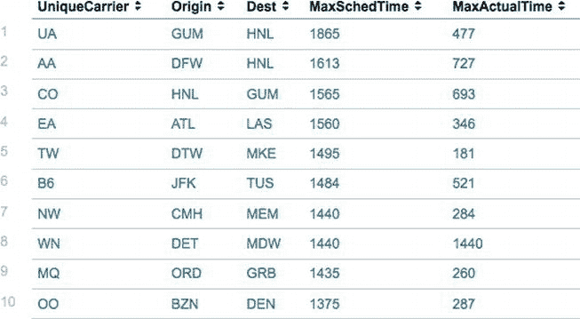

图 10-33 . 各航空公司历年最长航班

我们这样做的目的是向您展示最大计划时间列中几乎所有行都出现的奇怪数字。这显然有误，因为 1865 分钟（约 31 小时）对商业航班而言完全不现实。这一点可由以下事实证实：同一航班在过去 26 年中的最大实际飞行时间为 477 分钟（约 8 小时），这对关岛至火奴鲁鲁的航班来说更为合理。我们需要查找更多信息。首先，我们想确认这是偶发性错误还是经常出现。为此，我们执行以下简单搜索，结果如图图 10-34 所示。

```
UniqueCarrier=UA CRSElapsedTime=1865
```

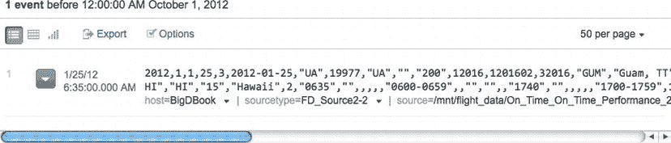

图 10-34 . 所有计划飞行时间为 1,865 分钟的联合航空航班

此搜索仅返回一个事件，但我们仍无法确定是否为孤立错误。因此，我们搜索该航线中计划时间超过 26 年来最大实际飞行时间的航班：

```
UniqueCarrier=UA Origin=GUM Dest=HNL | where CRSElapsedTime>477
```

此搜索仅返回与上一个相同的事件，因此这是一个孤立事件。我们怀疑 2012 年 1 月 25 日的联合航空 200 航班存在数据录入问题。最后一个搜索使我们能够解释一些搜索性能技巧。当 Splunk 需从原始数据读取大量事件时速度较慢，这就是`tsidx`存在的原因。然而，Splunk 在查找事件中的特定项时速度极快，尤其是在处理键值对时。上述搜索对所有 1.47 亿个事件耗时约 1 秒。搜索的第一部分直接通过查看 Splunk 内部维护的索引表来定位所需事件，而非读取每个事件。第二部分应用条件查询，这通常成本更高，但仅针对第一次搜索得到的事件。或者，我们也可以将搜索表述为：

```
* | where UniqueCarrier=UA AND Origin=GUM AND Dest=HNL AND CRSElapsedTime>477
```

这将针对每个原始事件评估条件，耗时可能超过三小时。区别在于：匹配包含联合航空、关岛和火奴鲁鲁的 336 个事件，然后评估计划时间是否大于 477 分钟；而后者则需对全部 1.47 亿以上事件逐一评估航空公司是否为联合航空、出发地是否为关岛、目的地是否为火奴鲁鲁以及计划时间是否大于 477 分钟。

为完整性起见，我们对美国航空的异常值进行了快速检查，发现两个事件的计划飞行时间分别为 1,613 分钟和 1,517 分钟，分别发生在 1993 年和 1991 年。显然，这些是孤立事件，但可能因错误倾斜结果而影响分析。

解决此问题的一种方法是使用`delete`命令删除这些事件。该命令实际上并不删除事件，只是将其标记为不在搜索中使用。当然，这不会影响在删除事件之前创建的`tsidx`摘要。删除存在异常计划飞行时间的特定事件的一种示例如下：

```
UniqueCarrier=UA CRSElapsedTime=1865 | delete
```

使用此命令必须极其谨慎，据我们所知，事件删除后无法恢复。Splunk 对此命令非常敏感，默认情况下，即使用户或管理员也没有删除事件的权限。官方建议创建用于删除事件的专用用户。

最后一个示例展示了如何在单个`stats`命令中处理多个函数并将结果分配给新字段，以及如何处理条件查询。为此，我们将使用本章前面构建的按航空公司统计到达延误的搜索：

```
* | stats count(ArrDel15) as Total,
          count(eval(ArrDel15=0)) as OnTime,
          count(eval(ArrDel15=1)) as Delayed
          by UniqueCarrier
| eval PCTOnTime=round(OnTime/Total*100,2)
| eval PCTDelayed=round(Delayed/Total*100,2)
| sort - PCTDelayed
```

此搜索的第一个问题是它在`count`函数中使用了`eval`函数。尽管`count`被`tstats`支持，但`eval`不支持。解决方法是用`tstats`的`where`子句，但问题在于只能有一个子句，因此`stats`命令中的逻辑需分解为多个部分才能适配`tstats`。我们首先获取延误航班计数：

```
| tstats count as Delayed
         from summary_fd
         where ArrDel15=1
         groupby UniqueCarrier
```


