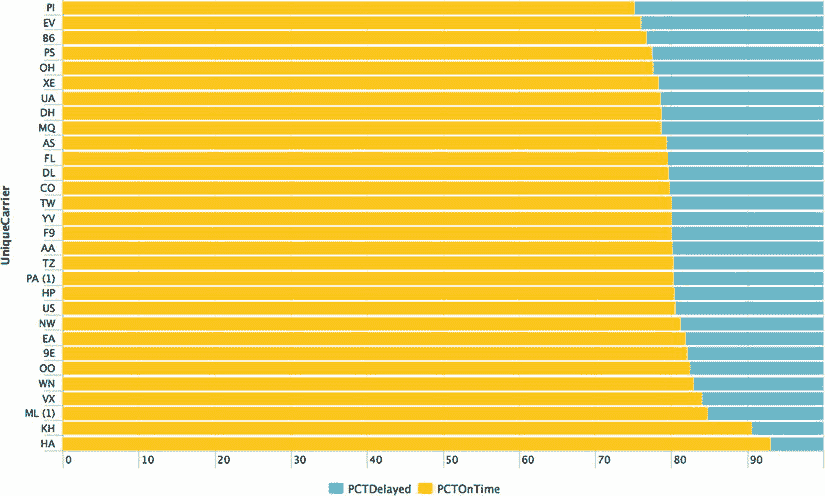

# 排版后内容

`*where*`参数的使用方式与`*eval*`函数类似，上述搜索最终按航空公司统计了所有延误航班的数量。请注意，在使用`*tstats*`命令时，必须遵循`*from*`、`*where*`和`*groupby*`子句的顺序。如果不按此顺序操作，您将收到非常具有误导性的消息，并花费大量时间试图理解发生了什么。接下来，我们需要另一个搜索来查找按航空公司统计的总航班数或准点航班数：

```
| tstats count as Total
         from summary_fd
         groupby UniqueCarrier
```

这个搜索非常简单，剩下的工作就是连接两个`tstats`命令、计算百分比并进行适当排序。最终的搜索如下所示：

```
| tstats count as Delayed
         from summary_fd
         where ArrDel15=1
         groupby UniqueCarrier
| join
  [
   | tstats count as Total
            from summary_fd
            groupby UniqueCarrier
  ]
| eval PCTDelayed=round(Delayed/Total*100,2)
| eval PCTOnTime=round((Total-Delayed)/Total*100,2)
| sort – PCTDelayed
| fields - Delayed, Total
```

本质上，我们完全重新构建了搜索，以绕过`*tstats*`命令的限制，并达到了相同的效果。在原始搜索中，我们通过一个命令统计了总数、准点航班和延误航班；而在新搜索中，我们将总数和延误航班的计数拆分为两个独立的`*tstats*`命令，然后使用`*join*`命令将它们合并，就像本章前面的“延误对比”搜索中所做的那样。准点率基于总数与延误航班数的差值计算。与原始搜索的唯一功能差异在于，我们使用`*fields*`命令消除了计数结果，只保留了百分比。使用 100%堆叠柱状图可以很好地展示过去 26 年累积到达延误的可视化效果，如图 10-35 所示。



**图 10-35.** 按航空公司统计的到达延误情况（所有年份）

正如`tsidx`机制所预期的那样，性能差异巨大。仅使用 2012 年 9 月数据的原始搜索运行时间为 10 秒，而使用重构搜索处理超过 1.47 亿条事件则耗时 15 秒。

## 总结

在本章中，我们使用航空公司准点性能数据完成了一次典型的数据分析会话，期间学习了如何使用 Splunk 中的一些命令。我们还讨论了各种可视化选项，这些选项取决于搜索结果以及需要传达给分析消费者的信息。最后，我们介绍了一些关于搜索和报告的性能优化技巧，这些技巧可以通过大幅缩短搜索响应时间，带来令人惊叹的巨大差异。

---

