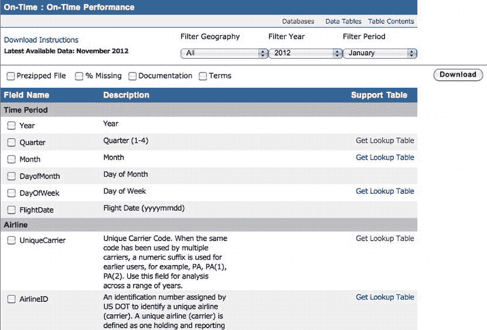
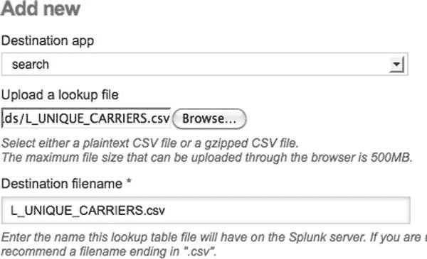
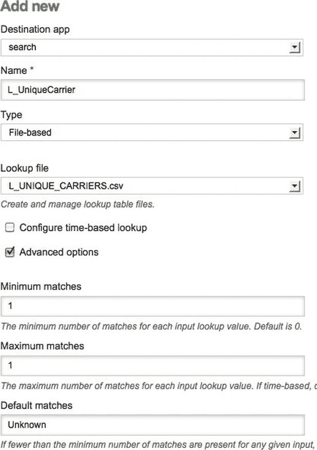
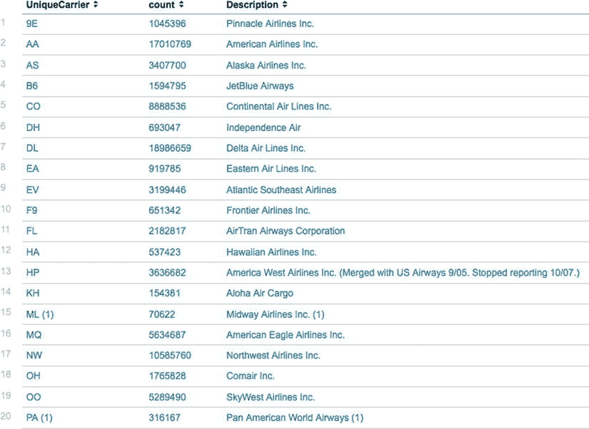
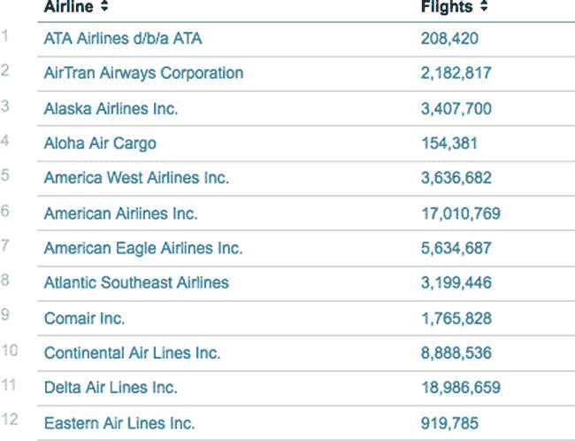
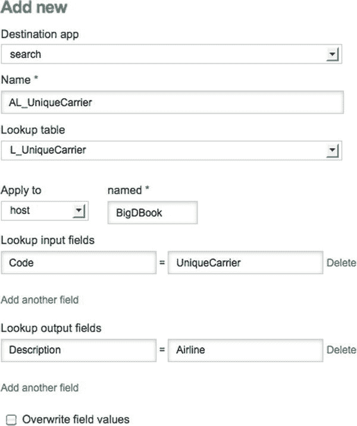

# 第 11 章


## 分析特定航班历年数据

以分析特定航班历年数据为例，我们继续探索 Splunk 命令。这次我们重点关注查找表，包括基于静态 CSV 的查找表和基于数据库的查找表。可以说，字段查找表继承自关系型数据库及其对数据规范化的持续需求。因此，我们日常处理的大部分数据都是编码的，而这些编码在单独的表中进行解释，这些表被称为查找表。在 Splunk 中，您可以创建并上传查找表，以便稍后在搜索中使用它们来扩展上述编码。

## 航空公司名称

在第 10 章中，我们提到将使用查找表来显示航空公司的名称，而不是我们到目前为止一直使用的缩写，这些缩写是我们从提供航空公司信息的三个字段（`UniqueCarrier`、`AirlineID`和`Carrier`）中获得的全部内容。我们将首先在 Splunk 中创建一个简单的查找表，以将这些编码替换为实际的航空公司名称。

当您进入 TranStats 网站的下载页面时，您会看到某些字段的右侧有一个指向相应查找表的链接。如图 11-1 所示。单击任一链接将下载一个 CSV 文件，其中包含与该特定字段相关的详细信息。在此示例中，我们下载了`UniqueCarrier`字段的查找表，该字段是我们在第 10 章的搜索中一直使用的字段。



**图 11-1.** 准点性能数据下载页面

下载查找表时，我们首先注意到文件名在`csv`扩展名末尾有一个奇怪字符：在 MacOS 中是双引号（`"`），在 Windows 中是短划线（`-`）。删除这个多余字符后，该文件才能用于电子表格应用程序。当我们打开它时，惊讶地发现表格中包含的航空公司远不止我们一直处理的 30 家，而且许多名称是我们以前从未听说过的。事实上，在我们撰写本文时下载的文件中，共有 1,543 家航空公司。快速浏览后，我们注意到其中大多数是外国航空公司或已不存在的航空公司。在表 11-1 中，我们展示了该文件的前五行内容。

**表 11-1.** `UniqueCarrier`字段查找文件示例

| Code | Description |
| --- | --- |
| 02Q | Titan Airways |
| 04Q | Tradewind Aviation |
| 05Q | Comlux Aviation, AG |
| 06Q | Master Top Linhas Aereas Ltd. |
| 07Q | Flair Airlines Ltd. |

要使查找表可在 Splunk 中的搜索中使用，需要执行几个步骤。第一步是上传包含查找表的文件。这可以通过用户界面完成：在管理器的“查找”菜单中，选择“查找表文件”选项下的“添加新文件”。图 11-2 包含了上传查找文件对话框的截图。



**图 11-2.** 上传查找文件

在此示例中，在上传对话框中将“目标应用”保留为`search`，但请注意：如果未能正确定义查找表将在哪个应用中使用，可能会导致调试相关问题时的诸多困扰。Splunk 接受纯文本 CSV 文件或压缩的 CSV 文件（仅限`gzip`格式）。通过用户界面上传的文件大小限制为 500MB。更大的文件可以直接使用配置文件上传。由于文件将存储在 Splunk 区域内，我们需要提供一个目标文件名。最佳实践建议使用与原始文件相同的名称（包括扩展名）。单击“保存”按钮后，文件将上传到 Splunk 中。

第二步是定义字段查找。在同一个“查找”菜单下，通过“查找定义”选项完成。对话框界面如图 11-3 所示。我们需要为字段查找指定一个名称，以便在搜索中引用它；我们通常使用字段名称，并在其前面加上`"L_"`。查找有两种类型：基于文件的查找（如我们正在定义的这种）和外部查找（可以使用 Python 程序来匹配字段）。外部查找是高级主题，本书将不涉及。



**图 11-3.** 定义查找

下一个下拉菜单中包含了已上传的查找文件名称。只需选择相应的文件即可。保持“基于时间的查找”复选框未选中；该选项允许使用基于时间戳的查找，本书不会涉及这部分内容。勾选“高级选项”，我们将用它来指定使用查找表时的最小和最大匹配数。我们希望最大值为 1，这样只获取一个值。严格来说，对于这个表并非必需，因为每个代码按理只有一个值，但我们在航班数据中已经发现了一些错误。如果没有匹配项，我们希望使用字符串“Unknown”；因此，我们指定最小匹配数为 1，因为默认值为 0。

现在查找已完全定义，我们可以开始使用它了。以下是最基本的命令形式：

```
lookup <查找定义> 查找字段
```

你必须注意，查找字段的名称必须与查找表标题行中所需列的名称一致。让我们用一个例子来说明这一点，统计最近一个月各航空公司的航班数量：

```
* | stats count by UniqueCarrier
| lookup L_UniqueCarrier UniqueCarrier
```

这行不通，因为查找表的标题行中没有名为`UniqueCarrier`的字段名称。如表 11-1 所示，字段名称是`Code`和`Description`。我们有两个选择：一是修改查找表的标题行，二是重命名`UniqueCarrier`字段。第一个选项维护成本高，因为我们每次获取新版本时都需要编辑文件。第二个选项更简单：

```
* | stats count by UniqueCarrier as Code
| lookup L_UniqueCarrier Code
```

这仍然行不通，因为我们是把计数结果命名为`Code`，而不是重命名字段。正确的做法是：

```
* | stats count by UniqueCarrier
| lookup L_UniqueCarrier Code as UniqueCarrier
```

一旦我们验证此搜索正确运行，就可以使用`tstats`命令将其应用于所有航班数据以节省时间：

```
| tstats count from summary_fd groupby UniqueCarrier
| lookup L_UniqueCarrier Code as UniqueCarrier
```

此搜索的部分结果可在图 11-4 中查看。如果没有查找命令，结果将只有两列：唯一承运人代码和计数。使用查找后，我们添加了描述列。如果查找表有更多列，所有列都会显示在结果中。你可以使用`lookup`命令的`output`参数指定需要显示的字段，并在其后列出希望出现的字段。



**图 11-4.** 使用查找表按航空公司统计的航班数量

这份报告中有几个烦人的问题，比如美国西部航空公司和全美航空的合并信息，以及中途航空公司和泛美世界航空公司名称后的“(1)”。你可能还记得，唯一承运人代码后附加的“(1)”表示其他航空公司当前正在使用该代码。我们认为应该清理这份报告：删除合并信息，同时一并处理“(1)”。既然我们在清理模式中，还应对最终的航班计数使用千位分隔符，使用合适的标题，并删除代码列。我们报告的最终搜索语句如下：

```
| tstats count from summary_fd groupby UniqueCarrier
| lookup L_UniqueCarrier Code as UniqueCarrier
| eval Airline=replace(Description, "^(.+)\(.+\)", "\1")
| eval Flights=tostring(count, "commas")
| fields – Code, count, Description
| sort Airline
```

`eval`命令的`replace`函数将第二个参数描述的正则表达式应用于第一个参数字段。正则表达式分为两部分：第一部分从开头到第一个右括号捕获一个或多个字符，并用圆括号括起该部分表达式以保留此匹配供后续使用。第二部分匹配由圆括号包围的一个或多个字符，通过在括号前加反斜杠（`\`）表示。如果`Description`字段中的字符串匹配该正则表达式，则将其替换为第三个参数的正则表达式，本例中指定使用保留的第一部分匹配。

为计数字段添加逗号是通过`eval`命令的`tostring`函数完成的。你必须注意，基于`Flights`字段的排序将不再是数值排序，因为它现在是一个字符串。如有必要，`sort`命令有一个函数允许我们将字符串字段视为数值处理。此搜索的部分输出结果可在图 11-5 中查看，其中美国西部航空公司的合并提示已不再显示。



**图 11-5.** 改进后的按航空公司统计的航班数量报告

最后是关于使用查找命令的一点说明。请注意，每次搜索事件或部分搜索结果时都会查询查找表，因此以下两种写法存在巨大差异：

```
* | lookup L_UniqueCarrier Code as UniqueCarrier
| stats by Airline
```

以及这个产生相同结果的搜索：

```
* | stats by UniqueCarrier
| lookup L_UniqueCarrier Code as UniqueCarrier
```

第一个搜索会针对每一个事件查询查找表，而第二个搜索仅会根据搜索产生的唯一承运人数量进行查询——在航班数据中，第二个搜索涉及 30 家航空公司，而第一个搜索则面对 1.47 亿个总事件。

Splunk 针对查找表文件自身所做的一项优化是：如果文件大于 10 MB，它会自动建立索引，从而加快查找速度。此大小为默认值，可以在配置文件中修改。

## 自动化字段查找

在某些情况下，我们希望查找能够自动进行，而无需我们指定查找命令。Splunk 提供了定义自动字段查找的功能，这非常简单，如图 11-6 所示，只需在用户界面的“管理器”屏幕中进入“查找”菜单的“自动查找”选项即可。



**图 11-6.** 定义自动查找