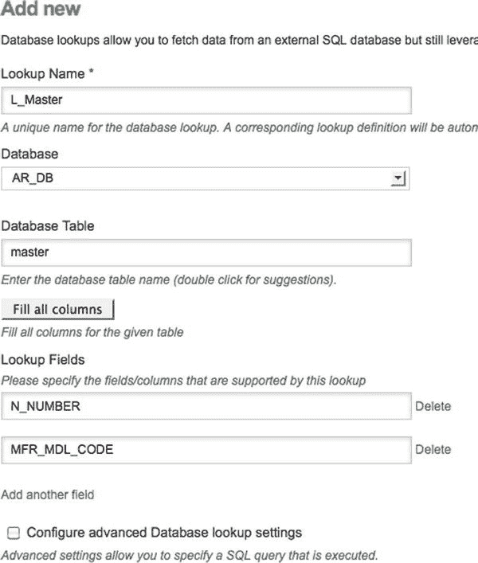
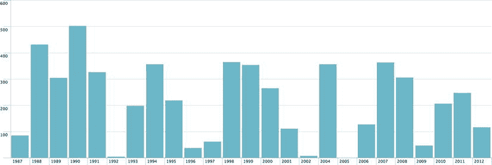
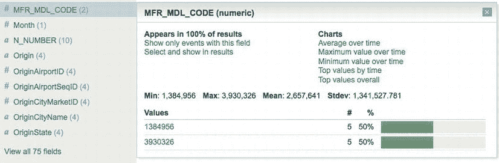
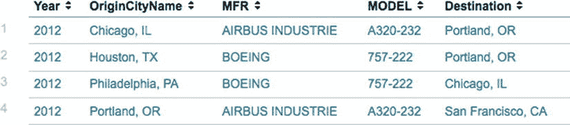
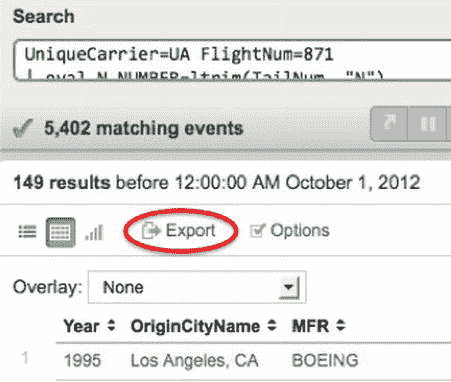
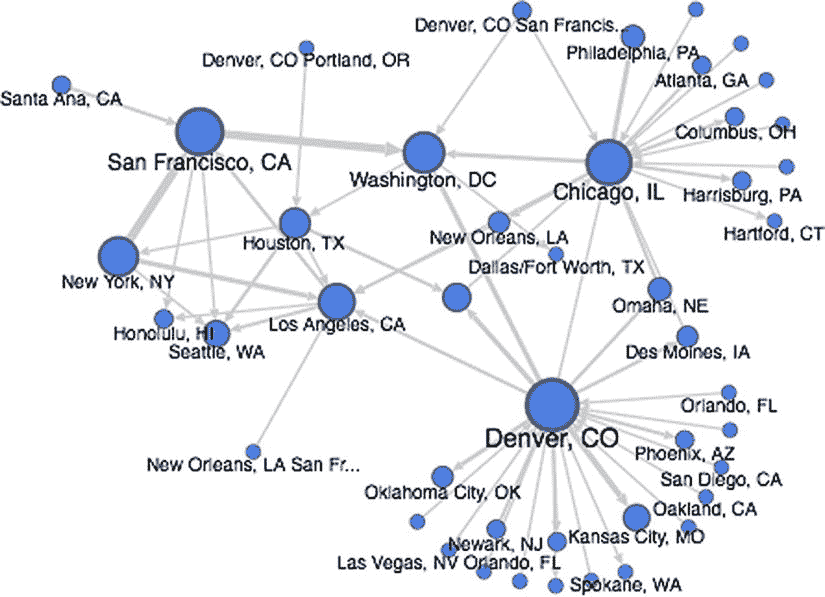

# 命名规范与自动查找

按照命名规范，我们惯于在自动查找的名称前加上"AL_"前缀，因此基于`L_UniqueCarrier`查找定义，这个自动查找被命名为`AL_UniqueCarrier`。自动查找的唯一要求是必须根据来源（source）、来源类型（source type）或主机（host）将其关联到事件上。对于本示例，我们将使用主机，因为所有航班数据都在名为`BigDBook`的单台主机上建立了索引。

下一节是定义查找输入字段，即用于在查找表中查找匹配项的字段。我们的示例基于一个字段：表中的`Code`和航班数据中的`UniqueCarrier`。请注意，必须将 CSV 字段名放在左侧，要匹配的字段放在右侧，否则查找将静默失败。对于要从查找表返回并添加到事件中的字段也是如此。最后，保留"Overwrite field values"为未选中状态，因为该选项仅在你希望用查找表中匹配到的对应值覆盖事件中的字段时使用。在此特定情况下，我们只是将`Description`作为新字段添加到事件中，并在定义中将其重命名为`Airline`。从现在开始，我们可以在任何搜索中直接使用`Airline`字段，而无需指定查找命令。例如：

```
* | stats count by Airline
```

将产生与以下相同的结果：
`* | stats count by UniqueCarrier`
`| lookup L_UniqueCarrier Code as UniqueCarrier`
`| rename Description as Airline`
`| fields – Code, UniqueCarrier`

有趣的是，通过创建自动查找，我们还可以执行反向搜索。这意味着你可以使用查找表的结果字段来进行搜索。例如：
`Airline="Virgin America"`
`| stats count`

`Airline`字段作为自动查找的结果字段可用。请注意，由于我们指定了`Description`字段自动映射到`Airline`，因此`Description`字段不再可用。任何使用`Description`的搜索都将失败，使用`Code`字段的搜索也会失败，因为在自动查找定义中，我们将`Code`映射到了`UniqueCarrier`。`UniqueCarrier`字段仍然可用，因为它是原始事件的一部分。

## 从搜索创建查找表

到目前为止，我们一直在使用 CSV 文件将数据上传到 Splunk 或将其用作查找表。Splunk 提供了创建基于 CSV 的查找表文件的能力。我们将优化本章前面使用的`L_UniqueCarrier.csv`查找表，以说明如何创建新的查找表文件并将其作为新查找表在搜索中重用。

最初从 TranStats 网站下载的`UniqueCarrier`字段的查找表包含 1,543 家航空公司。我们知道在整个航班数据中只涉及其中 30 家。此外，我们在清理数据时还更改了一些航空公司的名称，例如其中两家航空公司的合并备注。我们将使用以下搜索重新进行清理，并消除 26 年航班数据中未使用到的所有航空公司：

```
| tstats count from summary_fd groupby UniqueCarrier
| lookup L_UniqueCarrier Code as UniqueCarrier
| eval Airline=replace(Description, "^(.+)\(.+\)", "\1")
| fields - count Description
| outputlookup L_UniqueCarrier_short.csv
```

此搜索的前四个子句已为我们所熟知。新命令是`outputlookup`，它会创建一个 CSV 文件，并使用命令中给出的名称创建一个查找表文件定义。请注意，你还可以指定`.csv.gz`扩展名，这将自动压缩 CSV 文件。`outputlookup`命令有许多参数，我们只提及其中之一：`append`。该参数可用于将数据追加到现有的查找表文件，前提是该文件不是压缩文件。只有文件标题行中存在的字段才会被使用。

## 美联航 871 航班

现在我们已经知道如何创建和使用查找表，接下来将通过尝试回答一个查询来让事情稍微复杂一些。在此过程中，我们将使用数据库查找表。我们提出的查询是展示美联航 871 航班的历史，显示该航班号多年来使用过的航段或城市对（出发地和目的地），以及在这些航段中使用的是何种飞机型号。

这个查询需要用到几个查找表，因为航班数据事件中的信息仅包含飞机的注册号（`TailNum`字段）。要获取飞机型号，我们必须查阅美国联邦航空管理局（FAA）网站上的飞机注册数据库：`http://www.faa.gov/licenses_certificates/aircraft_certification/aircraft_registry/releasable_aircraft_download/`。在该网站上，我们了解到该数据库每周更新一次，撰写本文时其压缩大小为 45MB，由多个文件组成。

下载并解压文件后，我们快速浏览了`ARData.pdf`文件，注意到飞机注册主文件并不包含飞机的型号名称，而是一个代码。该代码由三部分组成：制造商代码、型号代码和系列代码，它们组合成一个名为`MFR_MDL_CODE`的单一字段。进一步探索后，我们发现在飞机参考文件中包含了主文件的制造商、型号、代码字段与制造商名称和型号名称之间的关系，而这正是我们想要的。

主文件包含超过 352,000 架飞机，未压缩时约为 207MB，而参考文件包含超过 76,000 条记录，大小为 6.7MB。如本章前面所述，由于主文件超过了用户界面的 100MB 最大大小限制，必须通过配置文件将其作为查找表上传到 Splunk。此外，由于该查找文件超过了 10MB 的默认大小，Splunk 会自动为其建立索引。然而，出于教学目的，我们将这两个表上传到 MySQL 数据库，并使用 Splunk DB Connect 应用通过定义数据库查找表来使用它们。

在第 9 章中使用的现有 MySQL 实例中，我们创建了一个名为`AircraftRegistration`的新数据库，其中包含`master`和`reference`两个表。完成此操作后，我们以与第 9 章中创建`FD_DB`数据库相同的方式，在 Splunk 中创建了一个新的"External Database"，但将其命名为`AR_DB`。既然已经定义了新的外部数据库，我们就可以继续创建所需的两个数据库查找了。这可以通过在"查找"菜单中选择"Database lookups"选项来完成。`master`表的数据库查找创建对话框如图 11-7 所示。



图 11-7 . 创建数据库查找

略微修改我们对查找表的命名规范，我们将此查找表称为`L_Master`。指定查找的数据库和表后，我们定义将要使用的字段。主表有 34 个字段，但我们只对`N_NUMBER`（映射到航班数据中的`TailNum`）和`MFR_MDL_CODE`（提供与参考表中制造商和型号名称的关系）感兴趣。以类似的方式，我们定义了`L_Reference`查找表，只使用 11 个字段中的三个：`CODE`（映射到主表的`MFR_MDL_CODE`字段）、`MFR`（制造商名称）和`MODEL`（飞机型号名称）。


## 构建查询：美联航 871 航班分析

现在我们已经建立并运行了查找表，可以开始构建搜索来回答查询问题。探索的第一步是了解美联航 871 航班在时间线上的数量变化。这个搜索非常简单，输出结果如图 11-8 所示。

```
UniqueCarrier=UA FlightNum=871
| stats count by Year
```



**图 11-8.** 美联航 871 航班随时间变化的计数

如图 11-8 所示，该航班号的使用在多年来并不恒定。上一个搜索结果的另一个重要信息是，在整整 26 年间，美联航使用该航班号共飞行了 5402 次。将鼠标悬停在 2012 年柱状图上，我们看到当年有 116 次航班。我们决定不使用最近一个月来测试搜索，而是只使用最近 10 次航班。这样做是因为，如果搜索有任何问题，仅用 10 个事件比用 116 个事件更容易定位问题。逐步构建搜索，下一个合理的步骤是执行第一次查找：

```
UniqueCarrier=UA FlightNum=871
| head 10
| lookup L_Master N_NUMBER as TailNum
```

然而，当查看显示字段的左侧边栏时，`MFR_MDL_CODE`并没有出现。我们确实注意到`Airline`字段在那里，所以我们之前定义的自动查找是正常工作的。为了确认查找表中没有匹配到尾号，我们修改搜索如下：

```
UniqueCarrier=UA FlightNum=871
| head 10
| lookup L_Master N_NUMBER as TailNum
| stats count(MFR_MDL_CODE)
```

计数结果为零：没有匹配项。我们查看查询返回的第一个事件，其尾号为`N441UA`，然后使用电子表格在查找表中查找它。我们很快找到了它，同时也找到了查找失败的原因。事实证明，飞行数据中的尾号包含注册号开头的`N`，而主文件不包含，所以解决方案是在执行查找之前修剪掉`N`。我们使用`eval`命令的`ltrim`函数来实现，该函数从字段左侧修剪指定的字符串：

```
UniqueCarrier=UA FlightNum=871
| head 10
| eval N_NUMBER=ltrim(TailNum, "N")
| lookup L_Master N_NUMBER
```

在修改这个搜索时，我们同时利用`eval`命令将修剪后的尾号赋值给`N_NUMBER`字段，以便它能直接被查找命令使用，这样我们就可以从查找命令中删除`as TailNum`。在图 11-9 中，可以看到`MFR_MDL_CODE`字段现在出现在左侧边栏中，当我们点击它时，弹出窗口显示它有两个值。



**图 11-9.** 字段侧边栏及`MFR_MDL_CODE`字段详情

现在我们验证这些值是否存在于第二个查找表中。`1384956`对应波音 757，`3930326`对应空客 A320，这两者对于像美联航这样的商业航空公司来说都是合理的。此外，我们手动验证了这 10 个事件确实与图 11-9 中显示的计数匹配。我们选择只使用 10 个事件而不是最近一个月的另一个原因是，验证 10 个事件及其在查找表中的所有关联关系要容易得多。现在我们有了这些值，就可以添加第二个查找来获取型号名称和制造商名称了。

```
UniqueCarrier=UA FlightNum=871
| head 10
| eval N_NUMBER=ltrim(TailNum, "N")
| lookup L_Master N_NUMBER
| lookup L_Reference CODE as MFR_MDL_CODE
```

我们再次验证，第二次查找产生的预期新字段出现在左侧边栏中，并且`MFR`和`MODEL`都显示了我们已经识别出的预期值，所以一切正常。现在我们有了所需的所有信息，让我们继续尝试回答查询问题：

```
UniqueCarrier=UA FlightNum=871
| head 10
| eval N_NUMBER=ltrim(TailNum, "N")
| lookup L_Master N_NUMBER
| lookup L_Reference CODE as MFR_MDL_CODE
| stats values(DestCityName) as Destination by Year OriginCityName MFR MODEL
```

使用这个搜索的输出（可在图 11-10 中找到），我们验证了最近 10 个事件确实匹配了出发地和目的地。一切匹配后，我们准备删除搜索中的`| head 10`部分，并对所有飞行数据运行搜索。当我们这样做并检查结果时，我们发现 2004 年用于芝加哥（伊利诺伊州）到得梅因（爱荷华州）航段的飞机是一架 P2004 Bravo，这是一架由 Costruzioni Aeronautiche Tecna 公司制造的双座单引擎飞机。这显然是记录中的错误，我们决定忽略它。在这些结果中发现的另一件奇怪的事情是，它们从 1995 年开始，如图 11-11 所示。我们知道自 1987 年（飞行数据的起始年份）以来就有美联航使用此航班号的航班，这是我们在开始为本查询探索飞行数据时了解到的，并且可以在图 11-8 中看到。经过一些研究，我们发现 1994 年之前的事件不包含这些航班所使用飞机的尾号。



**图 11-10.** 美联航 871 航班城市对及飞机信息



**图 11-11.** 导出结果链接的位置

数据库查找表不提供如 CSV 文件查找表那样的选项，即当未达到最小匹配数时，可以定义要返回的字符串（参见图 11-3）。

不幸的是，将这些结果可视化是一个真正的挑战。除了我们在图 11-10 中显示的表格之外，我们想不出任何像样的可视化方式，即使我们将表格分解为列的子组，并尝试像第 10 章（图 10-9）中那样使用图表来处理仪表板示例（按航空公司排名前五的机场）。核心挑战在于找到一种方法来表示航段或城市对（出发地和目的地）。理想的方式是使用地图并在城市对之间绘制连线，但我们未能立即找到提供此功能的应用程序。然而，在寻找过程中，我们偶然发现了一个网络图，它是 Google Fusion Tables（位于`http://tables.googlelabs.com`）的一部分。在这里，您可以上传包含数据的 CSV 文件并创建多种可视化效果，其中大部分在 Splunk 中已经可用。

在 Splunk 中导出搜索结果非常简单。只需找到导出链接，它位于输出模式选择旁边。这可以在图 11-11 中用红色圆圈标出。当您点击此链接时，一个对话框会要求您命名输出文件并选择格式。选项有 CSV、XML 和 JSON。

我们创建了一个包含美联航 871 航班所有飞行数据搜索结果的 CSV 文件，并将其上传到 Google Fusion Tables。我们选择使用`OriginCityName`和`Destination`列来创建网络图。有趣的图形如图 11-12 所示。




  
图 11-12. 联合航空 871 航线的城市对网络图  

## 本章小结  

在本章中，你学习了如何创建和定义查找表。我们针对静态文件和数据库表都完成了这一操作。我们通过几次搜索，分别使用了简单和较为复杂的查找来说明其用法。此外，还讨论了如何基于搜索结果创建查找表，以及如何将搜索结果导出为 CSV、XML 或 JSON 格式的文件。  

