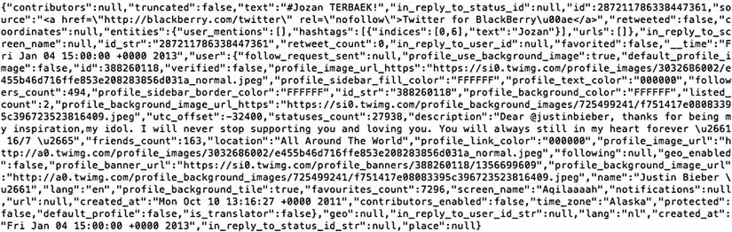
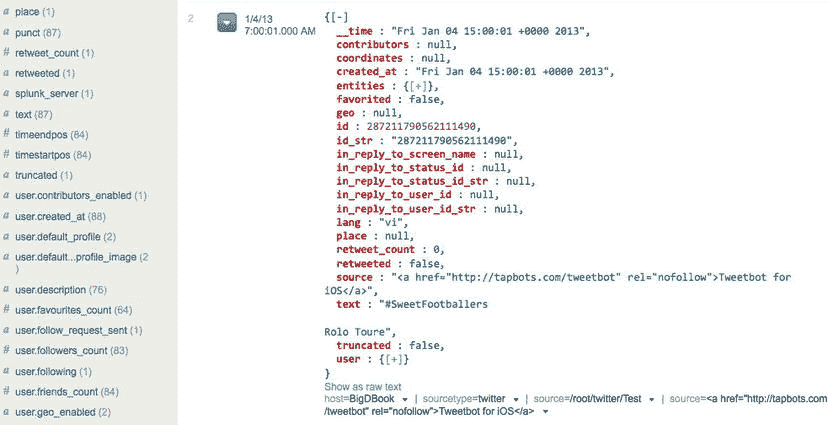
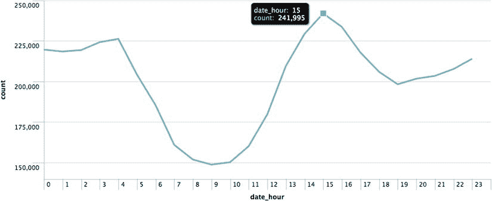
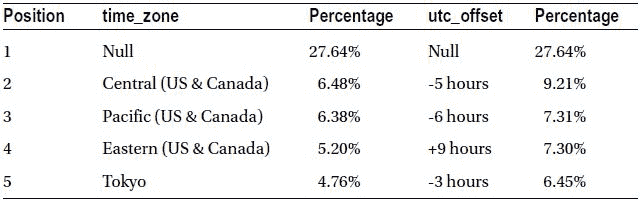
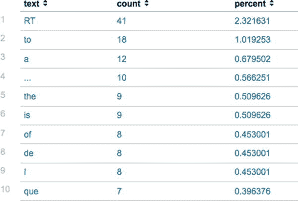
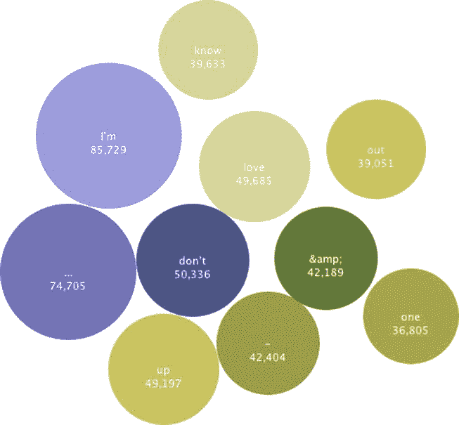
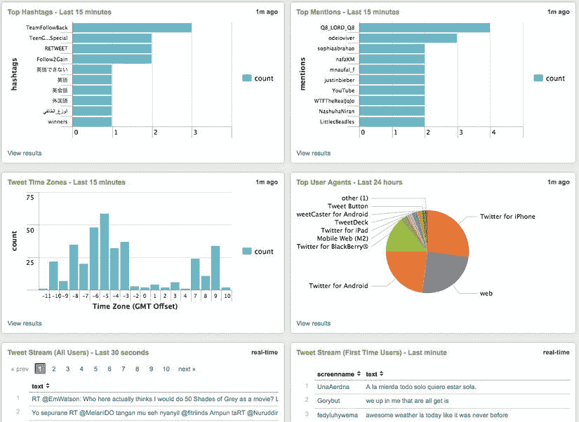

# 第 12 章  

  

## 分析推文  

在本章中，我们将回顾如何处理和分析推文。我们将介绍 Twitter 对象格式及其包含的字段。你还会了解 JSON——Twitter 用来分享推文及其他信息的数据交换格式，以及如何将这种格式的数据加载到 Splunk 中，包括时间戳方面的考量。我们将使用一些新命令来创建多个搜索，以历史方式和实时方式处理推文。  

Twitter 是一种微博客服务，用户可发布或阅读最多 140 个字符的文本消息。每一条这样的消息被称为一条 `tweet`。Twitter 非常成功，许多个人和公司都在使用它。来自互联网多个来源的统计数据显示，2012 年，超过 4.65 亿注册账户每天发布约 1.75 亿条推文，且每天新增 100 万个账户。使用 Twitter 最多的三个国家是美国、巴西和日本。Twitter 最繁忙的时刻每秒推文量高达 25,000 条。  

用户可以订阅以阅读其他用户的推文，这被称为 `following`（关注），而订阅者则被称为 `followers`（粉丝）。截至 2012 年底，按粉丝数量计算，最受欢迎的三位 Twitter 用户是：  

- Lady Gaga，拥有 32,987,239 名粉丝  
- Justin Bieber，拥有 32,874,390 名粉丝  
- Katy Perry，拥有 31,134,772 名粉丝  

推文默认是公开的，即任何人都可以查看，但用户可以选择仅向他们的粉丝发送推文，并批准谁可以关注他们。此外，还可以发送直接消息，即一个 Twitter 用户向另一个用户发送的私人消息。这些消息受到限制，因为用户只能向关注自己的人发送私信。  

关于推文还有一些额外的概念，例如 `@reply`。当一条推文以 `@username` 开头时，表示这是对发送该消息的用户的某条特定推文的回复。`@replies` 被视为普通推文，因此会发送给该用户的粉丝。由于推文的 140 字符限制，多年来形成了一种特殊的行话。虽然我们不会深入探讨这种行话，但需要指出的是，诸如 `@username` 这样的元素不仅可以在推文中的任何位置使用，而且已经在 Twitter 之外变得相当流行。  

在这种行话中，你还会发现主题标签（hashtags），它们也逐渐成为一种相当非正式的组织或分类推文的方式。用户在认为能代表推文内容类别或主题的词前加上 `#`。虽然这是一种有趣的分类内容的方式，但由于其随意性，并不总是精确的。例如，在 2012 年美国大选期间，同一个意图分类出现了多种变体：`#Elections`、`#elections`、`#Elections2012`、`elections2012`、`#Elections12`，此外还有一些拼写错误的变体，如 `election`。  

当你转发别人的推文时，这被称为转推（retweeting）。当你使用 Twitter 的转推功能时，它会自动在推文开头添加字母 `RT` 和原始作者的用户名。有时用户会自行在推文中添加 `RT`、`MT` 或 `MRT`，以表明他们正在转推或已在转推前对推文进行了修改，但这并非 Twitter 的官方功能，这些推文缺少 Twitter 在转推时包含的附加信息。  

当一个主题标签频繁出现在推文中时，我们称之为趋势（trending）或变得流行。趋势通常持续时间较短，许多网站会根据自有的算法提供它们所认为的热门话题。Twitter 本身也提供个性化趋势，这些趋势与你表达过兴趣的话题相匹配。它们的算法关注的是即时热门内容，而非那些已经流行一段时间或每日持续流行的内容。在本章后面，我们将提供我们自己相当简单的趋势版本。  

当 URL 作为推文内容的一部分被包含时，Twitter 会自动将其与潜在危险网站列表进行比对。无论该 URL 是否指向可疑网站，Twitter 还会使用他们称之为 `t.co` 服务的 URL 缩短器将其转换为新的 URL。这样，任何 URL 都将是 20 个字符长，即使链接本身更短。一些应用程序会据此调整消息的字符计数，而另一些则不会。  

每个用户都有一个个人资料，他们可以定义自己的位置、时区、姓名和显示名称，还可以提供自己的照片以及许多其他属性。用户发布的每条公开推文都会发送给其粉丝，并自动发布到其个人资料页面，使其在 Twitter 网站上也可搜索。  

除了网站，Twitter 还为各种手机和平板电脑提供了应用程序。还有大量第三方应用程序或客户端允许你与 Twitter 交互。这些交互或集成通过 Twitter API 完成，这些 API 提供了对大多数功能的简单接口。此外，Twitter 还提供了一组专用于包含推文的数据流的 API。从所有这些 API 中，我们将使用能够访问名为“1% 样本”的数据流的 API，该数据流是总推文量中约 1% 的实时随机样本。包含所有推文的数据流（不公开可用）被称为 Twitter `firehose`（消防水管）。  

### 接入样本数据流  

我们使用一个名为 `get1pct.py` 的程序收集了 24 小时的推文，在本章后续部分，我们将先利用这些数据进行一些基础分析，然后再使用一个 Splunk 应用程序来实时分析数据流。你可以在本书的下载包中找到该程序。使用该程序时，只需按如下方式调用，它便会将推文捕获到名为 `SampleTweets.out` 的文件中，直到你停止它：  

```
get1pct.py –n twitter_username –p password
```

Twitter 数据流使用 JSON 作为标准格式。JSON 代表 JavaScript 对象表示法（JavaScript Object Notation），是一种基于文本的数据交换标准。它通过使用花括号 `{ }` 来定义多层结构，并通过使用方括号 `[ ]` 为字段定义多个值。最终，一条使用 JSON 格式的推文是一个按多层结构组织的键值列表。你可以在图 12-1 中看到一条典型的 JSON 格式推文，它（不可避免地）相当难以阅读。  

  

图 12-1. 一条 JSON 格式的推文  

为了解释典型推文中我们可以预期的基本字段，我们将它们进行格式化，每行放置一个字段（键值对），并对不同层级进行缩进。你需要意识到，这些字段在每条推文中出现的顺序不一定相同，并且并非所有字段都会出现在所有推文中。换句话说，如果某个字段未出现，可以认为其值为空或为空集。好消息是，Splunk 在索引数据时会透明地处理这些情况。将推文格式化后，它变得更容易阅读：  


```json
{
  "contributors": null,
  "truncated": false,
  "text": "Searchtemplate on a form for a dashboard and evalhttp://t.co/Cc4gIIDe",
  "in_reply_to_status_id": null,
  "id": 287365037834788865,
  "source": "<a href=\"http://ifttt.com\" rel=\"nofollow\">IFTTT</a>",
  "retweeted": false,
  "coordinates": null,
  "entities": {[+]},
  "in_reply_to_screen_name": null,
  "id_str": "287365037834788865",
  "retweet_count": 0,
  "in_reply_to_user_id": null,
  "favorited": false,
  "__time": "Sat Jan 05 01:08:58 +0000 2013",
  "user": {[+]},
  "geo": null,
  "in_reply_to_user_id_str": null,
  "possibly_sensitive": false,
  "lang": "en",
  "created_at": "Sat Jan 05 01:08:58 +0000 2013",
  "in_reply_to_status_id_str": null,
  "place": null
}
```

按照此示例中的字段顺序，我们将对当前我们认为值得关注的字段进行说明；其他一些字段将在本章后面讨论。如果你想了解每个字段的详细描述，可以在 Twitter 网站 `http://dev.twitter.com/docs/platform-objects/tweets` 上找到。第一个值得关注的字段是 `text`，它包含了实际的推文内容。接下来是 `source` 字段，它告诉我们创建该推文时使用了哪个应用或客户端。对于 `entities` 字段，我们使用了 Splunk 标记 `{[+]}`（这并非 JSON 标准），来表示该字段包含我们稍后将要检查的其他子字段。`__time` 字段在推文中并不存在；它是由 Python 程序创建的，我们将在介绍数据加载和时间戳问题的章节中详细讨论。接下来的字段 `user` 包含了与发布推文的用户相关的所有信息，这些信息以子字段的形式呈现；同样，我们使用 `{[+]}` 标记来表示这一点。之后是 `lang` 字段，它包含一个遵循 ISO-639-1 标准的、由两个字母组成的语言代码。尽管在撰写本文时 Twitter 文档中并未解释此字段，但我们推测它表示对推文实际语言的最佳猜测，并将在本章后面详细讨论。在第一次过目时最后一个值得关注的字段是 `created_at`，它记录了推文创建的时间。该字段中的所有时间均基于 UTC/GMT 时区，这一点由 `+0000` 字符串表示。

展开 `user` 字段后，经过格式化的典型子字段如下所示：

```json
"user":{
  "follow_request_sent":null,
  "profile_use_background_image":true,
  "default_profile_image":false,
  "id":121214676,
  "verified":false,
  "profile_image_url_https":  "https://si0.twimg.com/profile_images/825701927/answers-avatar_normal.png",
  "profile_sidebar_fill_color":"DDEEF6",
  "profile_text_color":"333333",
  "followers_count":656,
  "profile_sidebar_border_color":"C0DEED",
  "id_str":"121214676",
  "profile_background_color":"C0DEED",
  "listed_count":28,
  "profile_background_image_url_https":"https://si0.twimg.com/images/themes/theme1/bg.png",
  "utc_offset":-28800,
  "statuses_count":12923,
  "description":null,
  "friends_count":9,
  "location":"San Francisco, CA",
  "profile_link_color":"0084B4",
  "profile_image_url":  "http://a0.twimg.com/profile_images/825701927/answers-avatar_normal.png",
  "following":null,
  "geo_enabled":true,
  "profile_background_image_url":"http://a0.twimg.com/images/themes/theme1/bg.png",
  "name":"Splunk Answers",
  "lang":"en",
  "profile_background_tile":false,
  "favourites_count":0,
  "screen_name":"splunkanswers",
  "notifications":null,
  "url":"http://answers.splunk.com/",
  "created_at":"Mon Mar 08 20:09:54 +0000 2010",
  "contributors_enabled":false,
  "time_zone":"Pacific Time (US & Canada)",
  "protected":false,
  "default_profile":true,
  "is_translator":false
},
```

同样，按照此示例的顺序，我们将解释对我们目的来说最相关的字段。第一个是 `followers_count`，即订阅以接收该用户推文的 Twitter 用户数量。下一个字段是 `utc_offset`，即 UTC/GMT 时区与用户声明的时区之间的差值，以秒为单位，这在进行基于 Unix 时间的数学运算时非常有用。然后是 `statuses_count`，即自账户创建以来该用户发布的推文数量。接下来是 `friends_count`，即该特定用户正在关注的其他用户数量。紧接着是 `location`，即用户声明的所在地位置。

接下来的两个值得关注的字段是 `name` 和 `screen_name`，其中 `screen_name` 是唯一的，被 Twitter 用作用户名。而 `name` 则不一定代表真实姓名。在这两个字段之间，可以找到 `lang`，它是该用户声明语言的代码。这并不意味着其推文就是用这种语言编写的。（请参阅本节后面的说明。）`created_at` 字段包含了用户资料创建或最后更新的时间戳。请不要将此字段与上一层级中同名的字段混淆，因为那个字段包含的是推文创建的时间戳。最后一个字段包含了用户声明的时区名称。

 **注意** 非常重要的一点是，某些字段是由用户在他们的应用或客户端中声明的，并不总是正确的。`location`、`lang` 字段的内容，以及程度稍轻的 `time_zone` 和 `utc_offset` 字段的内容，可能与它们推文的内容有关，也可能毫无关系。我们的经验表明，这些字段的内容往往是不可靠的。在进行数据分析时请务必记住这一点。

当一条推文是使用 Twitter 原生功能进行的转发（retweet）时，该推文会包含一个名为 `retweeted_status` 的顶级字段。此字段的子字段包含了原始用户的所有相关信息，包括原始推文。在处理转发推文的文本时，如果原始推文接近 140 个字符的限制，最好使用原始推文。这是因为转发推文会截掉原始推文的末尾部分，以便在转发文本的开头添加用户名和字母“RT”。请注意，顶层的 `retweeted` 字段并不一定表示当前推文被转发了。

在示例数据流中，我们还会发现一些事件并非推文，而是删除推文的指令。Twitter 不允许用户修改已经发布的推文；但它允许用户删除自己发布的推文或转发。尽管我们不需要这些记录（因为它们可能涉及到不包含在 1% 样本中的推文），但我们决定将它们原样保留在我们将要索引到 Splunk 的文件中。这些删除事件经过格式化后如下所示：

```json
{
  "delete":{
    "status":{
      "user_id_str":"400166241",
      "user_id":400166241,
      "id":139980458426499072,
      "id_str":"139980458426499072"
    }
  }
}
```

## 将推文加载到 Splunk

我们对 `get1pct.py` 程序生成的文件进行了修改，使其正好包含 24 小时的数据。我们的样本数据时间范围是从 1 月 4 日（星期五）的 15:00:00 到 1 月 5 日（星期六）的 14:59:59。该文件包含 4,815,166 个事件，大小约为 12 GB。由于 Twitter 服务条款的限制，实际的推文数据无法分发。我们建议您运行 Python 程序并收集一个样本，其大小需适合您 Splunk 许可证的索引限制。


### 第一个挑战：定义时间戳字段

我们需要处理的第一个挑战是为 Splunk 时间戳定义正确的字段。问题在于，在 Splunk 中我们只能使用正则表达式来定义包含时间戳的字段。有两个名为 `created_at` 的字段，一个在顶层，对应实际的推文——这是我们想要的时间戳；另一个位于 `user` 对象内部。虽然对人类或 JSON 解析器来说这两个字段明显不同，但对正则表达式而言它们却是一样的，因为字段的顺序和存在性都无法保证。我们无法采用第 9 章中使用的方法——当时时间戳分散在两个字段中，但我们能通过统计逗号数量来精确锁定想要的字段。这就是为什么 Python 程序会基于顶层的 `created_at` 字段创建一个名为 `__time` 的新字段。请注意，这个新字段名称前有两个下划线，以免与 Splunk 内部仅有一个下划线的 `_time` 字段混淆。有了这个新字段，在 Splunk 中定义时间戳就变得非常简单。

## 创建测试文件并定义新的源类型

出于谨慎考虑，我们决定创建一个仅包含样本数据前 100 条推文的小型测试文件。通过这个文件，我们按照第 9 章中“预处理航班数据”标题下的步骤，定义一个新的源类型，用于指定推文的时间戳位置：

*   定义一个新的输入文件，并在索引前预览数据
*   定义一个新的源类型
*   选择“调整时间戳和事件分隔设置”
*   选择“每行是一个事件”并点击“应用”
*   选择“时间戳”选项卡
*   在“位置”下选择“时间戳总是以某种模式为前缀”，并输入以下内容：`"__time":"`（记住，在 `time` 这个词前有两个下划线字符）
*   在“格式”下选择“指定时间戳格式”，并输入以下内容：`%a %b %d %T %Z %Y`，其中：
    *   `%a` 表示星期几的名称，可以是缩写或全称
    *   `%b` 表示月份的名称，可以是缩写或全称
    *   `%d` 表示月份中的日期，允许前导零，但不是必需的
    *   `%T` 表示时间，格式为 `%H:%M:%S`
    *   `%Z` 表示时区或时区名称/缩写
    *   `%Y` 表示包含世纪的年份
*   选择“指定时区”，并从下拉菜单中选取“(UTC) 协调世界时”，因为我们知道所有时间戳都位于该时区。
*   点击“应用”。现在您应该会看到每个事件或推文上的时间戳已高亮显示，并且第二列显示正确的时间戳。您还会看到删除事件出现警告，因为它们没有时间戳。Splunk 会为这些事件沿用前一个事件的时间戳。
*   点击“继续”，然后指定新源类型的名称。我们将其保存为 `twitter`。
*   现在可以开始索引测试数据了。

## 验证已索引的数据

将这 100 个事件索引到 Splunk 后，我们可以快速验证并确认加载操作是否正确。在图 12-2 中，您可以看到列出所有事件时输出的部分截图。此图中有几点需要注意。首先，虽然图中无法显示，但在结果顶部显示“所有时间段内共有 100 个事件”，因此确认已将我们提供的所有事件都索引了。其次要注意的是，左侧边栏显示了一些字段，这些字段与我们刚才查看的字段类似，这表明 Splunk 能够理解 JSON 格式。请注意，Splunk 表示多层字段的方式是使用点号（`.`）分隔层级形成路径。例如，`user` 字段下的 `created_at` 子字段被引用为 `user.created_at`，当我们使用 JSON 格式的数据创建搜索时，也将以这种方式引用字段。



图 12-2. 用户界面中列出的 JSON 事件

事件本身按字母顺序显示字段，并带有正确的 Splunk 时间戳，该时间戳与 `__time` 字段匹配。此外，第一个事件是我们测试文件中的最后一个事件。您可能还记得，Splunk 按从最新到最旧的顺序显示事件，所以这是正确的，因为我们的测试文件是从最早到最新排列的。您还会注意到事件以 `{[-]` 开头。如果您点击减号，Splunk 会折叠该层级显示的信息；这与点击 `{[+]}` 中的加号效果相反，点击加号会展开显示所选字段的所有子字段。注意，`entities`、`retweeted_status` 和 `user` 字段提供了展开查看其子字段的选项。在列出的事件底部，有一个以原始文本形式显示事件的链接。点击此链接后，事件将如图 12-1 所示的方式呈现。

另外需要注意的一点是，左侧边栏中的字段（例如 `id` 和 `user.created_at`）计数为 88。这是因为在 100 个事件中，有 88 个是推文，12 个是删除事件。最后，侧边栏上的 `source` 字段显示计数为 31，这看起来是错误的，因为只有一个源文件。当您查看列出的事件末尾时，会发现有两个 `source` 项，一个正确显示了包含我们刚索引的测试事件的文件名，另一个则包含了来自推文的 `source` 字段内容。不可否认，这会造成混淆，因为 Splunk 处理着两个同名字段，但能够区分它们之间的某种差异。我们将在本章后面介绍 `spath` 命令时详细讨论这个问题。

除了 `source` 字段造成的混淆情况之外，使用推文测试文件进行的索引似乎已成功，一切正常。接下来，我们将删除刚刚加载的 100 个事件，然后索引包含近 500 万条推文的完整文件。

## 推特中的一天

使用我们刚刚索引的包含近 500 万个事件的文件，我们对这些推文进行一次历史分析。为了熟悉 JSON 的字段表示法，让我们先从统计收集到的文件中删除事件的数量开始：

```
* | stats count(delete.status.id)
```

直接搜索单词“delete”很诱人，但如果这个词出现在推文的任何字段中，我们就会得到不正确的计数。这就是为什么我们选择统计删除结构中一个唯一的字段。任何字段都可以；我们选择了 `id` 子字段，这样当事件中存在该字段时，我们就能确定它是一个删除事件。总计数为 493,382，约占数据流的 10% 以上；这说明有大量的人在改变主意。

接下来，我们想了解一天中每个小时的推文数量。无论数据格式如何，这个搜索都非常简单，因为我们只需统计事件数量：

```
* | stats count by date_hour
```

`date_hour` 字段是 Splunk 中一组名为“日期时间”字段中的默认字段，这些字段为事件时间戳提供了更细的粒度。它们还包括 `date_minute`、`date_month`、`date_second`、`date_wday`、`date_year` 和 `date_zone`。此命令的输出以图表形式呈现在图 12-3 中。请注意，*y* 轴起点为 140,000，而非 0。



图 12-3. 一天中每个小时的推文数量


您必须记住，Twitter 是一种全球现象，因此当我们统计推文时，它们遍布世界各地。如之前所述，时间戳基于 UTC 时区。推文数量最多的时段是下午 3 点，共计 241,995 条。结合具体背景来看，下午 3 点对应伦敦时间上午 10 点、纽约时间早上 7 点、旧金山时间早上 4 点，以及东京时间的午夜（即新一天的开始）。还要注意，我们的样本数据从 1 月 4 日（周五）15:00 开始，因此图表应合理地从 15 点而不是 0 点开始，以呈现真实情况。遗憾的是，Splunk 的图表选项并不提供决定坐标轴起始值的功能。

在稍有差异的搜索中，我们使用`time_zone`和`utc_offset`这两个可用字段，按时区查看推文数量。这些字段属于用户对象的一部分，且如前所述，它们由用户定义，或者使用用户所使用的 App 的默认值。如果正确填写，它们通常指向用户的主要地理位置。我们发现，许多人在处理这两个字段时会感到困惑。一个时区可以有多个名称——毕竟时区从北极一直延伸到南极——因此`time_zone`字段的前五名是关于最常用的时区名称，而`utc_offset`字段则是关于实际时区偏移。表 12-1 展示了按两个字段分别统计的前五名推文数量。

表 12-1. 每小时区推文数量



令人惊讶的是，两个字段中最受欢迎的时区都是空值，占比超过 27%。推文数量最多的时区名称是美国中部时区；然而，推文数量最多的实际时区偏移是 UTC-5 小时，这对应以下时区名称：东部时间（美国和加拿大）、印第安纳州（东部）、波哥大、利马和基多。要获取按 UTC 偏移量分组的时区名称列表，只需使用以下搜索：

```
* | stats values(user.time_zone) by user.utc_offset
```

您会发现，某些时区关联了大量的名称；例如，UTC+1 小时有 20 个名称，基本上都是欧洲国家首都的名称。请注意，尽管大多数偏移量基于整小时，但也有少数偏移量为 30 或 45 分钟，最著名的是印度，偏移量为 UTC+5 小时 30 分钟，有四个时区名称：金奈、加尔各答、孟买和新德里。

现在，让我们看看推文的语言。情况相当不明确，因为我们处理的是两个字段：一个是在高层级上，截至本文撰写时，Twitter 并未对其文档化（但我们推测这是对推文语言的最佳猜测），另一个是作为用户结构一部分的`lang`字段。后者是用户所用 App 声明的语言，或者也可能是该 App 的默认语言。我们对前 20 个这两个字段内容不同的事件进行了搜索，发现有 8 个事件符合这种情况。如果算上这 20 个事件中有 2 个是删除事件，那么比例几乎达到 50%。仔细检查这 8 个事件的实际推文（`text`字段）语言，发现 5 条语言正确，2 条错误，还有 1 条没有足够的文本来猜测其语言，因为它只包含“@username (Y)”。

使用以下搜索来查找有多少事件的`text`字段语言与用户配置文件中定义的语言不同，我们得到 1,271,427 个事件，分布在 801 种不同的语言组合中。这几乎占推文总数的 30%。有趣的是，其中约有 21%的推文将用户语言定义为英语，但推文语言被标记为印度尼西亚语。

```
* | rename user.lang as tweet_user_lang
| where tweet_user_lang != lang
| stats count by tweet_user_lang, lang
```

 **注意**   在处理基于 JSON 的事件时，使用`eval`和`where`命令要小心。它们会将点号（`.`）解释为连接运算符。为避免这种情况，您可以将 JSON 字段路径用单引号（`'`）括起来，或者重命名字段。我们认为重命名字段是最佳实践。

我们还注意到，在这些结果中，约有 81,000 个事件的推文语言代码为“und”，我们推测这表示未确定。尝试猜测某些文本的语言，尤其是当文本像推文一样短时，是一项困难的任务，尤其是在当今多种语言混合使用变得越来越普遍的情况下。一些具有有趣名称的语言组合，如 Spanglish（西班牙语和英语混合）、Portuñol（葡萄牙语和西班牙语混合）、Frarabic（法语和阿拉伯语混合）、Hinglish（印地语和英语混合）等，使得这项任务更具挑战性。对于这一点，我们只能说，您应该极其谨慎地处理推文语言的分析。

另一个内容有问题的字段是`location`。这个字段由用户提供，我们见过它从城市名称变成“@username 的心底”，以及介于两者之间和超出想象的各种内容。`location`并不是一个可以用于任何严肃分析的字段。一些 Twitter 的 App 提供在其推文上附加地理位置信息的功能，即以经纬度形式附加推文的位置。这个字段是`coordinates`。还有另一个称为`place`的字段，它允许包含地址和边界框（地理坐标的多边形）。目前这些字段并未被广泛使用。我们快速搜索后发现，样本中约有 1.5%的推文带有地理位置信息。我们将在第 13 章中介绍如何处理地理位置数据。

有三个字段提供了有趣的信息，而且相当直观：`followers_count`、`friends_count`和`statuses_count`。它们是用户对象的一部分，由 Twitter 为每条推文计算得出。搜索拥有最多关注者、关注最多用户或拥有最多推文的用户极其简单。唯一需要非常注意的是，这些指标是非常动态的，因此您必须使用最新的推文才能获得最准确的结果。和往常一样，我们建议您在制定搜索时非常谨慎。在分析的这段时间内推文最多的用户与历史上推文最多的用户之间存在巨大差异。对于第一种情况，您可以使用以下搜索：

```
* | top user.screen_name
```

对于第二种情况，您可以使用如下搜索：

```
* | stats max(user.statuses_count) as max_count by user.screen_name
| sort - max_count
```

在第一个搜索中，我们仅根据已有的数据按用户统计事件。在第二个搜索中，我们寻找每个用户的最大推文计数，因为该数字会随每条推文而变化。对于第一个搜索，我们得到`favstar_bot`（一个机器人）是推文最多的用户，有 31 条；而对于第二个搜索，我们得到`Yougakudan_00`（日本的另一个机器人），其推文数量远超 3600 万条。

用于统计关注者和朋友数量的搜索也同样简单。当我们按关注者数量进行搜索时，我们在本章开头提到的前三名用户都没有出现在结果中。如果某个用户在样本期间内没有发布推文，该用户就不会出现在结果中，而上述三位用户在该期间内都没有发布推文。我们得到的关注者最多的用户是金·卡戴珊，拥有 17,084,687 名关注者。

最热门词汇


## 分词与停用词过滤

对于下一次搜索，我们希望找出推文中最流行的单词。我们将使用几个新命令来实现这一目标。主要思路是将文本字段分解为多值字段，其中每个值都是一个独立的单词。我们将单词定义为由两个空格包围的任何内容。完成这一步后，我们就可以继续对单词进行计数。第一个命令`makemv`接收一个字段，并使用空格作为默认分隔符将其转换为多值字段。由于 Splunk 将所有内容视为事件，我们将使用`mvexpand`将多值字段的每个值转换为独立的事件。我们首先只使用一条推文测试搜索，这样便于我们计数单词并确保其工作正常。下一步是使用前 200 条事件进行搜索，以了解结果的大致情况：

```
* | head 200
| makemv text
| mvexpand text
| top text
```

此搜索的输出如图 12-4 所示。毫不意外，前 200 条推文中出现最多的单词是`RT`，其计数是排名第二的单词`"to"`的两倍多。你还可以看到，大多数单词是英语和西班牙语中的介词、名词或代词，这些通常被视为非信息性词汇。我们需要的是更具实质内容的结果。一种方法是创建一个要从结果中排除的单词列表。这通常被称为停用词列表，在互联网上可以找到很多。我们需要考虑停用词列表的语言。我们创建了一个仅包含 44 个英语单词的简单停用词列表，并将只关注英语推文。



图 12-4 前 200 条推文中出现最多的单词

为了说明如何构建排除停用词列表中的单词的搜索，我们将使用一个查找表。你已经在第 11 章中了解了如何使用查找表，但这次我们将以略有不同的方式使用它们。第一步是创建一个简单的文件，每行一个单词，并记得包含一个标题行。在此示例中，我们将在标题行中使用`Word`作为字段名称。下一步是定义一个查找表，我们将其命名为`StopWords.csv`。该文件可在本书的下载包中找到。请注意，我们使用了`csv`扩展名，尽管该文件在技术上不包含逗号分隔值，只有一列。无需创建查找定义，因为`inputlookup`命令接受文件名或表名作为参数。此命令将查找表的内容作为搜索结果加载。将所有内容组合在一起，搜索如下所示：

```
lang=en
| makemv text
| mvexpand text
| search text NOT
  [
    | inputlookup StopWords.csv | rename Word as text
  ]
| top text
```

如你所见，该搜索基于一个子搜索，该子搜索加载所有停用词并将字段重命名为`text`。然后，停用词与我们在前一次搜索中找到的单词一起用于搜索，并结合布尔运算符`NOT`，这意味着我们不想统计那些同时出现在两者中的单词交由`top`命令进行计数。请注意，`NOT`必须大写，Splunk 才能将其理解为布尔运算符。另外需要提到的是，你不能在搜索的第一部分重命名`text`字段，因为新字段本身将无法用于第二个`search`命令。

## 结果可视化

既然我们在玩单词，我们也将稍微玩转一下结果的可视化。我们使用了 IBM 的 Many Eyes 网站，你可以在该网站上加载数据并尝试多种可视化类型。在尝试了前一次搜索的结果后，我们特别喜欢两种不同的可视化方式：气泡图（如图 12-5 所示）和词云（如图 12-6 所示）。这个有趣的网站位于一个相当奇怪的 URL：`http://www-958.ibm.com`。请注意，你上传的任何数据都将被公开。



图 12-5 英语推文前 10 个单词的气泡图


图 12-6 英语推文前 50 个单词的词云

显然，我们使用的停用词列表可以进一步改进，因为前 10 个单词列表中仍然包含许多非信息性词汇。气泡图对于前 10 个值效果不错，但它生成的词云相当稀疏，因此我们决定使用前 50 个值，这样可以得到更完整的词云。至此，我们结束了从历史角度审视 Twitter 信息的部分。接下来，我们将分析实时趋势。

## 实时 Twitter 趋势

在 Splunk 的 App 库 Splunkbase 中，你会发现一个 App，它为 Splunk 提供了一个脚本化输入，可以自动从 Twitter 的 1%样本流中提取推文，并且带有一个炫酷的仪表板：

```
http://splunk-base.splunk.com/apps/56296/twitter-for-splunk
```

该 App 最初由 Splunk 的 David Foster 编写。它是免费提供的，并遵循 Apache 2 许可证。你必须拥有有效的 Twitter 用户名才能使用此 App；此外，正如我们之前所见，Twitter 样本流每天会产生约 12GB 的数据，因此请确保你的 Splunk 许可证允许索引如此大量的数据。要从 Splunk 内部安装该 App，请遵循以下步骤：

*   进入管理器，选择 Apps，然后点击“在线查找更多 App”
*   搜索 Twitter App；搜索框位于屏幕的右上方，只需输入`twitter`
*   找到“Twitter for Splunk”并点击“免费安装”
*   该 App 将被下载，并提示你进行设置。你只需提供你的 Twitter 账户名和密码。如果信息正确，App 将开始运行，并在收集几分钟数据后，展示一个包含六个面板的仪表板，如图 12-7 所示：
    *   热门话题标签——过去 15 分钟
    *   热门提及——过去 15 分钟
    *   推文时区——过去 15 分钟
    *   热门用户代理——过去 24 小时
    *   推文流（所有用户）——实时，过去 30 秒
    *   推文流（首次用户）——实时，过去 1 分钟



图 12-7 Twitter App 仪表板

我们将回顾构成每个面板的搜索，但首先快速评论一下数据收集的方式。该 App 包含一个 Python 程序，它直接从 Twitter 的 1%样本流收集数据，并将其索引到一个名为`twitter`的索引中。这被称为脚本化输入，Splunk 不是索引一个文件（一次性）或监控一个目录或 TCP/UDP 端口，而是从程序获取数据。如果你有兴趣查看此程序，可以通过导航到“管理器” ➤ “数据输入” ➤ “脚本”找到其位置。该程序有两个版本，一个用于 Unix，另一个用于 Windows。我们不会审查任何一个程序，因为这超出了本书的范围。与此相关的是，我们在本章开头用于收集 24 小时数据的程序`get1pct.py`，是该 App 提供的程序的修改版本。


