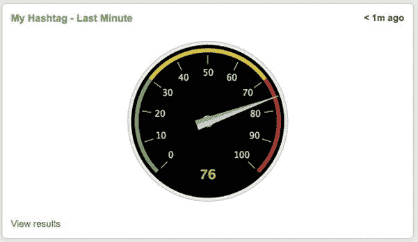

# 排版后的内容

仪表板的第一个面板展示了过去 15 分钟内的热门话题标签。基于本章前面构建的热门词汇搜索，我们可以将搜索条件制定为：

```
index=twitter
| makemv text
| mvexpand text
| eval hashtags = mvfilter(match(text, "#+"))
| top hashtags
```

在此案例中，我们使用`eval`命令提取话题标签。`match`函数将单词与正则表达式“#+”进行比较，该表达式表示“以#开头并包含一个或多个字符”。`mvfilter`函数基于布尔表达式（如我们在`match`函数中使用的表达式）对多值字段（例如`text`）进行过滤。综合运用时，`eval`命令会匹配以“#”开头的单词。这个过程相当简单，但 Twitter 为每条推文关联了一个`entities`对象，使操作更加简便。该对象包含从推文本身（文本字段）提取的元数据，例如：

*   **话题标签**，已从推文文本中解析出来。
*   **媒体**，是一个综合对象，代表推文中上传的媒体元素，例如照片。
*   **URL**，包含推文中的原始 URL 以及转换为`t.com`格式的对应 URL。
*   **提及**，是推文中提及的其他用户的屏幕名称，即那些以“@”开头且是真实 Twitter 用户的名称。

这些元素中的每一个都包含其在推文中的位置，表示为元素的起始和结束索引。根据元素类型的不同，计数和呈现方式也有所区别。详细信息可参阅 Twitter 文档。以下是一个包含几个话题标签、一个 URL 和一个提及的`entities`对象示例：

```json
"entities":{
  "user_mentions":[
    {"name":"Twitter API",
     "indices":[4,15],
     "screen_name":"twitterapi",
     "id":6253282,
     "id_str":"6253282"}
  ],
  "hashtags":[
    {"indices":[62,66],
     "text":"lol"}
    {"indices":[79,85],
     "text":"rotfl"}
  ],
  "urls":[
    {"indices":[32,52],
     "url":" http:\/\/t.co\/IOwBrTZR",
     "display_url":" youtube.com\/watch?v=oHg5SJ\u2026",
     "expanded_url":"http:\/\/www.youtube.com\/watch?v=oHg5SJ\u2026"}
  ]
}
```

使用 Twitter 的`entities`对象后，查找热门话题标签的搜索条件从之前的变为：

```
index=twitter
| rename entities.hashtags{}.text as hashtags
| fields hashtags
| mvexpand hashtags
| top hashtags
```

如前所述，作为最佳实践，我们建议重命名多级 JSON 字段，以避免与`eval`和`where`命令产生问题，即使在搜索中未使用这些命令。这样做还有一个好处，即可以输入一个简短的字段名，该字段名也可用作图表的 Y 轴标签。使用`entities.hashtags{}.text`是 Splunk 中用于 JSON 格式字段的通配符规范，用于获取所有话题标签的文本，而不是逐个指定`entities.hashtags{0}.text`、`entities.hashtags{1}.text`等。使用`fields`命令是为了优化搜索。由于一条推文包含众多字段，我们将除话题标签之外的所有字段都排除掉，因为本搜索中我们只关心话题标签。`mvexpand`命令将多值字段的值扩展为单独的事件，以便`top`命令进行计数。如果您想创建一个面板来监控您感兴趣的话题标签（例如，最近一分钟内），一个可能的搜索条件为：

```
index=twitter
| rename entities.hashtags{}.text as hashtags
| fields hashtags
| mvexpand hashtags
| where like(hashtags, "your_hashtag")
| stats count
```

您可以将可视化图表更改为径向仪表盘，因为您只展示一个数字，并指定时间范围为“从-1m@m 到现在”。生成的面板示例如图 12-8 所示。



图 12-8. 统计特定话题标签

展示热门提及的面板使用与热门话题标签相同的搜索条件，只是将字段名更改为`entities.user_mentions{}.screen_name as mentions`。时区面板使用以下搜索条件：

```
index=twitter
| rename user.utc_offset as z
| search z=* z!=null
| eval z=round(z/3600)
| stats count by z
| sort +z
```

正如您在本章前面所见，推文中时区为空的占比很高，因此为了避免计算中的问题，使用`search`命令来剔除所有那些推文。请记住`search`命令中隐式的 AND 布尔逻辑。该计算按整小时分解时区。如前面讨论，有少数时区偏移量为 30 分钟和 45 分钟。除以 3600 会将那些特殊时区的计数归入下一个整小时。我们尝试过移除`eval`命令来可视化结果，但由于时区过多，尝试的不同类型图表都无法清晰显示，因此我们可以称之为实用型时区图表。

下一个面板展示的是热门用户代理，这将使我们有机会介绍几个新命令。用户代理是用来创建推文的应用程序或客户端。对于面向营销的公司来说，这条信息非常有价值，因为它不仅展示了实际的应用程序，通常还包含了其运行的平台。包含此信息的字段是`source`。您可能还记得，在验证索引后的加载数据时，我们在这个字段和 Splunk 默认字段`source`之间遇到了一些冲突。我们将在解释搜索过程时澄清这些冲突。Twitter 的`source`字段内容与其他字段略有不同，因为在大多数情况下，它包含可以下载该应用程序的 URL。唯一的例外是当使用 Twitter 网站时，其值仅为“web”。这是一个典型示例：

```
"<a href=\"http://twitter.com/download/android\" rel=\"nofollow\">Twitter for Android</a>"
```

其他应用程序的`source`字段内容具有相同的结构：下载链接的目标地址和应用程序的名称。我们只关心应用程序的名称，如本例中的“Twitter for Android”，因此我们必须提出一个正则表达式来提取它，但需要考虑到特殊情况：`"source":"web"`。我们可以将字段内容分为三部分：第一部分从开头到应用程序的实际名称；第二部分是应用程序的名称；然后是剩余部分。基于此，正则表达式可以是：

```
(<[^>]*>)?([^<]*)
```

部分正则表达式的概念在第 9 章的“修改时间戳处理器”中已有介绍。正则表达式的第一个分组（用括号括起来）表示它以“<”开头，后跟零个或多个除“>”之外的任意字符，并且该分组可以出现零次或一次。第二个分组通过简单地声明它可以包含零个或多个除“<”之外的任意字符来捕获应用程序的名称。我们无需关心剩余部分。现在让我们来看一下搜索条件：

```
index=twitter
| spath source
| fields source
| rex field=source "(<[^>]*>)?(?<source>[^<]*)"
| top source
```

`spath`命令允许您基于 JSON 或 XML 从结构化事件中提取字段。由于本章中的 Twitter 事件是完全结构化的 JSON，因此我们无需使用此命令——Splunk 自动使所有字段可用。当事件中包含部分 JSON 或 XML 结构（例如某些日志文件在同一事件中混合纯文本与 XML 结构）时，此命令主要被使用。在此特定案例中，我们使用`spath`来消除事件中的`source`字段与 Splunk 默认字段`source`之间的歧义。通过使用`spath`命令，我们强制 Splunk 使用我们想要的`source`字段。我们再次使用`fields`命令，通过将搜索的其余部分限制为此字段来提高性能。

`rex`命令用于基于正则表达式提取字段。请注意，我们已修改正则表达式，在第二个分组的开头添加了`?<source>`。在`rex`命令中，这意味着该分组匹配的内容将被放入名为`source`的字段中。在普通的正则表达式解析器中，每个分组的匹配结果会作为`$1`、`$2`等形式可用。而在 Splunk 的`rex`命令中，分组的匹配结果可以放入在分组开头使用`?<field_name>`语法定义的字段中。这是一个非常方便的 Splunk 特性。

显示此搜索结果的饼图见图 12-7。它显示大多数客户端来自 Web，占比超过 26%，紧随其后的是 iPhone 和 Android 应用程序，各约占 23%，然后是 BlackBerry 应用程序，约占 16%。随着 Android 和 iOS 设备的兴起，我们决定为了更深入地理解这一现象，将基于时区名称分析 BlackBerry 设备的地理位置。为此，我们制定了一个搜索，并在本章前面处理过的 24 小时文件上运行，因为该文件包含的推文比我们通过实时应用收集的要多。排除那些没有时区的推文（如前所述，这些推文占比超过 27%），我们查看了推文数量达到 15,000 条或更多的时区名称。这些是排名前六的时区，如表 12-2 所示。我们最初的预期是大多数 BlackBerry 手机会集中在某些海外地区，但您可以看到，前六名中有三个在美国，且超过一半在美国。

**表 12-2. 排名前六的 BlackBerry 时区**

| 时区 | 数量 |
| --- | --- |
| 太平洋时间（美国及加拿大） | 74,607 |
| 曼谷 | 47,761 |
| 雅加达 | 34,064 |
| 中部时间（美国及加拿大） | 20,636 |
| 阿姆斯特丹 | 17,743 |
| 夏威夷 | 17,231 |

仪表板的第五个面板以实时方式显示过去 30 秒的推文文本。这是通过将时间范围指定为“from rt-30s to rt”来实现的。搜索极其简单：

```
index=twitter text=*
| table text
| sort - _time
```

通过指定`text=*`，我们确保推文的`text`字段包含内容，而`table`命令将所选字段以表格形式呈现。最终使用 Splunk 内部字段`_time`（单下划线）按降序排序，该字段包含时间戳，与由接入 Twitter 示例流的 Python 程序创建的`__time`字段（双下划线）无关。我们使用`_time`是因为它比使用任何其他可用字段更高效。请注意，以单个下划线符号（`_`）开头的字段通常供 Splunk 内部使用，但对用户可见。用于显示首条推文的面板的搜索也非常简单：

```
index=twitter user.statuses_count=1
| rename user.screen_name as screenname
| table screenname text
| sort -_time
```

假设除了跟踪特定标签（hashtag）的数量（如本章前面所示）之外，您还想显示包含该标签的推文。该搜索将是用于统计标签计数的搜索的轻微变体：

```
index=twitter
| rename entities.hashtags{}.text as hashtags
| rename user.screen_name as account
| fields account,hashtags,text
| mvexpand hashtags
| where like(hashtags, "your_hashtag")
| table account, text
| sort - _time
```

我们按照最佳实践重命名用户屏幕名称，并将字段限制为我们使用的那些字段以提高性能。一旦找到包含我们正在查找的标签的推文，我们就在用户名旁边显示该推文。

## 总结

在本章中，我们回顾了 Twitter 1%示例流的数据结构、如何收集它，以及如何以实时方式或从历史角度处理它。我们讨论了索引推文的时间戳问题，并探讨了一些关键字段及其内容。我们进行了多项有趣的搜索，从而引入了几个新命令，包括一些专门用于处理多值字段的命令。我们还使用了一个外部工具来创建更适合处理词语和标签的可视化。

## 第 13 章

