# 分析 Foursquare 签到数据

基于位置的服务——尤其是在手机上——正在迅猛发展。随着越来越多支持 GPS 的智能手机投入使用，位置数据为应用带来了一个全新的维度，包括广告、推荐附近商家和天气。在本章中，我们将重点介绍与地理位置相关的一些基本概念。我们还将讨论处理多个时区的复杂性。为此，我们将以 Foursquare 服务作为示例的基础。

Foursquare 可以被描述为一个以位置为中心的社交网络游戏。它不仅允许您在与朋友分享的地点签到，还能赢得奖励，其中大部分是虚拟的。每次签到都会为您赢得积分。通过积分，您可以获得徽章，这些徽章可以描述为正式的炫耀资本。徽章可以从简单的（如首次在某个场所签到获得的新手徽章）到探险家徽章（在 25 个不同的场所签到后获得）不等。还有一些更复杂的徽章，例如在五个不同的机场签到后获得的 JetSetter 徽章，或者在看第十场电影时获得的 Zoetrope 徽章。我们不应忘记那些与食物相关的徽章，比如在比萨餐厅签到 20 次获得的 Pizzaiolo 徽章，以及在 Zagat 评级的场所签到五次后获得的 Foodie 徽章。徽章列表非常长且不断变化，许多徽章由企业推广，例如基于 Zagat 的徽章。

另一个被认为重要的炫耀资本是成为某个场所的“市长”，这需要成为过去 60 天内在该特定位置签到次数最多的人。这个身份在非常热门的场所可能会被激烈争夺。Foursquare 的另一个功能是用户能够留下关于某个场所的提示或评价，这些内容可以被其他用户看到。

我们尚未完全描述 Foursquare 提供的所有功能，但您能很快意识到其商业潜力。从企业通过给场所市长提供免费饮品或特别折扣来与客户互动，再到推广新产品或地点的完整营销活动，可能性是无限的。Foursquare 网站上有一些很好的案例研究，展示了企业如何接触并与人们互动。

类似地，越来越多的“混搭”应用（`mashups`）正在涌现，它们将两个或多个来源的数据或功能结合起来，以创建新的服务。在这种情况下，`mashups` 获取 `Foursquare` 数据，并将其与 `Twitter`、`LinkedIn`、`YouTube`、`Flickr` 等其他服务或应用相结合。还有一些应用是构建在 `Foursquare API` 之上的，例如 `4sqwifi App`，它可以找到附近有 `Wi-Fi` 的场所并提供其密码。这个特定的应用利用了用户生成的场地小贴士来提供部分信息。

`Foursquare API` 包含两个基本功能：核心 `API`（`core API`）和实时 `API`（`real-time API`）。核心 `API` 允许应用或混搭程序执行所有可以通过 `Foursquare` 提供的移动应用或其网站完成的操作。实时 `API` 提供两种推送通知：场地推送（`venue push`），当用户签到其管理的场地时通知场地管理者；以及用户推送（`user push`），当使用其应用的用户在任何地方签到时通知开发者。

## 签到格式

由实时 `API` 生成的签到基于 `JSON` 格式。回想一下第 12 章首次介绍 `JSON` 时的内容，它通过使用花括号“`{}`”定义多级结构，并使用方括号“`[]`”为字段提供多个值。同时请记住，字段并不总是以相同的顺序出现，并且并非所有字段都会出现在每次签到中。在高层次上，由用户推送 `API` 生成的典型签到与由场地推送 `API` 生成的签到几乎相同。以 `Foursquare` 总部作为签到的示例场地，其格式如下：

```
{
"checkin": {
   "id": "4e6fe1404b90c00032eeac34",
   "createdAt": 1315955008,
   "type": "checkin",
   "timeZone": "America/New_York",
   "user": {[+]},
   "venue": {
      "id": "4ab7e57cf964a5205f7b20e3",
      "name": "foursquare HQ",
      "contact": {
          "twitter": "foursquare"
      },
      "location": {[+]},
      "categories": [+],
      "verified": true,
      "stats": {[+]},
      "url":http://foursquare.com
   }
}
```

我们将回顾此结构中最重要的字段。首先是签到创建的时间，它是一个 `Unix` 时间戳，然后是时区名称。这两个字段非常重要，我们将在讨论如何将数据加载到 `Splunk` 时重点关注。接下来是 `user` 字段，使用 `Splunk` 的符号表示该字段可以展开为另一个层级。展开此字段后，其内容如下：

```
"user": {
   "id": "1",
   "firstName": "Jimmy",
   "lastName": "Foursquare",
   "photo": "https://foursquare.com/img/blank_boy.png",
   "gender": "male",
   "homeCity": "New York, NY",
   "relationship": "self"
},
```

`gender` 字段可以有三个值：`female`、`male` 和 `none`。接下来是 `venue` 字段，它是签到的核心，特别是 `location` 和 `categories` 字段。让我们回顾一下 `location` 字段：

```
"location": {
   "address": "East Village",
   "lat": 40.72809214560253,
   "lng": -73.99112284183502,
   "city": "New York",
   "state": "NY",
   "postalCode": "10003",
   "country": "USA"
},
```

很高兴 `Foursquare` 提供了如此丰富的定位信息，特别是当移动设备仅发送签到地点的纬度和经度时。其余信息是通过一个称为“反向地理编码”（`reverse geocoding`）的过程生成的，我们将在本章后面进行解释。`categories` 字段展开如下：

```
"categories": [
   {
      "id": "4bf58dd8d48988d125941735",
      "name": "Tech Startup",
      "pluralName": "Tech Startups",
      "shortName": "Tech Startup",
      "icon": "https://foursquare.com/img/categories/building/default.png",
      "parents": [
         "Professional & Other Places",
         "Offices"
      ],
      "primary": true
   }
],
```

与 `Twitter` 不同，`Foursquare` 不提供包含所有签到数据的“消防水管”流（`firehose`），甚至不提供签到样本流。这种情况让我们陷入了困境，因为我们希望说明如何处理这些数据。一个选择是创建一个使用 `Foursquare API` 的应用，专注于提供一些面向用户的功能或管理场地的功能，但这超出了本书的范围。因此，我们决定基于真实的场地创建一组模拟的、但非常逼真的签到数据，并将其用作本项目的基础。为简化起见，我们创建的数据结构是之前描述的官方 `Foursquare` 结构的一个子集：

```
{
"checkin": {
   "id": "4e6fe1404b90c00032eeac34",
   "createdAt": 1315955008,
   "timeZone": "America/New_York",
   "user": {
      "gender":"male"
   },
   "venue": {
      "id": "4ab7e57cf964a5205f7b20e3",
      "name": "foursquare HQ",
      "location": {
         "lat": 40.72809214560253,
         "lng": -73.99112284183502
      },
      "categories": {
         "id": "4bf58dd8d48988d125941735",
         "name": "Tech Startups",
         "fullName": "Professional & Other Places:Offices:Tech Startups",
         "icon": "https://foursquare.com/img/categories/building/default.png",
      }
   }
}
}
```

请注意，我们将原始格式中的 `parents` 字段和 `pluralName` 字段合并为一个新字段，称为 `fullName`，每个值之间用冒号（`:`）分隔。`Foursquare` 中定义的类别最多可以有三级，如本示例所示。`Foursquare` 类别的完整列表可以在 `http://aboutfoursquare/foursquare-categories` 找到。

使用这种简化格式，我们创建了两组签到数据：一组用于纽约地区，包含 `541,238` 次签到；另一组用于旧金山湾区，包含 `271,662` 次签到。两组数据的时间跨度均为一个星期，从协调世界时（`UTC`）4 月 6 日星期六午夜开始，到 4 月 12 日星期五 `23:59:59` 结束。这些文件，以及它们各仅包含 `10,000` 次签到的较小版本，都可以作为本书下载包的一部分获取。

签到数据使用 `Unix` 时间戳，这隐含地意味着它们使用 `UTC` 时区，这将使我们能够讨论一些与时区处理相关的有趣问题。我们将在本章后面进行讨论，但首先我们将讨论反向地理编码。

## 反向地理编码

反向地理编码是将由纬度和经度定义的点位置转换为人类可读地址的过程。尽管这看起来很简单，但它实际上是一个相当复杂且计算密集的过程。虽然我们不会详细讨论如何创建这样一个应用，但反向地理编码非常重要，值得我们解释其基本原理。

纬度（`Latitude`）被定义为某地点在赤道以北或以南的角距离，即平行于赤道的假想线。在北时，距离用正数或简单使用单词 `north` 表示，而负数或单词 `south` 表示赤道以南的距离。类似地，经度（`Longitude`）被定义为某地点在英格兰格林威治以东或以西的角距离。这定义了一组从北极到南极的假想线，称为子午线（`meridians`），其中格林威治的子午线被称为本初子午线（`meridian zero`）。在本初子午线以东，使用单词 `east` 或正数；在本初子午线以西，则使用单词 `west` 或负数来表示位置。

请注意，这两个定义都指的是角距离。这是因为地球是一个球体，尽管并非完美——两极略扁；因此，专家将其描述为扁椭球体。纬度和经度以度、分、秒表示，例如纽约市中心位于 40° 44’ 27.6498”，−74° 0’ 14.0616”，而南非开普敦市中心位于 −33° 51’ 40.6548”，18° 24’ 56.9982”。可以想象，用这类数字进行数学计算非常困难，因此存在一种用于度、分、秒的十进制表示法。将这些地理位置转换为数字格式后（互联网上有大量转换工具），纽约市中心位于 40.741014，−74.003906，开普敦位于 −33.861293，18.415833。虽然海事和航空导航图仍使用度、分、秒格式，但 GPS 系统主要使用十进制表示法。

既然你已经有了经纬度（始终按此顺序提供），你可能对以下事项感兴趣：

- 最近的地址，即根据相应国家规则确定的正式地址
- 最近的十字路口，定义为最近的街道和交叉的下一条街道
- 指定半径内的附近邮政编码
- 最近的气象站及其最新的气象观测数据
- 国家或国家行政区域；例如，英国的萨里郡或美国的加利福尼亚州
- 时区，其边界通常由政治因素决定，不一定基于子午线
- 或许对于 Foursquare 这类服务最重要的，是指定半径内的附近地点

“最近”（`nearest`）和“附近”（`nearby`）这两个简单的词完全掩盖了计算这些项目所涉及的复杂性，这种计算通常基于哈弗辛公式（Haversine formula）。该公式用于计算两个指定经纬度点之间的距离和方位角。公式中包含大量三角运算，即大量的 `sin`、`cos` 和 `atang` 函数，而且这还不够——角度必须以弧度给出。如你所见，这是一个相当复杂的命题，此外还需要一个包含地点、街道、气象站、城市、国家、时区或你所寻找的任何内容的数据库。

一个看似简单的“最近地址”也需要计算一个半径，然后将其与数据库进行比较，以确定哪条记录距离当前位置最近。例如，`Splunk` 总部的地址是旧金山布兰南街 250 号，在各种数据库中显示为 37.783007，−122.391184，这很可能是大楼的入口。现在考虑有人签到参加 `Splunk` 总部会议室举办的 `Splunk` 开发者论坛活动，其地理位置为 37.782971，−122.390935；这是一个不同的经纬度对，也称为位置对。如果会议室足够大，坐在会议室两侧的人会产生不同的位置对。此外，更复杂的是，位置对不包含海拔信息。因此，你可能会在 20 楼公寓的客厅里，而最近的位置却是你所在大楼一楼的酒吧。

试图判断一个位置对是否位于某个邮政编码或城市的边界内则更为复杂，因为这类边界通常是不规则的。它们以多边形表示，而计算一个位置对是否位于多边形内远比计算一个半径复杂。

现在你应该理解为什么我们如此感激 `Foursquare` 处理位置对并提供地址（包括邮政编码）了。你也可以看出，为提供附近地点推荐以及其他用户留下的建议，背后凝聚了多少努力。

如果你的项目需要使用反向地理编码，有两种选择可以考虑。第一种是使用商业服务，它们根据你发送的位置对提供所需信息。第二种是编写自己的反向地理编码应用程序。在这种情况下，你可以使用几乎每日更新的商业数据库，或者使用往往不够准确且通常过时的免费数据库。互联网上有大量免费的反向地理编码服务，但所有这些服务都有使用限制，主要是每日可处理的位置对数量。

## 时区考量

如前所述，我们有两个签到数据文件，一个用于纽约大都会区，另一个用于旧金山湾区。这两个区域位于不同的时区，而签到数据使用 `Unix` 时间戳记录创建时间。`Unix` 时间戳基于 `UTC`（协调世界时，Coordinated Universal Time）时区，该时区位于格林威治子午线，因此有时也被称为格林威治平均时（GMT）。`UTC` 是 GMT 的继任者，但两者本质相同，你会看到它们被互换使用。我们提出这一点，是因为我们需要正确处理时区，才能在我们将要进行的分析中获得正确的结果。

鉴于我们将要分析的数据类型，时区是一个重要的考量因素，因为地点的签到模式需要反映对应位置的适当时间。假设我们要分析纽约和旧金山的周日早午餐模式，并定义周日早午餐从上午 11:00 开始。这意味着对纽约来说，这将是 15:00 GMT，而对旧金山来说则是 18:00 GMT。当然，这取决于夏令时是否生效。为了就如何处理时区做出更好的决策，我们需要理解 `Splunk` 在索引事件时对时区分配的优先级规则：

1.  `Splunk` 使用事件中指定的任何时区，例如 `PST` 或 `-0800`
2.  `Splunk` 使用属性文件中定义的 `TZ` 属性。这是将特定主机、source 或 sourcetype 与时区关联起来的好方法
3.  如果以上规则均不适用，`Splunk` 将分配索引该事件的服务器所在的时区

尽管签到事件确实包含一个单独的时区字段，但 `Splunk` 会忽略它，因为它将 `createdAt` 字段识别为 `Unix` 时间戳；因此，时区自动设置为 GMT。当使用 `Unix` 时间戳时，不能通过 `TZ` 属性更改时区。这意味着我们必须根据当地时间与 GMT 之间的差值来计算一天中的当地时间。

由于签到事件包含 `timeZone` 字段，在将数据加载到 `Splunk` 时，我们在如何处理时区方面有几个选择。第一个选项是，我们可以将两个数据集加载到同一个索引中，然后在搜索过程中处理时区问题；也就是说，每次我们想将搜索范围缩小到某个大都会区时，我们都需要在搜索开头指定时区，例如：

```
checkin.timeZone="America/New_York" | . . . 
```

这个操作本身很容易，但将两个数据集合并到同一个索引中的问题在于，当进行搜索时（例如本章前面提到的周日早午餐示例），处理不同的时间会变得困难。第二种方案是将每个数据集加载到不同的索引中，然后在进行覆盖两个都会区的搜索时将两者合并。这种方法似乎更容易处理，因为可以使用 `search` 命令的 `earliest` 和 `latest` 属性来选择时间和日期。两个索引的数据可以通过 `append` 命令结合子搜索合并，但必须注意子搜索返回的结果数量有限制，目前是 50,000 条。通常这不成问题，因为子搜索返回的是聚合信息，通常远小于该限制。

## 加载签到数据

我们先创建两个索引，分别命名为 `ny` 和 `sf`。和往常一样，我们在用户界面的新数据输入选项中选择数据预览。由于 Splunk 没有预设的 Foursquare 源类型，我们需要创建一个新的源类型。在选择要处理的文件后，我们注意到 Splunk 已经正确分割了每个事件，并且也已找到 Unix 时间戳，因此我们甚至无需再定义其位置，如图 Figure 13-1 所示。

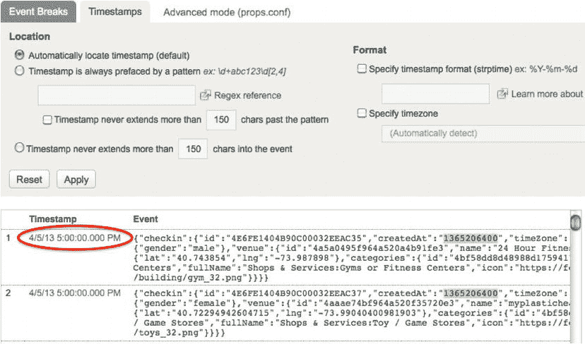
图 13-1. 定义 Foursquare 源类型

如图 13-1 所示，第一个事件的时间戳为 2013 年 4 月 5 日下午 5:00:00.000，这是一个早于我们数据起始时间（4 月 6 日星期六午夜）的日期和时间。这引发了一个问题，因为该第一个事件的 Unix 时间戳 `1365206400` 转换后为 2013 年 4 月 6 日星期六 00:00:00 GMT，这与 Splunk 在数据预览中显示的结果不同。

造成这种差异的原因是 Splunk 会以 Splunk 用户所设置的时区来显示事件时间戳，在我们的案例中是美国太平洋时区。两者相差七小时是合理的，因为 GMT/UTC 不会因夏令时改变。Splunk 用户的时区可以在用户界面“管理器”选项卡中的“您的账户”下进行修改。

> **注意** 使用 Unix 时间戳时，默认的日期时间字段（如 `date_hour`、`date_mday` 等）包含的信息基于 GMT/UTC 时区，而非 Splunk 用户时区。

由于一切看起来都正确，我们继续以名称 `foursquare` 保存新的源类型，并将纽约数据加载到 `ny` 索引中。将旧金山数据加载到 `sf` 索引则更为简单，因为我们无需再定义新的源类型，只需使用已定义好的 `foursquare` 即可，因此也无需进行预览。

下一步是验证数据是否已正确索引。首先，我们通过查看索引活动概览屏幕来检查已索引的事件数量，如图 Figure 13-2 所示。在该图中，我们可以看到每个索引的事件计数与我们原始数据集中的签到数量相符。这些信息不会显示在“摘要”选项卡中，因为该选项卡仅显示主索引（或默认索引）的信息。

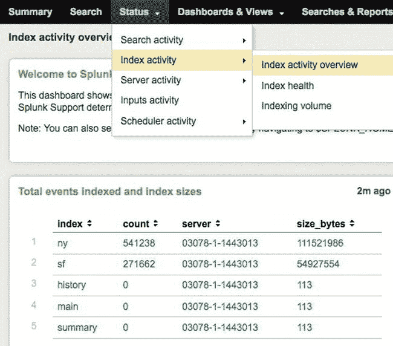
图 13-2. 索引活动概览屏幕

现在我们来检查事件。我们需要确认几件事，例如验证 `createdAt` 字段中的 Unix 时间戳是否与 Splunk 显示的时间戳一致。我们还希望看到左侧边栏中出现正确的字段，并且每个事件末尾的主机、源类型和源文件信息也正确显示。要显示几个事件，只需输入以下搜索命令 `index=ny | head`，该命令生成的输出可部分见于图 13-3。时间戳显示正确，构成签到事件的 13 个字段都出现在左侧，并包含适当的信息。每个事件底部的字段也显示了适当的信息。至此，我们可以确信数据已正确加载到 Splunk 中。我们成功地对旧金山数据重复了相同的验证过程。此阶段完成后，我们就可以开始分析了。

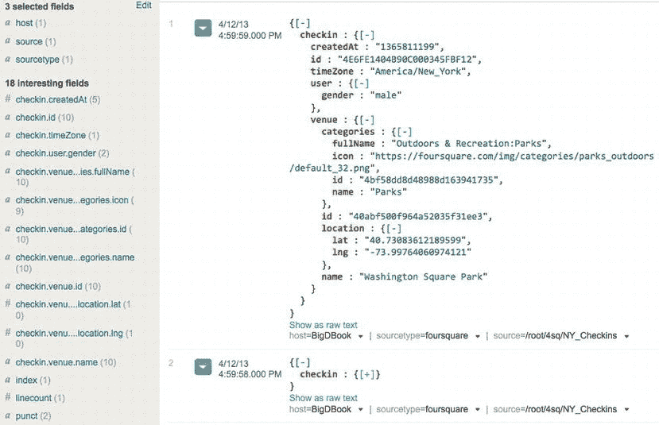
图 13-3. 验证 Foursquare 签到事件

## 分析签到数据

在本节中，我们将制定一系列搜索，涉及时区处理、地理定位，以及一些会暴露某些搜索命令局限性的复杂搜索。我们还将讨论一些可视化项目。我们将从本章前面提到的周日早午餐搜索开始。

### 周日早午餐搜索

通过这个搜索，我们试图比较纽约和旧金山都会区最受欢迎的周日早午餐地点。这个搜索存在两个挑战。第一个是我们需要处理来自两个不同索引的事件，第二个是我们需要处理两个不同的时区。如果我们定义早午餐为当地时间上午 11:00 到下午 2:00 之间的美食场所签到，那么我们就需要用不同的当地时间执行相同的搜索。我们先来制定针对纽约的搜索，需要指定正确的日期、时间和场所。

处理本地时间有两种方法。第一种方法是使用默认的 `datetime` 字段，我们已经知道这些字段基于 GMT 时区。考虑到纽约与 GMT 在该年该时段的时差为四小时，我们需要的是 2013 年 4 月 7 日星期日 GMT 时间 15:00:00 到 17:59:59 之间的事件。使用 `datetime` 字段，搜索的第一个子句为：

```
index=ny date_wday=sunday date_hour>=15 date_hour<18
```

请记住，`search` 命令中隐含了 AND 逻辑。这个子句适用于我们的数据集，因为我们的数据中只有一个周日，并且时间不会跨越两天。另一种更通用且能覆盖我们刚才解释的 `datetime` 字段局限性的方法，是使用 `search` 命令的 `earliest` 和 `latest` 属性。

> **注意** `search` 命令的 `earliest` 和 `latest` 属性基于 Splunk 用户的时区，而非数据的时区。

请记住，`latest` 属性是排他性的。使用这些属性时，由于我们已知 Splunk 用户的时区是美国太平洋时区，那么纽约上午 11:00 对应加利福尼亚的上午 8:00，因此搜索的第一个子句为：

```
index=ny earliest=4/7/2013:08:00:00 latest=4/7/2013:11:00:00
```

下一个问题是，我们应该搜索哪些类别。分析完前面提到的 `aboutfoursquare.com` 网站上的类别列表后，我们可以在 `checkin.venue.categories.name` 字段中查找单词 `Restaurant`，但这会排除诸如百吉饼店和面包店之类的地点。另一种选择是在 `checkin.venue.categories.fullName` 字段中查找单词 `Food`；这样我们就可以捕捉到所有与食品相关的场馆。该字段的典型条目类似于 “`Food:American Restaurants`”，因此我们必须确保指定匹配字段开头的单词 `Food`，后跟任何其他内容。初始搜索如下所示，输出结果见图 13-4。

```
index=ny earliest=4/7/2013:08:00:00 latest=4/7/2013:11:00:00
| rename checkin.venue.categories.fullName as Type
| where like(Type, "Food%")
| top Type
```

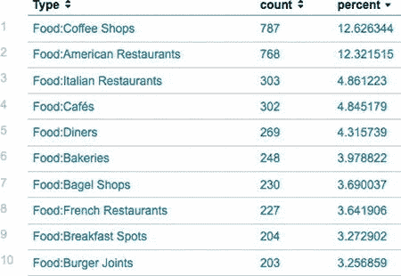
图 13-4. 纽约市周日早午餐十大热门场馆类别

请注意，`like` 函数使用了 SQL 表示法 `%`，这意味着任意字符出现任意次数。此外，请记住，在使用 `eval` 或 `where` 命令之前，我们必须重命名多层级 JSON 字段，否则这些命令会将字段中的点解释为连接指令。为了验证此搜索的结果，我们首先随机选择一个事件，并确保它在指定的时间范围内；然后我们验证其中一个餐厅类型的计数是否正确。为了检查一个随机事件，我们将搜索的最后一条子句从 `top Type` 修改为 `head 1`，这应该会生成该时间范围内最近的事件。在输出中（见图 13-5），你可以看到 Splunk 时间戳是 `4/7/13 10:59:58.000 AM`，即纽约时间 `1:59:58 PM`，因此这是正确的。

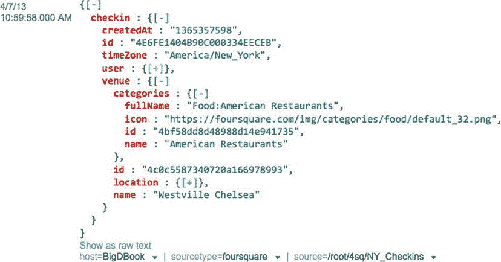
图 13-5. 所选时间段的签到事件示例

为了验证计数，我们制定了一个搜索，仅查找我们感兴趣时间段内最受欢迎的场馆签到 `Coffee Shops`。这是一个非常简单的搜索，基于 `checkin.venue.categories.name` 字段，而不是我们正在验证的搜索中使用的 `fullName` 字段：

```
index=ny earliest=4/7/2013:08:00:00 latest=4/7/2013:11:00:00
         checkin.venue.categories.name="Coffee Shops"
| stats count
```

结果是 `787`，与正在验证的搜索结果匹配，因此我们现在知道它是正确的。现在我们有了与食品相关的事件，我们想找到最受欢迎的地点，这可以通过修改搜索的最后一条子句非常容易地完成，如下所示，输出结果见图 13-6。

```
index=ny earliest=4/7/2013:08:00:00 latest=4/7/2013:11:00:00
| rename checkin.venue.categories.fullName as Type
| where like(Type, "Food%")
| top 5 checkin.venue.name
```

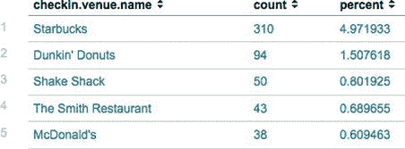
图 13-6. 纽约市五大早午餐场馆

请记住，图 13-6 中计算的百分比是基于定义时间段内所有食品类别事件，而不仅仅是前五名。另外需要注意的是，此特定搜索按名称匹配场馆，因此所有星巴克门店都被分组在一起。我们可以根据场馆的单个位置进行搜索，这很可能会提供不同的视角，如图 13-7 所示。该搜索基于每个位置唯一的场馆 ID 号进行计数。之后，结果基于场馆名称。

```
index=ny earliest=4/7/2013:08:00:00 latest=4/7/2013:11:00:00
| rename checkin.venue.categories.fullName as Type
| rename checkin.venue.name as Venue
| where like(Type, "Food%")
| stats count by checkin.venue.id, Venue
| table Venue, count
| sort -count
```

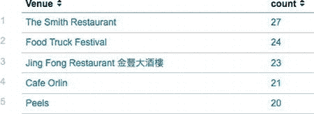
图 13-7. 纽约市五大早午餐地点

如图 13-7 所示，星巴克不再位列前五名。事实上，在指定的时间段内，签到次数最多的星巴克门店也只有六次。

这是一个有趣的插曲，但让我们回到主要的早午餐搜索。我们现在可以添加旧金山湾区，通过以下搜索生成的结果见图 13-8。我们所要做的就是添加一个带有适当时间窗口的子搜索，这些事件将被附加到与第一个子句中的搜索相匹配的事件中。

```
index=ny earliest=4/7/2013:08:00:00 latest=4/7/2013:11:00:00
| append [
          search index=sf earliest=4/7/2013:11:00:00 latest=4/7/2013:14:00:00
         ]
| rename checkin.venue.categories.fullName as Type
| where like(Type, "Food%")
| top 5 checkin.venue.name
```

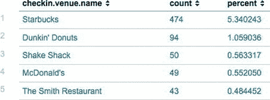
图 13-8. 纽约和旧金山五大早午餐场馆

这个搜索有一个问题：它没有区分大都市区，所以计数是两个地区的总和。如图 13-8 所示，星巴克的计数从 `310` 增加到 `474`，因为它只是添加了来自旧金山的签到。

我们可以考虑两种区分大都市区的方法。第一种是查看事件的经度，第二种是查看事件的时区。对于第一种方案，我们需要在纽约和旧金山之间选择一个子午线。纽约大约在 `−75` 度，而旧金山大约在 `−122` 度。因为我们喜欢整数，我们将选择 `−100` 子午线。这样，任何大于 `−100` 的经度就是纽约，而任何小于 `−100` 的经度就是旧金山。请注意，我们处理的是负数，因此大于 `−100` 的经度包括像 `−75` 这样的数字。当我们添加计算位于 `−100` 子午线哪一侧的子句并清理搜索时，搜索的新版本如下：

```
index=ny earliest=4/7/2013:08:00:00 latest=4/7/2013:11:00:00
| append [
          search index=sf earliest=4/7/2013:11:00:00 latest=4/7/2013:14:00:00
         ]
| rename checkin.venue.categories.fullName as Type
| rename checkin.venue.name as Name
| rename checkin.venue.location.lng as Lng
| where like(Type, "Food%")
| eval MetroArea = case(Lng> -100, "New York", Lng < -100, "San Francisco")
| stats count by Name, MetroArea
| sort 10 -count
```

这个搜索中唯一的新项是 `eval` 命令的 `case` 函数，它的功能与许多编程语言中的 `case` 语句非常相似。该函数接受成对的参数；如果第一个参数（一个布尔值）计算结果为 true，则返回该对中的第二个参数。

第二种区分大都市区的方法是查看签到的 `timeZone` 字段。为此，我们修改搜索如下：

```
index=ny earliest=4/7/2013:08:00:00 latest=4/7/2013:11:00:00
| append [
          search index=sf earliest=4/7/2013:11:00:00 latest=4/7/2013:14:00:00
         ]
| rename checkin.venue.categories.fullName as Type
| rename checkin.venue.name as Name
| rename checkin.timeZone as TZ
| where like(Type, "Food%")
| eval MetroArea = if(like(TZ, "%New_York"), "New York", "San Francisco")
| stats count by Name, MetroArea
| sort 10 -count
```

除了包含时区的字段重命名之外，变更还体现在 `eval` 命令中，现在我们使用了 `if` 函数。该函数会评估第一个参数；如果为真，则返回第二个参数，否则返回第三个参数（如果存在），若不存在则返回 `null`。`like` 函数用于查找任何以 `New_York` 结尾的字符串，使用 SQL 符号 `%` 表示。两次搜索的结果完全相同，如图 Figure 13-9 所示。

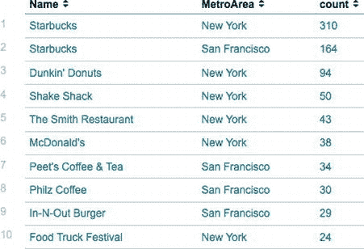
Figure 13-9. 按大都市区域划分的十大早午餐场所

由于我们已经验证了底层搜索，并注意到将纽约和旧金山的 `Starbucks` 计数相加，其结果与图 Figure 13-8 中搜索产生的结果相同，因此我们有信心认为此搜索产生的结果是可靠的。现在我们可以继续下一个有趣的搜索了。

## Google Maps 与顶级场所

因为我们处理的是包含地理位置信息的数据，不妨使用一下我们在第 4 章中介绍的 `Google Maps` 应用。首先，我们运行一个非常简单的搜索，来找出所掌握的一周数据中纽约的五大场所。基于此，我们将挑选排名第一的场所，并使用 `Splunk` 的 `Google Maps` 应用来探索这些位置。以下命令生成了如图 Figure 13-10 所示的表格。

```
index=ny
| top 5 checkin.venue.name
```

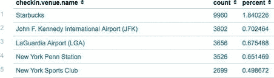

Figure 13-10. 纽约的五大场所

根据图 Figure 13-10 中呈现的搜索结果，纽约大都市区的顶级场所无疑是 `Starbucks`。排名第二的 `JFK` 机场，其签到次数略多于 `Starbucks` 的三分之一。鉴于 `Starbucks` 拥有众多分店，这是一个使用 `Google Maps` 应用来显示它们绝佳的例子。

在第 4 章中，我们通过向 `geoip` 命令提供一个 IP 地址来使用 `Maps` 应用。`geoip` 命令接收 IP 地址，在表中查找，然后返回一个位置坐标对，坐标对被呈现在地图上。由于本章处理的是直接的位置坐标对，而非 IP 地址，因此调用 `Maps` 应用的方式略有不同。`Maps` 应用期望在名为 `_geo` 的字段中提供一个纬度、经度坐标对，该字段以 `纬度,经度` 的形式包含它们，我们需要自己构建这个字段。这并不复杂。以下是在 `Google Maps` 应用中执行的搜索，用于显示我们所掌握的一周数据中纽约大都市区所有的 `Starbucks` 位置。地图显示了纽约大都市区的选定区域，如图 Figure 13-11 所示。

```
index=ny checkin.venue.name=Starbucks
| rename checkin.venue.location.lat as Lat
| rename checkin.venue.location.lng as Lng
| eval _geo=Lat+","+Lng
```

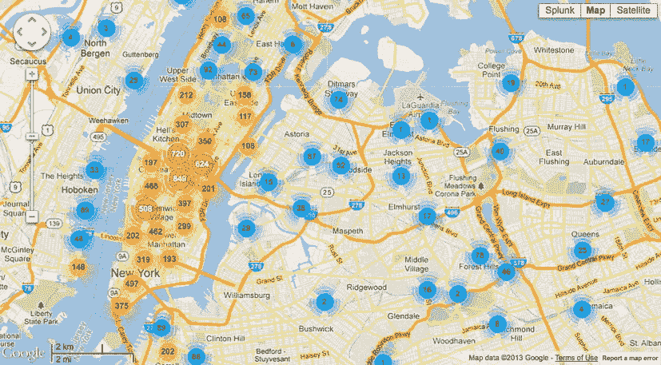

Figure 13-11. 纽约大都市区 `Starbucks` 位置地图

与 `Google Maps` 一样，您可以放大，这将提供 `Starbucks` 位置的更细粒度视图。看起来，`Starbucks` 签到最集中的区域发生在曼哈顿中城。当我们放大到该区域时，我们可以看到，在我们分析的那一周内，最受欢迎的 `Starbucks` 位置是位于第五大道和西 33 街拐角处的那家，如图 Figure 13-12 所示。

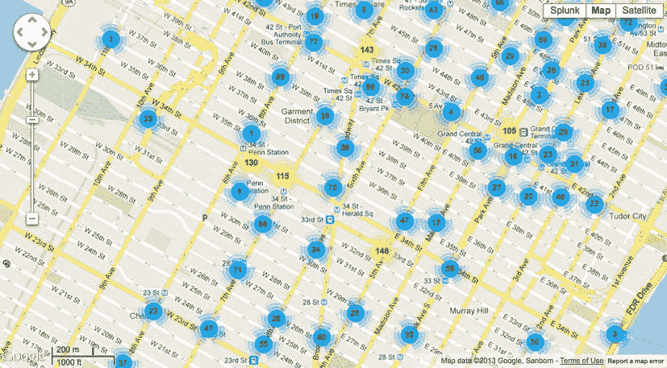

Figure 13-12. 曼哈顿最受欢迎的 `Starbucks` 地图

## 场所的签到模式

用于查找场所签到模式的搜索非常简单，但我们仍希望与您分享几个选项，并评论一下 `stats` 命令的一个限制。这次我们将重点关注旧金山湾区的顶级位置。查找该位置的搜索如下：

```
index=sf
| rename checkin.venue.name as Venue
| stats count by checkin.venue.id, Venue
| table Venue, count
| sort –count
```

在此搜索中，我们使用场所的 `id` 字段来统计各个位置，但通过其名称来呈现结果。您会看到 `stats` 命令包含了 `Venue` 字段，您可能认为这是多余的。问题在于 `stats` 命令是一个转换命令；因此，调用它之后，剩下的字段只有用于分割的字段和按分割计算出的聚合值。基本上，如果您希望在 `stats` 命令之前创建的某个字段能传递到下一个子句，您必须在 `stats` 命令中使用它，即使它不执行任何操作。在此示例中，如果我们不在 `stats` 命令中包含 `Venue` 字段，它将无法用于 `table` 命令。前述搜索的输出如图 Figure 13-13 所示。

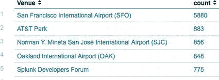

Figure 13-13. 旧金山湾区的五大位置

既然我们已经知道了顶级位置，查找旧金山机场签到模式最简单的方法就是搜索所有其名称中包含该机场的事件。`Splunk` 的时间线将呈现该模式，如图 Figure 13-14 所示，同时附上搜索语句。

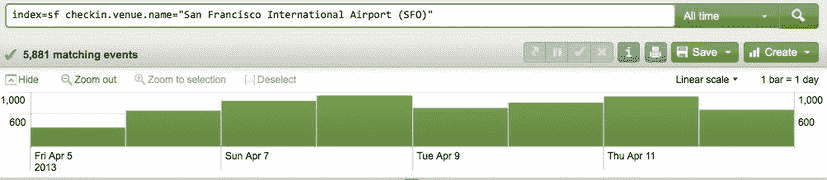

Figure 13-14. 旧金山机场的每日签到模式

然而，图 Figure 13-14 中呈现的时间线的问题是粒度不够细。它以天为单位显示结果，而我们希望按小时显示。为实现这一点，我们制定了另一个搜索，使用 `timechart` 命令并将时间跨度指定为每小时。搜索语句及其结果如图 Figure 13-15 所示。`Splunk` 图表的一个不错的功能是，当您将鼠标悬停在图表上时，它会显示该特定数据点的详细信息。

```
index=sf checkin.venue.name="San Francisco International Airport (SFO)"
| timechart span=1h count
```

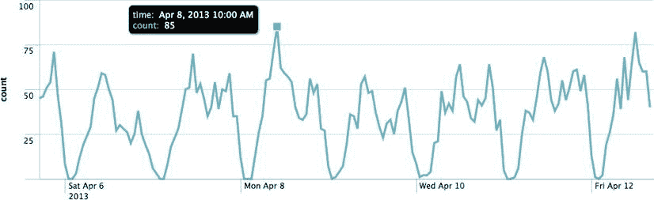

Figure 13-15. 旧金山机场的每小时签到模式

## 按签到次数划分的场所

我们经常听到的一个问题是关于场所在特定时间段内的签到次数：具体来说，有多少场所有一周一次签到，有多少场所有两次，依此类推。这可以提供另一个有趣的 `Foursquare` 世界视角。此搜索的基础是统计每个位置的签到次数，然后按签到次数统计位置数量。这意味着一前一后使用两个 `stats` 命令：

```
index=sf
| stats count as NumberOfCheckins by checkin.venue.id
| stats count as Locations by NumberOfCheckins
| table NumberOfCheckins, Locations
```

这很简单，我们之前解释过的 `stats` 命令的限制在这里不是问题，因为我们在第二个子句中生成的字段会立即在第三个子句中使用。验证此搜索的结果是一个更复杂的问题。首先，我们运行相同的搜索，但针对一个更短的时间段，例如一小时。输出如图 Figure 13-16 所示。

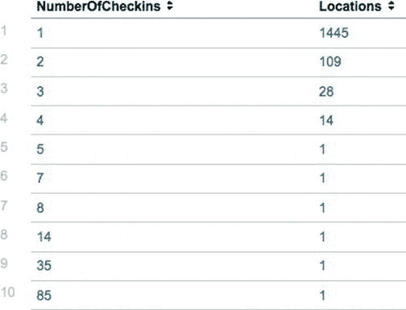

图 13-16. 按签到次数统计的场所（一小时内）

事实证明，在较短时间范围内进行搜索恰好得到 10 条结果。现在，我们有了更易于处理的结果数量。挑战在于找到另一种搜索方式，以便验证图 13-16 中展示的结果。在这些结果中，我们可以看到，某个场所有 85 次签到，另一个有 35 次，还有一个有 14 次。如果我们制定一个按场所名称计数的搜索，这些场所在结果中应该以单一地点场所的形式出现。验证搜索如下，部分结果展示在图 13-17 中。

```
index=sf earliest=4/8/2013:10:00:00 latest=4/8/2013:11:00:00
| stats count by checkin.venue.name
| table count, checkin.venue
| sort -count
```

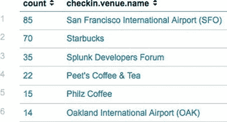

图 13-17. 验证搜索结果

拥有 85 次签到的场所是旧金山机场，35 次的是 Splunk 开发者论坛，14 次的是奥克兰机场。在图 13-17 所示结果中出现的其他场所都是多地点场所，因此它们没有出现在图 13-16 的结果中是合理的。我们有理由相信，初始搜索的结果在整个时间段内都是正确的。

有趣的是，Foursquare 有一个 Swarm 徽章，当 50 人或更多人在三小时内签到同一地点时即可获得。根据图 13-17 显示的结果，在旧金山机场签到的人应该能获得此徽章，而且他们很可能还能获得 Super Swarm 徽章（与 Swarm 徽章相同，但要求 250 人或以上）。

现已验证过的初始搜索结果非常冗长。当以折线图呈现时，`x` 轴的标签太多，无法显示。为了使结果更具可读性，我们将输出限制为前 30 条，如图 13-18 所示。从中可以看到，在我们分析的一周内，大多数地点的签到次数很少。

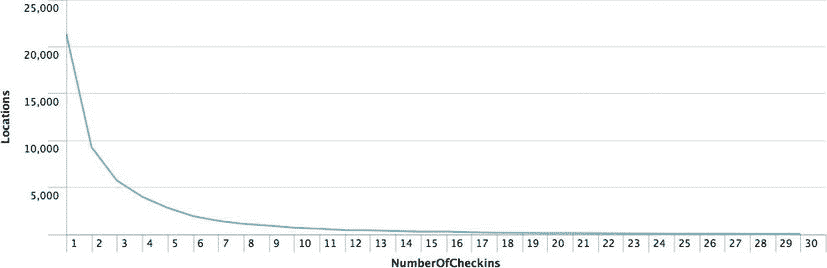

图 13-18. 旧金山各场所按签到次数统计

接下来，我们对搜索进行了调整，要求结果以签到次数的百分比形式呈现，而不是目前的计数。这项挑战的主要问题在于，我们需要计算签到总数（这很容易），但鉴于我们之前提到的 `stats` 命令的限制，这会成为一个难题。我们曾使用的技巧（即在下一个 `stats` 命令的计算中保留你想要保留的字段）并不总是有效。例如：

```
index=sf
| stats count as Total
| stats sum(Total) as Total, count as NumberOfCheckins by checkin.venue.id
| stats count as Locations by NumberOfCheckins
```

在这个例子中，我们通过计数事件获得总数，并将其放入 `Total` 字段。在下一个子句中，我们通过计算一个不应影响 `Total` 值的总和，对 `Total` 字段未作任何处理。然而，由于 `stats` 命令使用了 `by` 参数，它确实影响了 `Total` 的值。我们无法将总数传递到所有需要的 `stats` 命令中。不过，还有另一种方法可以解决这个问题：只需将每个地点的 `Locations` 字段值与 `NumberOfCheckins` 字段值相乘，然后将它们相加。这样就能得到事件总数。基于此，搜索如下：

```
index=sf
| stats count as NumberOfCheckins by checkin.venue.id
| stats count as Locations by NumberOfCheckins
| eventstats sum(eval(NumberOfCheckins * Locations)) as Total
| eval PCT=round(Locations / Total * 100, 2)
| table NumberOfCheckins, Locations, PCT, Total
```

`eventstats` 命令用于按前述方式计算总数，然后将 `Total` 字段添加到搜索前面子句产生的所有搜索结果中。有了这个，我们现在可以计算百分比，并以表格形式呈现结果，这样便于调试搜索中的任何问题。验证此搜索非常简单。由于我们已经有了按签到次数统计的场所数量以及事件总数，我们可以轻松计算百分比。如果仅有一次签到的场所比例为 7.87%，则搜索正确。正如你在图 13-19 中所见，搜索成功。

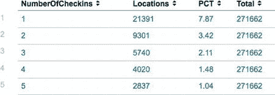

图 13-19. 按签到次数统计的场所百分比

现在我们清理搜索，只保留签到次数和百分比，并将输出限制为前 25 条。这样我们就可以生成一个漂亮的柱形图，回答在我们分析的这段时间内，旧金山都市区有多少百分比的场所有多少次签到。该图表见图 13-20。

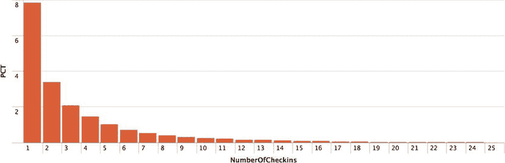

图 13-20. 按签到次数统计的场所百分比——柱形图

## 分析性别活动

按性别分析签到会非常有趣。为此，我们需要为每个类别名称按性别保留计数。正如我们之前所见，使用 `stats` 命令并不容易，因此我们将重点转向 `eventstats` 命令，它允许我们向事件添加新字段。此外，我们可以通过使用子搜索，在搜索的不同部分为每种性别添加这些计数。初始搜索着眼于 4 月 10 日星期三上午 7 点到晚上 10 点的旧金山数据：

```
index=sf earliest=4/10/2013:07:00:00 latest=4/10/2013:22:00:00
         checkin.user.gender=male
| eventstats count(checkin.id) as Male by checkin.venue.categories.name
| append [
          search index=sf earliest=4/10/2013:07:00:00 latest=4/10/2013:22:00:00
                 checkin.user.gender=female
          | eventstats count(checkin.id) as Female by checkin.venue.categories.name
         ]
| rename checkin.venue.categories.name as Category
| stats count(Male) as Men, count(Female) as Women by Category
| table Category, Women, Men
| sort 25 –Women, -Men
```

通过 `eventstats` 命令，我们按类别名称计算签到次数，并将其放入一个字段中，然后附加到搜索的结果（本例中为所有男性和女性事件）上。接着，`stats` 命令按类别对这些新字段进行计数，以获得最终计数。此搜索的部分结果可见于图 13-21。

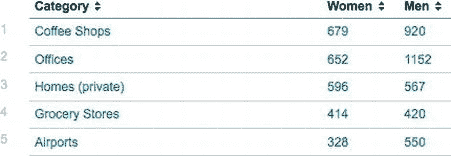

图 13-21. 旧金山按性别统计的活动情况

此搜索的验证相当简单，因为我们可以直接放大到这些类别中的任何一个并获取计数。例如：

```
index=sf earliest=4/10/2013:07:00:00 latest=4/10/2013:22:00:00
         checkin.user.gender=male
         checkin.venue.categories.name=Offices
| stats count
```

此次搜索的结果为 `1,152`，这与图 13-21 所示的对应结果相符。我们再执行一次验证搜索，以确保一切运行正常。这次我们使用机场作为女性场所的搜索条件，结果同样匹配；因此，我们可以断定该搜索功能是正确的。理想情况下，我们应该以百分比形式呈现结果，这样会更清晰，但我们不想让搜索变得复杂。有趣的是，有一种方法无需计算即可将这些结果以百分比形式呈现：使用条形图或柱状图，并选择 100% 堆叠选项。我们在图 13-22 中展示了搜索结果的呈现方式。由于柱状图中没有空间显示类别名称，因此我们使用条形图。

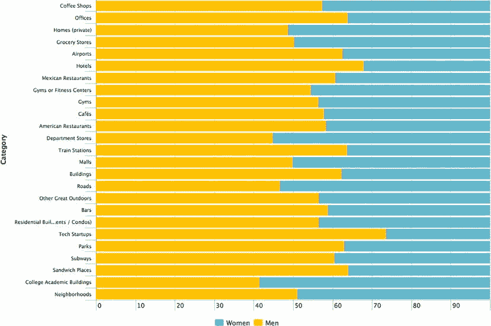

图 13-22. 旧金山按性别划分的活动——条形图

在图 13-22 中很有趣地发现，旧金山湾区聚焦于科技领域，约 75% 的男性签到来自科技初创公司，而第二大类别是酒店，很可能是科技初创公司的访客。对于女性而言，第一大类别是大学，第二大类别是百货商店。这种图表非常适合传达结果的对比，就像我们刚刚生成的那样。为了进行更非正式的对比，我们可以搜索纽约市一整周数据中，男性和女性按类别名称排名的热门活动。使用 IBM 的 Many Eyes 网站生成的词云结果，分别显示在图 13-23（女性）和图 13-24（男性）中。


图 13-23. 纽约女性的活动


图 13-24. 纽约男性的活动

## 总结

在本章中，我们利用 Foursquare 服务的签到数据，学习了地理定位配对、反向地理定位，以及 Splunk 的谷歌地图应用。我们还讨论了如何处理时区及其相关的所有问题。我们介绍了 `eventstats` 和 `append` 命令，并了解了 `stats` 命令的局限性。此外，我们还探索了可视化辅助工具，以便更好地传达搜索结果的含义，其中一些搜索结果相当复杂。