# 第 15 章


## 远程数据收集

到目前为止，我们一直将来自 Splunk 所在服务器上文件的数据，或使用 DB Connect 应用从数据库获取的数据索引到 Splunk 中。对于后者，数据库的位置几乎是透明的，因为 DB Connect 应用（或任何数据库客户端）可以轻松地通过网络与数据库通信。在本章中，我们将回顾如何使用 Splunk 转发器从远程服务器收集数据。我们还将介绍 Splunk 部署服务器，它允许更新远程 Splunk 实例（包括转发器），以及部署监控应用，该应用展示所有 Splunk 实例的状态。

## 转发器

Splunk 转发器的一个简单定义是：一种程序，它在本地收集数据，并通过网络将数据发送到 Splunk 索引器或另一个转发器（我们称之为接收器）。转发器可以使用 Splunk 索引器可用的方法（在第 2 章中回顾过）来收集数据：
*   从文件和目录，通过监控它们或仅一次性上传内容
*   从网络端口，使用 UDP 或 TCP 协议
*   从 Windows 系统

正如您将看到的，转发器有多种使用方式，但它通常与机器数据的收集相关联，例如日志文件以及与计算机服务器性能和监控相关的指标。

传统的数据收集方法包括依赖中央数据仓库的方法，例如使用 NFS 或 SMB 在多个服务器上挂载共享磁盘，并将日志文件放置其中。在这种情况下，Splunk 索引器可以监控包含这些文件的目录并对其进行索引。考虑到数据中心可能有成百上千台服务器，这种方法扩展性并不好，而且当涉及大量文件时还会增加延迟。在基于 Unix 系统上使用 syslog 时，可以考虑类似的拓扑结构，但在处理 Windows 系统时会变得更加复杂。Splunk 转发器具有一系列特性，使其成为远程数据收集非常有吸引力的替代方案。

- `缓存`。Splunk 转发器具有将数据本地存储在内存或磁盘队列中的能力。当接收端因维护或崩溃而不可用时，这一功能极其有用，因为正在收集的数据不会丢失。队列大小可以配置，默认值为 500 KB。
- `接收端确认`。可以配置转发器等待确认，以确保数据块被绝对可靠地接收。如果出现故障，转发器会重新发送该数据块。此功能默认禁用。
- `压缩`。数据可由转发器压缩，随后由接收端解压。此操作会略微增加两台服务器的 CPU 使用率，但数据在两端之间的传输时间会缩短。
- `安全性`。转发器与接收端之间的整个数据流均可使用 SSL 加密。
- `负载均衡`。当转发器将信息发送到为分布式搜索配置的一组索引器时，转发器会根据定义的时间段在所有索引器之间分配数据。这将在第 16 章中更详细地讨论。
- 您还可以使用转发器将信息发送到第三方系统。

转发器不仅可以在基于 Unix 的系统（包括 MacOS）上运行，也可以在 Windows 系统上运行。根据所使用的转发器类型，还有其他功能适用。由于转发器的用途多种多样，Splunk 提供了三种类型：
- `通用转发器`。这是首选转发器，因为其内存占用非常小，CPU 消耗极低。
- `轻量级转发器`。这主要在遗留场景中出现。在正常情况下，没有理由使用它。
- `重量级转发器`。这是一个实际运行的 Splunk 实例，但禁用了某些功能，例如搜索和警报功能，以及用户界面 Splunk Web。

一般经验法则是始终使用通用转发器，除非您需要解析事件以进行路由或过滤。只有在您过滤掉 50% 以上的事件时，后者才有意义，这是在广域网（WAN）上发送数据时的典型情况。重量级转发器在“存储转发”情况下也很有用。

## 常见拓扑

既然您已经了解了转发器提供的功能，我们可以分享一些涉及使用转发器的最典型拓扑。在本章的第一个示例中，我们提到了一个 NFS 共享磁盘作为日志文件的存储库。如果这种拓扑（如图 15-1 所示）已经存在于您的网络中，那么将这些文件索引到 Splunk 的最简单方法是在托管与其他服务器共享的一个或多个磁盘的服务器上安装通用转发器。

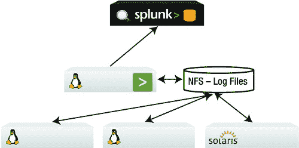

图 15-1。共享磁盘拓扑

如前所述，图 15-1 中所示的遗留拓扑扩展性不佳，并且将转发器的输入限制在托管转发器的特定服务器上存在的文件和脚本化输入。理想情况是在每台服务器上都部署一个转发器。这种拓扑不仅更具可扩展性且性能更优，还能处理安装有 Splunk 转发器的每台服务器上的所有传统 Splunk 输入，如图 15-2 所示。此外，如果 Splunk 部署是一个索引器集群，那么转发器还会对需要索引的数据进行负载均衡。


图 15-2。每台服务器上的通用转发器

关于 Windows 系统需要说明一点：您无法直接从 Windows 服务器将数据索引到运行在 Unix 系统上的 Splunk 实例。您可以将数据从 Windows 服务器加载到运行在 Windows 上的 Splunk 实例，或者，您可以在 Windows 系统上安装一个转发器，并将数据发送到运行在 Unix 系统上的 Splunk 实例。Splunk 可以处理以下特定的 Windows 输入：
- `事件日志`。可以由转发器在本地或从另一台 Windows 服务器上远程收集，但需要有效的域凭据。
- `性能监控`。与事件日志类似，您可以在本地或远程收集 PerfMon 数据或一般的 WMI 指标。
- `注册表监控`。您可以监控 Windows 注册表的任何更改。这只能在本地完成。
- `Active Directory (AD) 监控`。与注册表类似，这也只能在本地完成。

虽然让一台运行转发器的 Windows 服务器远程监控多台其他 Windows 服务器是一种可行的拓扑，但由于性能、部署和管理方面的考虑，并不推荐这样做。此外，通过远程监控，您将无法监控注册表和 Active Directory。更常见的拓扑是简单地在所有 Windows 服务器上安装通用转发器。一个包含 Windows 和基于 Unix 的服务器混合的典型拓扑如图 15-3 所示。

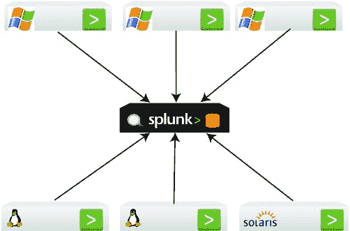

图 15-3。典型的混合操作系统拓扑

虽然转发器收集的数据包含标准的 Splunk 字段（主机、来源和来源类型），这便于进行分类，但这些字段可能不足以对数据进行编目。例如，在收集 Windows WMI 事件时，您可能希望将硬件事件与软件事件分开，以便相应的技术人员进行分析。这是一个应该使用重量级转发器的好例子，因为分类超出了标准字段的范围，并且您实际上必须详细检查事件以确定 WMI 代码，并决定应该在何处处理它。假设每个技术组都有自己的 Splunk 实例来监控和告警问题，图 15-4 显示了处理这种情况的拓扑。

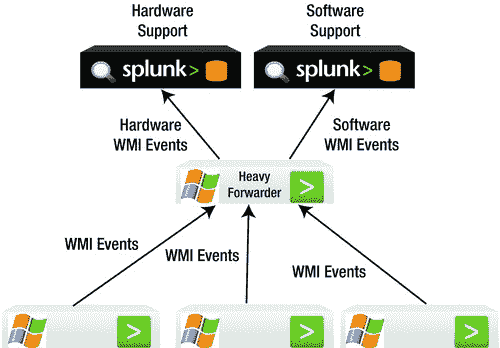

图 15-4。基于重量级转发器的路由拓扑

转发器的安装取决于类型和操作系统。重量级转发器本质上是一个普通的 Splunk 实例，而通用转发器具有以下选项：
- 在 Windows 上，可以在本地系统上使用安装程序 GUI 或命令行安装。
- 对于基于 Unix 的系统，只能使用本地服务器上的 CLI 安装转发器。
- 对于任一系统，您都可以远程部署转发器。
- 您可以将转发器作为系统镜像的一部分。

## 安装转发器

我们将演练在 Unix 系统上使用本地服务器上的 CLI 安装转发器，然后在 Windows 系统上使用 GUI 安装转发器。在这两种情况下，您都必须首先启用接收端以接受来自转发器的数据流。这可以通过使用 Splunk CLI 或 Splunk Web 来完成。对于第一种情况，这非常简单。例如，在使用 Linux 时，只需从 Splunk 的 `bin` 目录中输入以下命令：

```
./splunk enable listen <port> -auth <username>:<password>
```

这里的 `<port>` 是 Splunk 监听来自转发器的数据流所使用的网络端口。通常使用端口 `9997`，但您也可以使用任何其他未使用的端口，一般建议端口号大于 `1024`。如果您没有指定 `--auth` 参数，Splunk 会提示您输入用户名和密码。若要禁用接收功能，只需将 `enable` 改为 `disable`。

若要通过 Splunk Web 启用接收器，只需进入管理器“数据”区域的“转发和接收”部分。在显示“配置接收”行右侧，点击“添加新”链接。这将带您进入一个类似图 15-5 所示的界面。您所需要做的就是指定 Splunk 应监听来自转发器数据流的端口，然后保存配置。

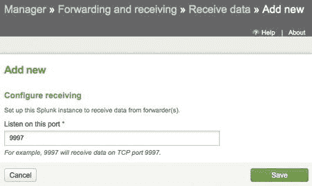

图 15-5. 配置接收

请记住，您必须在防火墙中开放所选端口，否则转发器端会出现隐蔽问题，且问题不会指向接收器端的封闭端口。现在，我们示例中的主 Splunk 实例已准备好从转发器接收数据，我们可以继续安装转发器。首先，我们将提供在基于 Unix 的系统上本地安装通用转发器的说明：
*   在目标服务器上下载并安装通用转发器
*   我们强烈建议您让转发器在每次系统启动时自动运行。您可以通过在 Splunk 的 `bin` 目录下输入以下命令来指定此项设置：`./splunk enable boot-start`
*   通过在 Splunk 的 `bin` 目录下输入以下命令启动转发器：`./splunk start`
*   通过在 Splunk 的 `bin` 目录下输入以下命令，配置转发器以连接到接收器（在我们的示例中为 `bigdbook`）：`./splunk add forward-server bigdbook:9997`
*   验证转发器是否已与接收器连接。输入图 15-6 中显示的命令，并期望得到与该图相似的输出结果。

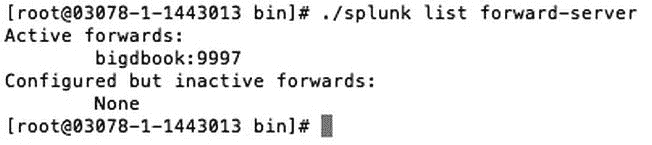

图 15-6. 验证与接收器的连接

*   现在您可以定义要使用转发器收集的数据。在我们的示例中，我们将让转发器收集其安装所在机器的 `/var/log` 目录中的所有日志。这可以通过以下命令完成：`./splunk add monitor /var/log`。如果要将数据发送到接收器上的特定索引，命令将如下所示：`./splunk add monitor /var/log --index your_index`

要在 Windows 系统上安装通用转发器，只需执行以下步骤：
*   下载相应的 `.msi` 文件（32 位或 64 位）
*   双击 `.msi` 文件；这将弹出一个包含安装向导的界面，安装向导是在 Windows 系统上安装软件的常用工具。点击“下一步”，然后进入显示软件许可协议的界面。选择接受协议的单选按钮，并点击“下一步”。
*   向导现在要求提供安装位置。除非您希望将转发器安装到其他目录，否则只需点击“下一步”。
*   下一个界面允许您指定部署服务器。就本示例而言，您将跳过此步骤，因此直接点击“下一步”。
*   现在您可以输入接收器的信息。在本示例中，您使用与前面 Linux 服务器示例相同的信息，即 `bigdbook:9997`，然后点击“下一步”。
*   您可以在下一个界面中提供关于 SSL 证书的信息（可选）。对于本示例，我们通过点击“下一步”来跳过此步骤。
*   现在向导询问您是希望从本地还是远程获取数据。我们建议您在每台 Windows 服务器上都安装一个转发器，并从本地收集数据。在本示例中，您选择“仅本地数据”，然后点击“下一步”。
*   由于您选择了监视本地数据，下一个界面将显示可供本地监视的数据，如图 15-7 所示。在本示例中，选择监视安全日志、性能监视器和 Active Directory，然后点击“下一步”。

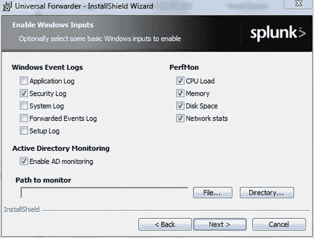

图 15-7. Splunk 通用转发器的 Windows 监视选项

*   此时，Splunk 已准备好安装转发器。只需点击“安装”，安装将在几分钟内完成。

当在拥有成百上千台服务器的网络中工作时，在每台服务器上部署转发器似乎是一项艰巨的任务。然而，大多数管理大型网络的系统管理员会使用诸如 Chef 和 Puppet 之类的配置管理工具，用于大型网络的部署和日常管理。一旦按照要求安装并配置好转发器，您可以继续使用这些工具，或者您也可以选择使用 Splunk 部署服务器工具来对转发器和 Splunk 实例进行日常维护。

## 部署服务器

Splunk 的部署服务器是一个用于管理 Splunk 实例配置的工具，无论是远程还是本地配置。这些实例可以是索引器、搜索头或转发器。部署服务器的工作方式非常简单。它持有一组配置文件，这些文件被视为主副本，并且每当发生更改时都会被复制到远程服务器。这些配置文件有一个令人困惑的名称——部署应用；请注意，这不是一个 Splunk 应用。部署客户端（即启用了从部署服务器接收内容的 Splunk 实例）会定期检查是否有任何更新版本的部署应用。一个部署客户端可以接收一个或多个部署应用。部署客户端可以被分组到所谓的服务器类中。这允许基于相似的配置文件进行逻辑分组。客户端可以属于多个组。

 **注意**   部署服务器不能用于在远程服务器上安装 Splunk 实例。其功能仅限于更新内容，包括现有远程 Splunk 实例上的许可证。

### 服务器类示例说明

为了说明服务器类的概念，我们将使用一个示例。假设您有一个典型的多层 Web 应用，如图 15-8 所示。第一层由运行 Apache Web 服务器的 Linux 服务器组成。第二层托管包含所有业务逻辑的应用程序，该应用程序运行在 JBoss Java 应用服务器上，而 JBoss 又运行在 Linux 操作系统之上。第三层是运行 MySQL 数据库的 Linux 服务器。还有一个 `Splunk` 实例，用于搜索和索引来自所有转发器的数据，每个服务器上都有一个转发器。这个 `Splunk` 实例同时也是部署服务器。

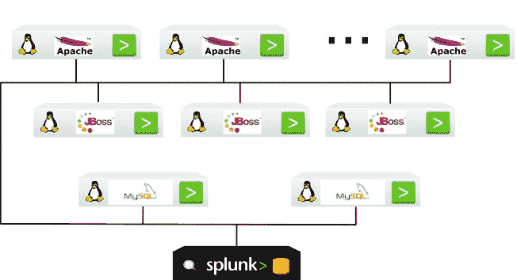

图 15-8. 典型的多层应用

以每种输入类型作为每个转发器监控和收集内容的示例，我们可以创建几个服务器类：
*   **Linux 服务器**：此类应用于示例中的所有服务器。我们希望转发器监控所有 Linux 日志文件。
*   **Web 服务器**：此类仅针对第一层运行 Apache Web 服务器的服务器。我们希望转发器监控 Apache 日志文件，例如访问日志。
*   **JBoss 服务器**：此类针对第二层运行 JBoss Java 应用服务器的服务器。转发器应监控 JBoss 日志文件。
*   **数据库服务器**：此类包含运行 MySQL 数据库的服务器。转发器监控数据库的日志文件。

有了这四个基于输入的服务器类，我们可以根据需要更新 `Splunk` 实例。例如，如果数据库已升级并且现在有一个额外的日志文件需要收集，我们只需在部署服务器上更新数据库服务器类的主配置文件。下次属于数据库服务器类的部署客户端检查更新时，它将下载相应配置文件的最新版本。之后，转发器将重新启动以激活新的配置文件。如果您更新了 Linux 服务器类部署应用中的配置文件，示例中的所有服务器都将被更新。

通过这样组织示例中的服务器，您可以根据所收集的输入类型，高效地更新配置文件或部署应用。您可以根据最适合自己的方式组织服务器类：例如，按地理位置、数据中心、时区、操作系统等进行组织。

为了说明如何使用部署服务器，我们将用它来处理三个基于 Unix 的系统上的转发器。为简化示例，主 `Splunk` 实例同时也是部署服务器，但请注意，当您拥有超过 30 个转发器时，最好在单独的 `Splunk` 实例上设置一个部署服务器。您将让转发器收集 `/var/log` 中的所有日志文件，并将其发送到主 `Splunk` 实例。为此，您将创建两个部署应用：一个指定要收集的文件（输入），另一个指定数据发送到的位置（输出）。这样，您可以独立地轻松更改输入或输出。此示例的拓扑结构如图 15-9 所示。

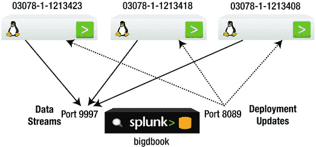

图 15-9. 部署服务器示例的拓扑结构

有多种方法可以完成此设置，我们并不声称某一种方法优于其他方法。本示例采用的方法是：首先在指定为部署服务器的 `Splunk` 实例上进行配置，然后逐台服务器安装转发器。最后一步可以通过使用诸如 `Chef` 和 `Puppet` 之类的工具或创建服务器镜像来优化，但出于教学目的，我们将按说明进行。

## 配置部署服务器

部署服务器的配置必须通过直接编辑配置文件来完成。我们的示例非常简单，但将展示完成此任务的所有必要步骤。可以完成更复杂的配置，您可以在`Splunk`文档中找到相关的说明和示例。

由于这是首次将`bigdbook`服务器设置为部署服务器，我们需要在`Splunk`安装目录的`etc/system/local`子目录中创建一个`serverclass.conf`文件。该文件定义了服务器类，在我们的示例中只有一个服务器类，我们将其命名为`CentOS6.2`，这是我们所使用的Linux服务器的操作系统名称和版本。该文件还包含属于此服务器类的成员服务器的名称或IP地址。此外，该文件包含此服务器类可用的部署应用。如前所述，本示例有两个部署应用：一个定义转发器的输入，名为`collect`；另一个指定接收器，在我们的例子中是`bigdbook`服务器。这最后一个部署应用名为`send`。文件内容如下：

```
### Example serverclass.conf

### Global server class – Must exist!
[global]
whitelist.0=*

### The server class and its members
[serverClass:CentOS6.2]
whitelist.0=03078-1-1613423
whitelist.1=03078-1-1613418
whitelist.2=03078-1-1613408

### The members could also have been defined using wildcards, for example:
### whitelist.0=03078-1-16134*

### The Collect deployment app definition
[serverClass:CentOS6.2:app:collect]
stateOnClient=enabled
restartSplunkd=true

### The Send deployment app definition
[serverClass:CentOS6.2:app:send]
stateOnClient=enabled
restartSplunkd=true
```

服务器类配置文件使用白名单和黑名单的概念来包含或排除服务器，从而在管理服务器时实现高水平的细化控制。`stateOnClient`属性指定部署应用在客户端上是启用还是禁用，与部署服务器上的状态无关。`restartSplunkd`属性指定客户端在更新后是否需要重新启动，在我们的案例中，这是使更改生效所必需的。下一步是创建用于放置每个部署应用配置文件的目录：

```
mkdir –p $SPLUNK_HOME/etc/deployment-apps/collect/default
mkdir –p $SPLUNK_HOME/etc/deployment-apps/send/default
```

在`send/default`目录中，我们创建`outputs.conf`文件，其中包含转发器发送数据流的目标规范。在本示例中，我们将其发送到`bigdbook`服务器的`9997`端口。如果将来我们有一个索引器集群，我们只需在部署服务器上修改此文件，它将自动更新到此服务器类的部署客户端上，并且每个转发器将自动重启以使更改生效。文件内容如下：

```
### Example outputs.conf file
[tcpout]
defaultGroup=receiver

### Here we specify the Splunk instance that receives the data
[tcpout:receiver]
server=bigdbook:9997
```

下一步是为`collect`部署应用创建`inputs.conf`文件。这是在之前创建的`collect/default`目录中完成的。文件内容如下：

```
### Example inputs.conf file
[monitor:///var/log]
disabled=false
```

诚然，这只是一个非常简单的`inputs.conf`文件示例，因为它只监控了`/var/log`目录。输入配置文件拥有大量属性，这些属性在Splunk文档中有详细说明。使用三个斜杠（`/`）的原因是：前两个是Splunk所要求格式的一部分，第三个斜杠则是待监控目录（或文件）路径名的一部分。

由于这是首次设置部署服务器，我们需要重启Splunk实例。每次更改`serverclass.conf`文件后都需要执行此操作，否则只需发出重载命令即可：`./splunk reload deploy-server`。最后，我们需要确保Splunk已就绪并在端口`9997`上监听转发器将要发送的数据流，此步骤可按照图15-5所示进行操作。

## 配置转发器

如前所述，使用其他系统管理工具来安装和配置转发器有更好的方法，但为了说明配置转发器的步骤，我们将使用这个相当基础的过程。将相应的转发器下载到合适的服务器后，您可以使用`tar`命令来解压它，例如：`tar xzf splunkforwarder-5.0.2-149561-Linux-x86_64.tgz`。

现在，您可以切换到`splunkforwarder/bin`目录，并在启动转发器之前通过输入以下命令进行配置：`./splunk set deploy-poll bigdbook:8089 --accept-license`。此命令指定了部署服务器的名称及其管理端口（通常为`8089`）。由于我们是首次安装转发器，系统会显示并要求您接受许可协议；通过在命令中直接接受许可，我们可以避免该步骤。现在，我们可以通过输入`./splunk start`来启动Splunk转发器。请注意，如果系统要求您输入登录名和密码，您必须使用`admin`和默认密码`changeme`，因为密码尚未更改。启动后，需要几分钟时间连接到部署服务器、下载相应的部署应用程序并重新启动。要查看此过程是否完成，一种方法是输入命令：`./splunk list forward-server`，当该过程完成时，会输出类似于图15-6所示的结果。对于我们希望部署转发器的每个基于Unix的服务器，都需要重复这些步骤，在我们的示例中，只有三台这样的服务器。

## 部署监控器

部署监控器是一个免费的Splunk应用程序，用于跟踪所有Splunk实例（包括转发器），并提供异常或意外行为的早期预警。此应用程序提供了丰富的信息，包括每周索引数据量和连接数的比较，以及按来源类型划分的许可证使用情况。我们将展示该应用程序生成的一些页面，让您了解其功能。在图15-10中，您将看到该应用程序显示的一些警告。

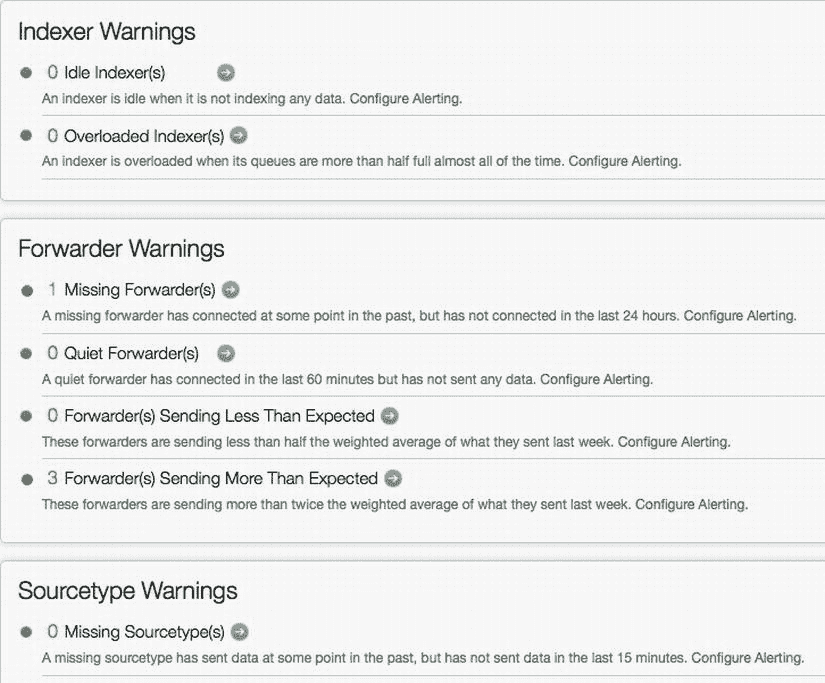

图 15-10. 来自部署监控器应用程序的警告

图15-10中显示的警告不言自明。在这个特定案例中，有一个转发器缺失，因为我们已经关闭了那个用于演示如何通过GUI在Windows上安装转发器的例子。此外，关于三个转发器发送的数据量超出预期的警告之所以存在，是因为前一周还没有转发器。另一个有趣的页面是详细显示转发器及其活动的页面，如图15-11所示。

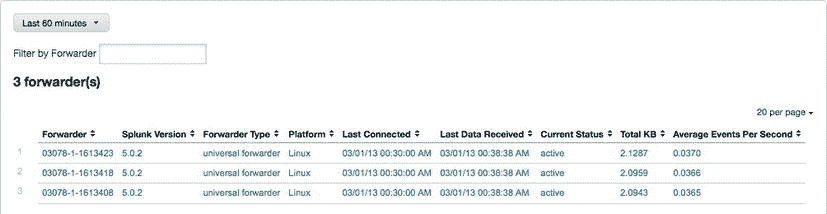

图 15-11. 转发器详情

如图15-11所示，关于转发器的信息非常全面。因为我们只有三个转发器，所以不需要使用过滤选项，但当您有数百或数千个转发器时，这个功能就非常方便了。部署监控器应用程序还提供关于索引器的详细信息，但由于我们只有一个索引器，所以可查看的内容不多。在图15-12中，您可以看到一个展示与来源类型相关信息的页面。

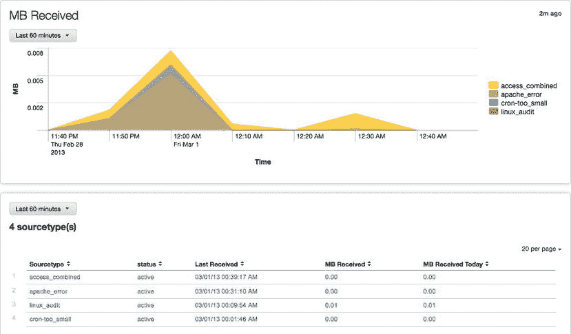

图 15-12. 按来源类型查看信息

如您所见，部署监控器应用程序非常有用，特别是当您拥有大量转发器时，因为它提供了与被索引的所有数据、索引器以及数据远程来源相关的非常全面的信息集。

## 总结

在本章中，您学习了Splunk转发器及其用途、配置和拓扑结构。您还了解了部署服务器，并回顾了一个使用示例，以及用于捕获所有Splunk实例使用情况和与异常情况相关警告的部署监控器。