# 扩展与高可用性

到目前为止，本书中的所有示例和项目都基于使用单个 Splunk 实例，该实例同时充当索引器和搜索器。在本章中，我们将回顾如何通过添加更多服务器来处理索引和搜索组件，从而扩展 Splunk。您还将学习集群的基本原理，它通过处理索引器的自动故障转移来提高 Splunk 的弹性。我们将建立一个示例集群来说明此过程的基本步骤。

## 扩展 Splunk

Splunk 的功能大致可以分为三个基本领域：

-   收集数据
-   索引收集到的数据
-   在已索引的数据中搜索信息

Splunk 的强大功能之一在于您可以分离这些功能区域并分别对它们进行扩展。在第 15 章中，您学习了如何通过使用转发器将数据收集扩展到远程服务器（无论是基于 Unix 的系统还是 Windows 服务器）；您还回顾了一些涉及使用转发器的典型拓扑结构。在本章中，我们将回顾如何单独或组合地扩展索引和搜索功能。

扩展任何一个功能都有多种理由。如果您有数百个转发器向单个 Splunk 实例发送信息，根据它们发送的数据量，单个实例可能会迅速成为瓶颈，因此您可以添加另一个 Splunk 实例来协助分担负载。这样做的一个优点是，转发器可以将数据分发到两个实例上，有助于扩展。另一个优点是该分发隐式地为转发器创建了故障转移能力。当一个 Splunk 实例宕机时，转发器会自动切换到另一个实例。这种拓扑结构可以在图 16-1 中看到。

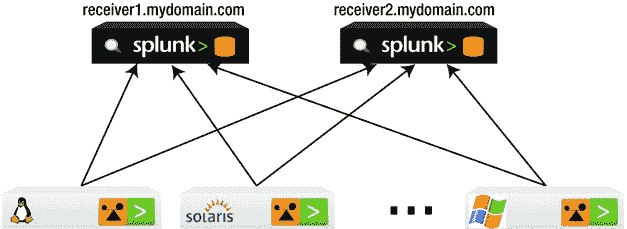

图 16-1. 多个转发器在两个索引器上负载均衡数据


### 分布式搜索配置

图 16-1 展示的拓扑结构虽然是有效的，但它引发了一个问题：每个 Splunk 实例只会拥有部分已索引数据。在一个实例上执行搜索时，只会搜索该实例所索引的数据部分，而不是全部数据。为了能够搜索两个实例上的所有已索引数据，必须使用分布式搜索。这并不像听起来那么困难，只需两步操作即可完成：首先在 Splunk Web 的 Manager 中激活此功能（见图 16-2），然后定义搜索对等节点。要进入激活界面，请转到 Manager 并从 Distributed Environment 部分选择 Distributed search 选项。进入后，点击 Distributed search setup 链接。

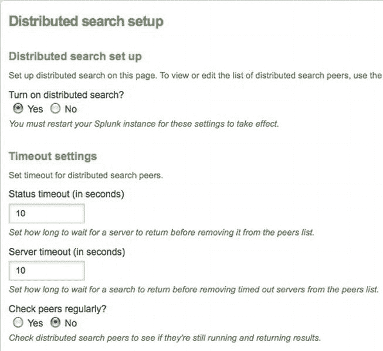

图 16-2：启用分布式搜索

启用分布式搜索后（我们通常保持其他选项为默认值），需要重启 Splunk 实例。该过程的第二步是定义参与搜索的其他 Splunk 实例，也非常简单，如图 16-3 所示，我们将第二个索引器定义为第一个索引器的对等节点。


图 16-3：定义搜索对等节点

 **注意**：使用分布式搜索时，必须更改 Splunk 的初始密码。使用默认密码将无法正常工作。

图 16-3 中的搜索对等节点是从第一个索引器定义的。然后必须将第一个索引器定义为第二个索引器的对等节点。基本上，必须为混合环境中的每个索引器定义所有搜索对等节点，并且请记住需要在防火墙上开放管理端口（通常为 8089），否则连接将无法工作。

在转发器方面，有几件事需要完成。第一件事是定义接收器集合。这可以通过 CLI 或直接修改 `outputs.conf` 文件来完成。无论采用哪种方式，都可以在 DNS 列表中为每个接收器的 IP 地址定义一个新的 A 记录，使其看起来像这样：

```
receiver.mydomain.com           A       192.186.1.1
receiver.mydomain.com           A       192.186.1.2
```

显然，你应该使用自己的域名和合适的 IP 地址。使用此方法时，`outputs.conf` 文件将类似于以下内容：

```
[tcpout]
defaultGroup=my_indexers

[tcpout:my_indexers]
disabled=false
server=receiver.mydomain.com:9997
```

需要指出的一点是，转发器基于时间分发数据：即负载均衡通过按固定时间段（默认为 30 秒）从一个索引器切换到下一个索引器来实现。由于 Splunk 是一个时间序列索引器，这是关于数据分发的关键点。这意味着当进行搜索时，每个索引器将根据轮询机制拥有总数据的 30 秒切片。这种数据分发方式非常高效，索引器仅在有搜索时间段内的数据时才会参与分布式搜索。结果通常是几乎所有索引器都会以相当平衡的方式参与搜索。通常没有理由更改 30 秒的默认值，但如果想将其更改为 20 秒，只需在 `outputs.conf` 文件中添加以下指令：`autoLBFrequency=20`。另一种指定负载均衡的方式是使用 CLI；在这种情况下，需要在 Unix 提示符下发出以下命令：

```
./splunk add forward-server receiver.mydomain.com:9997 –method autobalance
```

此示例假设你已按前述方式定义了 DNS A 记录。如果未这样做，你可以在转发器上指定每个单独的索引器，如下所示：

```
./splunk add forward-server receiver1.mydomain.com:9997 –method autobalance
./splunk add forward-server receiver2.mydomain.com:9997 –method autobalance
```

如果你正在使用部署服务器，就像第 15 章的示例中那样，只需修改 `send/default` 目录下的 `outputs.conf` 文件，更改将自动发送到转发器，转发器在收到更新后将重启，并以 30 秒的间隔在两个 Splunk 实例之间分发数据。

通过启用分布式搜索，用户可以访问任何 Splunk 实例进行搜索，它将使用所有 Splunk 实例（或本示例中的两个实例）上索引的数据。最终的拓扑结构（其中搜索在索引器之间协调）如图 16-4 所示。在此示例中，用户根据负载均衡器的决定访问任一 Splunk 实例。

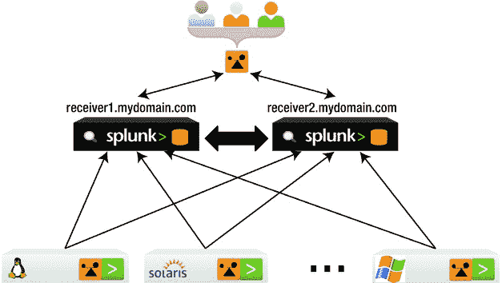

图 16-4：启用分布式搜索的拓扑结构

提醒一下，此设置中使用两个网络端口：管理端口（通常为 8089），用于 Splunk 实例之间的相互通信；以及接收器端口（通常为 9997），用于接收器获取转发器的数据流。无需多言，这两个网络端口必须在防火墙上开放才能工作。我们指出这一点是因为忘记开放防火墙上的网络端口是一个常见错误，而 Splunk 产生的错误消息与防火墙无关。

任何已保存的搜索、Splunk 应用或一般的知识对象（即在某个 Splunk 实例上定义的）称为知识包。在分布式搜索环境中，知识包必须复制到其他 Splunk 实例或搜索对等节点，以便用户可以透明地使用任何实例进行搜索。如果知识包相当大，将其复制到所有搜索对等节点可能是一个缓慢的复制过程。为了提高效率，可以使用所谓的挂载包，即将实际的知识包放置在由所有搜索对等节点共享的磁盘上（使用 NFS 或 SMB），这样可以消除复制的需要。Splunk 文档详细说明了启用挂载包所需采取的步骤。包含使用挂载包的搜索对等节点的最终拓扑结构如图 16-5 所示。请注意，这种拓扑结构对于所谓的中型部署可以正常工作。在某个节点上，搜索数量将迅速压垮挂载包和搜索轮询。

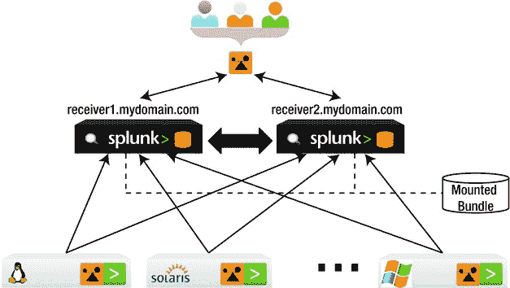

图 16-5：使用挂载包的分布式搜索拓扑结构

在本章到目前为止使用的示例中，Splunk 实例是自包含的，即它们同时拥有索引器和搜索组件。我们之前提到这些组件可以分离。一个典型的例子是将搜索组件安装在自己的服务器上，如图 16-6 所示，此时它被称为搜索头。搜索头不接收和/或收集数据，它所做的只是协调所有索引器的搜索。此外，接收器或索引器不再由用户直接访问，用户必须通过搜索头来进行搜索。

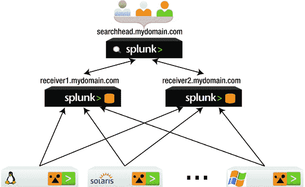

图 16-6：使用搜索头的分布式搜索拓扑结构


随着您对 Splunk 的使用不断增加，您可以信赖其提供的灵活性，特别是分离基本功能的能力，如 图 16-7 所示的拓扑结构中，不仅有各种索引器，还有多个搜索头。这个例子相当复杂，但也非常实际。增加更多搜索头的驱动因素是并发搜索的数量，通常是仪表板中的计划搜索。随着仪表板越来越普及，通常会发现有专门用于服务仪表板搜索的搜索头。当存在大量与 Splunk 交互的用户（无论是进行临时搜索还是保存的搜索）时，也需要额外的搜索头。关于何时添加索引器或搜索头的讨论可以在附录 A 中找到。

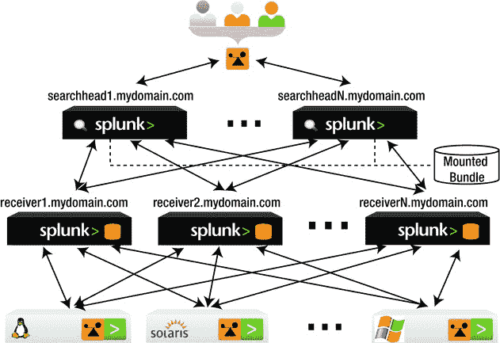

图 16-7. 具有多个搜索头的分布式搜索拓扑

关键在于，由于 Splunk 允许将搜索与索引分离，并且能够定义搜索对等节点和知识包，因此您可以创建最适合您独特需求的拓扑结构。这种灵活性不仅限于扩展，还可以用于其他需要管理组织上或地理上分散数据的情况。例如，您可能有一个公司，其大部分数据在本地层级处理，但加利福尼亚州除外，旧金山和洛杉矶的办公室共享数据。除此之外，总部还有一个搜索头可以访问所有办公室的数据。这种情况在 图 16-8 中进行了描述。

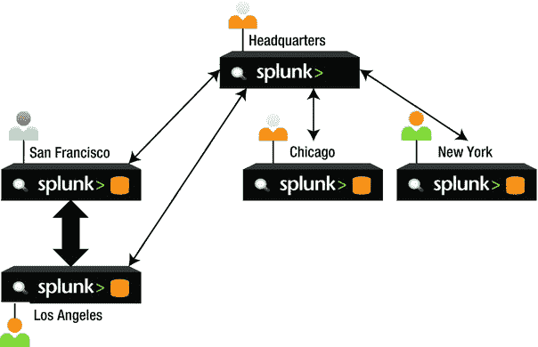

图 16-8. 地理上分散的拓扑结构

如 图 16-8 所示的例子所见，通过分离索引器和搜索功能所能实现的灵活性，可以满足大多数需求，无论是为了处理更多数据和搜索而扩展，还是为了处理特殊的组织或地理需求。有关扩展的更多细节，例如何时添加索引器或搜索头，可以在附录 A 中找到。

## 集群

对 Splunk 索引器进行集群是实现高可用性的方法。分布式搜索的一个问题是，当搜索对等节点或索引器不可用时，该索引器中的数据将不再可用。尽管这对于自动负载均衡的转发器来说不是问题，因为它们会将数据流发送到下一个索引器，但对于执行搜索的人或进程来说，这就成了一个问题。在该 Splunk 实例中索引的那部分数据不再可用，搜索结果将不完整。

集群在多个索引器上复制数据，这样当一个索引器宕机时，包含复制数据的其他索引器可以介入，为搜索提供数据的完整性。复制、故障转移和其他集群特定项目的协调由集群主机完成，集群主机是一个 Splunk 实例，仅执行此协调功能，不执行其他任何操作。在 图 16-9 中，您可以看到一个集群拓扑，其中包括一组转发器、四个索引器、一个搜索头和必要的集群主机，说明了数据流的走向。

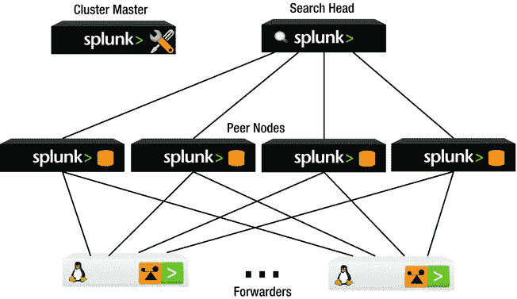

图 16-9. 展示数据链路的典型集群拓扑

由于集群主机仅协调对等节点之间的复制和故障转移活动，图 16-9 并未显示主机节点与其他实例之间的任何连接。在解释主机节点如何履行职责以及复制机制如何工作之前，我们必须先解释数据在 Splunk 中的存储方式。Splunk 中的数据分为两部分：

*   **原始数据**，这并不是严格意义上的原始数据，而更像是一个已经分解成事件的处理版本。它以压缩格式存储。
*   **索引**，包含指向原始数据的元数据。这使得搜索非常快，因为搜索从索引开始，并在原始数据中查找特定事件以检索所需信息（如果存在）。

这两部分都存储为平面文件，它们一起被统称为 Splunk 索引，并组织成桶。这些桶只是包含这些平面文件的目录，根据事件的时间戳按“年龄”排列。桶有自己的生命周期，经历从热到温再到冷，最后到冻结的各个阶段。数据根据大小从热阶段滚动到温阶段；此后，数据根据大小和年龄滚动到下一阶段。滚动到冻结阶段的数据将被删除，除非您将其归档，在这种情况下，以后可以解冻。在所有阶段中都可能存在（并且通常存在）许多桶。

在集群环境中，Splunk 会复制桶，而且是以相当高效的方式进行的。需要指定两个参数，第一个是**复制因子**。它定义了拥有桶原始数据的总索引器或对等节点数量。第二个是**搜索因子**，它定义了其中有多少个副本还包含索引或元数据。默认值是复制因子为 3，搜索因子为 2。这意味着一个索引器包含主桶（原始数据和索引）；另一个索引器包含主桶的副本（包含原始数据和索引）；第三个索引器仅包含桶原始数据的副本。主桶是用于搜索的桶，而其他副本仅在出现故障时使用。

其效率基于这样一个事实：索引部分可以随时从原始数据生成；因此，存在一个完整的次要桶可用，如果由于任何原因该桶不再可用，第三个部分副本可以重新生成索引部分，成为一个功能完整的桶。

当然，您可以将复制因子和搜索因子定义为最适合您特定情况的值，但复制因子不能大于对等节点的数量。类似地，搜索因子不能大于复制因子。请注意，一旦定义了这些值并启动了集群，您就无法更改它们。在 图 16-10 中，您可以看到一个在集群中使用默认值的索引工作示例。最左边的索引器接收数据，并将一个完整副本复制到另一个对等节点，并将部分桶复制到第三个节点。主节点告知索引器将复制数据发送到哪些对等节点。

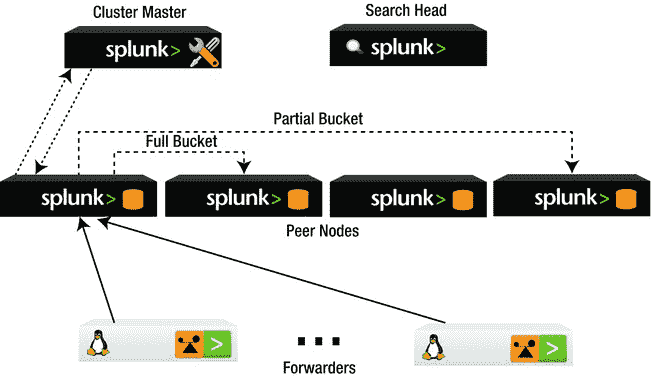

图 16-10. 显示一个索引器复制过程的集群拓扑

在使用集群时，强烈建议您使用转发器收集数据并启用数据确认选项，以确保索引器接收到转发器发送的数据流。


主节点每秒接收来自所有对等节点的心跳信号。当它在 60 秒内（这是默认值；虽然不推荐，但可以更改）未收到心跳信号时，会假定某个对等节点宕机，并启动补救措施。除此之外，主节点还有其他重要功能，总结如下：

- 它告诉每个对等节点数据应复制到哪里。虽然对等节点分配算法没有公开，但这显然取决于复制因子和搜索因子。
- 它向搜索头提供一个可用索引器列表。
- 当一个对等节点不可用时，协调补救措施：
  - 对于故障对等节点中的每个主存储桶，选择一个拥有完整存储桶的新对等节点作为新的主存储桶。这通常只需几秒钟。
  - 对于故障对等节点中的每个完整存储桶，选择一个将托管完整存储桶的新对等节点，以维持搜索因子。在某些情况下，这可能需要从部分存储桶的原始数据中计算元数据。这可能需要几分钟。
  - 对于故障对等节点中的每个部分存储桶，选择一个将托管部分存储桶的新对等节点，以维持复制因子。

此关于 Splunk 集群基本原理的高级概述应为您提供设置集群所需的基础知识。我们强烈建议您在设置生产集群之前，先查阅 Splunk 关于此主题的文档。

### 设置集群

为了说明我们刚刚回顾的集群概念，我们将练习设置一个类似于图 16-9 中描述的集群，该集群由四个索引器（或对等节点）、一个搜索头和一个主节点组成。我们将使用复制因子 3 和搜索因子 2 的默认值。

第一步是启用集群主节点。请注意，主节点不能同时作为对等节点或搜索头，它只能是一个主节点。一旦您安装并启动了 Splunk 实例，请转到管理器并选择集群选项。在那里，您单击“配置”，这将调出图 16-11 中显示的屏幕。您可以看到，我们正在启用集群并将此实例设为集群主节点，并使用所有默认设置。您还可以提供一个密钥，该密钥将用于验证主节点与所有对等节点之间的通信。所有集群实例上的密钥必须相同。我们选择将其留空。


图 16-11. 为主节点启用集群

保存此配置后，您必须重启 Splunk 才能生效。重启实例后，它就可以接受对等节点了。请注意，它会阻止对等节点上的索引，直到有足够多的对等节点满足复制因子。下一步是启用对等节点。这通过转到与启用主节点时相同的屏幕来完成，但您要选择将此实例设为集群对等节点，如图 16-12 所示。在这里，您需要提供主节点的名称和管理端口，通常为 8089。记得添加`https://`，否则会失败。此外，您需要提供对等节点用于从其他对等节点接收复制数据的网络端口。任何未使用的端口都可以，因此我们选择了 8100。因为我们没有在主节点上定义密钥，所以这里我们也将其留空。


图 16-12. 启用集群对等节点

在第一个对等节点上重启 Splunk 实例后，我们会收到以下警告消息：`Indexing not ready; fewer than replication_factor peers are up`，这是意料之中的，因为集群中只有一个对等节点。在主节点上，您可以通过转到管理器，然后选择集群，再单击仪表盘链接来查看集群状态。此仪表盘可以配置，但默认情况下包含三个信息部分。在图 16-13 中，我们展示了集群概览，其中显示了我们刚刚评论的状态。

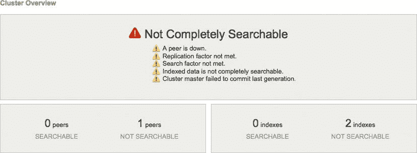

图 16-13. 集群概览报告

再次提醒，您必须确保防火墙中所有必要的网络端口均已打开；否则，集群将无法工作，因为所有对等节点间的通信都无法进行。一旦您启用了所有搜索对等节点，就可以继续启用搜索头了。该过程与启用主节点或对等节点相同，但您只需选择搜索头。这将要求您提供主节点的 URL 和密钥。保存配置后，您需要重启 Splunk 实例。要验证搜索头是否正常工作，您可以在管理器的集群组下查看搜索头仪表盘。此选项的输出如图 16-14 所示。

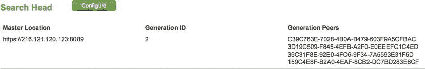

图 16-14. 搜索头仪表盘

搜索头仪表盘中显示的信息相当晦涩，但您需要查找的是在`Generation Peers`标题下是否有与对等节点数量相同的行。在我们的示例中，如图 16-14 所示，它显示了四行，这是正确的。值得注意的是，您可以拥有多个活动集群，并且一个搜索头或一组搜索头可以访问多个集群。这为您提供了所需的灵活性，可以设计出几乎适用于任何情况的解决方案。

现在集群已启动并运行，您可以在主节点上查看集群概览报告，如图 16-15 所示。尽管此图仍呈现了总报告的部分信息，但我们添加了一个显示对等节点详细信息的章节。

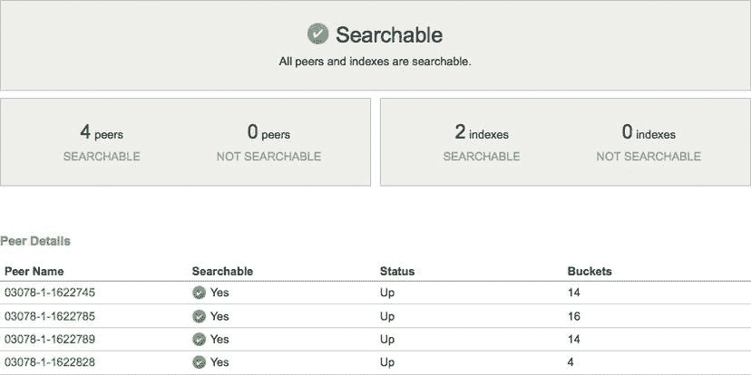

图 16-15. 完整集群的概览报告

到目前为止，我们执行的步骤适用于仅使用主索引的基本集群。如果您使用任何其他索引或应用程序，则需要准备一个所谓的`configuration bundle`在主节点上，这将允许您将附加信息分发到所有对等节点。有关此主题的更多详细信息，请查阅 Splunk 文档。

最后一点是关于主节点的。诚然，它可以被认为是一个单点故障，但它并不像看起来那么脆弱。如果主节点不可用，对等节点之间会继续相互通信，根据需要复制数据，因为它们拥有所有必要的信息。当某个对等节点不可用时，主节点的缺失就会成为一个问题，因为没有一个主节点可以协调补救活动并为搜索提供数据完整性。当一个新的对等节点加入集群（无论是重启还是新节点）且不知道该使用哪些对等节点进行复制时，情况也是如此。Splunk 文档介绍了一种设置备用主节点的方法。

## 总结


