# 附录 A

## Splunk 的性能表现

本附录概述了 `Splunk` 在索引、搜索、分布式搜索以及磁盘速度对搜索影响方面的性能表现。我们还提出了一些建议，帮助您更好地了解您的 `Splunk` 环境，包括搜索头。

## 搜索类型

我们必须在此附录开头提出严正警告：性能不能一概而论，也不能从其他类似系统进行类推。无论您认为您的应用与另一个应用多么相似，或者与在别处运行的同一个应用多么相像，您都无法准确推断出其性能表现。事实上，您的应用会根据使用模式表现出不同的性能特征。`Splunk` 是一个复杂的软件系统，没有公式可以计算其性能。在本附录中，我们将分享 `Splunk` 在不同情况下的性能表现，以便您了解其行为并设定合理的预期。

此处提供的性能数据仅用于说明目的，不应视为 `Splunk` 性能的准确体现。如果您运行相同的性能测试，您得到的结果也会有所不同。这是因为有太多的配置文件，不仅在 `Splunk` 中，也在底层操作系统中，任何微小的差异都可能产生巨大影响。

`Splunk` 拥有多个活动组件，这使我们无法提供通用的性能衡量标准。从宏观层面来看，以下因素会影响 `Splunk` 的性能：

*   搜索类型
*   索引器数量
*   搜索头数量
*   被索引数据的类型
*   底层硬件和操作系统

`Splunk` 的工程团队根据搜索结果中返回的事件数量对搜索类型进行分类。您的预期可能是根据搜索的复杂度进行分类，但这实际上无法衡量；而搜索生成的事件数量是可以衡量的，并且对搜索的响应时间有非常大的影响。以下是搜索的类别或类型：

*   **密集**：每索引一至一千个事件返回一个结果（1 到 1,000）
*   **稀疏**：每索引一千至一百万个事件返回一个结果（1,000 到 1,000,000）
*   **罕见**：每索引一百万至十亿个事件返回一个结果（1,000,000 到 1,000,000,000）
*   **大海捞针**：每索引十亿个或更多事件返回一个结果（1,000,000,000+）

可以这样理解：密集搜索会产生大量事件，是对索引数据的全景式浏览。稀疏搜索则稍微放大，如同使用了双筒望远镜。罕见搜索开始深入细节，如同显微镜；而大海捞针搜索则真正深入到了分子层面，如果愿意的话，可以将其比作电子显微镜。从俯瞰森林，到观察树枝，再到审视树叶，最后目睹光合作用的进行。您越聚焦放大，`Splunk` 的性能就越好，正如我们将在本附录中看到的。

 **注意** 我们必须提醒您，本附录中呈现的性能测试是在实验室的真空中完成的，不能指望其反映真实世界的情况。

`Splunk` 不会对搜索结果进行缓存或使用缓冲区。为了提供正确的比较，本附录中执行的所有性能测试都在运行前清除了 Unix 缓存。

## 搜索性能概览

为了展示性能如何依赖于搜索类型，我们进行了一个简单的实验。我们按照组合日志格式创建了一个典型的 Web 访问日志文件，但在末尾放置了一些关键字，例如 `every2`、`every100` 等，以及一个用于验证目的的序列号。每个关键字出现在相应的每个事件中，因此 `every2` 会出现在每第二个事件中，而 `every100` 出现在每第一百个事件中。多个关键字会相应出现，例如，每第一百个事件也将包含 `every2` 关键字，因为 100 是 2 的倍数；而每第一万个事件不仅包含 `every10K` 关键字，还包含 `every2` 和 `every100`。典型的 Web 访问日志条目如下所示：

```
150.135.220.120 - - [04/Jan/2012:23:59:59 -0700] "GET /themes/splunk_com/img/skins/white/logos/downloads/logo_freebsd.gif HTTP/1.1" 200 - "http://www.splunk.com/index.php/landing?ac=ostg-cpd" "Mozilla/4.0 (compatible; MSIE 7.0; Windows NT 5.1; .NET CLR 1.0.3705; .NET CLR 1.1.4322; Media Center PC 4.0)" "150.135.220.120.0000044400204798" every2 every100 num=000000100051200
```

我们生成了略多于 36 亿个事件，约 1 TB 的原始数据，这些数据被索引到一台普通服务器上。我们使用另一台服务器作为搜索头。这项测试并不十分真实，因为没有任何其他操作发生，没有数据被索引，也没有其他人执行其他搜索，但它仍然为我们提供了基于搜索分类的响应时间的相当不错的概念。测试是使用 CLI 通过简单搜索完成的，例如：

```
search every2
| stats count
```

结果可以在图 A-1 中看到。我们不得不使用对数刻度，因为使用 `every2` 关键字的密集搜索的结果与光速测试的结果之间存在四个数量级的差距，光速测试只是搜索关键字 `SpeedOfLight`，我们知道它在生成的数据中并不存在。当您执行搜索时，`Splunk` 会检查其数据桶，看其中是否有该字符串。光速搜索只是用来衡量遍历 `Splunk` 基础设施寻找一个不存在的字符串需要多长时间；在这个例子中只需两秒钟。当它在某个桶中找到该字符串时，它会在原始数据中查找包含搜索字符串的实际事件，但要做到这一点，它必须先解压缩原始数据，因为原始数据是以压缩格式存储的。匹配搜索的事件越多，它需要解压缩的数据就越多，因此密集搜索往往受限于 CPU。如结果图表所示，非常密集的 `every2` 关键字搜索耗时近四小时，因为 `Splunk` 必须处理超过 18 亿个 Web 访问事件。当我们转向不太密集的搜索，如 `every100`，响应时间降至 45 分钟，因为 `Splunk` 只需处理约 3600 万个事件。随着结果包含的事件越来越少，性能显著提升，如 `every200million` 关键字所示，仅需 26 秒即可返回匹配搜索的 18 个事件。

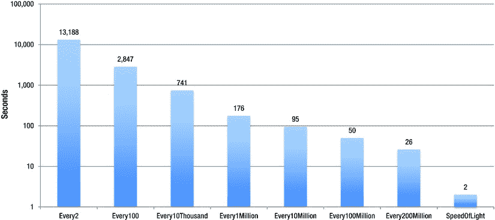

图 A-1 . 按类型划分的搜索性能

随着搜索从密集到稀疏、稀有再到大海捞针，它们会从 CPU 密集型转变为 I/O 密集型，因为需要解压的原始数据减少了，但对桶的读取操作增多了。图 A-2 展示了在每索引 10,000 到 100,000 个事件中返回一个结果时发生的转变，这将其置于稀疏搜索类别的中间位置。

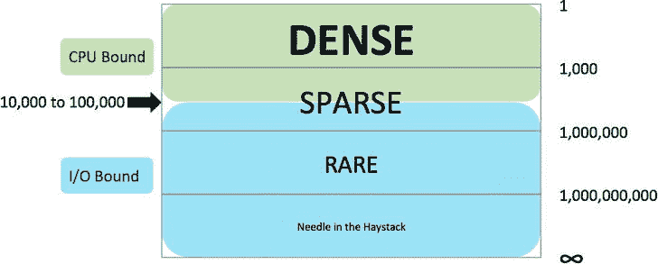

图 A-2. 搜索资源消耗

要判断搜索是 CPU 密集型还是 I/O 密集型，只需点击作业检查器按钮，该按钮位于用户界面的搜索屏幕上，在时间选择器下方，是一个内含字母“i”的蓝色方块。这将打开另一个浏览器窗口，其中包含该特定搜索的执行成本信息。在图 A-3 中，你可以看到我们在第 10 章中使用的一个简单搜索的部分输出，该搜索寻找计划飞行时间为 31 小时的美联航航班：

```
UniqueCarrier=UA CRSElapsedTIme=1865
```

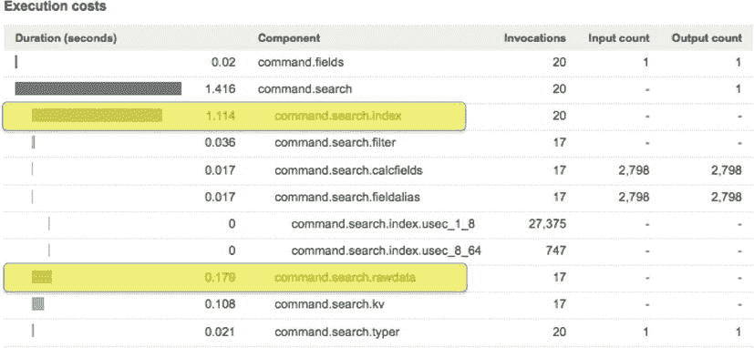

图 A-3. 搜索执行成本

仔细查看作业检查器的输出，你会发现`command.search.index`花费的时间是 1.114 秒，而`command.search.rawdata`是 0.179 秒；因此，此搜索是 I/O 密集型的。这在意料之中，因为该搜索属于稀有类别，在 1.47 亿个已索引事件中仅有一个结果。最后提醒一点：这不适用于基于`tsidx`机制的搜索。

## 大海捞针

为大海捞针搜索设置性能测试非常复杂且耗时；这就是为什么之前的实验没有包含这种搜索类型的原因。然而，我们有幸专门为此案例运行了一些独立的性能测试。与之前的测试类似，我们使用组合访问格式创建了一组 Web 访问日志，并为每个事件附加了一个唯一的序列号，这次没有使用关键词。我们生成了 560 亿个事件，并将其平均分布在 10 个 `Splunk` 索引器上。该集群还有一个单独的搜索头。我们从 CLI 使用的搜索命令如下：

```
search 0000028000000123
```

这会查找该特定字符串，该字符串在 560 亿个事件中是唯一的，对应的事件编号为 28000000123，可以在大约一半的位置找到。此搜索的结果可以在表 A-1 中找到。

表 A-1. 大海捞针性能

| 桶大小 | 布隆过滤器 | 响应时间（秒） |
| --- | --- | --- |
| 1GB | 否 | 186.636 |
| 1GB | 是 | 31.788 |
| 10GB | 否 | 71.459 |
| 10GB | 是 | 9.727 |

当然，最引人注目的焦点是从 560 亿个事件中找出唯一事件只用了不到 10 秒，但有几个地方需要先解释一下。我们先从桶开始。这是 `Splunk` 存储原始数据的地方；默认大小在安装 `Splunk` 时由系统自动计算。它基于运行 `Splunk` 的服务器上的核心数量和其他配置信息进行设置。当桶与主索引关联时，默认大小很可能是每个桶 10GB，而对于与自定义索引（即您定义的索引）关联的桶，默认大小很可能为 1GB。您可以配置桶大小，但一般来说，对于高容量索引（例如主索引），我们建议使用预定义的`auto_high_volume`设置，否则使用`auto`设置。一个高容量索引通常被认为是每天接收超过 10GB 数据的索引。

对搜索性能有巨大影响的另一项是布隆过滤器。这是一种可以明确声明某个元素不在数据集中的数据结构。`Splunk` 使用布隆过滤器来判断某个字符串是否不在某个桶中。这样，`Splunk` 就不必打开并处理不包含我们正在查找的字符串的桶，从而显著提高性能。当您将更大的桶大小与布隆过滤器结合使用时，桶的数量会更少，这意味着需要处理的布隆过滤器更少，从而减少了搜索的处理时间。布隆过滤器在索引时创建，并且在 `Splunk` 中默认启用。创建它们会有相对较小的开销，但当您进行稀有或大海捞针搜索时，这点开销是非常值得的。开销包括索引期间创建布隆过滤器的额外处理时间，以及用于存储过滤器的额外磁盘空间。我们建议，如果您的大多数搜索是稀有或大海捞针类型，您可以在自定义索引上使用 10GB 的桶大小。

## 分布式搜索

最常见的问题之一是何时应向 `Splunk` 服务器集群中添加索引器。由于这个问题没有精确答案，我们准备了一组三个性能测试，这些测试将让您对 `Splunk` 在增加部署中索引器数量时的行为有一个相当清晰的认识。

### 性能测试 1

在这组测试中，我们保持固定数量的事件（1 亿个）均匀分布在所有索引器上，同时增加索引器的数量。第一个数据点是使用一个索引器，它拥有全部 1 亿个事件。接下来，我们将索引器数量增加到十个，但由于事件数量固定，现在每个索引器只有 1000 万个事件。下一个数据点是 50 个索引器，每个有 200 万个事件，最后是 100 个索引器，每个有 100 万个事件。密集搜索的第一组结果见表 A-2。

表 A-2. 性能测试 1——密集搜索

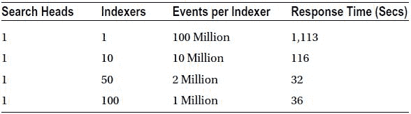

随着我们增加索引器，性能提高了。在 1 到 10 个索引器之间，有线性可扩展性的迹象，但数据点不足以确定。然而，我们可以看到，从 50 个索引器增加到 100 个索引器时出现了一个拐点，响应时间增加了。这是一个收益递减点，再增加索引器已经不值得了。我们将性能下降归因于搜索头与索引器之间的通信开销。

在表 A-3 中，你可以看到稀疏搜索的响应时间。虽然不那么明显，但在 1 到 10 个索引器之间，我们也有线性可扩展性的迹象。我们也可以看到与密集搜索相同的拐点，原因与之前相同。

表 A-3. 性能测试 1——稀疏搜索

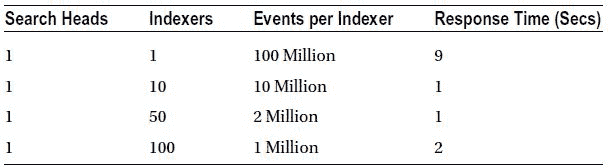

表 A-4 显示了索引器过多实际上会损害稀有搜索的性能。拐点比其他搜索类型出现得更早。这是因为稀有搜索的性质决定：每个索引器的响应都非常快，但所有额外索引器的通信开销直接影响了响应时间。

表 A-4. 性能测试 1——稀有搜索

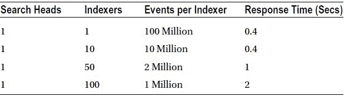

从这个性能测试中，我们可以得出结论：

*   增加索引器的数量往往能提高性能
*   存在一个收益递减点，即过多的索引器会对搜索性能产生负面影响，尤其是对稀有搜索。

### 性能测试 2

In this performance test, we fixed the number of events per indexer. That means the total number of events increased every time we added an indexer. We used only two data points: the first with 10 indexers each containing 10 million events, resulting in a total of 100 million events; the second with 200 indexers each containing 10 million events, giving a total of 2 billion events.

In Table A-5, we can see the test results under dense search. In this case, scalability was far better than linear, but our data points are insufficient to draw this conclusion. Remember, in this set of tests, we increased the number of indexers, each with additional data. In the previous set of tests, we increased the number of indexers but diluted the number of events per indexer.

Table A-5. Performance Test 2 – Dense Search

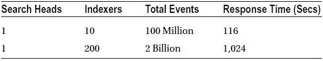

In Table A-6, we again observe indications that the scalability of sparse search is far better than the linear model. By extrapolation, the response time for 2 billion events should have been 20 seconds, but it was actually only 9 seconds.

Table A-6. Performance Test 2 – Sparse Search

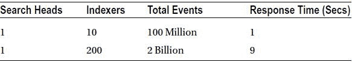

Finally, as shown in Table A-7, the rare search exhibits a similar pattern, also showing indications of far better than linear scalability. From this, we can conclude that under these conditions, adding indexers as the number of events increases makes sense, and scalability is at least linear or better.

Table A-7. Performance Test 2 – Rare Search

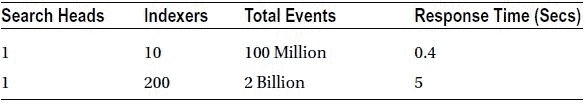

## Performance Test 3

我们称之为真实世界的性能测试。前两个性能测试中描述的场景在实践中并不会发生。用于索引的新事件均匀分布在所有索引器上，因此一个新索引器只会接收到总事件的一小部分。由于新索引器在刚加入时没有任何事件，因此总事件数并未均匀分布在所有索引器上。

在这组测试中，我们从一个搜索头和一个索引器开始。第一个数据点包含1亿个事件。然后我们将事件增加到2亿和3亿。此时，我们增加另一个索引器，并将事件增加到4亿和5亿。这里发生的情况是：当我们添加新的索引器并增加1亿个事件时，其中5000万个事件会流向新的索引器（使其总数达到5000万事件），另外5000万个事件流向旧索引器（使其总数达到3.5亿事件）。当我们再增加1亿个事件时，它们会在两个索引器之间均匀分配。此时，新索引器总共有1亿个事件，旧索引器有4亿个事件。

在图 A-4 中，我们绘制了五个数据点的实际响应时间，并添加了一条代表线性可扩展性的趋势线。如您所见，实际响应时间优于预期的线性可扩展性。事实上，结果可能比图中显示的更好。这是因为搜索操作会访问所有数据，而在现实场景中，这些搜索通常针对最近的、持续滚动的时间窗口，因此搜索时间的整体改善将大于我们在此展示的结果。

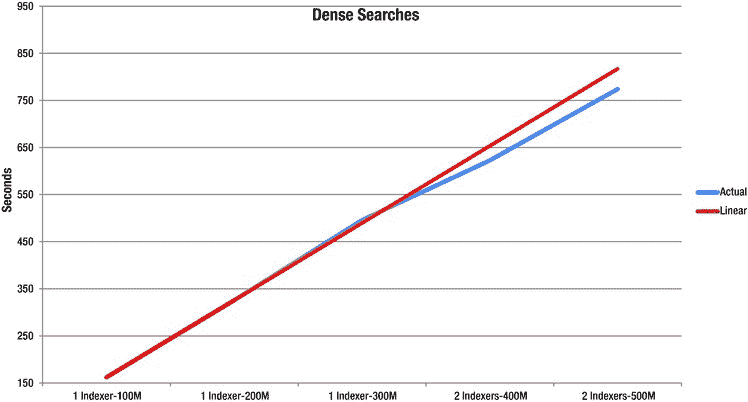

图 A-4. 性能测试 3，密集搜索

解释图 A-5 的另一种方式是观察线性可扩展性趋势线。您可以看到，对于单个索引器，当事件数达到4亿时，响应时间为80秒；在我们添加第二个索引器后，80秒的响应时间仅在事件达到5亿时才出现，因此这对性能和可扩展性都做出了重大贡献。

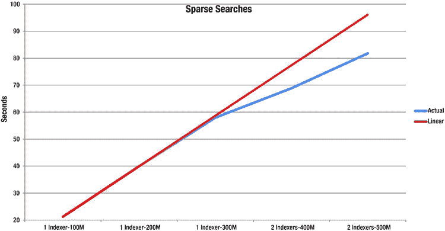

图 A-5. 性能测试 3，稀疏搜索

在图 A-6 中，我们可以看到添加索引器带来了一点小改善，但考虑到响应时间已经非常快，添加另一个索引器似乎没有必要。

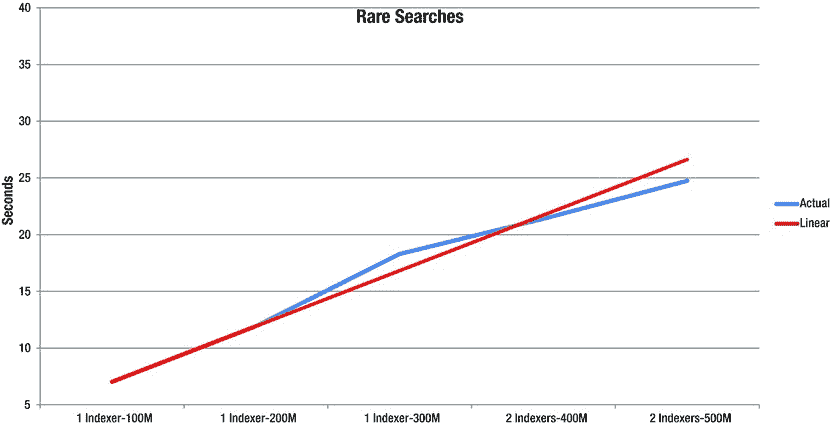

图 A-6. 性能测试 3，罕见搜索

根据这组性能测试的结果，我们可以得出结论：添加另一个索引器是有用的，特别是对于稀疏搜索，但它似乎对罕见搜索没有优势。显然，通过添加索引器进行横向扩展可以在一定程度上延迟响应时间的退化，这可以成为添加索引器的一个理由。

## Indexing Performance

另一个性能无法一概而论的例子是索引性能。这种情况高度依赖于被索引的数据类型。此外，将数据加载到`Splunk`时执行的转换也有影响。这在第9章讨论处理航空准点性能数据的不同方法时已彻底讨论过。最后，底层操作系统和硬件也会影响性能。

根据数据类型，事件的大小可能差异很大。例如，使用组合日志格式的Web访问日志事件平均约300个字符。`syslog`文件的平均事件大小因源类型而异；我们观察到的范围从300到1200个字符。另一种常见类型是`JBoss`日志文件；当包含内容时，它通常是Java堆栈跟踪，这往往很长，平均约5000个字符。由于这些事件大小差异很大，更倾向于以千字节每秒（`KBps`）来衡量索引性能，而不是简单地计算事件数量。

在图 A-7 中，您可以看到使用前面讨论的三种日志文件类型测量索引吞吐量的结果。Linux环境下的结果非常稳定，约为14,000 `KBps`。Solaris环境下的情况类似，尽管吞吐量下降到约11,000 `KBps`。Windows操作系统下索引吞吐量的不一致性令人惊讶。为了提供更完整的图景，我们选择使用`gzip`压缩`syslog`文件。我们可以将Linux和Solaris上稍慢的吞吐量归因于需要解压`syslog`文件。然而，Windows在处理压缩文件时似乎表现更好。

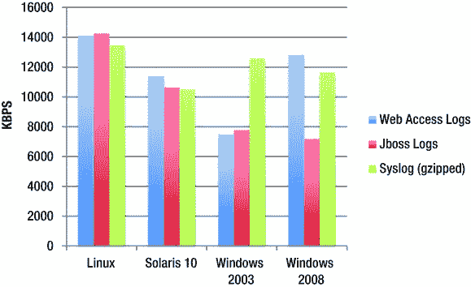

图 A-7. 索引性能

此图表并非意在推荐任何特定的操作系统。如您所知，影响操作系统性能的因素繁多。但是，这些测试是在同一台通用服务器上进行的，因此Solaris 10运行在x86架构上，而不是`SPARC`服务器上。此图表旨在说明数据类型之间存在差异，而这些差异也可能受到底层操作系统和硬件的影响。

## Disk Speed and Search

作为计算机中最慢的硬件组件，磁盘驱动器确实会影响性能，尤其是在像`Splunk`这样将数据存储在磁盘上的应用程序中。在`Splunk`中，数据存储在桶（`bucket`）中。这些桶可以是热（`hot`）、温（`warm`）、冷（`cold`）或冻结（`frozen`）状态。我们不会详细讨论它们的工作原理以及数据如何从一个桶滚动到另一个桶，但可以说，索引性能与存储热桶和温桶的设备（`device`）的写入性能直接相关。搜索性能部分与存储热桶、温桶和冷桶的设备的读取性能相关。您可以在配置文件中指定桶的位置。

我们进行的测试旨在测量使用不同转速磁盘驱动器时的搜索性能。为了更清楚地了解这一行为，我们还会考虑并发搜索的数量。

图 A-8 中的图表显示，固态硬盘（`SSD`）提供了最佳的搜索性能，并且随着并发搜索次数的增加，性能还会提升。其相对于传统机械磁盘驱动器的提升非常显著，以至于我们必须使用对数刻度。`SSD`在搜索性能上的差异可能足以证明其价格差异是合理的。

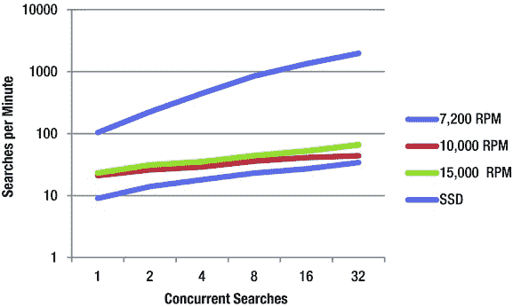

图 A-8 .  磁盘速度与搜索性能

图 A-9 放大了机械磁盘的性能视图，这样我们就能在没有`SSD`不同存储技术造成的扭曲的情况下，更好地理解其性能。7,200 RPM 磁盘与 10,000 RPM 磁盘之间的差距是显著的，平均约为 50%。然而，10,000 RPM 与 15,000 RPM 之间的差异则小得多。随着并发搜索次数的增加，性能确实会提升，在 32 次并发搜索时达到了 34% 的提升。

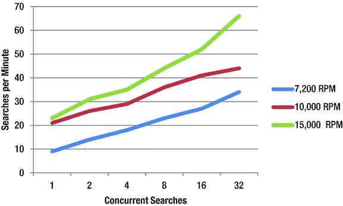

图 A-9 .  机械磁盘速度与搜索性能

尽管这些性能测试中未使用，但在使用 `RAID` 配置时，推荐设置为 `RAID 10`，也称为 `RAID 0+1`。`RAID 10` 提供了快速的读写性能以及最高的冗余度。请勿使用 `RAID 5`，因为重复写入会导致索引速度变慢。

此测试结果可能会帮助您为自己的安装环境选择磁盘驱动器，但请记住，在做出决定之前，您必须使用自己的数据、搜索模式和用法进行测试。另一个提示是，并发搜索可能由多个用户、仪表盘或两者共同发起。我们提到这一点，是因为我们看到过有人在计算并发搜索时忘记了仪表盘。

## 了解您的 Splunk 环境

`SplunkWeb`，即 `Splunk` 的用户界面，提供了一组全面的报告，能让您非常清楚地了解您的 `Splunk` 环境的行为。当您在搜索应用中时，“摘要”选项卡会按来源、源类型和主机显示所有已索引数据的概览。当您选择“状态”选项卡时，会看到一个下拉菜单，其中包含多个选项，如图 A-10 所示。这些选项中的每一个都提供了关于 `Splunk`、您的数据和搜索的内部运作的详细信息。我们强烈建议您熟悉这些报告。


图 A-10 .  状态选项

我们还想与您分享一些其他技巧，以便您能更好地了解您的 `Splunk` 环境。我们已经讨论了 `Splunk` 工程团队使用的搜索分类方法，因此我们将向您展示如何为自己的搜索计算这个分类。但首先，我们将告诉您如何找到哪些是您最耗资源的搜索，以及它们随时间推移的响应情况。最后，我们将讨论关于搜索头性能的问题。

### 最耗资源的搜索

您可能希望首先了解哪些是最耗资源的搜索，以便查看它们是否可以改进或优化。当您在状态下拉菜单中选择“搜索活动概览”选项时，您将看到一个包含多个面板的仪表盘。滚动到页面底部，您会找到一个标题为“最近按资源消耗排序的搜索（最近一小时）”的面板。这包含我们想要的核心信息，但时间范围仅限于最近一小时，并且它没有显示已保存搜索的名称，只显示了实际的搜索语句。

我们已修改此搜索，以便它能够提供已保存搜索的名称；如果不是已保存的搜索，则将其标识为“临时搜索”。如果您点击面板左下角的“查看结果”，它将带您进入一个搜索屏幕，其中包含实际的搜索语句和结果。您可以在此处修改搜索，方法是添加一行使用`eval`命令来创建一个名为`saved_name`的字段。同时，在`stats`命令中添加一行，以便搜索名称显示在表格中。然后，将时间范围修改为更适合您需求的时段（可能是一个月），并将其保存为“最耗资源的搜索”。最终的搜索语句如下所示，其中`高亮`显示了更改部分：

```
`audit_searchlocal`
|  convert num(total_run_time)
| eval user = if(user="n/a", null(), user)
| `audit_rexsearch`
| eval is_scheduled = if(search_id LIKE "scheduler%", "yes", "no")
| eval saved_name = if(savedsearch_name LIKE "", "Ad Hoc", savedsearch_name)
| stats min(_time) as _time
        first(user) as user
        first(total_run_time) as total_run_time
        first(saved_name) as saved_search_name
        first(search) as search
        first(is_scheduled) as is_scheduled by search_id
| search user=*
| sort - total_run_time
```

此搜索的输出结果如图 A-11 所示。通过添加已保存搜索名称的列，可以非常容易地识别出耗资源的搜索。输出结果仅显示每次搜索中资源消耗最高的那次出现。下一步是更深入地理解那些有问题的搜索。

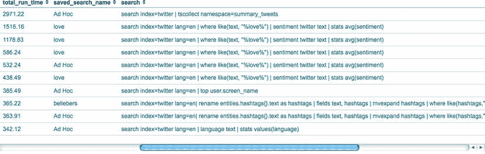

图 A-11 .  最耗资源的搜索

### 历史运行时间

一旦您识别出最耗资源的搜索，我们建议您回顾那些您最关心的搜索随时间推移的行为变化。之前的报告“最耗资源的搜索”仅显示每次搜索中资源消耗最高的记录。查看历史运行时间（即响应时间）会让我们有更清晰的概念。为此进行的搜索非常简单。如果它是已保存搜索，请使用以下命令：

```
index=_audit info=completed savedsearch_name="saved search name"
| chart first(total_run_time) as RunTime over _time
```

对于临时搜索，您必须输入实际的搜索语句而不是已保存的搜索名称。不要忘记将已保存搜索的名称或实际搜索语句用双引号（`"`）括起来，并注意`over`关键字和特殊字段`_time`之间有一个空格：

```
index=_audit info=completed savedsearch_name="actual search"
| chart first(total_run_time) as RunTime over _time
```