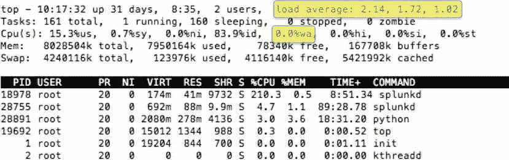

这两种搜索的输出都会生成一张图表。你需要调整图表选项才能获得清晰的图像。对我们而言，通常需要调整折线图 `y` 轴的最小值以获得更好的分辨率。根据我们的经验，上下浮动 10% 的偏差可以视为可接受范围。如果你分析的搜索包含许多数据点，那么更容易观察到趋势（如果有的话）。显示搜索响应随时间恶化的趋势可能由以下原因导致：

*   你索引的数据量比之前更多
*   搜索返回的事件比例比之前更高，也就是说，搜索正在变得更高密度
*   搜索覆盖的时间范围比之前更长

上述任何一个原因都可能导致搜索随时间恶化。你需要详细分析你的配置，以确保如果出现上述原因，它们都出于已知的原因。如果你无法根据上述任何原因解释性能恶化，说明你的搜索存在问题，应当进行更深入的检查。

有时我们会使用前述搜索的变体来展示搜索返回的事件数量。你可以尝试将两者结合，但我们发现有时两组数值之间的量级差异会搞乱图表。替代搜索如下：

```
index=_audit info=completed savedsearch_name="saved search name"
| chart first(event_count) as ReturnedEvents over _time
```

## 对搜索进行分类

了解我们拥有哪种类型的搜索有助于我们对性能设定合理的预期。要确定某个搜索属于哪一类，首先需要计算响应中的事件数量与索引中事件总数的比率：

```
比率 = 索引中事件总数 / 搜索结果中的事件数量
```

乍看之下，找到搜索结果中的事件数量可能并不容易，尤其是对于包含大量子句（即使用大量管道）的搜索。搜索通常以可流式命令开始，这些命令对事件执行某些操作（例如修改），或仅从索引中选择事件，并将其传递给搜索的下一部分。我们希望关注搜索的第一个命令，这通常是一个直接搜索。我们基于这个命令来计算比率，因为它负责在数据桶中查找符合请求条件的事件。在处理包含子搜索的搜索时，为了对其进行分类，每个子搜索都应被视为独立的搜索。

查找索引中的事件数量很简单，只需使用 `eventcount` 命令或前往搜索应用的摘要页面即可。如果计算出的比率范围在：

*   1 到 1000 之间，搜索属于高密度（Dense）
*   1000 到 100 万之间，搜索属于稀疏（Sparse）
*   100 万到 10 亿之间，搜索属于罕见（Rare）
*   超过 10 亿，搜索属于大海捞针（Needle in the Haystack）

当然，这项计算的目标是动态变化的，因为索引通常在不断增长，尤其是在搜索基于滚动时间范围的情况下。遗憾的是，Splunk 并不保存索引中存储的事件数量的历史记录，因此我们无法得知某个搜索随时间推移究竟属于哪一类。

## 搜索头性能

我们对 Splunk 性能所做的大部分研究都集中在搜索、索引和拓扑结构上。随着我们看到包含多个面板甚至复杂搜索的仪表盘越来越受欢迎，我们意识到在理解实际搜索头本身所承受的负载方面投入的精力还不够。构成仪表盘的大多数搜索都基于滚动时间段，例如最后一分钟或最后五分钟。即使这些搜索处理的事件量相对较小，滚动汇总也属于高密度搜索，而使用报告加速或 `tsidx` 加速并不总能奏效，因为汇总操作必须在面板下一次刷新之前的某个时间点完成，而这个时间间隔可能短到无法完成。

仪表盘像兔子一样容易滋生蔓延，你很快就会发现，自己面临大量仪表盘，每个仪表盘又包含十几个面板，受众范围从高管、管理层到真正使用它们的运维人员。与此同时，我们看到越来越多的人部署搜索头，这些搜索头专门用于处理仪表盘的搜索。

那么问题就变成了：何时应该添加另一个搜索头？在尝试回答这个问题之前，我们需要解释一下仪表盘的工作方式。所有仪表盘都由定时搜索组成。定时搜索应该在特定的时间间隔运行，例如每五分钟一次或每小时整点运行一次。如果搜索的启动时间出现延迟，很可能是因为系统过载。轻微的、不规则的延迟是可以接受的，平均延迟在几秒钟范围内也可接受，但当延迟持续较大时，你就应该认真考虑添加另一个搜索头了。

另一个指标是跳过的搜索次数。当前一次搜索运行耗时过长，以至于已经到了运行下一个（被跳过的）搜索的时间时，该搜索就会被跳过。例如，假设我们有一个计划每分钟运行一次的搜索，但它需要两分钟才能完成，因此它将跳过下一次执行（该执行时间点已成为过去），并在下一个间隔运行。如果这个搜索之前需要 45 或 50 秒，而现在耗时更长，那么很可能存在负载问题，这可以通过延迟或跳过来识别。当然，如果你的搜索耗时超过了为其分配的时间间隔，那这不是负载问题，而只是调度逻辑问题。

那么，回到我们的问题。答案分为两部分，而且我们必须说明，这部分更多是基于经验和直觉，而非像在本附录中进行的正式实验。第一部分基于使用 Splunk 在用户界面的“状态”选项卡下提供的综合信息，特别是“调度器活动概览”页面。在那里你会找到两个重要的面板，一个显示过去 24 小时内已启动和已跳过的搜索次数，另一个显示过去 24 小时内的平均执行延迟。根据前面的解释，你应该能够快速评估搜索头（或多个搜索头）的负载情况。

答案的第二部分侧重于 Unix/Linux 操作系统的指标。一般性的说法是，当任何资源（如 CPU 或内存）达到容量上限时，你就应该添加另一个搜索头。这太笼统了，让我们来看一些更具体的内容。我们的通用服务器运行的是 CentOS 6.2，`top` 命令为我们提供了两个我们认为很关键的指标：Unix 负载和 I/O 等待百分比。其他命令也能提供这些指标。在图 A-12 中，你可以看到在 `top` 命令的输出中哪里可以找到这些指标。



图 A-12。Unix `top` 命令的输出

平均负载显示在右上角。它呈现了三个数字，分别代表过去 1 分钟、过去 5 分钟和过去 15 分钟的平均负载。如果这些数字始终高于服务器拥有的 CPU 核心数，那么是时候认真考虑添加另一个搜索头了。第二个指标是 I/O 等待，可以在平均负载标题下方几行找到。在图 A-12 中，它显示为 `0.0%wa`。此指标表示 CPU 核心等待 I/O 的时间。该指标从 0.2% 开始，往往会非常迅速地呈指数级增长，你将在相当短的时间内陷入混乱。现在，你对搜索头及其性能的了解和我们一样多。

## 总结

在本附录中，你了解了搜索类型及其性能。我们还回顾了何时应考虑向我们的环境添加另一个索引器。经验法则是，添加另一个索引器几乎总能改善整体搜索时间。我们看到了磁盘 I/O 对搜索性能的重要性。我们分享了一些了解你的 Splunk 设置的技巧，特别是查找最昂贵的搜索；并且我们建议你同时查看其搜索时间的历史记录，并尝试了解性能下降的原因（如果有）。最后，我们回顾了如何监控搜索头以避免出现不可接受的性能。