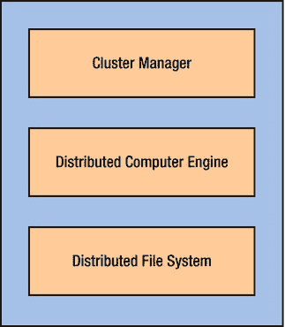
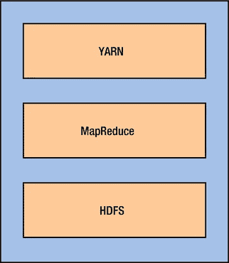
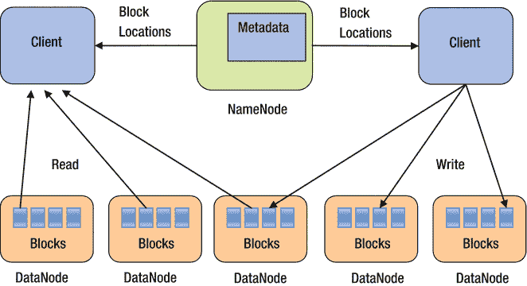
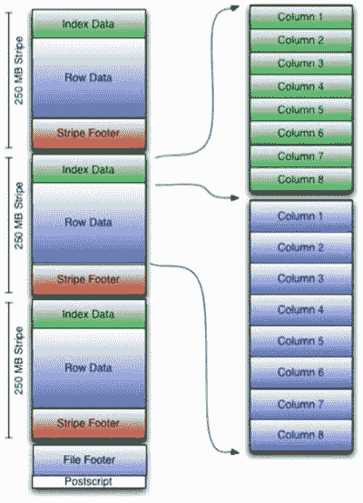
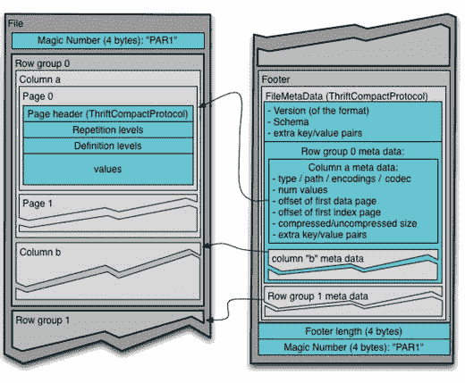
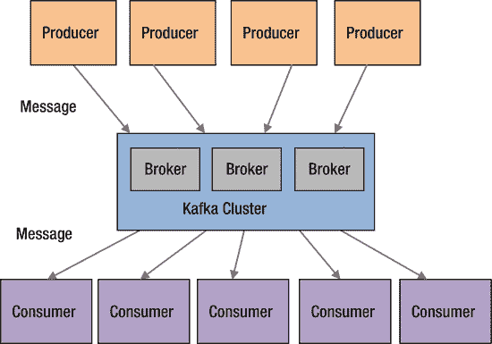
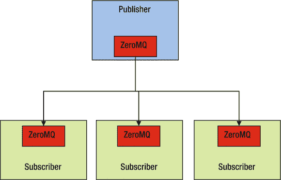

# 大数据技术全景

我们正处在一个大数据的时代。数据不仅已成为任何组织的命脉，而且正呈指数级增长。如今生成的数据量比几年前大了好几个数量级。挑战在于如何从这些数据中获取商业价值。这正是大数据相关技术所要解决的问题。因此，在过去几年中，大数据已成为最热门的技术趋势之一。一些最活跃的开源项目都与大数据相关，而且这类项目数量正在快速增长。近年来，专注于大数据的初创公司数量激增。大型成熟企业也在大力投资大数据技术。

尽管“大数据”这个术语很火热，但它的定义却很模糊。人们以不同方式定义它。一种定义与数据量有关；另一种定义则与数据的丰富度有关。有些人将大数据定义为按照传统标准“过大”的数据；而另一些人则将其定义为能够捕捉其所代表实体更多细节的数据。前者的例子是数据量超过 PB 或几 TB 的数据集。如果这些数据存储在传统关系数据库(`RDBMS`)的表中，它会有数十亿行。后者的一个例子是列宽极大的数据集。如果这些数据存储在关系数据库表中，它会有数千列。另一种流行的大数据定义是以三个 V 为特征的数据：海量（Volume）、高速（Velocity）和多样（Variety）。我刚刚讨论了海量。高速意味着数据生成速度很快。多样指的是数据可以是非结构化的、半结构化的或多结构化的。

标准的关系数据库难以轻松处理大数据。这些数据库的核心技术设计于几十年前，当时很少有组织拥有 PB 甚至 TB 级的数据。如今，一些组织每天生成 TB 级的数据并不罕见。不仅是数据量，数据生成的速度也在爆炸式增长。因此，需要能够不仅处理和分析大量数据，还能高速摄入大量数据的新技术。

大数据技术的其他关键驱动因素包括低成本下的可扩展性、高可用性和容错性。处理和大型数据集分析的技术已经被广泛研究，并且长期以来以专有商业产品的形式存在。例如，`MPP`（大规模并行处理）数据库已经存在了一段时间。`MPP`数据库采用“无共享”架构，数据存储和处理在一个节点集群上进行。每个节点都配有自己的一套 CPU、内存和磁盘。它们通过网络互联进行通信。数据被分区到集群中的各个节点上。节点之间没有争用，因此它们可以并行处理所有数据。此类数据库的例子包括 `Teradata`、`Netezza`、`Greenplum`、`ParAccel` 和 `Vertica`。`Teradata` 发明于 20 世纪 70 年代末，到 90 年代，它已能够处理 TB 级的数据。然而，专有的 `MPP` 产品价格昂贵，并非所有人都能负担得起。

本章介绍一些与大数据相关的开源技术。尽管本章所涉及的技术似乎是随意挑选的，但它们都有一个共同的主题。它们与 `Spark` 一起使用，或者 `Spark` 为其中一些技术提供了更好的替代方案。当你开始使用 `Spark` 时，可能会遇到这些技术。此外，熟悉这些技术将有助于你更好地理解 `Spark`，我们将在第 3 章中介绍它。

## Hadoop

`Hadoop` 是首批流行的开源大数据技术之一。它是一个可扩展的容错系统，用于在商用服务器集群上处理大型数据集。它利用计算机集群中的可用资源，为大规模数据处理提供了一个简单的编程框架。`Hadoop` 的灵感来源于谷歌为其搜索产品创建倒排索引而发明的一个系统。杰弗里·迪恩和桑杰·格玛沃特在 2004 年发表了论文，描述了他们在谷歌创建的系统。第一篇题为“MapReduce：大型集群上的简化数据处理”，可在 `research.google.com/archive/mapreduce.html` 找到。第二篇题为“谷歌文件系统”，可在 `research.google.com/archive/gfs.html` 找到。受这些论文的启发，道格·卡丁和迈克·卡法雷拉开发了一个开源实现，后来成为了 `Hadoop`。

许多组织已经用 `Hadoop` 取代了昂贵的专有商业产品来处理大型数据集。原因之一是成本。`Hadoop` 是开源的，并且运行在商用硬件集群上。你可以通过添加廉价服务器轻松扩展它。`Hadoop` 提供了高可用性和容错性，因此无需购买昂贵的硬件。其次，它更适合某些类型的数据处理任务，例如大规模数据的批处理和 `ETL`（提取、转换、加载）。

`Hadoop` 建立在几个重要的理念之上。首先，使用一组商用服务器集群来存储和处理大量数据比使用高端强大的服务器更便宜。换句话说，`Hadoop` 采用横向扩展架构而非纵向扩展架构。

其次，通过软件实现容错比通过硬件实现更便宜。容错服务器非常昂贵。`Hadoop` 不依赖容错服务器。它假设服务器会失败，并透明地处理服务器故障。应用程序开发人员无需担心处理硬件故障。那些繁琐的细节可以交给 `Hadoop` 处理。

第三，通过网络将代码从一台计算机移动到另一台计算机，比在同一网络上移动大型数据集要高效和快速得多。例如，假设你有一个 100 台计算机的集群，每台计算机上有 1TB 数据。处理这些数据的一种选择是将其移动到一个可以处理 100TB 数据的非常强大的服务器上。然而，移动 100TB 的数据需要很长时间，即使在非常快速的网络上也是如此。此外，这种方法需要非常昂贵的硬件来处理数据。另一种选择是将处理这些数据的代码移动到你的 100 节点集群中的每台计算机上；这比第一种选择要快得多，也高效得多。而且，你不需要昂贵的高端服务器。

第四，通过将核心数据处理逻辑与分布式计算逻辑分离，可以简化分布式应用程序的编写。开发一个利用计算机集群资源的应用程序比开发一个在单台计算机上运行的应用程序要困难得多。能够编写在单台机器上运行应用程序的开发人员数量比能够编写分布式应用程序的多出几个数量级。`Hadoop` 提供了一个框架，隐藏了编写分布式应用程序的复杂性。从而允许组织利用更庞大的应用程序开发人员资源。

尽管人们将 `Hadoop` 视为一个单一产品，但它实际上并非单一产品。它由三个关键组件组成：集群管理器、分布式计算引擎和分布式文件系统（参见图 1-1）。

图 1-1. 关键的 `Hadoop` 概念组件

### Hadoop 架构

在 2.0 版本之前，Hadoop 的架构是单体式的。所有组件紧密耦合，捆绑在一起。从 2.0 版本开始，Hadoop 采用了模块化架构，允许你将 Hadoop 组件与非 Hadoop 技术混合搭配使用。

图 1-1 中所示的三个概念性组件的具体实现是 `HDFS`、`MapReduce` 和 `YARN`（见图 1-2）。

图 1-2. 关键的 Hadoop 组件

本章涵盖了 `HDFS` 和 `MapReduce`。`YARN` 将在第 11 章中介绍。

### HDFS（Hadoop 分布式文件系统）

`HDFS`，顾名思义，是一个分布式文件系统。它将文件存储在一组商用服务器集群上。它旨在存储大型文件和大规模数据集并提供快速访问。它具有可扩展性和容错性。

`HDFS` 是一个块结构文件系统。就像 Linux 文件系统一样，`HDFS` 将文件分割成固定大小的块，也称为分区或分片。默认块大小为 128 MB，但它是可配置的。从块的大小可以清楚地看出，`HDFS` 并非为存储小文件而设计。如果可能，`HDFS` 会将文件的块分散存储在不同的机器上。因此，应用程序可以并行化文件级别的读写操作，使得读取或写入一个分布在多台计算机不同磁盘上的大型 `HDFS` 文件，比读取或写入存储在单个磁盘上的大文件要快得多。

将文件分布到多台机器会增加集群中某台机器发生故障时文件变得不可用的风险。`HDFS` 通过在多个机器上复制每个文件块来降低这种风险。默认的复制因子是 3。因此，即使提供文件块的一台或两台机器发生故障，该文件仍然可以被读取。`HDFS` 的设计假设机器可能会定期发生故障。因此它可以处理集群中一台或多台机器的故障。

一个 `HDFS` 集群包含两种类型的节点：`NameNode` 和 `DataNode`（见图 1-3）。`NameNode` 管理文件系统命名空间。它存储文件的所有元数据。例如，它跟踪文件名、权限和文件块的位置。为了提供对元数据的快速访问，`NameNode` 将所有元数据存储在内存中。`DataNode` 以文件块的形式存储实际的文件内容。

图 1-3. HDFS 架构

`NameNode` 会定期从 `HDFS` 集群中的 `DataNode` 接收两种类型的消息。一种称为 `Heartbeat`（心跳），另一种称为 `Blockreport`（块报告）。`DataNode` 发送心跳消息以告知 `NameNode` 其运行正常。`Blockreport` 包含一个 `DataNode` 上所有数据块的列表。

当客户端应用程序想要读取文件时，它首先联系 `NameNode`。`NameNode` 响应包含组成该文件的所有块的位置信息。块位置标识了保存该文件块数据的 `DataNode`。然后，客户端直接向 `DataNode` 发送针对每个文件块的读取请求。`NameNode` 不参与从 `DataNode` 到客户端的实际数据传输。

类似地，当客户端应用程序想要向 `HDFS` 文件写入数据时，它首先联系 `NameNode`，请求其在 `HDFS` 命名空间中创建一个新条目。`NameNode` 检查是否存在同名的文件，以及客户端是否有权限创建新文件。接下来，客户端应用程序要求 `NameNode` 为文件的第一个块选择 `DataNode`。它在托管该块的所有副本节点之间创建一个管道，并将数据块发送到管道中的第一个 `DataNode`。第一个 `DataNode` 在本地存储该数据块，并将其转发给第二个 `DataNode`，第二个 `DataNode` 在本地存储并转发给第三个 `DataNode`。在第一个文件块存储在所有指定的 `DataNode` 上之后，客户端要求 `NameNode` 选择 `DataNode` 来托管第二个块的副本。此过程一直持续，直到所有文件块都存储在 `DataNode` 上。最后，客户端通知 `NameNode` 文件写入完成。

### MapReduce

`MapReduce` 是 Hadoop 提供的分布式计算引擎。`HDFS` 提供了一个用于存储大型数据集的分布式文件系统，而 `MapReduce` 则提供了一个计算框架，用于跨计算机集群并行处理大型数据集。它抽象了集群计算，并为编写分布式数据处理应用程序提供了更高级别的构造。它使没有编写分布式或并行应用程序经验的程序员也能编写可在商用计算机集群上运行的应用程序。

`MapReduce` 框架会自动在集群中的一组机器上调度应用程序的执行。它处理负载均衡、节点故障和复杂的节点间通信。它处理了分布式计算的繁琐细节，允许程序员专注于数据处理逻辑。

`MapReduce` 应用程序的基本构建块是两个函数：`map` 和 `reduce`。这两个原语都借自于函数式编程。`MapReduce` 应用程序中的所有数据处理任务都使用这两个函数来表达。`map` 函数接收一个键值对作为输入，并输出一组中间键值对。`MapReduce` 框架为输入数据集中的每个键值对调用一次 `map` 函数。接下来，它对 `map` 函数的输出进行排序，并将所有与相同中间键关联的中间值分组。然后，将它们作为输入传递给 `reduce` 函数。`reduce` 函数聚合这些值，并输出聚合后的值以及它作为输入接收到的中间键。

将在第 3 章中介绍的 Spark，被认为是 `MapReduce` 的继任者。它提供了许多优于 `MapReduce` 的优势。这将在第 3 章中详细讨论。

### Hive

`Hive` 是一种数据仓库软件，它提供一种类似 SQL 的语言，用于处理和分析存储在 `HDFS` 和其他兼容 Hadoop 的存储系统（如 Cassandra 和 Amazon S3）中的数据。尽管 Hadoop 使得编写能够利用计算机集群资源的数据处理应用程序变得更加容易，但能够编写此类应用程序的程序员数量仍然远少于懂 SQL 的人员数量。

SQL 是使用最广泛的数据处理语言之一。它是一种声明式语言。它看起来简单，但却是一种强大的语言。与用于编写 `MapReduce` 应用程序的 Java 和其他编程语言相比，SQL 更易于学习和使用。`Hive` 将 SQL 的简单性带入了 Hadoop，使其为更广泛的用户群所用。

`Hive` 提供了一种名为 Hive 查询语言 (`HiveQL`) 的类似 SQL 的查询语言，用于处理和分析存储在任何兼容 Hadoop 的存储系统中的数据。它提供了一种机制，可以将结构投射到存储在 `HDFS` 中的数据上，并使用 `HiveQL` 对其进行查询。在底层，它将 `HiveQL` 查询转换为 `MapReduce` 任务。它还支持 UDF（用户定义函数）和 UDAF（用户定义聚合函数），可用于无法用 `HiveQL` 高效表达的复杂数据处理。

在第 7 章中讨论的 Spark SQL，被认为是 `Hive` 的继任者。然而，Spark SQL 提供的不仅仅是 SQL 接口。它的功能要多得多，这将在第 7 章中详细介绍。

## 数据序列化

数据拥有其自身的生命周期，独立于创建或消费它的程序。大多数情况下，数据的寿命比创建它的应用程序更长久。通常，数据保存在磁盘上。有时，它会通过网络从一个应用程序发送到另一个应用程序。

数据存储在磁盘上或通过网络发送的格式，与其在内存中的格式不同。将内存中的数据转换为可以存储在磁盘上或通过网络发送的格式的过程，称为序列化。从磁盘或网络读取数据到内存中的反向过程，称为反序列化。

数据可以使用多种不同的格式进行序列化。例如 CSV、XML、JSON 和各种二进制格式。每种格式都有其优缺点。例如，CSV、XML 和 JSON 等文本格式是人类可读的，但在存储空间或解析时间方面效率不高。另一方面，二进制格式更加紧凑，并且解析速度比文本格式快得多。然而，二进制格式不是人类可读的。

当数据集较小时，文本格式和二进制格式在序列化/反序列化时间或存储空间上的差异并不是大问题。因此，对于小型数据集，人们通常更喜欢文本格式，因为它们更易于管理。然而，对于大型数据集，文本格式和二进制格式在序列化/反序列化时间或存储空间上的差异非常显著。因此，存储大型数据集通常首选二进制格式。

本节描述了一些常用于序列化大数据的二进制格式。

### Avro

`Avro` 提供了一种紧凑的、与语言无关的二进制格式用于数据序列化。它可以用于将数据存储在文件中或通过网络发送。它支持丰富的数据结构，包括嵌套数据。

`Avro` 使用一种自描述的二进制格式。当使用 `Avro` 序列化数据时，模式（schema）与数据一起存储。因此，任何应用程序稍后都可以读取 `Avro` 文件。此外，由于模式与数据一起存储，每个数据项的写入都没有按值产生的开销，这使得序列化快速且紧凑。当使用 `Avro` 通过网络交换数据时，发送方和接收方在初始连接握手期间交换模式。`Avro` 模式使用 JSON 描述。

`Avro` 会自动处理字段的添加和删除，以及向前和向后兼容性——所有这些都无需应用程序感知。

### Thrift

`Thrift` 是一个与语言无关的数据序列化框架。它主要提供用于在用不同编程语言编写的应用程序之间通过网络交换数据进行序列化的工具。它支持多种语言，包括 C++、Java、Python、PHP、Ruby、Erlang、Perl、Haskell、C#、Cocoa、JavaScript、Node.js、Smalltalk、OCaml、Delphi 以及其他语言。

`Thrift` 提供了一套代码生成工具和一组库，用于序列化数据并将其通过网络传输。它抽象了序列化数据和跨网络传输的机制。因此，它允许应用程序开发者专注于核心应用程序逻辑，而无需担心如何序列化数据以及如何可靠高效地通过网络传输数据。

使用 `Thrift`，应用程序开发者在一个与语言无关的接口定义文件中定义数据类型和服务接口。接口定义文件中定义的服务由服务器应用程序提供，并由客户端应用程序使用。`Thrift` 编译器编译该文件并生成代码，开发者可以使用这些代码快速构建客户端和服务器应用程序。

基于 `Thrift` 的服务器和客户端可以运行在同一台计算机上，也可以运行在网络中的不同计算机上。同样，服务器和客户端应用程序可以使用相同的编程语言或不同的编程语言开发。

### Protocol Buffers

`Protocol Buffers` 是一个由 Google 开发的开源数据序列化框架。和 `Thrift` 及 `Avro` 一样，它是与语言无关的。Google 内部将 `Protocol Buffers` 作为其主要文件格式。它也内部用于通过网络在应用程序之间交换数据。

`Protocol Buffers` 与 `Thrift` 类似。它提供了一个编译器和一组库，开发者可以用它们来序列化数据。开发者在一个文件中定义数据集的结构或模式，并使用 `Protocol Buffers` 编译器对其进行编译，编译器会生成代码，这些代码随后可用于轻松读取或写入该数据。

与 `Thrift` 相比，`Protocol Buffers` 支持的语言种类较少。目前，它支持 C++、Java 和 Python。此外，与同时提供数据序列化和构建远程服务工具的 `Thrift` 不同，`Protocol Buffers` 主要是一种数据序列化格式。它可以用于定义远程服务，但它不依赖于任何特定的 RPC（远程过程调用）协议。

### SequenceFile

`SequenceFile` 是一种用于存储键值对的二进制平面文件格式。它在 Hadoop 中常用作输入和输出文件格式。MapReduce 也使用 `SequenceFile` 来存储映射（map）函数的临时输出。

`SequenceFile` 可以有以下三种不同的格式：未压缩、记录压缩和块压缩。在记录压缩的 `SequenceFile` 中，只有记录中的值被压缩；而在块压缩的 `SequenceFile` 中，键和值都被压缩。

### 列式存储

数据可以以行导向或列导向的格式存储。在行导向格式中，一行中的所有列或字段存储在一起。一行可以是 CSV 文件中的一行或数据库表中的一条记录。当使用行导向格式保存数据时，第一行之后是第二行，之后是第三行，依此类推。行式存储非常适合主要对数据执行 CRUD（创建、读取、更新、删除）操作的应用程序。这些应用程序一次操作一行数据。

然而，行式存储对于分析型应用程序效率不高。这类应用程序操作的是数据集中的列。更重要的是，这些应用程序跨多行读取和分析的只是列的一个小子集。因此，读取所有列是浪费内存、CPU 周期和磁盘 I/O 的，而磁盘 I/O 是一种开销昂贵的操作。

行式存储的另一个缺点是数据无法被高效压缩。一条记录可能由具有不同数据类型的列组成。跨行的熵（即信息的不确定性）很高。压缩算法在异质数据上效果不佳。因此，使用行式存储在磁盘上存储的表，其文件大小会比使用列式存储更大。更大的文件不仅消耗更多磁盘空间，还会影响应用程序性能，因为磁盘 I/O 与文件大小成正比，而磁盘 I/O 是一种开销昂贵的操作。

列式存储系统按列将数据存储在磁盘上。一列中的所有单元格在磁盘上存储在一起或连续存放。例如，当以列式格式将表保存到磁盘上时，第一列所有行的数据会先被保存。接着是第二列所有行的数据，然后是第三列，依此类推。对于分析型应用程序来说，列式存储比行式存储更高效。它能实现更快的分析，且需要的磁盘空间更少。

下一节将讨论 Hadoop 生态系统中三种常用的列式文件格式。

### RCFile

`RCFile`（`Record Columnar File`）是最早基于`HDFS`实现的一种列式存储格式，用于存储`Hive`表。它实现了一种混合列式存储格式：`RCFile`首先将表拆分为行组（`row groups`），然后以列式格式存储每个行组。这些行组分布在整个集群中。

`RCFile`允许你同时利用列式存储和`Hadoop MapReduce`的优势。由于行组分布在集群中，它们可以并行处理。节点内的列式行存储可实现高效压缩和更快的分析。

#### ORC

`ORC`（`Optimized Row Columnar`）是另一种列式文件格式，它提供了一种非常高效的结构化数据存储方式。相比`RCFile`格式，它具有许多优势。例如，它存储行索引，这允许在查询期间快速定位到指定行。此外，由于它基于数据类型使用块模式压缩，因此提供了更好的压缩率。同时，它还可以在基于数据类型的列级压缩之上，通过`zlib`或`Snappy`应用通用压缩。

与`RCFile`类似，`ORC`文件格式将表划分为可配置大小的条带（stripes）（见图 1-4）。默认条带大小为`250 MB`。条带类似于`RCFile`中的行组，但每个条带不仅包含行数据，还包含索引数据和条带脚注。条带脚注包含流位置的目录。索引数据除了行索引外，还包含每列的最小值和最大值。`ORC`文件格式为条带中每`10,000`行存储一个索引。在每个条带内，`ORC`文件格式使用特定于数据类型的编码技术（例如对整数列使用游程编码，对字符串列使用字典编码）来压缩列。它还可以使用通用压缩编解码器（如`zlib`或`Snappy`）进一步压缩列。

图 1-4. `ORC`文件结构（来源：`orc.apache.org`）

条带之后是文件脚注（file footer），它包含文件中条带的列表、每个条带中的行数以及每列的数据类型。它还包含每列的统计信息，例如计数、最小值、最大值和总和。文件脚注之后是后记（postscript）部分，其中包含压缩参数和压缩后脚注的大小。

`ORC`文件格式不仅高效地存储数据，而且还支持高效的查询。应用程序可以仅请求查询所需的列。类似地，应用程序可以使用谓词下推（`predicate pushdown`）跳过读取整个行集。

#### Parquet

`Parquet`是另一种专为`Hadoop`生态系统设计的列式存储格式。它可以与任何数据处理框架（包括`Hadoop MapReduce`和`Spark`）一起使用。它被设计用于支持复杂的嵌套数据结构。此外，它不仅支持多种数据编码和压缩技术，还允许在每列的基础上指定压缩方案。

`Parquet`实现了一个三级层次结构来在文件中存储数据（见图 1-5）。首先，它将表水平分区为行组，类似于`RCFile`和`ORC`。这些行组分布在集群中，因此可以与任何集群计算框架并行处理。其次，在每个行组内，它将列拆分为列块（`column chunks`）。`Parquet`使用术语“列块”指代行组中某一列的数据。一个列块在磁盘上连续存储。层次结构中的第三级是页（`page`）。`Parquet`将列块拆分为页。页是编码和压缩的最小单元。一个列块可以由多个不同类型的交错页组成。因此，一个`Parquet`文件由行组组成，行组包含列块，而列块又包含一个或多个页。

图 1-5. `Parquet`文件结构（来源：`parquet.apache.org`）

## 消息系统

数据通常从一个应用程序流向另一个应用程序。它由一个应用程序产生，并被一个或多个其他应用程序使用。通常，生成或发送数据的应用程序被称为生产者（`producer`），而接收数据的应用程序被称为消费者（`consumer`）。

有时，产生数据的应用程序数量与消费数据的应用程序数量之间存在不对称性。例如，一个应用程序可能产生数据，这些数据被多个消费者消费。类似地，一个应用程序可能消费来自多个生产者的数据。

有时，一个应用程序生产数据的速率与另一个应用程序消费数据的速率之间也存在不对称性。一个应用程序可能以快于消费者消费速率的速率生产数据。

从一个应用程序向另一个应用程序发送数据的简单方法是将它们直接连接起来。然而，如果数据生产者和消费者的数量存在不对称性，或者数据生产和消费的速率存在不对称性，这种方式将无法奏效。另一个挑战是，生产者与消费者之间的紧耦合要求它们同时运行，或者实现复杂的缓冲机制。因此，生产者与消费者之间的直接连接无法扩展。

一种灵活且可扩展的解决方案是使用消息代理（`message broker`）或消息系统。应用程序不再直接相互连接，而是连接到消息代理或消息系统。这种架构使得向数据管道添加生产者或消费者变得容易。它也允许应用程序以不同的速率生产和消费数据。

本节将讨论一些常用于大数据应用程序的消息系统。

### Kafka

`Kafka` 是一个分布式消息系统或消息代理。准确来说，它是一个分布式、分区化、复制化的提交日志服务，可用作发布-订阅消息系统。

`Kafka` 的主要特性包括高吞吐量、可扩展性和持久性。单个 `broker` 每秒可处理来自数千个应用程序的数百兆字节的读写操作。通过向集群添加更多节点，可以轻松实现扩展。为了持久性，它将消息保存在磁盘上。

基于 `Kafka` 架构的关键实体包括 `brokers`、`producers`、`consumers`、`topics` 和 `messages`（参见图 1-6）。`Kafka` 以节点集群的方式运行，每个节点称为一个 `broker`。通过 `Kafka` 发送的消息会被分类到 `topics` 中。将消息发布到 `Kafka` `topic` 的应用程序称为 `producer`。`consumer` 是订阅 `Kafka` `topic` 并处理消息的应用程序。

图 1-6. `Kafka` 中的消息流

`Kafka` 将一个 `topic` 拆分为多个 `partitions`。每个 `partition` 是一个有序且不可变的消息序列。新消息会追加到 `partition` 中。`partition` 中的每条消息都被分配一个唯一的顺序标识符，称为 `offset`。`Partitions` 分布在 `Kafka` 集群的各个节点上。此外，它们还会被复制以实现容错。`topics` 的分区有助于实现可扩展性和并行性。一个 `topic` 不必局限于单台机器。它可以增长到任意大小。通过向 `Kafka` 集群添加更多节点，可以处理 `topic` 大小的增长。

发布到 `Kafka` 集群的消息的一个重要属性是：它会保留所有消息一段可配置的时间。即使在 `consumer` 消费了一条消息之后，该消息在配置的时间间隔内仍然可用。更重要的是，`Kafka` 的性能在数据量增长时实际上保持恒定。

`Kafka` 通过一个名为 `consumer group` 的抽象支持队列和发布-订阅两种消息模型。发布到某个 `topic` 的每条消息都会被投递给每个订阅该 `topic` 的 `consumer group` 中的一个 `consumer`。因此，如果订阅某个 `topic` 的所有 `consumers` 都属于同一个 `consumer group`，那么 `Kafka` 就像一个队列消息系统，每条消息只会投递给一个 `consumer`。另一方面，如果订阅某个 `topic` 的每个 `consumer` 都属于不同的 `consumer group`，那么 `Kafka` 就像一个发布-订阅消息系统，每条消息都会广播给所有订阅该 `topic` 的 `consumers`。

### ZeroMQ

`ZeroMQ` 是一个轻量级的高性能消息库。它专为实现消息队列以及构建可扩展的并发和分布式消息驱动应用程序而设计。它不强制采用以消息代理为中心的架构，尽管在需要时可以用于构建消息代理。它支持大多数现代语言和操作系统。

`ZeroMQ` API 的模型仿照了标准的 UNIX socket API。应用程序之间通过一个名为 `socket` 的抽象进行通信。与标准 socket 不同，它支持 N 对 N 的连接。`ZeroMQ` `socket` 代表一个异步消息队列。它使用简单的组帧方式在网络上传输离散消息。消息的大小可以从零字节到千兆字节不等。

`ZeroMQ` 不对消息施加任何格式限制。它将消息视为一个二进制大对象。它可以与序列化协议（如 Google 的 Protocol Buffers）结合使用，来发送和接收复杂对象。

`ZeroMQ` 在后台线程中异步执行 I/O 操作。它会自动处理物理连接的建立、重连、消息投递重试以及连接断开。此外，如果接收方不可用，它会将消息排队。当队列满时，可以配置为阻塞发送方或丢弃消息。因此，`ZeroMQ` 在发送和接收消息方面提供了比标准 socket 更高层次的抽象。它使得创建消息应用程序更加容易，并实现了发送和接收消息的应用程序之间的松散耦合。

`ZeroMQ` 库支持多种传输协议，用于线程间、进程间以及跨网络的消息传递。对于同一进程内线程间的消息传递，它支持一种基于内存的消息传递传输方式，不涉及任何 I/O 操作。对于同一台机器上运行的进程间的消息传递，它使用 UNIX 域套接字或 IPC 套接字。在这种情况下，所有通信都发生在操作系统内核内部，不使用任何网络协议。`ZeroMQ` 支持 TCP 协议用于跨网络的应用程序间通信。最后，它还支持 PGM 协议用于多播消息。

`ZeroMQ` 可用于实现不同的消息模式，包括请求-应答、路由-经销商、客户端-服务器、发布-订阅和流水线。例如，你可以使用 `ZeroMQ` 创建一个发布-订阅消息系统，将数据从多个发布者发送到多个订阅者（参见图 1-7）。要实现这种模式，发布者应用程序创建一个类型为 `ZMQ_PUB` 的 socket。在此类 socket 上发送的消息会以扇出的方式分发给所有连接的订阅者。订阅者应用程序创建一个类型为 `ZMQ_SUB` 的 socket，用于订阅发布者发布的数据。它可以指定过滤器来筛选感兴趣的消息。类似地，你可以使用 `ZeroMQ` 创建流水线模式，将数据分发给按流水线方式排列的节点。应用程序创建一个类型为 `ZMQ_PUSH` 的 socket，向下游应用程序发送消息，下游应用程序则创建一个类型为 `ZMQ_PULL` 的 socket。

图 1-7. 使用 `ZeroMQ` 进行发布-订阅

## NoSQL

术语 `NoSQL` 用于指代广泛的一类非关系型现代数据库。最初，`NoSQL` 代表“不支持 SQL”，因为这些数据库不支持 SQL。然而，现在它意味着“不仅仅是 SQL”，因为其中一些数据库支持 SQL 命令的子集。与关系型数据库管理系统相比，`NoSQL` 数据库具有不同的设计目标。关系型数据库保证了 ACID（原子性、一致性、隔离性、持久性）。`NoSQL` 数据库则牺牲 ACID 合规性，以换取线性可扩展性、高性能、高可用性、灵活的模式以及其他特性。

本节讨论一些常用的 `NoSQL` 数据库。

### Cassandra

Cassandra 是一个分布式、可扩展且具有容错性的 NoSQL 数据库，专为存储大型数据集而设计。它是一个可调一致性的分区行存储。其关键特性之一是动态模式。每一行可以存储不同的列，这与关系型数据库中每行具有完全相同列的情况不同。此外，Cassandra 针对写入进行了优化，因此插入操作的性能很高。

Cassandra 采用无主节点的分布式架构，因此不存在单点故障。此外，它还能在集群中自动分布各行。读取或写入数据的客户端应用程序可以连接到 Cassandra 集群中的任意节点。

Cassandra 通过内置的数据复制支持提供了高可用性。需要保存的副本数量是可配置的。每个副本都存储在集群中的不同节点上。因此，如果复制因子为 3，即使一两个节点发生故障，集群仍然可用。

在 Cassandra 中，数据通过 `keyspace`、`table`、`row` 和 `column` 的层级结构进行建模。`keyspace` 在概念上类似于关系数据库管理系统（RDBMS）中的数据库或模式。它是表的逻辑集合，代表一个命名空间，旨在控制一组表的数据复制。`table`（也称为列族）在概念上类似于 RDBMS 中的表。一个列族由一组分区行组成。每一行由一个分区键和一组列组成。需要注意的是，尽管 Cassandra 中的 `keyspace`、`table`、`row` 和 `column` 分别看起来与关系型数据库中的 `schema`、`table`、`row` 和 `column` 相似，但它们的实现和物理存储是不同的。

查询模式驱动着 Cassandra 中的数据模型。Cassandra 中的列族或表本质上是一个物化视图。与关系型数据库不同，Cassandra 不支持连接。这意味着相同的数据可能需要在多个列族中重复。

### HBase

HBase 也是一个分布式、可扩展且具有容错性的 NoSQL 数据存储，专为存储大型数据集而设计。它运行在 HDFS 之上。它与 Cassandra 具有相似的特征，因为两者都受到了由谷歌发明的数据存储 Bigtable 的启发。

Bigtable 是谷歌创建的一个分布式存储系统，用于在数千台廉价服务器上管理 PB 级别的结构化数据。它不支持关系数据模型，而是提供了一个简单的数据模型，使客户端应用程序能够动态控制数据存储。

HBase 将数据存储在表中。一个表由多行组成。一行由多个列族组成。一个列族由多个带版本号的列组成。然而，HBase 中的表和列与关系型数据库中的表和列截然不同。HBase 表本质上是一个稀疏、分布式、持久化、多维、排序的 `Map`。

`Map` 是大多数编程语言支持的一种数据结构。它是一个用于存储键值对的容器，是一种通过键来查找值的高效数据结构。通常，键的顺序是不确定的，应用程序也不关心顺序，因为它将一个键提供给 `Map` 并返回该键对应的值。注意，`Map` 数据结构不应与 Hadoop MapReduce 中的 `map` 函数混淆。`map` 函数是函数式编程语言中用于转换数据的概念。

`Map` 数据结构在不同的编程语言中有不同的名称。例如，在 PHP 中，它被称为关联数组；在 Python 中，它被称为字典；Ruby 称之为哈希；Java 和 Scala 将其称为 `Map`。

HBase 表是一个排序的多维或多层级 `Map`。第一层级键是行键，它允许应用程序从数十亿行中快速读取一行。第二层级键是列族。第三层级键是列名，也称为列限定符。第四层级键是时间戳。行键、列族、列和时间戳的组合唯一标识一个单元格，其中包含一个值。一个值是一个未经解释的字节数组。

HBase 表中的行是稀疏的。与关系型数据库中的行不同，HBase 中的每一行不必具有相同的列。每一行具有相同的列族集合，但某一行可能在某个列族中不存储任何内容。空单元格不占用任何存储空间。

## 分布式 SQL 查询引擎

如前所述，SQL 是查询和分析数据最常用的语言之一。它易于学习，而且了解 SQL 的人远比了解 Java 等编程语言的人多。基本上，Hive 就是为此而创建的。然而，Hive 依赖于 MapReduce，因为它将 HiveQL 查询转换为 MapReduce 作业。

MapReduce 是一个强大的框架，但它专为批处理数据而设计。它具有高吞吐量和高延迟的特点。它非常适合数据转换或 ETL（提取、转换、加载）作业，但并非交互式查询或实时分析的理想平台。Hive 继承了 MapReduce 的局限性。这促使人们使用不同的架构创建低延迟的查询引擎。

本节讨论几个不使用 MapReduce 的开源低延迟分布式 SQL 查询引擎。Spark SQL 也可以充当分布式查询引擎，但此处不作介绍；它将在第 7 章中详细讨论。

### Impala

`Impala` 是一个开源数据分析软件。它提供 SQL 接口，用于分析存储在 HDFS 和 HBase 中的大型数据集。它支持 HiveQL，即 Hive 所支持的类似 SQL 的语言。它可以用于批处理和实时查询。

`Impala` 不使用 MapReduce，而是使用专门的分布式查询引擎来避免高延迟。其架构类似于商业上可用的 MPP（大规模并行处理）数据库。因此，它通常比 Hive 的响应时间快一个数量级。

### Presto

`Presto` 也是一个用于分析大型数据集的开源分布式 SQL 查询引擎。目前，它提供了一个 SQL 接口，用于分析 HDFS、Cassandra 和关系型数据库中的数据。它允许对 TB 级和 PB 级的数据进行交互式分析查询。此外，它还允许一个查询合并来自多个数据源的数据。

`Presto` 在架构上与 `Impala` 类似。它不使用 MapReduce 来分析 HDFS 数据，而是实现了 MPP 架构。

### Apache Drill

`Apache Drill` 是另一个用于分析存储在 `HDFS` 或 NoSQL 数据库中大数据集的开源分布式 SQL 查询引擎。其灵感来源于谷歌的 `Dremel`。它可用于对数拍字节的数据执行快速的交互式即席查询。与 `Presto` 和 `Impala` 类似，它采用了集群化 MPP 架构。它支持 ANSI SQL 和 `JDBC/ODBC` 接口，因此可与任何支持 `JDBC/ODBC` 的 BI 或数据可视化应用程序一起使用。

`Drill` 的主要特性包括动态模式发现、灵活的数据模型、去中心化元数据和可扩展性。使用 `Drill` 查询数据集无需指定模式。它利用 `Avro`、`JSON`、`Parquet` 等自描述格式以及 NoSQL 数据库提供的信息来确定数据集的模式。它还能在查询过程中处理模式变更。

`Drill` 支持分层数据模型，可用于查询复杂数据。它允许查询复杂的嵌套数据结构。例如，可直接查询存储在 `JSON` 或 `Parquet` 中的嵌套数据，而无需先将其展平。

`Drill` 不需要集中式元数据存储。它从数据源的存储插件中获取元数据。由于不依赖集中式元数据存储，`Drill` 可同时查询来自多个数据源（如 `Hive`、`HBase` 和文件）的数据。因此，它可用作数据虚拟化平台。

`Drill` 与 `Hive` 兼容。它可在 `Hive` 环境中使用，对现有 `Hive` 表执行快速、交互式的即席查询。它支持 `Hive` 元数据、`UDF`（用户自定义函数）和文件格式。

## 总结

近年来数据的指数级增长为众多大数据技术创造了机遇。传统的专有产品要么无法处理大数据，要么过于昂贵。这为开源大数据技术打开了大门。该领域的快速创新催生了许多新产品，仅在过去的几年里就层出不穷。大数据领域已经变得如此庞大，以至于单是介绍各种大数据技术就足以写一本书。

相反，本章讨论了一些与 `Spark` 配合使用的大数据技术。同时还介绍了 `Hadoop` 以及 `Hadoop` 生态系统中的关键技术。`Spark` 也是该生态系统的一部分。

`Spark` 将在第 3 章中介绍。第 2 章则绕道讨论 `Scala`，这是一种混合了函数式编程和面向对象编程的语言。理解 `Scala` 非常重要，因为本书中的所有代码示例均使用 `Scala`。此外，`Spark` 本身也是用 `Scala` 编写的，尽管它也支持包括 `Java`、`Python` 和 `R` 在内的其他语言。